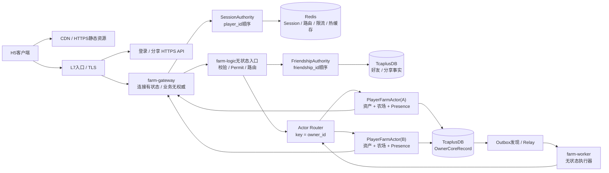
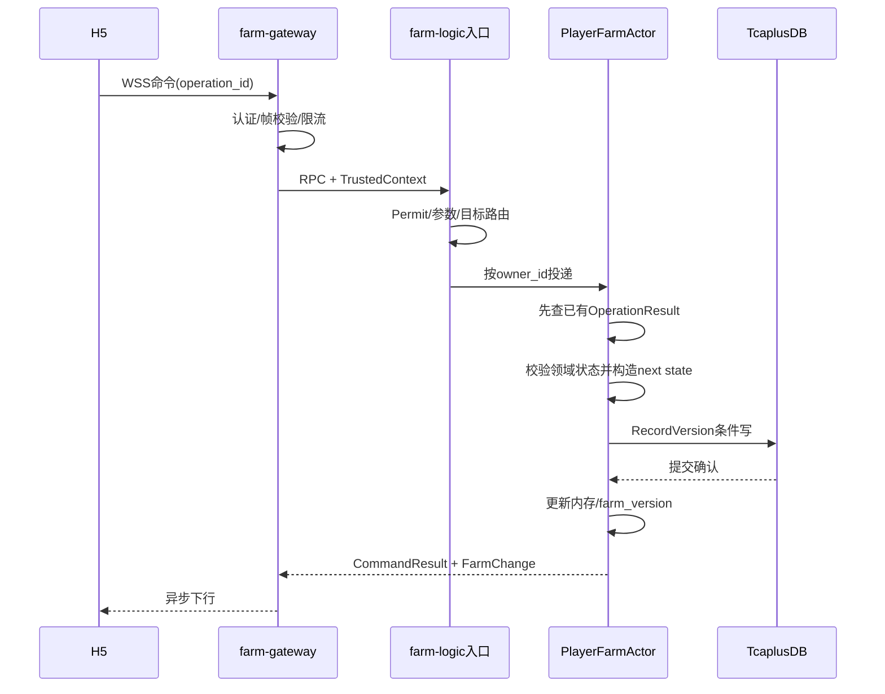
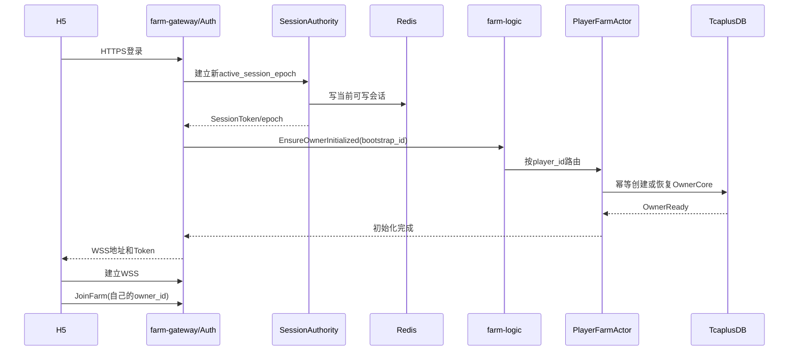
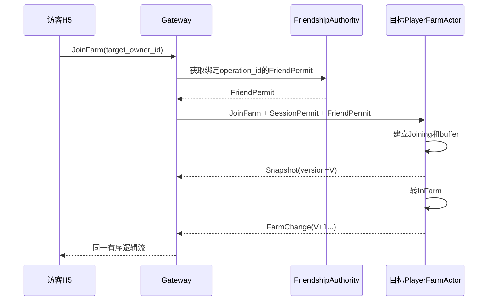
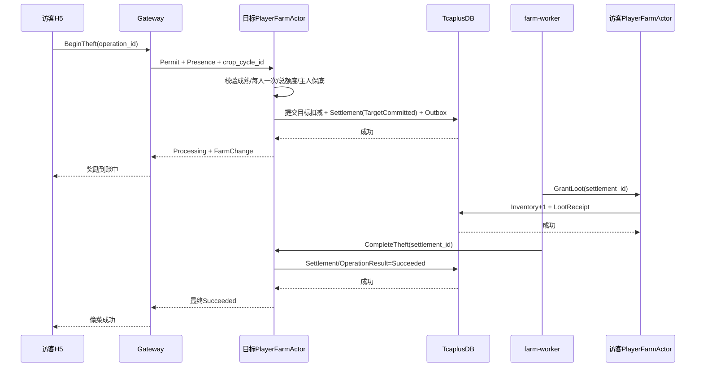

# 《经典农场小游戏》项目设计交接文档

版本：v0.1

更新时间：2026-07-25

状态：P0 总体架构交接基线。业务场景、冲突边界、Actor 边界、通信方式、进程划分和存储产品已经收敛，详细通信合同 v0.1 已形成；正式 `.proto` 字段编号、Go 接口、Actor Runtime、TcaplusDB 实际 SDK 语义和容量参数仍待详细设计或验证。

> 2026-07-26 接入层更新：真实 WSS 入口已收敛为 Linux/Docker 上的 `TCONND(BY_WS) → gateproxy → Unix gRPC GateStream → farm-gate`。本文后续出现的“farm-gateway 管 WSS/Socket”应按“farm-gate 管应用 Session/协议/背压，真实 Socket 由 TCONND 持有”理解；农场项目不新增自研公网 WSS Adapter。权威细节以 `farm-game/docs/design/07-tconnd-access-boundary.md` 为准。

> 2026-07-25 帧协议更新：不再使用 `total_size/meta_size/FrameMeta`。一个 WebSocket binary message 只承载一个 `FarmFrame{protocol_version, kind, connection_seq, body}` protobuf；权威细节以 `C:\Users\developer_026\Desktop\farm-game\docs\design\11-frame-codec.md` 为准。

适用对象：

- 新加入本项目的设计、开发或评审 Agent；
- 接手方案讨论的实习同学；
- 后续负责客户端、接入层、Actor Runtime、存储或压测的开发者；
- 需要快速理解“为什么这样设计”的答辩评审者。

本文目标是让接手者只读这一份文档，就能理解当前项目做到哪里、为什么这样设计、哪些结论不能随意推翻、下一步应该产出什么。更完整证据仍以文末链接的专项文档为准。

---

## 0. 接手者先看这里

### 0.1 当前项目阶段

当前还没有进入完整业务代码开发，处于：

```text
业务场景与产品规则
        已完成
            ↓
冲突矩阵与领域权威
        已完成
            ↓
Actor边界与存储产品
        已完成
            ↓
系统总体架构
        已完成
            ↓
协议、接口、Schema、时序详细设计
        下一阶段
            ↓
P0纵向业务实现
        尚未开始
```

已经完成的主要成果：

- 91 个业务场景；
- 56 条核心业务不变量；
- P0a/P0b 范围和三个核心 Loop；
- 冲突矩阵、业务事实拥有者和跨玩家失败语义；
- `PlayerFarmActor(owner_id)` 候选权威边界；
- TcaplusDB + Redis 存储产品决策；
- HTTPS + WSS + Protobuf 通信决策；
- P0 首帧认证、请求/结果/推送、Join、重连和内部 RPC 通信合同；
- `farm-gate + farm-logic + farm-worker` 三类业务进程，以及 TCONND/gateproxy 接入边界；
- 14 条 P0a 命令合同；
- 3000 万 DAU 第一版容量模型。

### 0.2 一句话架构

> H5 通过 HTTPS 完成登录和分享落地，通过 TCONND BY_WS/WSS 发送游戏命令并接收实时变化；TCONND/gateproxy 管公网连接和传输事件，`farm-gate` 通过 GateStream 管应用 Session、协议和下行背压但不拥有业务事实，`farm-logic` 按 `owner_id` 路由到 `PlayerFarmActor` 串行裁决玩家资产和私有农场，成功写入 TcaplusDB 后才返回成功和广播；Redis 只保存可重建会话、路由和限流状态，`farm-worker` 依靠持久 Settlement/Outbox 推进偷菜等跨 Owner 流程。

### 0.3 当前冻结的五项总体选型

| 分类 | 当前 P0 结论 |
|---|---|
| 前后台通信 | 静态资源走 HTTPS/CDN；登录、分享落地走 HTTPS API；登录后的业务命令、快照和实时变化走 WSS |
| 模块与进程 | 三类业务进程：`farm-gate`、`farm-logic`、`farm-worker`；接入基础设施另含 TCONND 与 gateproxy；领域能力先作为进程内模块，不按名词拆微服务 |
| 接入层 | TCONND/gateproxy 拥有传输连接状态；`farm-gate` 业务无权威，负责应用鉴权、Session、协议、限流、路由、背压和下行 |
| 存储 | TcaplusDB 是唯一权威业务主库；Redis 保存可重建短期状态；MongoDB 只作为回退，Memcached 不进入 P0 |
| 有状态/无状态 | 混合架构：Gateway 连接有状态，PlayerFarmActor 业务执行有状态，Worker/业务入口无状态，TcaplusDB 持久权威，Redis 短期有状态 |

### 0.4 接手者不得默认改变的结论

没有新的业务需求、压测证据或平台约束时，不应默认：

- 把旧项目 zonesvr、gatesvr 代码直接复制到新农场项目；
- 将 Plot、Wallet、Inventory、Task 分别拆成独立 Actor 或微服务；
- 用 Redis 保存唯一一份金币、仓库、地块、幂等结果或偷菜结算；
- 在 TcaplusDB 确认提交之前返回 `Succeeded`；
- 把成熟实现为每个作物一个持久 Timer；
- 让 Lobby/Presence 决定作物、可偷额度或资产结果；
- P0 直接拆独立 LobbyActor；
- 为一次偷菜建立跨两个玩家的数据库大事务；
- 因为客户端没收到响应就生成新的 `operation_id` 再执行。

---

## 1. 业务背景和 P0 边界

### 1.1 题目要求

题目是一个经典农场 H5 小游戏后台，基础要求包括：

- 账号与登录；
- 种植循环；
- 商店和仓库；
- 好友玩法；
- 多人同一农场实时同步；
- 基础任务；
- 宠物、图鉴、邮件等基础系统；
- 按 3000 万 DAU 做架构设计、容量估算、瓶颈分析和压测验证；
- 弱网体验与平滑更新为加分项；
- 前端只用于展示后端能力。

### 1.2 三个核心 Loop

#### 个人成长 Loop

```text
购买种子
→ 播种
→ 等待
→ 按权威时间成熟
→ 收获
→ 获得作物和经验
→ 出售或继续经营
```

#### 经济 Loop

```text
金币
→ 购买种子
→ 土地生产
→ 作物入库
→ 出售
→ 金币
```

该 Loop 的后台重点是：

- 金币和库存不能为负；
- 扣款与入库共同成功；
- 扣物与加钱共同成功；
- 重试不重复扣款或发货；
- 配置切换时一次交易只使用一个规则版本。

#### 社交 Loop

```text
分享建立好友
→ 进入好友农场
→ 查看成熟作物
→ 浇水或偷菜
→ 多人看到同一地块变化
→ 访客奖励到账
→ 回到自己的经营循环
```

这是最能体现后端价值的 Loop，因为它同时包含权限、同场同步、热点、单农场顺序和跨玩家可靠结算。

### 1.3 P0a 和 P0b

P0a 是先实现的核心小雏形：

1. 登录与首次建档；
2. 自己农场的购买、播种、成熟、收获、出售；
3. 分享链接建立好友；
4. 进入自己或好友农场；
5. 多人同场地块同步；
6. 好友浇水；
7. 好友偷成熟作物；
8. 断线后重新登录、查询结果和重新 Join。

P0b 补齐题面基础系统：

- 基础任务和奖励；
- 邮件和附件领取；
- 宠物守护；
- 图鉴；
- 除草、除虫等经典互动。

后置加分项：

- 更完整的弱网 ACK/重放；
- 重连风暴治理；
- 平滑更新与连接 Handoff；
- 更复杂容量、排行榜、活动和运营系统。

### 1.4 已冻结的关键产品规则

- 每位玩家拥有一个私有农场；
- 好友不能播种、正常收获、出售或消耗农场主资产；
- P0 好友主要可以查看、浇水和偷菜；
- 作物未成熟不能偷；
- 一茬默认产量 10，最大总可偷量 3，主人至少保留 7；
- 每名好友对每茬作物最多一次消耗型偷菜结算；
- 普通资格拒绝不消耗机会；
- 宠物拦截时消耗本茬机会，但不减少目标产量、不扣访客金币；
- P0 仓库容量视为无限或足够大；
- 同一农场最多 8 名可操作成员，包括农场主；
- 不排队、不提供只读围观；
- 同一玩家只允许一个活跃可写会话；
- 没有人物移动、聊天、战斗、物理 Tick；
- 成熟状态由 `mature_at` 和服务器时间派生，不依赖 Timer 改写。

---

## 2. 架构设计原则

### 2.1 权威事实只有一个拥有者

任何会影响资产、地块或权限的事实都必须回答“谁说了算”。

| 事实 | 权威者 |
|---|---|
| 金币、仓库、经验 | 玩家自己的 `PlayerFarmActor` |
| 私有农场、地块、作物周期 | 农场主的 `PlayerFarmActor` |
| 可偷总量、已偷总量 | 目标农场主的 `PlayerFarmActor` |
| 访客偷菜奖励到账 | 访客自己的 `PlayerFarmActor` |
| 好友关系和关系代次 | FriendshipAuthority + TcaplusDB |
| 当前可写会话和会话代次 | SessionAuthority + Redis |
| 底层 socket、传输连接和 TCONND 心跳 | TCONND / gateproxy |
| 应用连接索引、Session 和有界下行队列 | `farm-gate` |
| 在场成员和订阅 | 目标 `PlayerFarmActor` 内的 `FarmPresenceState` |

客户端、Gateway、Redis 缓存、广播消息和查询投影都不能反向裁决权威结果。

### 2.2 路由键必须对齐冲突键

如果两个请求会修改同一份权威事实，它们必须进入同一个串行裁决范围。

例如：

```text
两个好友同时偷A的作物
→ 都按 target_owner_id=A 路由
→ 都进入 PlayerFarmActor(A)
→ Actor邮箱决定唯一先后
```

这就是“路由键对齐冲突键”。它既用于有状态路由，也用于保证业务冲突不会被不同节点分别裁决。

### 2.3 同一 Owner 内串行，不同 Owner 间并行

```text
PlayerFarmActor(A)
  顺序处理A的资产和农场命令

PlayerFarmActor(B)
  可以同时处理B的命令
```

单 Actor 顺序只解决单 Owner 内执行顺序，不自动解决：

- 数据库提交；
- 跨 Actor 原子事务；
- 消息可靠投递；
- 幂等；
- 双活和迁移；
- Redis 或 TcaplusDB 故障。

### 2.4 提交成功后才能更新内存和广播

所有持久业务写遵循：

```text
读取当前Actor状态
→ 验证业务条件
→ 构造next state
→ TcaplusDB条件提交
→ 提交确认
→ 替换Actor内存
→ 返回结果
→ 广播和推进Outbox
```

如果条件提交失败或结果未知：

- 不替换内存；
- 不广播成功；
- 不返回 `Succeeded`；
- 使用相同 `operation_id` 查询或恢复。

### 2.5 广播不是业务提交

```text
业务提交成功
→ farm_version推进
→ 尽力实时广播
```

广播失败不能回滚已经成立的业务事实。客户端通过版本缺口检测和重新 Join 获取最新快照收敛。

### 2.6 缓存不是权威

Redis 被清空后可以影响：

- 登录体验；
- 在线会话；
- 路由命中率；
- 限流精度；
- 热查询延迟。

但不能造成：

- 金币丢失；
- 地块回退；
- 已偷产量恢复；
- 好友关系永久错误；
- 幂等记录消失后重复发奖。

---

## 3. 系统总体架构



### 3.1 三类物理进程

P0 只建立：

```text
farm-gateway
farm-logic
farm-worker
```

原因：

- 已经存在连接、业务权威和可靠异步流程三种明显不同的生命周期；
- 三者扩缩容指标不同；
- 三者故障影响不同；
- 继续按领域对象拆微服务会增加跨进程调用和分布式事务；
- P0 仍需要较低实现复杂度和清晰演示链路。

### 3.2 为什么不是一个大进程

- Gateway 由连接数、下行带宽和发送队列决定容量；
- Logic 由 Actor 数量、邮箱、CPU、内存和 TcaplusDB P99 决定容量；
- Worker 由 Outbox 积压、重试和跨 Owner 结算吞吐决定容量；
- Gateway 滚动发布不应强制迁移全部 Owner Actor；
- Worker 积压不应阻止玩家继续进行普通经营。

### 3.3 为什么不是十几个微服务

购买、播种、收获会同时修改 Wallet、Inventory、Farm 和 Progression。若把这些按名词拆开：

```text
FarmService
WalletService
InventoryService
ProgressionService
```

一次收获立即变成四个服务之间的跨边界一致性问题。当前将它们作为 `PlayerFarmActor` 内部模块，可以在一个 Owner 权威提交中共同成功。

---

## 4. 前后台通信

### 4.1 外部通道选型

| 场景 | 通道 | 原因 |
|---|---|---|
| H5 静态资源 | HTTPS + CDN | 与游戏业务服务解耦，适合浏览器缓存和静态分发 |
| 登录和建会话 | HTTPS API | 请求响应模型简单，适合首次认证 |
| 分享链接落地 | HTTPS | 浏览器天然支持，未登录时可保存接受意图 |
| 登录后游戏命令 | WSS | 一条双向连接，减少重复握手 |
| 农场快照和实时变化 | WSS | 服务端需要主动推送 |
| 顶号、权限撤销和系统通知 | WSS | 需要主动通知当前连接 |

不采用纯 HTTP 轮询作为主通道，因为多人同场会产生大量无效轮询和更高延迟。

不采用 SSE 作为主通道，因为 SSE 只解决服务端到客户端，客户端命令仍需要第二条 HTTP 通道，增加会话和顺序解释成本。

### 4.2 消息格式

P0 使用 Protobuf 作为唯一业务 IDL：

- H5 使用生成的 TypeScript 类型或 protobufjs；
- 浏览器通过 `ArrayBuffer` 发送二进制；
- Go 服务使用生成代码；
- JSON 仅用于本地调试、日志展示和测试工具；
- 不维护一套独立 JSON 业务语义。

### 4.3 客户端命令统一信封

概念结构：

```text
ClientCommandEnvelope {
    protocol_version
    operation_id
    client_seq
    command_type
    target_owner_id

    expected_farm_version
    expected_plot_version
    expected_crop_cycle_id

    payload
}
```

字段职责：

| 字段 | 作用 |
|---|---|
| `protocol_version` | 协议演进和兼容 |
| `operation_id` | 业务幂等键；超时重试必须复用 |
| `client_seq` | 单连接观测和排错，不代替幂等 |
| `command_type` | 命令路由和解码 |
| `target_owner_id` | 决定目标 Owner/农场 |
| `expected_*` | 防止旧页面误操作新一茬或新版本 |
| `payload` | 命令业务参数 |

客户端不能提交权威价格、产量、成熟时间、权限、Permit 或最终奖励。

### 4.4 服务端可信上下文

Gateway 和 Authority 在服务端追加：

```text
TrustedCommandContext {
    player_id
    active_session_epoch
    session_permit
    friend_permit
    gateway_id
    connection_id
    trace_id
}
```

该上下文不能从客户端透传后直接信任。

### 4.5 命令结果

```text
CommandResultEnvelope {
    operation_id
    status
    error_code
    owner_state_version
    farm_version
    payload
}
```

统一状态：

| 状态 | 含义 |
|---|---|
| `Succeeded` | 权威成功合同已经提交 |
| `Processing` | 业务意图和可恢复进度已持久化，跨 Owner 流程仍在推进 |
| `NoChange` | 请求合法，但目标事实已经是所需状态 |
| `Rejected` | 权限、资源、版本或业务条件不成立 |
| `Unavailable` | 当前不能确认是否受理，必须用同一 operation_id 查询或重试 |

### 4.6 服务端推送

```text
ServerPushEnvelope {
    server_seq
    subscription_id
    actor_activation_epoch
    presence_epoch
    farm_version
    push_type
    payload
}
```

必须区分：

- `server_seq`：某条连接上的传输观测顺序；
- `farm_version`：农场公开业务变化顺序。

客户端不能用连接序号代替农场版本。

### 4.7 内部通信

内部接口冻结为：

```text
Protobuf IDL + Unary RPC
```

候选实现：

1. 新项目环境允许独立使用、具备成熟治理能力时，优先 tRPC-Go；
2. 否则使用 gRPC-Go；
3. 业务合同不得依赖旧项目 gatesvr/zonesvr 的私有协议。

主要内部调用：

| 调用方 | 被调用方 | 内容 |
|---|---|---|
| Gateway | Logic | 玩家命令、Join、Leave、结果查询 |
| Logic | SessionAuthority | 会话切换与 SessionPermit |
| Logic | FriendshipAuthority | FriendPermit、好友新增/删除 |
| Logic Router | PlayerFarmActor | 按 Owner 执行业务命令 |
| Worker | Logic/Actor Router | GrantLoot、CompleteTheft、补偿命令 |
| Logic | Gateway 下行适配器 | 命令结果、Snapshot、FarmChange |

### 4.8 一条普通命令的通信流程



Gateway 不能等待客户端真正读取完数据后才让 Actor 继续处理。

---

## 5. 关键通信流程

### 5.1 登录和首次建档



关键语义：

- `bootstrap_id` 稳定，建档重试不能创建两套初始资产；
- 新登录提升 `active_session_epoch`；
- 旧连接尽力收到踢线，但即使通知延迟，也不能继续取得新写 Permit；
- OwnerReady 前不能对用户宣称建档成功。

### 5.2 购买、播种和收获

#### 购买

```text
BuyOffer
→ 路由到buyer_id
→ 校验Offer和规则版本
→ 同一OwnerCore提交Wallet扣款 + Inventory入库 + OperationResult
→ 成功后返回
```

#### 播种

```text
PlantCrop
→ 路由到owner_id
→ 校验SessionPermit、主人身份和Presence
→ 校验种子、空地版本、规则
→ 固定本茬plant_at/mature_at/base_yield/stealable_limit/rule_version
→ 提交种子-1 + CropCycle创建 + farm_version + OperationResult
→ 广播FarmChange
```

#### 成熟

不创建作物 Timer，不写 `Growing -> Mature` 状态：

```text
phase(now):
  now < mature_at  => Growing
  now >= mature_at => Mature
```

成熟提醒可以由 Scheduler 触发，但提醒失败不改变成熟事实。

#### 收获

```text
HarvestCrop
→ 校验ActiveCrop且phase(now)=Mature
→ 计算owner_claimable
→ 同一OwnerCore提交：
   CropCycle Ended
   Plot Empty
   Inventory增加
   Experience增加
   OperationResult
   PendingOutbox
→ 提交后广播
```

### 5.3 JoinFarm 与无缺口实时同步

Join 不能采用：

```text
先普通查询Snapshot
→ 再独立订阅变化
```

否则两步之间可能漏掉地块变化。

目标 Actor 必须在同一串行 turn 中：

1. 校验 SessionPermit；
2. 好友农场再校验 FriendPermit；
3. 校验 8 人名额；
4. 创建 `Joining` Presence；
5. 建立变化缓冲；
6. 生成版本 V 的完整 Snapshot；
7. 将 Snapshot 排入该订阅的有序下行；
8. 将所有 `version > V` 的变化接在快照后；
9. Presence 转为 `InFarm`。



版本跳跃、Actor activation 变化或下行缓冲溢出时，客户端重新 Join 获取新快照，不猜测丢失内容。

### 5.4 浇水

```text
WaterCrop(target_owner_id, crop_cycle_id)
→ SessionPermit
→ 好友操作需要FriendPermit
→ 目标Actor当前InFarm Presence
→ 目标Actor校验作物和护理状态
→ 首个有效请求提交护理事实和版本
→ 后续重复请求返回NoChange和最新地块
```

Presence 只证明当前在场，不单独证明仍然是好友。

### 5.5 偷菜

偷菜跨越两个 Owner：

```text
目标农场Owner
  拥有作物、可偷额度、目标扣减和Settlement

访客Owner
  拥有自己的Inventory和LootReceipt
```

完整流程：



必须满足：

- 未成熟直接 `Rejected`，不消耗机会；
- 目标已扣减后不能回退；
- 目标已扣但访客未到账时返回 `Processing`；
- `GrantLoot` 重复投递由 `LootReceipt(settlement_id)` 吸收；
- 完整成功必须经过 TargetCommitted、LootReceipt 和 CompleteTheft；
- 不做跨两个玩家的一次数据库事务；
- 不让 Worker 内存成为唯一进度。

### 5.6 断线、超时和重连

基础 P0：

```text
WSS断开
→ 任意Gateway重新连接
→ 重新认证
→ 不确定命令用原operation_id查询
→ 重新JoinFarm
→ 获取当前权威Snapshot
```

本期不要求完整跨连接 Frame 重放，但必须保证：

- 断线不会撤销已提交事实；
- 旧连接不能继续写；
- 重试不会重复扣款或发奖；
- 客户端最终收敛到权威快照。

---

## 6. 模块划分

模块是代码和职责边界，不等于独立进程，也不等于 Actor。

### 6.1 `farm-gateway` 内部模块

| 模块 | 负责 | 不负责 |
|---|---|---|
| Transport | HTTPS/WSS、连接建立、关闭、TLS 后接入 | 农场规则 |
| Protocol | 帧解析、版本协商、Protobuf 编解码、大小限制 | 权威业务参数 |
| Authentication | Token 验证、绑定 player_id | 判断作物是否成熟 |
| Session Adapter | 会话代次、顶号、SessionPermit | 修改 OwnerCore |
| Rate Limit | IP/玩家/动作限流 | 永久封禁事实 |
| Route Adapter | 根据 target_owner_id 找 Logic/Actor | 决定业务成功 |
| Downlink | 有界发送队列、推送、慢客户端处理 | 等待客户端 ACK 才提交业务 |
| Observability | trace、连接指标、错误码和审计上下文 | 保存唯一 OperationResult |

### 6.2 `farm-logic` 无状态入口模块

| 模块 | 职责 |
|---|---|
| API Adapter | 接收内部 RPC，映射业务命令 |
| Command Validation | 类型、长度、必填字段和基础格式 |
| Session Admission | 获取/验证 SessionPermit |
| Friendship Admission | 获取/验证 FriendPermit |
| Actor Router | 按 owner_id 定位唯一 Actor |
| Query Adapter | 公开只读查询和结果查询入口 |
| Error Mapping | 领域错误到协议错误码 |

入口本身不能保存跨请求唯一业务状态。

### 6.3 `PlayerFarmActor` 内部模块

| 模块 | 权威事实 | 典型命令 |
|---|---|---|
| OwnerMeta | owner_epoch、state_version、schema_version | 所有写 |
| FarmCore | Farm、Plot、CropCycle、farm/plot version | Plant、Harvest、Water、BeginTheft |
| Economy | Wallet、Inventory、EconomyTransaction | Buy、Sell、Harvest、GrantLoot |
| Progression | 经验、等级和解锁 | Harvest、任务奖励 |
| FarmPresenceState | Joining/InFarm、名额、订阅、短期buffer | Join、Leave、Expire |
| OperationResult | 近期幂等结果 | 所有持久写、结果查询 |
| ReliableExecution | PendingOutbox、TheftSettlement、LootReceipt | BeginTheft、GrantLoot、CompleteTheft |
| TaskReward | 任务进度和奖励领取 | P0b |
| MailReceipt | 邮件已读和附件领取 | P0b |
| PetGuard | 守护宠物和拦截结果 | P0b |
| Album | 图鉴解锁和里程碑 | P0b |

### 6.4 Social 模块

Social 不放进某个玩家的 OwnerCore 作为双方关系唯一事实，避免两份关系状态冲突。

主要逻辑事实：

- Friendship；
- friendship_epoch；
- BlockRelation；
- FriendShareLink；
- ShareAcceptance；
- 好友上限；
- 分享奖励幂等事实。

`FriendshipAuthority` 按规范化 `friendship_id` 线性化：

- FriendPermit 签发；
- 删除好友；
- 拉黑；
- 关系代次推进。

不能仅由多个无状态实例读取一次 Redis 后本地判断，因为“签发 Permit”和“删除好友”可能并发。

### 6.5 Session 模块

按 `player_id` 线性化：

- 创建新 `active_session_epoch`；
- 切换当前可写农场；
- 为写操作签发 SessionPermit；
- 旧会话失效；
- Redis 全量故障后的 authority epoch 提升。

P0 暂定一个 `active_session_epoch` 同时最多拥有一个 `current_writable_farm_id`。

### 6.6 RuleConfig 模块

保存和发布：

- 作物定义；
- 成熟时长；
- 原始产量和可偷上限；
- 商店 Offer 和价格；
- 等级和解锁规则；
- 宠物拦截策略；
- 任务、奖励和邮件定义。

创建 CropCycle 时冻结关键参数：

```text
crop_definition_id
rule_version
plant_at
mature_at
base_yield
stealable_limit
mutation_seed/result
```

后续配置变更只影响新种下的作物。

### 6.7 `farm-worker` 模块

| 模块 | 职责 |
|---|---|
| Outbox Relay | 发现 OwnerCore 中待处理事件 |
| Theft Driver | 推进 GrantLoot 和 CompleteTheft |
| Retry Scheduler | 按 next_retry_at 重试未完成流程 |
| Projection Worker | 更新好友摘要、互动记录等可重建视图 |
| Task/Album Consumer | 消费已成立业务事实，幂等推进 P0b |
| Notification Worker | 成熟提醒、邮件和尽力通知 |
| Archive Worker | 将终态 Result/Settlement 移出热窗口 |

Worker 自身无权威状态。进程崩溃后必须从 TcaplusDB 中恢复。

---

## 7. Actor 边界和运行模型

### 7.1 为什么是 `PlayerFarmActor(owner_id)`

一个玩家的高频业务经常同时修改：

```text
玩家资产 + 该玩家唯一私有农场
```

例如：

- 播种：Inventory 种子 + Farm Plot；
- 收获：Farm CropCycle + Inventory + Experience；
- 购买：Wallet + Inventory；
- 偷菜到账：Inventory + LootReceipt。

合并后可以在一个 Owner 权威提交中完成，不需要 PlayerActor 和 FarmActor 之间频繁协调。

### 7.2 为什么不做 PlotActor

- 地块数量有限；
- 多个操作还会争用 Inventory、FarmVersion、偷菜总额度；
- 拆 PlotActor 不能消除共享资产冲突；
- 会增加广播顺序和聚合快照复杂度。

Plot 和 CropCycle 保留为 FarmCore 内的实体。

### 7.3 `FarmPresenceState` 是什么

它是 Actor 内的临时运行态，不是长期领域实体：

```text
FarmPresenceState {
    actor_activation_epoch
    presence_epoch
    members[<=8]
    Joining/InFarm
    gateway_id
    connection_id
    subscription_id
    lease_deadline
    joining_change_buffer
}
```

它可以丢失。Actor 重启后玩家重新 Join。

它不保存：

- socket；
- WebSocket 心跳；
- 真正的网络发送队列；
- 金币、仓库和地块副本；
- 好友关系权威；
- 全局好友在线列表。

### 7.4 为什么 P0 不拆 LobbyActor

当前同场最多 8 人，并且：

- 没有人物移动；
- 没有聊天；
- 没有 Tick；
- 没有只读围观；
- 心跳只到 Gateway；
- Actor 只接收低频 Join/Leave/Expire。

将 Presence 留在目标 Actor 内，可以天然保证：

- Join 名额和快照在同一顺序中；
- Snapshot V 和 V 后变化无缺口；
- Leave 与写操作有明确先后；
- 浇水、偷菜和 Presence 在一个 Actor turn 中形成完整准入。

现在拆独立 PresenceActor 会增加跨 Actor Join、权限和订阅协调，性能未必更好。

### 7.5 未来何时拆 Presence

出现以下证据时再考虑 `FarmPresenceActor(farm_id)`：

- 同场人数显著超过 8；
- 增加大量只读围观者；
- 增加聊天、人物或高频互动；
- Join/Leave 占据 FarmActor 邮箱主要部分；
- 广播订阅内存成为 Actor 主要成本；
- 热门农场明显拖慢农场主经营命令。

拆分后 Lobby/Presence 仍只能做订阅和传播，不能裁决作物或资产。还必须补充 `SubscribeFrom(V+1)` 或等价 Joining barrier，保证快照之后不漏变化。

### 7.6 Actor 生命周期

激活：

```text
请求到达
→ Router确定节点
→ 获取owner_epoch
→ 从TcaplusDB加载OwnerCore
→ 建立邮箱和热状态
```

钝化条件：

- 邮箱为空；
- 没有活跃 Presence；
- 没有必须驻留内存的未完成 turn；
- 热状态已与权威提交一致；
- 未完成 Settlement/Outbox 已持久化；
- 钝化不会丢失唯一流程进度。

成熟时间不会让 Actor 常驻。

### 7.7 Actor Runtime 必须提供或实现

- 同 key 串行邮箱；
- 不同 key 并行；
- 有界邮箱和过载策略；
- owner_id 到节点/虚拟分片路由；
- 单 Owner 唯一激活或等价 fencing；
- `owner_epoch` 迁移保护；
- 激活、钝化和崩溃恢复；
- 单 Actor 慢 I/O 不阻塞同分片其他 Actor；
- 不可重入或严格限定的重入；
- 指标、追踪和邮箱深度观测；
- 滚动发布和旧 Actor 写入拒绝。

当前 Runtime 尚未最终确定：

1. 优先确认是否有可独立接入的新项目通用 Actor Runtime；
2. 不满足要求时，在新 `farm-logic` 内实现最小 keyed executor + virtual shard；
3. 不复制旧项目 zonesvr。

---

## 8. 接入层详细设计

### 8.1 `farm-gateway` 应负责

- HTTPS/WSS 接入；
- WebSocket Upgrade；
- 连接生命周期；
- 心跳、空闲超时和断线；
- Token 认证和连接绑定；
- 协议版本、帧大小和消息类型校验；
- 单 IP、单玩家、单动作限流；
- SessionPermit 适配；
- FriendPermit 适配；
- `target_owner_id` 路由；
- 有界下行发送队列；
- Snapshot/FarmChange 的订阅级保序；
- 慢客户端断开和重新 Join；
- trace、错误码、连接指标和安全审计。

### 8.2 `farm-gateway` 不应负责

- 判断成熟；
- 决定偷菜是否成功；
- 扣金币或发道具；
- 保存地块权威副本；
- 使用 Redis 缓存裁决好友权限；
- 修改 OwnerCore；
- 在 socket 发送完成前阻塞 Actor；
- 仅因连接在线就认定用户有业务权限。

### 8.3 为什么 Gateway 是连接有状态、业务无权威

WebSocket 一旦建立，天然固定在一个 Gateway：

```text
socket
heartbeat
send queue
connection binding
```

这些是连接本地状态。

但 Gateway 重启后：

- 客户端可以重连任意实例；
- 已提交业务结果不丢失；
- 农场状态从 TcaplusDB/Actor 恢复；
- Presence 重新 Join；
- 不确定操作按 operation_id 查询。

因此 Gateway 不是纯无状态 HTTP 服务，也不是业务有状态服务。

### 8.4 下行背压

必须有三层边界：

1. Actor 到逻辑下行适配器的有界队列；
2. Logic 到 Gateway 的有界通道；
3. Gateway 每连接的有界发送队列。

慢客户端策略：

```text
队列达到阈值
→ 不阻塞FarmActor
→ 断开该连接
→ 客户端重连并重新Join
```

不允许一个弱网客户端拖住整个农场 Actor。

### 8.5 输入安全

Gateway 至少校验：

- 帧大小；
- Protobuf 解码；
- 协议版本；
- operation_id 格式；
- target_owner_id 基础合法性；
- 命令频率；
- payload 数量上限；
- 非法消息类型；
- 重复/乱序连接控制帧。

领域规则仍由目标 Actor 校验，不能因为 Gateway 已校验就省略。

### 8.6 顶号

严格基线：

```text
旧操作先取得SessionPermit
→ 该在途操作可以继续进入目标Actor

新登录先提升active_session_epoch
→ 旧epoch不能再取得新Permit
```

踢线通知是体验，不是安全边界。

Redis 全量丢失时：

1. 暂停签发写 Permit；
2. 提升全局 `session_authority_epoch`；
3. Gateway/Actor 只接受新 authority epoch；
4. 旧 SessionPermit 整体失效；
5. 玩家重新登录。

不能将 `active_session_epoch` 重置为 1 后立即开放写入。

---

## 9. 存储设计

### 9.1 产品选择

P0：

```text
TcaplusDB
  唯一权威业务存储

Redis
  Session / 路由 / 限流 / 可重建缓存

MongoDB
  TcaplusDB关键能力或压测失败时的回退

Memcached
  不引入
```

选择 TcaplusDB 的原因：

- 与腾讯游戏基础设施背景更贴合；
- Key-Value/Generic Record 适合按 owner_id 访问；
- 支持 RecordVersion/CAS 类条件更新；
- 单 Owner 聚合与 PlayerFarmActor 边界一致。

代价：

- 公开能力不提供当前设计所需的跨记录事务；
- 因此必须采用单条 OwnerCore；
- 大记录写放大、P99 和故障确认语义必须实测。

### 9.2 `OwnerCoreRecord`

概念结构：

```text
OwnerCoreRecord {
    owner_id
    owner_epoch
    state_version
    schema_version

    player_profile
    progression

    wallet
    inventory

    farm {
        farm_id
        farm_version
        plots[]
        crop_cycles[]
    }

    task_state
    mail_receipts
    pet_state
    album_state

    recent_operation_results[]
    pending_outbox[]
    active_theft_settlements[]
    recent_loot_receipts[]
}
```

逻辑模块化不意味着拆成多个权威记录。近期 Result、PendingOutbox、活跃 Settlement 和 LootReceipt 必须与业务状态在同一 OwnerCore 条件写中共同提交。

### 9.3 TcaplusDB 逻辑表

| 表 | Key | 内容 |
|---|---|---|
| `owner_core` | owner_id | 玩家资产、农场和 Owner 内可靠执行状态 |
| `account_bootstrap` | 平台身份/玩家键 | 账号映射和首次建档状态 |
| `friendship` | 规范化好友对 | 关系、friendship_epoch、拉黑状态 |
| `share_link` | share_token_hash | 邀请者、有效期和规则 |
| `share_acceptance` | 分享者+接受者/稳定接受键 | 防重复接受和发奖 |
| `operation_archive` | owner+时间分桶 | 移出热窗口的终态结果 |
| `interaction_archive` | owner/时间分桶 | 互动和审计投影 |
| 配置/定义表 | definition_id/version | 作物、商品、任务、邮件等定义 |

表名最终可以调整，事实边界不能改变。

### 9.4 Redis 保存什么

| 类别 | 示例 | 丢失后 |
|---|---|---|
| Session | active_session_epoch、gateway binding、current writable farm、lease | 提升 authority epoch，强制重登 |
| 路由提示 | owner -> virtual shard/node | 重新定位 |
| 限流 | IP/player/action token bucket | 使用保守默认并重建 |
| 热结果缓存 | 近期 OperationResult 查询结果 | 回源 TcaplusDB |
| 只读视图 | 好友摘要、公开农场摘要 | 回源或异步重建 |
| 重连状态 | reconnect token、连接元数据 | 完整登录和重新 Join |

### 9.5 Redis 绝对不能只保存什么

- Wallet；
- Inventory；
- Farm/Plot/CropCycle；
- Friendship；
- TheftSettlement；
- PendingOutbox；
- operation_id 防重事实；
- 唯一奖励领取事实；
- 唯一任务进度。

### 9.6 OwnerCore 提交

目标语义：

```text
expected RecordVersion
+ expected owner_epoch/state_version
→ 条件更新单条OwnerCore
```

只有写成功确认满足“不因切主而回退”的持久语义后才能返回 `Succeeded`。

当前必须向内部平台确认：

- 实际 SDK/API 版本；
- RecordVersion 和条件过滤组合方式；
- 写成功对应内存、磁盘和副本的哪一层确认；
- master 切换后已确认写是否可能回退；
- 权威读是否能够避免旧副本；
- 字段更新的实际网络、WCU 和磁盘写放大；
- 16/32/64/128 KB 热记录的 P95/P99；
- PB/TDR Schema 滚动兼容规范。

### 9.7 热窗口和归档

OwnerCore 内不能无限保存历史：

- `recent_operation_results` 有时间和数量窗口；
- 终态 Settlement 归档；
- 已完成 Outbox 清理；
- LootReceipt 保留足够防重窗口后归档或压缩；
- 未完成 Processing/Settlement/Outbox 不能按普通 TTL 删除；
- 过期 operation_id 仍需有业务唯一事实或墓碑防止重新执行。

### 9.8 Outbox 发现

错误方式：

```text
OwnerCore提交成功
→ 只向Redis List写任务
→ Redis写失败
→ 永久没有Worker恢复
```

当前设计：

1. PendingOutbox 内容和状态保存在 OwnerCore；
2. Actor 提交后尽力通知 Relay；
3. 可用时使用 TcaplusDB 数据订阅/变更流；
4. 使用 `has_pending_outbox + next_retry_at` 可重建索引或扫描兜底；
5. Actor 激活时检查未完成 Outbox；
6. Worker 重复投递由目标 Owner 的幂等事实吸收。

索引和消息只负责发现，不是权威进度。

---

## 10. 有状态和无状态

### 10.1 总表

| 组件 | 分类 | 状态 | 为什么这样分 |
|---|---|---|---|
| CDN/L7 | 无业务状态 | 静态路由、证书配置 | 任意实例可替换 |
| `farm-gateway` | 连接有状态、业务无权威 | socket、心跳、发送队列 | WebSocket 天然绑定实例，但业务必须可恢复 |
| Logic API | 无状态 | 当前请求上下文 | 方便水平扩容和重试 |
| SessionAuthority | 短期有状态权威 | 会话代次、当前可写农场、Permit顺序 | 顶号和旧会话必须有唯一顺序 |
| FriendshipAuthority | 持久关系权威 | 好友关系代次、删除与Permit顺序 | 避免删除和授权竞态 |
| `PlayerFarmActor` | 有状态执行单元 | Owner热状态、邮箱 | 同Owner串行、不同Owner并行 |
| `FarmPresenceState` | 可丢失临时状态 | 在场成员、订阅、Joining buffer | 与Join/写顺序相关，但断线可重建 |
| `farm-worker` | 无状态执行器 | 当前任务局部变量 | 进度在Settlement/Outbox |
| TcaplusDB | 持久业务权威 | Owner、关系、分享、结果和结算 | 业务成功事实必须长期保留 |
| Redis | 可重建短期状态 | Session、路由、限流和热缓存 | 高访问频率，允许失效重建 |
| H5 | 非权威本地状态 | UI、最近Snapshot、未确认operation_id | 最终以服务端为准 |

### 10.2 “有状态”不是一个统一答案

错误提问：

```text
这个系统到底是有状态还是无状态？
```

正确提问：

```text
这份状态属于谁？
生命周期多长？
是否可以丢？
谁裁决？
怎样恢复？
怎样扩容？
```

本项目采用混合架构，是因为连接、业务资产、Presence、缓存和可靠流程具有完全不同的生命周期与恢复要求。

---

## 11. 权限、幂等和一致性

### 11.1 三层写准入

好友农场写操作需要：

```text
SessionPermit
+ 必要的FriendPermit
+ 目标Actor当前Presence
+ 当前领域状态
```

四项在目标 Actor 的同一个 turn 中共同形成 `InteractionAdmission`。

### 11.2 SessionPermit

绑定：

- operation_id；
- player_id；
- active_session_epoch；
- current_writable_farm_id；
- allowed_action；
- expires_at；
- session_authority_epoch；
- integrity_proof。

用于防止顶号后旧 Gateway 继续发起新写。

### 11.3 FriendPermit

绑定：

- operation_id；
- visitor_id；
- target_owner_id；
- friendship_id；
- friendship_epoch；
- allowed_action；
- expires_at；
- integrity_proof。

好友删除和 Permit 签发按同一 `friendship_id` 顺序处理：

- 删除先成立：不再签发新 Permit；
- Permit 先签发：该在途操作有资格继续进入目标 Actor；
- 进入 Actor 后仍需校验 Presence 和当前作物事实。

### 11.4 幂等顺序

相同 operation_id 到达事实 Owner 后：

```text
先查询已有OperationResult/TheftSettlement
→ 存在则认证结果归属并返回
→ 不重新执行
→ 不要求旧Permit仍有效

不存在
→ 才校验当前Permit、Presence和领域状态
→ 创建新意图
```

否则用户顶号、离场或删除好友后，可能无法查询已经成立的旧结果。

### 11.5 FarmVersion

- 每个被接受的公开农场变化获得单调递增 `farm_version`；
- 版本表示公开观察顺序，不表示所有不同地块命令互斥；
- 两个不争用地块、资产、道具或额度的操作都可以成功；
- 即使底层 Actor 串行执行，业务上仍可表达“两者都成功”；
- 客户端重复收到变化时按版本幂等应用；
- 发现缺口时重新获取快照。

---

## 12. P0a 命令目录

| 命令 | 路由键 | 主要用途 |
|---|---|---|
| `EnsureOwnerInitialized` | player_id | 首次建档和恢复 |
| `BuyOffer` | buyer_id | 扣金币、道具入库 |
| `SellItem` | seller_id | 扣物、加金币 |
| `PlantCrop` | owner_id | 播种 |
| `HarvestCrop` | owner_id | 正常收获 |
| `JoinFarm` | target_owner_id | 建立Presence和无缺口Snapshot |
| `LeaveFarm` | target_owner_id | 释放Presence |
| `ExpirePresence` | target_owner_id | 可信内部租约清理 |
| `WaterCrop` | target_owner_id | 好友/主人护理 |
| `BeginTheft` | target_owner_id | 目标扣减和创建Settlement |
| `GrantLoot` | visitor_id | 访客仓库幂等到账 |
| `CompleteTheft` | target_owner_id | 闭合目标Settlement |
| `GetFarmSnapshot` | target_owner_id | 普通只读快照 |
| `GetOperationResult` | 结果所在Owner | 查询不确定操作结果 |

控制流注意：

- WebSocket heartbeat 不进入 Actor；
- Worker/GM/Bootstrap 使用可信内部身份；
- Join 的 Snapshot 不能被普通 `GetFarmSnapshot` 替代；
- Actor 不等待 MQ Broker 或客户端网络发送。

---

## 13. 失败语义和稳定性

### 13.1 数据库提交结果未知

```text
请求超时
≠ 业务失败
```

处理：

- 用相同 operation_id 查询；
- 查到原结果直接返回；
- 无法证明已受理时返回 `Unavailable`；
- 已持久化可恢复进度时才返回 `Processing`；
- 禁止生成新 operation_id 重新扣款或发奖。

### 13.2 Redis 故障

- 默认 fail-closed，暂停新写 Permit；
- 全量故障提升 session authority epoch；
- 旧 Permit 失效；
- 玩家重新登录；
- Owner 业务事实不变；
- 热缓存和路由重新构建。

### 13.3 TcaplusDB 变慢

- Actor 邮箱有上限；
- Gateway 对同玩家/同农场背压；
- 只读视图可降级；
- 资产写不能假成功；
- Worker 可以积压；
- Outbox/Settlement 保持持久；
- 超时后通过 operation_id 恢复。

### 13.4 Worker 崩溃

- 不回滚 TargetCommitted；
- 重启后重新发现 PendingOutbox；
- GrantLoot 重复执行由 LootReceipt 防重；
- CompleteTheft 重复执行返回原结果；
- 监控 Outbox lag 和最长 Processing 时间。

### 13.5 Gateway 崩溃

- socket 丢失；
- Actor 内旧 Presence 最终由租约/activation 清理；
- 客户端重新连接任意 Gateway；
- 重新 Join；
- 业务事实不丢失。

### 13.6 Actor 双活

必须由：

```text
唯一所有权
+ owner_epoch
+ RecordVersion/state_version条件写
```

共同防护。

旧 Actor 即使仍在运行，条件写也必须 100% 失败。

### 13.7 广播失败

```text
业务提交成功
FarmChange发送失败
```

用户下一次 Join 获取新 Snapshot。不能为了广播失败回滚业务。

---

## 14. 扩容和容量关注点

### 14.1 容量基线

题面给出 3000 万 DAU。当前推演使用显式假设得到：

- 基线/压力 PCU：约 125 万/250 万；
- JoinFarm 容量设计：约 3 万 QPS；
- 农场地块写：约 3.67 万 QPS；
- 核心写：约 4.33 万 QPS；
- 严格 Permit 模式下 SessionPermit/FriendPermit 最坏量级约 7.33 万/4.67 万 QPS。

这些是压测输入，不是真实生产数据。

### 14.2 Gateway 扩容

按：

- 活跃连接数；
- 每连接内存；
- 上下行带宽；
- 心跳；
- 发送队列；
- TLS/协议 CPU；
- 重连风暴。

水平扩容。连接建立后自然绑定当前 Gateway，重连可以进入任意实例。

### 14.3 Logic 扩容

按：

- 活跃 Actor 数；
- Actor 热状态内存；
- 邮箱深度；
- turn 时间；
- TcaplusDB P99；
- 单 Farm 热点；
- virtual shard 分布。

水平扩容。路由提示可在 Redis，但所有权和 fencing 不能依赖 Redis 提示。

### 14.4 Worker 扩容

按：

- PendingOutbox 数量；
- TheftSettlement Processing 数量；
- 重试率；
- 下游 Actor/TcaplusDB 吞吐；
- 最大处理延迟。

多个 Worker 可以重复发现任务，最终由幂等事实吸收。

### 14.5 热点

P0 同场最多 8 人，因此单 Farm 广播扇出最多 7。

仍需单独测试：

- 多人同时偷最后份额；
- 同一热门 Farm 高频 Join/Leave；
- 同一 Owner 连续购买/播种；
- TcaplusDB 热 Key；
- Redis 会话热点；
- 大规模重连；
- Worker 积压恢复。

### 14.6 TcaplusDB 写放大

若 4.33 万/s 核心写都覆盖 30 KB OwnerCore：

```text
约1.3 GB/s原始业务载荷
```

尚未包含副本、日志和存储引擎放大。因此必须测：

- 16 KB；
- 32 KB；
- 64 KB；
- 128 KB；
- 均匀 Owner；
- 单热 Owner；
- 正常、超时、切主和重试。

---

## 15. 推荐代码仓库结构

以下是下一阶段候选，不代表代码已经存在：

```text
cmd/
  farm-gateway/
  farm-logic/
  farm-worker/

api/
  proto/
    common/
    session/
    farm/
    economy/
    social/
    realtime/
    settlement/

internal/
  gateway/
    transport/
    protocol/
    auth/
    session/
    ratelimit/
    route/
    downlink/

  logic/
    api/
    router/
    actor/
      runtime/
      playerfarm/
        ownermeta/
        farmcore/
        economy/
        progression/
        presence/
        reliable/
    social/
    config/

  worker/
    outbox/
    theft/
    retry/
    projection/
    notification/
    archive/

  storage/
    tcaplus/
    redis/

  observability/
  testkit/

configs/
deploy/
docs/
```

设计约束：

- Domain 模块不能直接依赖 Gateway；
- Actor 通过 Store 接口提交，不在领域代码散落 SDK 调用；
- Redis 和 TcaplusDB Adapter 分开；
- Worker 通过可信命令进入相同 Actor 路由；
- Protobuf 合同独立于旧项目协议；
- 测试可以替换 Store、Clock、RuleConfig 和 Downlink。

---

## 16. 推荐实现顺序

### 阶段一：详细设计

1. Protobuf 包和消息目录；
2. 统一错误码；
3. Gateway/Logic/Worker 接口清单；
4. OwnerCore PB Schema；
5. 单条 OwnerCore 大小预算；
6. Redis Key/TTL/故障表；
7. 登录、Plant、Join、Theft 时序图；
8. Actor Runtime 和 TcaplusDB 最小验证程序。

### 阶段二：垂直技术骨架

```text
HTTPS登录
→ WSS连接
→ Gateway到Logic RPC
→ owner_id路由
→ 激活空PlayerFarmActor
→ TcaplusDB读写
→ Redis Session
→ Join空农场Snapshot
```

### 阶段三：P0a-1 个人经营

```text
购买
→ 播种
→ 时间派生成熟
→ 收获
→ 出售
```

### 阶段四：P0a-2 社交访问

```text
分享
→ 建好友
→ 好友列表
→ Join好友农场
→ Leave和权限撤销
```

### 阶段五：P0a-3 多人互动

```text
Snapshot无缺口
→ FarmChange
→ 浇水
→ 多客户端版本同步
```

### 阶段六：跨 Owner 可靠偷菜

```text
BeginTheft
→ TargetCommitted
→ PendingOutbox
→ GrantLoot
→ LootReceipt
→ CompleteTheft
→ 结果查询和崩溃恢复
```

### 阶段七：P0b 和加分项

- 任务、邮件、宠物、图鉴；
- 弱网 ACK/重放；
- 平滑更新；
- 故障注入；
- 3000 万 DAU 模型压测。

---

## 17. 进入正式业务代码前的 Go/No-Go

### 17.1 Actor Runtime

- 相同 owner_id 是否严格串行；
- 不同 Owner 是否并行；
- 是否可能双激活；
- owner_epoch fencing 是否有效；
- 单 Actor 慢 I/O 是否阻塞同 shard；
- 邮箱是否有界；
- 崩溃、钝化、迁移和滚动发布是否可恢复。

### 17.2 TcaplusDB

- RecordVersion/条件更新；
- 写成功持久确认点；
- 权威读取一致性；
- 切主后已成功写不回退；
- OwnerCore 大小和写放大；
- 未知提交恢复；
- PB/TDR Schema 演进。

### 17.3 Redis/Session

- 顶号与 Permit 并发；
- authority epoch 灾难切换；
- Redis 全量丢失；
- 路由缓存过期；
- 限流降级；
- 会话重建。

### 17.4 实时同步

- Snapshot V 与 V 后变化无缺口；
- 重复 FarmChange 幂等；
- 下行队列满时不阻塞 Actor；
- Gateway 崩溃后重新 Join；
- 8 人名额与并发 Join；
- 权限撤销和在途操作顺序。

### 17.5 跨 Owner 结算

- TargetCommitted 后 Worker 崩溃；
- GrantLoot 重复投递；
- 访客到账后 CompleteTheft 失败；
- Processing 长期恢复；
- Outbox 通知丢失；
- 结果查询能找到正确目标 Owner。

---

## 18. 已冻结、待验证和未来演进

| 项目 | 分类 | 当前结论 |
|---|---|---|
| HTTPS + WSS | 已冻结 | 外部通信基线 |
| Protobuf | 已冻结 | 唯一业务 IDL |
| 三进程 | 已冻结 | Gateway/Logic/Worker |
| PlayerFarmActor | 已冻结为 P0 候选边界 | Player资产与唯一私有Farm合并 |
| FarmPresenceState 共置 | P0 已冻结 | 暂不拆 LobbyActor |
| TcaplusDB + Redis | 产品选择已冻结 | Tcap权威，Redis可重建短期状态 |
| 单条 OwnerCore | P0 主路线 | 必须通过 SDK 与容量验证 |
| tRPC-Go | 待环境确认 | 不可用则 gRPC-Go |
| Actor Runtime | 待选择 | 通用 Runtime 或最小 keyed executor |
| Outbox 发现 | 待平台确认 | 数据订阅 + 索引/扫描兜底 |
| Protobuf 字段 | 待详细设计 | 下一阶段 |
| Redis Key/TTL | 待详细设计 | 下一阶段 |
| 独立 PresenceActor | 未来演进 | 只有热点/规模证据后考虑 |
| MongoDB | 回退 | Tcap关键门槛失败时评审 |
| 完整弱网重放 | 后置加分项 | 基础重连先靠快照收敛 |

---

## 19. 接手 Agent 的工作规则

### 19.1 设计变更规则

如果需要改变已冻结结论，必须写明：

1. 新需求或新证据是什么；
2. 当前方案为什么无法满足；
3. 影响哪些业务不变量；
4. 新方案增加什么复杂度；
5. 如何迁移；
6. 如何验证；
7. 需要同步修改哪些文档。

不能因为“某框架更流行”或“看起来更像大型游戏服”直接改变边界。

### 19.2 文档优先级

出现冲突时按问题类型查：

| 问题 | 权威文档 |
|---|---|
| 产品规则和场景 | `classic-farm-domain-model.md`、`classic-farm-product-decisions.md` |
| 成功、失败和并发结果 | `classic-farm-p0-acceptance-matrix.md`、`classic-farm-critical-scenarios.md` |
| 冲突和事实拥有者 | `classic-farm-conflict-matrix.md`、`classic-farm-domain-ownership.md` |
| Actor 边界 | `classic-farm-actor-selection.md` |
| 命令准入和成功点 | `classic-farm-p0a-command-contracts.md` |
| 存储产品与提交 | `classic-farm-storage-product-selection.md`、`classic-farm-owner-persistence-options.md` |
| 总体通信和进程 | `classic-farm-system-architecture.md` |
| 当前总体交接 | 本文 |

### 19.3 修改后的最低检查

- 场景编号和不变量是否仍唯一；
- 文档相对链接是否有效；
- P0/P0b/P1 术语是否一致；
- `FarmPresenceState`/`PlayerFarmActor` 命名是否一致；
- TcaplusDB/Redis 权威边界是否被破坏；
- Succeeded/Processing/Unavailable 是否仍有明确提交点；
- operation_id 是否仍可幂等恢复；
- 旧视图是否携带 crop_cycle_id/version；
- 偷菜 TargetCommitted 是否保持不回退；
- README 和 verification-log 是否同步。

### 19.4 当前不应直接开始的大任务

- 一次实现全部 91 个场景；
- 先完成整个 H5 再接后端；
- 先拆大量微服务；
- 自行实现完整事件溯源平台；
- 自行实现完整跨地域 Actor Runtime；
- 在没有真实 SDK 实验时宣称 3000 万 DAU 已可承载；
- 用单机 Demo 的内存状态代替持久成功语义。

---

## 20. 术语表

| 术语 | 含义 |
|---|---|
| Owner | 一个玩家及其私有资产和唯一私有农场的权威边界 |
| PlayerFarmActor | 按 owner_id 串行处理 Owner 命令的有状态执行单元 |
| FarmCore | Farm、Plot、CropCycle 和版本等农场业务模型 |
| FarmPresenceState | Actor 内可丢失的同场成员、订阅和 Joining buffer |
| Business Authority | 对业务事实拥有最终裁决权的组件 |
| Presence | 玩家当前是否在某农场的短期状态 |
| FarmVersion | 农场公开变化的单调业务版本 |
| owner_epoch | 防止旧 Actor/双活写入的所有权代次 |
| operation_id | 一个业务意图的稳定幂等标识 |
| SessionPermit | 绑定单次操作、会话代次和动作的短期凭证 |
| FriendPermit | 绑定单次操作、好友关系代次和动作的短期凭证 |
| InteractionAdmission | Permit、Presence 和目标领域状态在一个 Actor turn 中共同通过 |
| TheftSettlement | 目标 Owner 中记录偷菜跨玩家流程的持久状态机 |
| LootReceipt | 访客 Owner 中证明某次偷菜奖励已到账的幂等事实 |
| PendingOutbox | 与业务状态共同提交、等待异步执行的持久任务 |
| TargetCommitted | 目标产量已经扣减且不能回退的偷菜状态 |
| SnapshotEnvelope | Join 后发送的完整版本化农场视图 |
| FarmChangeEnvelope | Snapshot 之后按 FarmVersion 推送的增量变化 |
| WSS | TLS 加密的 WebSocket |
| P0a | 第一版核心可运行雏形 |
| P0b | 补齐题面基础系统 |
| P1 | 核心完成后的增强和加分项 |

---

## 21. 推荐阅读顺序

接手 Agent 时间有限时：

1. 本交接文档；
2. [MVP 业务切片与实现顺序](./classic-farm-mvp-scope.md)；
3. [P0 业务流程总图](./classic-farm-p0-business-flows.md)；
4. [Actor 边界与运行模型选型](./classic-farm-actor-selection.md)；
5. [系统架构与通信选型](./classic-farm-system-architecture.md)；
6. [P0 通信合同](./classic-farm-communication-contract.md)；
7. [H5 电脑端开发实施方案](./classic-farm-h5-desktop-development-plan.md)；
8. [H5 接入微信小程序实施方案](./classic-farm-h5-wechat-miniprogram-deployment.md)；
9. [P0a Actor 命令合同](./classic-farm-p0a-command-contracts.md)；
10. [存储产品角色与选型比较](./classic-farm-storage-product-selection.md)；
11. [Owner 持久化路径比较](./classic-farm-owner-persistence-options.md)；
12. [3000 万 DAU 容量模型](./classic-farm-capacity-model.md)。

需要重新评审产品和并发语义时，再读：

- [业务场景与领域模型](./classic-farm-domain-model.md)；
- [P0 关键业务场景卡](./classic-farm-critical-scenarios.md)；
- [业务事实归属与冲突边界](./classic-farm-domain-ownership.md)；
- [P0a 业务冲突矩阵](./classic-farm-conflict-matrix.md)；
- [P0 业务验收矩阵](./classic-farm-p0-acceptance-matrix.md)；
- [产品决策包与领域审计](./classic-farm-product-decisions.md)。

---

## 22. 下一位 Agent 应从哪里继续

下一位 Agent 不应该重新讨论“是否需要 Actor”或“主库选 TcaplusDB 还是 Redis”。应该从下面的详细设计开始：

```text
任务一：根据通信合同生成并评审正式Protobuf包、统一信封和错误码

任务二：列出Gateway/Logic/Worker全部接口

任务三：定义OwnerCoreRecord PB Schema和大小预算

任务四：定义Redis Key、TTL、失效和灾难恢复

任务五：为Login/Plant/Join/Theft画可实现时序图

任务六：编写Actor Runtime与TcaplusDB最小验证计划
```

完成这些评审后，再开始 P0a-1 的登录和个人经营垂直切片。
