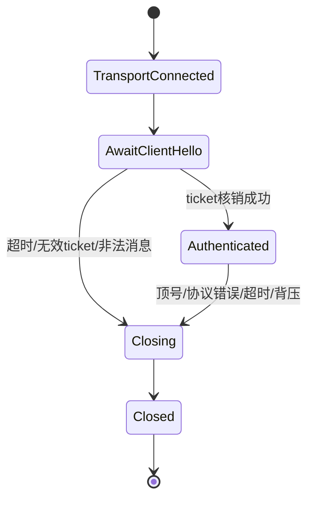
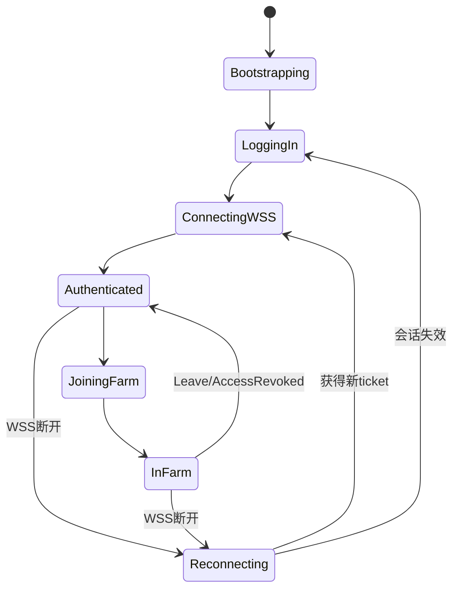
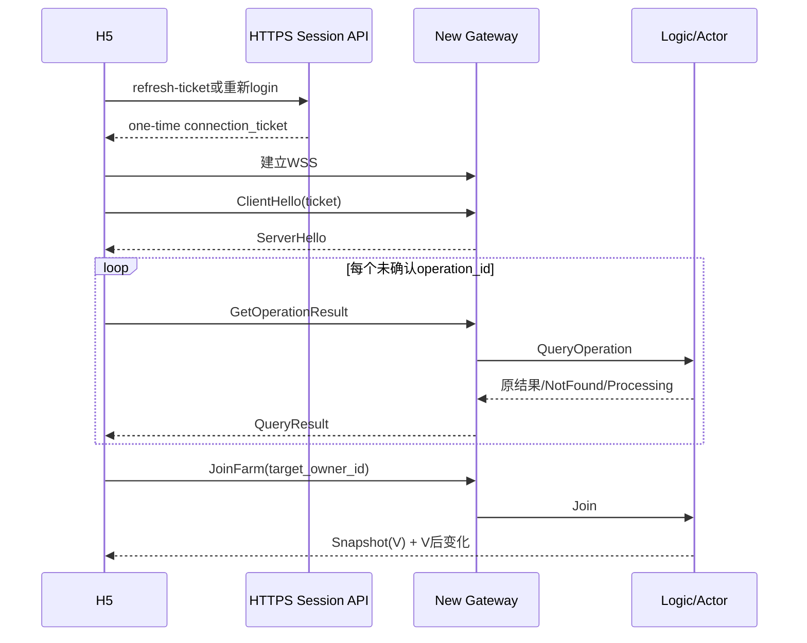
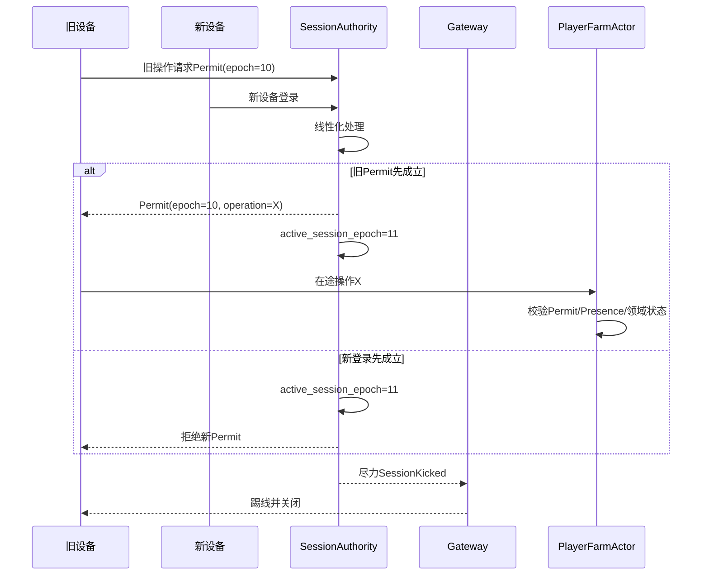

# 《经典农场小游戏》P0 通信合同

> 2026-07-26 接入边界补充：公网 WSS 终止于 TCONND，经平台 gateproxy 转换为 Unix gRPC GateStream 传输事件；farm-gate 负责应用 Session、协议和下行背压，不直接持有公网 Socket。帧协议以 `FarmFrame{protocol_version, kind, connection_seq, body}` 为准。后续实现的权威合同以 `farm-game/docs/design/07-tconnd-access-boundary.md`、`10-protocol.md` 和 `11-frame-codec.md` 为准。

版本：v0.1（详细设计基线）

更新时间：2026-07-25

状态：本文冻结 P0 的外部通道、连接生命周期、消息分层、请求/结果/推送语义、关键时序、内部 RPC 边界、路由、超时和重连合同。字段编号、Go 包名、具体 tRPC-Go/gRPC-Go 配置和数值阈值仍需在实现前生成正式 `.proto` 并通过测试确认。

前置文档：

- [项目设计交接文档](./classic-farm-agent-handoff.md)
- [系统架构与通信选型](./classic-farm-system-architecture.md)
- [P0a Actor 命令合同](./classic-farm-p0a-command-contracts.md)
- [P0 业务流程总图](./classic-farm-p0-business-flows.md)
- [Actor 边界与运行模型选型](./classic-farm-actor-selection.md)
- [H5 接入微信小程序实施方案](./classic-farm-h5-wechat-miniprogram-deployment.md)

---

## 0. 本文冻结什么

### 0.1 已冻结

| 决策 | P0 结论 |
|---|---|
| 静态资源 | HTTPS + CDN |
| 登录、分享落地 | HTTPS API |
| 登录后游戏通信 | 单条 WSS 长连接 |
| 业务 IDL | Protobuf |
| WSS 认证 | HTTPS 登录取得一次性短期 `connection_ticket`；WSS 建立后的第一条应用消息完成认证 |
| 写操作幂等 | 16 字节稳定 `operation_id`；同一业务意图重试必须复用 |
| 连接请求关联 | 每条连接内单调 `request_id/client_seq` |
| 农场变化顺序 | `farm_version` |
| 实时 Join | Snapshot V 与所有 V 后变化使用同一订阅级有序逻辑流 |
| P0 重连 | 重新认证、查询未确认 operation_id、重新 Join 获取快照 |
| 跨连接完整重放 | 不作为 P0 基础要求 |
| Gateway 到 Logic | Protobuf IDL + Unary RPC |
| 内部实现候选 | tRPC-Go 优先，不能独立使用时选择 gRPC-Go |
| Actor 路由 | 根据命令语义提取 `owner_id/target_owner_id`，不能只相信客户端声明 |
| 网络发送 | Actor 不等待客户端 socket flush |

### 0.2 尚未冻结

- `.proto` 字段编号；
- tRPC-Go 或 gRPC-Go 的最终产品选择；
- 单帧、发送队列、心跳和超时的生产阈值；
- 压缩算法及启用阈值；
- P1 跨连接 ACK/Frame Replay；
- 真实 QQ/微信平台身份接入方式；
- 外部域名、证书、CLB 和服务发现产品。

本文给出初始工程基线，待压测后允许只调整数值，不改变业务语义。

---

## 1. 通信分层

通信分为五层：

```text
L1 传输层
  HTTPS / WSS / 内部RPC

L2 连接与会话层
  connection_ticket / ClientHello / heartbeat / session epoch

L3 应用信封层
  request_id / operation_id / command_type / status / error

L4 领域命令层
  PlantCrop / JoinFarm / BeginTheft ...

L5 实时订阅层
  Snapshot / FarmChange / AccessRevoked / ResyncRequired
```

分层原因：

- 连接重试不等于业务重试；
- `request_id` 不等于 `operation_id`；
- WSS 传输顺序不等于 `farm_version`；
- 会话在线不等于有好友权限；
- 收到广播不等于业务提交刚刚发生；
- Gateway 可以更换，业务结果仍可查询。

---

## 2. 外部 HTTPS 接口

以下路径是逻辑名字，最终 URL 可按项目规范调整。

### 2.1 `POST /v1/session/login`

用途：

- 验证平台身份；
- 分配或取得稳定 `player_id`；
- 推进单活跃会话代次；
- 确保 Owner 已初始化；
- 返回 WSS 连接信息。

概念请求：

```text
LoginRequest {
    platform
    platform_token
    client_version
    protocol_min_version
    protocol_max_version
    device_id
    pending_share_token
}
```

概念响应：

```text
LoginResponse {
    player_id
    active_session_epoch
    connection_ticket
    ticket_expires_at
    wss_endpoint
    selected_protocol_version
    server_time_ms
    owner_ready
}
```

约束：

- `connection_ticket` 短期、一次性；
- ticket 只用于建立一条已认证 WSS，不等于长期平台 Token；
- 登录成功前必须完成或恢复 `EnsureOwnerInitialized` 到 OwnerReady；
- `pending_share_token` 可以只保存接受意图，不能在未登录时创建匿名好友；
- 平台 Token 不写日志；
- 本地开发可使用 MockIdentityAdapter，线上接口保持平台无关。

### 2.2 `POST /v1/session/refresh-ticket`

用途：

- 用户仍有有效登录上下文，但 WSS ticket 已过期或已使用；
- 重新签发一次性连接 ticket。

它不能：

- 绕过单活跃会话；
- 复活旧 `active_session_epoch`；
- 作为写操作 Permit。

### 2.3 `POST /v1/share/resolve`

用途：

- H5 打开分享链接时解析短 token；
- 返回邀请人公开摘要、是否过期和是否需要登录；
- 未登录时由客户端暂存 `pending_share_token`。

解析链接不建立好友、不发奖励。

### 2.4 运维接口

以下接口不对普通 H5 公开：

- `/healthz`：进程存活；
- `/readyz`：依赖和接流量能力；
- `/metrics`：Metrics；
- `/debug/*`：仅受控测试环境；
- GM/审计：独立认证和审计。

---

## 3. 为什么 WSS 认证使用第一帧

浏览器原生 WebSocket API 不能像普通 HTTP 客户端一样自由设置 `Authorization` Header。常见替代方案：

1. 长期 Token 放 URL Query；
2. Token 放 WebSocket Subprotocol；
3. 建连后第一条应用消息认证；
4. URL 只放短期一次性 ticket。

P0 选择：

```text
HTTPS登录
→ 返回短期一次性connection_ticket
→ 建立wss://.../game
→ 第一帧ClientHello携带ticket
→ Gateway核销ticket
→ ServerHello
→ 才允许业务消息
```

原因：

- 不把长期平台 Token 放 URL、代理日志或浏览器历史；
- ticket 泄露窗口小，且只能使用一次；
- 认证失败可以在应用层返回明确原因后关闭；
- Gateway 在认证前不建立业务 Session 或 Presence。

认证前连接限制：

- 只能发送 `ClientHello`；
- 必须在短时间内完成，例如开发基线 5 秒；
- 帧大小使用更严格上限；
- 每 IP 未认证连接数有限；
- 认证前不允许业务 RPC；
- ticket 重复使用立即拒绝。

---

## 4. WSS 连接状态机

### 4.1 Gateway 连接状态



`Authenticated` 只表示连接已经绑定玩家和会话，不表示已经进入某个农场。

### 4.2 客户端业务状态



客户端必须区分：

- WSS 已连接；
- 已认证；
- 已 Join 某农场；
- 某条写命令是否已经确认；
- 当前农场 Snapshot 版本。

---

## 5. 顶层 Protobuf 帧

概念结构：

```proto
message ClientFrame {
  uint32 protocol_version = 1;
  uint64 client_seq = 2;

  oneof body {
    ClientHello hello = 10;
    ClientCommand command = 11;
    ClientControl control = 12;
  }
}

message ServerFrame {
  uint32 protocol_version = 1;
  uint64 server_seq = 2;
  int64 server_time_ms = 3;

  oneof body {
    ServerHello hello = 10;
    CommandResult result = 11;
    ServerPush push = 12;
    ServerControl control = 13;
  }
}
```

说明：

- 这里只冻结字段职责，不冻结字段编号；
- `client_seq/server_seq` 是连接内传输观测序号；
- Protobuf 未知字段按兼容规则忽略；
- `oneof` 未知消息类型必须返回协议不支持或关闭连接；
- 业务消息不能直接裸发，必须经过顶层帧。

---

## 6. `ClientHello` 与 `ServerHello`

### 6.1 ClientHello

```proto
message ClientHello {
  bytes connection_ticket = 1;
  string client_version = 2;
  uint32 protocol_min_version = 3;
  uint32 protocol_max_version = 4;
  string device_id = 5;
  string locale = 6;
}
```

### 6.2 ServerHello

```proto
message ServerHello {
  uint64 player_id = 1;
  uint64 active_session_epoch = 2;
  uint32 selected_protocol_version = 3;
  uint32 heartbeat_interval_ms = 4;
  uint32 heartbeat_timeout_ms = 5;
  uint32 max_inbound_frame_bytes = 6;
  uint32 max_inflight_commands = 7;
  int64 server_time_ms = 8;
  bytes connection_id = 9;
}
```

ServerHello 返回后：

- Gateway 已绑定 `player_id + active_session_epoch + connection_id`；
- 客户端可以发送业务命令；
- 客户端仍需 `JoinFarm` 才能对农场执行要求 Presence 的写；
- 旧设备可能尚未物理断开，但不能取得新 SessionPermit。

---

## 7. 请求标识：三种 ID 不得混用

### 7.1 `client_seq`

- 当前 WSS 连接内单调增加；
- 用于发现客户端发送异常和排错；
- 重连后可以从 1 重新开始；
- 不提供业务防重。

### 7.2 `request_id`

- 当前连接内请求和响应关联；
- 同一业务意图每次网络发送可以使用不同 request_id；
- 响应应回显；
- 不作为资产幂等键。

### 7.3 `operation_id`

- 写操作业务意图的稳定 128-bit ID；
- 推荐浏览器使用 `crypto.getRandomValues` 生成 16 字节；
- 同一个按钮业务意图在超时、断线和重连后必须复用；
- 用户重新明确发起的新业务行为使用新 ID；
- 服务端校验固定长度和调用者归属；
- 读请求可以不携带 operation_id。

示例：

```text
用户点击“购买1颗小麦种子”
operation_id = X

第一次发送
request_id = 101, operation_id = X

网络超时后重试
request_id = 207, operation_id = X

用户之后再次点击购买
request_id = 301, operation_id = Y
```

---

## 8. 客户端命令

概念结构：

```proto
message ClientCommand {
  uint64 request_id = 1;
  bytes operation_id = 2;
  CommandType command_type = 3;
  uint64 target_owner_id = 4;

  uint64 expected_farm_version = 5;
  uint64 expected_plot_version = 6;
  bytes expected_crop_cycle_id = 7;

  bytes payload = 10;
}
```

实际 `.proto` 推荐使用 `oneof typed_command`，而不是长期依赖裸 `bytes payload`：

```proto
oneof typed_command {
  BuyOfferRequest buy_offer = 20;
  PlantCropRequest plant_crop = 21;
  HarvestCropRequest harvest_crop = 22;
  JoinFarmRequest join_farm = 23;
  WaterCropRequest water_crop = 24;
  BeginTheftRequest begin_theft = 25;
}
```

使用 typed oneof 的原因：

- 生成类型安全代码；
- 限制字段和大小；
- 兼容性更清楚；
- 不需要业务层手写二次反序列化；
- 更容易生成测试客户端和文档。

`target_owner_id` 只作为请求目标提示。Logic 必须根据命令语义提取真实路由键，并校验：

- 主人操作只能路由自己；
- 好友操作目标与 Permit 一致；
- `farm_id` 与 target owner 的唯一农场一致；
- Worker 内部命令不能由客户端伪造。

---

## 9. 命令结果

```proto
message CommandResult {
  uint64 request_id = 1;
  bytes operation_id = 2;
  CommandStatus status = 3;
  Error error = 4;

  uint64 owner_state_version = 5;
  uint64 farm_version = 6;

  oneof typed_result {
    BuyOfferResult buy_offer = 20;
    PlantCropResult plant_crop = 21;
    JoinFarmResult join_farm = 22;
    BeginTheftResult begin_theft = 23;
    OperationQueryResult operation_query = 24;
  }
}
```

### 9.1 状态语义

| 状态 | 服务端必须已经做到什么 | 客户端行为 |
|---|---|---|
| `SUCCEEDED` | 权威成功事实已经可靠提交 | 展示成功，不重新执行 |
| `PROCESSING` | 业务意图和可恢复进度已经持久化 | 展示处理中，查询原 operation_id |
| `NO_CHANGE` | 请求合法，但没有新事实变化 | 使用返回的最新状态 |
| `REJECTED` | 已确定业务条件不成立 | 根据错误码提示；新行为使用新 operation_id |
| `UNAVAILABLE` | 无法确认是否受理或依赖不可用 | 不显示确定失败；复用 operation_id 查询/重试 |

### 9.2 `Processing` 的严格限制

只有服务端能够证明以下至少一项时才能返回：

- `OperationResult=Processing` 已持久化；
- `TheftSettlement=TargetCommitted/Processing` 已持久化；
- 等价的可恢复业务意图已持久化。

仅仅因为“RPC 已经发给下游”不能返回 Processing。

---

## 10. 错误模型

概念结构：

```proto
message Error {
  ErrorCode code = 1;
  string message_key = 2;
  bool retryable = 3;
  uint32 retry_after_ms = 4;
  bytes latest_state = 5;
}
```

客户端展示使用 `message_key` 本地化，不直接展示服务端内部错误文本。

### 10.1 错误分类

#### 协议和输入

- `PROTOCOL_VERSION_UNSUPPORTED`
- `FRAME_TOO_LARGE`
- `MALFORMED_MESSAGE`
- `COMMAND_UNSUPPORTED`
- `INVALID_OPERATION_ID`
- `INVALID_ARGUMENT`

#### 认证和会话

- `UNAUTHENTICATED`
- `CONNECTION_TICKET_INVALID`
- `CONNECTION_TICKET_EXPIRED`
- `SESSION_REPLACED`
- `SESSION_EPOCH_STALE`
- `SESSION_AUTHORITY_UNAVAILABLE`

#### 权限和 Presence

- `NOT_FRIEND`
- `FRIENDSHIP_REVOKED`
- `NOT_IN_FARM`
- `PRESENCE_STALE`
- `FARM_FULL`
- `ACCESS_REVOKED`

#### 旧视图和农场状态

- `FARM_VERSION_STALE`
- `PLOT_VERSION_STALE`
- `CROP_CYCLE_STALE`
- `PLOT_NOT_EMPTY`
- `PLOT_EMPTY`
- `CROP_NOT_MATURE`
- `CROP_ALREADY_ENDED`
- `CARE_ALREADY_APPLIED`

#### 经济

- `INSUFFICIENT_FUNDS`
- `INSUFFICIENT_ITEMS`
- `OFFER_UNAVAILABLE`
- `RULE_VERSION_INVALID`

#### 偷菜

- `THEFT_NOT_ALLOWED`
- `THEFT_ALREADY_ATTEMPTED`
- `STEALABLE_LIMIT_REACHED`
- `OWNER_RESERVE_REACHED`
- `THEFT_BLOCKED`
- `THEFT_PROCESSING`

#### 系统

- `RATE_LIMITED`
- `SERVER_OVERLOADED`
- `STORE_UNAVAILABLE`
- `RESULT_UNKNOWN`
- `RESYNC_REQUIRED`
- `INTERNAL_ERROR`

正式错误码必须：

- 数值稳定，不复用旧值；
- 区分业务拒绝与系统不可用；
- 标记是否允许同 operation_id 重试；
- 不泄露表名、节点、堆栈和内部 ID；
- 在日志中保留内部 cause。

---

## 11. 服务端推送

```proto
message ServerPush {
  bytes subscription_id = 1;
  uint64 actor_activation_epoch = 2;
  uint64 presence_epoch = 3;
  uint64 farm_version = 4;

  oneof payload {
    FarmSnapshot snapshot = 20;
    FarmChange farm_change = 21;
    OperationFinalized operation_finalized = 22;
    AccessRevoked access_revoked = 23;
    SessionKicked session_kicked = 24;
    ResyncRequired resync_required = 25;
    Notification notification = 26;
  }
}
```

### 11.1 Snapshot

Snapshot 必须包含：

- farm_id/owner_id；
- `farm_version=V`；
- 所有当前可见 Plot/CropCycle；
- 规则引用或展示所需摘要；
- 当前用户允许看到的公开状态；
- 当前 `subscription_id/presence_epoch`。

好友视图不能包含：

- 农场主完整 Inventory；
- Wallet；
- 私有任务；
- 邮件；
- 未公开宠物资产；
- 内部 Settlement/OperationResult。

### 11.2 FarmChange

每条变化至少包含：

- farm_id；
- farm_version；
- change_type；
- plot_id；
- crop_cycle_id；
- 当前可公开状态或可幂等 Patch；
- 原操作 initiator 的可公开摘要（如产品需要）。

客户端应用规则：

```text
change.version <= local.version
→ 重复或旧消息，忽略

change.version == local.version + 1
→ 应用并推进版本

change.version > local.version + 1
→ 发现缺口，停止增量应用并重新Join
```

如果一次业务命令产生多个公开地块变化，可以：

- 一个 farm_version 携带一个原子 change batch；
- 或为每个公开变化分配连续版本。

P0 应优先选择“一个已提交业务 turn 对应一个 FarmChange batch 和一个 farm_version”，减少客户端中间态。

### 11.3 OperationFinalized

跨 Owner 命令先返回 Processing 后，可以主动推送终态：

```text
operation_id
status = Succeeded/Blocked/Rejected
result summary
```

推送丢失不影响结果查询。

---

## 12. 心跳和连接保活

浏览器 JavaScript 不能主动构造 WebSocket 原生 Ping 帧，因此 P0 使用应用层心跳：

```proto
message ServerPing {
  uint64 ping_id = 1;
  int64 server_time_ms = 2;
}

message ClientPong {
  uint64 ping_id = 1;
  int64 client_receive_time_ms = 2;
}
```

开发初始值：

| 参数 | 初始基线 | 状态 |
|---|---:|---|
| 心跳间隔 | 20 秒 | 可配置 |
| 无响应关闭 | 60 秒 | 可配置 |
| ClientHello 超时 | 5 秒 | 可配置 |
| Gateway Presence 续租通知 | 粗粒度/批量，不逐心跳进入 Actor | 原则冻结 |

注意：

- Gateway 心跳活跃不等于好友权限有效；
- 每个 Pong 不进入 PlayerFarmActor；
- Gateway 可以低频批量刷新 Session lease；
- Presence lease 通过 Join、Leave、Disconnect 和低频租约变化维护；
- 移动端后台挂起会导致断线，客户端应进入重连状态。

---

## 13. 实时 Join 合同

### 13.1 Join 请求

```proto
message JoinFarmRequest {
  uint64 target_owner_id = 1;
  bytes previous_subscription_id = 2;
  uint64 last_seen_farm_version = 3;
}
```

P0 即使携带 `last_seen_farm_version`，也允许服务端直接返回完整快照，不承诺一定增量补齐。

### 13.2 Actor 内流程

```text
校验SessionPermit
→ 好友农场校验FriendPermit
→ 校验名额
→ 建立Joining槽位
→ 创建subscription_id/presence_epoch
→ 建立Joining buffer
→ 在版本V生成Snapshot
→ 排入订阅有序下行
→ V后变化进入buffer
→ Snapshot后接续buffer
→ 状态转InFarm
```

### 13.3 Join 成功点

`JoinFarm=Succeeded` 至少意味着：

- Presence 已进入 InFarm；
- Snapshot 已进入该连接的有界逻辑下行；
- V 后变化已经有无缺口接续机制；
- 返回的 `subscription_id/presence_epoch` 可用于后续写；
- 如果下行队列已满，不能返回普通成功后静默丢快照。

### 13.4 重复 Join

同一连接、同一玩家、同一目标农场的重复 Join：

- 原 Join 已完成：返回当前 Presence 和新/原快照；
- 原 Join 仍进行：合并或返回 Processing；
- 连接已变化：旧 connection/presence 失效，新连接重新 Join；
- 不能重复占用两个名额。

---

## 14. 写命令准入流程

严格基线：

```text
1 Gateway认证连接身份
2 校验协议、帧、频率和operation_id
3 根据命令取得绑定operation_id的SessionPermit
4 好友动作取得绑定operation_id的FriendPermit
5 Logic按命令语义计算路由键
6 投递目标PlayerFarmActor
7 Actor先查询已有OperationResult/Settlement
8 已存在则认证归属并返回
9 不存在才校验Permit、Presence和领域状态
10 条件提交OwnerCore
11 提交后更新内存、结果和广播
```

Gateway/Logic 的具体分工允许两种实现：

### 方案 A：Gateway Admission Adapter

```text
Gateway
→ SessionAuthority/FriendshipAuthority
→ 附加Permit
→ Logic
```

优点：

- Logic 收到的写请求已经具备短期证据；
- 更早拒绝明显无权限流量。

风险：

- Gateway 需要理解动作类型；
- 接入层与权限模块耦合增加。

### 方案 B：Logic Admission Facade

```text
Gateway只认证连接
→ Logic
→ SessionAuthority/FriendshipAuthority
→ Actor
```

优点：

- Gateway 更纯粹；
- 权限编排集中。

风险：

- 所有流量进入 Logic；
- Logic 增加一次权限调用编排。

P0 逻辑合同不依赖 A/B。推荐工程起步使用方案 B，使 Gateway 专注连接；如果严格 Permit QPS 或入口防护压测证明有必要，再将 Session Permit 的快速签发下沉 Gateway。无论哪种实现：

- Permit Authority 的线性化语义不能改变；
- Gateway 不能自行读取旧 Redis 值伪造 Permit；
- Actor 必须校验 Permit 完整性和目标；
- Friendship 权威不能迁入 Gateway。

这一项是对总体架构职责的实现细化：Gateway 可以拥有 Admission Adapter，但默认不承担好友业务权威。

---

## 15. Gateway 到 Logic RPC

概念服务：

```proto
service GameCommandService {
  rpc Execute(ExecuteCommandRequest) returns (ExecuteCommandResponse);
  rpc QueryOperation(QueryOperationRequest) returns (QueryOperationResponse);
}

service RealtimeControlService {
  rpc JoinFarm(JoinFarmInternalRequest) returns (JoinFarmInternalResponse);
  rpc LeaveFarm(LeaveFarmInternalRequest) returns (LeaveFarmInternalResponse);
  rpc ConnectionClosed(ConnectionClosedRequest) returns (google.protobuf.Empty);
}
```

也可以将 Join/Leave 作为 Execute 中的 typed command，最终以代码生成和观测便利性决定。

### 15.1 ExecuteCommandRequest

```proto
message ExecuteCommandRequest {
  TrustedContext trusted = 1;
  ClientCommand command = 2;
  int64 gateway_deadline_ms = 3;
}

message TrustedContext {
  uint64 player_id = 1;
  uint64 active_session_epoch = 2;
  bytes connection_id = 3;
  string gateway_id = 4;
  bytes session_permit = 5;
  bytes friend_permit = 6;
  bytes trace_id = 7;
}
```

内部服务不能接受客户端提供的 TrustedContext。

### 15.2 RPC 超时

Gateway RPC 超时后：

- 不返回普通业务失败；
- 若已收到 `Processing` 或持久结果，按结果返回；
- 无法确认时映射 `UNAVAILABLE/RESULT_UNKNOWN`；
- 客户端保留 operation_id；
- Logic/Actor 继续完成已提交流程不依赖原 RPC 存活。

取消 RPC Context 不能自动回滚已经开始的数据库提交。

### 15.3 Actor 响应后

Actor 返回结果到 Logic/Gateway，不表示 Gateway 必须成功发到客户端。

```text
Actor权威提交
→ 结果可查询
→ Gateway尽力下行
```

客户端断线后仍能用 operation_id 获取结果。

---

## 16. Logic 到 Gateway 的下行

下行需要定位：

```text
gateway_id
connection_id
subscription_id
```

推荐抽象：

```text
DownlinkDispatcher.Enqueue(
  gateway_id,
  connection_id,
  stream_key,
  frame
)
```

`stream_key`：

- 命令结果可以按 connection；
- Snapshot/FarmChange 必须按 subscription 保序；
- 不同 farm subscription 之间不要求全局顺序。

下行结果：

| 结果 | 处理 |
|---|---|
| Enqueued | 已进入有界下行 |
| ConnectionGone | 丢弃实时发送，保留权威结果 |
| QueueFull | 关闭慢连接并要求重连 |
| GatewayUnavailable | 不回滚业务；连接最终重连 |

P0 不要求将每条实时推送写入可靠 MQ。权威状态和 farm_version 在 Farm Actor/TcaplusDB，实时消息丢失后靠快照收敛。

---

## 17. 并发和顺序

### 17.1 Gateway 是否串行所有请求

不需要将同一连接的所有业务 RPC 完全串行：

- Gateway 按连接顺序读取帧；
- 设置有限 `max_inflight_commands`；
- 不同目标 Owner 可以并发；
- 同目标 Owner 最终由 Actor 邮箱串行；
- 命令响应允许网络上乱序，通过 request_id/operation_id 关联；
- 同一订阅的 Snapshot/FarmChange 必须保序。

### 17.2 客户端不能依赖响应顺序

例如：

```text
request 101: WaterCrop
request 102: GetFarmSnapshot
```

响应 102 可能先到。客户端必须按 request_id 关联，并按 farm_version 应用公开状态。

### 17.3 同一业务按钮防抖不是幂等

客户端 UI 可以禁用按钮减少重复点击，但服务端仍必须：

- operation_id 防重；
- Actor 内查询旧结果；
- Store 条件提交；
- 唯一 LootReceipt/RewardClaim。

---

## 18. 重连合同

### 18.1 客户端保存什么

内存或短期本地状态：

- 当前 player_id；
- 当前农场 target_owner_id；
- 最后 `farm_version`；
- 未确认写操作的 operation_id 和命令摘要；
- 当前 UI 状态。

长期平台 Token 的保存遵循平台安全规范，不在本文固定。

### 18.2 重连步骤



### 18.3 NotFound 不一定表示可以立即重做

结果查询出现 NotFound 时需区分：

- 请求从未通过认证/未进入系统：可以由客户端重新发原命令；
- 请求提交结果仍未知、索引暂时不可见：返回 Unavailable；
- operation_id 已过热窗口但存在墓碑/业务唯一事实：返回 Expired/原摘要；
- 不能把普通 NotFound 当作自动生成新 operation_id 的理由。

### 18.4 重连退避

P0 客户端至少使用：

```text
指数退避 + 随机抖动 + 最大间隔
```

服务端可返回：

- `retry_after_ms`；
- Gateway 过载；
- 维护窗口；
- 必须完整重新登录。

弱网加分项再实现跨连接 Frame ACK 和有限重放。

---

## 19. 顶号时序



顶号的安全边界是“不能签发旧 epoch 新 Permit”，不是踢线消息是否先送达。

---

## 20. 分享链接通信

```text
邀请者 GenerateShareLink
→ 服务端生成签名/随机短token
→ H5分享URL

点击者打开HTTPS页面
→ ResolveShare
→ 未登录则保存pending_share_token
→ Login
→ WSS/HTTPS提交AcceptShare
→ FriendshipAuthority按稳定acceptance key裁决
→ 建立唯一Friendship
→ 奖励按幂等流程发放
```

安全要求：

- URL 不包含邀请人可伪造的权威 ID；
- token 有签名或服务端随机映射；
- 支持过期、撤销和刷新；
- 自邀拒绝；
- 同一链接可被不同玩家使用；
- 同一分享者+接受者只形成一个接受结果；
- Resolve 不产生资产副作用。

---

## 21. 帧大小、队列和初始参数

以下仅为开发基线，压测后调整：

| 参数 | 初始值 | 说明 |
|---|---:|---|
| 认证前最大帧 | 8 KiB | 仅 ClientHello |
| 已认证客户端最大帧 | 64 KiB | 普通命令足够 |
| 普通服务端推送最大帧 | 256 KiB | Snapshot 上限需单独预算 |
| 单连接 in-flight 命令 | 32 | 防止一个连接淹没 Logic |
| 单连接下行消息数 | 128 | 与字节上限共同限制 |
| 单连接下行字节 | 1 MiB | 达到后关闭并重连 |
| ClientHello 超时 | 5 秒 | 降低未认证连接占用 |
| 心跳间隔 | 20 秒 | 可配置 |
| 心跳失效 | 60 秒 | 可配置 |
| 普通命令 Gateway 等待 | 2～5 秒分级 | 不能据此判定业务失败 |
| 重连初始退避 | 0.5～1 秒随机 | 防止齐步重连 |
| 重连最大退避 | 30 秒 | 服务端可下发 retry_after |

必须同时限制“消息数”和“字节数”，否则大量小帧或少量大帧都可能耗尽内存。

压缩：

- P0 可以先不启用业务层压缩；
- 启用前测 CPU、带宽和延迟；
- 小消息不压缩；
- Snapshot 可单独评估；
- 防止压缩炸弹，解压后大小仍受限。

---

## 22. 协议版本演进

### 22.1 版本协商

客户端声明：

```text
protocol_min_version
protocol_max_version
```

服务端选择交集中的版本。无交集：

- HTTPS 登录直接返回升级要求；
- 或 WSS ClientHello 后返回 `PROTOCOL_VERSION_UNSUPPORTED` 并关闭。

### 22.2 Protobuf 兼容规则

- 不复用已发布字段编号；
- 删除字段使用 `reserved`；
- 新增可选字段保持默认值可解释；
- enum 新值要求客户端有 UNKNOWN 分支；
- 不改变旧字段含义；
- 一个版本周期内服务端兼容至少当前和上一协议版本，具体窗口待发布策略确认；
- Snapshot Schema 和持久 OwnerCore Schema 分开演进。

### 22.3 配置版本不是协议版本

作物规则、商品价格和任务定义使用 `rule_version`，不能与网络 `protocol_version` 混用。

---

## 23. 安全边界

- 所有外部通道使用 TLS；
- 不在 URL 中放长期平台 Token；
- connection_ticket 短期、一次性、核销；
- 客户端不能提交 TrustedContext；
- operation_id 与发起者绑定；
- target_owner_id 和命令权限服务端重算；
- 价格、产量、成熟时间和奖励以规则版本为准；
- 旧 crop_cycle_id 不能作用于下一茬；
- 日志脱敏平台 Token、ticket、Permit 和个人信息；
- 限制反序列化大小和 repeated 字段数量；
- Gateway 和内部 RPC 使用服务身份认证；
- Worker 使用可信内部身份，不能伪装玩家；
- GM 命令独立认证和审计；
- 公开 Snapshot 做权限裁剪。

---

## 24. 可观测性

### 24.1 每条命令日志上下文

- trace_id；
- request_id；
- operation_id；
- player_id；
- target_owner_id；
- gateway_id/connection_id；
- actor owner_id/owner_epoch；
- command_type；
- result status/error code；
- farm_version；
- Gateway/Logic/Actor/Store 各阶段耗时；
- 是否重试、是否命中旧结果。

不能记录：

- 平台 Token；
- 完整 connection_ticket；
- Permit 原文；
- 敏感客户端数据。

### 24.2 指标

Gateway：

- 当前连接；
- 新建/关闭连接；
- 认证成功率；
- 心跳超时；
- 帧大小；
- in-flight；
- 下行队列；
- 慢客户端关闭；
- 每命令入口 QPS。

Logic/Actor：

- 路由命中/重定向；
- Actor 激活/钝化；
- 邮箱深度；
- turn 延迟；
- Permit 延迟；
- 命令结果分布；
- stale view；
- FarmChange 扇出。

存储/Worker：

- TcaplusDB P50/P95/P99；
- CAS/RecordVersion 失败；
- 结果未知；
- OwnerCore bytes；
- PendingOutbox；
- Settlement Processing 时长；
- Worker 重试；
- LootReceipt 防重命中。

---

## 25. 测试清单

### 25.1 协议

- 版本无交集；
- 未知 oneof；
- 超大帧；
- 畸形 Protobuf；
- 非法 operation_id；
- 重复 client_seq；
- 未认证先发业务命令；
- ticket 过期、重复、伪造。

### 25.2 连接

- ClientHello 超时；
- 心跳丢失；
- 移动端后台挂起；
- Gateway 崩溃；
- 顶号；
- 连接队列满；
- 大规模重连加抖动。

### 25.3 幂等

- 响应丢失后相同 operation_id 重试；
- 新 request_id + 原 operation_id；
- 不同玩家复用 operation_id；
- 同玩家用一个 operation_id 调不同命令；
- Result 热窗口迁移；
- Processing 后查询。

### 25.4 实时

- Join 过程中发生 Water/Harvest/Theft；
- Snapshot 排队时产生 V+1；
- FarmChange 重复；
- FarmChange 缺口；
- subscription_id 过期；
- Presence activation 变化；
- 第 9 人并发 Join；
- AccessRevoked。

### 25.5 RPC 和存储

- Gateway RPC 超时但 Actor 最终成功；
- Client Context 取消时 Store 正在提交；
- TcaplusDB 结果未知；
- CAS 失败；
- Logic 返回后 Gateway 已断开；
- Worker 重复 GrantLoot；
- Outbox 通知丢失。

---

## 26. 第一批 `.proto` 文件建议

```text
api/proto/
  common/
    version.proto
    error.proto
    envelope.proto
    id.proto

  session/
    login.proto
    hello.proto
    heartbeat.proto

  farm/
    farm_view.proto
    farm_command.proto
    farm_change.proto

  economy/
    economy_command.proto
    inventory_view.proto

  social/
    share.proto
    friendship.proto

  reliable/
    operation_result.proto
    theft_settlement.proto

  internal/
    trusted_context.proto
    game_command_service.proto
    realtime_downlink.proto
    worker_command.proto
```

包依赖方向：

```text
common
  ↑
session / farm / economy / social / reliable
  ↑
internal
```

领域包不能依赖内部 Gateway 实现。

---

## 27. 下一步要产出的正式合同

本文通过讨论后，下一步应生成：

1. `common/envelope.proto`；
2. `common/error.proto`；
3. `session/login.proto`；
4. `session/hello.proto`；
5. `farm/farm_command.proto`；
6. `farm/farm_view.proto`；
7. `farm/farm_change.proto`；
8. `internal/game_command_service.proto`；
9. 14 条 P0a 命令的 request/result 字段表；
10. 客户端连接状态机测试用例。

在正式 `.proto` 评审前，不开始铺开全部 Handler。

---

## 28. 仍需用户或带教确认

下面五项会改变实现环境，但不改变本文业务合同：

1. P0 登录使用真实 QQ/微信身份，还是测试账号 + MockIdentityAdapter；
2. 新项目是否可以独立使用 tRPC-Go；
3. 内部是否提供可独立接入的 Actor Runtime；
4. TcaplusDB SDK 和数据订阅能力；
5. H5、Gateway 和 Logic 的实际部署与域名环境。

若暂时拿不到答案，P0 本地开发默认：

```text
MockIdentityAdapter
+ gRPC-Go或可替换RPC Adapter
+ 最小keyed executor
+ TcaplusDB接口Adapter与内存Fake
+ Redis接口Adapter与本地Redis
```

这些默认只为解耦开发，不代表生产选型被偷偷替换。
