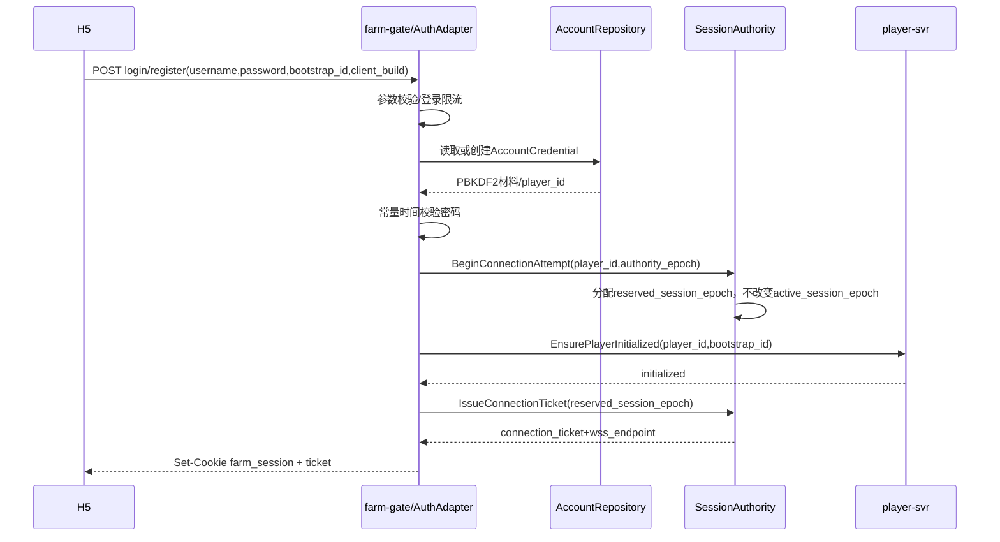
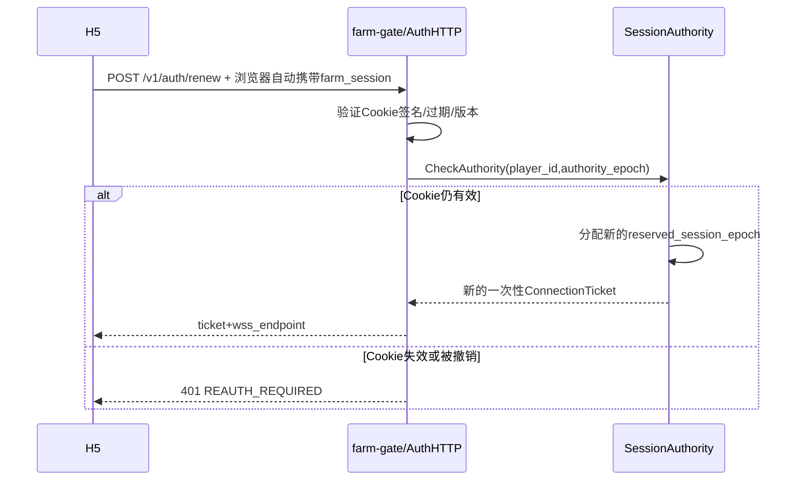
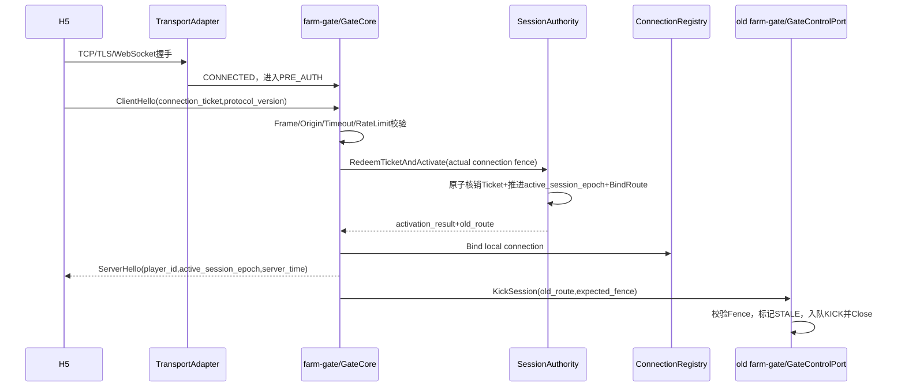

# 26 · 接入与会话详细合同

版本：`v1.3-bootstrap-friend-opportunity-public-contract-freeze-candidate`  
日期：2026-08-03  
定位：接入、Ticket、SessionAuthority、SessionRoute、Join、Subscription 和实时下行范围的唯一
详细权威；`22-production-architecture-v1.21` 只提供总体背景。本文用于后续协议、Redis 原子
脚本、farm-gate、H5 状态机、故障测试和压测实现。  
状态：在 `v1.0` 基础上收口与第 28/29 号文档的唯一权威关系，消除 H5 JoinPhase 重叠，冻结
SwitchFarm 本地线性化点、内部 `RESYNC_REQUIRED` 到公网 `REJOIN_REQUIRED` 的映射，并继续保留
有限 `ready_cut_version`、`CancelJoinAttempt`、SessionRoute/Subscription TTL 与单调时钟合同；同时明确
本文只拥有 Session/接入侧前置条件，完整 `ADMITTED` 边界以第 28 号文档为唯一权威。
本版进一步把首屏的玩家私有 Bootstrap 与连续好友机会查询固定为独立公网命令
`GET_PLAYER_BOOTSTRAP / GET_NEXT_FRIEND_OPPORTUNITY`，并明确好友 Subscription Ready 后由服务端
最佳努力更新 Navigation visited；该运行时更新不替代每日访问任务的 `CONFIRM_FRIEND_VISIT`。
本文为修订候选；对应代码与故障测试通过后再提升为正式 Freeze。

本文统一使用三层成熟度标记：

- `STABLE_SEMANTIC`：带 `HC-ACCESS-*` 编号的语义已经确认，实现不得自行改写；
- `CANDIDATE`：整份合同尚未通过端到端、故障注入和容量测试，不能宣称已生产验证；
- `PHYSICAL_PENDING`：Proto field number、Redis Key/Lua、TTL、队列和批量参数仍由后续探针冻结。

本文只记录已确认的合同、选择理由、失败语义和待验证参数，不复述讨论过程。在本文负责范围内，
若旧总体文档与本文冲突，以本文为实现基线，同时停止相关实现并同步修订总体文档；不得使用旧
总体文档覆盖本文，也不得由实现自行拼接两套语义。

---

## 0. 一页结论

接入与会话回答五个问题：

```text
玩家是谁
一根新连接能否代表该玩家
该玩家当前连接在哪个Gate
如何安全地把命令转入后端、把结果推回客户端
断线、顶号和发布时如何恢复
```

当前稳定语义结论（仍待实现验证）：

1. HTTPS 使用 JSON 完成注册、账号密码登录和 Cookie 免密换票；
2. WSS 使用 `Binary Protobuf FarmFrame`，一个 WebSocket Binary Message 只承载一个 FarmFrame；
3. `farm_session` 是浏览器保存的签名 HttpOnly Cookie，服务端不保存 Cookie 正文；
4. `ConnectionTicket` 是 Redis 中短 TTL、单次核销的 WSS 建连凭证，不放 URL；
5. ClientHello/ServerHello 是游戏应用层握手，不是 TCP、TLS 或 WebSocket 握手；
6. HTTPS 签发 Ticket 时只分配候选连接代次，不立即替换活跃 WSS；
7. ClientHello 成功核销 Ticket 后，才原子推进 `active_session_epoch`、绑定目标 Gate 并 Fence 旧连接；
8. 当前 `AccountCredential`、`SessionAuthority` 和 Ticket 使用公司 Redis；账号 Repository
   保持独立，以后迁移 Tcaplus 不改变登录协议；
9. 当前 SessionRoute 逻辑保存在 Redis SessionAuthority 记录中，不单独部署 SessionRoute 服务；
10. Gate 本地 `ConnectionRegistry` 持有真实连接，`ConnectionWriter` 为每连接有界 FIFO；
11. Direct WebSocket 是 P0 默认链路；TCONND + gateproxy 是共享 Gate Core 的候选 Transport Adapter；
12. 断线、Gate Drain 和发布不迁移 Socket，统一通过 Cookie 免密换票、新 WSS、重新 Join 和 Snapshot 恢复；
13. SessionRoute 与 FarmPresence 分离；前者回答“玩家连接在哪里”，后者回答“谁正在看这座农场”；
14. 自己和好友农场都使用 Subscription、Snapshot 和 JoiningBuffer 保证 Snapshot/Delta 无空洞；
15. 同一玩家在同一农场最多有一个当前有效 Subscription，重连或重复 Join 原子替换旧 Fence，不重复占用 200 人名额；
16. Join 内部使用 `JOINING(snapshot_armed=false/true) → FLUSHING → ACTIVATING → IN_FARM`；
    Snapshot 入队确认后在同一 Lane 冻结有限 `ready_cut_version=N`，不等待热门农场停止变化；
17. 正常首屏在自己的 Snapshot、玩家 Bootstrap、Pending 恢复和首个好友机会都完成后进入 HomeReady；
18. 首个好友机会超时可有界降级为 Loading/Retry，不能伪装成“没有好友机会”；
19. 一个农场最多 200 个不同玩家的当前有效 Subscription；FarmActor 只产生一次权威 FarmChange，
    FarmSubscriptionHub 按 Gate 聚合，下行层并发扇出。
20. 一根活跃游戏连接同一时刻最多只有一个当前 FarmSubscription；切换农场先撤销旧
    Subscription Fence，再建立新 Subscription，已经 ADMITTED 的旧命令允许完成。
21. `SessionPermit` 不是客户端 Token；它由 farm-gate 在命令准入后通过受信内部 RPC 注入，
    P0 依靠服务身份、mTLS/网络访问控制和完整 Fence 保证来源，不要求逐命令 HMAC。
22. Gate 必须区分 `PendingJoin` 与 `ActiveSubscription`；Join 的 `ACCEPTED` 只登记待完成
    Join，不得提前生成可用于经营命令的当前 FarmAdmissionContext。
23. `ACCEPTED` 不得携带或复用 `FarmSnapshot`；Gate 必须先绑定 PendingJoin、把 ACCEPTED 放入
    当前连接 FIFO，再显式 `ArmSnapshot`，禁止依赖两条独立 RPC 的到达顺序。
24. 匹配的 `FARM_SNAPSHOT` 成功进入当前 `ConnectionWriter` FIFO 后，只允许 Hub 从
    `JOINING` 进入 `FLUSHING`；Gate 仍保持 PendingJoin，H5 只应用快照但仍禁止经营写命令。
25. Hub 在同一 Lane 冻结有限 `ready_cut_version=N`：`version <= N` 继续 Catch-up，`version > N`
    转入 post-ready 有序缓冲；只有 Snapshot 与截至 N 的连续前缀均已入队，Gate 才能入队
    `SUBSCRIPTION_READY(N)` 并把 PendingJoin 提升为 ActiveSubscription。H5 只有在匹配 Ready、
    `applied_farm_version == N` 且恢复屏障完成后才进入 `FARM_INTERACTIVE`。
26. DownlinkService 不得根据“第一条 Farm Push”隐式创建、绑定或替换 Subscription；所有
    FarmSubscription Push 都必须匹配 Gate 已存在的 PendingJoin 或 ActiveSubscription Fence。
27. 已知 `subscription_id` 的断开、切换和顶号使用 `CleanupSubscription`；FirstHop 已创建
    JOINING 但 Gate 尚未取得 `subscription_id` 时，使用 `farm_id + join_attempt_id +
    join_operation_id + 完整连接Fence` 的 `CancelJoinAttempt`。两者都精确路由到目标 Farm Holder，
    禁止扫描本 Pod 全部活跃 FarmActor。
28. H5 对可恢复写命令必须在发送前持久保存 `command_type + operation_id + 原Typed Payload +
    原target_farm_id`，并按 CommandSpec RecoveryPolicy 处理 NOT_FOUND/PROCESSING/EXPIRED。
29. Farm 下行必须按 `gateway_id` 隔离为独立有界 FIFO 或等价 Lane；一个不可用 Gate 不得阻塞
    其他 Gate 的 Snapshot、FarmChange 和 CommandResult。
30. 客户端与服务端都必须严格校验本方向连接级 sequence 为 `last + 1`；跳号、重复和回退均
    进入连接恢复，不得静默接受。
31. `operation_id` 表示客户端 Join 意图；`join_attempt_id` 是 Gate 为当前连接上的 PendingJoin
    生成的运行时 Fence。同一 PendingJoin 的重复请求和内部 Redirect 复用 attempt，新 WSS 或
    Fresh Join 生成新 attempt，旧回调不得跨 attempt 生效。
32. Subscription Lease 只能续租完整 Fence 匹配的既有 Pending/Active Subscription，不能创建或
    复活订阅；续租使用 TTL 而非跨机器绝对到期时间，Gate 用本地单调时钟建立保守 Deadline。
33. ActiveSubscription/FarmAdmissionContext 只证明当前连接正在观看目标农场并允许路由命令；
    它不证明好友关系或护理、偷菜权限。每次好友操作仍需 ActionPermit，最终状态由 FarmActor 裁决。
34. 本文只定义 `SessionPermit`、PendingJoin 和 ActiveSubscription 的数据来源与语义；内部 RPC
    `TrustedCommandContext` 的唯一 IDL 由第 29 号文档定义，`request_id/operation_id/deadline`
    位于 `ExecuteCommandRequest` 外层。
35. Hub/Gate 内部失去实时版本连续性时使用 `RESYNC_REQUIRED`；公网只发送
    `REJOIN_REQUIRED`，客户端动作统一为 Fresh Join。
36. A→B 切换以 Gate SessionLane 本地撤销 A 的 ActiveSubscription 为线性化点；远程
    Cleanup(A) 有界、异步、最佳努力，不得无限阻塞 Join(B)。
37. 玩家私有首屏数据只通过 `GET_PLAYER_BOOTSTRAP` 返回；它与 `JOIN_FARM` 并行且不得塞入
    FarmSnapshot。该查询不要求 Recovery 完成或当前 FarmSubscription。
    **登录合并（20260817）**：HTTP 登录响应可附带同一个 `GetPlayerBootstrapResult`
    （`EnsureOwnerInitializedResponse.home_bootstrap`）。登录响应存在且通过客户端校验时，
    客户端不得再次发送 `GET_PLAYER_BOOTSTRAP`；私有首页数据仍不得塞入 ServerHello、
    FarmSnapshot 或任何隐式 Push。旧客户端、Reconnect、跨日刷新与状态丢失场景仍以
    `GET_PLAYER_BOOTSTRAP` 作为 RecoveryRequery；Renew 永远不携带该投影。
38. `GET_NEXT_FRIEND_OPPORTUNITY` 是登录和返回自己农场后的独立查询；依赖不可用必须返回
    Loading/Retry 语义，不能冒充 `NONE`。好友 Subscription Ready 后由服务端更新短期 Navigation
    visited；任务进度仍由独立 `CONFIRM_FRIEND_VISIT` 可靠命令负责。

“单玩家单活”冻结为：

```text
Redis中只有一条active SessionRoute
网络层新旧Socket可以短暂重叠
旧Gate已经准入并发往后端的命令允许完成
旧Gate观察到新Fence后不得再准入新命令
```

因此它不承诺取消已经离开 Gate 的请求，也不把跨 Gate KICK 误写成分布式事务。

---

## 1. 范围与非目标

### 1.1 本文负责

```text
账号注册与账号密码登录
签名Cookie和免密换票
ConnectionTicket签发、核销和防重放
Direct WebSocket/TCONND Transport边界
ClientHello/ServerHello
PRE_AUTH保护
SessionAuthority和SessionRoute
单玩家单活可写连接
连接序号、SessionPermit和命令准入
ConnectionRegistry、BackendPool和ConnectionWriter
心跳、限流、背压、Drain和断线重连
启动恢复屏障
SessionRoute与FarmPresence的边界
Join、JoiningBuffer和200人同场下行的接入侧合同
```

### 1.2 本文不负责

```text
播种、收获、护理、偷菜的业务裁决
金币、库存、任务、邮件等业务持久化
PlayerActor/FarmActor到Virtual Shard和Holder Pod的完整路由
跨Actor Workflow的领域状态机
好友关系和ActionPermit的业务规则
作物成熟和Scheduler
```

Actor Route 属于下一阶段的“命令路由与服务治理”。本文只冻结 Gate 选择命令首跳时必须携带
的可信 Session 上下文。

---

## 2. 四种“路由”不能混用

| 路由 | Key | 回答的问题 | 权威/持有者 |
|---|---|---|---|
| Transport Route | connection | Binary Frame 从 Direct WSS 还是 TCONND 进入 | Transport Adapter |
| SessionRoute | player_id | 玩家当前在哪个 Gate、哪根连接 | Redis SessionAuthority |
| FarmPresence | farm_id + subscription_id | 哪些连接正在订阅某座农场 | FarmSubscriptionHub |
| Actor Route | route_domain + actor_id | PlayerActor/FarmActor 当前在哪个 Holder Pod | Actor Routing Core |

`session_epoch` 不能替代 Actor `writer_epoch`：

```text
session_epoch
→ Fence旧浏览器连接

writer_epoch
→ Fence失去Shard写权的旧Holder Pod
```

---

## 3. 当前真实实现和目标边界

```text
                          ┌──────────────────────────────┐
                          │ 公司 Redis（当前持久化存储） │
                          │                              │
                          │ AccountCredential            │
                          │ SessionAuthority             │
                          │ ├── authority_epoch          │
                          │ ├── next_session_epoch       │
                          │ ├── active_session_epoch     │
                          │ └── active Gateway/Connection│
                          │ ConnectionTicket（单次+TTL） │
                          └──────────────▲───────────────┘
                                         │
H5 ──HTTPS/JSON──> farm-gate/AuthHTTP ────┤
                         │
                         ├── 注册/账号密码登录
                         ├── PBKDF2密码校验
                         ├── 登录限流
                         ├── SessionAuthority.Begin
                         ├── player-svr初始化玩家
                         ├── 签发ConnectionTicket
                         └── Set-Cookie:farm_session
                                  │
                                  ▼
                    浏览器保存签名HttpOnly Cookie
                    farm_session（Redis不保存Cookie正文）

H5 ──WSS/Protobuf FarmFrame──> Transport Adapter
                                      │
                         ┌────────────┴────────────┐
                         ▼                         ▼
                Direct WebSocket          TCONND + gateproxy
                  P0默认链路               平台兼容候选
                         │                         │
                         └────────────┬────────────┘
                                      ▼
                                  farm-gate
                    ├── PRE_AUTH / ClientHello
                    ├── SessionAuthority / SessionPermit
                    ├── ConnectionRegistry
                    ├── ProtocolGuard / SessionLane
                    ├── CommandCatalog / BackendPool
                    ├── DownlinkService
                    └── ConnectionWriter
                                      │
                        ┌─────────────┴─────────────┐
                        ▼                           ▼
                    player-svr                  farm-svr
```

`SessionAuthority` 是逻辑权威模块，不要求 P0 拆成独立 Deployment。当前 Redis 记录中直接保存
目标 Gateway，真实 Socket 只存在于对应 farm-gate 的本地 ConnectionRegistry。

---

## 4. 凭证、Cookie 与存储

### 4.0 AuthAdapter

账号密码不是所有环境唯一的生产认证方式。认证入口冻结为可替换 Adapter：

```text
AuthAdapter
├── WebAccountPasswordAdapter  当前Web/H5实现，PBKDF2
├── WeChatCodeAdapter          微信小程序目标实现
└── CookieRenewAdapter         已认证玩家公共免密换票
```

不同 Adapter 只负责把外部身份转换成可信的：

```text
AuthenticatedIdentity {
  platform
  account_subject
  player_id
  authority_epoch
}
```

之后统一进入 SessionAuthority、ConnectionTicket 和 ClientHello，不让微信 Code、用户名密码或
平台 SDK 字段泄漏到 FarmFrame、SessionRoute 和业务服务。当前 Web 账号密码适配器既可用于
本地/Staging，也可以在产品明确需要 Web 账号时继续使用；本文不把它写成微信正式环境的唯一
认证方案。

### 4.1 AccountCredential

当前工作区使用公司持久化 Redis 保存账号凭证：

```text
AccountCredential {
  normalized_username
  player_id
  password_hash
  password_salt
  password_kdf_version
  password_kdf_params
  account_status
  created_at_ms
  password_changed_at_ms
}
```

冻结要求：

- 服务端只保存 PBKDF2 等不可逆派生结果，不保存明文和可逆密文；
- 前端密码只存在于登录表单和 HTTPS 请求期间的内存；
- 密码不得进入 localStorage、sessionStorage、IndexedDB、URL、WSS、日志或埋点；
- 登录成功或失败后都清除前端密码变量；
- 账号 Repository 与 Session Repository 分离，未来迁移 Tcaplus 只替换存储实现；
- 密码 KDF 参数必须版本化，允许登录成功后按新参数渐进升级。

### 4.2 farm_session

`farm_session` 是签名 HttpOnly Cookie，用于免密申请新 Ticket，不直接建立 WSS：

```text
Cookie claims {
  player_id
  authority_epoch
  issued_at_ms
  expire_at_ms
  cookie_version
  nonce/session_subject
}
```

冻结要求：

```text
HttpOnly
Secure
SameSite按实际同域/跨域合同选择
明确Domain和Path
服务端密钥版本和轮换
```

签名防篡改但不等于加密，Cookie 内不得放密码、密码 Hash、资产和长期业务秘密。Redis 不保存
完整 Cookie 正文，但保存用于撤销和校验的 SessionAuthority。

### 4.3 ConnectionTicket

```text
ConnectionTicket {
  ticket_hash
  player_id
  authority_epoch
  reserved_session_epoch
  audience
  protocol_min_version
  protocol_max_version
  issued_at_ms
  expire_at_ms
  status: UNUSED/CONSUMED/SUPERSEDED
  activation_result（短期保留，用于Unknown解析）
}
```

Ticket 只在 HTTPS 响应中把明文交给客户端，服务端保存 Hash。Ticket 必须：

- 单次核销；
- 短 TTL；
- 绑定 audience/环境/协议边界；
- 不放 URL Query；
- 不作为长期登录凭证；
- 被核销后保留短期结果 Tombstone，避免 Redis 超时后无法判断是否已经成功激活。

### 4.4 三种凭证的职责

| 凭证 | 回答的问题 | 生命周期 |
|---|---|---|
| 账号密码 | 玩家是否拥有账号 | 登录请求级 |
| farm_session Cookie | 是否允许免密申请新 Ticket | 小时/天级，可由 authority_epoch 撤销 |
| ConnectionTicket | 是否允许建立这一根新 WSS | 秒级，单次 |

---

## 5. 端到端流程

### 5.1 首次注册或账号密码登录



账号初始化必须幂等。HTTPS 成功只表示：

```text
账号已认证
Cookie已签发
一张候选Ticket已签发
```

不表示新 WSS 已上线，也不应该提前踢掉当前活跃连接。

### 5.2 Cookie 免密换票

页面刷新、弱网断线或 Gate Drain 后：



Cookie 免密换票的价值：

- 前端不保存和重复发送密码；
- 避免每次重连执行 PBKDF2 和账号查询；
- Ticket 单次、短 TTL，降低重放风险；
- 新连接可以落到任意健康 Gate 并重建 SessionRoute；
- authority_epoch 提供修改密码、封禁和退出所有设备后的即时撤销能力。

### 5.3 WSS 与应用层握手



ClientHello/ServerHello 是第 4 层应用握手：

```text
TCP三次握手
→ TLS握手
→ HTTP Upgrade/WebSocket建立
→ ClientHello/ServerHello
→ JoinFarm/FarmSnapshot
```

收到 ServerHello 后客户端进入 `AUTHENTICATED`：连接身份和 SessionRoute 已建立，但尚未进入
任何农场，不能发送经营写命令。

旧连接可能位于另一台 Gate。KICK 是跨 Gate 的最佳努力控制调用，不属于 SessionAuthority
原子提交。KICK 失败不回滚已经激活的新 Route；它只负责尽快让旧客户端感知顶号并回收旧
Socket。旧 Gate 的命令准入和 Route Lease 仍必须独立遵守第 7、8 节 Fence 合同。

---

## 6. 客户端与服务端状态机

### 6.1 H5 状态机

连接、恢复和 Join 是三个可以并行推进的维度，不能实现成一个只能线性前进的枚举。推荐逻辑
状态为：

```text
ConnectionPhase:
DISCONNECTED → CONNECTING → AUTHENTICATING → AUTHENTICATED → RECONNECTING

RecoveryPhase:
NOT_STARTED → RECOVERING → COMPLETE

JoinPhase:
NO_JOIN → PENDING_JOIN → WAITING_SNAPSHOT → CATCHING_UP → READY
```

H5 的用户可写状态统一命名为 `FARM_INTERACTIVE`，由屏障派生：

```text
subscription_ready_for_ui
  = FarmSnapshot已经应用
  + SubscriptionReady的farm/subscription/attempt全部匹配
  + applied_farm_version == ready_through_version

FARM_INTERACTIVE
  = ConnectionPhase == AUTHENTICATED
  + RecoveryPhase == COMPLETE
  + PlayerBootstrap完成
  + subscription_ready_for_ui
```

代码若因历史原因仍使用 `InFarm` 名称，只能把它作为 H5 `FARM_INTERACTIVE` 的兼容别名，不能
与 Hub 的 `IN_FARM` 或 Gate 的 ActiveSubscription 共用一个跨组件布尔值。

JoinPhase 含义：

| 状态 | 含义 | 可发送内容 |
|---|---|---|
| `NO_JOIN` | 当前没有目标农场 Subscription | Join/读请求 |
| `PENDING_JOIN` | Join 请求已发送，尚未收到并匹配 ACCEPTED | Join/恢复控制请求；禁止经营写命令 |
| `WAITING_SNAPSHOT` | ACCEPTED 已匹配并登记 Join 元信息，等待唯一的 FarmSnapshot Push | Join/恢复控制请求；禁止经营写命令 |
| `CATCHING_UP` | Snapshot 已应用，等待 Catch-up 与 SubscriptionReady | 只更新页面和处理控制帧；禁止经营写命令 |
| `READY` | 匹配的 SubscriptionReady 已到达，且本地连续应用到 `ready_through_version` | Recovery/Bootstrap 同时完成后允许经营命令 |

因此 Snapshot 可以先于 Pending Operation 恢复完成，也可以后于它到达；两者只更新各自屏障，
不会互相覆盖全局状态。H5 收到 Snapshot 只进入 `CATCHING_UP`，不能直接进入
`FARM_INTERACTIVE`。

收到 `SubscriptionReady(N)` 时：

```text
applied_farm_version == N
→ JoinPhase转READY

applied_farm_version < N
→ 暂存Ready，继续按FIFO应用已经到达的前序Delta
→ 超过ready_apply_timeout仍无法到达N则Fresh Join

applied_farm_version > N
→ 违反FIFO/重复应用不变量
→ REJOIN_REQUIRED
```

H5 必须串行应用同一 Subscription 的 Snapshot、Catch-up、Ready 和 Live Delta；不得让 UI reducer
并发处理导致 Ready 越过尚未应用的 Delta。

`HOME_READY` 是首页 UI 里程碑，不新增 WsClient 连接状态：

```text
HOME_READY
  = FARM_INTERACTIVE
  + 首个好友机会已经返回FOUND/NONE
```

正常网络下，客户端在两者都满足后一次展示完整首页。好友机会查询超时不得无限阻塞个人经营：
客户端可以已经处于 FARM_INTERACTIVE 并展示自己的农场，但好友弹窗和列表保持 Loading/Retry，查询恢复
后再完成 HOME_READY。

### 6.2 farm-gate 状态机

```text
TCP_ACCEPTED
→ WS_UPGRADED/PRE_AUTH
→ TICKET_REDEEMING
→ ROUTE_BOUND/ACTIVE
→ DRAINING
→ CLOSED
```

PRE_AUTH 只允许一个合法 Binary ClientHello 和必要控制帧。文本帧、业务命令、第二个
ClientHello、超大帧或超时直接关闭。

---

## 7. SessionAuthority 合同

### 7.1 逻辑状态

```text
SessionAuthority {
  player_id
  authority_epoch
  next_session_epoch
  active_session_epoch
  active_route {
    gate_id
    gate_boot_id
    connection_id
    connection_generation
    route_revision
    lease_expire_at_ms
  }
}
```

- `authority_epoch`：Fence 旧 Cookie；修改密码、封禁、退出所有设备时推进；
- `next_session_epoch`：为 Ticket 分配单调候选代次；
- `active_session_epoch`：当前唯一活跃可写 WSS 的代次；
- `active_route`：目标 Gate 和连接 Fence。

SessionAuthority 不保存 `writable_farm_id/current_farm_id`。当前页面上下文只放在 Gate 本地：

```text
ConnectionSessionContext {
  current_farm_id
  current_subscription_id
}
```

FarmSubscriptionHub 才持有农场订阅状态。切换农场不写全局 SessionAuthority，避免
SessionRoute 与 FarmPresence 双份权威和热门 Join/Leave 引起的 Redis Session 写放大。

### 7.2 为什么要候选代次

```text
当前active_session_epoch=20
HTTPS签发Ticket-A，reserved=21
但新WSS未建立
→ active仍是20，旧连接继续可用

ClientHello-A成功
→ active变21
→ 旧连接20失效
```

如果又签发 Ticket-B，`reserved=22`，且 B 已激活，则延迟到达的 Ticket-A 必须返回
`SESSION_ATTEMPT_SUPERSEDED`，不能把会话抢回 21。

### 7.3 原子激活

`RedeemTicketAndActivate` 必须在一个 Redis Lua/CAS 等价原子操作中完成：

```text
校验Ticket存在、未过期、UNUSED
校验authority_epoch
校验reserved_session_epoch未被更高激活代次淘汰
标记Ticket CONSUMED并保存activation_result
active_session_epoch = reserved_session_epoch
route_revision++
active_route = actual connection fence
返回old_route
```

ServerHello 只能在该操作成功且本地 ConnectionRegistry 已绑定后返回。

### 7.4 条件断开

旧连接迟到的 DISCONNECTED 事件只能执行：

```text
CompareAndClearRoute(
  expected_gate_id,
  expected_gate_boot_id,
  expected_connection_id,
  expected_connection_generation,
  expected_active_session_epoch
)
```

任何字段不匹配都不得清除当前路由。

### 7.5 Route Lease 续租

`lease_expire_at_ms` 不是装饰字段。每台 Gate 运行 `SessionLeaseRenewer`，按桶批量续租本 Gate
持有的 ACTIVE Route：

```text
SessionLeaseRenewer
→ BatchRenew(
     gate_id,
     gate_boot_id,
     [(player_id,session_epoch,connection_generation,route_revision,requested_ttl_ms)...]
   )
→ Redis/Lua使用Redis TIME或等价权威时间推进lease_expire_at_ms
→ 每条结果返回accepted_ttl_ms
```

每条续租必须比较完整 Route Fence，不能让已经被新 Session 替换的旧 Gate 续活。禁止每个
客户端心跳单独写一次 Redis；应使用分桶、Pipeline 或 Lua Batch，续租周期和批量大小由探针
确定。Gate 在发送批次前记录 `renew_started_monotonic`，匹配成功后使用
`renew_started_monotonic + accepted_ttl_ms - safety_margin` 建立本地 Deadline；不得把 Gate 墙上
Unix 时间与 Redis 中的 `lease_expire_at_ms` 直接比较。

续租语义：

```text
续租成功
→ 正常准入

Redis短暂失败但本地单调时间仍早于local_route_lease_deadline
→ 保持连接，限制新增命令排队和最大Deadline，继续重试

本地单调时间达到local_route_lease_deadline仍未续租
→ 停止准入新的业务写命令
→ 标记Session为ROUTE_LEASE_EXPIRED
→ 最佳努力发送RECONNECT_REQUIRED
→ Drain/关闭连接
```

Lease 到期前已经通过 Gate 准入并发往后端的命令按第 8 节在途语义完成。旧 Route 被新
Session 替换后，旧 Gate 的下一次 BatchRenew 必须因 Fence 不匹配失败，并立即进入 STALE。

### 7.6 跨 Gate KICK

```text
new gate
→ GateControlPort.KickSession(old_route, expected_fence)
→ old gate校验gate_boot_id/connection/session_epoch/route_revision
→ SessionLane标记STALE
→ ConnectionWriter入队KICK
→ Close
```

旧 Fence 不匹配时返回 `STALE_TARGET`，不得关闭已复用的新连接。KICK RPC 失败不回滚 Redis
中已经生效的新 Route；Route Lease 续租失败提供最终资源回收，业务 Actor 的串行和幂等合同
保证短暂重叠窗口不会破坏资产或 Farm 权威状态。

---

## 8. 并发与失败语义

| 场景 | 冻结结果 | 恢复/理由 |
|---|---|---|
| 同一 Ticket 被两个 ClientHello 同时核销 | 只有一个成功 | Redis 原子核销；另一方返回 TICKET_ALREADY_USED |
| 两张 Ticket 并发，较新候选已激活，旧 Ticket 后到 | 旧 Ticket 返回 SUPERSEDED | reserved_session_epoch 防止旧尝试抢回会话 |
| Ticket 已签发但 WSS 没连上 | 当前活跃连接不受影响 | Ticket 到期；active 只在 ClientHello 改变 |
| 旧连接命令已经通过 Gate 准入并发往后端，新 Session 随后激活 | 允许原命令完成 | P0 不取消已经离开 Gate 的在途请求 |
| 旧 Gate 已观察到 KICK/Fence 或 Route Lease 失效后再收到命令 | 拒绝 STALE_SESSION | SessionLane 不再准入 |
| 新 Session 已激活但跨 Gate KICK 尚未到达 | 允许存在有界传播窗口 | Redis Route 已唯一；KICK 与 Lease 将旧 Gate 收敛，Actor 仍保证业务正确 |
| 新 Session 激活后旧 DISCONNECTED 迟到 | 不删除新路由 | CompareAndClearRoute 校验完整 Fence |
| Redis 激活调用超时、结果未知 | 不换新 Ticket 盲目重试 | 使用同 ticket+connection fence 查询/重入，读取 activation_result |
| 路由已绑定但 ServerHello 发送失败 | 客户端超时并免密换新 Ticket | 更高候选代次覆盖失联路由 |
| Gate 在绑定后崩溃 | 客户端重连；Route Lease 到期 | 不迁移 Gate 内存 |
| Redis Session 全失 | 所有连接重新认证/登录 | Gate 进入保护或关闭现有 Session，不影响资产 |
| Cookie 签名有效但 authority_epoch 落后 | 401 REAUTH_REQUIRED | 修改密码/封禁/全设备退出已撤销旧 Cookie |
| Ticket 过期 | 客户端用 Cookie 再换一张 | 不重复发送密码 |
| Gate Drain | 停止接新连接，带抖动通知重连 | 新 Gate 建 Session、重新 Join |
| ClientHello 前发送业务命令 | 关闭或协议错误 | PRE_AUTH 不允许业务 Frame |
| ConnectionWriter 队列满 | 按消息类别合并、丢 Hint、Resync 或关闭 | 不能反压 Actor |
| FarmChange 版本出现空洞 | RESYNC_REQUIRED + Fresh Join | 不继续发送不可解释增量 |

这里的名称按组件固定映射，不再混用：

```text
FarmSubscriptionHub / Gate内部状态
→ RESYNC_REQUIRED

公网ServerPush
→ REJOIN_REQUIRED（携带原FarmSubscription Fence）

H5动作
→ 停止该Subscription经营写入
→ 丢弃后续旧Delta
→ Fresh Join目标农场
```

进入内部 `RESYNC_REQUIRED` 时，Gate/Hub 必须保留足够的旧 Subscription Fence，直到终止 Push
成功进入当前 ConnectionWriter，或确认连接已经不可达；不能先清空全部 Fence，再让
`REJOIN_REQUIRED` 被自身的下行校验拒绝。终止 Push 失败不影响失效事实，客户端最终仍可由
版本空洞、Lease 失效或重连触发 Fresh Join。

所有 Unknown Outcome 的重试必须使用原 Ticket 和实际 connection fence；不能因为 RPC 超时就生成
新的激活操作并同时保留旧操作。

### 8.1 在途命令线性化与 Session 侧前置条件

完整公网命令 `ADMITTED` 线性化边界只由
[第 28 号文档第 6.3 节](./28-command-catalog-public-protocol.md#63-admitted-线性化边界)定义。
本文只冻结其中与接入和 Session 有关的前置条件：

```text
第28号协议、CommandCatalog、Payload和目标前置校验已通过
+ SessionLane校验本地Session仍ACTIVE
+ active_session_epoch/connection_generation/Route Lease有效
+ RateLimit通过
+ 成功占用BackendPool有界槽位
→ 才满足第28号定义的完整ADMITTED边界
```

不得只完成上述 Session 检查就提前标记 `ADMITTED`；同样不得在第 26 号文档或 Gate 实现中维护一套
与 CommandCatalog 不一致的第二准入定义。

已经到达 `ADMITTED` 的请求即使随后发生顶号，也允许到 PlayerActor/FarmActor 完成；响应若无法
发送到旧连接，由客户端使用原 `operation_id` 查询或恢复。尚未 ADMITTED 的旧连接请求在
SessionLane 观察到 KICK、续租 Fence 失败或 Lease 到期后返回 `STALE_SESSION`。

这是一条明确的 P0 取舍：

```text
严格唯一的是Redis active SessionRoute
跨Gate旧Socket和命令准入的停止是有界传播
已经准入的命令不做分布式取消
```

如果未来业务要求“新 Session 激活后旧 Gate 一条新命令都不能进入后端”的严格全局 Fence，
需要额外选择其一：

```text
激活进入SWITCHING，等待旧Gate Fence ACK或旧Lease到期后再ACTIVE
或首跳业务服务按active_session_epoch查询/订阅全局Session Fence
```

两者都会增加登录时延或命令路径成本，P0 暂不引入。

### 8.2 SessionPermit 与 TrustedCommandContext

`SessionPermit` 不是 H5 保存或回传的登录凭证。账号认证、ConnectionTicket 和 ClientHello
先建立在线 Session；之后每条通过 Gate 准入的命令，由 Gate 根据当前本地 SessionLane 和
SessionRoute Lease 取得下列受信数据来源：

```text
SessionPermit {
  player_id
  active_session_epoch
  gate_id
  gate_boot_id
  connection_id
  connection_generation
  route_revision
  admitted_at_ms
}
```

本文不再复制内部 `TrustedCommandContext` IDL。Gate 必须从上述 SessionPermit、当前恢复屏障、
PendingJoin 或 ActiveSubscription 中，构造
[第 29 号文档](./29-internal-rpc-trusted-context.md)唯一规定的内部上下文：

```text
普通农场经营命令
→ FarmAdmissionContext(admitted_farm_id, admitted_subscription_id)

JOIN_FARM
→ JoinAdmissionContext(join_attempt_id, target_farm_id)

request_id / operation_id / deadline / trace
→ 位于ExecuteCommandRequest外层，不属于TrustedCommandContext
```

`FarmAdmissionContext` 和 `JoinAdmissionContext` 不得同时存在。字段使用 `admitted_*`，表示命令
进入 ADMITTED 时刻的不可变快照；玩家随后切换页面不能改变已经 ADMITTED 的旧命令语义。
本文 SessionAuthority 中沿用的逻辑名 `gate_id/gate_boot_id/route_revision` 映射到第 29 号内部
IDL 的 `gateway_id/gateway_boot_id/session_route_revision`；它们是同一来源，不是两套 Fence。

P0 的可信边界是：

```text
H5只发送业务Payload
→ farm-gate校验Session、Lease、限流和连接Fence
→ farm-gate注入SessionPermit
→ 通过受信内部RPC调用后端
```

- `player_id`、Session Fence 和 ADMITTED 时刻的 Subscription 不得取自客户端 Payload；
- player-svr/farm-svr 只接受来自受信 farm-gate 或显式内部 Worker 身份的调用；
- 服务间使用 mTLS、服务身份或等价网络访问控制，不要求对每条 Permit 再做 HMAC；
- Worker 恢复命令使用独立 `InternalCallerContext`，不能伪造在线玩家 Session；
- Gate 已经 ADMITTED 的命令允许完成；Gate 观察到 Session Fence 失效后不得再生成新 Permit。

---

## 9. farm-gate 进程内执行模型

```text
WebSocket ReadLoop
→ ProtocolGuard
→ SessionLane
→ CommandIngress有界队列
→ CommandCatalog
→ BackendPool/gRPC
→ player-svr或farm-svr

CommandResult/ServerPush
→ DownlinkService
→ ConnectionWriter有界FIFO
→ WebSocket WriteLoop
```

“Gate 不等待业务 RPC”的准确含义是：

```text
后台请求任务可以有界等待RPC结果
但ReadLoop、WriteLoop、其他连接和Actor邮箱不能被该等待阻塞
```

Go 实现通常使用 goroutine、有界队列和 gRPC HTTP/2 多路复用，不要求一连接占用一个 OS 线程，
也不要求手写传统线程池。必须配置：

```text
单连接max_inflight_commands
全Gate BackendPool item/byte上限
RPC deadline
排队等待上限
SERVER_BUSY/RETRY_LATER
```

同连接 Frame 由 SessionLane 校验 `client_seq` 单调性；真正业务顺序由目标 Actor Mailbox、
`operation_id`、`expected_version` 和 SessionPermit 共同保证。

---

## 10. Transport Adapter 边界

统一接口：

```text
TransportAdapter {
  OnConnected
  OnBinaryFrame
  SendBatch
  Close
  GetConnectionMeta
}
```

实现：

```text
DirectWebSocketAdapter  P0默认
TconndGateproxyAdapter  平台探针通过后显式启用
```

FarmFrame、ClientHello、SessionAuthority 和 Actor Route 不得出现：

```text
TCONND私有包头
TBUS地址
gateproxy私有连接Handle
平台私有错误码
```

Adapter 统一映射：

```text
QUEUE_ACCEPTED
CONNECTION_NOT_FOUND
QUEUE_FULL
STALE_CONNECTION
UNAVAILABLE
```

同一环境只启用一种公网 Transport，不做运行时自动回退。

---

## 11. SessionRoute、FarmPresence 与 Subscription

### 11.1 SessionRoute

```text
player_id
→ gate_id/gate_boot_id
→ connection_id/connection_generation
→ active_session_epoch/route_revision
```

用于顶号、定向通知和寻找玩家当前接入节点。

### 11.2 FarmPresence

```text
FarmPresence {
  by_player:       map[viewer_player_id]Subscription
  by_subscription: map[subscription_id]viewer_player_id
  by_join_attempt: map[join_attempt_id]subscription_id
  cancelled_attempts: map[join_attempt_id]CancelTombstone
}
```

每个 Subscription：

```text
Subscription {
  subscription_id
  join_attempt_id
  join_operation_id
  farm_id
  viewer_player_id
  target_fence {
    gateway_id
    gateway_boot_id
    connection_id
    connection_generation
    session_epoch
    session_route_revision
  }
  state: JOINING/FLUSHING/ACTIVATING/IN_FARM/RESYNC_REQUIRED/CLOSED
  snapshot_armed
  snapshot_version              # 未Arm时为空；Arm线性化后为V
  joining_buffer                # 未Arm时为空；Ready切割前捕获V+1...
  flush_inflight_through_version
  ready_cut_version             # Snapshot入队确认后在Hub Lane冻结的有限目标N
  ready_through_version
  post_ready_buffer             # version>N，严格排在SubscriptionReady(N)之后
  lease_expire_at_ms
}

CancelTombstone {
  join_attempt_id
  join_operation_id
  target_fence
  cancelled_at_ms
  expire_at_ms
}
```

`JOINING + snapshot_armed=false` 等价于实现中的 `JOINING_UNARMED`：只保留名额、Subscription
和完整连接 Fence，尚未选择 Snapshot 版本，也尚未开始捕获后续 FarmChange。收到完整 Fence
匹配的 Arm 后，才允许在与 FarmChange 同序的 Farm Runtime Lane 上建立唯一
`Snapshot(V) + V 之后变化游标`，并执行一次 `false → true`。重复 Arm 必须复用同一基线或同一
in-flight Arm，不能重新选择第二个 V。实现可以使用显式
`JOINING_UNARMED/JOINING` 枚举，也可以使用上述布尔字段，但两份文档和代码只能选择一种表达。

`gateway_id` 属于正在观看农场的连接，与农场主人是否在线无关。主人离线、好友 B 在 gate-2
访问该农场时，Subscription 保存 B 的 gate-2 投递目标。

`by_player` 保证同一玩家在同一农场最多一个当前有效 Subscription；`by_subscription` 用于
QueueAccepted、Disconnect 和异步 DeliverResult 的精确定位；`by_join_attempt` 用于 FirstHop
已经创建未 Arm JOINING、但 ACCEPTED 尚未把 `subscription_id` 返回 Gate 时的精确取消。三者
以及 `cancelled_attempts` 必须在同一 Hub Lane 原子维护。取消先于迟到 Join 到达时，Hub 先安装
有界 CancelTombstone；后续 `CreateOrReuseJoining` 必须检查 tombstone 并拒绝同 attempt 创建。
200 人准入以 `by_player` 中
Lease 有效且处于 JOINING/FLUSHING/ACTIVATING/IN_FARM 的不同玩家数为准，不以历史
subscription_id 数量为准。到期 Subscription 必须先在 Hub Lane 条件转 CLOSED 并释放名额，
续租不能让已经 CLOSED 的 Subscription 复活。

重复 Join 与重连规则：

```text
不存在旧Subscription
→ 新建并占用一个名额

incoming.session_epoch > existing.session_epoch
+ incoming SessionPermit仍是当前可信Session
→ 原子替换旧Subscription
→ 旧Subscription转CLOSED并清理JoiningBuffer
→ 人数不增加

incoming.session_epoch == existing.session_epoch
+ Gate/connection/generation Fence完全相同
→ 按join operation_id幂等返回现有Subscription

incoming.session_epoch < existing.session_epoch
→ STALE_SESSION

同session_epoch但连接Fence不同
→ SESSION_FENCE_CONFLICT，不能比较generation大小后猜测谁更新
```

`connection_generation` 只在同一 Gate/boot 的连接命名空间中用于精确 Fence，不能跨不同 Gate
直接比较大小。旧 QueueAccepted、Disconnect 或 DeliverResult 必须先通过
`by_subscription` 找到玩家，再确认 `by_player[player].subscription_id` 仍是同一条；否则
只能忽略，不得修改新 Subscription 或释放新名额。

一根活跃游戏连接同一时刻最多拥有一个当前 FarmSubscription。玩家从农场 A 切换到农场 B
时采用 P0 的 break-before-make 合同：

```text
FARM_INTERACTIVE(A)
→ Gate进入SWITCHING/JOINING并停止准入新的A农场命令
→ SessionLane原子执行：
     active_subscription = nil
     subscription_context_generation++
→ 这是A→B切换的线性化点
→ 从此拒绝A的新命令和迟到Push

异步Cleanup(A-sub,完整Fence,有界deadline)
→ 最佳努力，不等待旧Holder无限恢复

并行或随后JoinFarm(B)
→ B的Snapshot/Catch-up/SubscriptionReady完成
→ current_subscription_id=B-sub
→ FARM_INTERACTIVE(B)
```

切换前已经 ADMITTED 的 A 农场命令允许完成；切换后携带旧 A Subscription 的新命令返回
`STALE_SUBSCRIPTION`。条件 Leave 丢失时，A Hub 通过连接关闭提示、Subscription
租约/空闲过期和完整 Fence 最终清理；Gate 对旧 Subscription 的下行也必须按
`current_subscription_id` 拒绝，避免旧农场继续占用当前页面上下文。Join B 失败时客户端
可以 Fresh Join A，不恢复旧 Subscription。远程 Cleanup 的同步等待只能占用独立有界后台任务，
不得把页面切换、SessionLane 或 Join(B) 无限挂在不可用的旧 Holder 上。

### 11.3 Gate PendingJoin 与 ActiveSubscription

Gate 本地连接状态必须显式区分：

```text
NONE
→ PENDING_JOIN
→ ACTIVE_SUBSCRIPTION

PENDING_JOIN
→ CANCELLING
→ NONE / Fresh Join(new attempt)
```

```text
PendingJoin {
  join_attempt_id
  target_farm_id
  optional subscription_id       # FirstHop ACCEPTED 后补齐
  operation_id
  full_connection_fence
  stage: CREATED/ACCEPTED_QUEUED/SNAPSHOT_ARMED/SNAPSHOT_QUEUED/FLUSHING/READY_QUEUED/CANCELLING
  snapshot_version
  ready_through_version
  optional authorization_pair_id
  optional authorization_relation_id
  optional authorization_relation_epoch
  created_at_ms
}

ActiveSubscription {
  farm_id
  subscription_id
  join_attempt_id
  full_connection_fence
  optional authorization_pair_id
  optional authorization_relation_id
  optional authorization_relation_epoch
  activated_at_ms
}
```

冻结规则：

1. Gate 在调用 Join FirstHop 前生成不透明 `join_attempt_id` 并创建 `PENDING_JOIN`。同一连接
   Fence 上相同 `operation_id + payload_hash` 的重复请求复用该 PendingJoin；新 WSS 或 Fresh Join
   创建新 attempt。H5 不生成、覆盖或跨 Join 复用该 ID。
   好友 Join 还必须遵守第 33 号授权接缝：Hub 在 Pair Authority 授权前先登记内部
   `AUTHORIZING` 临时记录；该状态不暴露为新的 H5 Session 状态。Permit 绑定成功后，Gate/Hub 才把
   `authorization_relation_id + authorization_relation_epoch` 写入对应 Pending/Subscription Fence。
2. FirstHop `ACCEPTED` 只能把返回的 `subscription_id` 绑定到同一 PendingJoin。Gate 必须先把
   `CommandResult(ACCEPTED)` 成功放入当前连接 FIFO，再向 Hub 发送 `ArmSnapshot`；它不得设置
   `current_farm_id/current_subscription_id`，也不得让经营命令通过当前订阅准入。
3. Hub 只有收到匹配 `join_attempt_id + subscription_id + target_farm_id + 完整连接Fence` 的
   `ArmSnapshot` 后才允许发送 Snapshot。这样 ACCEPTED 与 Snapshot 的顺序由显式协议保证，
   不能依赖两个 RPC 的偶然到达顺序。
4. 匹配的 `FARM_SNAPSHOT` 成功进入当前 ConnectionWriter FIFO 后，Gate 仍保持 PendingJoin，
   只向 Hub 返回 SnapshotQueueAccepted，使 Hub 执行 `JOINING → FLUSHING`。
5. Snapshot QueueAccepted 回到 Hub Lane 时，Hub 冻结有限 `ready_cut_version=N`；N 取该 Lane
   当时已经连续捕获的最高版本，若没有增量则为 Snapshot 版本 V。此后 `version <= N` 只进入
   Catch-up，`version > N` 只进入 post-ready 有序缓冲。确认 Snapshot 和截至 N 的 Catch-up 都已经
   QueueAccepted 后，`ready_through_version=N`，Hub 发送 ActivateSubscription。Gate 验证完整
   Fence，先把
   `SUBSCRIPTION_READY(N)` 放入同一连接 FIFO，再原子执行：

```text
PENDING_JOIN
→ ACTIVE_SUBSCRIPTION
```

6. Hub 收到 Ready QueueAccepted 后执行 `ACTIVATING → IN_FARM`，再按版本发送 post-ready 中
   N+1 之后的变化。Ready 的成立不要求整个农场变化流静止，也不要求 post-ready 缓冲为空。
7. `TrustedCommandContext.FarmAdmissionContext` 只能从 ActiveSubscription 生成；PendingJoin
   永远不能出现在普通农场经营命令的可信上下文中。
8. DownlinkService 不得通过“entry.subscription 为空”或“第一条 Farm Push 到达”隐式绑定
   Subscription。没有匹配 Pending/Active Fence 的 Push 必须返回 `STALE_SUBSCRIPTION`。
9. 旧 ACCEPTED、旧 Snapshot、旧 QueueAccepted、旧 Ready、旧 Disconnect 和旧 DeliverResult 必须同时
   校验 `join_attempt_id + subscription_id + 完整连接Fence`；任一不匹配只允许幂等忽略。
10. ACCEPTED、Snapshot、Catch-up 或 Ready 任一阶段入队失败，PendingJoin 超时或连接 Fence
    改变时，Gate 必须先在本地 Session Lane 原子转为 `CANCELLING`，停止该 attempt 的重试、Arm
    和激活。已知 `subscription_id` 时发送精确 Cleanup；未知时发送 `CancelJoinAttempt`；不得把
    半完成 Join 升级为 Active。CANCELLING 后迟到 ACCEPTED 只能补充清理所需 subscription_id，
     不能再入队公开 ACCEPTED 或恢复 Join。
11. 好友删除/拉黑产生的 AccessRevoked 必须携带 `relation_id + captured_active_epoch`。对已经绑定
    授权的 PendingJoin/ActiveSubscription，只允许移除 epoch 精确匹配者；对尚处于 AUTHORIZING 且
    epoch 未绑定的同 pair 临时记录允许 Fail Closed 取消。旧 epoch 清理不得影响重新成为好友后创建的
    新 Subscription。

断线和切换清理必须使用当前连接已经记录的精确目标：

```text
Gate
→ CleanupSubscription(farm_id, subscription_id, join_attempt_id, full_fence)
→ FARM:farm_id 当前Holder
→ FarmSubscriptionHub条件删除

FirstHop已创建JOINING，但ACCEPTED响应丢失/超时
→ Gate尚不知道subscription_id
→ CancelJoinAttempt(farm_id, join_attempt_id, join_operation_id, full_fence)
→ FARM:farm_id 当前Holder
→ Hub通过by_join_attempt只取消仍未Arm的JOINING
```

正常断线清理复杂度必须是 `O(1)` 路由和一次目标 Hub 操作，禁止扫描当前 Pod 的全部 FarmActor。
`CancelJoinAttempt` 命中已经 Arm/激活的 Subscription 时不能凭 attempt 广泛删除，必须返回
“已经推进，需要 subscription_id 精确清理”或等价状态。Gate 只有在本地仍是同 attempt、同连接
Fence 的 `CANCELLING` 时，才能使用返回的 subscription_id 继续 Cleanup；迟到取消响应不能撤销
已经由新 attempt 建立的 Subscription。重复取消通过 attempt Tombstone 或等价有界幂等记录返回
原结果，不能误删后来建立的新 Subscription。有效 Cancel 即使暂时没有找到 JOINING，也必须先
安装 tombstone 再返回成功取消；否则“Cancel 先到、原 Join 后到”会重新占用名额。Tombstone TTL
至少覆盖 Join Deadline、内部有界重试和最大 RPC 迟到窗口；Hub 重启导致运行时 tombstone 丢失时，
迟到 Join 仍必须受 attempt deadline/连接 Fence 限制，未 Arm 名额最终由短 Lease 回收。
Tombstone 按 Farm 具有 item/byte/TTL 上限并受 Join 频率限制；容量不足时对新的 Join/Cancel
Fail Closed 或要求 Fresh Join，不能提前淘汰尚在迟到窗口内的 tombstone 后放行同 attempt。
Gate 突然崩溃时，才由 Subscription Lease/TTL、Gate Boot 失效事件和重新 Join 作为兜底。

### 11.4 为什么分离

```text
登录/重连
→ 只修改player_id维度SessionRoute

Join/Leave/广播
→ 只修改farm_id维度FarmPresence
```

热门农场的 200 人 Join/Leave 不会争用全局登录路由；SessionRoute 更新也不进入 FarmActor
业务邮箱。Presence 在 Join 时保存经过 Gate 签发和 farm-svr 校验的投递目标快照，广播不需要
对 199 个玩家逐个查询 Redis SessionRoute。Gate 最终仍校验本地 connection generation 和
session_epoch，过期目标不会误投。

ActiveSubscription 与由其生成的 FarmAdmissionContext 只证明“该连接当前正在观看这座农场，
可以把命令送入该 Farm 上下文”，不证明玩家仍是好友，也不授予浇水、护理或偷菜权限。Join
好友农场需要 VisitPermit；Care/Theft 等每次操作仍需校验当前 ActionPermit；FarmActor 对
CropCycle、Incident、AttemptReceipt、份额和版本做最终裁决。删除/拉黑好友后，旧页面携带的
Subscription 不能绕过新的关系权限。

### 11.5 Subscription Lease 与 Gate 崩溃兜底

正常 Disconnect、切换和 KICK 必须立即发送精确 Cleanup；Lease 只处理 Gate 进程突然消失、
来不及清理的异常路径。每台 Gate 按目标 Farm Holder 分组、批量续租自己当前的 Pending/Active
Subscription：

```text
SubscriptionLeaseRenewer
→ BatchRenewSubscriptions(
     gateway_id,
     gateway_boot_id,
     [(farm_id,subscription_id,join_attempt_id,player_id,
       完整DownlinkTargetFence,requested_ttl_ms)...]
   )
→ 按FARM:farm_id路由到当前Holder
→ Hub仅在完整Fence匹配时按可信服务端时间延长lease_expire_at_ms
→ 每个结果返回accepted_ttl_ms，不返回要求Gate比较的跨机器绝对时间
```

不得让每个浏览器心跳直接写 Hub，也不得为续租扫描全部 FarmActor。Gate 可以把同一 Holder 的
多座农场续租合并为有界批次；Holder 再按 farm_id 投到对应 Hub Lane。旧 Gate Boot、旧 Session
或旧 attempt 的续租只能幂等拒绝。Renew 只能延长已存在且未 CLOSED 的 Subscription，不能创建
Subscription、改变 farm/player/attempt，也不能复活 CLOSED Subscription。Hub 使用可信服务端
时间，并把 `requested_ttl_ms` 限制在配置的最大续租窗口内，不能接受任意远期绝对时间。

```text
lease到期
→ Hub条件关闭Subscription
→ 释放200人名额和JoiningBuffer
→ 后续旧Push/旧Ack均因Fence失效被拒绝
```

Gate 同时维护本地观察到的 Subscription Lease Deadline。Gate 在发送续租批次前记录
`renew_started_monotonic`，收到匹配响应后保守计算：

```text
local_deadline
= renew_started_monotonic
  + accepted_ttl_ms
  - configured_safety_margin
```

不得使用 Gate 墙上时钟与 Hub 的绝对 Unix 时间直接比较；从请求开始时刻计算会把请求/响应网络
耗时计入安全余量，不会让 Gate 误以为 Subscription 比 Hub 实际保存得更久。

```text
续租短暂失败、仍早于Deadline
→ 可有界重试

达到Deadline仍未获得匹配续租确认
→ PendingJoin/ActiveSubscription进入RESYNC_REQUIRED
→ 停止准入新的农场经营命令
→ 暂时保留只读终止Fence
→ 向H5发送REJOIN_REQUIRED（可达时）
→ Push入队或连接确认不可达后再释放终止Fence
→ Fresh Join重建Subscription
```

已经在 Deadline 前 ADMITTED 的命令仍按 operation_id 和后端权威语义完成；Lease 失效不能把
已执行命令伪装成未执行。Gate 恢复续租后也不能直接把本地 INVALID 改回 Active，必须 Fresh Join，
避免 Hub 已经释放名额而 Gate 单方面复活旧订阅。

逻辑硬合同是“每个 Subscription 必须有完整 Fence 的存活证明并可最终过期”。P0 的唯一基线实现
仍是当前 `BatchRenewSubscriptions`，避免实现 Agent 同时维护两套方案。压测若证明 Entry 背景流量
过高，可演进为 `GateBoot Lease + Hub按(gateway_id,gateway_boot_id)反向索引 + 更低频Subscription
TTL`：GateBoot 失效批量清理，低频 Subscription TTL 处理单条 Cleanup 丢失。该优化必须保持完整
Fence、Fail-Closed 和不复活 CLOSED 的同等语义，不能仅凭 Gate 进程存活永久保留所有订阅。

续租周期、Lease 时长、单批上限、Safety Margin 和 Gate Boot 失效加速通知均为探针参数；但
“正常路径精确 Cleanup、异常路径有完整 Fence 的 Lease 兜底”是固定合同。

---

## 12. Join 与 JoiningBuffer

### 12.1 JoinAttempt 与 Snapshot 唯一路径

Join 的公网和内部结果必须只有一条农场状态路径：

```text
JOIN_FARM CommandResult(ACCEPTED)
→ 只携带 target_farm_id / join_attempt_id / subscription_id 等元信息
→ Gate先把结果放入当前连接FIFO
→ H5收到并匹配后执行PENDING_JOIN→WAITING_SNAPSHOT

ArmSnapshot
→ Gate确认ACCEPTED已入队后显式通知Hub
→ Hub才取得发送Snapshot的资格

FARM_SNAPSHOT ServerPush
→ 唯一允许携带和应用 FarmSnapshot
→ 匹配 join_attempt_id + subscription_id + target_farm_id
→ H5应用后进入CATCHING_UP，仍禁止经营写命令

SUBSCRIPTION_READY ServerPush
→ 表示截至ready_through_version的Snapshot与Catch-up已按序入队
→ H5连续应用到ready_through_version且Recovery/Bootstrap屏障完成后进入FARM_INTERACTIVE
```

`ACCEPTED` 不得携带 FarmSnapshot、PlotView 或可被 Adapter 解释成 Snapshot 的兼容字段。玩家私有
Bootstrap 属于 Player 级结果或独立 Bootstrap 响应，不得借 Join Snapshot 建立第二条农场状态通道。

`operation_id` 是客户端逻辑 Join 意图；`join_attempt_id` 是 Gate 当前 PendingJoin 的运行时
Fence。同一 PendingJoin 的重复网络请求和内部 Redirect 保持 attempt 不变；新 WSS 或 Fresh Join
生成新 attempt。FarmSubscriptionHub 必须把 attempt 与 `operation_id`、`subscription_id`、
Snapshot、Catch-up、Ready 和所有 QueueAccepted 回调绑定。

为什么需要 `ArmSnapshot`：ACCEPTED 响应与 Snapshot Downlink 是两条独立 RPC，发送代码的先后
不等于 Gate 的处理先后。没有显式握手时，Snapshot 可能先到，而 PendingJoin 尚未绑定
`subscription_id`，只能被判为 STALE；或者 H5 先看到 Snapshot，却尚不知道对应 attempt。
`ArmSnapshot` 把这种偶然时序改成协议保证，而且发生在 Hub 运行时 Lane，不阻塞 FarmActor Turn。

### 12.2 QueueAccepted、Ready 与完成边界

```text
FirstHop ACCEPTED
→ Join运行时已经创建/幂等复用JOINING
→ 但Gate和H5都不能经营

ACCEPTED QueueAccepted + ArmSnapshot
→ PendingJoin绑定subscription_id
→ Hub可以发送唯一Snapshot

Snapshot QueueAccepted
→ Snapshot已进入当前连接FIFO
→ Gate仍保持PendingJoin
→ Hub JOINING转FLUSHING

H5应用匹配Snapshot
→ H5进入CATCHING_UP
→ 仍不能经营

Hub建立有限ready_cut_version=N
→ 确认截至N的Catch-up全部QueueAccepted
→ ready_through_version=N
→ FLUSHING转ACTIVATING

SubscriptionReady(N) QueueAccepted
→ Gate PendingJoin提升为ActiveSubscription
→ Hub ACTIVATING转IN_FARM

H5收到SubscriptionReady(N)
→ 等待/确认applied_farm_version == N
→ Recovery/Bootstrap屏障完成后进入FARM_INTERACTIVE
```

Gate 的 ActiveSubscription、H5 的 FARM_INTERACTIVE 和 Hub 的 IN_FARM 是三个相关但不同的运行状态，
不得使用一个布尔值混为一谈。共同安全基础是 `SubscriptionReady(N)`：它在同一连接 FIFO 中
排在 Snapshot 和所有 `version <= N` 的 Catch-up 后面。N 是一次有限版本切割，不是等待农场
没有新操作的结果；N+1 之后的新变化可以继续发生，但必须排在 Ready 后面发送。因此 Ready
表示一个线性版本屏障，不表示农场从此不再变化。

Ready(N) 也不承诺 N 是服务端此刻的最新 FarmVersion；N+1 可能已经位于同一连接 FIFO 的 Ready
后方。它只承诺客户端已经获得截至 N 的连续视图，可以按正常 expected-version/crop-cycle Fence
发送操作；若在短暂窗口内基于旧视图操作，FarmActor 仍返回版本冲突或最新状态，不能误操作下一茬。

`JoiningBuffer` 位于 farm-svr 同 Holder 的 FarmSubscriptionHub，不在 H5、Gate、Redis 或
Farm 持久化记录中：

```text
FarmSubscriptionHub
└── Subscription
    ├── state=JOINING
    ├── snapshot_armed=false
    ├── snapshot_version=unset
    ├── joining_buffer=[]
    ├── ready_cut_version=unset
    ├── post_ready_buffer=[]
    └── ready_through_version=unset
```

Arm 成功建立基线后，同一对象才变为：

```text
Subscription
├── state=JOINING
├── snapshot_armed=true
├── snapshot_version=V
├── joining_buffer=[FarmChange(V+1...)]
├── ready_cut_version=unset
├── post_ready_buffer=[]
└── ready_through_version=unset
```

内部状态机：

```text
ABSENT
→ JOINING
→ FLUSHING
→ ACTIVATING
→ IN_FARM
→ RESYNC_REQUIRED
→ CLOSED
```

流程：

```text
创建JOINING(subscription_id, snapshot_armed=false)
→ 只返回ACCEPTED元信息；不生成Snapshot、不捕获FarmChange
→ Gate把ACCEPTED放入ConnectionWriter FIFO
→ ArmSnapshot校验完整Join/连接Fence
→ 在与FarmChange同序的Farm Runtime Lane建立唯一线性化切点
→ FarmActor在一个有界只读/系统turn中生成Snapshot(V)
→ JoinBaseline(subscription_id, Snapshot(V))进入同Holder有序交接流
→ 之后提交的FarmChange(V+1...)进入同一交接流
→ Hub原子安装snapshot_version=V、snapshot_armed=true和V+1捕获游标
→ Hub把后续V+1...放入该subscription的JoiningBuffer
→ Snapshot进入当前ConnectionWriter FIFO
→ SnapshotQueueAccepted校验完整连接Fence
→ 在同一Hub Lane令JOINING转FLUSHING并冻结有限ready_cut_version=N
→ N取当前已经连续捕获的最高版本；没有增量时N=V
→ version<=N保留在JoiningBuffer，后续version>N进入post_ready_buffer
→ 分批把JoiningBuffer中不超过N的版本送入同一ConnectionWriter FIFO
→ 每批CatchupBatchQueueAccepted后在同一Hub Lane确认并移除对应前缀
→ 已连续QueueAccepted through=N且不存在<=N的空洞或inflight时，设置ready_through_version=N
→ FLUSHING转ACTIVATING
→ Gate把SubscriptionReady(N)放入同一ConnectionWriter FIFO并激活Subscription
→ ReadyQueueAccepted回到Hub Lane
→ ACTIVATING转IN_FARM
```

`Snapshot(V)` 的读取、JoinBaseline 的发布以及从 `V+1` 开始的捕获必须共享一个可证明的顺序边界。
P0 可以让一个有界 `PrepareJoinBaseline` 读/系统消息进入 FarmActor Lane，并把 JoinBaseline 与后续
已提交 FarmChange 写入同一 Holder 的 FIFO 交接流。Hub 的 Join/Leave/续租和网络 ACK 仍不进入
FarmActor 业务邮箱。禁止一个 goroutine 读取 Snapshot、另一个 goroutine 稍后才注册捕获游标，
否则两者之间提交的 FarmChange 会形成不可恢复的版本空洞。

Snapshot 尚未 QueueAccepted 时，新 FarmChange 必须继续追加到 JoiningBuffer，不能直接走普通
广播。Snapshot QueueAccepted 回到同一 Hub Lane 后必须立即冻结有限切点 N；从该 Turn 起，
`version > N` 不再延长本次 Catch-up 目标，而是进入 post-ready buffer。若当前正在提交
`[V+1...N]`：

```text
新Change(N+1)到达
→ 追加post_ready_buffer，不改变ready_cut_version

DeltaBatchAccepted(through=N)回到Hub Lane
→ 移除已确认前缀
→ 只继续Flush尚未确认且version<=N的前缀

检查连续QueueAccepted前缀through==ready_cut_version N
+ version<=N不存在空洞
+ version<=N不存在flush_inflight
+ state仍为FLUSHING
→ 设置ready_through_version=N
→ 同一次Lane turn转ACTIVATING

ACTIVATING期间新Change(N+1...)到达
→ 放入post_ready_buffer或等价有序队列
→ 不得排到SubscriptionReady(N)之前

ReadyQueueAccepted
→ ACTIVATING转IN_FARM
→ 再按版本发送N+1...变化
```

不得继续使用“整个 JoiningBuffer 与变化流完全为空”作为 Ready 条件。持续有玩家操作的热门农场
可能永远没有全局静止瞬间；固定 N 以后，本次 Join 只追到有限边界，后续变化排在 Ready 后继续
交付，从而同时保证无空洞和有界完成。

不能由一个 Goroutine 检查空 Buffer、另一个 Goroutine 修改状态，否则 Change 可能落在
FLUSHING、ACTIVATING 与 IN_FARM 之间。外部协议不需要暴露 Hub 内部状态名，但必须发送
`SUBSCRIPTION_READY` 作为客户端可观察的最终屏障。

自己的农场和好友农场都遵循相同顺序：

```text
Snapshot(V)
→ FarmChange(V+1)
→ FarmChange(V+2)
```

JoiningBuffer 与 post-ready buffer 都有 item、byte 和 duration 上限。缓冲溢出、版本空洞、连接
Fence 变化或 Holder 重建，都使本次 Join 进入 RESYNC_REQUIRED 并要求 Fresh Join，不能从
Redis/Tcaplus 恢复半个 Join。持续变化本身不再是 Join 失败理由；只有它造成有界缓冲或时限超标
时才触发 Resync。

---

## 13. 登录首屏与好友机会

本节是与接入流程相邻的客户端 Bootstrap/首页体验合同，不是 Session 激活正确性的组成部分：

```text
ServerHello
→ AUTHENTICATED                 接入成功

Bootstrap + Recover + OwnFarm
→ FARM_INTERACTIVE              农场可交互

FriendOpportunity FOUND/NONE
→ HOME_READY                    首页体验完整
```

好友机会失败不能撤销 Session、Join 或长期阻塞个人农场经营。

收到 ServerHello 后并行启动：

```text
                       ┌→ RecoverPending
                       ├→ GET_PLAYER_BOOTSTRAP
ServerHello ───────────┼→ JoinOwnFarm
                       └→ GET_NEXT_FRIEND_OPPORTUNITY
```

`GET_PLAYER_BOOTSTRAP` 是独立 PLAYER Route Domain 查询，返回当前玩家私有 Bootstrap；它不能被
FarmSnapshot、JoinResult 或 Player Push 的隐式副作用替代。弱网丢响应时直接安全重查，不进入长期
OperationResult。

登录合并后（合同 31）：HTTP 登录的 EnsureOwnerInitialized 在完成每日登录事实后，用最终
rec/version 直接构建同一份首页投影并随登录响应返回；投影或邮件降级失败时省略可选字段，登录
本身不得失败。WS 上 thick-login 收敛为一条关键命令（`JOIN_FARM`），不再与 Bootstrap 串行排队；
Gate backend 每个登录只占一个 backend slot。

这里不要求客户端先加载完整 FriendRoster。`GET_NEXT_FRIEND_OPPORTUNITY` 在服务端内部完成：

```text
FriendIndex/好友ID
→ FarmOpportunitySummary候选
→ Friendship批量校验
→ FarmReadAPI小批精确检查
→ 返回一个FOUND或明确NONE
```

好友依赖不可用时返回 `TEMPORARILY_UNAVAILABLE`，不能推进为 `NONE`。好友农场完成
`SUBSCRIPTION_READY` 后，Gate 使用新 ActiveSubscription 的受信 FarmAdmissionContext，最佳努力调用
player-svr Navigation 入口，把该 `target_farm_id` 记入本 Session 本轮 `visited_farm_ids`。该更新只影响
连续推荐；失败不回滚 Join，不建立 Workflow/Order，也不替代每日访问任务的
`CONFIRM_FRIEND_VISIT`。

里程碑：

```text
FARM_INTERACTIVE
  = PlayerBootstrap完成
  + Pending恢复完成
  + 自己FarmSnapshot和Catch-up已应用
  + 收到匹配SubscriptionReady
  + applied_farm_version == ready_through_version

HOME_READY（正常路径）
  = FARM_INTERACTIVE
  + 首个好友机会返回FOUND/NONE
```

若好友机会超过首屏等待预算：

```text
进入FARM_INTERACTIVE并展示自己的农场
→ 右下角弹窗和好友列表显示LOADING/TEMPORARILY_UNAVAILABLE
→ 后台带退避重试
→ 成功后进入HOME_READY
```

失败不能冒充 `NONE`。好友列表 UI 至少区分：

```text
LOADING
READY
EMPTY
TEMPORARILY_UNAVAILABLE
```

完整好友列表、排行榜、图鉴完整页等不阻塞个人农场。若存在缓存，可先展示旧基础卡片并标注
“正在更新”；偷菜/护理动作标记必须等待当前精确结果。

---

## 14. 200 人同场广播与有界下行

例：农场 A 有 200 个 Subscription，B 给 3 号地浇水：

```text
FarmActor(A)只裁决一次
→ 可靠提交Care变化
→ farm_version 100→101
→ 生成一份FarmChange(101)

FarmSubscriptionHub
→ gate-1:80 targets
→ gate-2:70 targets
→ gate-3:50 targets

每个Gate一次DeliverBatch
→ 对本Gate每个ConnectionWriter非阻塞入队
```

跨 Gate 下行必须隔离：

```text
FarmSubscriptionHub / DownlinkRouter
→ 按gateway_id拆分
→ 每Gate独立有界FIFO或等价Lane
→ 同一Gate内保持顺序和批处理
→ 不同Gate之间有界并行
→ 每次DeliverBatch具有明确Deadline
```

禁止使用单一全局发送 goroutine 配合无 Deadline 的 `WaitForReady`，否则一个不可用 Gate 会
阻塞其他 Gate 的 Snapshot、FarmChange 和 Join QueueAccepted。Gate Lane 满或目标 Gate 不可用
只影响该 Gate 的订阅；其他 Gate 必须继续下行。

业务事实只有一份；网络层仍需为不同连接发送数据。Hub 尽量复用同一份序列化 Payload，只保存
轻量 Target/Fence 索引。

每个连接独立 FIFO：

```text
conn-A: Snapshot100 → Change101 → Change102
conn-B: Change101 → Change102
```

同一连接严格有序，不同连接并行。Batch 入队不等待 Socket Flush：

```text
78个连接QueueAccepted
2个慢连接QUEUE_FULL
→ 正常78个立即继续
→ 慢连接合并Hint或RESYNC/关闭
```

`QueueAccepted` 只表示消息进入 Gate 本地发送队列，不表示浏览器已经收到、解析或完成动画。

---

## 15. 安全、限流与可观测性

必须配置并观测：

```text
登录账号/IP/设备限流
PBKDF2耗时和失败率
Cookie验签失败/authority_epoch失配
Ticket签发、过期、重复核销、SUPERSEDED
PRE_AUTH连接数、字节、帧数和超时
ClientHello成功率与P99
active_session_epoch替换和KICK
SessionRoute CAS/Unknown/BatchRenew/Lease过期
跨Gate KICK成功、Fence不匹配、超时
旧Session命令ADMITTED/STALE_SESSION
每Gate连接数和重连速率
BackendPool排队/inflight/deadline
ConnectionWriter item/byte/oldest_age
QUEUE_FULL、RESYNC和慢连接关闭
Join时延、JoiningBuffer item/byte/duration
PendingJoin数量/时长、ACCEPTED入队、ArmSnapshot、Snapshot/Catch-up/Ready QueueAccepted时延
Pending→Active成功/失败、Ready屏障版本与总Join时延
H5 Ready等待前序Delta时长、applied_version小于/大于Ready版本次数
旧join_attempt/旧Snapshot/旧Catch-up/旧Ready/旧QueueAccepted/隐式绑定拒绝次数
同玩家Subscription替换、重复占位和旧回调忽略
精确Cleanup成功/失败、禁止全Actor扫描的回归指标
Subscription批量续租批次/条目/P99、STALE_FENCE/CLOSED/ROUTE_STALE、Gate本地Lease失效次数
JOINING/FLUSHING/ACTIVATING/IN_FARM各状态数量和时长
单Farm活跃Subscription和DeliverBatch扇出
每Gate下行Lane深度、oldest_age、Deadline和失败隔离
```

日志和 Trace 至少关联：

```text
request_id
player_id（按隐私规则脱敏/分级）
ticket_hash_prefix
session_epoch
gate_id/gate_boot_id
connection_id/generation
subscription_id
farm_id
operation_id
```

不得记录密码、Cookie 正文或 Ticket 明文。

---

## 16. 稳定语义硬合同（候选版）

以下合同是实现不得自行改变的稳定语义；本文仍是 freeze-candidate。TTL 数值、批量大小、Proto
field number 和具体 Redis 布局只有在实现、容量与故障测试通过后才提升为正式 Freeze。

```text
HC-ACCESS-01  HTTPS只负责账号认证、Cookie和候选Ticket，不提前替换活跃WSS。
HC-ACCESS-02  Cookie免密换票不发送密码；Ticket单次、短TTL且不得进入URL。
HC-ACCESS-03  ClientHello成功核销Ticket后才激活active_session_epoch和SessionRoute。
HC-ACCESS-04  同Ticket只能一个连接成功；高候选代次激活后旧Ticket不得抢回会话。
HC-ACCESS-05  旧连接断开只能按完整Fence条件删除路由。
HC-ACCESS-06  PRE_AUTH只允许一个Binary ClientHello和必要控制帧。
HC-ACCESS-07  一个WebSocket Binary Message等于一个FarmFrame。
HC-ACCESS-08  Direct WebSocket和TCONND复用同一Gate Core，不向业务协议泄漏平台字段。
HC-ACCESS-09  Gate后台任务可有界等待RPC，但ReadLoop/WriteLoop和其他连接不得被阻塞。
HC-ACCESS-10  每连接Response/Push/Control共享一个有界FIFO和单调server_seq。
HC-ACCESS-11  SessionRoute与FarmPresence分离；Presence不得成为登录权威。
HC-ACCESS-12  同一玩家在同一Farm最多一个当前有效Subscription，重连替换不增加人数。
HC-ACCESS-13  Join内部具有FLUSHING和ACTIVATING等价状态；Snapshot、Catch-up和Ready按同FIFO有序入队。
HC-ACCESS-14  FarmActor不逐连接RPC；Hub按Gateway聚合，Gate按连接并发下行。
HC-ACCESS-15  广播或Gate失败不回滚已提交业务，版本不连续时Fresh Join。
HC-ACCESS-16  P0不做透明Socket迁移，Drain和故障依靠免密换票、重连、Re-Join和Snapshot。
HC-ACCESS-17  完整ADMITTED边界以第28号第6.3节为唯一权威；已ADMITTED的旧Session命令允许完成，
              观察到Fence后不得再准入新命令。
HC-ACCESS-18  SessionRoute由Gate批量续租；权威侧按可信时间保存绝对到期，Gate只使用accepted_ttl
              和本地单调时钟建立Deadline；Deadline到期后必须停止准入新业务写命令。
HC-ACCESS-19  旧连接KICK使用跨Gate控制调用并校验完整Fence；失败不回滚新Route。
HC-ACCESS-20  SessionPermit由Gate根据已验证Session状态构造，并作为第28号完整ADMITTED交接的一部分
              注入内部请求；客户端不能提供操作者身份或连接Fence。
HC-ACCESS-21  一根活跃连接同一时刻最多一个当前FarmSubscription；切换后旧上下文命令拒绝。
HC-ACCESS-22  Gate必须区分PendingJoin与ActiveSubscription；ACCEPTED不得提前激活当前订阅。
HC-ACCESS-23  FarmSnapshot只能通过FARM_SNAPSHOT ServerPush下发；CommandResult不得携带第二份Snapshot。
HC-ACCESS-24  ACCEPTED必须先入队并显式ArmSnapshot；独立RPC到达先后不能成为正确性前提。
HC-ACCESS-25  Snapshot QueueAccepted在同一Hub Lane冻结有限ready_cut_version=N；只等待截至N的
              连续Catch-up，N之后变化排在Ready后，不得等待整个变化流静止。
HC-ACCESS-26  H5收到匹配SubscriptionReady、连续应用到ready_through_version并完成
              Recovery/Bootstrap屏障后才进入FARM_INTERACTIVE。
HC-ACCESS-27  DownlinkService不得通过第一条Push隐式绑定Subscription；所有Push必须匹配显式Fence。
HC-ACCESS-28  已知subscription_id时使用CleanupSubscription；未知subscription_id的未Arm JOINING
              使用farm_id+join_attempt_id+join_operation_id+完整Fence的CancelJoinAttempt，禁止扫描全部Actor。
HC-ACCESS-29  H5可恢复写命令在终态前保存原Typed Payload并按RecoveryPolicy恢复。
HC-ACCESS-30  不同Gate的下行必须隔离，一个坏Gate不得造成全局队头阻塞。
HC-ACCESS-31  客户端和服务端均严格校验连接级sequence为last+1。
HC-ACCESS-32  operation_id标识Join意图，join_attempt_id标识本连接PendingJoin；旧attempt回调不得污染新Join。
HC-ACCESS-33  JOINING未Arm时Hub不得下发Snapshot；相同完整Fence重复Arm幂等且不得生成第二份基线。
HC-ACCESS-34  Subscription Renew只能延长完整Fence匹配的既有未关闭订阅，不能创建或复活订阅；
              请求和响应使用有界TTL，不要求跨机器比较绝对到期时间。
HC-ACCESS-35  Gate以renew请求开始时的本地单调时钟、accepted_ttl和安全余量建立Deadline；到期前
              未续租成功时停止新农场写准入并要求Fresh Join。
HC-ACCESS-36  200人名额只计算Lease有效且处于AUTHORIZING/有效Join/Active状态的不同viewer；
               AUTHORIZING从创建起预留名额，失败、Deadline或Fence变化时必须释放。
HC-ACCESS-37  未Arm时不得选择Snapshot版本或开始变化捕获；Arm建立的Snapshot(V)与V+1捕获必须共用
              一个可证明的线性化顺序。
HC-ACCESS-38  Gate取消Join前必须原子进入CANCELLING；CancelJoinAttempt只能按attempt、operation和
              完整连接Fence取消仍未Arm的JOINING。迟到ACCEPTED不能重新Arm，已推进Subscription
              只有在Gate仍匹配同一CANCELLING Fence时才能使用返回的subscription_id精确清理。
HC-ACCESS-39  Ready切割后version>N的新变化必须进入post-ready有序缓冲，不能反向延长本次Ready目标。
HC-ACCESS-40  ActiveSubscription/FarmAdmissionContext只证明当前观看与路由上下文，不授予好友业务权限。
HC-ACCESS-41  CancelJoinAttempt与CreateOrReuseJoining必须在同一Hub Lane受CancelTombstone排序；
              Cancel先到时也必须阻止迟到的同attempt Join创建名额。
HC-ACCESS-42  本文只拥有SessionPermit、PendingJoin和ActiveSubscription的数据来源与语义；内部
              TrustedCommandContext IDL以第29号文档为唯一权威，request/operation/deadline位于
              ExecuteCommandRequest外层，经营命令使用ADMITTED时刻的不可变FarmAdmissionContext。
HC-ACCESS-43  内部版本连续性失效统一命名RESYNC_REQUIRED；公网只发送REJOIN_REQUIRED，客户端
              统一执行Fresh Join。终止Push完成或连接不可达前必须保留只读终止Fence。
HC-ACCESS-44  A→B切换以SessionLane本地撤销A的ActiveSubscription为线性化点；远程Cleanup(A)
               有界、异步、最佳努力，不得无限阻塞Join(B)。
HC-ACCESS-45  H5的PENDING_JOIN只表示尚未收到匹配ACCEPTED；匹配后进入WAITING_SNAPSHOT，二者
              不得表示同一阶段。
HC-ACCESS-46  好友Join由Hub先登记AUTHORIZING，再由Pair Authority线性化授权；授权后的Subscription
               保存relation_id+relation_epoch。AccessRevoked只精确撤销被终止epoch，AUTHORIZING未绑定
               epoch时按同pair Fail Closed取消，旧清理不得删除新关系Subscription。
HC-ACCESS-47  GET_PLAYER_BOOTSTRAP与JOIN_FARM是两条独立并行链；Bootstrap不要求Recovery完成或
              当前Subscription，不得嵌入FarmSnapshot或依赖隐式Player Push才能完成首屏屏障。
HC-ACCESS-48  GET_NEXT_FRIEND_OPPORTUNITY不要求当前Subscription；FOUND/NONE必须由服务端查询明确
              得出，依赖失败返回Unavailable/Retry。好友Ready后的Navigation visited由服务端按
              Session/Farm Fence最佳努力更新，不替代CONFIRM_FRIEND_VISIT任务命令。

UX-BOOTSTRAP-01  好友机会失败显示Loading/Unavailable，不能冒充NONE或撤销FARM_INTERACTIVE。
```

---

## 17. 待探针参数

以下是可配置参数，不在没有真实 Linux/CLB/Redis/TCONND 压测前写死：

```text
Cookie TTL/轮换窗口
ConnectionTicket TTL和Consumed Tombstone保留
client_hello_timeout_ms
PRE_AUTH每IP/Pod连接和字节预算
application_ping_interval/pong_timeout
CLB idle_timeout
max_connection_age及抖动
单连接max_inflight_commands
BackendPool item/byte/deadline
ConnectionWriter item/byte/oldest_age
Route Lease续期和过期时间
Subscription Lease续期、过期时间和批量上限
首个好友机会首屏等待预算
JoiningBuffer item/byte/duration
CancelJoinAttempt Tombstone item/byte/TTL
单Gate目标连接数和重连风暴预算
200会话广播下行P99
```

必须验证：

1. 公司 Redis Lua/CAS 是否支持本文 Ticket+SessionRoute 原子合同；
2. Redis 超时后的 activation_result 查询和 Tombstone 保留；
3. CLB WSS、Origin、Trusted Proxy、Idle Timeout 和真实 IP；
4. Direct WebSocket 200 会话 Join/广播/慢读/重连；
5. TCONND BY_WS 消息边界、QueueFull 和 Send 返回语义；
6. PBKDF2 参数、登录峰值和 CPU 隔离；
7. Gate Drain 时带抖动重连是否产生风暴；
8. SessionRoute BatchRenew 吞吐、Redis 故障、Gate/Redis墙钟偏差和单调Deadline到期Fail-Closed；
9. 跨 Gate KICK 的目标 Fence、超时和旧 Gate 不可达演练；
10. 同玩家重复 Join/重连时只占一个名额，旧 QueueAccepted/Disconnect 不影响新订阅；
11. ACCEPTED 与 Snapshot 两条 RPC 反序到达时，ArmSnapshot 仍保证公开下行有序；
12. FLUSHING 期间持续 FarmChange 时冻结有限 Ready 切点，农场持续变化也能在有界时间进入 Ready；
13. ACTIVATING 期间的新 Change 必须排在 Ready 后，旧 Ready 不能激活新 attempt。
14. Ready(N) 到达时 applied_version<N 不开放经营，超时Fresh Join；applied_version>N立即Resync；
15. FirstHop创建未Arm JOINING但ACCEPTED响应丢失时，Gate无需subscription_id即可精确取消；
    Cancel先于迟到Join到达时，Tombstone阻止同attempt重新创建并占用名额；
16. Subscription正常批量续租、旧Fence拒绝、Gate崩溃后过期释放名额；
17. Gate使用accepted_ttl和本地单调时钟建立保守Deadline；墙钟漂移不延长Subscription；
18. Gate续租失败达到本地Deadline后停止准入，后续恢复网络也不能复活旧Subscription；
19. 删除/拉黑好友后，旧ActiveSubscription不能替代新的ActionPermit通过Care/Theft权限校验。

---

## 18. 下游合同边界：CommandCatalog、内部 RPC 与 Actor Route

本文完成后，下一阶段从以下输入开始。内部结构不在这里重新展开：

```text
第29号文档的TrustedCommandContext
├── SessionPermitSnapshot
├── recovery_complete_at_admission
├── FarmAdmissionContext（普通农场命令）
└── JoinAdmissionContext（JOIN_FARM）

第28号文档的CommandCatalog
→ 公网字段映射、准入、第一跳、RouteMode与恢复策略
```

下一阶段需要冻结：

```text
Command → RouteDomain/RouteKey
ActorKey → VirtualShard
VirtualShard → Holder Pod
本地激活/远程RPC
Redirect和路由版本
Shard Lease和writer_epoch
扩缩容、迁移和Holder故障
跨Actor Workflow首跳与Coordinator归属
```

SessionRoute 只把消息送到当前玩家连接；它不回答 PlayerActor/FarmActor 在哪个 Pod。Actor Route
也不能替代 SessionRoute 向浏览器下行。
