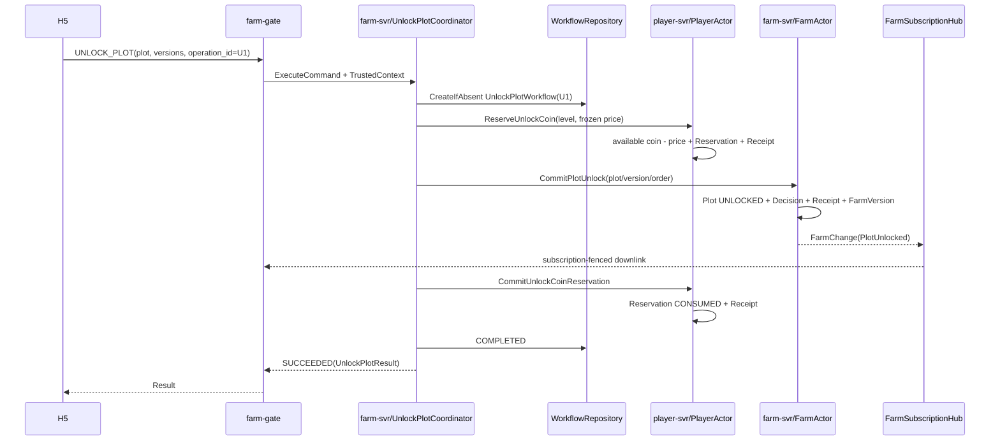
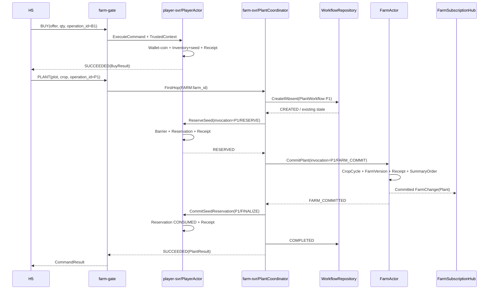
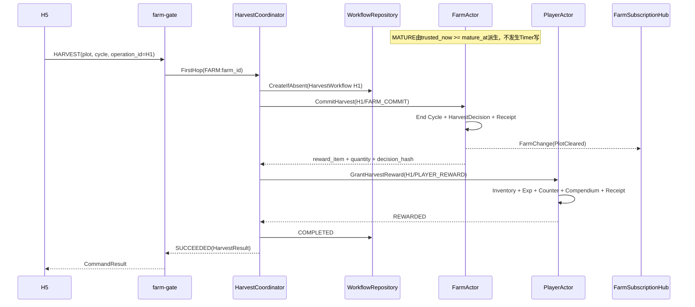
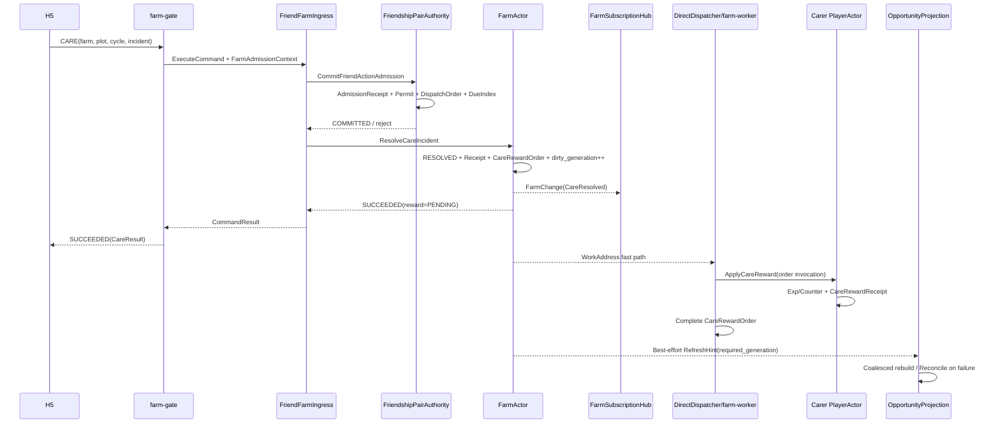
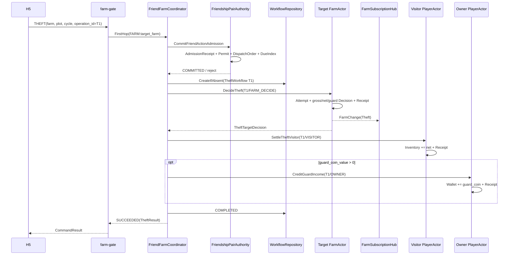

# 32 · 经典农场核心业务场景合同

版本：`v0.29-downstream-contract-navigation-freeze-candidate`
日期：2026-08-03
定位：把 26～31 号及第 33 号已经确认的稳定接入、路由、Actor、Workflow、Redis、好友准入和容量语义，落成可实现的
Buy、Sell、UnlockPlot、Plant、成熟、Harvest、Care、Theft 核心业务合同，并建立完整 P0 场景覆盖总账。本文
回答“玩家点击后经过哪些服务、哪个 Actor 说了算、写哪些事实、客户端看到什么、失败后如何恢复”，
不重新定义上层协议和存储脚本。

本版完成 CareOperationReceipt、稳定 CareResult、FarmOpportunityHeader、PlotVersion、StableOpaqueID 和
FarmChange PostCommitDeliveryGuard 接缝的跨文档收口；不改变第 33 号 ActionAdmission、双 Actor 或
Workflow/Order 主链。
本版再按第 36 号收口宠物守护接缝：FarmActor 安装完整 GuardSnapshot；Feed 只改内部记录，真正
Switch 才通过 FarmMetaDelta 公开宠物外观，守护时间、概率与规则版本始终保持私有。
本版再按第 37 号把图鉴解锁从“Harvest 时临时判断”收口为 Plant 冻结资格、CropCycle 持有
`CompendiumUnlockSnapshot`、Harvest 原样传递并在 PlayerActor 保存原始 `CompendiumUnlockDelta`；
同时统一公网解锁 ID 为 `crop_definition_id`。
本版清理已经被第 33～37 号正式承接的历史待办导航，并把任务进度接缝统一为同一 PlayerActor
Turn、现有 Harvest/Theft Participant、CareRewardOrder 与 `CONFIRM_FRIEND_VISIT`，不再描述不存在的
通用任务事件消费者或任务进度 Order。

权威关系：

- [26-access-session-contract.md](./26-access-session-contract.md)：登录、Session、Join、Subscription、
  Ready Cut 和实时下行；
- [27-access-routing-actor-workflow-freeze.md](./27-access-routing-actor-workflow-freeze.md)：Actor、路由、
  场景总体职责和 Workflow/Order；
- [28-command-catalog-public-protocol.md](./28-command-catalog-public-protocol.md)：公网命令、状态、
  RetryDirective 和 FarmFrame；
- [29-internal-rpc-trusted-context.md](./29-internal-rpc-trusted-context.md)：FirstHop、Coordinator、
  Participant、Worker 的内部调用；
- [30-actor-authority-store-contract.md](./30-actor-authority-store-contract.md)：权威提交、Receipt、Order、
  Unknown、Persistence Lane；
- [31-actor-authority-redis-physical-contract.md](./31-actor-authority-redis-physical-contract.md)：Redis 物理
  布局、容量、有界队列、Projection 和热点 Farm；
- [33-friendship-share-access-contract.md](./33-friendship-share-access-contract.md)：canonical 好友关系、
  VisitPermit、逐 operation ActionAdmission 与删除/拉黑线性化；
- [core-scenario-casebook.md](./core-scenario-casebook.md)：把 C01 登录/Join、C02～C05 核心经营与互动、
  C06 迁移恢复和 C07 好友机会串成可 Review 案例；它只解释本文及 26～37 号合同，不拥有新规则。

本文状态：`CANDIDATE`。第 32 号详细冻结目标只包括 S02～S10 的个人经营和好友农场核心互动；
任务、邮件、宠物管理、图鉴、好友关系和分享在本文只登记与核心经营的接缝，其完整语义已由第 33～37
号分别拥有。本文使用：

- `FROZEN_INPUT`：26～31 号、第 33 号或此前产品讨论已经确认，不在本文反转；
- `FROZEN_32`：已经在第 32 号逐项讨论中确认，后续实现与评审以该规则为准；
- `FROZEN_37`：图鉴页面、活动档案、Seen Fence 和解锁原结果已由第 37 号冻结，本文只承接 Plant/Harvest 接缝；
- `PROPOSED_32`：本轮给出的可实现默认值，需要逐节确认后才升级为冻结；
- `CONFIGURABLE`：语义固定、具体数值由版本化配置决定；
- `DOWNSTREAM_CONTRACT`：完整语义由第 33～37 号现行合同拥有，本文只引用核心经营接缝。

本文不把候选参数写成平台性能事实，也不因为暂时缺少数值而省略状态、幂等、失败和原子边界。

---

## 0. 先看全局：我们到底有哪些业务场景

### 0.1 不是每个功能都要一个服务

当前只有两个长期业务权威 Actor：

```text
PlayerActor(player_id)
├── Wallet / Inventory / ShopCounter
├── PetState
├── TaskProgress / TaskClaimReceipt
├── MailClaimReceipt / 个人系统邮件领取状态
├── CompendiumUnlock
└── OperationReceipt / ParticipantReceipt

FarmActor(farm_id)
├── Plot / CropCycle
├── CareIncident
├── TheftAttemptReceipt / TheftTargetDecision
├── GuardSnapshot
├── FarmVersion / FarmActivity
└── FarmOpportunitySummary 的来源事实
```

`player-svr` 和 `farm-svr` 是 Actor 的部署与入口承载，不代表每一个领域模块都拆成独立 svr。
任务、宠物、图鉴和邮件领取状态可以是 PlayerActor 内的逻辑模块；MailEntry 列表/正文可在 player-svr
内独立分页存储；好友关系可以是 player-svr 内的逻辑权威模块；查询副本、机会摘要和红点由读模块
访问 Projection Redis。只有出现独立流量、故障域、发布节奏或容量证据时才新增 Deployment。

### 0.2 场景按“参与的权威状态”分组

| 场景组 | 代表功能 | 权威参与者 | 是否跨 Actor | 共同处理方式 |
|---|---|---|---:|---|
| P：单 Player 写 | Buy、Sell、TaskClaim、MailClaim、PetFeed、PetSwitch | PlayerActor | 否 | 一个 Actor Turn + 一次 Player Authority Commit |
| F：单 Farm 写 | FarmRead、Crop 派生成熟、护理裁决、同场 FarmChange | FarmActor | 否/后续奖励异步 | FarmActor 串行裁决 + FarmVersion |
| PF：跨 Player/Farm | UnlockPlot、Plant、Harvest、Theft、GuardSync | PlayerActor + FarmActor | 是 | Coordinator 创建 Workflow/Order，Participant 各自可靠提交 |
| R：只读/查询 | FarmSnapshot、好友列表、机会标识、公开资料、红点 | Projection/ReadAPI，最终回权威 | 否 | 批量读副本，Top 候选精确检查 |
| S：实时会话 | Join、切农场、Care/Theft 后 FarmChange 广播 | FarmSubscriptionHub + Gate | 不拥有业务真值 | 共享 Snapshot/VersionRing + Subscription Fence |
| W：后台恢复 | Order 重试、Workflow 恢复、机会摘要更新、提醒 | farm-worker / 同步读写模块 | 可能 | DueIndex 发现 + Lease + Receipt 防重 |

“场景一样”指它们可以复用同一种技术模板，不表示业务事实相同。例如 Buy 和 MailClaim 都是
单 Player 写，但 MailClaim 还必须检查 MailClaimReceipt；Plant 和 Harvest 都是跨 Actor Workflow，
但它们的 Farm 不可逆提交点和补偿语义不同。

### 0.3 当前完整 P0 场景清单

| 编号 | 场景 | 本文状态 | 首跳/主要入口 |
|---|---|---|---|
| S01 | 登录、Join、Snapshot、切换、重连 | `FROZEN_INPUT`：由 26/C01 负责 | farm-gate → farm-svr |
| S02 | Buy 种子/普通道具 | `FROZEN_32`：Q32-01～Q32-02 | player-svr / PlayerActor |
| S03 | Sell 收获物/普通库存 | `FROZEN_32`：Q32-01～Q32-03 | player-svr / PlayerActor |
| S03A | UnlockPlot：达到等级后主动付费解锁土地 | `FROZEN_32`：Q32-09 | farm-svr / UnlockPlotCoordinator |
| S04 | Plant | `FROZEN_32`：单地块、规则版本、Reservation与失败恢复 | farm-svr / PlantCoordinator |
| S05 | 成熟派生与护理机会激活 | `FROZEN_32`：时间派生、无枯萎、单季周期 | FarmActor / FarmReadAPI |
| S06 | Harvest | `FROZEN_32`：单地块、Farm先提交、Player奖励原子到账 | farm-svr / HarvestCoordinator |
| S07 | 好友列表与机会标识 | `FROZEN_INPUT`：C07/31 已有主合同 | player-svr + farm-svr ReadAPI |
| S08 | 好友进入同一农场与实时同步 | `FROZEN_INPUT`：26/29/31；本文只引用业务准入 | farm-gate → farm-svr |
| S09 | Care：浇水/除虫 | `FROZEN_32`：Q32-04～Q32-05、Q32-08 | farm-svr / FriendFarmIngress |
| S10 | Theft：偷菜与宠物截留结算 | 产品语义 `FROZEN_32`：Q32-06A～Q32-06B | farm-svr / FriendFarmCoordinator |
| S11 | 宠物喂养/切换/守护同步 | `FROZEN_36`：服从第36号 | player-svr |
| S12 | 每日/成长/临时任务 | `FROZEN_34`：服从第34号 | player-svr |
| S13 | 系统邮件与附件领取 | `FROZEN_35/35A`：服从第35/35A号 | player-svr |
| S14 | 图鉴解锁/活动档案 | `FROZEN_37`：解锁触发参与 S06；完整查询、红点与活动档案服从第37号 | player-svr |
| S15 | 分享、加好友、删除、拉黑 | `FROZEN_33/33A`：服从第33/33A号 | player-svr |
| S16 | 红点、通知与通用投影刷新 | Core Opportunity由31/C07负责；任务/邮件/图鉴分别服从34/35/37 | worker + ReadAPI |

第 32 号不复制 S11～S16 的详细设计；它们出现在总账里是为了保证核心链路接缝没有遗漏，而不是为了把
所有玩法再次塞进一份巨型文档。其完整语义以对应第 33～37 号为准。

### 0.4 Farm 地块规模输入

`FROZEN_32` 产品输入：每个农场最多 24 块土地，新玩家初始解锁 5 块。达到版本化
`PlotUnlockRule.required_level` 只会让目标土地进入“可购买”状态，不会自动解锁；玩家必须主动点击并
支付配置的普通金币，购买成功后 FarmActor 才把该 Plot 改成已解锁。24 个 Plot 仍全部属于同一个
FarmActor；该数量不会推动 PlotActor 拆分。Snapshot 可以返回 24 个稳定 Plot Slot，未解锁项携带锁定
状态、要求等级、价格和规则版本；未购买成功前不能执行 Plant、Harvest、Care 或 Theft。

---

## 1. 每个场景统一使用的合同模板

第 32 号不再只画架构框，而是每个场景都填写下面九项：

1. 玩家动作与产品结果：玩家点击什么、页面显示什么；
2. Admission：Session、当前 Subscription、好友关系、目标 Farm 条件；
3. FirstHop：Gate 把命令送到哪个业务入口，为什么；
4. Authority Participants：哪些 Actor 最终裁决哪些事实；
5. Workflow/Order：是否需要独立 Workflow、来源局部 Order 或不需要；
6. 原子写集合：一次可靠提交必须同时写哪些事实和 Receipt；
7. 返回与推送：`SUCCEEDED/PROCESSING/REJECTED/NO_CHANGE`、Result 和 FarmChange；
8. 重试与失败：原 operation_id 是否复用、如何处理 Unknown、是否补偿；
9. 验收断言：并发、崩溃、重复调用、旧版本和热点测试如何证明正确。

### 1.1 FirstHop 不等于最终裁决者

```text
FirstHop Coordinator
→ 完成Execution-Accept并CreateIfAbsent可靠Workflow
→ 编排Participant
→ 同步预算内终结则返回SUCCEEDED/REJECTED/NO_CHANGE
→ 已有可靠锚点但尚未终结则返回PROCESSING

PlayerActor/FarmActor
→ 负责自己的权威数据和最终业务裁决

DirectDispatcher/farm-worker
→ 负责可靠后续推进，不拥有业务事实
```

公网 `ACCEPTED` 只用于第 26/28 号 Join 运行时协议，不能用于 UnlockPlot、Plant、Harvest、Theft 等
跨 Actor 业务 Workflow；内部 `Execution-Accept` 也不能直接映射成公网 `ACCEPTED`。

例如 Plant 首跳是 farm-svr，不代表 farm-svr 可以直接扣玩家种子；扣种子仍必须由 PlayerActor
裁决。Theft 首跳是目标 farm-svr，不代表 FarmActor 可以直接写访问者库存；访问者库存仍由访客
PlayerActor 提交。

### 1.2 统一 ID 与状态

所有跨 Actor 场景至少使用：

```text
request_id                 // 一次网络请求
operation_id               // 玩家一次业务意图，重试不变
workflow_id/order_id       // 服务端可靠进度
participant_invocation_id // 某 Participant Step 的幂等身份
payload_hash               // 防止同 operation_id 换 Payload
```

客户端看到 `PROCESSING` 时只能使用原 `operation_id` 查询或重试；不能生成新 operation_id 绕过旧
Workflow、Reservation、TheftAttemptReceipt 或 MailClaimReceipt。

### 1.3 核心场景共同业务不变量

以下是 S02～S10 共享的冻结输入：

```text
B1  客户端不能提交操作者player_id、价格、成熟时间、产量、奖励数量或随机结果。
B2  所有写命令都绑定operation_id + canonical payload_hash。
B3  旧Plot/CropCycle/Incident不能误作用到下一茬。
B4  每个Actor只裁决自己的权威；Coordinator不能直接改Player/Farm状态。
B5  同一FarmActor写操作串行；不同地块可都成功，但不承诺同Actor内部并行。
B6  业务成功边界必须能从Receipt/Workflow恢复，不能依赖内存响应已经送达。
B7  Farm公开变化先可靠提交，随后才进入FarmChange广播；广播失败不回滚业务。
B8  Projection、红点、提醒和任务异步刷新不参与核心业务成功裁决。
B9  trusted_now_ms在一个Actor Turn内只取一次；客户端时间不参与业务判断。
B10 数值配置必须带rule/config版本；在途CropCycle和首次随机结果不能被热更新重算。
```

### 1.4 P0 数值与批量策略

`FROZEN_32（Q32-01～Q32-03）`：

- Buy/Sell 是单一物品类型、指定正整数数量，并不是一次只能交易一个：例如一条 Buy 命令可以买20个
  同类种子，一条 Sell 命令可以卖35个同类作物；P0 不支持一条命令混合多个物品类型，一键批量收获和
  一键务农也不进入首版写合同；
- 玩家普通经营只使用普通金币，付费货币字段可以预留但不进入本轮命令；
- Shop 价格由服务端版本化配置决定；客户端携带期望 Offer/Rule 版本，旧价格页面拒绝成交并要求刷新；
- 普通偷菜所得与自己收获的同定义作物进入同一 Inventory Stack，默认均可出售；只有版本化
  `SellRule` 明确标记不可出售时才拒绝，不按来源拆分库存。

其余 `PROPOSED_32 / CONFIGURABLE` 默认值：

- 仓库首版不设实际容量上限，但保留容量策略接口；
- Crop、Shop、Care、Theft、Pet 数值来自版本化配置；客户端只提交 ID 和期望版本，不提交数值；
- 数值变化不改变本文的状态机、原子边界和幂等语义。

### 1.5 配置快照边界

```text
Shop交易
→ Authority提交时冻结offer_version、unit_price、quantity和total_amount

PlantWorkflow
→ CreateIfAbsent时冻结CropRuleSnapshot
→ FarmActor把mature_at、base_yield、stealable_limit、crop_unit_coin_value写入CropCycle

Care
→ Plant时冻结CarePlan、规则版本和最终due_at；P0使用固定偏移

Theft
→ 首次Farm裁决时冻结规则版本和宠物截留随机结果
```

热更新只能影响新创建的交易/周期/裁决。相同 operation_id 的恢复必须使用已经冻结的快照，不能重新
读取新价格、新成熟时长或重新随机。

---

## 2. Buy / Sell：单 PlayerActor 经济场景

### 2.1 为什么两个场景共用技术模板

Buy 与 Sell 都只修改 PlayerActor 的 Wallet、Inventory、Counter 和 Receipt，不需要 FarmActor、独立
Workflow 或 farm-worker。两者共用“单 Player 权威提交”模板，但保留独立命令、配置和审计语义：

```text
Gate
→ PLAYER Route Domain
→ PlayerIngress
→ PlayerActor一个Turn
→ PlayerAuthorityCommit
→ CommandResult
```

首版按 `R2_CRASH_DURABLE` 提交。以后即使压测允许普通经济命令进入 `R1_ACTOR_SOFT`，与 Plant
Reservation 紧邻时仍必须先经过 Durability Barrier。

准入沿用第 28 号：必须已认证且 Recovery 完成，但不要求当前 Farm Subscription；目标 PlayerID 只从
TrustedCommandContext 的 Session 取得，Buy/Sell Payload 不允许携带操作者 ID。

### 2.2 Buy 请求与结果

逻辑 Proto（字段号最终由 Proto 评审冻结）：

```protobuf
message BuyRequest {
  uint32 offer_id = 1;
  uint32 quantity = 2;
  uint64 expected_offer_version = 3;
}

message BuyResult {
  uint32 offer_id = 1;
  uint64 offer_version = 2;
  uint32 granted_item_id = 3;
  uint32 granted_quantity = 4;
  uint64 unit_price = 5;
  uint64 total_cost = 6;
  uint64 normal_coin_balance = 7;
  uint64 inventory_quantity = 8;
  uint64 player_record_version = 9;
}
```

Payload 不携带 player_id、币种、单价、总价或奖励物品；操作者来自 SessionPermit，交易内容来自服务端
`ShopOffer(offer_id, offer_version)`。

`quantity` 表示本次要购买的同类物品数量，允许大于1，满足
`1 <= quantity <= max_trade_quantity`；P0 普通种子按一份数量获得一个种子，即
`granted_quantity = quantity`。`total_cost = unit_price × quantity` 必须使用检查算术，任何乘法、库存
加法或余额减法溢出都在 Authority Commit 前拒绝。每条命令仍只有一个 `offer_id`，不是多商品购物车。

### 2.3 Buy 裁决与原子提交

```text
1. 幂等预检：EffectiveIdempotencyKey + payload_hash
2. 读取并校验ShopOffer：上架、时间、版本、购买限制
3. 校验quantity范围与total_cost无溢出
4. 校验Wallet.normal_coin >= total_cost
5. 生成Candidate
6. 同一次PlayerAuthorityCommit：
   Wallet.normal_coin -= total_cost
   Inventory[item_id] += granted_quantity
   ShopCounter[offer/period] += quantity
   EconomyAudit摘要
   AuthorityReceipt + StoredOperationOutcome
   Player RecordVersion++
7. 返回SUCCEEDED
```

`expected_offer_version` 与当前版本不一致时返回 `REJECTED/PRICE_CHANGED`，并可在错误详情中给出最新
Quote；本次不扣金币。相同 operation_id 的恢复继续使用首次已经提交/冻结的版本，不能按新价格再买
一次。

### 2.4 Sell 请求、结果与原子提交

```protobuf
message SellRequest {
  uint32 item_definition_id = 1;
  uint32 quantity = 2;
  uint64 expected_sell_rule_version = 3;
}

message SellResult {
  uint32 item_definition_id = 1;
  uint32 sold_quantity = 2;
  uint64 sell_rule_version = 3;
  uint64 unit_price = 4;
  uint64 total_income = 5;
  uint64 normal_coin_balance = 6;
  uint64 inventory_quantity = 7;
  uint64 player_record_version = 8;
}
```

```text
PlayerActor校验SellRule与库存
→ Inventory[item_id] -= quantity
→ Wallet.normal_coin += total_income
→ SellCounter/Audit摘要
→ AuthorityReceipt + StoredOperationOutcome
→ RecordVersion++
→ SUCCEEDED
```

`FROZEN_32（Q32-03）`：普通作物进入 Inventory 后不再区分“自己收获”还是“偷菜所得”，因此默认
都可出售。活动作物、任务
绑定物品和不可出售物品由 `SellRule.sellable=false` 控制；首版不通过物品来源建立多套堆叠。

### 2.5 返回与失败语义

| 条件 | 结果 | 是否修改金币/库存 |
|---|---|---:|
| quantity=0、越界、结构错误 | `REJECTED/INVALID_ARGUMENT` | 否 |
| Offer/Rule 不存在或未开放 | `REJECTED/OFFER_UNAVAILABLE` | 否 |
| 客户端版本过旧 | `REJECTED/PRICE_CHANGED` | 否 |
| 金币不足 | `REJECTED/INSUFFICIENT_COIN` | 否 |
| 库存不足/不可出售 | `REJECTED/INSUFFICIENT_ITEM` 或 `ITEM_NOT_SELLABLE` | 否 |
| Redis 明确提交 | `SUCCEEDED` | 是 |
| 提交超时未知 | `PROCESSING`，进入 Unknown Resolver | 未知，禁止新 operation 重做 |
| 相同幂等键、相同 Payload | 返回原结果 | 不重复写 |
| 相同幂等键、不同 Payload | `REJECTED/IDEMPOTENCY_CONFLICT` | 否 |

表中的“否”只表示不修改领域资产；越过 Execution-Accept 后形成的确定业务拒绝仍按第 28/30 号写入
幂等 Receipt 与 StoredOperationOutcome。结构错误和接纳前拒绝不写权威结果。

P0 仓库无实际容量上限，因此 Buy 不产生 `INVENTORY_FULL`；接口保留容量策略并不代表首版启用。

### 2.6 必测断言

- 两台客户端并发购买，PlayerActor 串行后余额和次数限制不超卖；
- 提交成功但响应丢失，相同 operation_id 不重复扣金币/发物品；
- 旧价格页面不能按旧价格成交，也不能由客户端篡改单价；
- total_cost/total_income 的乘法和余额加减均做溢出检查；
- Sell 不允许负数、零数量、不可出售定义或超过库存；
- Buy 后立即 Plant，Barrier 能把购买和 SeedReservation 的最新状态可靠提交。

---

## 2A. UnlockPlot：等级资格 + 主动付费购买

### 2A.1 产品与准入语义

`FROZEN_32（Q32-09）`：每个农场最多 24 块土地，初始 Plot 1～5 已解锁且不产生购买记录；Plot 6～24
按固定 `unlock_order` 依次购买。达到 `required_level` 只获得当前下一块土地的购买资格，玩家仍须主动
点击并支付版本化 `normal_coin_price`。不能跳过前置土地，也不能替好友购买。

公开命令要求：

```text
已认证、Recovery完成、存在自己的当前FarmSubscription
target_farm_id == admitted_farm_id == session.player_id
plot_id == 当前下一块可购买Plot
expected_plot_version与expected_unlock_rule_version匹配
```

候选公网 Payload：

```protobuf
message UnlockPlotRequest {
  uint64 target_farm_id = 1;
  uint32 plot_id = 2;
  uint64 expected_plot_version = 3;
  uint64 expected_unlock_rule_version = 4;
}
```

客户端不提交等级、价格或货币类型。价格来自服务端版本化 `PlotUnlockRule`；页面版本过旧时返回
`PRICE_CHANGED/RULE_VERSION_CHANGED`，刷新后由玩家重新确认，不按客户端旧价格成交。

### 2A.2 为什么由 farm-svr 首跳

UnlockPlot 的业务目标是 `farm_id + plot_id`，所以 Gate 首跳到 FARM Route Domain 的
`UnlockPlotCoordinator`。这不代表 farm-svr 可以扣金币：金币和等级仍由 PlayerActor 裁决，Plot 锁定
状态仍由 FarmActor 裁决。Gate 只选 FirstHop，不编排 Participant。

### 2A.3 Workflow 主链

```text
H5
→ farm-gate CommandCatalog(UNLOCK_PLOT)
→ farm-svr UnlockPlotCoordinator
→ CreateIfAbsent UnlockPlotWorkflow
→ PlayerActor.ReserveUnlockCoin
→ FarmActor.CommitPlotUnlock
→ PlayerActor.CommitUnlockCoinReservation
→ COMPLETED / SUCCEEDED
```

四个 Participant Step 的 Typed Payload/Result、确定性 ReservationID、InvocationID、Step/Result Hash
和首次执行状态，以第 29 号第 7.7～7.11 节为唯一内部 IDL；本节只拥有等级、价格、固定解锁顺序和
不可逆点等业务语义。

Workflow 必须在任何资产预留之前可靠创建，并冻结：

```text
workflow_id / operation_id / payload_hash
owner_player_id / farm_id / plot_id
expected_plot_version
unlock_order / previous_plot_id
required_level
normal_coin_price
unlock_rule_version
```

相同 operation_id 的恢复始终使用该快照；规则热更新只影响新创建的购买意图。

### 2A.4 PlayerActor 金币预留

`ReserveUnlockCoin` 在一个可靠 PlayerActor Turn 中：

```text
校验Player.level >= required_level
校验Wallet.available_normal_coin >= normal_coin_price
Wallet.available_normal_coin -= normal_coin_price
UnlockCoinReservation(workflow_id, amount, rule_version, status=RESERVED)
ParticipantReceipt(RESERVE_UNLOCK_COIN)
Player RecordVersion++
```

Reservation 与当前全部 Player Soft 状态一起经过 Durability Barrier；不能只在内存里减少可用金币后就
让 FarmActor 永久解锁土地。等级不足或金币不足属于明确 `REJECTED`，此时不调用 FarmActor。

### 2A.5 FarmActor 不可逆提交

`CommitPlotUnlock` 在同一个 FarmActor Turn 中重新检查：

```text
owner/farm/plot与Workflow一致
目标Plot仍为LOCKED
plot_version与Workflow快照匹配
目标Plot是当前next_unlock_order
previous_plot_id为空或已经UNLOCKED
```

通过后一次 Authority Commit 写入：

```text
Plot.lock_state = UNLOCKED
Plot.unlock_workflow_id = workflow_id
Plot.unlock_rule_version = frozen_rule_version
Plot.unlocked_at_ms = trusted_now_ms
PlotVersion++
FarmVersion++
FarmOpportunityHeader.source_farm_version = new FarmVersion
PlotUnlockDecision
ParticipantReceipt(COMMIT_PLOT_UNLOCK)
构造候选CommittedFarmChange(PlotUnlocked)
```

Farm 提交是不可逆点。之后 Player Reservation 即使暂时未 Finalize，也不能把土地重新锁回去，只能由
Coordinator/farm-worker 继续完成扣款。

PlayerActor 收到与 WorkRecord 中 Farm Result Hash 一致的 `CommitUnlockCoinReservation` 后，在一个
可靠 Turn 中提交：

```text
UnlockCoinReservation RESERVED → CONSUMED
ParticipantReceipt(COMMIT_UNLOCK_COIN_RESERVATION)
Player RecordVersion++
```

该步骤只是确认预留金币永久消费，不再次减少 Wallet。

### 2A.6 补偿、结果与并发

Farm 明确拒绝且没有 `COMMIT_PLOT_UNLOCK` Receipt 时：

```text
PlayerActor.ReleaseUnlockCoinReservation
→ available_normal_coin += amount
→ Reservation = RELEASED
→ ParticipantReceipt(RELEASE_UNLOCK_COIN_RESERVATION)
→ Workflow = COMPENSATED
```

Farm 已提交而 Finalize 仍 Pending 时，客户端看到：

```text
PROCESSING：土地已解锁，扣款确认中
```

同一 operation_id 继续查询原结果，不得重新发起另一笔购买。只有 Reservation 已转为 `CONSUMED` 后才
返回顶层 `SUCCEEDED`。公开结果冻结为：

```protobuf
message UnlockPlotResult {
  uint64 farm_id = 1;
  uint32 plot_id = 2;
  uint64 applied_unlock_rule_version = 3;
  uint64 paid_normal_coin = 4;
  uint64 normal_coin_balance = 5;
  uint64 committed_plot_version = 6;
  uint64 committed_farm_version = 7;
}
```

`normal_coin_balance` 使用 `ReserveUnlockCoin` ParticipantReceipt 中与预留线性化点一致的
`balance_after_reserve`，表示该笔金额预留后的可支配普通金币；不能在 Workflow 最后完成时重新读取一个
已经被后续 Buy/Sell 改变的当前余额，拼进原 operation 的稳定结果。

并发规则：

- 两个不同 operation 同时购买同一 Plot：FarmActor 只接受第一个匹配 PlotVersion 的 Workflow；另一个
  释放自己的金币 Reservation；
- 重复调用同一 operation：命中 Workflow/Participant Receipt，不能重复扣款；
- 目标已由另一个 operation 解锁：先可靠释放本次 Reservation；只有
  `Reservation=RELEASED + RELEASE_UNLOCK_COIN_RESERVATION Receipt` 已提交后才发布终态
  `NO_CHANGE/ALREADY_UNLOCKED`，释放仍在进行时返回 `PROCESSING`；
- 同时尝试购买 Plot 6 和 Plot 7：固定顺序使 Plot 7 在 Plot 6 提交前明确拒绝；
- 如果 Plot 6 先由 FarmActor 提交，Plot 7 随后进入 Turn 时已经成为合法 next plot，且自身资格、版本、
  金币 Reservation 均有效，则两笔独立 operation 可以按顺序都成功；
- Farm 提交成功但响应丢失：根据 `Plot.unlock_workflow_id` 与 Participant Receipt 恢复为已提交；
- 旧价格、旧 PlotVersion、等级不足和金币不足均不得留下 Farm 或 Player 的部分事实。

### 2A.7 错误、重试与 H5 Journal

| 条件 | CommandStatus / ErrorCode | 客户端动作 |
|---|---|---|
| 等级不足 | `REJECTED/LEVEL_REQUIREMENT_NOT_MET` | 展示所需等级，结束本 operation |
| 普通金币不足 | `REJECTED/INSUFFICIENT_COIN` | 展示余额不足，结束本 operation |
| 规则或价格已变化 | `REJECTED/RULE_VERSION_CHANGED` | 刷新土地信息，用户确认后使用新 operation |
| PlotVersion 过旧 | `REJECTED/STALE_PLOT_VERSION` | 应用最新 Snapshot/Delta 后重新判断 |
| 前置土地尚未解锁 | `REJECTED/PREVIOUS_PLOT_LOCKED` | 刷新固定解锁顺序 |
| 目标已由其他 operation 解锁 | `NO_CHANGE/ALREADY_UNLOCKED` | 应用最新 Plot 状态，不重复扣款 |
| Workflow 已创建或 Farm 已提交 | `PROCESSING` | 保留原 operation_id 查询，禁止新建购买意图 |
| 全部 Participant 完成 | `SUCCEEDED` | 应用 UnlockPlotResult 并清理 Journal |

H5 必须在首次发送前把 `operation_id + UnlockPlotRequest bytes + schema_version` 写入 Operation Journal。
弱网或断线后先恢复自己的 FarmSubscription，再用原 operation_id 查询/重发同一 Payload；更换 plot_id、
PlotVersion 或规则版本会改变 CanonicalPayloadHash，必须得到 `IDEMPOTENCY_CONFLICT`。只有取得可证明的
终态后才能清理 Journal。

---

## 3. Plant：Player Reservation + Farm Commit

### 3.1 产品语义

玩家选择一块自己的空地和一种种子。成功后，种子被消费并创建 CropCycle；失败不能凭空消耗种子。
作物成熟不是定时器写状态，而是由 `trusted_now_ms >= mature_at` 派生。

`FROZEN_32（S04 Plant）`：P0 一次 Plant 只种一块地、消费一颗由服务端 CropDefinition 映射出的对应
种子；Plant 本身不发经验，经验主要由 Harvest 和有效 Care 产生。命令必须满足：

```text
target_farm_id
== TrustedCommandContext.farm_context.admitted_farm_id
== TrustedCommandContext.session.player_id

plot_id已解锁
expected_plot_version匹配
目标Plot为空
crop_definition_id存在且当前允许使用该种子
expected_crop_rule_version匹配服务端当前可用规则
```

公网请求冻结为：

```protobuf
message PlantRequest {
  uint64 target_farm_id = 1;
  uint32 plot_id = 2;
  uint32 crop_definition_id = 3;
  uint64 expected_plot_version = 4;
  uint64 expected_crop_rule_version = 5;
}
```

客户端不提交 `seed_item_id`、成熟时间、产量、偷菜比例、CarePlan 或任何奖励数值。旧作物规则页面
返回 `RULE_VERSION_CHANGED`，要求刷新后重新确认，不能让客户端以旧展示数据悄悄种下新规则作物。

活动结束后遗留种子仍可播种，因此“活动当前是否开放”不能简单否决已经合法持有的遗留种子；具体由
CropDefinition 的 `legacy_seed_plantable` 配置表达。

### 3.2 主链

```text
H5
→ farm-gate CommandCatalog(PLANT)
→ farm-svr PlantCoordinator（目标 farm_id/plot_id）
→ CreateIfAbsent PlantWorkflow
→ PlayerActor.ReserveSeed
→ FarmActor.CommitPlant
→ PlayerActor.CommitSeedReservation
→ COMPLETED / SUCCEEDED
```

四个 Participant Step 的 Typed Payload/Result、确定性 ReservationID/CropCycleID、InvocationID、
CropRuleSnapshot 与 Step/Result Hash，以第 29 号第 7.7～7.11 节为唯一内部 IDL；公网
`PlantRequest` 不得直接转发给 PlayerActor 或 FarmActor。

Plant 首跳选择 farm-svr，是因为业务目标是“某座 Farm 的某块 Plot 创建 CropCycle”；种子属于
PlayerActor，只决定 ReserveSeed 必须由 PlayerActor 裁决，不决定 Coordinator 必须在 player-svr。

`PlantWorkflow CreateIfAbsent` 必须先于 Reservation。Workflow 使用
`EffectiveIdempotencyKey(subject_player_id, PLANT, operation_id,
FARM_ACTOR:target_farm_id)` 通过 `farm-workflow-id-v2` 确定性派生 workflow_id，并在创建时冻结：

```text
PlantWorkflowPayload {
  owner_player_id
  target_farm_id
  plot_id
  expected_plot_version
  crop_definition_id
  expected_crop_rule_version
  seed_item_id
  crop_rule_snapshot             // 内含CompendiumUnlockRuleSnapshot
  crop_cycle_id
  payload_hash
}
```

`crop_cycle_id` 在 Workflow 首次创建时生成并持久化；Participant 重试不得生成新的周期 ID。
PlantCoordinator 在创建 Workflow 前读取当前版本化 CropDefinition，比较
`expected_crop_rule_version`，并由服务端映射 `seed_item_id`。一旦 WorkRecord 创建，后续恢复只使用
其中冻结的 CropRuleSnapshot；相同 operation 不得因配置热更新换用新版本。

### 3.3 Participant 原子边界

PlayerActor.ReserveSeed：

```text
Inventory.available_seed -= 1
Reservation(seed_item_id, quantity=1, workflow_id, status=RESERVED)
ParticipantReceipt(RESERVE_SEED)
Player RecordVersion++
```

ReserveSeed 还需校验 Reservation 与 Workflow 的 player/crop/quantity 摘要一致。已有相同 Invocation 的
Receipt 时返回原结果；库存不足则明确拒绝，Workflow 进入可终结的失败分支。

FarmActor.CommitPlant：

```text
校验plot为空、expected_plot_version匹配
plant_at = 本次FarmActor Commit Turn捕获的trusted_now_ms
创建CropCycle(
  crop_definition_id,
  rule_version,
  plant_at,
  mature_at,
  base_yield,
  stealable_limit,
  crop_unit_coin_value,
  steal_plan_snapshot {
    policy_version,
    total_cap_ratio_bp,
    slot_ratio_bp[],
    slot_quantity[]
  },
  care_plan_snapshot {
    care_rule_version,
    schedule_mode,
    incidents[] {
      incident_id,
      care_type,
      due_at_ms
    },
    random_seed? // P0 FIXED_OFFSET 不使用；未来随机窗口模式才填写
  },
  compendium_unlock_snapshot {
    crop_definition_id
    unlock_eligible
    planted_by_player_id
    activity_id?
    catalog_version_at_plant
    definition_version_at_plant
  }
)
PlotVersion++
FarmVersion++
ParticipantReceipt(COMMIT_PLANT)
FarmOpportunityHeader / opportunity_dirty_generation++
构造候选CommittedFarmChange(Plant)
```

`CropRuleSnapshot` 至少冻结：成熟时长、基础产量、收获经验、StealPlan、最大可偷总量、宠物折价
单价、Care 规则版本，以及第 37 号 `CompendiumUnlockRuleSnapshot`。FarmActor 使用受信 owner 写入
`planted_by_player_id` 后形成随 CropCycle 持久化的 `CompendiumUnlockSnapshot`；活动结束、Catalog
热更新、重试和迁移均不得重新判断这茬作物的图鉴资格。
`mature_at = trusted_now_ms + frozen_grow_duration`，需检查时间加法溢出。
这里的 `trusted_now_ms` 是 FarmActor 真正提交 CropCycle 时的时间，不是客户端点击时间，也不是 Workflow
创建或种子预留时间；Actor/Workflow 排队不会提前消耗作物成长时长。

Care 计划采用 `FROZEN_32（Q32-04）`：P0 每茬最多一个浇水机会和一个虫害机会，两类机会相互独立，
允许同时处于待处理状态。首版使用配置化的 `FIXED_OFFSET`，Plant 时根据 `plant_at + configured_offset`
一次性生成并持久化 `CarePlanSnapshot.incidents[]`；是否启用某类机会及其偏移量由作物规则配置决定。
因此演示、单测和压测可以稳定复现，不依赖进程 Timer。

未来正式上线若需要随机时间，只新增版本化的 `DETERMINISTIC_RANDOM_WINDOW` 调度策略：Plant 时使用
稳定种子在配置窗口内计算一次并把最终 `due_at_ms` 写入同一 CarePlan；在途作物不因配置热更新重新
抽取。使用有界 `incidents[]` 而不是固定两个状态字段，是为了以后调整每茬次数时不改 CropCycle 主体
结构。相同 CropCycle 重载或重试必须得到相同 Incident ID 和时间。

PlayerActor.CommitSeedReservation：

```text
Reservation状态 RESERVED → CONSUMED
ParticipantReceipt(COMMIT_SEED_RESERVATION)
```

P0 不在该 Finalize Turn 增加 Plant 经验或任务进度。以后若产品增加种植奖励，必须在 Farm 已提交后由
该 Player Finalize 阶段或其唯一可靠后续步骤发放，不能在 ReserveSeed 时提前发奖。

所有 Participant Receipt 与本次事实同一次 Authority Commit。Farm 提交前失败时 Workflow 释放
Reservation；Farm 已提交后不能退款，只能继续完成 Reservation Finalize。

释放流程：

```text
FarmActor明确REJECTED且从未提交CropCycle
→ PlayerActor.ReleaseSeedReservation
→ available_seed += 1
→ Reservation = RELEASED
→ ParticipantReceipt(RELEASE_SEED_RESERVATION)
→ Workflow = COMPENSATED
```

Farm Commit 或 Release 的结果未知时，Workflow 先查询 ParticipantReceipt；不能仅凭 RPC Timeout
猜测应该退款。

### 3.4 返回与失败

| 阶段 | 对客户端语义 |
|---|---|
| 参数/权限/地块前置失败 | `REJECTED`，不创建有效作物 |
| 作物规则版本过旧 | `REJECTED/RULE_VERSION_CHANGED`，刷新规则后使用新 operation |
| Workflow 已创建，跨 Actor 尚未结束 | `PROCESSING`，必须保留 operation_id |
| Farm 已提交、Reservation 尚未完成 | `PROCESSING`，不能告诉玩家种植失败 |
| 全部 Participant 完成 | `SUCCEEDED`，返回 crop_cycle_id、farm_version、mature_at |
| 同 operation_id 重试 | 返回原 Workflow/原结果，不重复扣种子 |

逻辑 Result：

```protobuf
message PlantResult {
  uint64 farm_id = 1;
  uint32 plot_id = 2;
  string crop_cycle_id = 3;
  uint32 crop_definition_id = 4;
  uint64 committed_plot_version = 5;
  uint64 committed_farm_version = 6;
  int64 plant_at_ms = 7;
  int64 mature_at_ms = 8;
  uint64 applied_crop_rule_version = 9;
}
```

Farm Commit 后会先广播已提交的 Plant FarmChange；即使 Player Reservation 尚在 Finalize，其他同场玩家
也应看到作物已经种下。广播失败不回滚 CropCycle，由 Snapshot/VersionRing/Rejoin 恢复。

### 3.5 必测断言

- ReserveSeed 响应丢失后重试不重复扣种子；
- Farm Commit 前崩溃可释放 Reservation；
- Farm Commit 后崩溃最终一定 Finalize Reservation；
- Plant 与 Harvest/Plant 同一 Plot 并发时只有一个符合 expected version；
- 同一玩家并发种不同 Plot 时，只要种子足够且各 PlotVersion 匹配，所有命令都可成功；
- 旧 Subscription、旧 Plot 版本和旧 CropCycle 不能误种下一茬；
- 旧 CropRuleVersion 必须在 Work 创建前拒绝，不能按客户端旧展示规则成交；
- `plant_at` 等于 Farm Commit Turn 的受信时间，不受客户端时间和 Workflow 排队时长影响；
- Barrier 能把此前尚未可靠保存的 Buy 结果与 Plant Reservation 一起提交；
- Workflow Create 成功后 Coordinator 崩溃，worker 能从原 WorkRecord 继续推进；
- 活动配置热更新不改变已经创建 Workflow/CropCycle 的成熟时间、产量和单价；
- Plant 成功不会在 P0 额外增加经验；
- P0 固定偏移在重载、迁移和重试后产生相同护理计划；未来随机窗口模式的相同稳定种子也必须如此；
- FarmChange 投递失败后，重新 Join 的 Snapshot 仍包含已提交 CropCycle。

---

## 4. 成熟与 Harvest：Farm 先冻结结果，Player 再到账

### 4.1 成熟是时间派生

CropCycle 持久保存 `plant_at/mature_at`，不为每个作物创建一个成熟 Timer，也不要求 Scheduler 把
作物改成 `MATURE`。任何 FarmActor 读/写裁决都使用一次 Turn 捕获的 `trusted_now_ms`：

```text
trusted_now_ms < mature_at → 未成熟，不能收获、不能偷菜
trusted_now_ms >= mature_at → 成熟，可进入收获/偷菜裁决
```

Scheduler 只在后续需要“提醒玩家”时，到 `next_due_at` 唤醒并触发通知候选；故障不影响成熟正确性。

严格区分持久生命周期与展示阶段：

```text
持久生命周期：EMPTY → ACTIVE_CROP → ENDED
展示阶段：phase(cycle, trusted_now_ms) = GROWING | MATURE
```

`FROZEN_32（S05）`：P0 不存在 WITHER/枯萎状态，也不支持多季作物。一个 Plant 只创建一个单季
CropCycle；达到 `mature_at` 后可以无限期保持 MATURE，直到农场主执行 Harvest。收获后本周期进入
ENDED，Plot 回到 EMPTY；再次生产必须重新播种。即使成熟提醒、Scheduler、Projection 或玩家长期
离线，重新读取时仍按同一时间公式得到 MATURE。

到达 `mature_at` 本身不产生一次 Redis 写。FarmSnapshot、BatchEvaluate、Harvest 和 Theft 都根据同一
公式得到阶段，避免一亿作物 Timer 和“提醒没执行所以永远不成熟”。

护理机会同理：种植时已经冻结 CarePlan 中每个 Incident 的 `due_at_ms` 与确定性 Incident ID。时间到达
后，Snapshot 可以直接展示待护理状态；首次 Care 提交时同时确认该 Incident 已到期并写入 RESOLVED
事实。无需先写一次 `PENDING → ACTIVE`。如果 Scheduler/Projection 尚未刷新，好友列表仍可依据
`next_opportunity_at` 把该 Farm 纳入精确检查。

`FROZEN_32（Q32-04）` 还明确：P0 未处理的浇水或虫害不改变 `mature_at`、`base_yield` 或可偷份额，
它们只提供护理互动与奖励机会；CropCycle 收获结束时，仍未解决的 Incident 一并结束。以后若产品需要
减产或延长成熟时间，必须作为新的版本化 CareRule 显式引入，不能改变旧 CropCycle 的冻结结果。

### 4.2 Harvest 主链

`FROZEN_32（S06）`：P0 一次 Harvest 只收获自己农场的一块成熟土地。未解决的浇水或虫害不阻塞
Harvest；仓库首版无容量上限，因此不会出现 Farm 已清空但因仓库满而拒绝奖励。好友不能执行正常
Harvest，只能通过 Theft/Care 与该 CropCycle 互动。

```text
H5
→ farm-gate CommandCatalog(HARVEST)
→ farm-svr HarvestCoordinator
→ CreateIfAbsent HarvestWorkflow
→ FarmActor.CommitHarvest
→ PlayerActor.GrantHarvestReward
→ COMPLETED / SUCCEEDED
```

两个 Participant 的完整 Typed Payload/Result、HarvestDecision、InvocationID 和依赖 Result Hash，以
第 29 号第 7.12 节为唯一内部 IDL；本节拥有成熟、产量、奖励、图鉴与客户端表现等业务语义。

HarvestWorkflow 在创建时冻结：owner、farm、plot、crop_cycle_id、expected_plot_version 和 payload_hash；
奖励数值不由 Coordinator 预先计算，必须由 FarmActor 在不可逆提交点根据当前已偷数量决定。

命令要求 Recovery 完成且存在自己的当前 Subscription：

```text
target_farm_id
== admitted_farm_id
== session.player_id
```

好友不能替主人执行正常 Harvest；好友只通过 Theft/Care 操作。

### 4.3 FarmActor 不可逆提交

FarmActor 同一次可靠提交写入：

```text
校验owner、plot、crop_cycle_id、expected_plot_version和trusted_now_ms >= mature_at
CropCycle ACTIVE_CROP → ENDED(reason=HARVESTED)
Plot清空
最终 reward_item_id/reward_quantity
HarvestDecision（必须原样携带CropCycle.CompendiumUnlockSnapshot，并使用第29号7.12.1完整自包含结构）
ParticipantReceipt(COMMIT_HARVEST)
PlotVersion++
FarmVersion++
FarmOpportunityHeader / opportunity_dirty_generation++
构造候选CommittedFarmChange(Harvest)
```

最终收获量：

```text
reward_quantity = base_yield - stolen_amount
```

同时满足：

```text
0 <= stolen_amount <= stealable_limit <= base_yield
reward_quantity == owner_claimable
```

Farm 提交后不能恢复 CropCycle。若 PlayerActor 暂未到账，客户端看到：
`PROCESSING：收获已确认，作物到账中`，Workflow 继续恢复，不能再次收获同一周期。

### 4.4 PlayerActor 到账与图鉴

`FROZEN_32（Q32-07）`：PlayerActor 必须在一次可靠 Authority Commit 中提交本次收获产生的普通库存、
经验/等级、收获计数、首次自种收获图鉴解锁和全部防重 Receipt，不能把这些结果拆成可能彼此丢失的
独立保存。

PlayerActor 同一次可靠提交写入：

```text
Inventory += reward_quantity
RewardReceipt(workflow_id/crop_cycle_id)
Exp/Progression += frozen_reward_exp
HarvestCounter更新
CompendiumUnlock(crop_definition_id)   // 若此前未解锁
CompendiumUnlockDelta(newly_unlocked, crop_definition_id?, compendium_revision_after)
ParticipantReceipt(GRANT_HARVEST)
StoredOperationOutcome（内嵌原始CompendiumUnlockDelta）
```

图鉴解锁必须与“成功收获奖励到账”绑定，偷来的作物不触发首次自种收获解锁。重复 Workflow/重试
命中 Receipt 后不重复增加库存、经验、任务进度或图鉴状态。PlayerActor 只校验 HarvestDecision 中由
Plant 时冻结、随 CropCycle 持久化的 `CompendiumUnlockSnapshot`，不得在奖励 Turn 内重新读取当前
Catalog。ParticipantReceipt 和 StoredOperationOutcome 必须保留本次操作首次提交时的原始 Delta；即使
随后另一笔 Harvest 改变了当前集合，重试仍返回原操作自己的 true/false、条目 ID 和 Revision。

等级提高只改变 PlayerActor 的等级事实以及土地购买资格，不会在 Harvest 中自动修改 FarmActor 的
Plot 锁定状态。玩家后续必须通过独立 `UnlockPlot` 命令主动支付普通金币购买土地。

任务系统的完整 TaskProgress 规则留给后续支持系统合同；但 Harvest 必须产出唯一、可防重的
`HarvestCounter/HarvestedFact`，使任务模块无需根据不可靠 Push 猜测收获是否发生。若首版 TaskDomain
与 PlayerActor 同一 Authority Group，可在同一 GrantHarvestReward Turn 内同步推进匹配任务。

逻辑 Result：

```protobuf
message HarvestResult {
  uint64 target_farm_id = 1;
  uint32 plot_id = 2;
  string crop_cycle_id = 3;
  uint64 committed_farm_version = 4;
  uint32 harvested_quantity = 5;
  bool compendium_newly_unlocked = 6;
  optional uint32 unlocked_crop_definition_id = 7;
  uint64 compendium_revision = 8;
}
```

字段名和逻辑布局服从第 28 号公网协议；P0 统一使用 `crop_definition_id`，不得再引入含义不明的
plant/display/activity 别名。库存总量、经验和 PlayerRecordVersion 通过 Player 私有状态/Bootstrap 更新，不复制
进这个最小 HarvestResult。

`SUCCEEDED` 只在 PlayerActor 奖励 Receipt 已可靠提交后返回；Farm 已收空但奖励尚未完成时返回
`PROCESSING`。FarmChange 可以先让同场玩家看到地块已空，Owner H5 同时显示“奖励到账中”。

### 4.5 必测断言

- 未成熟收获必拒绝；
- Farm 决策成功而 Player RPC 超时，最终库存只增加一次；
- 收获与偷菜并发，权威 FarmActor 只接受一个可解释的先后顺序；
- 同一 CropCycle 不能被两个 HarvestWorkflow 重复结算；
- 首次成功收获解锁图鉴，重复收获不重复解锁/发奖；
- Catalog 在 Plant 后热更新或活动归档，Harvest 仍使用 CropCycle 冻结的解锁资格；
- 原 Harvest 响应丢失后又发生同植物 Harvest，查询原 operation 仍返回原始 UnlockDelta；
- 活动作物在活动结束后，已解锁内容仍完整展示，遗留种子仍可播种；
- Scheduler、Projection 和提醒全部关闭时，到点后的 Harvest/Theft 仍能正确判断成熟；
- 作物在 `mature_at` 后经过任意时长、Actor卸载或进程重启仍保持可收获，不会自动枯萎；
- 收获后 Plot 回到 EMPTY，不自动进入下一季，也不保留可再次收获的 CropCycle；
- 存在未解决护理 Incident 时仍可 Harvest，并在 CropCycle ENDED 时一并终结这些 Incident；
- 热更新产量/经验配置不改变在途 CropCycle 已冻结的 HarvestDecision；
- FarmChange 已广播但 Player 奖励仍 Pending 时，重连能从 Workflow/OperationResult 恢复真实状态；
- Harvest 与 Theft 竞争时，`base_yield = owner_reward + 全部gross_stolen`，不存在超产。

---

## 5. Care：Farm 全局 Incident + Player 异步奖励

### 5.1 产品语义

浇水、除虫都先按“地块上的全局待处理事件”处理，不是每个好友各自一次机会：

```text
CareIncident = ACTIVE
→ 第一个合法 Care 成功
→ CareIncident = RESOLVED
→ 后续合法请求返回 NO_CHANGE
```

同一 Incident 只有第一个有效处理者获得经验和好友互动任务进度。P0 使用作物配置中的固定相对偏移；
以后切换随机窗口时，随机结果必须在 Plant 时固定到 CarePlan，重试不能重新抽取。浇水和虫害互不排斥，
同一 CropCycle 可以同时存在两个未解决 Incident，但每个 Incident 仍独立执行“全局首次成功”。

`FROZEN_32（Q32-05）` 权限与奖励语义：农场主和有效好友都可以处理；第一个成功解决 Incident 的
处理者获得基础 Care 经验。只有玩家在有效好友农场护理成功时，才推进一次“好友互动”每日任务；
农场主处理自己的 Incident 不推进该任务。一个 Incident 的奖励只能属于首次解决者。

FarmActor 的 RESOLVED 事实与 `CareRewardOrder(PENDING)` 同一次来源权威提交。地块可以立即返回成功并
广播，处理者经验和任务进度由 DirectDispatcher/farm-worker 可靠投递到 PlayerActor；奖励稍晚到账不
回滚护理，也不允许客户端再次处理同一 Incident。机会摘要按第 31 号可重建投影合同处理，不占用
CareRewardOrder 的业务完成边界。

逻辑请求沿用第 28 号最小字段：

```protobuf
message CareRequest {
  uint64 target_farm_id = 1;
  uint32 plot_id = 2;
  string crop_cycle_id = 3;
  string incident_id = 4;
  CareType care_type = 5; // WATER | REMOVE_PEST
}
```

### 5.2 主链

```text
H5
→ farm-gate CommandCatalog(CARE)
→ farm-svr FriendFarmIngress
→ 校验当前Subscription
├→ OWNER护理：直接进入FarmActor Mailbox
└→ FRIEND护理：FriendshipPairAuthority.CommitFriendActionAdmission
→ 原子保存AdmissionReceipt + ActionPermit + DispatchOrder + DueIndex
   → DirectDispatcher/farm-worker可靠投递
→ FarmActor.ResolveCareIncident
→ Authority Commit：Incident + CareOperationReceipt + CareRewardOrder(PENDING)
   + Plot/FarmVersion + FarmOpportunityHeader/opportunity_dirty_generation++
├→ DirectDispatcher/farm-worker → PlayerActor.ApplyCareReward → CareRewardOrder(COMPLETED)
└→ 可合并OpportunitySummary刷新/Reconcile（不阻塞奖励Order）
```

Care 的 Farm 决策是同步权威事实；经验、任务进度等跨到处理者 PlayerActor，使用来源局部 Order
可靠发现和 Receipt 防重，不把两个 Actor 强行放入一个 Redis Lua。

Care 不创建独立 CareWorkflow。Owner 护理的 Execution-Accept 仍是 FarmActor Mailbox 接纳；好友护理
的 Execution-Accept 是第 33 号 Pair Authority ActionAdmission Commit。该来源 DispatchOrder 只负责把
原 operation 可靠送到 Farm，不承担护理奖励；奖励仍由 Farm 提交时创建的 CareRewardOrder 负责。

OperationResult 根锚点按第 33 号固定：Owner Care 使用 `FARM_ACTOR:own_farm_id` Root 并由
ResultDirectory直接登记 Farm Receipt；好友 Care 使用 `FRIEND_PAIR:pair_id` Root，
先登记 `FriendActionDispatchOrder` 的 Pair WorkAddress，Order 完成时把 `final_result_ref` 指向
`CareOperationReceipt/StoredOperationOutcome`。不得根据查询时是否仍为好友来猜结果位置。

### 5.3 Farm 原子提交

FarmActor 重新校验领域状态和受信授权绑定，不能相信客户端自报身份；好友关系不在 Actor Turn 内远程查询：

```text
target_farm_id == current admitted farm
请求者是owner，或持有与本operation绑定且在Execution-Accept时有效的ActionPermit
Plot/CropCycle仍匹配
Incident ID、CareType和确定性generation匹配
trusted_now_ms >= incident_due_at_ms
Incident尚未RESOLVED
```

删除/拉黑 Pair CAS 先提交时，新的 ActionAdmission 必须拒绝；ActionAdmission 先提交时，该 operation
已经可靠跨过 Execution-Accept，允许按原幂等身份完成。FarmActor 只验证已提交 Permit 与
operation/双方/farm/scope/target binding 的 Fence，不为此等待 FriendRelation RPC。

首次成功处理同一 Incident 时写入：

```text
CareIncident尚未resolved
+ trusted_now_ms >= incident_due_at_ms
→ 写入resolved_by_player_id / resolved_at_ms
CareResolutionSnapshot
CareOperationReceipt
CareRewardOrder(PENDING)
PlotVersion++
FarmVersion++
FarmOpportunityHeader / opportunity_dirty_generation++
构造候选CommittedFarmChange(CareResolved)
```

`ACTIVE` 是 `未resolved且trusted_now_ms >= due_at_ms` 的 Turn 内派生阶段，不持久化
`PENDING → ACTIVE` Timer 写入。`CareOperationReceipt` 是护理业务防重与稳定结果凭证；第 30 号裸
`ResolutionReceipt` 只用于 Unknown Resolver，不能在 Care 中复用。

后续请求如果 Incident 已 RESOLVED，返回 `NO_CHANGE`，不能创建第二个奖励 Order。若请求在关系、
目标农场、作物周期或版本校验阶段失败，则不消耗护理机会，也不产生奖励。

`FROZEN_32（Q32-08，按第31号上位合同修正）`：一次 Care 只创建一个业务必达 SourceOrder，即
`CareRewardOrder`；它只负责处理者奖励，不再承载可重建投影：

```text
PENDING
→ REWARD_DISPATCHING
→ PLAYER_REWARD_GRANTED
→ COMPLETED
```

`REWARD_DISPATCHING` 只表示 farm-worker 已持有当前恢复 Lease 并正在投递；
DirectDispatcher 的快速路径可以从 `PENDING` 直接完成奖励。它不是额外的业务效果，
也不改变 Order 仅以玩家奖励为完成边界的规则。

Farm Authority Commit 同时推进固定大小的 `opportunity_dirty_generation`。每 Farm/ProjectionKind 最多
维护一条可合并刷新状态，Projection Worker 按最大 required generation 重建 Summary；失败时由
Reconcile 恢复。不能为每次护理创建第二条不可合并 OpportunitySummaryUpdateOrder，投影失败也不能
阻止 CareRewardOrder 完成或反向拒绝新的 Care。

### 5.4 奖励与失败

`CareRewardOrder` 的最终 Participant 是处理者 PlayerActor：

```text
CareRewardReceipt(order_id)
→ 经验增加
→ care_context=FRIEND时，好友互动任务进度最多推进一次
→ 必要红点/任务投影异步更新
→ ParticipantReceipt(APPLY_CARE_REWARD)
```

Farm 事实、CareOperationReceipt 和 CareRewardOrder 明确提交后，Care 主操作已经成功，可以返回
`SUCCEEDED`。稳定结果只说明奖励义务已可靠创建，不把随后会变化的投递进度写进 StoredOutcome。
奖励仍 Pending 不是让玩家重新护理的理由。
只有 Farm Authority Commit 本身结果未知时，顶层命令才保持 `PROCESSING` 并由 Unknown Resolver
判断。DirectDispatcher 丢失、Player RPC 超时或 Worker 崩溃时复用原 order_id，不重复发经验和任务
进度。

`ApplyCareReward` 的 CareResolutionSnapshot、Typed Payload/Result、InvocationID、事件发生时间与
每日任务 Period 规则，以第 29 号第 7.14 节为唯一内部 IDL。

```protobuf
message CareResult {
  uint64 farm_id = 1;
  uint32 plot_id = 2;
  string crop_cycle_id = 3;
  string incident_id = 4;
  CareType care_type = 5;
  CareOutcome outcome = 6; // RESOLVED | ALREADY_RESOLVED
  uint64 resolved_by_player_id = 7;
  uint64 committed_plot_version = 8;
  uint64 committed_farm_version = 9;
  string care_reward_order_id = 10;
  bool reward_obligation_created = 11;
}
```

当前投递状态属于可变查询视图，可由 Player 私有 Push、Bootstrap 或 Order 查询表达为：

```text
CareDeliveryView {
  care_reward_order_id
  reward_delivery_status   // PENDING | APPLIED
  observed_at_ms
}
```

它不进入不可变 `CareResult/StoredOperationOutcome`；同一 operation 的恢复始终返回原 CareResult。
`SUCCEEDED/RESOLVED` 必须满足 `care_reward_order_id` 非空且 `reward_obligation_created=true`；
`NO_CHANGE/ALREADY_RESOLVED` 不创建 Order，两个字段分别为空和 `false`。

`NO_CHANGE/ALREADY_RESOLVED` 不产生 CareRewardOrder，也不增加经验或任务进度。

### 5.5 必测断言

- 两个好友同时浇水/除虫，只有一个 FarmActor Turn 返回成功；
- 第一个成功后其他人只能得到 `NO_CHANGE`；
- 成功护理后回到自己农场，OpportunitySummary 清除该护理机会；
- 奖励发送成功但 Order 更新响应丢失，不重复发奖；
- Farm 已解决但 Player 奖励未完成，Order 可由 DueIndex 恢复；
- 访问权限失效或好友被删除后，新的 Care 立即拒绝。
- Incident 尚未到 `due_at` 时，即使客户端伪造 incident_id 也必须拒绝；
- owner护理可获得基础奖励，但不会推进“好友互动”任务；
- Care成功后同场客户端只收到一个版本化 FarmChange；
- Player奖励已提交、Summary投影失败时，Care仍成功且CareRewardOrder可以完成；投影由合并刷新状态/
  Reconcile修复；
- 奖励延迟跨过每日零点时，任务Period按resolved_at而不是实际投递时间计算；
- SourceOrder容量不足时，Care事实不能先单独提交。

---

## 6. Theft：Farm 一次裁决，两个 Player 最终结算

### 6.1 产品规则与偷菜槽位

```text
未成熟作物不能偷
每名好友每茬最多一次合法 Attempt
stealable_limit = floor(base_yield × 20%)
主人至少保留的数量 = base_yield - stealable_limit
宠物截留的是本次 gross 偷取量中的作物，不扣访问者已有金币
被截留作物按本周期冻结单价换算给主人金币
```

非好友、未成熟、周期结束、无可偷份额等前置失败不消耗本茬偷菜机会。一次合法 Attempt 一旦由
FarmActor 提交，即消耗该好友本茬机会；即使宠物截留全部或部分作物，也不能重新尝试。

`FROZEN_32（Q32-06A）` 的 P0 配额语义：整茬累计最多被偷基础产量的 20%，主人至少保留 80%；
首版配置十个偷菜槽位，每个槽位占基础产量的 2%，所以一茬最多接受十名不同好友的合法 Attempt。
同一好友可以偷同一农场的不同 Plot，但对同一 Plot 的同一 CropCycle 只能成功进入一次裁决。

Plant 时把版本化 `StealPlanSnapshot` 写入 CropCycle：

```text
total_cap_ratio_bp = 2000
slot_ratio_bp = [200, 200, 200, 200, 200, 200, 200, 200, 200, 200]
slot_quantity[i]
  = base_yield × slot_ratio_bp[i] / 10000

stealable_limit
  = sum(slot_quantity[0..9])
  = base_yield × total_cap_ratio_bp / 10000
```

`FROZEN_32（Q32-12）` 进一步确定：启用该 P0 策略的 `base_yield` 必须是50的倍数，因此每个2%槽位
都能精确转换成大于0的整数，十槽总和恰好等于20%。配置发布时必须校验比例总和、精确整除、槽位
数量和算术溢出；不能创建“偷到0个但消耗机会”的合法Attempt，也不能在运行时临时四舍五入。

未来“第一个人较多、后续逐渐下降”只需发布新的有界 `slot_ratio_bp[]` 曲线，且总和仍不得超过 20%。
在途 CropCycle 继续使用种植时冻结的旧曲线；FarmActor 按权威 Turn 顺序消费下一个槽位，因此并发时
谁先获得较大槽位也有唯一、可解释的裁决顺序。

`FROZEN_32（Q32-06B）`：P0 宠物使用二元截留。GuardRule 中的触发概率保持配置化；未触发时
`guard_lost_quantity=0`，触发时完整截留当前槽位，即
`guard_lost_quantity=gross_stolen_quantity`。首版不会产生部分截留，但协议和内部 Decision 可以保留
`PARTIALLY_BLOCKED` 作为以后版本化 GuardRule 的扩展结果。

逻辑请求：

```protobuf
message TheftRequest {
  uint64 target_farm_id = 1;
  uint32 plot_id = 2;
  string crop_cycle_id = 3;
}
```

### 6.2 主链

```text
H5
→ farm-gate CommandCatalog(THEFT)
→ farm-svr FriendFarmCoordinator(target_farm_id)
→ FriendshipPairAuthority.CommitFriendActionAdmission
   → 原子保存AdmissionReceipt + ActionPermit + DispatchOrder + DueIndex
→ DirectDispatcher/farm-worker CreateIfAbsent TheftWorkflow
→ FarmActor.DecideTheft
→ VisitorPlayerActor.SettleTheft
→ OwnerPlayerActor.CreditGuardIncome（guard_coin_value > 0）
→ COMPLETED
```

Gate 不直接相信客户端的 viewer/owner 身份；最终关系和 Farm 状态仍在受信内部 Context 与 Actor 中
校验。ActionPermit 只是进入最终裁决的准入结果，不是偷菜成功凭证。

TheftWorkflow 使用业务幂等键确定性派生 workflow_id/settlement_id，并使用
`StableOpaqueID("farm-theft-attempt-id-v1", canonical_farm_id, crop_cycle_id,
canonical_visitor_player_id)` 得到唯一 `theft_attempt_id`；Work 冻结
visitor、owner、target farm、plot、crop_cycle_id、ActionPermit 摘要、
`execution_accepted_at_authority_ms` 和 payload_hash。Permit
必须在该 operation 越过 Execution-Accept 时有效；之后由 Coordinator/worker 恢复同一 Work 时不因
Permit 墙钟到期重新否决。Pair Authority Admission Commit 已经可靠接管业务；若 TheftWorkflow 尚未
创建，客户端看到 `PROCESSING`，由原 DispatchOrder 恢复，不能创建新 Attempt。完整 ActionPermit
Snapshot、AdmissionReceipt、三个 Participant Typed Payload/Result 和依赖 Hash 以
第 29 号第 7.13 节为唯一内部 IDL。

好友 Theft 使用 `FRIEND_PAIR:pair_id` OperationRoot，ResultDirectory首先登记
`FriendActionDispatchOrder` 的 Pair WorkAddress。Workflow 创建前
由该 Order 返回 `PROCESSING`；创建后 Order 的 `final_result_ref` 指向 TheftWorkflow/最终
StoredOperationOutcome。客户端查询同一 operation 时不直接猜 Farm Receipt 或 Workflow Bucket。

### 6.3 FarmActor 首次裁决

FarmActor 同一次可靠提交写入：

```text
stolen_amount += gross_stolen_quantity
owner_claimable -= gross_stolen_quantity
next_steal_slot_index++
TheftAttemptReceipt(crop_cycle_id, visitor_player_id)
TheftTargetDecision（必须使用第29号7.13.1完整自包含结构，不得另建简化结构）
ParticipantReceipt(FARM_DECIDE)
FarmActivity
PlotVersion++
FarmVersion++
FarmOpportunityHeader / opportunity_dirty_generation++
构造候选CommittedFarmChange(Theft)
```

公式：

```text
net_received_quantity = gross_stolen_quantity - guard_lost_quantity
guard_coin_value = guard_lost_quantity × crop_unit_coin_value

P0:
guard_lost_quantity = guard_triggered ? gross_stolen_quantity : 0
```

GuardSnapshot 使用首次 Farm 裁决时已经生效的宠物状态和规则，而不是 Plant 时状态。上述
GuardDecisionSnapshot 与 AttemptReceipt、目标扣减和 Decision 同一次提交；响应丢失、换
operation_id、Actor 迁移或配置热更新均返回原结果，不允许重新抽取。`random_draw_bp`、算法密钥信息和
主人确切金币不进入公共 FarmChange。

宠物是否触发在第一次 Farm 裁决时固定，Participant 重试不能重新随机。`stolen_amount` 按 gross
数量增加，因此被宠物完整截留的数量也不再留回 Farm，而是按冻结单价折算给主人普通金币。

FarmActor 在提交前重新检查：

```text
ActionPermit绑定visitor/owner/farm/operation，且在Execution-Accept时仍有效
visitor != owner
Plot和crop_cycle_id仍匹配
trusted_now_ms >= mature_at
CropCycle仍ACTIVE且主人未收获
visitor本茬AttemptReceipt不存在
next_steal_slot_index < len(steal_plan_snapshot.slot_quantity)
当前slot_quantity > 0
stolen_amount + 当前slot_quantity <= stealable_limit
```

未成熟、关系无效、目标换茬返回 `REJECTED`；份额刚被他人取完可返回 `NO_CHANGE/NO_STEALABLE_QUOTA`。
宠物全部截留不是失败，而是成功裁决中的 `TheftOutcome=BLOCKED_BY_GUARD`，Attempt 已消费。

### 6.4 两个 Player 结算

访问者 PlayerActor：

```text
Inventory += net_received_quantity
TheftVisitorReceipt(settlement_id)
FriendInteractionCounter/TaskProgress（合法Attempt只推进一次）
```

农场主 PlayerActor：

```text
Wallet.normal_coin += guard_coin_value
GuardIncomeReceipt(settlement_id)
```

两份 Player 提交不组成跨 Slot 事务。TheftWorkflow 用稳定 Participant Invocation 和 Receipt 推进：
Farm 已裁决后，客户端不能看到“纯失败并重新偷一次”，只能是 `PROCESSING`、已到账或可恢复结果。

访问者即使 `net_received_quantity=0`，也必须可靠写 TheftVisitorReceipt，证明合法 Attempt 已结算；
不能因为 Inventory 没变化而省略 Participant。农场主金币步骤仅在 `guard_coin_value>0` 时存在。

### 6.5 页面表现

偷菜成功时，访问者页面显示：

```text
gross偷取数量
宠物截留数量
实际获得数量
```

访问者回自己农场后，在仓库看到实际获得的作物数量；不会直接增加因偷菜产生的金币。农场主的金币
只增加宠物截留作物折算出的 `guard_coin_value`。

```protobuf
message TheftResult {
  string settlement_id = 1;
  uint64 target_farm_id = 2;
  uint32 plot_id = 3;
  string crop_cycle_id = 4;
  uint32 reward_item_id = 5;
  uint32 gross_stolen_quantity = 6;
  uint32 guard_lost_quantity = 7;
  uint32 net_received_quantity = 8;
  uint64 guard_coin_value = 9;
  TheftOutcome outcome = 10; // P0: STOLEN | BLOCKED_BY_GUARD；PARTIALLY_BLOCKED预留
  uint64 committed_farm_version = 11;
  uint32 applied_slot_ratio_bp = 12; // P0为200，即2%
}
```

`SUCCEEDED` 表示 Farm 决策、访问者 Receipt，以及存在时农场主 GuardIncomeReceipt 均已完成。
中间阶段返回 `PROCESSING`，GetOperationResult 最终得到同一 TheftResult。FarmChange 只广播地块/活动
变化，不广播访问者库存或农场主 Wallet 私有余额。

### 6.6 必测断言

- 未成熟作物必拒绝且不消耗 Attempt；
- 同一好友并发两次偷菜，只有一个合法 Attempt；
- 两个好友同时偷同一作物，FarmActor 按进入权威 Turn 的顺序结算；
- 主人收获与好友偷菜并发时结果可解释且不超产量；
- 宠物触发结果重试不变化；P0 只允许 `guard_lost=0` 或 `guard_lost=gross`；
- 访问者库存、农场主金币和两个 Receipt 最终不重复；
- Farm 已提交后任何后续错误都不能把已结算的偷菜返回成可重试的新 Attempt。
- 十个 2% 槽位全部消费后累计不超过 20%，主人所得不小于 80%；
- 并发 Attempt 只能依次取得唯一 `steal_slot_index`，不会重复消费或跳过有效槽位；
- net=0 时仍写访问者 Receipt，且同 operation 重试不重新判宠物；
- Owner金币提交成功但 Workflow 更新响应丢失时，Receipt 能让恢复器完成而不重复加金币；
- FarmChange 广播不能泄漏两个 PlayerActor 的私有余额/库存；
- P0 单茬最多十个有效 AttemptReceipt；24 块地同时在途时最多 240 个，仍满足第 31 号记录上限和清理规则。

---

## 7. 好友进入、同场实时同步与机会导航

### 7.1 进入好友农场

```text
Gate创建PendingJoin(join_attempt_id, full fence)
→ FarmSubscriptionHub先创建AUTHORIZING并预留名额（最多200人）
→ FriendshipPairAuthority.AuthorizePreparedVisit线性化授权
→ Hub绑定VisitPermit中的relation_id + relation_epoch
→ FarmActor/FarmReadPath 生成目标 Snapshot
→ ArmSnapshot + JoiningBuffer/VersionRing
→ ACCEPTED → Snapshot → Catch-up → SUBSCRIPTION_READY
→ H5 FARM_INTERACTIVE
```

删除/拉黑的 `FriendTerminationOrder` 同时覆盖 AUTHORIZING 与后续 Subscription 状态，并按
`relation_id + captured_active_epoch` 精确撤销；禁止先签 Permit、待删除清理完成后才创建 Hub 记录。

推荐好友农场完成匹配的 `SUBSCRIPTION_READY` 后才视为本轮已经访问，不要求偷菜或护理成功。Gate
使用 ActiveSubscription Fence 最佳努力推进 Navigation visited；该运行时状态不会伪造偷菜、护理或
任务成功事实，任务访问仍由独立 `CONFIRM_FRIEND_VISIT` 可靠提交。

### 7.2 同场变化

同一个 FarmActor 是地块变化的唯一裁决顺序：

```text
Water/Theft/Harvest/Plant等有效写入
→ FarmVersion++
→ 一个FarmChange
→ FarmSubscriptionHub共享VersionRing
→ 各Subscription按游标接收
```

200 人同场不意味着 200 份 FarmActor，也不意味着 FarmActor 等待 199 次网络发送。共享 Snapshot/Delta
和每连接有界 FIFO 的详细交接以 26、29、31 为准。

### 7.3 好友列表与右下角弹窗

```text
好友关系权威
→ player-svr FriendReadAPI返回当前页 ID/公开资料
→ FarmOpportunitySummary批量筛候选
→ FarmReadAPI.BatchEvaluate精确检查当前页/Top候选
→ 返回action_mask
```

好友机会 Summary 不是个性化偷菜资格。每个访问者的“本茬是否已尝试”由 FarmActor 的
TheftAttemptReceipt 精确判断；护理机会则由 FarmIncident 是否已 RESOLVED 判断。

右下角一次只显示一个推荐好友：

```text
登录/回自己农场
→ 从Navigation候选窗口取一个精确可操作好友
→ 显示弹窗
→ 玩家进入该好友农场即标记已访问
→ 回自己农场GET_NEXT_FRIEND_OPPORTUNITY时继续复核下一个候选
```

投影或好友服务失败时，自己农场仍可进入；好友入口显示 Loading/Retry，不能把“暂时查不到”解释成
“没有互动机会”。

---

## 8. 支持系统边界登记

本节只登记核心经营与支持系统的接缝，不复制其完整场景合同。任务、邮件、宠物和图鉴已经分别由
第 34～37 号拥有公开命令、记录、红点与失败语义；实现 Agent 不能仅凭本节自由发挥。

### 8.1 任务

任务不建立 TaskActor，也不建立通用任务事件消费者或任务进度 Order。进度只在已有权威链上推进：

- 登录、Buy/Sell、领奖等同一玩家事实在同一个 PlayerActor Turn 内直接更新 TaskDomain；
- Harvest/Theft 复用原有 Player Participant，在发放资产的同一次 PlayerActor 提交中推进对应任务；
- 好友 Care 在既有 `CareRewardOrder` 到达 PlayerActor 时推进互动任务，不另发第二条任务消息；
- 好友访问由 Ready 后独立公网 `CONFIRM_FRIEND_VISIT` 可靠进入 PlayerActor。

这样一次已经完成的一次性任务不会为后续每次同类行为制造无用任务事件，也不会新增任务专用 MQ、
Worker RPC 或 DueIndex。

每日任务：每天配置时区 0 点开始新周期并重置；至少包括：

```text
登录一次
访问好友农场一次
与好友互动一次（偷菜或护理任一成功）
```

“访问”只要求进入一次；“互动”要求一次偷菜或护理成功，不要求同一天多次累计。成长任务可包括
达到等级、累计收获次数等；临时活动任务使用配置化条件，不改变 PlayerActor 权威边界。

任务领取原子提交：

```text
TaskProgress满足条件
→ TaskClaimReceipt不存在
→ PlayerActor发放奖励
→ TaskClaimReceipt写入
→ RedPointProjection异步刷新
```

### 8.2 系统邮件

首版邮件是玩家个人系统邮件，不提供好友之间互发邮件。邮件逻辑归 Player 侧部署，不能因为有
`MailDomain` 就拆独立 MailSvr：

```text
MailEntry/正文/附件列表   // 可独立冷存储/分页读取
PlayerActor.MailClaimReceipt // 领取权威
```

领取附件必须进入 PlayerActor，同一次提交写入资产与 MailClaimReceipt；重复领取返回原结果。邮件
列表/红点是读路径，邮件投递可以由来源 Order 或后台工具创建，不能只依赖在线 Push。

### 8.3 宠物

PetState 长期归 PlayerActor：宠物解锁、喂食、守护切换和宠物相关资产都由 PlayerActor 可靠提交；
P0 不存在宠物经验、等级或独立成长线。
FarmActor 只保存参与偷菜裁决所需的版本化 `GuardSnapshot`。

```text
PlayerActor Feed/Switch
→ PetState + Receipt + GuardSyncOrder(PENDING)
→ DirectDispatcher/worker
→ FarmActor.APPLY_GUARD_SNAPSHOT
```

守护快照更新失败不回滚已经成功的喂食/切换；Order 最终补齐。偷菜使用裁决时已经固定的快照，
不会因中途切换宠物重新计算历史结果。Feed 不产生公开 FarmChange；真正切换宠物并改变公共外观时
才产生一份 FarmMetaDelta。完整宠物领域合同以第 36 号为准。

### 8.4 图鉴

图鉴的完整权威以[第 37 号](./37-plant-compendium-contract.md)为准。核心 Harvest 接缝为：

```text
Plant冻结CompendiumUnlockSnapshot并随CropCycle保存
→ 第一次成功收获自己农场种植的crop_definition_id
→ PlayerActor把CompendiumUnlockDelta与奖励、Receipt、StoredOutcome同提交
→ GET_COMPENDIUM短读PlayerActor并在Turn外合并Catalog
→ ACK_COMPENDIUM_SEEN单调推进已观察Revision
```

活动结束后，已解锁活动植物进入活动档案并永久完整展示；未解锁植物保持灰色剪影。活动结束后仍
允许使用遗留种子继续播种，但偷菜获得的植物不能替代“首次成功收获自己种植”的解锁条件。图鉴不使用
RedPointProjection作为永久解锁权威；红点由PlayerActor的compendium_revision/seen_revision直接计算。

---

## 9. 现行下游合同引用：好友关系、分享和访问权限

第 32 号只消费“当前是否允许访问/操作”的 ActionPermit，不设计好友申请全过程。本节记录已经确认的
边界；分享自动加好友、删除、拉黑、好友上限和权限状态机由现行
[第 33 号合同](./33-friendship-share-access-contract.md) 唯一拥有，其 Redis 物理边界由第 33A 号拥有。

### 9.1 关系事实

好友关系不会自然过期：除非删除或拉黑，否则一直有效。FriendIndex 只是可修复分页索引，
FriendRelation 才是关系权威。

好友准入至少检查：

```text
关系存在且未DELETED/BLOCKED
访问者未被农场主拉黑
农场访问权限允许
目标农场当前可加入
```

关系检查、FarmActionPermit 和 FarmActor 最终状态检查是三层不同职责，不能用“成功进入过农场”
永久授权之后的偷菜/护理。

### 9.2 分享链接

分享链接不携带农场操作成功结果。其“自动建立好友关系”的完整权威语义已经转交
[第 33 号合同](./33-friendship-share-access-contract.md)：同一个有效链接允许多个不同登录玩家分别兑换，
每个 canonical pair 独立幂等；删除关系后，删除前签发的旧链接不能恢复该 pair。

```text
分享Token
→ HTTPS/客户端传给 farm-gate
→ 校验签名/有效期/使用规则
→ 第33号AddFriendWorkflow建立关系
→ 进入正常 Session/Join/ActionPermit 流程
```

分享 Token 不能绕过 Session、好友关系和 FarmActor 裁决；重放、过期、已删除好友均返回明确结果。

### 9.3 转交第 33 号继续冻结的规则

- 分享兑换、双方精确好友上限、删除和拉黑的关系语义以第 33 号为准，不在第 32 号保留第二套答案；
- 删除/拉黑后新 Permit 立即拒绝，已有 Subscription 的清理下行与完整时序仍由第 33 号补齐；
- 拉黑是有方向的记录；任一方向的有效拉黑都会终止好友关系，解除拉黑不自动恢复；
- 好友列表排序优先级（有机会、最近互动、等级、最近访问等）。

---

## 10. 跨场景失败语义矩阵

| 场景 | 权威不可逆点 | 结果未决时 | 是否可用原 operation_id 重试 | 恢复锚点 |
|---|---|---|---|---|
| Buy/Sell | Player 资产 + Receipt 提交 | 通常可 Unknown 解析 | 是 | Player Receipt/Outcome |
| UnlockPlot | FarmActor CommitPlotUnlock | `PROCESSING`，可能释放或 Finalize 金币Reservation | 是 | UnlockPlotWorkflow + PlotUnlockDecision/Receipt |
| Plant | FarmActor CommitPlant | `PROCESSING`，可能释放或 Finalize Reservation | 是 | PlantWorkflow + ParticipantReceipt |
| Harvest | FarmActor CommitHarvest | Farm 已确认则继续到账 | 是 | HarvestWorkflow + HarvestDecision |
| Care | Farm Incident RESOLVED | Farm 已解决则继续奖励 | 是 | CareRewardOrder + CareRewardReceipt |
| Theft | FarmActor TheftTargetDecision | Farm 已裁决则继续两侧结算 | 是 | TheftWorkflow + TheftTargetDecision/Receipts |
| MailClaim | Player 资产 + MailClaimReceipt | 查询原结果，不得二次领取 | 是 | MailClaimReceipt |
| TaskClaim | Player 奖励 + TaskClaimReceipt | 查询原结果，不得二次领取 | 是 | TaskClaimReceipt |
| PetFeed/Switch | Player PetState + Receipt | GuardSync 可继续 Pending | 是 | GuardSyncOrder + PetReceipt |
| CompendiumUnlock | Player 永久解锁 | 已解锁则幂等成功 | 是 | CompendiumUnlock |

统一规则：

- 权威提交前被明确拒绝：`REJECTED`，不能留下部分业务事实；
- Plant/Harvest/Theft 的顶层成功合同覆盖多个 Participant，未完成时返回 `PROCESSING`；
- Care 的顶层成功合同是 Incident 已可靠解决并创建 Order，可返回 `SUCCEEDED`；稳定结果携带
  `care_reward_order_id + reward_obligation_created=true`，当前投递状态通过 Player 私有状态或查询视图观察；
- 同一幂等键同一 Payload：返回原结果；
- 同一幂等键不同 Payload：`IDEMPOTENCY_CONFLICT`；
- Projection/通知失败不回滚权威业务，也不改变最终操作结果。

### 10.1 核心场景写入总账

| 场景 | PlayerActor 权威写 | FarmActor 权威写 | 可靠执行对象 | 公开变化 | 顶层成功边界 |
|---|---|---|---|---|---|
| Buy | Wallet、Inventory、Counter、Receipt | 无 | 无 | 私有 Player 结果 | Player Commit |
| Sell | Inventory、Wallet、Counter、Receipt | 无 | 无 | 私有 Player 结果 | Player Commit |
| UnlockPlot | 金币Reservation/Receipt | Plot UNLOCKED、Plot/FarmVersion、Receipt、OpportunityHeader版本 | UnlockPlotWorkflow | PlotUnlocked FarmChange | 金币Reservation Finalized |
| Plant | Seed Reservation/Receipt | CropCycle、Plot/FarmVersion、Receipt、OpportunityHeader、dirty generation | PlantWorkflow；Summary合并刷新 | Plant FarmChange | Reservation Finalized |
| Mature | 无 | 到点本身不写；读取时派生 | 可选提醒/Summary刷新 | Snapshot派生阶段 | 无命令成功边界 |
| Harvest | Inventory、Exp、Counter、Compendium、Receipt | CropCycle Ended、HarvestDecision、Plot/FarmVersion、OpportunityHeader、dirty generation | HarvestWorkflow；Summary合并刷新 | Harvest FarmChange | Player Reward Commit |
| Care | 处理者Exp/Counter/Receipt | Incident Resolved、CareOperationReceipt、Plot/FarmVersion、OpportunityHeader、dirty generation | 一个 CareRewardOrder 只负责奖励；投影独立合并重建 | CareResolved FarmChange | Farm Commit；奖励义务已创建 |
| Theft | 访客净作物/Receipt；主人宠物金币/Receipt | Attempt、TargetDecision、产量、Plot/FarmVersion、OpportunityHeader、dirty generation | TheftWorkflow；Summary合并刷新 | Theft FarmChange | 必要 Participant 全部完成 |

这张表是实现审查入口：如果代码在表中没有标出的 Actor 写了权威数据，或新增第二套 Workflow/Order，
必须先回到设计评审。

### 10.2 冲突与并发矩阵

| 并发组合 | 冻结裁决 |
|---|---|
| 同玩家 Buy vs Sell | 同一 PlayerActor Mailbox 串行，余额/库存基于前一条已安装状态 |
| 两次 UnlockPlot 同一 Plot | FarmActor只接受第一个匹配PlotVersion的Commit；另一个释放金币Reservation |
| UnlockPlot 当前Plot vs 后续Plot | 固定unlock_order；前置Plot未提交时后续购买明确拒绝 |
| UnlockPlot vs Buy/Sell | PlayerActor串行预留普通金币，不会超花同一余额 |
| Buy种子 vs 立即Plant | Plant 的 Durability Barrier 包含最新 Buy 状态，再 ReserveSeed |
| 两次 Plant 同一 Plot | FarmActor只接受第一个匹配 expected_plot_version 的 Commit；另一个释放Reservation |
| Plant vs 旧页面 Harvest | crop_cycle_id/plot_version不匹配，旧命令不能作用到新周期 |
| Harvest vs Theft 同一 CropCycle | FarmActor权威 Turn 顺序决定：先偷则主人收剩余，先收则偷菜拒绝 |
| 两个不同好友 Theft | 按FarmActor顺序逐个扣总可偷份额，累计不超过stealable_limit |
| 同一好友重复 Theft | `(crop_cycle_id, visitor_id)` AttemptReceipt 只允许一次合法裁决 |
| 两人 Care 同一 Incident | 第一条解决并创建唯一Order，后一条 `NO_CHANGE` |
| Care vs Harvest | Care先提交可随后Harvest；Harvest先结束周期则迟到Care拒绝且不发奖励 |
| Harvest/Theft到账 vs Sell | 目标 PlayerActor 串行；Sell只能看到已经提交到该Actor的Inventory |
| PetSwitch vs Theft | Theft使用目标Farm已应用的版本化GuardSnapshot；GuardSync Pending状态对客户端明确 |
| 删除好友 vs 新Care/Theft | 新 ActionPermit 立即拒绝；已经越过准入线的在途命令按其Admission Fence完成或被Actor拒绝 |

同一 Farm 不为不同 Plot 建 PlotActor。无冲突的不同 Plot 操作应允许都成功，但仍可由一个 FarmActor
顺序执行并产生单调 FarmVersion。

### 10.3 用户可见中间状态

| 场景 | 中间可见事实 | 客户端怎么展示 |
|---|---|---|
| UnlockPlot | Plot已解锁，金币Reservation仍Finalize中 | 土地可展示为已解锁；操作状态“扣款确认中”，禁止重复购买 |
| Plant | Farm已种下，种子Reservation仍Finalize中 | 地块显示作物；操作状态“种植确认中”，禁止重复点新operation |
| Harvest | 地块已空，奖励尚未到账 | “收获已确认，作物到账中” |
| Care | Incident已解决，经验/任务奖励Pending | 护理动画成功；奖励状态可稍后刷新 |
| Theft | Farm已扣gross，Player结算未完成 | “偷取已确认，奖励到账中”；不允许重新偷本茬 |

这些中间状态不是数据库异常泄漏，而是跨 Actor 最终一致性的产品语义。H5 应以 operation_id 恢复结果，
不能根据按钮动画自行推断失败。

### 10.4 FarmChange 与 PlotDelta 公开变化合同

`FROZEN_32（Q32-11）`：CommandResult 只回答操作结果和私有结算；同场画面只接受带
`FarmSubscriptionPushContext` 的 Snapshot/FarmChange。`FarmChange` 是某个公开
`farm_version` 唯一、不可变的提交结果，不是给某个 viewer 临时拼出的页面 Patch。

#### 10.4.0 Authority Commit 与实时交接边界

文中“FarmChange 与 Farm Authority Commit 一起确定”不表示把完整变化历史永久追加到 Redis：

```text
同一CandidateState
→ 推进PlotVersion/FarmVersion并构造唯一CommittedFarmChange(V)候选
→ 在强提交前安装PostCommitDeliveryGuard(V)
→ Authority Store只原子保存业务事实、版本、Receipt/Decision、OpportunityHeader与必要Order

明确NOT_COMMITTED
→ 清除Guard，不发布候选Change

TIMEOUT_UNKNOWN
→ 保留Guard，先按Authority Receipt/Version解析

确认COMMITTED
→ 将原候选Change交给当前delivery_generation的VersionRing
→ 或设置invalid_from_version <= V并使该Farm当前Subscription全部Fresh Join
```

ActorRecord 不保存无界 FarmChange 历史，也不能在提交后重新读取当前状态或热配置拼另一份 Change。
若 Holder 整体退出，Hub/Subscription 运行态同时丢失，客户端按第 26/27 号合同重新 Join。

#### 10.4.1 逻辑结构

以下只冻结语义和字段集合，不抢占正式 Proto field number：

```text
FarmSnapshot {
  farm_version
  farm_meta: FarmMetaView
  public_plots[]
}

FarmMetaView {
  guard_pet_appearance?
}

GuardPetAppearance {
  pet_id
  display_definition_id
}

FarmChange {
  farm_version
  committed_at_ms
  farm_meta_delta?
  plot_deltas[]
}

FarmMetaDelta {
  guard_pet_appearance_after?
}

PlotDelta {
  state_after: PublicPlotView

  oneof detail {
    PlotUnlockedDetail
    PlantDetail
    HarvestDetail
    CareResolvedDetail
    TheftResolvedDetail
  }
}

PublicPlotView {
  plot_id
  plot_version

  oneof state {
    LockedPlotView
    EmptyPlotView
    PublicCropView
  }
}

PublicCropView {
  crop_cycle_id
  crop_definition_id
  plant_at_ms
  mature_at_ms
  base_yield
  stolen_total_quantity
  owner_claimable_quantity
  remaining_stealable_quantity
  care_incidents[]
}

PublicCareIncident {
  incident_id
  care_type
  due_at_ms
  resolved_at_ms?
  resolved_by_player_id?
}
```

`target_farm_id` 与 `subscription_id` 已存在于 Push Context，不得在 FarmChange Payload 重复；
`crop_cycle_id` 只存在于 `PublicCropView` 或确实需要指向已结束周期的 Detail，不再在 PlotDelta 外壳
制造第二来源。Snapshot 与 Delta 必须复用同一个 `PublicPlotView`，避免两个页面模型逐渐漂移。
Snapshot 与 MetaDelta 同样必须复用 `GuardPetAppearance`；该结构只表达公开宠物外观，不携带
`guard_until_ms`、是否生效、概率、规则/随机版本、Order 状态或主人资产。

`state_after` 是该 Plot 提交后的完整公开状态，而不是 `stolen += 1`、`watered = true` 这类命令式
Patch。它使 Reducer 容易验证和重建，但不授权跳过 FarmVersion：正常实时流仍必须逐版本连续应用。

#### 10.4.2 时间派生字段

`PublicCropView` 不持久化或广播一个会自行过期的 `MATURE` 状态。客户端使用 ServerHello 的服务器
时间基准派生展示：

```text
trusted_now_ms < mature_at_ms
→ Growing

trusted_now_ms >= mature_at_ms
→ Mature
```

护理事件同理：

```text
resolved_at_ms存在
→ Resolved

resolved_at_ms不存在 && now < due_at_ms
→ Pending

resolved_at_ms不存在 && now >= due_at_ms
→ Active
```

Plant FarmChange 会公开本周期 `mature_at_ms` 和 P0 至多两个护理 Incident 的 `due_at_ms`，使已经在场
的客户端不依赖一次“到点改状态”Push。Scheduler 或机会投影延迟只影响提醒及时性，不改变 FarmRead
和 FarmActor 依据这些时间进行的权威判断。

#### 10.4.3 五种 Detail 与隐私边界

Detail 是动画提示；`state_after` 才是画面正确性的依据。新增未知 Detail 时，旧客户端可以忽略动画，
但仍必须应用它认识的 PublicPlotView 字段。

| Detail | 允许公开 | 必须私有 |
|---|---|---|
| PlotUnlocked | 操作者player_id；解锁后的Empty Plot已在state_after | Owner等级、金币、价格校验、Reservation、Workflow |
| Plant | 操作者player_id；作物与时间已在state_after | Owner库存、Seed Reservation、Workflow、规则内部字段 |
| Harvest | 操作者player_id、ended_crop_cycle_id；Empty Plot已在state_after | Owner仓库、经验、任务、图鉴解锁与奖励Receipt |
| CareResolved | 操作者player_id、incident_id、care_type | 处理者经验、任务进度、CareRewardOrder及完整私有资料 |
| TheftResolved | 操作者player_id、gross_removed_quantity、guard_triggered | 访客net入库、主人确切金币、结算Receipt、operation_id、随机种子 |

同场玩家可以看到操作来自哪个玩家，但 Delta 只携带 `actor_player_id`；昵称、头像通过已有公开资料
缓存解析，不能复制到每条广播。偷菜者页面展示的精确 gross、宠物截留、net 入库和等价金币由
`TheftResult/OperationResult` 返回；主人金币由 PlayerActor 私有状态更新。公共 Theft Detail 只用于
表达地块变化与宠物动画，不成为资产结算来源。

任何 FarmChange 都禁止携带 viewer 个性化字段，例如：

```text
viewer_can_steal
viewer_already_attempted
viewer_can_care
is_friend
ActionPermit
```

这些事实因访问者不同而不同，分别由好友列表精确检查、FarmReadAPI、CommandResult 或 FarmActor 最终
裁决提供。否则同一 FarmChange 无法安全地广播给 200 个订阅者。

#### 10.4.4 FarmVersion、PlotVersion 与多地块边界

1. `record_version` 可因私有或内部持久化变化而增加；只有公开农场状态发生变化时才增加
   `farm_version` 并产生 FarmChange。Feed 安装隐藏 GuardSnapshot 只推进 record_version；真正 Switch
   改变 `GuardPetAppearance` 才推进 farm_version；自然到期不写任何版本。
2. 只有某块地的公开状态变化时才增加该地的 `plot_version`。
3. 一个 `farm_version` 只能对应一份不可变 FarmChange；VersionRing 中不得出现同版本不同内容。
4. P0 的 UnlockPlot、Plant、Harvest、Care、Theft 每次只改变一块地；外壳仍使用
   `plot_deltas[]`，为以后一键收获等一次权威提交修改多块地保留兼容能力。
5. 纯宠物外观切换允许 `farm_meta_delta` 存在且 `plot_deltas[]` 为空；地块命令不得用 MetaDelta 代替
   PlotDelta。一次 Change 可以同时携带两类变化，但 P0 当前没有这种命令。
6. 单个 FarmChange 最多包含 24 个 PlotDelta；同一 Change 内按 `plot_id` 升序且不得重复。
7. `committed_at_ms` 使用该 Actor Turn 捕获的 `trusted_now_ms`，只用于展示和诊断，不参与客户端
   重新裁决。

#### 10.4.5 Join 追赶、实时动画与 Reducer

同一个 FarmChange 有两种公开载体：

```text
FARM_DELTA_BATCH（Snapshot后的Join追赶）
→ 按版本应用state_after
→ 禁止播放历史动画、Toast和声音

FARM_CHANGE（SubscriptionReady后的实时变化）
→ 要求farm_version == applied_farm_version + 1
→ 先应用state_after
→ 再按detail至多播放一次实时动画
```

CommandResult 与 FarmChange 可能先后到达。CommandResult 只更新 operation_id 对应的私有操作状态，
不得把其中的数据作为第二条 Plot Reducer 输入；公开地块最终只由 Snapshot/FarmChange 更新。动画去重
使用当前 Subscription 内的 `farm_version + plot_id`，不得公开或依赖 operation_id。

发现重复、回退、跳号、Context 不匹配，或所需版本已经从共享 VersionRing 覆盖时，H5 必须停止当前
农场写入并 Fresh Join。虽然 `state_after` 本身可安全覆盖同一 Plot，它不能证明被跳过版本中的活动顺序
与其他 Plot 变化已经被处理。

#### 10.4.6 200 人同场与背压

```text
FarmActor预先构造FarmChange(V)候选并安装Guard
→ Authority Commit确认成功
→ 原候选进入该Farm共享VersionRing；共享交接失败则失效该Farm当前全部Subscription
→ FarmSubscriptionHub按gateway_id分组
→ 每个Gate一次DeliverBatch
→ 各ConnectionWriter独立有界FIFO
```

公共 Payload 不含 viewer 个性化字段，因此同一协议版本可以编码一次并在目标间复用；每个连接仍有
自己的 FarmSubscriptionPushContext、FarmFrame sequence 和 FIFO。某个慢连接队列满，只使该
Subscription 进入 `RESYNC_REQUIRED → REJOIN_REQUIRED`，不得让 FarmActor 等待网络、回滚已经提交的
状态，或影响其余订阅者。

必须区分两个失效范围：Actor/Guard 到 Hub/VersionRing 的共享交接失败会使该 Farm 当前全部
Subscription 失效；某个 Gate Lane 或 ConnectionWriter 满只使对应 Subscription 失效。二者都不回滚
Authority 事实，但不能用“慢连接”规则掩盖共享流已经无法证明连续的故障。

`FARM_CHANGE` 不允许静默丢弃或普通合并。即使 PlotDelta 携带绝对状态，也不能跳过中间 FarmVersion；
未来若要增加显式 FarmRebase，必须定义新的协议类型和客户端屏障，不能复用当前 Push 偷偷合并。

#### 10.4.7 实现验收表

| 验收项 | 必须证明 |
|---|---|
| Snapshot/Delta模型统一 | Snapshot与FarmChange引用同一PublicPlotView生成源 |
| 农场Meta模型统一 | Snapshot与FarmMetaDelta引用同一GuardPetAppearance生成源 |
| Catch-up无副作用 | DeltaBatch恢复最终状态，但不播放护理、偷菜、宠物或收获历史动画 |
| Ready后实时效果 | 实时FarmChange先更新状态，每个Detail最多播放一次 |
| 严格版本 | V+1成功；重复、回退、V+2跳号均触发Fresh Join |
| 未知Detail兼容 | 能应用已知state_after并安全忽略未知动画Detail |
| 隐私 | 序列化测试证明不存在Wallet、Inventory、Exp、Task、Receipt、Workflow、operation_id、随机种子和viewer个性化字段 |
| 多地块有界 | 最多24个PlotDelta，按plot_id升序且唯一；超限或重复拒绝编码/解码 |
| 守护版本隔离 | Feed只推进record_version且无FarmChange；真正Switch只产生一次FarmMetaDelta；到期不写版本 |
| 共享广播 | 200个Subscription只生成一份业务FarmChange；按Gate分组，慢连接不阻塞FarmActor和其他连接 |
| 共享交接失效 | Actor到Hub/VersionRing无法证明交接时，该Farm当前全部Subscription要求Fresh Join |
| 单连接队列失效 | 某个Gate Lane/ConnectionWriter无法入队时，只失效对应Subscription |
| 私有结果分离 | Theft精确net/主人金币、Care奖励、Harvest奖励只通过私有Player结果或状态到达 |

FarmChange 不能携带完整 FarmSnapshot。正式 `.proto` 评审只需继续冻结 field number、`reserved`、
精确 MaxPayloadBytes 和滚动兼容窗口，不得借物理评审改变上述语义。

### 10.5 Participant RPC 场景表

这些是内部 Typed Payload，不复用公网 Request。UnlockPlot、Plant、Harvest、Theft、Care 的完整字段、
结果和 Hash 构造已经在第 29 号第 7.7～7.14 节冻结；本表只提供跨场景导航：

| 场景 | Participant RPC | 必带业务证据 |
|---|---|---|
| UnlockPlot | `ReserveUnlockCoin` | workflow/invocation、owner、level要求、价格、rule/step hash |
| UnlockPlot | `CommitPlotUnlock` | workflow/invocation、farm/plot/version、顺序与规则快照、Reserve Result Hash |
| UnlockPlot | `CommitUnlockCoinReservation` / `ReleaseUnlockCoinReservation` | workflow/invocation、reservation_id、互斥Work状态、Farm Result Hash |
| Plant | `ReserveSeed` | workflow/invocation、owner、seed、quantity、payload/step hash |
| Plant | `CommitPlant` | workflow/invocation、farm/plot/version、CropRuleSnapshot、crop_cycle_id、Reserve Result Hash |
| Plant | `CommitSeedReservation` / `ReleaseSeedReservation` | workflow/invocation、reservation_id、预期状态、前一步Result Hash |
| Harvest | `CommitHarvest` | workflow/invocation、farm/plot/cycle/version；Farm冻结最终Decision |
| Harvest | `GrantHarvestReward` | Farm Result Hash、HarvestDecision及decision_hash |
| Care | `ApplyCareReward` | order/invocation、CareResolutionSnapshot、care_context、resolved_at与奖励规则 |
| GuardSync | `ApplyGuardSnapshot` | order/invocation、source owner、target farm、完整GuardSnapshot与Canonical Hash |
| Theft | `DecideTheft` | workflow/invocation、visitor/owner、farm/plot/cycle、ActionPermit Snapshot |
| Theft | `SettleTheftVisitor` | Farm Result Hash、TargetDecision及decision_hash；net=0仍提交Receipt |
| Theft | `CreditGuardIncome` | Farm/Visitor Result Hash、owner、coin value及decision_hash |

每个 Participant 都必须检查 `participant_invocation_id + step_hash` 并同事实写 ParticipantReceipt。
Coordinator 首次推进使用第 29 号 CoordinatorWorkContext；farm-worker 恢复使用带当前 Lease 的
InternalCallerContext，不能伪造在线 SessionPermit。

### 10.6 错误、RetryDirective 与 OperationResult 冻结矩阵

`FROZEN_32（Q32-10）`：错误处理必须同时回答三个不同问题：

```text
CommandStatus
→ 本次服务端尝试处于什么阶段

ErrorCode
→ 为什么得到这个结果

RetryDirective
→ H5对原用户意图下一步怎么做
```

H5 只按 `RetryDirective` 执行恢复动作，不得在各页面重新编写
`ErrorCode → 是否重试` 判断。ErrorCode 用于稳定展示原因、埋点、告警和服务端恢复指令重建；
自由字符串不参与控制流。

#### 10.6.1 状态与恢复指令总表

| 情况 | CommandStatus | ErrorCode 类型 | RetryDirective | 是否是原 operation 终态 |
|---|---|---|---|---:|
| Join 已创建 Joining，等待 Snapshot/Ready | `ACCEPTED` | 无 | `NONE` | 否，Join 不进持久 OperationResult |
| 命令的顶层成功边界已满足 | `SUCCEEDED` | 无 | `NONE` | 是 |
| 命令合法，但目标已无需再变更 | `NO_CHANGE` | `ALREADY_* / NO_*_QUOTA` | `NONE` | 是 |
| 已有 Workflow/Order/Unknown 等可查询的可靠证据 | `PROCESSING` | `OPERATION_PROCESSING / TIMEOUT_UNKNOWN` | `POLL_OPERATION_RESULT` | 否 |
| 金币不足、未成熟、无权限等确定业务拒绝 | `REJECTED` | 领域错误 | `NONE` | 越过 Execution-Accept 后是 |
| 价格、规则、Plot/Cycle/Incident 视图已过时 | `REJECTED` | `PRICE/RULE/VERSION_*` | `REFRESH_AUTHORITY_STATE` | 是；刷新后如需操作必须新建 operation |
| 接纳前遇到可证明未执行的过载/路由失败 | `REJECTED` | `ROUTE/CAPACITY_*` | `RETRY_SAME_OPERATION` | 否 |
| 当前 Farm Subscription 无效 | `REJECTED` | `SUBSCRIPTION_*` | `FRESH_JOIN` | 否；禁止自动重放旧写命令 |
| 当前 WSS 不再可用 | `REJECTED` 或 ControlFrame | `CONNECTION_STALE` | `RECONNECT` | 否 |
| 账号 Session/Cookie 已撤销 | `REJECTED` 或 KICK | `SESSION_REVOKED` | `REAUTHENTICATE` | 否 |

`FRESH_JOIN_THEN_RETRY` 不用于普通旧页面拒绝。它只用于 Operation Journal 恢复：

```text
GetOperationResult = NOT_FOUND
+ 原命令RecoveryPolicy要求FarmSubscription
→ Fresh Join原target_farm_id
→ 使用原operation_id + 完全相同Payload有界重发
```

这是恢复原业务意图，不是用旧 Payload 自动操作刷新后的新作物周期。

#### 10.6.2 公共 ErrorCode 注册表

ErrorCode 按第 28 号的 `PROTOCOL / AUTH / SESSION / SUBSCRIPTION / ROUTE / ACTOR /
WORKFLOW / BUSINESS` 分域注册。下表冻结公网可见的稳定符号和动作；数字值留给唯一
`.proto` 生成源。

| ErrorCode | 典型产生边界 | Status + Directive | 约束 |
|---|---|---|---|
| `INVALID_ARGUMENT` | Gate/FirstHop 结构与范围校验 | `REJECTED + NONE` | 不进入业务执行 |
| `UNSUPPORTED_COMMAND` / `PAYLOAD_TOO_LARGE` | Protocol Guard | `REJECTED + NONE` | 记录协议指标 |
| `AUTH_REQUIRED` | 未建立可写 Session | `REJECTED + REAUTHENTICATE` | 不进 OperationResult |
| `SESSION_REVOKED` | 顶号/登录代次失效 | `REJECTED/KICK + REAUTHENTICATE` | 旧连接不得自动抢回写权 |
| `CONNECTION_STALE` | Gate boot/connection generation 失效 | `REJECTED + RECONNECT` | 免密换票后新建 WSS |
| `RECOVERY_NOT_COMPLETE` | H5 越过恢复屏障发写命令 | `REJECTED + RETRY_SAME_OPERATION` | 返回 `retry_after_ms`，接纳前失败 |
| `SUBSCRIPTION_REQUIRED` / `STALE_SUBSCRIPTION` / `TARGET_FARM_MISMATCH` | Gate Session Fence | `REJECTED + FRESH_JOIN` | 只恢复视图，不自动重放写命令 |
| `ROUTE_UNSTABLE` | Gate 一次 Redirect 纠正后仍失败 | `REJECTED + RETRY_SAME_OPERATION` | 必须能证明未越过 Execution-Accept |
| `SERVICE_UNAVAILABLE_NOT_SENT` | Gate→FirstHop RPC 能证明请求未发送、且尚未越过 Execution-Accept | `REJECTED + RETRY_SAME_OPERATION` | 保持原operation_id |
| `RATE_LIMITED` / `ACTOR_MAILBOX_FULL` / `WORK_CAPACITY_FULL` | 接纳前容量拒绝 | `REJECTED + RETRY_SAME_OPERATION` | 必须带有界 `retry_after_ms` |
| `IDEMPOTENCY_CONFLICT` | 同幂等键、不同 CanonicalPayloadHash | `REJECTED + NONE` | 不得覆盖旧意图，必须告警 |
| `OPERATION_PROCESSING` | Workflow/Order 已建立 | `PROCESSING + POLL_OPERATION_RESULT` | 使用原operation_id |
| `TIMEOUT_UNKNOWN` | Authority Commit 已发送而结果不明 | `PROCESSING + POLL_OPERATION_RESULT` | 必须先建立可定位 Unknown 证据 |
| `RECONCILE_REQUIRED` | 内部证据冲突 | 有可靠锚点时 `PROCESSING + POLL_OPERATION_RESULT` | 同时告警，不得谎报普通失败 |

`REDIRECT、SHARD_DRAINING、STALE_ASSIGNMENT、WRITER_EPOCH_MISMATCH、WRITER_CLAIM_MISMATCH`
是内部路由/存储结果，不直接暴露给 H5。它们必须先由 Gate/FirstHop 依据
Execution-Accept 边界映射为上表公网结果。

Actor Mailbox 已接受后出现的 AuthorityStore `UNAVAILABLE_NOT_SENT` 不属于上表公网
`SERVICE_UNAVAILABLE_NOT_SENT`：Actor/FirstHop 先在剩余 Deadline 内部有界重试，不能让 Gate
重新 Redirect 整条命令。预算耗尽且没有形成可靠锚点时，当前网络尝试按无响应/NOT_FOUND 恢复路径
处理；H5 仍使用原operation_id，不得把“没收到结果”解释成“确定未执行”。

#### 10.6.3 七个核心写命令错误矩阵

| 命令 | 条件 | CommandStatus / ErrorCode / RetryDirective | H5 行为 |
|---|---|---|---|
| Buy | 数量非法/溢出 | `REJECTED / INVALID_ARGUMENT / NONE` | 结束原 operation，不自动重试 |
| Buy | Offer 下架或不可用 | `REJECTED / OFFER_UNAVAILABLE / REFRESH_AUTHORITY_STATE` | 刷新商店，不自动购买 |
| Buy | 价格/Offer 版本变化 | `REJECTED / PRICE_CHANGED / REFRESH_AUTHORITY_STATE` | 展示新价，用户确认后新 operation |
| Buy | 金币不足/购买上限 | `REJECTED / (INSUFFICIENT_COIN or PURCHASE_LIMIT_REACHED) / NONE` | 展示原因 |
| Sell | 数量非法/溢出 | `REJECTED / INVALID_ARGUMENT / NONE` | 结束原 operation |
| Sell | SellRule 版本变化 | `REJECTED / RULE_VERSION_CHANGED / REFRESH_AUTHORITY_STATE` | 刷新仓库/单价，由用户重新确认 |
| Sell | 库存不足/不可出售 | `REJECTED / (INSUFFICIENT_ITEM or ITEM_NOT_SELLABLE) / NONE` | 展示原因 |
| UnlockPlot | 等级/金币不足 | `REJECTED / (LEVEL_REQUIREMENT_NOT_MET or INSUFFICIENT_COIN) / NONE` | 展示条件 |
| UnlockPlot | 规则、价格或 PlotVersion 过时 | `REJECTED / (RULE_VERSION_CHANGED, PRICE_CHANGED or STALE_PLOT_VERSION) / REFRESH_AUTHORITY_STATE` | 刷新土地，新 operation |
| UnlockPlot | 前置地块未解锁/目标不再是 next plot | `REJECTED / (PREVIOUS_PLOT_LOCKED or PLOT_UNLOCK_ORDER_CHANGED) / REFRESH_AUTHORITY_STATE` | 刷新解锁顺序 |
| UnlockPlot | 目标已被其他 operation 解锁 | `NO_CHANGE / ALREADY_UNLOCKED / NONE` | 应用最新 Plot 状态 |
| Plant | 种子不足/作物当前不可播种 | `REJECTED / (INSUFFICIENT_SEED or CROP_NOT_PLANTABLE) / NONE` | 展示原因 |
| Plant | Plot 未解锁、已非空地或 PlotVersion 过时 | `REJECTED / (PLOT_LOCKED, PLOT_NOT_EMPTY or STALE_PLOT_VERSION) / REFRESH_AUTHORITY_STATE` | 刷新 Farm，不自动播种 |
| Plant | CropRule 版本变化 | `REJECTED / RULE_VERSION_CHANGED / REFRESH_AUTHORITY_STATE` | 刷新作物规则，新 operation |
| Harvest | 尚未成熟 | `REJECTED / CROP_NOT_MATURE / NONE` | 显示服务端 `mature_at` 倒计时 |
| Harvest | Plot/CropCycle 已变更或目标周期已结束 | `REJECTED / (STALE_PLOT_VERSION or STALE_CROP_CYCLE) / REFRESH_AUTHORITY_STATE` | 刷新 Farm，禁止作用到下一茬 |
| Care | 不是 owner 且无有效 ActionPermit | `REJECTED / ACTION_NOT_PERMITTED / NONE` | 显示无权限 |
| Care | Incident 尚未到期 | `REJECTED / CARE_NOT_DUE / NONE` | 使用返回的 `due_at_ms` 更新页面 |
| Care | Plot/Cycle/Incident 不再匹配 | `REJECTED / (STALE_PLOT_VERSION, STALE_CROP_CYCLE or STALE_INCIDENT) / REFRESH_AUTHORITY_STATE` | 刷新目标 Farm |
| Care | Incident 已被首个玩家处理 | `NO_CHANGE / ALREADY_RESOLVED / NONE` | 显示“已被处理”并应用 FarmChange |
| Theft | 偷自己、非好友或 Permit 失效 | `REJECTED / (SELF_THEFT_FORBIDDEN or ACTION_NOT_PERMITTED) / NONE` | 显示原因 |
| Theft | 作物未成熟 | `REJECTED / CROP_NOT_MATURE / NONE` | 不消耗 Attempt |
| Theft | Plot/CropCycle 已变更 | `REJECTED / (STALE_PLOT_VERSION or STALE_CROP_CYCLE) / REFRESH_AUTHORITY_STATE` | 刷新 Farm，不作用于新周期 |
| Theft | 该好友已消费本茬 Attempt | `NO_CHANGE / ALREADY_ATTEMPTED / NONE` | 返回可公开的原 Attempt 摘要 |
| Theft | 全茬可偷份额已耗尽 | `NO_CHANGE / NO_STEALABLE_QUOTA / NONE` | 结束本次操作 |

对 UnlockPlot、Plant、Harvest、Theft：

```text
Workflow已CreateIfAbsent或不可逆Farm步骤已提交
→ PROCESSING / OPERATION_PROCESSING / POLL_OPERATION_RESULT

全部必要Participant已完成
→ SUCCEEDED / NONE
```

Care 的顶层成功边界不同：Farm Incident 已 RESOLVED 且 CareRewardOrder 已与来源事实原子创建后，
即可返回稳定 `SUCCEEDED + care_reward_order_id + reward_obligation_created=true`；奖励 Pending 不得
改成 `PROCESSING` 诱导玩家重复护理，当前投递状态也不得反向修改原 StoredOperationOutcome。

Theft 中宠物截留是成功的业务裁决，不是 ErrorCode：最终仍返回 `SUCCEEDED`，
`TheftResult` 携带 `gross_stolen_quantity / net_received_quantity / guard_withheld_quantity /
owner_guard_coin_value`。

#### 10.6.4 OperationResult 与 H5 Journal 映射

| 服务端证据 | GetOperationResult | H5 动作 |
|---|---|---|
| 存在 Workflow/Order/Unknown 且未终态 | `PROCESSING` | 按 `retry_after_ms` 查询原operation_id |
| 存在终态 Receipt/Outcome | `COMPLETED` | 返回原 `SUCCEEDED/REJECTED/NO_CHANGE`；清理 Journal |
| 当前无可定位证据 | `NOT_FOUND` | 不证明未执行；按 CommandSpec RecoveryPolicy 使用原operation_id恢复 |
| 有水位/retention 证据证明过期 | `EXPIRED` | 停止自动重放，刷新 Player/Farm 权威状态 |

`StoredOperationOutcome` 不保存旧 `request_id`、Subscription、连接代次或当时的短期
`retry_after_ms`。对终态 `REJECTED + REFRESH_AUTHORITY_STATE`，持久层保存稳定
ErrorCode；GetOperationResult 由服务端 ErrorRecoveryPolicy 注册表重新产生当前
`completed_retry_directive`。H5 仍不需要自己解释 ErrorCode。

H5 Journal 冻结规则：

1. 网络重试生成新 `request_id`，保留原operation_id 和完全相同的 Payload bytes；
2. `RETRY_SAME_OPERATION` 只在服务端能证明未接纳时出现，并且必须有界退避；
3. `POLL_OPERATION_RESULT` 禁止重新创建业务意图；
4. `REFRESH_AUTHORITY_STATE`、`FRESH_JOIN` 和 `REAUTHENTICATE` 不自动重放旧写命令；
5. 刷新后用户重新确认的操作生成新 operation_id 和新 CanonicalPayloadHash；
6. 只有取得终态、有证据的 `EXPIRED`，或用户明确放弃且服务端合同允许时，才能清理 Journal。

业务拒绝、视图恢复和系统重试不能共用一个泛化 `FAILED`。实现时应生成唯一
ErrorCode/RecoveryPolicy 注册表，供 FirstHop、GetOperationResult 和 H5 SDK 合同测试使用。

### 10.7 规则配置快照与热更新生命周期

`FROZEN_32（Q32-12）`：规则不能全部在 Plant 时冻结，也不能在每次重试时读取最新配置。每类规则在
其业务事实首次生效的 Authority 边界冻结：

| 规则 | 冻结时刻 | 后续热更新影响 |
|---|---|---|
| 成熟时长、基础产量、收获经验、保护折价单价 | PlantWorkflow CreateIfAbsent | 只影响新Plant |
| 偷菜20%总额与十个2%整数槽位 | FarmActor CommitPlant | 在途CropCycle不变 |
| 护理Incident ID与最终due_at | FarmActor CommitPlant | 在途CarePlan不变 |
| 护理经验与好友互动资格 | Incident首次RESOLVED | 已创建CareRewardOrder不变 |
| 当前宠物状态、拦截概率与本次随机结果 | 每个TheftAttempt首次Farm裁决 | 已存在AttemptReceipt不变；新Attempt可使用新宠物状态 |
| Sell价格 | Sell Authority Commit | 与CropCycle保护补偿相互独立 |

#### 10.7.1 配置模板、规则快照与运行事实

```text
版本化配置模板
→ ConfigRegistry当前只读版本

业务规则快照
→ Workflow/Order保存本次采用的完整规则与Canonical Hash

运行事实
→ CropCycle中的mature_at、slot_quantity[]、CareIncident.due_at
→ TheftAttempt中的GuardDecisionSnapshot
```

P0 不新增独立 `config-svr`。配置可以来自版本化文件或公司配置中心，各服务通过进程内
ConfigRegistry 原子替换只读视图；Actor Turn 不等待远程配置 RPC。恢复所需内容已经写入
Workflow、CropCycle、CarePlanSnapshot、StealPlanSnapshot、CareResolutionSnapshot 或
GuardDecisionSnapshot，因此旧版本从进程内 Registry 下线也不影响在途业务。

PlantWorkflow 在创建前比较客户端 `expected_crop_rule_version` 与当前规则。版本过旧则不创建 Work，
返回 `RULE_VERSION_CHANGED + REFRESH_AUTHORITY_STATE`；一旦 Work 创建，后续配置升级不得把其中快照
替换成新版本。活动结束后的 CropDefinition 不直接删除，而是：

```text
shop_available = false
legacy_seed_plantable = true
archive_visible = true
```

使遗留种子继续合法播种。

#### 10.7.2 P0 整数偷菜槽位

P0 Inventory 不引入小数作物。启用十个2%槽位的作物必须通过配置校验：

```text
base_yield % 50 == 0
slot_ratio_bp = [200 x 10]
slot_quantity[i] = base_yield * 200 / 10000
slot_quantity[i] > 0
sum(slot_quantity) = base_yield * 20%
```

例如 `base_yield=100` 时每次 gross=2，最多十名不同好友，共20，主人至少保留80。配置加载时检查
数组上限、精确整除和全部算术溢出；无效配置不能 Ready，运行时不得通过四舍五入临时修补。

#### 10.7.3 Care 时间与奖励

P0 CarePlanTemplate 使用有界 Incident 列表，水和虫害各最多一项，使用
`FIXED_OFFSET` 且要求 `0 < offset < grow_duration`。FarmActor 提交 Plant 时生成：

```text
incident_id = StableOpaqueID(
  "farm-care-incident-id-v1",
  crop_cycle_id,
  stable_care_type_name,
  canonical_ordinal
)
due_at_ms = plant_at_ms + fixed_offset_ms
```

未来随机窗口也只能在 Plant 时选择一次最终 `due_at_ms` 并持久化；Actor 重载、迁移和相同 Invocation
重放不得重新抽取。护理成功时再把当前奖励规则冻结到 CareResolutionSnapshot；异步 Player 发奖只
执行其中的 `care_reward_rule_version/reward_exp/friend_interaction_eligible`，不能按投递时配置重算。

#### 10.7.4 宠物规则与单次偷菜随机结果

宠物规则不在 Plant 时冻结，因为主人可能在作物生长期间喂养或切换宠物。每个 TheftAttempt 使用
FarmActor 裁决时已经生效的 GuardSnapshot；Attempt 身份固定为：

```text
theft_attempt_id =
  StableOpaqueID(
    "farm-theft-attempt-id-v1",
    canonical_farm_id,
    crop_cycle_id,
    canonical_visitor_player_id
  )
```

FarmActor 首次裁决使用版本化服务端 PRF 产生 `random_draw_bp`，并把 GuardSnapshot版本、规则版本、
概率、算法/密钥版本、触发结果、gross/withheld/net、CropCycle冻结单价和主人金币写入
GuardDecisionSnapshot。它与目标扣减、AttemptReceipt、Decision、FarmActivity、FarmChange 和版本
一次 Authority Commit。

PRF 只用于首次计算；恢复权威是已经提交的 GuardDecisionSnapshot。相同好友换 operation_id、网络
重试、Actor 迁移或规则热更新都不能重抽。不同好友在不同时间偷同一茬时，可以使用不同的当前
GuardSnapshot，这是主人中途喂养/切换宠物的正常业务结果。随机 draw、密钥信息和主人确切金币均不
进入公共 FarmChange。

#### 10.7.5 版本、Hash 与验收

顶层 `crop_rule_version` 在种子映射、成熟、产量、经验、保护折价、StealPlan 或 CarePlan 任一语义
变化时都必须推进；子规则版本只用于审计。完整快照使用显式 Canonical Builder 计算 Hash，不 Hash
不稳定的 Proto bytes。相同版本出现不同 Hash 属于配置完整性事故，Fail Closed 并告警。

实现必须证明：

- 页面规则过旧时不创建 Workflow，刷新后使用新 operation_id；
- Workflow 创建后热更新配置，仍按旧 Snapshot 完成；
- Plant 响应丢失、Actor 迁移或 Worker 接管后，mature_at、槽位和 Incident 时间不变；
- 同一 TheftAttempt 重放一百次只产生一个 GuardDecision，宠物结果不改变；
- 新 TheftAttempt 可以看到已经生效的新 GuardSnapshot；
- CareRewardOrder 延迟投递时仍按 RESOLVED 时冻结的奖励，不按次日或新活动配置重算；
- ConfigRegistry 删除旧版本后，在途 Workflow/CropCycle 仍可仅凭持久快照恢复。

### 10.8 Q32-13 · Plant / Harvest / Care / Theft 故障与并发验收矩阵

`FROZEN_32（Q32-13）`：本节把“可以恢复”展开成实现 Agent 和测试 Agent 可以逐条执行的验收合同。
它不新增第二套 RPC、Store 或 Redis 设计；调用上下文、WriterClaim、Unknown Outcome 和物理 Key 分别
以第 29、30、31 号为唯一权威。

#### 10.8.1 四条主链共用的故障切面

| 切面 | 服务端必须采用的语义 | 客户端语义 |
|---|---|---|
| Execution-Accept 前明确失败 | 可以证明未接管业务；不留下 Work/Order 或 Authority 事实 | 按 RetryDirective 有界重试原 operation，或明确结束 |
| 已接纳，但可靠 Work 创建结果未知 | 只能用原 EffectiveIdempotencyKey 执行 CreateIfAbsent/查询，禁止换 operation或Root | `PROCESSING` 或按原 operation 恢复；不能创建新意图 |
| Work/Order 已存在、尚未越过不可逆点 | Coordinator 可推进；超时后 farm-worker Claim 原 Work | `PROCESSING`，保留 operation_id |
| Authority Commit 明确拒绝/无变化 | 进入 Work 的 REJECTED/NO_CHANGE 终态分支；不调用不必要 Participant | 返回稳定原结果 |
| Authority Commit `TIMEOUT_UNKNOWN` | Actor 隔离；FenceAndClaimActor + Receipt/Outcome 解析；不得猜测、补偿或推进 | `PROCESSING`，轮询原 operation |
| Authority 不可逆事实已提交 | 永不回滚；后续 Participant 必须最终完成 | 可以先看到公开事实，并看到“结算/到账中” |
| Participant 已提交但响应丢失 | 使用同一 Invocation 重试并命中 Receipt；只推进 Work 状态 | 不重复资产变化，不要求用户重做 |
| Work/Order CAS 响应丢失 | 读取 Work 与 Participant Receipt 解析；禁止重复执行业务步骤 | 仍恢复为同一最终结果 |
| Projection 失败 | 保留 dirty generation，由 Reconcile 重建 | 查询信息可能短暂延迟，不影响真实操作结果 |
| FarmChange/实时下行失败 | Authority 不回滚；使受影响 Subscription Resync/Fresh Join | 页面重连/重新 Join 后以 Snapshot 恢复 |

这里的“可靠”以当前 P0 存储存活为前提。Pod/进程崩溃、RPC 超时、丢响应和 Shard Handoff 属于应用
必须覆盖的故障；Redis 整集群同时丢失的 RPO/RTO 由平台持久化探针和灾备合同决定，不能由 Workflow
代码凭空保证。

#### 10.8.2 Plant

| 故障或并发点 | 权威事实 | 恢复动作 | 最终断言 |
|---|---|---|---|
| Work 创建前明确拒绝 | 无 Reservation、无 CropCycle | 按 RetryDirective 处理 | 不扣种子、不种地 |
| CreateIfAbsent 响应未知 | Work 可能存在 | 原 EffectiveIdempotencyKey 查询/重放 CreateIfAbsent | 同一Root只存在一个 PlantWorkflow |
| ReserveSeed 已提交、响应丢失 | SeedReservation + Receipt 已存在 | 同 Invocation 重试 ReserveSeed | 只预留一次种子 |
| Farm 明确拒绝空地版本/状态 | 无 CropCycle；Reservation 仍存在 | 进入 `RESERVATION_RELEASING`；确认释放后终态 REJECTED | 成功 Work 不受影响；失败 Work 的种子回到 available |
| Release 响应未知 | Reservation 最终状态未知 | 查 Release/Reservation Receipt；保持 PROCESSING | 未确认释放前不能发布最终 REJECTED |
| CommitPlant `TIMEOUT_UNKNOWN` | CropCycle 可能已经提交 | Fence + Receipt 解析；禁止先释放种子 | 最终只能是“未种下并释放”或“已种下并 Finalize”之一 |
| Farm 已提交、Finalize Pending | CropCycle/FarmVersion/FarmChange 已提交 | 继续 CommitSeedReservation | 页面显示作物，操作显示确认中 |
| Finalize 已提交、响应丢失 | Reservation 已永久消费 | 同 Invocation 命中 Receipt | 不二次扣种子 |
| 两个 operation 同时种同一空地 | FarmActor 给出唯一顺序 | 第一个匹配版本者提交；第二个 Farm Reject 后释放自己的 Reservation | 只创建一个 CropCycle |

#### 10.8.3 Harvest

HarvestWorkflow 的合法状态分支为：

```text
CREATED → FARM_COMMITTING
├→ FARM_REJECTED → COMPLETED(REJECTED)
├→ FARM_NO_CHANGE → COMPLETED(NO_CHANGE)
└→ FARM_HARVEST_COMMITTED
   → PLAYER_REWARDING → PLAYER_REWARDED → COMPLETED(SUCCEEDED)
```

`COMPLETED` 仅表示 Work 已终止，最终业务状态必须另存；实现不得把所有 `COMPLETED` 映射成
`SUCCEEDED`。

| 故障或并发点 | 权威事实 | 恢复动作 | 最终断言 |
|---|---|---|---|
| `now < mature_at` | CropCycle 未变 | Farm 明确 REJECTED | 不创建 HarvestDecision、不发奖 |
| 周期已结束/目标过时 | 当前周期未被该操作修改 | Farm 返回 REJECTED 或稳定 NO_CHANGE | 不能收获下一茬 |
| CommitHarvest `TIMEOUT_UNKNOWN` | CropCycle 可能已 Ended | Fence + HarvestDecision/Receipt 解析 | 禁止猜失败并恢复作物 |
| Farm 已提交、Player Pending | 地块已空，HarvestDecision 已冻结 | 继续 GrantHarvestReward | 页面显示空地和“作物到账中” |
| Player Commit 响应丢失 | 库存/经验/计数/图鉴/Receipt 已原子提交 | 同 Invocation 命中 Receipt | 奖励只增加一次 |
| Player 成功后 Work CAS 丢失 | Participant Receipt 已存在 | Worker 查 Receipt 后推进 Work | GetOperationResult 最终返回原成功结果 |
| 两个 Harvest 同时命中同一周期 | FarmActor 串行 | 只允许一个 HarvestDecision | 只发一次主人奖励 |
| Harvest 与 Theft 并发 | FarmActor 串行 | Harvest 先则 Theft 失败；Theft 先则 Harvest 收剩余 | `base_yield = owner_reward + Σgross_stolen` |

#### 10.8.4 Care

| 故障或并发点 | 权威事实 | 恢复动作 | 最终断言 |
|---|---|---|---|
| 无权限/未到 due_at/目标过时 | Incident 未变 | REJECTED，不创建 Order | 不发经验、不推进任务 |
| 多人同时护理同一 Incident | FarmActor 给出唯一顺序 | 首个提交 RESOLVED；其余 NO_CHANGE | 只有一个 CareOperationReceipt 和 CareRewardOrder |
| 来源 Authority Commit `TIMEOUT_UNKNOWN` | RESOLVED + Order 可能已同槽提交 | Fence + Receipt/Order 解析 | 不能仅凭超时再护理或重新发奖 |
| `RESOLVED + CareRewardOrder(PENDING)` 已提交 | Care 主操作已成功 | DirectDispatcher 快速投递，失败由 DueIndex/worker 恢复 | 返回稳定SUCCEEDED/OrderID；投递状态由私有视图观察 |
| ApplyCareReward 响应丢失 | Player Reward/Task/Receipt 可能已提交 | 同 Invocation 命中 CareRewardReceipt | 经验和每日互动只增加一次 |
| Order Complete CAS 响应丢失 | Player Receipt 已存在 | Worker 查 Receipt 后只推进 Order | 不再次发奖 |
| Projection 更新失败 | dirty_generation 领先 | 合并刷新/Reconcile | 不阻塞 Order 完成、不回滚 Care |
| Care 与 Harvest 并发 | FarmActor 串行 | Care 先可成功后收获；Harvest 先则 Care 目标过时 | 已结束周期不产生新护理奖励 |
| 来源同槽 Order/DueIndex 无法写入 | RESOLVED 不能形成完整原子提交 | 整次 Authority Commit 失败/Unknown 解析 | 禁止只提交 RESOLVED 而没有可恢复 Order |

#### 10.8.5 Theft

TheftWorkflow 的合法状态分支为：

```text
CREATED → FARM_DECIDING
├→ FARM_REJECTED → COMPLETED(REJECTED)
├→ FARM_NO_CHANGE → COMPLETED(NO_CHANGE)
└→ FARM_DECIDED
   → VISITOR_SETTLING → VISITOR_SETTLED
   ├→ guard_coin_value == 0 → COMPLETED(SUCCEEDED)
   └→ OWNER_SETTLING → OWNER_SETTLED → COMPLETED(SUCCEEDED)
```

| 故障或并发点 | 权威事实 | 恢复动作 | 最终断言 |
|---|---|---|---|
| ActionPermit/好友权限失败 | 无 Workflow/Attempt | REJECTED | 不消耗机会 |
| Farm 未成熟/目标过时 | 无合法 Attempt | FARM_REJECTED 终态 | 不扣 gross、不重抽宠物 |
| 已偷过/总配额已耗尽 | 无新 Attempt | FARM_NO_CHANGE 终态 | 不调用 Visitor/Owner Participant |
| DecideTheft `TIMEOUT_UNKNOWN` | gross/Attempt/GuardDecision 可能已提交 | Fence + Decision/Receipt 解析 | 禁止再偷一次或恢复 gross |
| Farm 已决定、Visitor Pending | gross 已从目标扣除，宠物结果已冻结 | 继续 SettleTheftVisitor | 页面可显示目标减少，操作显示奖励到账中 |
| Visitor Commit 响应丢失 | 净作物与 TheftVisitorReceipt 可能已提交 | 同 Invocation 命中 Receipt | 净作物只入库一次；net=0 仍有 Receipt |
| `guard_coin_value=0` | Visitor 已结算 | 直接完成 Work | 不调用 Owner Participant |
| Owner 结算 Pending/响应丢失 | 主人金币可能已提交 | 同 Invocation 命中 GuardIncomeReceipt | 主人金币只增加一次；不扣访客钱包 |
| 同一 visitor 用不同 operation 重复偷 | 确定性 theft_attempt_id 相同 | 首次决定权威；后续 ALREADY_ATTEMPTED | Attempt、宠物随机和 gross 只产生一次 |
| 不同 visitor 并发偷 | FarmActor 串行消费槽位 | 每人最多一个槽；达到十槽后 NO_STEALABLE_QUOTA | 累计 gross 不超过20% |
| GuardSync 与 Theft 并发 | FarmActor Mailbox 给出顺序 | Theft 使用其 Turn 看到的已应用 GuardSnapshot | 已提交 Attempt 不因后续宠物变化重抽 |

#### 10.8.6 H5 的三条可见链路

| 信息 | 通道 | 用途 |
|---|---|---|
| FarmChange / Snapshot | Farm Subscription | 地块、作物、护理和公开 FarmVersion；不表达私有资产是否已到账 |
| CommandResult / GetOperationResult | request_id / operation_id | 当前操作是 REJECTED、NO_CHANGE、PROCESSING 还是最终 SUCCEEDED |
| Player 私有 Push / Bootstrap | Player Session | 钱包、库存、经验、任务、图鉴等私有权威状态 |

因此允许出现：Plant 已看到作物但种子 Finalize 中；Harvest 已看到空地但奖励到账中；Theft 已看到
目标产量减少但访问者/主人结算中。Care 是特例：来源 RESOLVED 与 Order 原子提交后主操作已成功，
原 CareResult 只确认奖励义务已经创建；是否到账通过 Player 私有 Push、Bootstrap 或 CareDeliveryView
观察，不返回 PROCESSING 诱导重复护理，也不修改原 StoredOutcome。

#### 10.8.7 统一故障注入点

| Failpoint | 注入位置 | 必须验证的结论 |
|---|---|---|
| `BEFORE_PARTICIPANT_SEND` | Coordinator/Dispatcher 调用前 | Work/Order 可由原执行者或 worker 接管 |
| `AFTER_AUTHORITY_COMMIT_BEFORE_RESPONSE` | ActorStore 已提交、RPC 尚未返回 | 通过 Fence + Receipt 解析，不重复 Authority 变化 |
| `AFTER_PARTICIPANT_RESPONSE_BEFORE_WORK_CAS` | 已拿到 Participant 结果、Work 未推进 | 重试命中 Receipt，只推进 Work |
| `AFTER_WORK_CAS_BEFORE_NEXT_STEP` | Work 已推进、下一 Participant 前 | worker 从新状态继续，不回退上一步 |
| `AFTER_PLAYER_COMMIT_BEFORE_RESPONSE` | Player 资产已提交、响应丢失 | 库存/金币/经验/任务只变化一次 |
| `AFTER_FARM_CHANGE_COMMIT_BEFORE_DELIVERY` | Authority/FarmChange 已提交、交接前 | Authority 不回滚，Subscription Resync/Fresh Join |
| `BEFORE_ORDER_COMPLETE` | Participant 已成功、Order 未终态 | Receipt 驱动 Order 完成，不重复发奖 |
| `FORCE_SHARD_HANDOFF` | 任一在途 Step 前后 | 新 Holder 使用原 Work/Invocation 恢复，旧 Writer 被 Fence |

每个 Failpoint 至少覆盖：RPC 超时、丢响应、进程退出；涉及 ActorStore 的位置再覆盖 WriterClaim 换代，
涉及 Work/Order 的位置再覆盖 Lease 换代。测试不得只验证“最后成功”，还必须比较 Receipt 数量、资产
增量、CropCycle/Incident/Attempt 数量、随机结果、FarmVersion 连续性和最终 OperationResult。

### 10.9 Q32-14 · Buy / Sell / UnlockPlot 故障与并发验收矩阵

`FROZEN_32（Q32-14）`：Buy/Sell 使用单 PlayerActor 原子提交，不创建 Workflow；UnlockPlot 使用独立
Workflow、金币 Reservation 和 FarmActor 不可逆提交。三者都沿用第 28～31 号的幂等、Receipt、Unknown
与 Writer Fence，不另建经济服务或交易事务框架。

#### 10.9.1 Buy / Sell 数量和提交边界

```text
Buy
→ 一个offer_id + quantity个同类物品
→ total_cost = unit_price × quantity

Sell
→ 一个item_definition_id + quantity个同类物品
→ total_income = unit_price × quantity
```

P0 可以一次买卖多个同类物品，但不支持一个 Payload 同时携带多个 item line。版本化 ShopOffer/
SellRule 配置 `max_trade_quantity`，并对 quantity、价格乘法、余额加减和库存加减执行检查算术。
Buy/Sell 首版统一使用
`R2_CRASH_DURABLE`：Player Authority Commit 明确成功后才返回 `SUCCEEDED`。未来压测若启用
`R1_ACTOR_SOFT`，必须单独接受 RPO，并在 Plant/Unlock 等关键跨 Actor 操作前执行 Durability Barrier；
它不属于本节首版正确性基线。

| 故障点 | 是否写领域事实 | 服务端处理 | 最终语义 |
|---|---:|---|---|
| 解码失败、quantity=0/超限、Payload超限 | 否 | Execution-Accept前拒绝 | REJECTED，不写Receipt |
| 价格/规则过旧、Offer不可用 | 否 | Actor提交确定REJECTED + Receipt/Outcome | 同operation永久返回原拒绝 |
| 金币/库存不足、物品不可出售 | 否 | Actor提交确定REJECTED + Receipt/Outcome | 后来资产变化也不改变原operation |
| 算术溢出 | 否 | 写入前Fail Closed、保存确定拒绝Outcome并记录安全告警 | REJECTED，不产生部分资产变化 |
| Player Authority Commit明确成功 | 是 | 钱包、库存、Counter、Audit、Receipt/Outcome一次提交 | SUCCEEDED |
| Commit成功但响应丢失 | 是 | 原operation命中Receipt | 不重复扣款、发物或出售 |
| Commit `TIMEOUT_UNKNOWN` | 未知 | 隔离PlayerActor，Fence + Receipt/Outcome解析 | PROCESSING，禁止新operation代替 |
| 相同operation、不同Payload/quantity | 否 | CanonicalPayloadHash冲突 | IDEMPOTENCY_CONFLICT |

确定业务拒绝之所以也写 Outcome，是为了避免第一次“金币不足”响应丢失后，玩家后来获得金币，再用同一
operation重试却突然成交。结构非法、未认证、接纳前限流、RouteRejection等不写成业务终态，避免无效
流量制造权威写放大。

#### 10.9.2 Buy / Sell 并发裁决

| 并发组合 | 冻结结果 |
|---|---|
| 两次Buy竞争同一余额 | PlayerActor按Mailbox顺序裁决，后者只能看到前者提交后的available coin |
| 两次Sell竞争同一库存 | 先提交者扣减，后者按剩余库存成功或INSUFFICIENT_ITEM |
| Buy与UnlockCoinReservation | 共用Player Authority Lane；Reservation只占用available coin，不能超花 |
| Sell与SeedReservation | Sell只能扣available inventory，不能出售reserved seed |
| Buy种子后立即Plant | Plant Durability Barrier包含最新Buy结果，再创建SeedReservation |
| Harvest/Theft奖励Pending时Sell | 奖励进入PlayerActor Authority前不可出售；Participant提交后才可见 |

不同 PlayerActor 仍可并行。这里的串行范围是单个玩家资产，不是让全服交易进入一个队列。

#### 10.9.3 UnlockPlot 完整终态

```text
CREATED
├→ PLAYER_REJECTED
│  → COMPLETED(REJECTED)
└→ COIN_RESERVED
   → FARM_COMMITTING
   ├→ FARM_REJECTED
   │  → COIN_RELEASING
   │  → COMPENSATED(REJECTED)
   ├→ FARM_NO_CHANGE
   │  → COIN_RELEASING
   │  → COMPENSATED(NO_CHANGE)
   └→ FARM_COMMITTED
      → COIN_FINALIZING
      → COIN_FINALIZED
      → COMPLETED(SUCCEEDED)
```

| 故障或结果 | 权威事实 | 恢复与最终断言 |
|---|---|---|
| 等级/可用金币不足 | Work和Player拒绝Receipt存在；无Reservation | 不调用FarmActor，终态REJECTED |
| Reserve成功响应丢失 | Reservation/Receipt可能已提交 | 同Invocation重试；只预留一次 |
| Farm明确REJECTED | Plot未解锁，金币仍Reserved | 可靠Release后才发布REJECTED |
| Farm返回ALREADY_UNLOCKED | 本Work未解锁Plot，金币仍Reserved | 可靠Release后发布NO_CHANGE |
| Farm Commit `TIMEOUT_UNKNOWN` | Plot可能已解锁 | Fence解析前禁止Release；已提交走Finalize，未提交才走释放 |
| Plot已解锁、Finalize Pending | Plot/FarmVersion/FarmChange已提交 | 土地保持解锁，继续确认消费金币，返回PROCESSING |
| Finalize提交后响应丢失 | Reservation已CONSUMED | 命中Receipt，只推进Work，不二次扣金币 |
| FarmChange投递失败 | Plot仍已解锁 | Subscription Resync/Fresh Join，不回滚土地或金币流程 |

#### 10.9.4 相邻土地并发规则

Plot 6 与 Plot 7 的两个独立请求按照 FarmActor Turn 线性裁决：

```text
Plot 7先执行
→ Plot 6仍LOCKED
→ Plot 7 REJECTED/PREVIOUS_PLOT_LOCKED
→ 释放Plot 7金币Reservation

Plot 6先提交
→ Plot 7随后执行时已经成为next plot
→ 若Plot 7自己的版本、等级和Reservation仍有效
→ Plot 6与Plot 7均可顺序成功
```

该规则允许一次选择多个数量买卖物品，但土地仍是一块一条 UnlockPlot 命令；不支持跳地，也不把24块地
拆成一个批量解锁事务。两个 operation 各自付费、各自有 Workflow 和 Receipt。

#### 10.9.5 Q32-14 必测断言

- 一次买20个同类种子、一次卖35个同类作物均原子成功；一条命令不能混合两个物品类型；
- quantity为0、超过配置上限、总价/总收入或库存运算溢出时，没有任何部分资产变化；
- Buy/Sell确定拒绝响应丢失后，即使资产或配置变化，相同operation仍返回原拒绝；
- Buy/Sell提交响应丢失、Actor迁移和WriterClaim换代后，资产与Receipt都只出现一次；
- ReserveUnlockCoin/ReserveSeed明确拒绝后不调用FarmActor，也不发送不存在Reservation的Release；
- UnlockPlot的REJECTED与NO_CHANGE都在确认金币释放后才成为公网终态；
- CommitPlotUnlock Unknown期间任何Release均被拒绝；解析后只进入Finalize或Release其中一条分支；
- 相邻Plot并发分别覆盖“后继先到被拒绝”和“前置先提交后两者顺序成功”。

---

## 11. 冻结决策索引与实现待验证项

Q32-01～Q32-15 已全部冻结。以下内容用于实现 Agent 查找决策和区分“语义已定”与“物理仍待验证”，
不再表示还有一轮业务规则待确认。

### 11.1 第 32 号逐项决策登记

| 编号 | 状态 | 规则 | 作用 |
|---|---|---|---|
| Q32-01 | `FROZEN_32` | Buy/Sell 每条命令只含一个物品类型，但quantity可为配置上限内任意正整数，可一次买卖多个同类种子/作物；首版只有普通金币 | 决定公网字段和 Player 经济原子组，不引入多商品购物车 |
| Q32-02 | `FROZEN_32` | 交易提交时冻结 offer/rule version 与单价；旧页面价格变化则拒绝 | 决定弱网重试和热更新语义 |
| Q32-03 | `FROZEN_32` | 普通偷菜所得与自种收获进入同一 Inventory Stack，可按 SellRule 出售 | 决定不引入物品来源维度 |
| Q32-04 | `FROZEN_32` | P0 每茬最多一次浇水和一次虫害，二者可并存；首版使用固定相对偏移，未来可切换确定性随机窗口；未护理不影响成熟和产量，收获时结束 | 决定 CropCycle/CarePlan 字段与演进策略 |
| Q32-05 | `FROZEN_32` | owner和有效好友都能护理；首次解决者获得基础经验；只有好友农场护理成功推进好友互动任务；Farm提交后通过CareRewardOrder可靠到账 | 决定 ActionPermit、跨Actor奖励与用户成功语义 |
| Q32-06A | `FROZEN_32` | 整茬累计最多被偷20%；P0十个2%槽位；每名好友每个CropCycle只消费一个槽位；未来可配置总和不超过20%的递减曲线 | 决定StealPlanSnapshot、参与度与AttemptReceipt上界 |
| Q32-06B | `FROZEN_32` | 宠物触发概率配置化；P0未触发时截留0，触发时完整截留本次gross；Attempt仍被消费，截留作物按冻结单价给主人金币 | 决定GuardRuleSnapshot、主人金币和页面展示 |
| Q32-07 | `FROZEN_32 + FROZEN_37` | Harvest的Player提交原子包含库存、经验/等级、收获计数、首次自种收获图鉴解锁、原始UnlockDelta与Receipt；解锁资格在Plant时冻结并随CropCycle进入HarvestDecision；升级只产生土地购买资格，不自动解锁 | 避免配置热更新、奖励恢复、进度和永久解锁彼此漂移 |
| Q32-08 | `FROZEN_32` | 每次Care只有一个业务必达CareRewardOrder且只负责玩家奖励；机会投影依赖dirty generation、每Farm合并刷新与Reconcile，不创建逐Care投影Order（已按第31号物理合同修订） | 防止投影故障反向阻塞护理，并严格对齐第31号Redis物理合同 |
| Q32-09 | `FROZEN_32` | 24块地、初始5块；等级只提供资格；固定顺序主动购买；普通金币与版本化价格；UnlockPlotWorkflow采用Player预留→Farm解锁→Player确认 | 决定Player金币与Farm地块状态的跨Actor边界 |
| Q32-10 | `FROZEN_32` | 五种CommandStatus与RetryDirective正交；版本/规则过时终止旧operation并刷新，接纳前临时失败才重试原operation，可靠在途只轮询，普通Subscription失效不自动重放写命令 | 统一H5、Gate、FirstHop、OperationResult与Journal恢复行为 |
| Q32-11 | `FROZEN_32` | 一次公开Farm提交对应一份不可变FarmChange；PlotDelta携带完整公开state_after与可忽略Detail；Snapshot/Delta复用PublicPlotView；追赶不播放历史动画，Ready后严格V+1并播放实时效果；公共Payload无viewer个性化和私有资产 | 决定200人共享广播、H5 Reducer、版本空洞恢复与隐私边界 |
| Q32-12 | `FROZEN_32` | Crop/Steal/Care规则按Plant冻结；Care奖励按首次RESOLVED冻结；Guard按每个TheftAttempt裁决时冻结；P0十个2%槽位使用base_yield为50倍数的整数模型；所有随机最终事实提交后不可重抽 | 决定热更新、弱网重试、Actor迁移和Worker恢复后的确定性 |
| Q32-13 | `FROZEN_32` | Plant/Harvest/Care/Theft 已冻结明确拒绝、无变化、Unknown、不可逆提交、Participant响应丢失、投影/下行失败、同目标并发和统一Failpoint矩阵；Workflow终止状态与最终CommandStatus分离 | 把“可恢复”变成可执行的崩溃、重试和并发验收合同 |
| Q32-14 | `FROZEN_32` | Buy/Sell为单类型多数量、P0可靠Player提交；确定业务拒绝保存Outcome；UnlockPlot/Plant补齐Player拒绝，Unlock区分Farm拒绝/无变化并在释放后终态；相邻土地按FarmActor提交顺序可依次成功 | 补齐经济命令与土地解锁的弱网、Unknown、补偿及并发验收 |
| Q32-15 | `FROZEN_32_BY_33` | 好友Care/Theft逐operation执行Pair Authority ActionAdmission强提交；Owner Care仍由Farm Mailbox接受；Admission先于删除则原操作可恢复，删除先则拒绝 | 消除Permit只读签发与删除好友之间的权限接管窗口 |

具体成熟时间、价格、经验、概率、首批作物列表都标记 `CONFIGURABLE`，不阻塞语义冻结。

### 11.2 第 32 号仍需补齐的技术表

1. Buy/Sell/Plant/Harvest/Care/Theft 的最终 Proto 字段号和 MaxPayloadBytes；
2. UnlockPlot/Plant/Harvest/Theft/Care Participant RPC 与 InvocationID 已冻结；通用 ParticipantReceipt 的
   最终物理 Proto/Redis Schema 仍待补齐；
3. PlotUnlocked/Plant/Harvest/Care/Theft 五类 FarmChange 的语义字段、兼容和隐私边界已冻结；只剩
   最终 field number、`reserved`、精确 MaxPayloadBytes 与滚动兼容窗口；
4. `CropRuleSnapshot/StealPlanSnapshot/CarePlanSnapshot/GuardDecisionSnapshot` 的语义字段、冻结时刻、
   整数和随机合同已冻结；只剩正式配置文件/Proto字段号、ConfigRegistry平台接法和密钥轮换参数；
5. Buy/Sell/UnlockPlot/Plant/Harvest/Care/Theft 的故障注入与并发语义已冻结；仍需把统一 Failpoint 接入
   Go Fake/Redis Integration Test，并生成可重复的测试夹具和报告；
6. 与当前 Go/H5 代码的 CommandCatalog、Payload、错误注册表和状态迁移差异清单。

### 11.3 现行下游合同引用

- [33-friendship-share-access-contract.md](./33-friendship-share-access-contract.md)：好友关系、多人复用
  分享链接、删除、拉黑、双方好友上限和 Permit；
- [34-task-system-contract.md](./34-task-system-contract.md)：每日/成长/临时任务、进度与领取；
- [35-mail-system-contract.md](./35-mail-system-contract.md) 与
  [35A-player-mail-redis-physical-contract.md](./35A-player-mail-redis-physical-contract.md)：邮件投递、列表、
  过期、附件领取及非 Actor Redis 物理边界；
- [36-simple-pet-guard-contract.md](./36-simple-pet-guard-contract.md)：宠物解锁、喂食、切换和守护同步；
- [37-plant-compendium-contract.md](./37-plant-compendium-contract.md)：图鉴页面、活动档案、Seen Fence、
  Plant冻结资格和Harvest原始解锁Delta。

第 32 号只冻结这些系统被核心场景调用时的最小边界；完整产品行为服从上述现行合同。

### 11.4 不需要在 32 号继续争论的内容

- 是否把任务、邮件、宠物、图鉴各拆成独立服务：当前不拆，先作为 player-svr 逻辑模块；
- 是否使用 MQ 作为 P0 正确性依赖：不使用，Order/Workflow + DueIndex + farm-worker 可恢复；
- 是否把 Farm 拆成 PlotActor：不拆，200 人同场仍由单 FarmActor 串行裁决；
- 是否用 Scheduler 改写 Mature：不使用，成熟由 `now >= mature_at` 派生；
- 是否让查询副本直接决定偷菜/护理：不允许，必须回 FarmActor 精确裁决；
- 是否让宠物从访问者钱包扣钱：不允许，宠物只截留作物并给主人折算金币；
- 是否让每个好友分别护理同一 Incident：不允许，同一 Incident 全局只成功一次。

---

## 12. 32 号完成标准

当以下内容完成，才算“场景设计不虚”：

- [x] S02～S10 每个核心场景都有 Admission、FirstHop、Actor、原子写集合和结果语义；
- [x] `core-scenario-casebook.md` 已补齐 C01～C07 端到端案例；案例只解释 26～37 号现行合同，
  不反向覆盖本文业务规则；
- [x] Plant、Harvest、Care、Theft 各自有并发/崩溃/重复请求/Unknown 测试表；
- [x] Buy/Sell 的价格版本、资产原子提交、溢出和弱网重试语义明确；
- [x] 成熟与 CarePlan 不依赖 Timer 写状态；P0 固定偏移可复现，未来随机结果必须在 Plant 时冻结；
- [x] 任务、邮件、宠物、图鉴和好友关系已拆入第33～37号；32号只保留核心经营接缝，不复制其完整合同；
- [x] UnlockPlot/Plant/Harvest/Theft/Care 的公开 Payload 与内部 Participant RPC 已明确分离；
- [x] 每个核心经营场景可以从玩家点击一直追到 Player/Farm Authority Commit 和客户端最终表现；
- [x] S04 Plant 已冻结单地块Payload、规则版本、种子Reservation、Farm Commit、补偿与Unknown语义；
- [x] S05/S06 已冻结时间派生成熟、无枯萎、单季CropCycle、单地块Harvest与奖励到账语义；
- [x] Q32-01～Q32-08 已确认并升级为 `FROZEN_32`；
- [x] Q32-09 已确认并升级为 `FROZEN_32`；等级和价格参数显式配置化；
- [x] Q32-10 已确认；七个核心写命令的 ErrorCode、RetryDirective、OperationResult 与 H5 Journal
  恢复规则已经冻结；
- [x] Q32-11 已确认；FarmChange/PlotDelta、PublicPlotView、Join追赶与实时动画、200人共享广播、
  严格版本和隐私边界已经冻结；
- [x] Q32-12 已确认；Crop/Steal/Care/Guard规则的分阶段冻结、十个整数偷菜槽位、Care最终due_at、
  单次宠物随机结果和配置热更新恢复语义已经冻结；
- [x] Q32-13 已确认；四条跨Actor主链的失败终态、不可逆点、响应丢失恢复、并发不变量和统一
  Failpoint 验收矩阵已经冻结；
- [x] Q32-14 已确认；单类型多数量Buy/Sell、确定拒绝Outcome、UnlockPlot/Plant首次Player拒绝、
  Unlock补偿终态和相邻土地并发顺序已经冻结；
- [x] 已完成与 26～31 号及第 33 号稳定语义的交叉检查，统一 Care Receipt/Result、稳定 ID、
  OpportunityHeader、PlotVersion 与 FarmChange 实时交接边界；
- [ ] 等用户提供 Linux 环境中的最新 Go/H5 代码后，产出供实现 Agent 使用的合同差异清单；不得使用
  本机旧副本冒充最新实现。

完成后，32 号才会把“架构看起来合理”转成“实现 Agent 能按场景逐条落地”。

---

## 附录 A · 核心场景时序图候选

旧案例集中的 C01 登录/Join 和 C07 好友机会不在这里复制。以下只展示第 32 号新增的核心经营时序。

### A.0 UnlockPlot



### A.1 Buy 后 Plant



### A.2 成熟后 Harvest



### A.3 Care 与异步奖励



### A.4 Theft 与宠物截留结算


