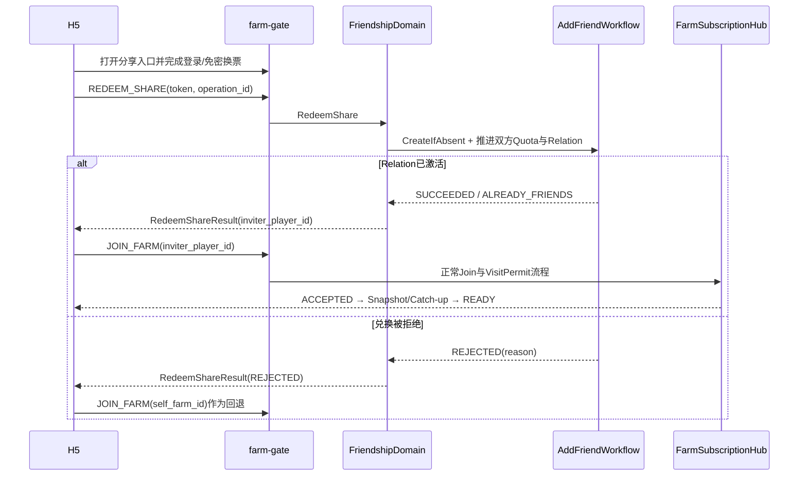
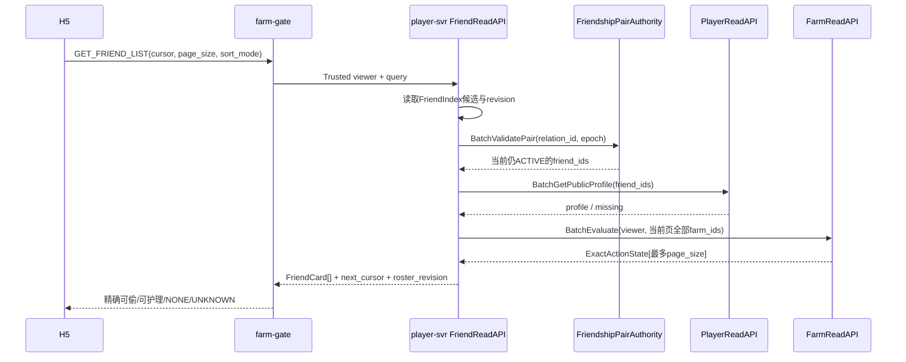
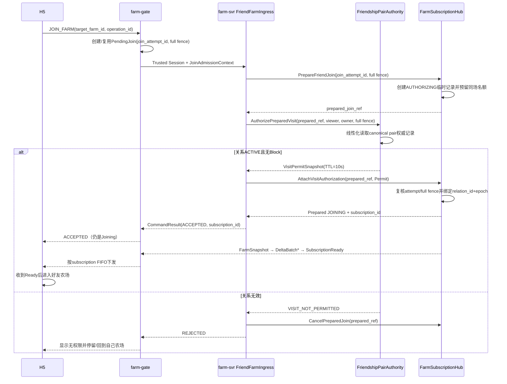

# 33 · 好友关系、分享加好友与访问权限合同

版本：`v1.2-friend-opportunity-navigation-public-command-freeze-candidate`  
日期：2026-08-03  
定位：在第 26～32 号已经冻结的 Session、Subscription、Actor Route、Workflow、Authority Store、Redis
与核心经营场景之上，定义好友关系真值、多人复用分享链接、删除/拉黑、双方精确好友上限以及后续
VisitPermit/ActionPermit 的业务边界。本文不重新定义 Join、Care、Theft 或好友机会投影。

权威关系：

- 第 26 号唯一负责在线 Session、Join、Subscription 与切换；
- 第 27～31 号唯一负责路由、内部 RPC、写权、Redis 物理边界与查询投影；
- 第 32 号唯一负责 Care/Theft 对好友权限的消费语义；
- 本文唯一负责“双方当前是否为好友、分享链接能否激活关系、删除/拉黑何时生效”。

本文业务语义状态为 `FREEZE_CANDIDATE`；`Q33-01～Q33-20` 已确认。最终 Proto 字段号、
Redis Key/Lua、Permit TTL、批次和限流参数仍属于 `PHYSICAL_PENDING`，需由好友权威物理合同与实现探针
闭合，但不得改变本文已冻结的产品与一致性语义。
好友上限与 ShareToken TTL 已由 I0 在
[`social-product-profile-v1.json`](../../internal/socialprofile/social-product-profile-v1.json) 中分别确认为
`friend-limit-v1 = 300` 与 `share-token-ttl-v1 = 7d`；新的数值只能通过新的版本化 profile 引入。
本版把连续导航明确落到公网 `GET_NEXT_FRIEND_OPPORTUNITY`，并冻结好友农场
`SUBSCRIPTION_READY` 后由服务端最佳努力更新短期 visited 的接缝；不新增客户端导航 Ack，也不把它与
每日访问任务的 `CONFIRM_FRIEND_VISIT` 混为一条命令。

---

## 0. 范围与场景总账

| 编号 | 场景 | 当前状态 |
|---|---|---|
| F01 | 获取好友分页列表 | `FROZEN_33` |
| F02 | 生成多人可使用的分享链接 | `FROZEN_33` |
| F03 | 登录用户点击分享链接自动成为好友并独立导航 | `FROZEN_33` |
| F04 | 删除好友 | `FROZEN_33` |
| F05 | 拉黑/解除拉黑 | `FROZEN_33` |
| F06 | 进入好友农场与 VisitPermit | `FROZEN_33` |
| F07 | Care/Theft 的 ActionPermit | `FROZEN_33` |
| F08 | 好友机会列表与连续导航 | `FROZEN_33`：复用第 31 号投影/Navigation，并由第 28 号公开命令承接 |

这里的 `FROZEN_33` 冻结领域语义，不代表公网产品入口已经实现。当前 F05 为
`DEFERRED_NOT_EXPOSED`：H5 无入口、HTTP 无 route、WSS disabled，且不阻塞 Showcase R1。

P0 不包含：聊天、玩家互发邮件、好友赠送、亲密度、好友分组、推荐好友、附近的人、人物移动与传统
Room，也不包含手工搜索、申请、同意/拒绝、申请收件箱与申请红点。P0 唯一新增好友入口是
题目要求的“登录玩家点击分享链接后自动成为好友”。

---

## 1. 部署与权威边界

### 1.1 P0 不创建 FriendActor

```text
player-svr Deployment
├── PlayerActor
│   └── 钱包、仓库、任务、宠物、图鉴等玩家权威
└── FriendshipDomain
    ├── FriendshipPairAuthority
    ├── ShareTokenAPI
    ├── FriendQuotaParticipant
    ├── PermitAPI
    └── FriendReadAPI
```

`FROZEN_33`：FriendshipDomain 是无状态逻辑模块，P0 与 player-svr 共部署，但不放进 PlayerActor Mailbox，
也不新增 social-svr/FriendActor。任意健康实例都可接收请求，再按 canonical pair 或 player_id 访问对应
Redis Authority Record。

原因：好友关系变更低频，没有 Tick、位置或同场高频状态；关系正确性依赖 CAS、relation_epoch、Receipt
和可恢复 Workflow，不依赖常驻内存 Actor。未来只有当社交流量、团队边界或独立容量明确时才拆
friend-svr，业务合同保持不变。

### 1.2 真值、索引和最终裁决分层

```text
FriendIndex
→ 回答“好友列表里快速显示谁”
→ 查询投影，可延迟、可重建

FriendRelation + BlockRelation
→ 回答“当前是否具有好友关系、是否被屏蔽”
→ 长期业务真值

VisitPermit / ActionPermit
→ 回答“这一次访问/操作是否经过当前关系授权”
→ 短期内部能力证明

FarmActor
→ 回答“当前地块最终是否允许Care/Theft”
→ 农场业务最终裁决者
```

FriendIndex 命中不能替代 FriendRelation；FriendIndex 暂时漏项也不能删除真实关系。所有真正进入好友
农场或操作地块的路径都必须回到 canonical relation、block 和 FarmActor 逐层校验。

---

## 2. 好友与拉黑 Pair Authority

### 2.1 Canonical Pair

```text
low_player_id  = min(player_a, player_b)
high_player_id = max(player_a, player_b)
pair_key       = low_player_id + high_player_id
relation_id    = StableID(low_player_id, high_player_id)
```

双方并发点击不同分享链接仍命中同一个 canonical pair。客户端不能自行指定 relation_id 或 relation_epoch。

### 2.2 FriendshipPairAuthorityRecord

`FROZEN_33`：P0 将双方 FriendRelation 与两个方向的 BlockRelation 共置在同一个 canonical pair 权威
记录中。它们仍是两个逻辑概念，但必须共享一次 CAS/Lua 提交边界。

```text
FriendshipPairAuthorityRecord {
    pair_key
    low_player_id
    high_player_id
    relation
    low_blocks_high
    high_blocks_low
    reactivation_barrier {
        state                    // NONE | PENDING | READY | CONSUMED
        terminated_relation_epoch
        low_share_generation_floor?
        high_share_generation_floor?
        barrier_revision
    }
    record_version
    receipt_count
    receipt_bytes
    pending_work_count
    pending_work_bytes
    updated_at_ms
}
```

Pair 主记录只保存当前关系与拉黑真值以及有界容量统计。`Receipt、StoredOperationOutcome、Admission、
SourceWork` 必须放在同一 Pair Persistence Bucket 的有界子 Key 中，并进入到期索引执行
`Full → Tombstone → Expired Evidence` 生命周期；禁止把无界数组持续追加到 Pair 主记录。

`record_version` 是整个 canonical Pair 的唯一物理 CAS 版本。`FriendRelation` 和两个方向的
`BlockRelation` 只保留领域 epoch，不再各自维护第二套物理 `record_version`。

这样可以一次原子提交“设置拉黑方向 + 终止好友关系 + 创建可靠后续工作”。如果把 Block 和 Relation
拆成两个独立提交，就可能出现已经拉黑但关系仍为 ACTIVE，或解除拉黑后旧关系意外恢复的窗口。

### 2.3 FriendRelation

```text
FriendRelation {
    relation_id
    low_player_id
    high_player_id
    status                 // ACTIVE | DELETED
    relation_epoch
    activated_at_ms
    deleted_at_ms
    activation_token_id
    activation_token_generation
    termination_reason       // NONE | USER_DELETE | BLOCKED
    terminated_by_player_id
    last_change_operation_id
}
```

`FROZEN_33`：好友关系不会按时间自动到期。只有明确删除或任一方向拉黑才使其失效。每次激活/删除推进
`relation_epoch`，Permit 必须绑定签发时的 epoch。

### 2.4 BlockRelation

拉黑是有方向的：

```text
BlockRelation {
    blocker_player_id
    blocked_player_id
    status                 // ACTIVE | REMOVED
    block_epoch
    created_at_ms
    removed_at_ms
    operation_id
}
```

冻结语义：

1. 任一方向存在 ACTIVE BlockRelation，就不能新建/恢复好友关系，不能签发 VisitPermit/ActionPermit；
2. 拉黑必须令现有 FriendRelation 进入 DELETED，并记录 `termination_reason=BLOCKED`；不能只依赖查询时
   临时叠加 BlockRelation，否则解除拉黑后会错误恢复旧关系；
3. 解除拉黑只移除 BlockRelation，不自动恢复好友；
4. 解除后必须通过新的合法加好友行为重新激活关系。

---

## 3. 删除、拉黑与在途操作

`FROZEN_33`：删除或拉黑的 Pair Authority 提交是权限撤销线性化点，也是对 H5 返回成功的边界。

```text
删除/拉黑提交
→ FriendRelation不再ACTIVE，或BlockRelation已经ACTIVE
→ 不再签发新的VisitPermit/ActionPermit
→ 已有页面收到访问撤销/重新Join提示
```

### 3.1 删除好友

```text
DeleteFriend(caller, peer, operation_id)
→ canonical pair CAS
   ├── captured_active_epoch = 当前ACTIVE relation_epoch
   ├── FriendRelation ACTIVE → DELETED
   ├── termination_reason = USER_DELETE
   ├── terminated_by_player_id = caller
   ├── relation_epoch++
   ├── reactivation_barrier = PENDING(captured_active_epoch)
   ├── StoredOperationOutcome = SUCCEEDED
   └── 原子创建 FriendTerminationOrder + 同桶DueIndex
→ 向H5返回SUCCEEDED
→ DirectDispatcher立即推进，farm-worker故障恢复
```

删除成功不等待两个 ShareIssuer：权限撤销只依赖 Pair Authority，一次提交后立即生效。Generation Floor
由 `FriendTerminationOrder` 后台读取并按 `captured_active_epoch` 回填；在两侧 Floor 都可靠提交前，
Barrier 保持 PENDING，任何重加好友尝试均返回 `RELATION_REACTIVATION_PENDING`。ShareIssuer 故障只会
延迟重新加好友，不会延迟删除，也不会恢复旧权限。

关系本来已不是 ACTIVE 时返回 `NO_CHANGE / NOT_FRIENDS`，不重复释放名额；该确定性终态仍与
FRIEND_PAIR Root 作用域 EffectiveIdempotencyKey、payload hash 一起持久化，防止同一旧操作在双方后来
重新成为好友后被再次执行。删除是
双方关系终止，不是只从调用者页面隐藏。

### 3.2 拉黑与解除拉黑

```text
BlockPlayer(A, B, operation_id)
→ canonical pair CAS
   ├── A_blocks_B = ACTIVE，block_epoch++
   ├── 若Relation为ACTIVE，同时改为DELETED
   ├── termination_reason = BLOCKED
   ├── relation_epoch++（仅原关系被终止时）
   ├── 终止关系时设置reactivation_barrier=PENDING
   ├── StoredOperationOutcome
   └── 需要时原子创建FriendTerminationOrder
```

A、B 原本不是好友时，拉黑仍可成功，但不创建好友名额释放步骤。A 已经拉黑 B 时重复调用返回
`NO_CHANGE / ALREADY_BLOCKED`。解除拉黑已经是 REMOVED 时返回 `NO_CHANGE / ALREADY_UNBLOCKED`。
这些越过 Pair Authority Execution-Accept 后形成的确定性 `SUCCEEDED/REJECTED/NO_CHANGE` 均保存
`StoredOperationOutcome`，不能仅返回一次内存结果。

```text
UnblockPlayer(A, B, operation_id)
→ 只把A_blocks_B改为REMOVED并推进block_epoch
→ 不创建FriendRelation
→ 不占用好友名额
```

如果 B 仍然拉黑 A，解除 A 的方向后双方依旧不能加好友或访问。只有两个方向均无 ACTIVE Block，且
玩家通过删除后生成的新分享链接重新兑换，才可能重新成为好友。

### 3.3 FriendTerminationOrder

`FriendTerminationOrder` 是 `SOURCE_PERSISTENCE_BUCKET` Work，`source=FRIEND_PAIR(pair_id)`；它不是按
`workflow_id` 单独落入另一 Slot 的 Independent Workflow。Pair Authority Commit 必须把 Order 与来源
关系变化和同桶 DueIndex 原子创建；禁止关系提交后再向普通内存队列发送清理任务。Order 可包含多个
可恢复 Participant Step：

```text
FriendTerminationOrder(captured_active_epoch)
├→ CaptureShareGenerationFloor(low, captured_active_epoch)
├→ CaptureShareGenerationFloor(high, captured_active_epoch)
├→ CommitReactivationGenerationFloors(pair, captured_active_epoch)
├→ RemoveActiveRelationIfEpochMatches(low, relation_id, captured_active_epoch)
├→ RemoveActiveRelationIfEpochMatches(high, relation_id, captured_active_epoch)
├→ RevokeFarmSubscription(low visiting high, relation_id, captured_active_epoch)
├→ RevokeFarmSubscription(high visiting low, relation_id, captured_active_epoch)
├→ MarkFriendIndexDirty(low/high)
└→ COMPLETED
```

各步骤使用稳定 InvocationID 和 Participant Receipt，可并行但必须分别可重试。名额释放携带被终止的
`captured_active_epoch`，即终止提交前真正占用名额的激活 epoch；不能携带删除后递增的新 epoch，也
不能误删后来重新建立关系所占用的更高 epoch。

Subscription 撤销是可靠的服务端清理，不只是最佳努力给客户端发一个弹窗：

```text
FriendTerminationOrder
→ 路由到目标FarmSubscriptionHub
→ 只移除authorization_relation_id + authorization_relation_epoch匹配的Subscription
→ 尝试下发ACCESS_REVOKED / REJOIN_REQUIRED
```

Hub 的所有好友访问记录都保存 `authorization_pair_id`；Permit 绑定后的
`JOINING、FLUSHING、ACTIVATING、IN_FARM` 还必须保存
`authorization_relation_id + authorization_relation_epoch`。AUTHORIZING 在绑定前 epoch 为 UNBOUND，
同 pair 清理可 Fail Closed 取消；旧 epoch 的迟到 Order 不得移除已经绑定新 relation epoch 的
Subscription。Hub 当前不存在或对应玩家已离场时，撤销 Participant 幂等返回 `NO_CHANGE`。
客户端通知丢失不会恢复 Subscription；客户端下一条命令仍会被 Subscription/Permit Fence 拒绝并重新
Join。

FriendIndex 更新失败不阻塞权限撤销；标记 dirty_generation 后由投影刷新/Reconcile 修复。

`CommitReactivationGenerationFloors` 只有在 Pair 仍是同一 DELETED epoch 且 Barrier=PENDING 时才能把
双方 Floor 一次写入并切换为 READY；旧 Order 迟到时返回 NO_CHANGE。READY 仍不表示任意较新 Token
自动恢复关系：邀请者必须在客户端显式执行 `RotateForPairReactivation(pair_id, barrier_revision)`，由
ShareIssuer 产生绑定该 barrier 的 RotateReceipt。激活同时要求 Token generation 严格大于 Floor 且
RotateReceipt 匹配当前 barrier，因而删除处理中提前生成的 Token 也不能穿透屏障。
关系成功重新激活时，Pair Authority 必须在同一次提交中把当前 Barrier 从 READY 切换为
CONSUMED。CONSUMED 仅表示本次 `barrier_revision` 已被一次合法重激活消费，不代表关系失效；
下一次删除/拉黑会先推进 relation_epoch 与 barrier_revision，再创建新的 PENDING Barrier。

### 3.4 在途操作与公开成功语义

与第 27/29/32 号保持一致：

- 删除/拉黑先提交，新的 Join、Care、Theft 必须拒绝；
- 好友 Care/Theft 已经完成 Pair Authority ActionAdmission Commit，才算越过业务
  Execution-Accept，并可按原幂等身份恢复完成；只拿到未提交的普通 Permit 不算接管；
- Visit 使用第 7 章专门的 `AUTHORIZING → VisitAuthorizationAccept` 接缝，不复用 Care/Theft 的业务
  Execution-Accept。授权前删除则 Join 拒绝；授权后删除则按 relation epoch 撤销临时或活跃 Subscription；
- 已有 Farm Subscription 不是业务授权。清理通知即使延迟，新的 Care/Theft 仍会被 Permit/FarmActor 拒绝；
- 为减少隐私窗口，关系撤销应产生可恢复的 Subscription Cleanup/AccessRevoked 后续动作；其具体 Order
  与下行时序由本节 FriendTerminationOrder 冻结。

删除/拉黑对外返回 `SUCCEEDED` 不等待双方 quota、Hub 和 FriendIndex 全部完成。因为 Pair Authority
已经禁止后续访问，这是用户要求的不可逆业务事实；后台清理失败只能继续恢复，不能把关系恢复成
ACTIVE。清理期间好友名额可能暂时少一个，但绝不能提前释放或重复释放导致突破上限。

---

## 4. 多人复用分享链接

### 4.1 ShareToken

```text
ShareToken {
    token_id
    inviter_player_id
    token_generation
    issued_at_ms
    expires_at_ms
    status                 // ACTIVE | REVOKED | EXPIRED
    purpose                // ADD_FRIEND
    token_format_version
}
```

公开链接携带不可猜测的 opaque token；是否保存明文或 Hash 属于物理实现。Token 必须由已认证用户在
服务端生成，客户端不能伪造 inviter_player_id 或有效期。

### 4.2 多人使用语义

`FROZEN_33`：同一 ShareToken 可由多个不同已登录玩家在有效期内使用：

```text
A生成Token-T
├→ B兑换：激活A-B
├→ C兑换：激活A-C
└→ D兑换：激活A-D
```

Token 不维护“剩余使用次数”全局热计数。每个兑换者与邀请者形成独立 pair、AddFriendWorkflow 和幂等
结果；同一兑换者重复点击只返回原结果，不重复占用名额。

兑换必须校验：

1. 当前用户已经完成认证和 Recovery；
2. Token 存在、ACTIVE、未过期且 purpose 正确；
3. 兑换者不是邀请者本人；
4. 任一方向不存在 ACTIVE BlockRelation；
5. Token 对该 pair 不早于最近一次删除；
6. 双方都能取得好友名额；
7. canonical FriendRelation 没有被其他并发 operation 以不兼容状态占用。

#### 4.2.1 Token 兑换接受点

`FROZEN_33`：`AddFriendWorkflow` 创建后，由 ShareIssuer Authority 执行一次线性化 Token Admission：

```text
AcceptShareTokenAdmission {
    workflow_id
    token_id
    token_generation
    inviter_player_id
    redeemer_player_id
    operation_id
    canonical_payload_hash
}

ShareIssuer Authority Commit
├── 校验当前Token仍ACTIVE、generation匹配、未过期、purpose正确
└── 写ShareTokenValidationReceipt
```

`ShareTokenValidationReceipt` 先提交，表示本次 Workflow 已经通过 Token 准入。随后发生的 Rotate/Revoke
只阻止新的 Admission，不取消该在途兑换；原 Workflow 仍需继续校验 Block、删除后的 Generation Floor、
双方 Quota 和 Pair 当前状态。Rotate/Revoke 先提交时，新的 Admission 必须拒绝。

该 Receipt 必须可恢复发现并有界 GC，不能只存在进程内；否则读取 Token 后进程崩溃，恢复时会因 Token
已被轮换而改变同一 operation 的历史结论。它只冻结“本次 Token 准入成功”，不保证最终一定成为好友。
它会在 ShareIssuer Bucket 形成一次有界准入写，但不维护全局“已使用次数”计数；账号/IP/Token 速率限制、
双方300好友上限与Receipt GC共同约束热门链接。该热点必须在好友权威物理合同中单独压测，不能用
“多人复用无计数”掩盖 Validation Receipt 写流量。

### 4.3 旧链接不能恢复已删除关系

`FROZEN_33`：删除/拉黑终止关系时先设置 PENDING ReactivationBarrier；后台回填双方 ShareIssuer 的
Generation Floor 后才进入 READY。PENDING 时无论 Token 多新都禁止重加。READY 后按本次 Token 的
inviter 方向比较，并验证当前 barrier 的显式 RotateReceipt：

```text
token.token_generation <= pair.reactivation_barrier.share_generation_floor[token.inviter_player_id]
→ REJECTED / SHARE_TOKEN_PREDATES_RELATION_DELETE

缺少或不匹配RotateForPairReactivation Receipt
→ REJECTED / REACTIVATION_ROTATE_REQUIRED
```

邀请者必须在 Barrier READY 后显式为该 Pair 轮换并生成新分享链接，对方再次主动点击，才允许重新激活。
激活提交后 Barrier 转为 CONSUMED，防止同一 barrier_revision 被第二个 Workflow 再次使用。
任一方向仍在拉黑时，即使 Token 更新也必须拒绝。`issued_at_ms/deleted_at_ms` 只用于审计、展示和诊断，
不能承担跨 Redis Authority 的正确性排序。

已有 ACTIVE 关系再次兑换任意合法 Token：

```text
→ NO_CHANGE / ALREADY_FRIENDS
```

### 4.4 分享启动、兑换与进入农场是两段结果

`FROZEN_33`：分享链接首先用于建立或确认好友关系；进入邀请者农场必须再走第 26 号的正常
`JOIN_FARM(inviter_player_id)`。两段结果不能合并成一个模糊的“分享成功”。



分享启动模式下，H5 在认证和 Recovery 完成后先兑换 Token，不必先 Join 自己农场。兑换成功或
`ALREADY_FRIENDS` 后，再单独请求进入邀请者农场；兑换失败则进入自己农场并显示明确原因。

如果好友关系已经建立，但随后 Join 因以下原因失败：

- 邀请者农场同场人数已满；
- 关系在两步之间被删除或拉黑；
- VisitPermit、路由或目标 Farm 暂时不可用；
- Join 超时、连接断开或 Snapshot 无法完成；

好友关系仍然成立，不能回滚 AddFriendWorkflow。H5 显示“已成为好友，但暂时无法进入农场”，随后
回到自己农场或提供重试按钮。

已经在游戏内的玩家点击分享链接时，不需要重新建立 WSS；在当前有效 Session 上兑换成功后，使用
一次新的 `JOIN_FARM(inviter_player_id)` 替换旧 Subscription。旧农场 Push 继续受第 26 号
`subscription_id` Fence 限制。

### 4.5 ShareToken 生命周期与客户端安全

`FROZEN_33`：P0 每名邀请者同时只有一条“当前有效”的加好友分享 Token。同一 Token 可以被多个不同
玩家兑换，但不是永久凭证。

```text
GenerateShareToken(inviter)
├→ 当前Token仍ACTIVE且未过期
│  → 返回同一条分享链接
└→ 当前Token不存在/已过期
   → generation++
   → 创建新Token

RotateShareToken(inviter)
→ generation++
→ 旧Token立即REVOKED
→ 创建并返回新Token

RevokeShareToken(inviter)
→ generation++
→ 当前Token立即REVOKED
→ 不自动创建新Token
```

默认 TTL 已确认为 `share-token-ttl-v1 = 7天`。显式环境配置必须绑定并匹配该 profile，不能静默形成
第二默认。Token 的有效性以兑换时的可信服务端时间判断；玩家点击
链接时尚未登录，不代表已经兑换成功。如果登录过程中 Token 到期，必须返回 `SHARE_TOKEN_EXPIRED`。

轮换、撤销和过期只阻止未来兑换，不删除或改变已经建立的 FriendRelation。主动重新生成才会令旧链接
失效；普通重复点击“分享”必须复用当前链接，不能让稍早发给其他人的链接意外失效。

逻辑 Authority 至少保存：

```text
ShareIssuerState {
    inviter_player_id
    current_generation
    current_token_id
    issued_at_ms
    expires_at_ms
    status                 // ACTIVE | REVOKED | EXPIRED
    last_operation_id
    record_version
}
```

Token 本身必须具有不可猜测性并绑定 inviter、generation、purpose 和 expires_at。服务端可使用随机 Token
索引、认证加密信封或签名信封；原始 Bearer Token 不得进入访问日志、Trace、Metrics、错误文本和 TLog。
日志只允许记录 `token_id` 或不可逆 Digest。具体密码学封装和 Redis Key 留给物理实现评审。

Web H5 的公开分享入口优先使用 URL Fragment，例如：

```text
https://game.example/farm#share_token=<opaque>
```

Fragment 不随首个 HTTP 请求和 Referer 发送。后续微信小程序或必须使用 URL Query 的渠道使用短期
`landing_code`，由已加载的一方页面通过 HTTPS POST 换取真实 ShareToken；接入日志对 landing code 和
Token 做脱敏。

H5 安全规则：

1. 启动后立即从 URL Fragment 提取 Token，并用 `history.replaceState` 从地址栏和浏览器历史当前项移除；
2. 登录/跳转期间只放在当前标签页的 `sessionStorage` 或等价短生命周期容器，不写长期
   `localStorage`；
3. 收到终态 `SUCCEEDED/NO_CHANGE/REJECTED` 后清除；收到 `PROCESSING` 时保留到原
   `operation_id` 恢复完成；
4. 前端埋点、错误上报和截图信息不得包含原始 Token；
5. Token 只允许调用分享兑换入口，不能替代 Session、VisitPermit、ActionPermit 或 FarmActor 裁决。

页面设置 `Referrer-Policy: no-referrer`，分享落地首屏不加载非必要第三方资源。`replaceState` 只能缩短
前端暴露窗口，不能替代 Fragment/landing code、日志脱敏和前端埋点治理。

生成、轮换、撤销和兑换分别做账号级/IP级有界限流。由于链接允许多人使用，不能把“同一 Token 被多个
账号兑换”本身当成重放攻击；风控只处理异常速率、批量账号和超过好友上限等行为。

### 4.6 P0 好友来源边界

`FROZEN_33`：P0 只支持 ShareToken 兑换后自动加好友。兑换成功时直接进入本文的
`AddFriendWorkflow`，不额外创建 `PENDING_REQUEST`、不等待邀请者手工同意，也不产生好友申请红点。

P0 不实现：

- 按玩家 ID、昵称或其他条件搜索陌生人；
- `SendFriendRequest / Accept / Reject / Withdraw`；
- 好友申请收件箱、过期策略、未读计数与红点；
- 陌生人推荐、通讯录匹配和附近的人。

未来如果增加手工申请，必须单独定义 `FriendRequestRecord`、申请状态机、防骚扰/黑名单检查、
收件箱与红点语义。`PENDING` 申请不得复用 ACTIVE FriendRelation，也不得签发
VisitPermit/ActionPermit。该扩展不改变 P0 的 ShareToken 直接激活主链。

---

## 5. 双方精确 300 好友硬上限

### 5.1 FriendQuotaRecord

`FROZEN_33`：P0 双方好友上限都是精确硬上限，当前 `friend-limit-v1` 的有效值为 300。显式环境配置
必须绑定并匹配该 profile，且不能通过并发
添加突破上限。

```text
FriendQuotaRecord(player_id) {
    active_relations {          // relation_id -> relation_epoch
        relation_id -> active_relation_epoch
    }
    reservations {
        reservation_id -> {
            workflow_id
            relation_id
            target_relation_epoch
            state              // RESERVED | FINALIZED | RELEASED
            created_at_ms
        }
    }
    configured_limit_version
    record_version
}
```

`reservation_id = StableOpaqueID(workflow_id, player_id, relation_id)`，同一 Participant 重试只能命中同一
Reservation。Finalize 必须校验 `reservation.target_relation_epoch == 实际激活的 relation_epoch`；释放必须
执行 `RemoveActiveRelationIfEpochMatches(relation_id, captured_active_epoch)`，禁止按裸 relation_id 删除。

Reserve 时的不变量：

```text
occupancy = count(active_relations) + count(RESERVED reservations)

只有 occupancy < effective_max_friends
才允许创建新的Reservation
```

如果配置从 300 下调到 200，而玩家已有 250 个好友，已有关系全部保留，不强制删除；在 occupancy 降到
200 以下前禁止新增。已经取得的合法 Reservation 仍允许 Finalize，因为它在创建时已经计入容量。因此
`occupancy <= effective_max_friends` 不是配置下调后永远成立的状态不变量，系统允许
`grandfathered overflow`，但不允许在 overflow 状态继续 Reserve。

物理实现可以使用同槽 Hash/有界集合，但不能只维护一个无法幂等删除和无法验证 epoch 的裸 count。

FriendQuotaAuthority 不是 Actor；它是按 player_id 路由的无状态 CAS Participant。热门邀请者的名额更新
会在其 Redis Authority Record 上自然串行，但好友添加远低于经营和实时广播流量。

### 5.2 AddFriendWorkflow

一条好友关系同时占用双方名额，Redis Cluster 无法用一个跨 Slot Lua 原子修改两个玩家，因此使用可靠
Workflow，不使用分布式锁或客户端重试拼接一致性：

```text
CreateIfAbsent AddFriendWorkflow
→ AcceptShareTokenAdmission（得到持久ValidationReceipt）
→ ValidatePairBlockAndGenerationFloor
→ ReserveFriendSlot(first_quota_player)
→ ReserveFriendSlot(second_quota_player)
→ ActivateFriendRelation
→ FinalizeFriendSlot(first_quota_player)
→ FinalizeFriendSlot(second_quota_player)
→ COMPLETED(SUCCEEDED)
```

`AddFriendWorkflow` 的 WorkPlacement 固定为 `INDEPENDENT_WORK_BUCKET`。它必须在任何一方 Quota 修改前
可靠创建；它不与 Pair、Quota 或 ShareIssuer 伪装成跨 Slot 原子提交。`FriendTerminationOrder` 与
`FriendActionDispatchOrder` 则固定为 `SOURCE_PERSISTENCE_BUCKET(source=FRIEND_PAIR)`。

两个 quota Participant 按 `min(player_id) → max(player_id)` 的稳定顺序推进，而不是根据谁是邀请者决定。
这样同一 pair 从相反方向并发触发时仍使用相同顺序；结果和错误中再映射回 inviter/redeemer 身份。
Pair Validation 返回本次候选 `target_relation_epoch = current_relation_epoch + 1`；两侧 Reservation 和最终
Activate 都绑定该值。期间 Pair epoch 被其他命令推进时，Activate 必须拒绝/重读并按原 Workflow 补偿，
不能把旧 Reservation 套到新的关系代次。

建议状态机：

```text
CREATED
├→ VALIDATION_REJECTED
│  → COMPLETED(REJECTED/NO_CHANGE)
└→ VALIDATED
   ├→ FIRST_SLOT_REJECTED
   │  → COMPLETED(REJECTED)
   └→ FIRST_SLOT_RESERVED
      ├→ SECOND_SLOT_REJECTED
      │  → FIRST_SLOT_RELEASING
      │  → COMPENSATED(REJECTED)
      └→ BOTH_SLOTS_RESERVED
         ├→ RELATION_REJECTED
         │  → BOTH_SLOTS_RELEASING
         │  → COMPENSATED(REJECTED/NO_CHANGE)
         └→ RELATION_ACTIVE
            → PUBLISH_PUBLIC_SUCCEEDED
            → FIRST_SLOT_FINALIZED
            → SECOND_SLOT_FINALIZED
            → COMPLETED(SUCCEEDED)
```

FriendRelation ACTIVE 是关系不可逆点。此前明确失败可以释放 Reservation；此后不能因为 Finalize、索引
或下行失败把关系改回删除，只能由 worker 用 Participant Receipt 最终完成双方名额。

`ActivateFriendRelation` 必须再次校验 ValidationReceipt、两个方向 Block、Token Generation Floor、
Reservation 的 `target_relation_epoch` 和 Pair 当前 epoch。Token Admission 已接受只保证后续 Rotate/Revoke
不反向取消本 Workflow，不允许绕过后来已经提交的 Block 或不匹配的删除重加屏障。
若是历史 DELETED Relation 的重激活，脚本还必须校验 Barrier=READY 与当前
RotateForPairReactivationReceipt，并在 Relation 变为 ACTIVE 的同一次提交中将 Barrier 转为 CONSUMED。

公网成功边界冻结为：`FriendRelation ACTIVE + 可恢复的双方 Reservation 已存在 + 持久 OperationOutcome`
已经提交。到达该边界即可向 H5 返回 `SUCCEEDED`，不必等待 Reservation 从 RESERVED 改成 FINALIZED，
也不等待 FriendIndex 更新。因为 Reservation 已计入精确上限，后台收尾延迟不会突破 300 人限制。
不可逆点之前超时则返回 `PROCESSING`，H5 使用原 `operation_id` 查询或重试，不能自行发起第二条兑换。

如果第一个 Participant 已满，不预留第二个名额。若第一个预留成功而第二个已满，可靠释放第一个
Reservation 后才返回 `FRIEND_LIMIT_REACHED`，并在结果中指出实际达到上限的一方。任何
Reservation/Relation Commit `TIMEOUT_UNKNOWN` 都必须解析 Receipt，禁止猜测并创建第二条关系。

### 5.3 删除后的名额释放

关系删除先撤销权限，再可靠释放双方 quota entry。这样即使释放延迟，也只会暂时少一个可用名额，不会
突破上限。旧 relation_epoch 的释放不能误删后来重新激活的新 epoch。

在旧关系的双方名额尚未清理完成时，新的分享兑换可以返回 `RELATION_CLEANUP_PENDING`，避免同一 pair
同时占用两个 epoch 的容量。完整 Delete/Block Workflow 在后续小节确认。

---

## 6. 好友列表、公开资料与精确互动标识

### 6.1 数据位置与职责

| 数据 | 存储分类 | 读取模块 | 用途 |
|---|---|---|---|
| `FriendshipPairAuthorityRecord` | Authority Redis | FriendshipPairAuthority | 好友/拉黑最终真值 |
| `FriendIndex` | Projection Redis | player-svr/FriendReadAPI | 按玩家分页列出关系候选 |
| `PublicProfile` | Projection Redis | player-svr/PlayerReadAPI | 昵称、头像、等级等公开卡片字段 |
| `FarmOpportunityHeader` | Farm Authority Redis中的紧凑权威切片 | farm-svr/FarmOpportunityReadAPI | 全局导航的低成本粗筛和排序 |
| `FriendOpportunityNavigation` | Runtime Redis | player-svr/FriendOpportunityNavigation | 分窗扫描、已访问集合、连续推荐 |
| Farm Authority ReadPath | Authority Redis/当前Holder只读视图 | farm-svr/FarmReadAPI | 当前页精确action_mask |

FriendIndex、PublicProfile 与 Navigation 不跟 Actor 迁移，也不要求新增 query-svr；FarmOpportunityHeader
跟随 Farm Authority 持久状态，不是异步 Summary 副本。P0 由 player-svr 的 Read Role 组织好友页，调用
farm-svr Read API；后续只有查询流量、资源模型或团队边界证明需要时才拆独立 Deployment。

`PublicProfile` 的 P0 最小字段是 `player_id、display_name、avatar、level`。不向好友页复制 Wallet、
Inventory、付费货币或其他私有资产；以后若产品要求展示金币，必须单独定义可公开的展示字段，不能直接
读取 PlayerActor Wallet。

### 6.2 FriendIndex 与分页游标

```text
FriendIndexEntry {
    friend_player_id
    relation_id
    friend_relation_epoch
    activated_at_ms
}

FriendListCursor {
    viewer_player_id
    sort_mode
    roster_projection_revision
    scan_position
    issued_at_ms
}
```

默认 `page_size=20`，硬上限候选 `50`，均配置化。默认稳定顺序为
`activated_at_ms DESC, friend_player_id ASC`。Cursor 必须是服务端可校验的 opaque 值，绑定 viewer、
排序模式和 FriendIndex revision；列表 revision 变化后旧 Cursor 返回 `FRIEND_ROSTER_CHANGED`，H5 刷新
第一页，不能在新旧 roster 上继续翻页造成重复或漏项。

FriendRelation ACTIVE 后，通过可靠 dirty generation/投影刷新更新双方 FriendIndex；删除时同样移除。
Index 延迟不能改变关系真值。查询当前页时，FriendReadAPI 按 canonical pair 批量验证候选
`relation_id + relation_epoch` 仍然 ACTIVE；过期条目丢弃，并在有界 refill budget 内继续读取后续索引，
直到填满当前页或到达末尾。

分享兑换成功不等待 FriendIndex。H5 可以根据 `RedeemShareResult` 临时插入新好友卡片，再后台刷新；
删除后 Index 短暂残留也会被当前页 Pair Authority 验证过滤。

### 6.3 当前页精确查询时序



`FROZEN_33`：当前页最终返回的每张有效好友卡都进入 `BatchEvaluate`，不依赖异步 Summary 粗筛。
BatchEvaluate 按 Farm Route/Redis 节点分组、受总 Deadline 和并发上限控制，使用 Authority
ReadPath 或当前 Holder 的一致只读视图，不激活最多 20 个冷 FarmActor。

精确检查至少计算：`trusted_now_ms >= mature_at`、当前可偷槽位、viewer 的 TheftAttemptReceipt、
CareIncident 是否 ACTIVE，以及 target binding 是否仍有效。返回的 action mask 可包含
`CAN_STEAL、CAN_WATER、CAN_REMOVE_PEST、NONE`；单卡读取超时返回 `UNKNOWN/LOADING`，不能伪造成
`NONE`。

这里的“精确”指响应组装时读取到的权威切片。响应返回后其他玩家仍可能先完成护理、偷菜或收获；点击
后的 ActionAdmission 和 FarmActor 才是最终裁决。

### 6.4 排序与连续导航

默认好友列表使用稳定 roster 顺序，避免机会频繁变化导致分页跳动。公网连续导航命令固定为
`GET_NEXT_FRIEND_OPPORTUNITY`。`INTERACTION` 模式不建立
viewer×friend 的全量持久索引，也不在一座农场成熟时向最多 300 个好友逐人写记录；它复用第 31 号
Navigation：

```text
批量读取好友农场的轻量FarmOpportunityHeader
→ 按actionable_at对候选排序
→ 对Top候选读取Facts/Receipt做BatchEvaluate
→ 保存最多8个短期candidate window
→ 当前页/右下角逐步消费
```

因此 P0 不承诺每次请求都全扫 300 人并生成全局绝对排序；它承诺已经返回的卡片状态经过精确检查，
并通过服务端游标继续发现后续机会。客户端不上传 scan cursor、candidate window 或 visited 集合。

在线 Hint 采用一条独立的定向加速路径：H5 将刚收到的 `owner_id + opportunity_revision` 在 300ms 内
合并，最多 16 项回传给 `GET_NEXT_FRIEND_OPPORTUNITY`。FriendOpportunityNavigation 必须重新校验 Pair、
Profile、Farm Header/Facts 和 TheftAttemptReceipt；Hint 本身不能授权。有效结果与 CandidateWindow 在
同一次 Navigation CAS 中 Upsert，已访问/已失效目标移除；权威 revision 尚未追上 Hint 时返回 UNKNOWN，
保留旧窗口但不能展示旧 READY。

登录、返回自己农场、页面重新可见和低频 fallback 不携带 Hint 目标，仍使用完整 Navigator 粗筛/精查。
打开好友列表也不消费 CandidateWindow，只精确批查当前页最多 20 人。

玩家进入推荐好友农场并完成匹配的 `SUBSCRIPTION_READY` 后，Gate 使用刚激活的
ActiveSubscription Fence 最佳努力调用 player-svr 标记本轮 visited；不要求实际护理或偷菜成功。
该运行时更新失败不回滚 Join，最多导致返回自己农场后重复推荐一次。每日访问任务使用独立公网
`CONFIRM_FRIEND_VISIT` 与 operation_id 可靠提交，不能用 Navigation visited 冒充任务完成。

### 6.5 查询失败语义

- FriendIndex/Projection Redis 不可用：好友区域显示 Loading/Retry，不返回空好友列表；
- PublicProfile 缺失：卡片使用明确占位并触发修复，不影响关系验证；
- Header 缺失或读取失败：当前页仍执行精确 BatchEvaluate；全局导航返回 UNKNOWN/重试，不能误报 NONE；
- 单个 FarmRead 超时：该卡片显示 UNKNOWN，其余卡片可以正常返回；
- Pair Authority 判断关系已删除/拉黑：当前页过滤该卡片，不允许 Index 旧数据授权访问；
- 整批超出 Deadline：返回可识别的部分结果/重试状态，不把未知转换成 NONE。

---

## 7. VisitPermit 与好友 Join 接缝

### 7.1 VisitPermit 是内部短期授权快照

`FROZEN_33`：H5 的 `JOIN_FARM` 只携带目标农场和公开 Join 字段，不携带 VisitPermit，也不能自报
`viewer_player_id`。Gate 从第 26 号 Session 取得操作者身份，先创建 `PendingJoin`；farm-svr 与
FarmSubscriptionHub 在 Actor Turn 之外完成临时 Join 登记和 Friendship Authority 授权。

```text
VisitPermitSnapshot {
    permit_id
    viewer_player_id
    owner_player_id
    target_farm_id
    relation_id
    friend_relation_epoch

    join_operation_id
    join_attempt_id
    gateway_id
    gateway_boot_id
    connection_id
    connection_generation
    active_session_epoch

    action_scope             // VISIT_FARM
    accepted_ttl_ms
    issued_at_authority_ms   // 仅诊断
    permit_payload_hash
}
```

默认 `accepted_ttl_ms=10秒` 并配置化。Ingress/Hub 在收到 Permit 时使用本机 monotonic clock 建立本地
`permit_deadline`；跨机器的绝对墙钟只用于诊断，不承担正确性比较。Permit 绑定当前连接、Session、Join
意图与 attempt，不能跨玩家、跨连接、跨目标农场或跨 attempt 复用。它通过第 29 号可信内部 RPC 传递，
可附内部签名/Hash，但不是公网 Token。

P0 不为每个 VisitPermit 建 Redis 记录。FriendshipDomain 必须直接线性化读取 canonical Pair Authority，
校验：

```text
FriendRelation.status == ACTIVE
两个方向Block均非ACTIVE
viewer与owner确实是该pair双方
target_farm_id == owner_player_id
```

FriendIndex、好友列表缓存、FarmOpportunityHeader 和客户端页面状态均不得用于签发 Permit。

### 7.2 好友 Join 时序



`AUTHORIZING` 是 Hub 内部的好友授权准备态，H5 仍只看到第 26 号的 `Joining`，不新增公网 Session
状态。AUTHORIZING 记录先保存 `pair_id + join_attempt_id + 完整连接Fence`，relation epoch 暂为
`UNBOUND`；Permit 绑定后才写入 `authorization_relation_id + authorization_relation_epoch`。授权失败、
Deadline 到期或连接 Fence 变化都释放预留名额。

进入自己农场不需要 VisitPermit。好友 Join 随后仍完整服从第 26 号的
`JOINING → FLUSHING → ACTIVATING → IN_FARM`、Arm/Snapshot/Ready 和 Subscription Fence；本文只增加
好友关系准入，不重新定义 Join 状态机。

### 7.3 Permit 与删除的先后顺序

`AuthorizePreparedVisit` 的 Pair Authority 线性化读取是本次 Join 的关系授权接受点。Hub 先创建
AUTHORIZING 记录，是为了消除“删除清理已经执行完，旧 Permit 才创建新 Subscription”的窗口：

```text
删除/拉黑先提交
→ Authority读取看到关系失效
→ 不签VisitPermit
→ AUTHORIZING记录取消，Join拒绝

Authority先读取并签发Permit
→ 本次Join已经先通过关系准入
→ Permit只能绑定预先存在且Fence匹配的AUTHORIZING记录
→ 随后的FriendTerminationOrder可撤销AUTHORIZING或后续任一Subscription状态
```

授权先发生不保证玩家一定完成 Snapshot/Ready；随后删除、连接断开、容量回收或下行失败仍可终止该次
Join。它只保证删除不能把已经发生的授权历史改写成“从未授权”。

Hub 必须在绑定时检查本地 Permit Deadline 和所有 Fence。若尚未绑定就过期，返回
`VISIT_PERMIT_EXPIRED`，客户端可使用原 Join operation 发起新的 attempt。Hub 已绑定后 Permit 到期不
自动踢出玩家；已有 Subscription 的生命周期由第 26 号 Lease/切换/断线和本章 AccessRevoked 控制。

Relation 删除/拉黑清理必须同时覆盖 AUTHORIZING、Joining、Flushing、Activating 和 InFarm。对于尚未
绑定 epoch 的 AUTHORIZING，匹配同一 canonical pair 的清理允许 Fail Closed 取消；绑定后则只能按
`relation_id + captured_active_epoch` 精确撤销。新 relation epoch 的 Subscription 不受旧 Order 影响。

### 7.4 VisitPermit 不授权业务操作

VisitPermit 只允许创建该次好友农场观看 Subscription。它不能授权 Care、Theft 或以后可能新增的好友
业务命令。每个 Care/Theft 仍需要与自身 `operation_id` 绑定的 ActionPermit，并由 FarmActor 对地块
状态做最终裁决。已有 Subscription 也不能替代 ActionPermit。

农场达到 200 人上限、Snapshot 失败、路由不可用或连接断开，只导致本次 Join 失败；不会删除好友关系，
也不需要回滚或持久化 VisitPermit。

---

## 8. ActionPermit 与可靠业务接管

### 8.1 每个 operation 独立准入

`FROZEN_33`：好友 Care/Theft 必须为每个 `operation_id` 创建独立 ActionPermit；不签发可在十秒内对
多块土地反复使用的批量 Permit。原因是每次操作绑定不同的 plot、crop cycle、incident、Attempt 和
幂等结果，且好友关系可能在两次操作之间被删除或拉黑。

Owner 在自己农场执行 Care 不经过 FriendshipPairAuthority，仍按 FarmActor 自身准入；Theft 只允许
好友，因此总是经过本节 ActionAdmission。

### 8.2 为什么普通只读 Permit 不够

以下时序存在权限缝隙：

```text
t1 只读关系并生成短期Permit
t2 删除好友提交
t3 才创建TheftWorkflow或把Care放进FarmActor Mailbox
```

若 t3 仍被当作 Execution-Accept，就会在删除之后接管新业务。为保持第 27～29 号“删除先提交则新操作
拒绝；已可靠接管的旧 operation 可完成”的语义，好友 ActionPermit 必须由 Pair Authority 的一次强提交
产生，而不是只返回内存对象。

### 8.3 CommitFriendActionAdmission

```text
CommitFriendActionAdmission(operation)
→ canonical pair CAS/Lua
   ├── 再次检查Relation ACTIVE、两个方向Block均非ACTIVE
   ├── 校验operation_id + canonical_payload_hash
   ├── 写ActionAdmissionReceipt
   ├── 冻结ActionPermitSnapshot
   ├── 写FriendActionDispatchOrder(PENDING)
   └── 写同AuthorityPersistenceBucket的DueIndex
```

上述 Pair Authority Commit 就是好友 Care/Theft 的 `Execution-Accept`。来源事实、Receipt、Permit、
DispatchOrder 与可发现索引必须原子创建；禁止提交 Permit 后只投递普通内存队列。

`FriendActionDispatchOrder` 的 WorkPlacement 固定为：

```text
placement_kind = SOURCE_PERSISTENCE_BUCKET
source_authority = FRIEND_PAIR
source_id = pair_id
```

它与 Pair 主记录、Admission Receipt 和 DueIndex 使用同一个 Pair Hash Tag；它不是独立 Workflow，也不能
落入按 order_id 随机分布的另一 Slot。

```text
ActionPermitSnapshot {
    permit_id
    relation_id
    friend_relation_epoch
    visitor_player_id
    owner_player_id
    target_farm_id
    operation_id
    action_scope                 // CARE | THEFT
    canonical_payload_hash
    target_binding_hash          // plot/cycle/incident等服务端规范字段
    issued_at_authority_ms
    expire_at_authority_ms
    execution_accepted_at_authority_ms
}
```

同一 FRIEND_PAIR Root 的 EffectiveIdempotencyKey + 相同 payload hash 返回原 Admission/Outcome；
同一 Key + 不同 hash 返回
`IDEMPOTENCY_CONFLICT`。Permit 只绑定本 operation，H5 不接收、不保存也不回传它。

ActionAdmissionReceipt 和 Pending Dispatch 必须有界清理：终态发布并超过 OperationResult 保留窗口后，
可按第 31 号 Bucket/GC 合同压缩；不能无限追加到单个 Pair 主记录。具体 Redis 子 Key、Hash Tag 和批次
属于本合同的物理后续项。

### 8.4 快速推进与故障恢复

```text
Pair Authority Commit
├→ DirectDispatcher立即推进
│  ├→ CARE：调用FarmActor.ResolveCareIncident
│  └→ THEFT：CreateIfAbsent TheftWorkflow后推进FarmActor.DecideTheft
└→ 进程退出/超时
   → farm-worker从DueIndex发现同一FriendActionDispatchOrder
   → 使用相同InvocationID恢复
```

Care 不因此新增一套完整 CareWorkflow；它只多一个来源为 Pair Authority 的可靠准入/投递 Order。
FarmActor 提交 Care 后，原有 CareRewardOrder 仍负责处理者奖励。Theft 仍使用第 32 号 TheftWorkflow；
AdmissionOrder 只确保该 Workflow 必然被创建或恢复，不取代偷菜的三个 Participant 状态机。

若最终 Farm 返回确定的 `REJECTED/NO_CHANGE/SUCCEEDED`，DispatchOrder 保存结果引用并完成；若 Farm 或
Workflow 结果未知，则保持 PENDING/PROCESSING 并按原 Invocation/operation 恢复，不能重新签发第二个
Permit。

### 8.5 删除、过期与恢复

```text
删除/拉黑Pair Commit先发生
→ CommitFriendActionAdmission拒绝
→ 不创建Receipt/DispatchOrder

ActionAdmission Commit先发生
→ operation已经可靠接管
→ 后续删除只阻止新的operation
→ 原Care/Theft允许由Dispatcher/worker恢复完成
```

Permit 的短期时间边界在 ActionAdmission Commit 时检查并冻结。已经提交的 Admission 在 worker 恢复时
不因当前墙钟超过 `expire_at_authority_ms` 被重新拒绝；Participant 校验的是
`execution_accepted_at_authority_ms` 当时位于合法窗口内。这样弱网、Shard Handoff 或进程重启不会改变
已经接管的权限裁决。

Admission Commit 超时未知时，FriendshipPairAuthority 必须按 operation_id 查询
ActionAdmissionReceipt；确认 COMMITTED 后返回 `PROCESSING` 并恢复原 DispatchOrder，确认未提交才允许
相同 operation 重试。禁止客户端换 operation_id 猜测性重做。

### 8.6 Care/Theft 的 OperationResult 根锚点

好友 Care/Theft 的顶层 Operation Anchor 固定为 `FriendActionDispatchOrder`。Pair Order 证明关系准入已
可靠接管并负责把 operation 送达 Farm；Farm Receipt/TheftWorkflow 证明最终地块裁决和结算。两层不是
重复幂等锚点。

```text
ResultDirectory(
  subject_player_id,
  command_type,
  operation_id,
  OperationRootRef=FRIEND_PAIR:pair_id)
→ Pair WorkAddress(FriendActionDispatchOrder)

FriendActionDispatchOrder.final_result_ref
├→ CARE: CareOperationReceipt / StoredOperationOutcome
└→ THEFT: TheftWorkflow WorkAddress / StoredOperationOutcome
```

从接管到下游锚点尚未创建期间，ResultDirectory 仍能定位 Pair Order 并返回 `PROCESSING`。Owner 在自己
农场执行 Care 不经过 Pair Admission，其 OperationRootRef 为 `FARM_ACTOR:own_farm_id`，ResultDirectory
直接登记 Farm Receipt 地址。同一 CommandType 允许存在不同 Root Anchor，但 Root 必须由第 28 号
CommandCatalog 根据可信 Session 与原业务目标确定，并由 Directory 显式记录；禁止根据当前好友关系或
当前页面猜测，也禁止客户端直接提交内部 pair_id/Bucket。

---

## 9. 已冻结并发与失败不变量

| 场景 | 冻结结果 |
|---|---|
| 同一Token被100个不同玩家并发兑换 | 形成100个不同pair的独立Work；Token本身不做全局使用次数写热点 |
| 同一兑换者重复点击同一Token | 同OperationRoot内相同EffectiveIdempotencyKey返回原Work/Outcome，不重复占名额 |
| 同一pair使用两个不同Token并发添加 | canonical FriendRelation CAS只允许一个激活；另一条NO_CHANGE并释放名额 |
| 第二方好友已满 | 释放第一方Reservation后才返回FRIEND_LIMIT_REACHED |
| 好友上限从300下调到200但已有250 | 保留250条关系并禁止新Reserve；不自动删除，已有Reservation仍可Finalize |
| Relation激活后进程崩溃 | 不回滚关系；worker继续Finalize双方quota与更新索引 |
| Token Admission与Rotate/Revoke并发 | ValidationReceipt先提交则原Workflow继续；Rotate/Revoke先提交则新Admission拒绝 |
| 删除后用旧Token重加 | PENDING Barrier一律拒绝；READY后仍要求generation大于floor且有当前barrier的显式RotateReceipt |
| 删除提交时ShareIssuer不可用 | 删除仍立即成功并撤权；Barrier保持PENDING，后台恢复Floor前禁止重加 |
| 删除处理中提前Rotate | 没有READY barrier绑定的RotateReceipt，不能恢复该Pair |
| 拉黑与添加并发 | Block先提交则添加拒绝；Relation先激活则随后Block令关系失效 |
| Index更新失败 | 关系仍有效/失效，以canonical记录为准；Reconcile修复列表 |
| Visit授权与删除并发 | Hub先有AUTHORIZING记录；删除先则授权拒绝，授权先则TerminationOrder可撤销该临时/活跃Subscription |
| 旧TerminationOrder迟到 | 只撤销/释放captured relation_epoch；不得影响后来重建的新epoch关系、名额或Subscription |
| ActionAdmission提交后进程崩溃 | Receipt、Permit、DispatchOrder和DueIndex同提交；worker恢复原Care/Theft，不重新授权 |
| ActionAdmission与删除并发 | canonical Pair Authority提交顺序唯一；Admission先则原operation可完成，删除先则Admission拒绝 |

---

## 10. 决策登记

| 编号 | 状态 | 决策 |
|---|---|---|
| Q33-01 | `FROZEN_33` | FriendshipDomain无状态并与player-svr共部署；P0不建FriendActor/social-svr |
| Q33-02 | `FROZEN_33` | FriendRelation使用canonical pair、ACTIVE/DELETED和relation_epoch；关系不自动过期 |
| Q33-03 | `FROZEN_33` | 拉黑有方向；任一Block阻断关系和Permit；解除拉黑不自动恢复好友 |
| Q33-04 | `FROZEN_33` | 删除/拉黑提交后不签新Permit；已先越过Execution-Accept的operation可按原身份恢复 |
| Q33-05 | `FROZEN_33` | 一个ShareToken可被多个不同登录玩家使用；每个pair独立幂等，不维护全局剩余次数 |
| Q33-06 | `FROZEN_33` | 删除/拉黑立即撤权并设置PENDING ReactivationBarrier；后台回填双方generation floor后进入READY；READY后仍需显式RotateForPairReactivation，新Token generation严格大于floor；激活成功后转CONSUMED；Block始终优先拒绝 |
| Q33-07 | `FROZEN_33` | 双方采用精确好友硬上限，`friend-limit-v1` 有效值300；Quota保存relation_epoch并通过Reservation + AddFriendWorkflow保证并发正确性；配置下调保留既有关系但阻止新增 |
| Q33-08 | `FROZEN_33` | FriendIndex是可重建查询投影，不能授权Visit/Care/Theft |
| Q33-09 | `FROZEN_33` | 分享兑换与Join邀请者农场是两个独立结果；兑换成功不因后续Join失败回滚，分享启动时先兑换、失败再回退自己农场 |
| Q33-10 | `FROZEN_33` | 每名玩家同时一条当前有效Token；普通分享复用、`share-token-ttl-v1` 默认TTL 7天、主动Rotate/Revoke才使旧链接失效；原始Token不得落日志或长期存于H5 |
| Q33-11 | `FROZEN_33` | Relation与双向Block共置canonical pair权威记录；删除/拉黑原子撤权并创建Pair来源FriendTerminationOrder，解除拉黑不恢复关系 |
| Q33-12 | `FROZEN_33` | 好友Join由Hub先登记AUTHORIZING，再由Pair Authority授权；VisitPermit绑定join operation/attempt、完整连接Fence与relation_epoch，TTL使用本地monotonic deadline；自己农场免Permit |
| Q33-13 | `FROZEN_33` | 好友Care/Theft逐operation执行Pair Authority强准入；AdmissionReceipt、Permit、DispatchOrder与DueIndex原子创建，该提交即Execution-Accept |
| Q33-14 | `FROZEN_33` | 好友页默认20/最大50且Cursor绑定roster revision；当前页全部卡片批量验证Pair并精确BatchEvaluate，未知显示Loading；默认稳定排序，互动模式分窗扫描不全扫300人 |
| Q33-15 | `FROZEN_33` | P0仅支持ShareToken兑换后自动加好友；不实现手工搜索/申请/同意/拒绝、申请收件箱和申请红点，只保留后续独立扩展边界 |
| Q33-16 | `FROZEN_33` | ShareTokenValidationReceipt提交是兑换准入接受点；之后Rotate/Revoke只阻止新兑换，不反向取消该在途Workflow |
| Q33-17 | `FROZEN_33` | AddFriendWorkflow使用INDEPENDENT_WORK_BUCKET；FriendTerminationOrder与FriendActionDispatchOrder使用FRIEND_PAIR来源同槽Bucket |
| Q33-18 | `FROZEN_33` | 好友Care/Theft的OperationResult根锚点是FriendActionDispatchOrder；Owner Care直接锚定Farm Receipt，均由ResultDirectory显式登记 |
| Q33-19 | `FROZEN_33` | 好友强写幂等以FRIEND_PAIR:pair_id为OperationRoot；GetOperationResult由可信Session与原peer/target或受保护Locator派生Root，客户端不能指定内部Pair/Bucket |
| Q33-20 | `FROZEN_33` | 好友写的TIMEOUT_UNKNOWN按精确CommitAttempt解析；同一operation只有在旧Attempt明确NOT_COMMITTED并重新校验后才可推进下一ordinal |

---

## 11. 文档收口状态

第 33 号的 P0 业务语义已确认完成，当前没有待确认产品项。ShareToken TTL 与好友上限服从上述版本化
profile；Permit TTL、分页大小和限流仍保持 `CONFIGURABLE`。

本文已经冻结 Pair、Quota、ShareIssuer、Receipt、SourceOrder 的逻辑原子集合与 WorkPlacement，但没有
假装现有第 31 号 Actor Bucket 已经覆盖这些非 Actor 权威。具体 Redis Key/Hash Tag、Lua 输入输出、
RPC 到脚本的物理映射、Unknown Fence、GC 批次、ACL 和 SLO 必须在好友写链实现前由
[33A · 好友非 Actor 权威 Redis 物理合同](./33A-friendship-authority-redis-physical-contract.md)闭合。

33A 不是新服务，也不重新定义第 29 号拥有的逻辑 RPC；它只是第 33 号业务合同的 Redis Adapter 实施合同。
继续讨论第 34 号任务语义不依赖 33A，但把第 33 号交给多个 Agent 编写真实 Redis/Lua 前必须先完成它。
