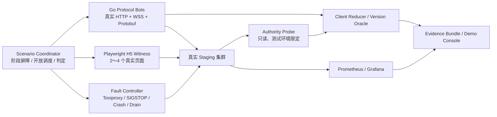

# 60 · 接入与会话测试、容量验证与演示验收冻结

版本：`v1.5-final-contracts-w5a-evidence-realigned`
日期：2026-08-03
状态：`STABLE_SEMANTIC + IMPLEMENTATION_GAPS + PHYSICAL_PENDING`
适用范围：经典农场后台的 HTTPS 认证、Cookie 免密换票、WSS、ClientHello/ServerHello、SessionAuthority、SessionRoute、Join、Subscription、FarmPresence、弱网恢复与 200 人同场广播。
上游权威：第 26 号《接入与会话详细合同》。

本文是上述范围的**测试规则与验收口径唯一权威**。它回答：

1. 必须测试什么；
2. 如何确定性制造竞态和故障；
3. 什么证据可以判定 PASS；
4. 如何论证 3000 万 DAU，而不把小规模连接测试冒充生产容量；
5. 如何把后台正确性、性能和用户体验同时展示给评委。

本文不复制第 26 号文档的业务语义；发生冲突时，第 26 号负责定义系统应该怎样工作，本文负责定义怎样证明它确实这样工作。

每次真实执行产生的配置、日志、指标、截图和结论必须单独保存到 `docs/verification/`，不得把一次运行结果写成永久设计事实。

---

## 0. 一页冻结结论

### 0.1 冻结的测试体系

经典农场不采用“只压几个接口”，也不采用“启动 200 个完整浏览器”作为主测试方式。正式测试体系冻结为：

```text
Scenario Coordinator
    ├── Go Protocol Bots：真实 HTTPS/WSS/Protobuf，承担规模和精确协议校验
    ├── 2～4 个 Playwright H5：承担真实页面体验和可视见证
    ├── Fault Controller：弱网、暂停、RST、Crash、Drain、依赖故障
    ├── Authority Probe：只读查询当前权威状态
    ├── Client State Oracle：逐客户端重放 Snapshot/Delta 并检查收敛
    └── Evidence Reporter：生成机器可判定结果和评委演示看板
```

### 0.2 冻结的六组场景

| 编号 | 场景 | 当前结论 |
|---|---|---|
| S01 | 正常登录、免密换票与 HomeReady | 既有 Direct WSS 页面级账号/分享/重登录结果仅作 `HISTORICAL_OBSERVATION`；Gate Recovery Admission 已通过逻辑/竞态测试，最终合同组合下真实 H5 与双 Gate E2E 待重跑 |
| S02 | Ticket 并发、重放、乱序激活与结果未知 | 单元基础较强；缺跨 Gate 端到端竞态 |
| S03 | 同账号顶号、旧会话命令和迟到清理 | 已有页面级顶号；缺以 ADMITTED 为边界的确定性竞态 |
| S04 | Join、Snapshot、增量连续性、重试与取消 | Gate/Hub/H5 已实现唯一 ACCEPTED→Snapshot→Delta*→Ready 顺序；既有页面级 Join/恢复仅作局部证据，最终组合、多批 Delta、权威 Hash、好友 AUTHORIZING 与双 Gate 待证明 |
| S05 | 弱网、重连、Gate Crash、Drain 与租约 | W5A SessionRoute Lease 已通过逻辑、竞态及公司 Redis Lua 验证；W5B Subscription Lease、双 Gate 与真实弱网/重连风暴仍缺证据 |
| S06 | 含农场主共 200 人同场、广播与慢客户端隔离 | 尚未被当前工具严格证明，属于 P0 补强项 |

### 0.3 冻结和未冻结的边界

已经冻结：

- 同场人数口径为 `1 个农场主 + 199 个访客 = 200 个不同玩家`；
- S01～S06 的范围、前置数据、故障点、硬断言和证据类型；
- 正确性不变量违反次数必须为 0；
- 测试必须同时包含客户端观察和服务端权威观察；
- 200 人同场与 3000 万 DAU 是两种不同问题，必须分开验证；
- 现有 Go `ws-stress` 应演进为农场专用 Protocol Bot，而不是推翻重写为另一套通用工具；
- Playwright 只承担少量真实页面见证，不承担 200 人主负载；
- 性能测试必须记录计划负载和实际施加负载，避免服务变慢后压测器自动降压造成假通过。

尚未冻结：

- 具体 P99 SLO；
- 单 Gate 安全连接数；
- 单 Player/Farm Pod 安全 QPS、Actor 数和内存水位；
- 最终 Pod、VirtualShard 和压测机数量；
- owner 尚未在场时是否永久预留 1 个 owner 名额；S06 本版统一 owner 先入场，不偷偷替产品做该决定；
- 弱网延迟、队列长度、Lease TTL 等物理参数；
- “当前已经通过 200 人同场广播”或“当前已经证明 3000 万 DAU”的结论。

上述物理参数只能由 Staging/生产型隔离环境的阶梯压测冻结。

---

## 1. 成熟度双轨：当前硬化 Join 与生产验收目标

测试报告必须显式标注协议成熟度，禁止把设计目标写成当前实现能力。

### 1.1 `CURRENT_HARDENED_JOIN`

当前 Gate、FarmSubscriptionHub 与 H5 已实现的 Join 完成屏障为：

```text
CommandResult(ACCEPTED)先进入当前ConnectionWriter FIFO
→ 显式ArmSnapshot
→ 匹配的FarmSnapshotPush(V)
→ FarmDeltaBatchPush(V+1...N)*
→ SubscriptionReadyPush(N)
→ H5连续应用到N
→ 叠加PlayerBootstrap与Pending恢复首轮屏障
→ Gate确认RecoveryAdmission
→ H5进入FARM_INTERACTIVE
```

Hub `IN_FARM`、Gate `ActiveSubscription` 与 H5 `FARM_INTERACTIVE` 是三个不同状态；`InFarm` 只可作为
旧代码兼容名，验收报告不得用它掩盖状态所属层级。

匹配至少包括：

```text
operation_id
target_farm_id / owner_id
subscription_id
join_attempt_id
connection generation / session epoch 对应的当前连接
```

已有单元、全仓和 Direct WSS 浏览器记录在各自绑定的历史提交上证明了以下局部行为；它们在最终
26～33 合同组合和当前 HEAD 重新运行前只能标为 `HISTORICAL_OBSERVATION/LOGIC_PASS`：

- ACCEPTED、Snapshot、Delta、Ready 使用唯一公开顺序和完整 Join Fence；
- Snapshot 只建立基线，Ready 前 H5 不开放经营写；
- PlayerBootstrap 独立于 FarmSnapshot，迟到的低 economy_version 不能覆盖新资产；
- Pending Journal 首轮读取或查询入队失败时 H5 保持恢复屏障并重试；
- 真实账号、分享好友，以及 Worker/全后端重启后的未决 Harvest 恢复通过。

W5A 已补齐 SessionRoute Lease 的实现和公司 Redis 脚本证据：Authority 使用 Redis TIME 保存绝对到期
并返回 Accepted TTL，Gate 使用续租请求开始时的本地单调时钟建立保守 Deadline；过期连接代次不可
复活，Deadline 前已经 ADMITTED 的命令仍可完成。该结论只标记为 `IMPLEMENTATION_PASS`，不能替代
双 Gate 实进程、Drain、重连和 Subscription Lease 证据。实现提交为
`72de6619b7911d97032deb02383eb714b75e7120`，证据索引为
`docs/verification/w5a-session-route-lease-handoff.md`；正式复测仍需在 Run Manifest 绑定实际 HEAD、
配置、Redis 目标和原始日志，不能仅引用交接结论。

Gate 已实现连接级 `ClientRecoveryComplete` 控制帧，并以当前 connection generation、SessionRoute、
自有农场 ActiveSubscription 和恢复轮次生成受信的 `recovery_complete_at_admission`。该实现已经通过
单元与竞态测试；当前协议下真实 H5、双 Gate、Drain 后恢复和混合版本发布仍需重新验证。

现有证据仍不能证明：双 Gate 下完整的 SessionRoute + Subscription Lease、确定性多批 Delta 竞态、
好友 Join 的 AUTHORIZING/RelationEpoch 撤销、200 人同场、TCONND 接入或 3000 万 DAU 容量。

### 1.2 `TARGET_PRODUCTION_VALIDATED`

生产验收继续使用同一硬化协议，不再保留旧的 Snapshot 即 InFarm 主路径：

```text
Arm Snapshot(V)
→ Snapshot 进入同一连接 FIFO
→ Catch-up V+1...N
→ SubscriptionReady(N)
→ H5 已连续应用到 N
→ FarmInteractive
```

其中 N 是一次有限切割，不要求热门农场停止变化。`N+1` 之后的新变化排在 Ready 后继续发送。

下列能力在对应 Evidence Bundle 完成之前仍不得宣称通过：

- 双 Gate、Lease 失效、Drain 与跨 Gate 顶号；
- 多批 Catch-up、QueueFull、版本 Gap 和持续热点下的有限 Ready；
- 1+199 同场、慢客户端隔离与 201 准入拒绝；
- TCONND 实际流量、开放到达容量、Soak 和 Redis 故障；
- Gate 侧受信 RecoveryAdmission 的真实 H5、双 Gate、Drain 与滚动兼容证据；
- 最终 FarmFrame oneof、Typed Payload、field number/reserved 与滚动兼容窗口。

### 1.3 报告标记

每个测试结果必须携带：

```text
protocol_maturity = CURRENT_HARDENED_JOIN | TARGET_PRODUCTION_VALIDATED
implementation_commit
server_image_digest
h5_commit
scenario_version
```

---

## 2. 业务流量模型与证据边界

### 2.1 当前产品假设

题面输入：

```text
DAU = 30,000,000
```

第 31 号 `CapacityProfile v0.1` 给出的当前可调基线：

```text
每玩家每天会话数       = 6
每次在线时长           <= 5 分钟
设计 PCU               = 3,000,000
压力 PCU               = 5,000,000
每会话 Join            = 3 次设计 / 6 次压力
每日权威写             ≈ 20 次/玩家
好友数                 = 平均 100 / 上限 300
集中峰值与压测余量     = 10 倍集中峰值 × 2 倍压测余量
```

由均匀日平均只能得到基准量级：

```text
日会话数 = 30,000,000 × 6
         = 180,000,000

平均登录/WSS 到达率 = 180,000,000 / 86,400
                   ≈ 2,083 次会话/秒

均匀平均 CCU 上界 = 30,000,000 × 6 × 5 / 1440
                  ≈ 625,000

设计 Join 平均到达率 = 180,000,000 × 3 / 86,400
                     ≈ 6,250 Join/s

压力 Join 平均到达率 = 180,000,000 × 6 / 86,400
                     ≈ 12,500 Join/s

平均权威写 = 30,000,000 × 20 / 86,400
           ≈ 6,944 write/s
```

应用 `10×` 集中峰值和 `2×` 压测余量后，候选压力点约为：

```text
登录/WSS 压力到达率 ≈ 41,667 session/s
Join 压力到达率     ≈ 125,000 Join/s
权威写压力到达率    ≈ 138,889 write/s
并发在线             = 3M 设计 / 5M 压力 PCU
```

以上数字仍是 `PHYSICAL_PENDING / CAPACITY_PROFILE_V0_1`，不是已经实测通过的 SLO。早、午、晚分布、
登录与 Join 相关性、好友热点和命令混合必须由真实流量或压测校准；60 号不得把候选全局压力目标写成
单 Pod 门禁。

容量模型还必须单独测量 Snapshot 平均/P99 字节数、每种命令的 Redis/权威写放大、Push 扇出、跨区比例和 N+1 故障余量；不能仅凭 CCU 与应用命令 QPS 推出生产副本数。

### 2.2 三种负载不能混测

| 负载 | 主要回答的问题 | 测试方式 |
|---|---|---|
| 长连接容量 | 单 Gate 能安全保持多少真实 WSS | 阶梯连接、心跳、下行和 Soak |
| 业务吞吐 | Actor、Store、Workflow 能处理多少真实命令 | 开放到达率 + 真实业务组合 |
| 热点农场 | 单一 FarmActor、Hub、Gate 扇出是否稳定 | 200 人同场 + 连续真实 FarmChange |

500 条空闲连接不能证明约 34.4 万峰值业务 QPS；约 34.4 万分散业务 QPS 也不能证明一个热门农场能给最多 200 个当前订阅稳定广播。

### 2.3 开放到达与闭环玩家

两种模型都需要：

1. `Closed Player Journey`：模拟玩家等待上一个结果再操作，适合会话行为和端到端体验；
2. `Open Arrival`：按外部时钟调度登录、换票、重连或业务命令，不因服务端变慢而自动降低计划到达率。

开放到达测试至少记录：

```text
scheduled_arrivals
launched_arrivals / actual_arrivals
admitted_arrivals
arrival_lag_ms
dropped_arrivals
completed
failed
timed_out
```

每轮在 Manifest 中预先冻结 `max_arrival_lag_ms` 和 `max_drop_ratio`。同时记录“计划时刻→完成”的排队延迟和“实际发送→完成”的服务延迟。若超过冻结阈值，结果必须判为 `INCONCLUSIVE_LOAD_GENERATOR_LIMIT`，不能由“明显低于”这类人工措辞判 PASS。

### 2.4 3000 万 DAU 的证明方法

三周项目不要求真的建立 258 万条连接。正式论证链为：

1. 在生产型隔离环境测出单 Gate 安全连接水位；
2. 测出单 Player/Farm Holder 在目标 P99 下的安全 Actor、邮箱和业务 QPS 水位；
3. 验证 1、2、4 Pod 的横向扩展曲线和非线性损耗；
4. 以不高于 75% 的目标利用率计算生产副本数；
5. 单独验证单 Farm 200 人热点；
6. 用较大规模分布式压测校准模型，而不是把理论线性外推当成最终证据；
7. 保存基础设施、镜像、配置和原始指标，使计算可复算。

---

## 3. 测试系统架构



### 3.1 Scenario Coordinator

负责：

- 创建本轮 run_id 和随机种子；
- 分配玩家、Gate 和目标 Farm；
- 预建账号、好友关系、作物和测试配置；
- 以阶段屏障协调 Bot、H5、服务和故障注入；
- 记录计划到达与实际到达；
- 汇总硬不变量并返回非零退出码；
- 生成可重复执行的 Manifest。

不得只依赖 `sleep(100ms)` 碰竞态。至少需要以下确定性屏障：

```text
WAIT_TICKET_COMMITTED
WAIT_SESSION_ACTIVATED
WAIT_COMMAND_ADMITTED
WAIT_SNAPSHOT_CAPTURED
WAIT_SNAPSHOT_QUEUED
WAIT_ALL_VIEWERS_JOINED
PAUSE_DOWNLINK
RELEASE_DOWNLINK
INJECT_GATE_CRASH
WAIT_ROUTE_LEASE_EXPIRED
```

实现方式可以是测试构建 Hook、受保护的测试控制端口或可注入接口；必须满足：

- 只在 Staging/Test 显式启用；
- 不暴露在公网；
- 不改变正式业务裁决；
- 报告记录启用的 Hook 和触发时刻。

### 3.2 Go Protocol Bot

在现有 `cmd/ws-stress` 基础上演进，复用生成的 Proto 和真实认证流程。每个 Bot 必须有独立状态机：

```text
INIT
→ HTTPS_AUTHED
→ WS_CONNECTED
→ HELLO_OK
→ JOIN_PENDING
→ SNAPSHOT_APPLIED
→ READY_APPLIED
→ RECOVERY_COMPLETE + PLAYER_BOOTSTRAP_READY
→ FARM_INTERACTIVE
→ FRIEND_OPPORTUNITY_FOUND_OR_NONE
→ HOME_READY
→ RECONNECTING / RESYNCING / CLOSED
```

`READY_APPLIED`、Gate `ActiveSubscription`、Hub `IN_FARM`、H5 `FARM_INTERACTIVE` 和 UI
`HOME_READY` 是不同观察点；Bot 必须分别记录，不能用一个布尔值同时代表它们。

每个 Bot 保存测试期事件账本：

```text
player_id
gate_id
session_epoch
connection_generation
subscription_id
snapshot_version
applied_farm_version
last_server_seq
received_change_count
received_change_rolling_hash
last_change_versions[bounded]
resync_count
close_reason
```

完整事件流应边接收边写 NDJSON，内存只保留计数、滚动 Hash 和最近 N 条；失败客户端再保留完整 Trace。上述高基数数据只进入压测器报告和采样日志，不进入 Prometheus 标签。

### 3.3 Client Reducer / Version Oracle

Bot 不能只读取后丢弃消息，必须复用或等价实现 H5 的状态归并规则：

```text
ApplySnapshot(V)
ApplyFarmChange(V+1)
ApplyFarmChange(V+2)
...
```

逐客户端检查：

- `server_seq` 严格单调且符合当前协议合同；
- Snapshot 前没有同 Subscription 的 FarmChange；
- FarmChange 版本无跳号、回退和不可解释重复；
- Push 的 Subscription Fence 与当前连接一致；
- 最终客户端状态哈希与权威 Farm 状态哈希一致。

### 3.4 Authority Probe

Authority Probe 仅用于测试判定，必须是只读接口。推荐由当前 Holder/FarmActor 返回：

```text
farm_id
farm_version
canonical_state_hash
distinct_valid_viewers
subscriptions_by_phase
holder_id / writer_epoch
```

它不能：

- 绕过 FarmActor 修改业务状态；
- 被 H5 正式业务调用；
- 作为客户端同步路径；
- 用内部状态冒充公网消息已经送达。

### 3.5 Playwright H5 Witness

只运行 2～4 个真实页面：

- 农场主页面；
- 一个正常访客页面；
- 可选一个弱网访客；
- 可选一个被顶号或 Drain 的访客。

它负责证明：

- 页面状态机与协议一致；
- Loading、重连、顶号、Resync 文案可理解；
- FarmChange 在真实 UI 中生效；
- 用户不会在未恢复完成时误操作；
- 故障恢复后页面不保持虚假的 InFarm。

### 3.6 Fault Controller

故障面分为：

```text
Client ↔ Gate WSS
Gate ↔ Redis SessionAuthority
Gate ↔ Player/Farm RPC
Farm ↔ Gate Downlink RPC
Gate/Player/Farm 进程本身
```

正式 Fault Controller **必须覆盖**：延迟、抖动、带宽限制、单向暂停、半开、超时、RST、进程暂停、
Crash、Drain 和依赖不可用。当前仓库只具备其中一部分脚本/Hook；未真实触达故障点时必须报告
`INCONCLUSIVE_FAULT_NOT_REACHED`，不得把本节能力清单当成已经实现的工具证据。

### 3.7 确定性 Harness 族

借鉴成熟游戏服的测试方式，但不复制具体项目框架。不同冲突域不能全部塞进一个通用 Actor Harness，推荐建立四类可组合 Harness：

```text
SessionAuthorityHarness
    └── 真 Redis/Lua 或等价原子实现：Ticket、Epoch、Route、Unknown

GateAdmissionHarness
    └── PRE_AUTH、ADMITTED、CommandQueue、旧 Session Fence

FarmActorHarness
    └── 真实 Runtime/Mailbox/Registry、Store、WriterFence、passivation

SubscriptionHubHarness
    └── Presence、JoiningBuffer、FarmEventLane、Downlink、Resync

ActorRouteAndFenceHarness
    └── Assignment Revision、Redirect、Shard Lease、WriterClaim、FenceAndClaim

共享测试构件
    ├── ManualClock：一次 turn 固定 trusted_now_ms
    ├── ControllableStore：成功、冲突、超时、结果未知
    ├── ControllableDownlink：Accepted、QueueFull、延迟回调
    ├── PhaseBarrier：在确定步骤暂停与恢复
    └── InvariantCollector：版本、Receipt、资源和生命周期
```

它用于确定性验证：

- 同 Actor 邮箱串行、不同 Actor 可并行；
- `ADMITTED` 后顶号、CAS 返回 Unknown、迟到回调等竞态；
- 邮箱满、系统消息保底通道、加载风暴和 Panic 恢复；
- passivation、重激活和旧 `writer_epoch` 写入拒绝；
- Join 的 Snapshot、Catch-up、QueueAccepted 和取消顺序；
- 旧 Assignment 返回 `ROUTE_STALE/REDIRECT`，最多使用原 operation 自动纠正一次；
- Shard Drain/Crash 后旧 Holder 不再接收新 Mailbox，新 Holder 取得新写权并懒加载 Actor；
- 旧 `writer_epoch/writer_claim_id` 写入拒绝，`CLAIM_UNKNOWN` 未解析前 Actor 不得 ACTIVE；
- Commit 先于 Fence 与 Fence 先于迟到 Commit 两种顺序都能由 Receipt/ResolutionTombstone 唯一解释。

Ticket 双 Gate 核销不属于 Actor 测试，必须由 SessionAuthority + 真 Redis/Lua 证明。Harness 使用的 Fake 只负责可控地制造边界，不能替代真实 Redis/Tcaplus、真实多进程或真实网络测试。

### 3.8 Store Contract Matrix

先按职责拆合同，再把每份合同运行在适用的物理实现上；不能用一张通用表暗示 Redis、Tcaplus 和 MemoryStore 承担相同职责。

| Contract Suite | 核心语义 | 适用实现 |
|---|---|---|
| Session/Ticket/Lease | Lua 原子核销、Epoch、TTL、Hash Slot、Lease、Unknown | Memory 模型 + Redis Live |
| Player/Farm Aggregate | Insert、Get、CAS、Writer Fence、Receipt 原子边界 | Memory/Fault + Redis P0 + Tcaplus 迁移目标 |
| Workflow/Outbox | CreateIfAbsent、Claim、Participant Receipt、投递进度 | Memory/Fault + Redis P0；未来按目标存储另做物理合同 |
| FriendRelation | canonical Relation、relation_epoch、Index 可重建 | Memory/Fault + Redis P0；未来按目标存储迁移 |

每份适用合同仍应复用相同业务期望，而不是为 Fake 和真存储分别写两套结论：

| 实现 | 用途 | 能证明什么 |
|---|---|---|
| Memory/Fake | 每次提交快速回归 | 业务状态机和错误分支 |
| Fault Decorator | 人工制造 Timeout/Unknown/迟到成功 | 结果恢复和 Fence |
| 公司 Redis Live | P0 当前真实物理合同 | Lua 原子性、CAS、TTL、Lease、集群 Hash Tag |
| Tcaplus Live | 目标聚合存储迁移探针 | RecordVersion、条件创建、索引和真实延迟；不照搬 Redis Lease/Lua 合同 |

聚合类 Repository 最少复用以下合同用例：

```text
InsertIfAbsent
Get
CAS(old_version -> new_version)
stale writer_epoch / writer_claim_id rejected
same idempotency key + same hash replayed
same idempotency key + different hash conflicted
timeout after possible commit -> resolve by authoritative read
authority fact + Receipt/Outbox physical atomicity
```

Unknown Outcome 必须按边界分别报告，不能用一个“重试成功”覆盖：

```text
SESSION_ACTIVATION_UNKNOWN
ACTOR_COMMIT_UNKNOWN
WORKFLOW_STEP_UNKNOWN
RESULT_PROJECTION_UNKNOWN
```

Session 激活按 Ticket/connection fence 解析；Actor Commit 使用 FenceAndClaim/ResolutionReceipt；Workflow
Step 读取 Participant Receipt；Result 投影 Unknown 只重放投影 Order，不能重新执行业务权威变化。

Lease 的 acquire/renew/expire/steal、Redis Cluster Hash Slot、Lua `NOSCRIPT`、超时后可能已提交、只读副本与切主属于 Redis 专项合同。

任何仅在 MemoryStore 通过的结论，最多标记为 `LOGIC_PASS`，不得写成 `PHYSICAL_PASS`。

### 3.9 Bot 生成、部署与数据准备

机器人不是 AI，也不是业务服里的特殊玩家。它是独立 `farm-load` 进程中的轻量协议客户端：

```text
FixtureBuilder
    → 生成 run_id 隔离的账号、好友关系、目标农场和作物
    → 输出 BotSpec[]

farm-load
    → 每个 Bot 一份状态机和事件账本
    → 少量进程/Pod 内承载大量事件驱动连接
    → 真实走 HTTPS/WSS/Protobuf
```

`BotSpec` 至少包含：

```text
player_id
role = OWNER | HEALTHY_VIEWER | SLOW_VIEWER | EXTRA_VIEWER
target_farm_id
gateway_affinity
auth_mode
scenario_seed
fault_profile
```

约束：

- 不把 Bot 嵌入 farm-gate、player-svr 或 farm-svr；
- 不为每个 Bot 启一个容器或完整浏览器；
- 不直接伪造 Redis 中的 Session/Ticket/Presence；
- 好友关系和可操作状态必须经仅在隔离环境启用的建档接口或权威命令创建，测试入口不得暴露在生产公网；
- 不为了管理 Bot 引入 MongoDB、GM 服务或场景服 Tick；
- 一个连接只有一个持续读取协程，所有命令通过同一写调度器发送，避免并发读 WebSocket；
- 收到 Push 后必须交给 Reducer/Oracle，不能读取后直接丢弃。
- `gateway_affinity` 只是调度意图；实际跨 Gate 分布必须由 ServerHello 中的安全接入标识或服务端低基数指标/测试 Probe 证明；
- “慢应用读取/限带宽”和“完全不读/不处理控制帧”是两个不同故障配置，必须分别报告 Close Reason。

S06 推荐分配为：`1 个 H5 农场主 + 1 个 H5 访客 + 198 个 Bot`，并额外创建第 201 个不同玩家验证容量拒绝。规模负载和 UI 见证由不同工具承担，但共享同一个 `run_id` 和场景阶段屏障。

---

## 4. 公共硬不变量

任何硬不变量违反一次，本轮即为 FAIL；不能被平均成功率稀释。

| 编号 | 不变量 |
|---|---|
| INV-SESSION-01 | 同一 player_id 在 Redis 中最多一条当前 active SessionRoute |
| INV-SESSION-02 | HTTPS 签发候选 Ticket 不提前替换当前活跃 WSS |
| INV-SESSION-03 | 同一 Ticket 并发核销最多一个连接成功 |
| INV-SESSION-04 | 更低 reserved_session_epoch 不得覆盖已经激活的更高 epoch |
| INV-SESSION-05 | 旧连接迟到 Disconnect/KICK/Cleanup 不得删除新 Route 或新 Subscription |
| INV-SESSION-06 | Fence/Lease 已失效的 Gate 不得准入新的业务写命令 |
| INV-JOIN-01 | Join 的 Result、Snapshot 和后续 Change 必须属于相同 Farm 与 Subscription |
| INV-JOIN-02 | Snapshot 之前不得交付该 Subscription 的普通 FarmChange |
| INV-JOIN-03 | Snapshot(V) 后应用的 FarmChange 必须形成连续版本前缀 |
| INV-JOIN-04 | Join 重试、重连和迟到回调不得创建幽灵 Presence 或重复占位 |
| INV-JOIN-05 | 业务已经权威提交时，下行失败不得回滚或伪装成业务未发生 |
| INV-CAP-01 | 一个农场最多 200 个不同玩家的当前有效 Subscription，含农场主 |
| INV-CAP-02 | 同玩家同农场的重 Join/替换连接最多占一个名额 |
| INV-FANOUT-01 | FarmActor 每次业务变化只裁决并生成一次权威 FarmChange |
| INV-FANOUT-02 | 一个慢连接或坏 Gate 不得阻塞其他健康连接/Gate 的下行 |
| INV-CONSISTENCY-01 | 所有健康客户端在收敛窗口结束后与权威 farm_version 和状态哈希一致 |
| INV-SECURITY-01 | 客户端不能伪造 player_id、SessionPermit 或连接 Fence |
| INV-ASSET-01 | 接入、重连、顶号和结果未知不得造成重复资产、重复奖励或操作二次执行 |

正确性门禁：

```text
invariant_violations == 0
unexpected_or_applied_version_gaps == 0
expected_gap_detected == injected_expected_gap
resync_failures == 0
state_hash_mismatch == 0
duplicate_asset_grants == 0
double_active_routes == 0
unclosed_required_workflows == 0
```

故意注入 Gap/QueueFull 的场景允许“检测到预期缺口”，但不允许客户端把带缺口的数据直接应用。最终 Hash 对账必须先停止业务写，冻结权威 `farm_version`，等待健康客户端追平或完成 Resync，并使用同一 Hash Schema 与 `as_of_ms`；成熟倒计时等时间派生展示字段不直接进入 canonical Hash。

---

## 5. S01 · 正常登录、免密换票与 HomeReady

### 5.1 目标

证明玩家从无连接状态进入可安全操作的自己农场，且认证、在线会话、Join 和首页依赖没有被一个模糊的 `InFarm` 布尔值混在一起。

### 5.2 子场景

#### S01-A 账号密码登录

```text
POST /v1/session/login
→ Set-Cookie farm_session
→ connection_ticket
→ WSS
→ ClientHello(ticket)
→ ServerHello
→ RecoverPending / PlayerBootstrap / FriendOpportunity
→ JoinOwnFarm
→ ACCEPTED + FarmSnapshot + Delta* + Ready
→ Recovery Complete + PlayerBootstrap Ready
→ FARM_INTERACTIVE
→ FriendOpportunity 返回 FOUND/NONE
→ HOME_READY
```

#### S01-B Cookie 免密换票

```text
已有合法 HttpOnly farm_session
→ POST /v1/auth/renew
→ 新 connection_ticket
→ 新 WSS / ClientHello
→ 恢复与 Join
```

请求中不得再次发送账号密码。

#### S01-C 好友机会有界降级

人为延迟好友机会查询：

```text
自己农场 Snapshot、PlayerBootstrap、PendingRecovery 完成
好友机会超时
→ 页面进入可经营状态
→ 好友区域明确显示 Loading/Retry
```

超时不能伪装成“当前没有互动机会”。

### 5.3 硬断言

- HTTPS 成功后、ClientHello 前，原 active session 不变化；
- Ticket 不出现在 URL、日志和 Cookie 正文中；
- ServerHello 返回前，SessionRoute 已绑定到精确连接 Fence；
- ClientHello 前发送业务命令被拒绝；
- Snapshot 到达前，客户端经营按钮不可用；
- Accepted 和 Snapshot 的 operation/farm/subscription 匹配；
- `FARM_INTERACTIVE` 至少要求：OwnFarm Snapshot/Delta/Ready 连续、PlayerBootstrap 完成、PendingRecovery
  完成且 Gate 侧受信 Recovery Admission 成立；
- `HOME_READY` 还要求 FriendOpportunity 明确返回 `FOUND` 或 `NONE`；好友查询超时/失败时页面只能保持
  `FARM_INTERACTIVE`，好友区域显示 Loading/Retry，不能把降级状态伪装成 HOME_READY 或 NONE；
- 页面刷新或弱网重连使用 Cookie 免密换票，而不是缓存密码。

### 5.4 证据

```text
login_latency
ticket_issue_latency
client_hello_latency
join_latency
home_ready_latency
每个首页屏障的完成时间
H5 状态转换时间线和截图/Trace
```

---

## 6. S02 · Ticket 并发、重放与激活结果未知

### 6.1 目标

证明 Ticket 单次、候选 epoch 单调、跨 Gate 激活原子，并能处理 Redis 已提交但调用方不知道结果的情况。

### 6.2 子场景

#### S02-A 同 Ticket 双 Gate 核销

```text
同一 Ticket
├── Gate-A ClientHello
└── Gate-B ClientHello
```

两端在同一屏障同时释放。必须只有一端收到成功 ServerHello；另一端得到稳定的已使用/冲突结果。

#### S02-B 两张 Ticket 顺序激活

```text
T1 reserved=21
T2 reserved=22
```

分别验证：

- T1 激活后 T2 激活：最终 epoch=22；
- T2 先激活、T1 后到：T1 返回 SUPERSEDED，epoch 不得回退到 21。

#### S02-C Ticket 过期

签发 Ticket 后不建立 WSS，等待过期。原有活跃连接必须继续可用。

#### S02-D 激活 Unknown Outcome

```text
Redis 已提交：Ticket consumed + active route changed
→ 在 Gate 收到结果或发送 ServerHello 前制造超时/Crash
```

Gate/客户端必须先使用原 Ticket、原 `connection_id + connection_generation` 查询或幂等重入
`activation_result`，不能仅因 RPC 超时就立即换更高 Ticket 制造第二次激活意图：

```text
确认 COMMITTED
→ 恢复原激活结果或按其 Fence 建立连接

确认 NOT_COMMITTED / 原 Ticket 明确失效
→ 才允许 Cookie 免密换取新 Ticket

仍为 UNKNOWN
→ 保持 UNKNOWN 并有界查询，不能并发制造第二个可写 Route
```

#### S02-E authority_epoch 撤销

修改密码、封禁或退出所有设备后，旧 Cookie 和旧 Ticket 必须失效。

### 6.3 硬断言

```text
active_session_epoch 单调不回退
route_revision 单调
同 Ticket 成功核销数 == 1
active SessionRoute 数 <= 1
旧 HTTPS 登录未激活前不踢当前连接
Unknown Outcome 不产生两个可写连接
```

### 6.4 权威检查

不能只看 WSS 返回值，必须读取测试环境下的：

```text
Ticket state / consumed result
next_session_epoch
active_session_epoch
route_revision
active_route full fence
```

---

## 7. S03 · 同账号顶号与旧会话命令边界

### 7.1 目标

证明“单玩家单活”的严格部分和有界传播部分：Redis Route 唯一；旧 Socket 可短暂存在；已经 ADMITTED 的旧命令允许完成；Fence 后不再准入新写。

### 7.2 确定性竞态

必须以服务端准入点为边界，不能以用户点击时刻为边界：

```text
旧连接进入自己农场
→ 旧连接发送命令 C1
→ Gate 完成 Session/Fence/RateLimit/BackendSlot 校验，C1=ADMITTED
→ 暂停 C1 发往业务服务
→ 新连接在另一 Gate ClientHello 激活并顶号
→ 释放 C1
→ 新连接查询/恢复 C1 的 OperationResult
→ 旧连接尝试发送 C2
```

### 7.3 预期结果

- C1 可以成功或返回其唯一终态，但最多执行一次；
- C1 的结果可以被新会话恢复；
- 若玩家在 C1 ADMITTED 后从 Farm-A 切到 Farm-B，A 的旧 Snapshot/FarmChange 必须按旧
  `subscription_id` 丢弃；C1 的 CommandResult 仍按 `request_id/operation_id` 返回或可查询，不能被当前
  Subscription Fence 误删，也不能把其中 A 的 PlotView 应用到 B 页面；
- 旧 Gate 观察到 KICK/Fence 或 Lease 失效后，C2 必须拒绝；
- 旧连接迟到 Disconnect 不得清理新 Route；
- 旧 Subscription 的迟到 Cleanup 不得清理新 Subscription；
- 新旧连接不能重复占用农场人数；
- 旧 H5 收到 `LOGIN_ELSEWHERE` 后进入登录提示页，不得自动 Cookie 免密重连与新页面互相顶号。

### 7.4 跨 Gate 要求

S03 正式验收必须至少部署两个 Gate，并能确定性指定旧连接和新连接落到不同 Gate。单 Gate 内存测试只能作为前置单测，不能替代跨 Gate 控制调用和 Route Lease 验证。

---

## 8. S04 · Join、Snapshot、增量、重试与取消

### 8.1 目标

证明 Join 不会因为 Snapshot/Result 反序、农场持续变化、重试、切换农场、慢下行或迟到回调而形成版本空洞或幽灵 Presence。

### 8.2 唯一公开顺序与内部竞态

公网只能观察到这一种顺序：

```text
CommandResult(ACCEPTED)
→ FarmSnapshot(V)
→ FarmDeltaBatch(V+1...N)*
→ SubscriptionReady(N)
```

测试必须在服务端内部制造 `ArmSnapshot`、Snapshot 投递和 FirstHop 返回之间的反序与延迟，证明
Gate 的 PendingJoin/FIFO 屏障仍把公开顺序固定为上述唯一结果。`FarmSnapshot → ACCEPTED` 不再是
兼容路径；一旦客户端观察到这种反序，本轮必须失败，不能让 H5 缓存后继续。

以下情况必须拒绝或忽略，不能污染当前 Join：

```text
旧 operation_id 的 Snapshot
另一 farm_id 的 Snapshot
另一 subscription_id 的 Snapshot
旧 connection generation 的 Push
已经取消 attempt 的迟到回调
```

### 8.3 Snapshot 与变化竞态

正式测试时序：

```text
访客发起 Join
→ Hub 捕获 Snapshot(V)
→ 暂停该访客下行
→ 由一个合法操作者完成 K 次真实、会增加 farm_version 的变化
→ 恢复下行
→ 访客应用 Snapshot(V)
→ 访客连续应用 V+1...V+K
→ 读取 FarmActor 权威状态
→ 比对版本和 canonical_state_hash
```

`K` 必须可配置。普通连续性测试可使用较小 K；缓冲和慢连接测试必须持续到触发真实 item/byte/duration 边界，不能假设一条消息可以填满 OS 或 Gate 队列。

### 8.4 重试和幂等

验证：

- 同一连接、同一完整 Fence、同一 PendingJoin，使用相同 `operation_id + payload_hash` 重试时复用原
  `join_attempt_id` 和结果，不增加人数；
- 同一 PendingJoin 的相同 `operation_id`、不同 Payload 返回 `IDEMPOTENCY_CONFLICT`；
- 新 WSS、Fresh Join 或旧 attempt 已终止时必须创建新的 `join_attempt_id`；旧 attempt 的迟到
  Snapshot/Ready 只能被 Fence 丢弃或用于精确清理，不能恢复为新 Join；
- 同玩家、同 Farm、新 Join 操作替换或复用当前有效订阅时，最终只占一个名额；
- 网络结果未知时，客户端不能用无限新 operation_id 盲目创建 Join。

### 8.5 取消与切换

```text
Join Farm-A 尚未完成
→ 客户端切换/取消
→ Join Farm-B
→ A 的 Snapshot/QueueAccepted/Catch-up/Ready 迟到
```

必须保证：

- A 的迟到消息不能把当前页面切回 A；
- A 的 Presence 最终清理；
- B 正常完成；
- 迟到 Cleanup(A) 不影响 B；
- 当前一根连接最多一个可写 ActiveSubscription。

### 8.6 QueueFull、Gap 与 Resync

发生以下情况：

```text
ConnectionWriter QueueFull
JoiningBuffer Overflow
FarmChange Version Gap
Holder 重建导致运行时缓冲丢失
连接 Fence 变化
```

结果必须是：

```text
当前订阅失效
→ REJOIN_REQUIRED / Fresh Join
→ 获取新 Snapshot
```

已经提交的业务变化不回滚；客户端不能继续应用不可解释的增量。

### 8.7 当前 Ready 合同与待补证据

当前实现和后续生产证据共同验证：

```text
Snapshot(V)
→ Catch-up 至有限 N
→ SubscriptionReady(N)
→ H5 applied_farm_version == N
→ FarmInteractive
```

持续产生 `N+1` 之后的变化不得让 Join 永远无法 Ready。

除客户端顺序外，Harness 还必须逐步观察内部状态推进：

```text
ACCEPTED QueueAccepted
→ ArmSnapshot
→ Snapshot QueueAccepted
→ 冻结 ready_cut_version=N
→ Catch-up Batch QueueAccepted（可为0..N批）
→ SubscriptionReady QueueAccepted
→ Gate PendingJoin提升为ActiveSubscription
→ Hub进入IN_FARM
```

任一 ACK 重复、乱序、丢失或超时都不得跳过阶段。持续热点时 `N+1` 之后进入 post-ready 区间，不能
继续抬高本次 `ready_cut_version`。共享 VersionRing 只保存一份变化，每个 Subscription 保存自己的游标；
Ring 覆盖只令落后的订阅 Fresh Join，不能复制 200 份完整 Delta 或拖慢健康订阅。Fresh Join 不得消费旧
`delivery_generation` 的变化。

### 8.8 好友 Join 的 AUTHORIZING 与 RelationEpoch Fence

好友 Join 必须增加以下确定性竞态；自己农场 Join 不走该路径：

```text
Gate 创建 PendingJoin(join_operation_id, join_attempt_id, full connection fence)
→ Hub 创建 AUTHORIZING 并立即预留一个同场名额
→ Pair Authority AuthorizePreparedVisit
→ Hub 仅在 attempt、目标和完整 Fence 全匹配时绑定 relation_id + relation_epoch
→ 进入普通 JOINING / Snapshot / Ready 主链
```

必须分别证明：

- 删除/拉黑先于授权提交：不签 Permit，AUTHORIZING 取消并释放名额；
- 授权先于删除/拉黑：`FriendTerminationOrder` 能撤销 AUTHORIZING 或后续 Subscription；
- Permit 绑定前 Deadline/Fence 变化：Fail Closed，不能产生 Snapshot；
- 旧 relation epoch 的迟到清理不会删除重新加好友后新 epoch 的 Subscription；
- AUTHORIZING、JOINING、FLUSHING、ACTIVATING、IN_FARM 中，同一 viewer 始终只占一个名额；
- H5 不新增 AUTHORIZING 页面状态，仍只看到 Joining 或确定性拒绝/Fresh Join。

---

## 9. S05 · 弱网、重连、Crash、Drain 与租约

### 9.1 目标

证明弱网只影响体验和及时性，不破坏 Session Fence、资产幂等、Farm 版本和跨 Actor 结果。

### 9.2 故障矩阵

| 故障 | 注入位置 | 重点观察 |
|---|---|---|
| 延迟/抖动 | Client ↔ Gate | Join/命令时延、按钮状态、重试 |
| 带宽限制/慢读 | Gate → Client | 单连接 Queue、Resync、其他连接隔离 |
| 单向暂停/半开 | WSS TCP | Ping/Pong、Lease、恢复时长 |
| RST/硬断 | Client ↔ Gate | Cookie 免密换票、Fresh Join |
| 结果下行丢失 | Farm/Player → Gate 或 Gate → Client | OperationResult 恢复、禁止重复执行 |
| Gate SIGSTOP/Crash | Gate Pod | Boot Fence、Route/Subscription Lease |
| Gate Drain | Gate Pod | 停接、抖动重连、重连风暴 |
| Redis 延迟/不可用 | Gate ↔ Session Redis | trusted deadline、Fail-Closed |
| Farm/Player RPC 延迟 | Gate ↔ 业务服务 | BackendPool、Deadline、连接隔离 |

具体毫秒、带宽和丢包率属于 `PHYSICAL_PENDING`，第一轮从轻到重阶梯增加并记录配置。

### 9.3 必须持续有业务负载

故障期间必须有一部分客户端持续执行真实命令；只保持空闲连接不能证明：

- 已发送但结果丢失的恢复；
- Actor 邮箱是否积压；
- Store/Workflow 是否收敛；
- 旧 Session 是否仍在错误准入写命令。

### 9.4 Gate Crash 与 Boot Fence

```text
Gate-A 持有 SessionRoute 与 FarmSubscription
→ Gate-A Crash
→ 客户端 Cookie 免密换票并连接 Gate-B
→ Gate-B 建立新 Route/Subscription
→ Gate-A 的旧 Lease/Reaper/Cleanup 迟到
```

旧 Gate 任何迟到动作都不得删除 Gate-B 的新状态。

### 9.5 Drain

Drain 不迁移 Socket：

```text
Gate 停止接新连接
→ 发送 DrainNotice / 提供重连窗口
→ 客户端 Full Jitter
→ Cookie 免密换票
→ 新 Gate / ClientHello / Fresh Join
```

需要同时验证：

- 重连分布没有集中在同一秒；
- 旧 Gate 在 Deadline 后退出；
- 没有双活写会话；
- 玩家最终恢复到自己或目标好友农场；
- 未决操作可查询，不重复执行。

### 9.6 Redis 故障

当 Gate 无法在可信 Deadline 前续租 SessionRoute：

- 到期后关闭该 connection generation 的新命令准入；
- 不得使用本地旧状态无限放行；
- 恢复 Redis 后通过新 Ticket/Session 或明确恢复流程重建；
- 资产服务可以继续保持其权威数据，不因 Session Redis 故障回滚。

### 9.7 SessionRoute Lease 与 Subscription Lease 分开验收

两种 Lease 不能混成一个“在线 TTL”指标：

```text
SessionRoute Lease
→ 约束当前 connection generation 是否仍是该玩家的活动在线路由

FarmSubscription Lease
→ 约束某个完整 SubscriptionFence 是否仍占用目标农场名额并可接收新的农场写
```

W5B 正式验收必须证明：

1. Gate 按当前 Farm Holder 批量发送 `BatchRenewSubscriptions`，每项携带完整
   `SubscriptionFence + DownlinkTargetFence`；不得按每次广播查询 Redis；
2. Holder 使用一次 trusted-now 处理批次并返回 `accepted_ttl_ms`，Gate 从 **renew 请求开始时刻**
   建立本地单调 Deadline，并扣除 Safety Margin；
3. 旧 subscription、旧 connection generation、旧 session epoch、旧 holder revision 任一不匹配时
   不得续租或延长本地 Deadline；
4. Authority 已判 EXPIRED/CLOSED 或 Gate 本地 Deadline 已越过后，该 Subscription 进入终止态，
   不能被迟到成功响应复活；
5. Subscription 到期只终止对应农场上下文：停止新的农场写，按当前连接 FIFO 下发
   `REJOIN_REQUIRED` 并执行 Fresh Join；不要求整条 WSS 重新账号登录；
6. Deadline 前已经 ADMITTED 的命令仍按原 operation 语义完成或查询，不能因 Lease 到期回滚；
7. RPC 暂时失败但本地 Deadline 尚未越过时保留当前状态并继续有界重试；越过 Deadline 后必须
   Fail Closed；
8. 200 人同场续租按 Holder/Gate 聚合，记录 batch size、续租 QPS、P99、拒绝原因和过期清理时延。

---

## 10. S06 · 含农场主共 200 人同场

### 10.1 固定口径

```text
owner = 1
visitors = 199
distinct viewers = 200
```

正式测试至少跨两个 Gate，例如：

```text
Gate-A: owner + 99 visitors
Gate-B: 100 visitors
```

演示可使用：

```text
1 个农场主真实 H5
1 个访客真实 H5
198 个 Go Bot
```

### 10.2 前置数据

- 1 个 owner、198 名先入场访客、2 名容量竞争访客，共 201 个独立玩家身份；
- owner 与全部 200 名候选访客之间都存在真实、有效的 canonical FriendRelation；
- 目标农场存在可被合法操作并能产生真实版本变化的作物/护理状态；
- 所有测试玩家与历史测试数据隔离；
- 记录初始 farm_version 和状态哈希。

不得通过关闭好友权限来伪造合法访问者，也不得让第 201 人因“不是好友”被拒后冒充 Farm Full。owner 先入场，避免在本场景中混入“访客已满时是否为 owner 预留名额”的另一项产品决策。

### 10.3 容量准入顺序

1. owner + 198 名访客完成当前协议 Join 屏障，当前人数为 199；
2. 已在场玩家重复 Join，同一玩家计数仍为 1；
3. 已在场玩家新连接替换旧连接，计数仍为 1；
4. 两名都具备合法好友权限的新访客并发竞争最后一个名额；
5. 恰好一名成功、一名得到明确 `REJECTED + CAPACITY_*`，Authority Probe 看到正好 200 个不同有效
   Viewer；精确容量错误码由 CommandCatalog 工作包冻结，验收不得提前发明 `ERR_FARM_FULL`；
6. 满员状态继续 Join，不得因重试、换 Gate 或新 operation_id 超过 200；
7. 正常离开或 Lease 清理后，释放的名额可以被原失败访客使用。

好友访客从创建 `AUTHORIZING` 起就占用名额；授权失败、Deadline、Fence 变化或关系撤销必须释放。
测试不能只统计 Ready 成员，否则会漏掉授权风暴下的真实容量占用。

### 10.4 广播正确性

所有人 Ready 后，由合法操作者产生 K 次真实、确实增加 `farm_version` 的变化。推荐使用短成熟时间的测试配置和真实 `Buy → Plant → 每茬一次 Care → now >= mature_at → Harvest` 周期，不能用重复 NoChange 或测试 Tick 冒充变化：

```text
权威初始版本 = V
权威最终版本 = V + K
```

健康客户端必须满足：

```text
收到 Snapshot 或当前基线版本
收到连续变化至 V+K
最终 applied_farm_version == V+K
canonical_state_hash == FarmActor canonical_state_hash
```

同时观察：

- FarmActor 权威提交次数为 K，而不是 K×199；
- `successful_mutations == K`，NoChange/Rejected 不计入 K；
- Hub 按 Gate 聚合投递；
- 本场景固定 `fanout_expected_targets = 200`：FarmChange 发送给全部 200 个有效 Subscription，包括
  操作者自己的订阅；CommandResult 不能替代 canonical FarmChange。若未来产品决定排除操作者，必须先
  修订 26/60 与 Fixture，单轮测试不能同时接受 199 和 200 两种结果；
- 广播热路径不对每个玩家逐个查询 Redis SessionRoute；
- 每 Gate 本地再向对应 ConnectionWriter 并发扇出。

### 10.5 慢客户端隔离

容量检查完成后，选 5 个 Bot 进入“慢应用读取/极低带宽”配置，并与“完全不读导致心跳超时/半开”分成两个子场景。持续产生真实变化，直到前者触发配置化 Queue/Duration 边界；不能预设固定 K 必然填满 OS 或 Writer 队列。若在安全最大变化数内始终未触达目标水位，本轮判 `INCONCLUSIVE_FAULT_NOT_REACHED`。

预期：

- 5 个慢客户端进入 Lagging、Resync 或 Closed；
- 其他 195 个客户端版本继续连续并最终收敛；
- 慢客户端不能反压 FarmActor；
- Gate-A 不可用不能阻塞 Gate-B；
- 清理慢客户端后，Presence 计数下降，释放名额可再次使用。

### 10.6 硬验收

```text
authority_change_count == K
full_stage_distinct_valid_viewers == 200
fanout_expected_targets_per_change == 200
distinct_valid_viewers_never_exceeds_200 == true
duplicate_capacity_occupancy == 0
healthy_unexpected_or_applied_version_gap == 0
expected_gap_detected == injected_expected_gap
healthy_resync_failure == 0
healthy_client_state_hash_mismatch == 0
healthy_client_unexpected_disconnect == 0
slow_client_blast_radius == selected_slow_clients
per_viewer_session_route_redis_lookup_on_broadcast == 0
```

### 10.7 好友 ActionAdmission 竞态

S06 中用于产生真实变化的好友 Care/Theft 不能只依赖“当前在场”或 FriendIndex。至少验证：

```text
删除/拉黑先提交
→ CommitFriendActionAdmission REJECTED
→ 不创建 FriendActionDispatchOrder

ActionAdmission 先提交
→ AdmissionReceipt + ActionPermit + DispatchOrder + DueIndex 同 Pair Bucket 原子存在
→ 随后的删除只阻止新操作
→ 原 operation 仍由 Dispatcher/Worker 恢复至唯一终态
```

同 `IdempotencyKey + payload_hash` 重试必须复用原 Admission；同 Key 不同 Hash 返回
`IDEMPOTENCY_CONFLICT`。已有 FarmSubscription、延迟的 FriendIndex 或 OpportunitySummary 都不能代替
ActionPermit。验收必须读取 Pair Authority/Order 证据，而不是仅看最终页面动画。

### 10.8 ResultDirectory 与跨 Slot 结果恢复

好友 Care/Theft 的结果查询根锚点必须显式登记：

```text
ResultDirectory(subject, command_type, operation_id)
→ FriendActionDispatchOrder WorkAddress
→ CARE: CareOperationReceipt / StoredOperationOutcome
→ THEFT: TheftWorkflow / StoredOperationOutcome
```

Owner Care 不经过 Pair Admission，Directory 直接锚定 Farm Receipt。必须注入 Directory 写失败，证明
来源 Authority 已提交的 `ResultPublishOrder` 可由 DirectDispatcher 快路径或 farm-worker/DueIndex 重放，
且重复投影不会重复奖励。Directory 是可重建查询副本，不是第二裁判；缺失时返回
`PROCESSING/NOT_FOUND/EXPIRED` 必须按合同区分，`NOT_FOUND` 不能被解释成“原操作肯定未执行”。

---

## 11. 测试数据、身份与可重复性

### 11.1 每轮隔离

每轮使用独立：

```text
run_id
player_id range
farm_id
operation_id namespace
friend relation fixture
random_seed
```

不得依赖上一次测试留下的作物、好友、Receipt 或 SessionRoute。

### 11.2 Fixture 建立

测试数据通过受控的 Fixture 工具或正式幂等接口创建。Fixture 必须记录：

- 创建了哪些玩家和关系；
- 初始 Farm 状态；
- 使用了哪些测试专用配置；
- 清理是否完成。

容量测试不应通过逐个 UI 点击创建 199 个好友；但最终 ActionPermit 和访问必须读取与生产同语义的 FriendRelation 真值。

### 11.3 测试时钟

测试可以使用缩短作物成熟时间的配置，但不能让客户端时间成为裁决依据。所有服务记录统一 UTC Unix Milliseconds；一次 Actor turn 使用同一个 trusted_now_ms。

---

## 12. 指标与可观测性

### 12.1 低基数 Prometheus 指标

允许的典型标签：

```text
scenario
phase
command_type
result
error_code
gate_id（受控实例集合）
route_domain
actor_type
```

禁止作为生产/长驻指标标签：

```text
player_id
farm_id
operation_id
subscription_id
connection_id
ticket
run_id
```

高基数明细进入压测器 NDJSON、结构化日志和采样 Trace。

### 12.2 Gate 指标

```text
active_connections
pre_auth_connections
ticket_redeem_total{result}
client_hello_duration
session_replace_total
stale_session_reject_total
backend_pool_inflight / rejected
connection_writer_items / bytes
queue_full_total
slow_client_total
downlink_batch_size
drain_reconnect_rate
```

### 12.3 Join/Presence 指标

```text
join_duration
joining_count
active_subscription_count
joining_buffer_items / bytes / age
snapshot_to_first_delta_duration
version_gap_total
resync_total{reason}
farm_viewer_count histogram
fanout_recipients histogram
fanout_gate_batches histogram
```

### 12.4 Actor/Store/Workflow 指标

```text
active_actors
mailbox_depth / wait_duration / rejected
actor_turn_duration
store_get/cas/insert duration and result
writer_fenced_total
workflow_age / retry / terminal result
outbox_backlog / oldest_age
```

### 12.5 测试器指标

```text
scheduled_arrivals
actual_arrivals
dropped_arrivals
client_state_count{state}
client_version_lag histogram
snapshot_total
farm_change_total
version_gap_total
state_hash_mismatch_total
unexpected_close_total{reason}
```

---

## 13. 评委演示控制台

### 13.1 必须展示的内容

```text
当前 Scenario 和阶段
200 个玩家格子：Connecting / Joining / Ready / Lagging / Resync / Closed
FarmActor 权威 farm_version
客户端版本分布，例如 V+20:195、V+18:5
两个 Gate 的连接数、批次数和慢连接数
Actor 邮箱、Store P99、Redis P99、CPU、RSS、GC
故障注入时间线
硬不变量 PASS/FAIL
```

### 13.2 演示流程建议

```text
1. 两个真实 H5 + 198 Bot 全部进入同一农场
2. 页面显示 200/200 Ready
3. 访客完成一次合法护理，两个 H5 同步变化
4. 看板显示权威版本和 200 客户端收敛
5. 暂停 5 个 Bot 下行
6. 连续产生变化，5 个格子变黄/红，195 个保持绿色
7. 重启一台 Gate 或执行 Drain
8. 客户端免密换票、重连、Fresh Join
9. 最终所有硬不变量保持为 0，显示 PASS
```

### 13.3 看板不是 Oracle

Grafana 和动画只负责解释。最终 PASS 由 Scenario Coordinator 根据原始事件账本、权威 Probe 和硬不变量生成；不能由评委“肉眼看起来没问题”判定。

---

## 14. Evidence Bundle 与判定规则

### 14.1 每轮产物

```text
evidence/<run_id>/
├── manifest.json
├── verdict.json
├── verdict.md
├── clients.ndjson
├── authority-snapshots.ndjson
├── fault-timeline.json
├── metrics-snapshot/
├── h5-traces/
├── screenshots/
└── server-logs-sampled/
```

`manifest.json` 至少包含：

```text
scenario_id / scenario_version
protocol_maturity
git commits / image digests
server config hash
fixture id / random seed
target arrivals / connections / duration
fault profile
start / finish UTC time
```

### 14.2 三种正式结论

```text
PASS
→ 所有硬不变量为 0，计划负载被真实施加，观测完整

FAIL
→ 任一硬不变量违反，或明确性能门禁未满足

INCONCLUSIVE
→ 压测器未施加目标负载、指标缺失、环境污染、故障未按计划触发
```

不得把 `INCONCLUSIVE` 记成 PASS，也不得只打印成功率而保持进程退出码为 0。硬断言失败时测试进程必须非零退出。

### 14.3 性能门禁冻结方式

当前只冻结正确性零错误。P50/P95/P99 先完整记录，在第一轮稳定基线后按以下流程冻结：

1. 同环境重复至少三轮；
2. 排除压测器饱和；
3. 确认无 GC、网络或依赖异常；
4. 结合产品体验确定目标；
5. 在文档的新版本中把该值从 `BASELINE_PENDING` 提升为 `STABLE_SLO`。

---

## 15. 执行层级

| 层级 | 频率 | 内容 |
|---|---|---|
| T0 纯领域/协议/属性测试 | 每次提交 | 成熟派生、偷菜上限、Ticket 状态机、Reducer、幂等 Hash、FarmFrame Fuzz 种子 |
| T1 Actor Harness 确定性集成 | 每次提交 | 真实 Mailbox/Registry + ManualClock/Fault Store 下的 S02/S03/S04、生命周期和 Unknown |
| T2 Store Contract | 每次合并/每日 Live | 同一套 Insert/CAS/Fence/Receipt/Lease 合同跑 Memory、Fault、Redis，未来再跑 Tcaplus |
| T3 双 Gate 真实拓扑 E2E | 每个合并请求/每日 | S01、跨 Gate 顶号、Join、Direct WSS、2～4 个真实 H5 |
| T4 热点与故障 | 每日或发布前 | S05、S06、200 人、慢连接、Crash、Drain、Redis/RPC 网络故障 |
| T5 容量、Soak 与平台 | 里程碑/发布前 | 阶梯连接、开放 QPS、30 分钟/2 小时浸泡、扩展曲线、CLB/TCONND/Redis 切主 |

T0/T1 追求确定性和快速；T2 证明物理存储语义；T3～T5 证明真实进程、网络和规模。不能用大量随机压力代替确定性竞态，也不能用内存测试替代跨 Gate、真 Redis 和网络行为。

---

## 16. 现有仓库差距与实施顺序

### 16.1 保留并演进的现有资产

- `cmd/ws-stress`：保留真实 Login/Hello/Join/Plant/Reconnect 能力；当前稳态读取只丢弃消息，且业务错误后仍可能以进程码 0 结束，在增加 Reducer/Oracle 和机器判定退出码前不能作为 S04/S06 或容量 PASS；
- H5 Playwright staging：保留真实双浏览器、好友、顶号和同步场景；
- Prometheus/Grafana：保留 Gate、Actor、Store、Worker 指标；
- Stage5 故障脚本：保留 Gate Boot Lease、Redis 失联和坏 Downlink Lane 证据。

### 16.2 P0 工具改造

按优先级：

1. 固化本轮后端/H5 配对 Commit 与镜像摘要；验证脚本在 H5 缺失或版本不匹配时必须失败，不能静默跳过；
2. 测试入口显式声明 `transport=direct|tconnd`；Direct WSS 不依赖 TCONND 报告，TCONND 模式必须把目标 URL 真正注入 H5/Playwright，并由接入指标证明流量经过 Adapter；
3. 给 `ws-stress` 增加逐客户端 Farm Reducer、版本账本、持续事件循环和非零失败退出码；
4. 增加 Authority Probe 与最终状态哈希比对；
5. 增加 Actor Test Harness、Scenario Coordinator 和确定性阶段屏障；
6. 在已实现 Ready 主链上补齐 S04 多批 Snapshot/Delta、QueueFull、Gap 和双 Gate 确定性竞态；
7. 完成 S06 1+199、201 拒绝、跨 Gate 广播和慢客户端隔离；
8. 增加开放到达调度与 `scheduled/actual/dropped` 指标；
9. 接入 Fault Controller；
10. 生成 Evidence Bundle 和演示控制台。

真实拓扑与破坏性测试还必须使用独占 Compose Project、端口区间、`run_id` Key 前缀和运行锁；启动后校验 Commit/Config Hash，Crash/Drain/停止 Compose 等破坏性测试最后执行，退出 Trap 只清理本轮资源并保留原始失败码。

### 16.3 当前最危险的假通过

必须消除：

```text
连接保持 30 分钟 → 误称实时同步正确
Join 返回 Ready → 误称所有增量连续
Water 返回 NoChange → 误称完成热点广播
200 个历史 subscription_id → 误称 200 个不同在线玩家
平均延迟正常 → 掩盖少量版本空洞或重复资产
服务变慢、压测器降压 → 误称服务仍达到目标 QPS
一次 Direct WSS E2E 通过 → 误称双 Gate、TCONND 或 200 人已经通过
```

---

## 17. 设计审查后的附加风险

独立反方审查补充并冻结以下检查：

1. 顶号后的旧客户端收到 `LOGIN_ELSEWHERE` 不得自动免密重连，否则两页面可能循环互踢；
2. S03 必须在 Gate `ADMITTED` 后暂停，而不是用客户端点击时间猜测命令是否在途；
3. S04/S06 必须有客户端版本 Oracle，不能由“连接仍活着”推断状态正确；
4. S06 必须预建真实好友关系和真实可操作状态，不能把权限拒绝或 NoChange 当有效热点写；
5. 慢客户端测试必须制造足够数据填满真实有界队列；
6. 故障注入期间必须持续有业务流；
7. 负载生成器本身达到瓶颈时结果只能是 INCONCLUSIVE；
8. Prometheus 不保存玩家级无界标签，玩家明细保存在 Evidence Bundle。
9. Scheduler 测试只验证到期唤醒、generation 和通知去重；作物是否成熟仍由 `trusted_now_ms >= mature_at` 派生，不能通过测试专用 Tick 修改成熟真值；
10. 邮件、任务和红点测试应验证“权威领取、幂等 Receipt、可重建投影”语义，不能把是否存在独立 mailsvr、redpointsvr 或 MQ 写成业务正确性的前提；
11. 测试脚本找不到配对 H5、凭据、平台报告或目标服务时必须 Fail Closed，禁止打印成功后静默跳过。
12. 当前 Stage5 坏 Lane 证据没有客户端 Reducer，只能证明健康 Lane 未被阻塞和连接未立即退出，不能直接证明健康观察者应用了 FarmChange；
13. 容量竞争中的失败者必须拥有合法 FriendRelation，并明确断言 `REJECTED + CAPACITY_*`，否则权限拒绝会冒充容量保护；精确错误码冻结前不得写死 `ERR_FARM_FULL`；
14. TCONND 报告存在不等于本轮 H5 流量经过 TCONND，必须由实际目标 URL 和接入层证据绑定本轮 `run_id`。

---

## 18. 外部方法参考

- Heroic Labs Nakama Load Testing：生产型隔离环境、真实认证和游戏逻辑、无通用容量公式、保留容量余量；
- Grafana k6 Open and Closed Models：开放到达避免服务变慢后压测负载自动下降；
- Grafana k6 WebSocket Examples：每个虚拟用户维持连接并接收其他用户广播；
- Colyseus Load Testing：轻量自定义客户端加入房间、发送消息并响应状态变化；
- Colyseus Unit Testing：等待下一次 Patch/Message 后比对服务端与客户端状态；
- Playwright BrowserContext：少量隔离用户的真实多页面场景；
- Toxiproxy：延迟、抖动、带宽、超时、RST、半开和丢包故障；
- Prometheus Instrumentation：避免用户 ID 等高基数标签。
- Go Fuzzing：对 FarmFrame、Envelope、Reducer 和幂等输入运行可复现的覆盖引导模糊测试。

参考链接：

- https://heroiclabs.com/docs/heroic-cloud/operations/load-testing/
- https://grafana.com/docs/k6/latest/using-k6/scenarios/concepts/open-vs-closed/
- https://grafana.com/docs/k6/latest/examples/websockets/
- https://docs.colyseus.io/tools/loadtest
- https://docs.colyseus.io/tools/unit-testing/
- https://playwright.dev/docs/next/browser-contexts
- https://github.com/Shopify/toxiproxy
- https://prometheus.io/docs/practices/instrumentation/
- https://go.dev/doc/security/fuzz/

---

## 19. 最终冻结声明

从本版本开始：

1. 接入与会话测试范围统一使用 S01～S06；
2. 200 人统一表示含农场主共 200 个不同玩家；
3. 当前唯一公开 Join 顺序是 `ACCEPTED → Snapshot → Delta* → Ready`；服务端内部反序只能由 Gate 屏障消化，不能暴露为第二条兼容主链；
4. 正确性门禁必须零违反；
5. 设计规则统一维护在本文，每次执行证据单独进入 `docs/verification/`；
6. 在 S04、S06 的逐客户端版本与权威状态比对完成前，不得宣称实时同步和 200 人同场已经验收；
7. 在单 Pod 水位、开放到达负载、扩展曲线和热点测试完成前，不得宣称 3000 万 DAU 已经实测通过；
8. 后续实现若改变上述语义，必须先修订本文版本和场景合同，再修改测试与代码，禁止实现自行漂移。
