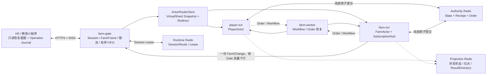

# 61 · 性能、弱网恢复与平滑更新统一方案

版本：`v0.1-review`

状态：`ACTIVE_EDIT / PLATFORM_PARAMETERS_PENDING / IMPLEMENTATION_VALIDATION_PENDING`

日期：2026-08-03

定位：把 3000 万 DAU 容量、200 人同场、弱网恢复和服务器平滑更新收敛为一套可实施、可压测、
可演示的连续体验方案。本文不重新定义业务、协议、Actor 写权或验收真值。

## 0. 一页结论

本项目不需要为了 3000 万 DAU 推翻现有 `farm-gate + player-svr + farm-svr + farm-worker`、
PLAYER/FARM 双 Actor、VirtualShard 和 Redis 权威提交架构。现有架构具备水平扩展条件，真正需要补齐的
是五类可测容量常数、热点农场的下行模型、故障恢复的用户体验，以及更新期间的恢复预算。

统一目标不是“用户完全不知道发生过故障”，而是：

1. 短时网络波动不清空页面；旧画面只读，恢复后由新权威 Snapshot 原子替换；
2. 普通断线、Gate Crash 和 Drain 使用 Cookie 免密换票，不要求重新输入密码；
3. 已进入可靠执行边界的命令只产生一次业务副作用，响应丢失后查询原 `operation_id`；
4. Farm 实时流断裂只 Fresh Join 当前农场，不重建账号 Session；
5. 一个慢客户端不能拖慢 FarmActor、同场其他玩家或 Gate 全局下行；
6. Gate、Actor Holder、Worker 和 H5 分别采用适合自身状态模型的更新方式；
7. 所有“支持 3000 万 DAU”“支持 200 人同场”“平滑更新”的结论都必须附带真实施压量、故障点、
   服务端权威对账和客户端状态证据。

当前证据边界按最新第 71 号文档登记：W5B 已在 Linux 提交 `a949761` 完成双 Gate、Drain、Fresh Join、
200 人 Subscription Lease 批续租和 GateBoot 退役证据。它只证明 W5B 工作包，不等于已经证明：

- 200 人持续真实 `FarmChange` 广播与慢连接隔离；
- 最终 33 类命令全部接入 Operation Journal；
- 动态 Assignment、Shard Drain/Handoff 与旧 Holder 存储级拒写；
- Redis Failover、24 小时 Soak 或 3000 万 DAU 总容量。

## 1. 文档权威关系

出现冲突时按以下顺序处理：

| 主题 | 唯一权威 |
|---|---|
| Auth、Ticket、Session、Join、Subscription、`FARM_INTERACTIVE`、`HOME_READY` | 第 26 号 |
| FirstHop、VirtualShard、Actor Runtime、Workflow/Order | 第 27 号 |
| FarmFrame、CommandCatalog、Operation Journal、公开错误与恢复指令 | 第 28 号 |
| 内部可信调用、Coordinator/Participant/Worker RPC | 第 29 号 |
| CAS、Writer Fence、Unknown、Handoff 写权顺序 | 第 30 号 |
| Redis Key/Slot/Lua、DueIndex、ResultDirectory、Projection | 第 31 号 |
| 业务规则与场景 | 第 32～37 号 |
| 详细测试、硬断言与 PASS 证据 | 第 60 号 |
| 多 Agent 实施顺序与写集 | 第 71～73 号 |

本文只完成三件事：

1. 将上述合同组合成性能和连续体验主链；
2. 给出优化优先级、实施分期和责任边界；
3. 把待压测参数与已经冻结的逻辑语义分开。

本文中的 `DrainNotice`、`ReconnectHint`、能力协商等若尚未进入第 28 号，不得由实现 Agent 私自扩展
公网 Proto；必须先由协议 Owner 补合同、字段号、黄金向量和兼容测试。

## 2. 负载模型：先把正常流量和故障流量分开

### 2.1 已知产品输入

当前讨论输入为：

```text
DAU                          = 30,000,000
每玩家每日会话               = 5～6 次
单次在线时长                 = 通常不超过 5 分钟
好友上限                     = 300
同一农场可操作成员上限        = 200（含农场主）
```

这些数字不能直接等同于单 Pod QPS。

按较保守的 `6 次 × 5 分钟` 估算：

```text
平均 PCU
= 30,000,000 × 6 × 5 / 1,440
= 625,000

平均新会话到达率
= 30,000,000 × 6 / 86,400
≈ 2,083 次/秒
```

如果晚高峰系数暂取 3：

```text
候选高峰 PCU       ≈ 1,875,000
候选登录/WSS 到达率 ≈ 6,250 次/秒
```

以上只是从产品行为推导的基线，不是最终 SLO。容量设计继续保留：

```text
设计 PCU = 3,000,000
压力 PCU = 5,000,000
```

### 2.2 为什么故障恢复峰值远高于正常峰值

正常登录不能覆盖 Gate 批量重启、网络恢复和 Holder 迁移引起的集中 Rejoin。

例如 500 万压力连接恢复：

```text
120 秒内重建 WSS → 约 41,667 次/秒
40 秒内完成 Farm Join → 约 125,000 次/秒
```

因此 `41,667 WSS/s`、`125,000 Join/s` 应定位为故障/发布压力包络，不应描述成日常平均流量。

权威写压力必须从真实操作频率推导：

```text
authority_write_qps
= active_players × writes_per_active_player_second
× workflow_write_amplification
```

例如 300 万 PCU 下，平均每人 30～60 秒产生一次写命令，仅入口写就约为 5～10 万次/秒；Plant、
Harvest、Care、Theft 还会放大为 Workflow、Participant、Receipt、Order 和投影更新。具体混合比例由
Staging 行为模型冻结，本文不写死 13.9 万等候选数值。

### 2.3 200 人热点与 3000 万 DAU 是两种问题

| 问题 | 主要风险 | 验证方式 |
|---|---|---|
| 3000 万 DAU | 全局 PCU、登录/Join、权威写、Redis、网络和 Pod 水平扩展 | 多机开放到达率、混合负载、Soak |
| 200 人同场 | 单 FarmActor、Hub、VersionRing、广播扇出、慢客户端 | 1 owner + 199 visitor 定点热点测试 |

200 人热点通过不能证明全局容量；全局 QPS 通过也不能证明单一 Farm 不会被慢客户端拖垮。

### 2.4 Pod 与存储规模怎样由实测值计算

最终不提前承诺固定机器数，而是使用五个安全容量常数计算：

```text
Gate副本数
= max(
    PCU / safe_connections_per_gate,
    WSS到达率 / safe_handshakes_per_gate,
    总下行带宽 / safe_egress_per_gate
  ) × 故障余量

player-svr副本数
= max(
    Player Turn QPS / safe_player_turns_per_pod,
    活跃PlayerActor / safe_player_actors_per_pod,
    Player激活率 / safe_player_activations_per_pod
  ) × 故障余量

farm-svr副本数
= max(
    Farm Turn QPS / safe_farm_turns_per_pod,
    Join/Snapshot到达率 / safe_join_per_farm_pod,
    活跃FarmActor / safe_farm_actors_per_pod
  ) × 故障余量

worker副本数
= 峰值Participant Step / safe_worker_steps_per_second
  × 积压恢复余量
```

Redis 取 QPS、网络字节、Lua CPU、内存和热 Slot 五种约束中的最大值，再计算副本和故障余量。正常运行
候选保留 30%～40% 稳定余量以及 N+1 故障容量，最终比例由成本和故障演练冻结。

## 3. 统一架构视图



统一设计原则：

- 同一 PlayerActor/FarmActor 内串行，不同 Actor 之间并行；
- Actor Turn 不等待客户端网络，也不等待另一个 Actor；
- Authority Redis 保存最终裁决事实，Runtime/Projection Redis 不替代权威；
- 弱网恢复、Gate Drain 和 Shard Handoff 最终都收敛到 Operation 恢复与 Fresh Join；
- 正确性不依赖迁移 Socket、Mailbox、Presence 或 Actor 内存。

## 4. 性能提升方案

### 4.1 第一优先级：先建立五个容量常数

所有 Pod 数和 Redis 容量都应由以下实测常数推导：

```text
safe_connections_per_gate
safe_join_per_gate_or_farm_pod
safe_actor_turns_per_pod
safe_redis_commits_per_cluster
safe_worker_steps_per_second
```

每条主链至少拆出：

```text
Gate Admission / Queue
Gate → FirstHop RPC
Route Resolve / Redirect
Actor Mailbox Wait
Actor Turn CPU
Redis Queue / RTT / Lua
Workflow Wait
Downlink Queue
Client Apply
```

`player_id`、`farm_id`、`operation_id` 不能进入 Prometheus Label；它们只进入采样 Trace、结构化日志和
受限 TopK，避免监控系统自身成为高基数瓶颈。

### 4.2 Gate、Join 与 Snapshot

Join 和下行带宽很可能先于业务计算达到瓶颈。

冻结的优化顺序：

1. 一个 Farm 维护一份共享 Snapshot Base 和一份 FarmChange VersionRing；
2. 每个订阅只保存 Fence、游标和有界追赶状态，不复制完整 Snapshot/Delta；
3. Snapshot Base 可按版本预编码，访客差异只生成小型 ViewerOverlay；
4. 同一 FarmChange Payload 只编码一次，按 `gateway_id` 聚合为 `DeliverBatch`；
5. 同一连接保持 FIFO，不同 Gate、不同连接并行下行；
6. 只对足够大的 Snapshot 评估压缩，短 Delta 默认不压缩；
7. 对 Snapshot bytes、编码 CPU、TLS CPU、队列字节和客户端 Apply 时间分别测量。

接入 Transport 必须保持语义中立：当前 Direct WebSocket 与未来 TCONND + gateproxy 都承载相同 FarmFrame、
Session 和恢复协议，业务层不读取 TCONND 私有字段。平台最终选型分别比较安全连接数、握手率、TLS/CPU、
下行带宽、Drain 行为和运维成本；切换 Transport 不能要求重写 Actor、Operation Journal 或 Fresh Join。

不能用“200 人共享一个 JoiningBuffer”描述实现。正确模型是：

```text
FarmSubscriptionHub
├── SharedSnapshot(version=V)
├── SharedVersionRing(V+1...N)
└── Subscription[player]
    ├── subscription_id / Fence
    ├── snapshot_version
    ├── catchup_cursor
    └── post_ready_cursor / 有界状态
```

共享的是版本化数据，每个玩家拥有自己的订阅状态和游标。

### 4.3 下行背压与慢连接隔离

队列优先级：

| 类型 | 策略 |
|---|---|
| CommandResult、Snapshot、Delta、Ready、KICK、REJOIN_REQUIRED | 不得进入 FIFO 后选择性删除 |
| 绝对值红点、在线人数等可覆盖状态 | 分配 `server_seq` 前合并 |
| Opportunity Hint、非关键动画 | 分配 `server_seq` 前允许丢弃或降频 |

慢连接处理顺序：

```text
合并允许合并的绝对状态
→ 丢弃 Hint
→ 降低非关键 Push 频率
→ VersionRing 已覆盖其游标：REJOIN_REQUIRED
→ 控制帧也无法进入预留容量：关闭 WSS
```

控制帧应有小型保留预算；否则队列已满时连恢复指令都无法发出。若控制帧仍无法入队，关闭连接比阻塞
FarmActor 更安全。

### 4.4 Actor Runtime

Actor 性能优化不改变“同一权威实体串行”：

- 首次 `LoadAndClaim` 后在内存持有活跃状态，写成功后安装 Candidate；
- 激活使用 Singleflight、全 Pod 并发上限、速率限制和有界等待；
- 仅在无活跃 Subscription、无未决工作且强事实已满足持久化要求时 Passivate；随后回收对应 Mailbox、
  goroutine 和可重建运行态；
- 一个 Turn 只做内存裁决、本 Actor 权威提交和本地输出；
- 跨 Actor 由 Coordinator/Workflow 推进，Actor 不等待远程 Participant；
- UserMailbox 与 SystemQueue 隔离，LeaseLost、Drain、PersistenceCompleted 不被玩家洪水饿死；
- 热点 Actor 使用公平 Quantum，不能无限连续清空自己的 Mailbox。

暂不拆 PlotActor。同一农场不同土地业务上可同时成功，但 FarmActor 仍可按邮箱顺序裁决；这避免重新引入
FarmVersion、宠物、偷菜总额度、批量收获和全农场规则的分布式协调。只有单 Farm 实测 CPU 成为硬瓶颈后，
才依次评估：热点独立调度 Lane、更高 CPU 配额、只读 Snapshot 旁路和明确可批的系统消息微批。

### 4.5 Redis

逻辑上固定分为三类，即使 P0 暂时物理共用：

| Redis 角色 | 数据 | 性能原则 |
|---|---|---|
| Authority | Player/Farm 状态、Receipt、Outcome、Order | 小 Lua、同槽原子、Fail Closed |
| Runtime | Ticket、SessionRoute、Lease、短期在线态 | TTL、批续租、故障可重建 |
| Projection | ResultDirectory、好友机会、红点、公开资料 | 批读、允许延迟、可重建 |

Authority Lua 只做有界的 Fence、Version、Receipt、容量检查和 Model Mutation；禁止在 Lua 中遍历好友、
扫描历史或推进完整 Workflow。

还必须验证：

- Actor Record、Receipt、Outcome、Order 的字节增长和 GC 水位；
- 热 Slot 与大 Key；
- Lua P99、网络字节、复制/AOF 和 Failover Unknown 放大；
- DueIndex 按 Authority/Workflow Bucket 分桶，禁止全服一个 ZSET；
- 查询使用 MGET/HMGET/Pipeline，禁止业务路径 `KEYS`、全库 `SCAN` 和巨型 `HGETALL`；
- Projection 读洪峰和 Session 风暴不能挤压 Authority 连接池。

`ACTOR_SOFT`、批量异步保存只能由压测触发，且首版白名单不得包含 Farm CropCycle、Reservation、
Receipt、TheftDecision、MailClaim 和关键资产结算。先用 `CRASH_DURABLE` 建立正确性基线，再比较 Redis
QPS、P99、Dirty Age、Crash RPO 和 ForceFlush。

### 4.6 Workflow 与 Worker

正常路径：

```text
来源 Authority Commit
→ DirectDispatcher 立即推进
→ 失败或超时才由 DueIndex + farm-worker 恢复
```

Worker 需要：批量 Claim、有界并发、指数退避、按 Participant/目标 Pod 分组、积压年龄优先和热点 Work
隔离。以下指标必须单独测量，不能只看入口命令 QPS：

```text
workflow_create_total
participant_step_total
due_claim_total
retry_amplification_ratio
worker_backlog_oldest_age
```

MQ 不是默认方案。只有 DirectDispatcher 持续不足、跨区域可靠传输或 Worker 削峰证据明确时才评估；MQ
不能替代“来源事实 + Order + DueIndex 同提交”。

### 4.7 好友列表与机会查询

好友上限 300 时不应逐个激活 FarmActor，也不应在一座农场成熟时向 300 个离线好友写持久消息。

```text
好友分页（每页有限数量）
→ Batch MGET FarmOpportunitySummary
→ 粗筛、排序
→ 只对少量 Top 候选执行 FarmReadAPI.BatchEvaluate
→ 返回准确的可偷/可护理状态
```

Summary 更新由 Farm 权威状态变化派生：种植、成熟窗口、护理 Incident 创建/解决、偷取额度变化、收获
结束都会推动摘要 revision。Summary 只是查询副本，最终动作仍由 ActionPermit 和 FarmActor 裁决。

## 5. 弱网恢复方案

### 5.1 四级恢复

| 级别 | 故障 | 客户端行为 | 是否重建 WSS |
|---|---|---|---|
| L1 | 好友、邮件、任务等弱依赖失败 | 自己农场可经营；局部 Loading/Retry | 否 |
| L2 | `farm_version` 空洞、Subscription Lease 丢失、追赶窗口覆盖 | 保留只读画面，同 WSS Fresh Join 当前农场 | 否 |
| L3 | WSS、connection sequence、Gate Crash/Drain | Cookie 免密换票、新 WSS、恢复 Operation、Fresh Join | 是 |
| L4 | Cookie 失效、封禁、主动退出 | 回登录页重新认证 | 是 |

`FARM_INTERACTIVE` 与 `HOME_READY` 继续服从第 26 号：OwnFarm Snapshot/Delta/Ready、PlayerBootstrap 和
PendingRecovery 完成后可以经营；好友机会失败时保持 `FARM_INTERACTIVE`，好友区域显示 Loading/Retry，
不能把失败伪装成 `NONE`，也不能错误进入 `HOME_READY`。

### 5.2 只读旧画面

L2/L3 恢复期间：

```text
保留最后一次已应用的权威 FarmView
→ 标记 STALE_VISUAL / READ_ONLY_RECOVERING
→ 禁止新的经营写命令
→ 时间派生动画可按最后 server-time offset 展示，但不参与裁决
→ 新 Snapshot + Delta* + Ready 完整通过
→ 按 target_farm_id + subscription_id Fence 原子替换
```

不能把旧页面当成离线操作队列。离线点击最多保存本地草稿；重新联网后仍须按当前 CropCycle、价格、好友
关系和 ActionPermit 重新校验。

### 5.3 Operation Journal

所有可恢复写命令必须在第一次发送前写入 IndexedDB，至少保存第 28 号冻结的：

```text
environment + player_id
command_type + operation_id
原 typed payload + schema version
业务 target / operation root
server_operation_locator（收到后）
恢复状态、重试次数和创建时间
```

禁止保存 Cookie、ConnectionTicket、SessionPermit、ActionPermit、subscription_id、RouteHeader 和
writer_epoch；这些必须在恢复时重新生成。

恢复顺序：

```text
新 Session 建立
→ GET_OPERATION_RESULT(原 operation_id)

COMPLETED
→ 应用原终态，清理 Journal

PROCESSING
→ 按 retry_after 继续查询，不创建新 operation_id

NOT_FOUND + PLAYER_RETRY_SAME_OPERATION
→ 刷新 PlayerBootstrap
→ 原 operation_id + 原 Payload 有界重发

NOT_FOUND + FARM_FRESH_JOIN_THEN_RETRY_SAME_OPERATION
→ Fresh Join 原 target_farm_id
→ 原 operation_id + 原 Payload 有界重发

EXPIRED / REFRESH_AUTHORITY_STATE
→ 不自动重放旧写命令，重新读取权威状态
```

多个未决操作争用同一目标时，恢复器不能盲目并发重放。应按原提交顺序和 `conflict_key` 串行恢复，先让
前一操作收敛，再决定后一操作是否仍合法。

### 5.4 重连风暴治理

计划 Drain 可使用服务端重连窗口；意外 Crash 使用指数退避 + Full Jitter。候选稳定抖动：

```text
delay = Hash(player_id, release_id, reconnect_round) % retry_window
```

参数必须通过压测冻结：首轮窗口、退避倍数、最大 Backoff、稳定连接多久后重置和 Drain Deadline。

客户端必须有总恢复预算和熔断状态，不能无限快速循环：

```text
renew ticket失败
→ 有界退避
→ 多次失败进入 DEGRADED_OFFLINE
→ Cookie明确失效才回登录页
```

## 6. 平滑更新方案

### 6.1 farm-gate：当前最适合做成真实加分演示

当前 W5B 已有 `Drain/1012 → Cookie 换票 → 新 Gate → Fresh Join` 基础。推荐分两级：

**P0 可交付基线**：

```text
旧 Gate readiness=false
→ 不接新连接
→ 停止新的长生命周期 Admission
→ 使用现有 Drain/1012 通知客户端
→ 客户端保留只读页面并按 Full Jitter 建立新 WSS
→ 新 ClientHello 推进 session_epoch
→ 旧 Session 被 Fence
→ 恢复未决 Operation 和 Farm Subscription
→ Deadline 后旧 Gate 退出
```

**增强方案**：在第 28 号正式定义 `DrainNotice/RetryWindow` 后，可先建立新 WSS 再关闭旧 WSS。
这只是传输层短暂重叠，权威层仍严格单活：

```text
新 ClientHello 激活前 → 旧连接可准入
新 ClientHello 激活后 → 新连接可准入，旧连接不得接收新命令
旧连接已 ADMITTED 操作 → 继续执行；结果丢失时由新连接查询原 operation
```

旧 Gate 的迟到 Cleanup 必须带 generation/session fence，不能删除新 Gate 建立的 SessionRoute。

### 6.2 player-svr / farm-svr：Shard Handoff 是目标能力，不冒充当前能力

计划更新最终形态：

```text
新 Pod Ready + Assignment Watch
→ RouteManager 选择小批 VirtualShard
→ 旧 Holder DRAINING，停止新 Turn/Join
→ 已 ADMITTED Turn 收敛或留下可靠 Unknown 锚点
→ 原子推进 ShardWriteAuthority / writer_epoch
→ 新 Holder 取得 Lease 和写权
→ 发布一致的 Assignment Snapshot
→ 新 Holder 按请求 LoadAndClaim Actor
→ 旧 Holder 退出
```

不搬迁：Actor 内存、Mailbox、Presence、JoiningBuffer 和待发送网络批次。Farm Holder 切换后，受影响的
Subscription 在同一 WSS Fresh Join；Player Holder 切换一般不需要 Farm Join，命令在准入前 Redirect，
准入后返回完成态、`PROCESSING` 或查询原结果。

当前动态 AssignmentProvider、RouteManager Watch 和新 Writer Fence 主链接线尚属于后续工作。在这些能力
完成前，只能宣称“受控重启后可冷加载恢复”，不能宣称已经实现无缝 Shard Handoff。

更新波次按 Shard Cohort 和受影响 ActiveSubscription 计算，不按 Pod 随机拍脑袋：

```text
本波受影响 ActiveSubscription / 目标恢复窗口
<= 实测安全 Join 容量 × recovery_budget_ratio
```

`recovery_budget_ratio` 候选为 30%～50%，最终由压测冻结。第一波测试账号 Shard，随后 1%、5%、
10%～20% 逐步扩大；回滚不能让 writer_epoch 倒退。

### 6.3 farm-worker

```text
旧 Worker 停止 Claim 新 Work
→ 已持有 Lease 的步骤在 Deadline 内完成
→ 未完成 Lease 自然到期
→ 新 Worker 使用同一 ParticipantInvocationID 接管
```

ParticipantReceipt 防重，因此 Worker 不需要迁移内存，也不需要客户端重连。

### 6.4 H5、协议与静态资源

当前无生产存量客户端时可以协调单版本切换，但架构应保留有限 N/N-1 窗口：

```text
ClientHello  : client_build / supported_versions / capability_bits
ServerHello  : selected_version / min_client_build / enabled_capabilities
CommandCatalog AvailabilityPolicy：后端未完整部署时禁止命令进入 ADMITTED
```

静态资源使用内容 Hash 和长缓存，HTML 短缓存；旧 JS/CSS Chunk 至少保留最大会话时长加发布宽限期，不能
新 HTML 发布后立即删除旧 Chunk。普通升级等待安全点或下次进入首页，不在未决 Operation 中强制刷新。

### 6.5 配置更新

代码平滑不等于业务规则平滑。CropCycle、Workflow、Order、Reward、GuardDecision 等进入可靠边界时，必须
固定所需配置版本或不可变结果字段。重试、Worker 接管和 Holder 切换继续使用原 Snapshot，不能因为新旧
Pod 配置不同而改变一个已经开始的 operation 结果。

## 7. 性能与恢复必须共同治理

弱网恢复本身会制造 Join 和 Redis 负载，因此不能分别设计。

| 风险 | 统一控制 |
|---|---|
| Gate 同时退出 | Drain Window + Full Jitter + 每波连接预算 |
| Farm Holder 批量迁移 | Shard Cohort + ActiveSubscription 恢复预算 |
| 大量 Fresh Join | Shared Snapshot/编码缓存 + Join 限流 + 激活限速 |
| 客户端重复写 | Operation Journal + Receipt + 原 operation 恢复 |
| 慢客户端积压 | 每连接有界 FIFO + Hint 降级 + REJOIN/断开 |
| Redis 故障后重试风暴 | Fail Closed + Unknown 解析 + 有界退避 |
| Worker 积压 | Lease + 分桶 DueIndex + 批 Claim + Backoff |

保护顺序固定为：

```text
业务权威写与幂等证据
> CommandResult / Snapshot / Ready
> Session 与 Subscription 恢复
> 查询投影
> Hint、动画与非关键推荐
```

过载时先降级好友 Hint、红点刷新、动画和推荐，不能牺牲 Authority Receipt、Writer Fence 或 Operation
结果恢复来维持表面吞吐。

## 8. 日志、指标与证据

### 8.1 关键指标

接入和弱网：

```text
active_connections
ticket_renew_total{result}
reconnect_total{reason}
fresh_join_total{reason}
time_to_farm_interactive
time_to_home_ready
password_relogin_fallback_total
rejoin_amplification_ratio
```

下行和热点：

```text
connection_queue_bytes
connection_queue_oldest_age
deliver_batch_size
snapshot_bytes
snapshot_encode_seconds
catchup_delta_count
version_ring_overrun_total
slow_client_rejoin_total
```

Actor、Redis 和 Workflow：

```text
actor_mailbox_wait_seconds
actor_turn_seconds
actor_activation_inflight
redis_lua_seconds
authority_commit_bytes
timeout_unknown_total
writer_fence_reject_total
worker_backlog_oldest_age
retry_amplification_ratio
```

硬不变量：

```text
duplicate_business_effect_total      = 0
stale_session_admitted_total         = 0
stale_writer_commit_success_total    = 0
client_authority_mismatch_total      = 0
```

### 8.2 日志与 Trace

- 结构化日志携带 `run_id/request_id/operation_id/route_domain/virtual_shard/holder/revision`；
- 敏感 Cookie、Ticket、密码和完整 Permit 不落日志；
- TLog/经营流水记录关键资产变化和审计，不替代 Authority Redis；
- Trace 采样记录 Gate、Route、Mailbox、Redis、Workflow 和 Downlink 分段时间；
- 故障测试必须绑定唯一 `run_id`，同时保存服务日志、指标快照、客户端状态和 Authority 对账。

## 9. 验收矩阵

详细硬断言继续服从第 60 号。本文冻结验收分层：

| 场景 | 必须证明 |
|---|---|
| 300～800ms 延迟 | 页面可解释，操作不重复，P99 与队列受控 |
| 2～10 秒网络黑洞 | 不回密码页；恢复原 Operation 和 Farm |
| 上行通、下行断 | 已提交操作通过 Journal 收敛 |
| `server_seq` 空洞 | 新 WSS，不静默继续 |
| `farm_version` 空洞 | 同 WSS Fresh Join |
| Plant 提交后响应丢失 | 只扣一次种子，只创建一个 CropCycle |
| Gate Drain/Crash | 重连有 Jitter，旧 Cleanup 不破坏新 Route |
| 1 owner + 199 visitor | 持续广播、版本一致、慢连接只影响自身 |
| 第 201 人进入 | 明确拒绝，不破坏已有 200 人 |
| farm-svr Handoff | 旧 Holder 写成功数为 0，受影响 Farm Fresh Join |
| Worker 更新 | Lease 接管，不重复 Participant/奖励 |
| Redis Failover/NOSCRIPT | Unknown 可解析，不出现双写和无限重试 |
| 新旧 H5/服务组合 | 协议协商或明确拒绝，不出现半兼容 |
| 24 小时 Soak | goroutine、Actor、Mailbox、Receipt、DueIndex、队列均收敛 |

负载工具采用 Go Protocol Bot 作为主负载、少量 Playwright 作为真实页面见证，并使用固定开放到达率；必须
同时记录计划发出率、实际发出率、完成率、排队、拒绝率和 P99，禁止服务变慢后压测器自动降压制造假通过。

## 10. 推荐实施顺序

### Phase 0：证据和测量基线

1. 将 Linux `a949761` 的 W5B Evidence Bundle 同步到当前可审计文档位置；
2. 修正早于 `a949761` 的实现审计状态，避免“已完成/待补”并存；
3. 完成 Q0 指标、开放到达率、Fault Controller、Authority Probe 和 Client State Oracle；
4. 每次 Checkpoint 记录单实例饱和点，不先做无证据优化。

### Phase 1：连续体验最小闭环

1. 最终 33 类目录中，所有按 CommandSpec 标记为可恢复的写命令全部接入 IndexedDB Operation Journal；
2. H5 增加只读旧画面、局部 Loading/Retry 和统一 Recovery Orchestrator；
3. 收口 Gate Drain/1012、Full Jitter、Cookie 换票、新 WSS 和 Fresh Join；
4. 演示“Plant 已提交但响应丢失”只生效一次；
5. 如需 `DrainNotice`，先走第 28 号协议 Owner，不直接在 Gate/H5 各自发明。

### Phase 2：Join 与 200 人热点专项

1. Shared Snapshot、VersionRing、每订阅游标和 Joining/PostReady 有界状态；
2. Snapshot/FarmChange 一次编码、按 Gate Batch Deliver；
3. 慢连接水位、控制帧预算、REJOIN/断开；
4. 真实 200 人持续广播、10% 慢客户端、VersionRing 覆盖和第 201 人拒绝；
5. 分别测出 Direct WebSocket 与 TCONND 候选链路的 Gate/Farm Pod 安全 Join、广播、连接和带宽常数。

### Phase 3：Authority 与 Holder 更新能力

1. 将第 30/31 号新 AuthorityStore 与 Writer Fence 接入 Player/Farm 主链；
2. 实现最小 Dynamic AssignmentProvider/RouteManager Watch；
3. 完成小批 Shard Drain/Handoff、Redirect 和旧 Holder 迟到写测试；
4. 再决定是否需要热点 Actor 独立 Lane，不实现全 Shard Actor 内存搬迁。

### Phase 4：全局容量与生产证据

1. 正常峰值、重连风暴、混合写、Workflow 放大分别压测；
2. Redis Failover、Gate/Farm/Player Crash、Worker 停机与滚动更新故障注入；
3. 2 小时高压 + 24 小时 Soak；
4. 根据五个安全容量常数计算 Pod/Redis 数量，并保留 30%～40% 稳定余量和 N+1 故障容量；
5. 只有实测瓶颈出现后才评估 ACTOR_SOFT、MQ、Proxyless 或更激进的 Shard 再平衡。

## 11. 多 Agent 写集建议

本专项嵌入第 71～73 号现有角色，不新建一个可跨仓库随意修改的“性能/高可用超级 Agent”。

| 责任 | 唯一写入区域 | 产物 |
|---|---|---|
| Protocol Owner | Proto、CommandCatalog、黄金向量 | Drain/Retry/Capability 合同（若启用） |
| H5 Integration Owner | WsClient、Operation Journal、全局 Store、Reducer | 只读恢复、Pending 状态、四级恢复 |
| Gate Owner | Session、ConnectionWriter、Downlink、Drain | Jitter、背压、慢连接隔离 |
| Farm Runtime Owner | SubscriptionHub、Snapshot、VersionRing | 200 人广播与 Fresh Join |
| Actor/Redis Owner | AuthorityStore、Persistence Lane、Lua | Writer Fence、容量与 Unknown |
| RouteManager Owner | Assignment、Lease、Handoff | Shard Cohort 更新 |
| Worker Owner | Dispatcher、DueIndex、Lease | 恢复吞吐和更新接管 |
| Capacity/Verification Owner | 只写压测、故障注入和 verification | 瓶颈证据，不直接修改共享生产代码 |

性能 Agent 只负责定位瓶颈；实际优化由对应代码单写者完成，避免为了性能破坏协议、Actor 或存储不变量。

## 12. 最推荐的答辩演示

```text
玩家点击 Plant
→ 服务端权威提交成功，测试器故意丢弃响应
→ Gate 同时进入 Drain
→ H5 保留只读农场，显示“服务器切换中，正在确认操作”
→ Cookie 免密换票，新 WSS 建立
→ GET_OPERATION_RESULT 查询原 operation_id
→ Fresh Join 得到最新 Snapshot/Delta/Ready
→ 页面恢复可操作
→ Authority Probe 证明只扣一份种子、只创建一个 CropCycle
```

随后用 Protocol Bot 展示同一农场 200 人广播，并人为限制两名客户端带宽：健康客户端继续按序更新，慢
客户端被单独要求 Fresh Join 或断开，FarmActor 邮箱和其他 198 名连接不被拖慢。

这两段演示同时覆盖正确性、性能、弱网体验和平滑更新，比只展示 Kubernetes RollingUpdate 或单接口 QPS
更能说明游戏后台设计价值。

## 13. 待压测而非待重新设计的问题

以下参数暂不冻结数值：

- 每 Gate 安全连接数、握手率和下行带宽；
- 每 Farm/Player Pod 安全 Actor 数、Turn QPS 和激活率；
- Snapshot 压缩阈值、VersionRing 深度、连接队列 item/byte 水位；
- Session/Subscription Lease TTL 与批续租周期；
- Reconnect Window、Backoff 和每波 Recovery Budget；
- Redis Bucket 数、Lua P99、记录大小、Receipt/Outcome/Order 保留和 GC 水位；
- Worker Claim batch、并发和 Backoff；
- 最终 Pod 数、Redis 集群数和 HPA 阈值。

这些参数不应阻塞业务与恢复语义实现，但必须阻塞“生产已支持 3000 万 DAU”的最终结论。
