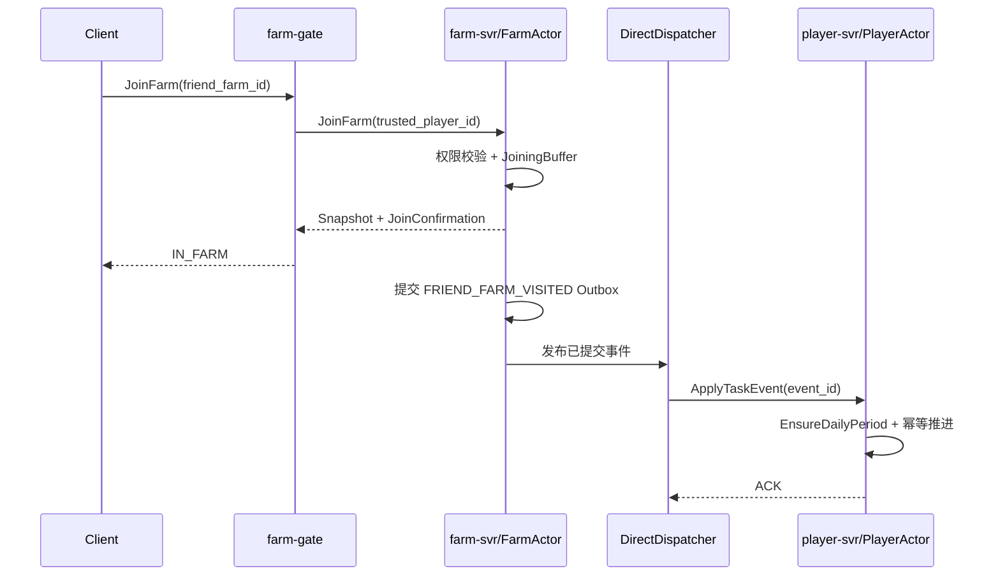
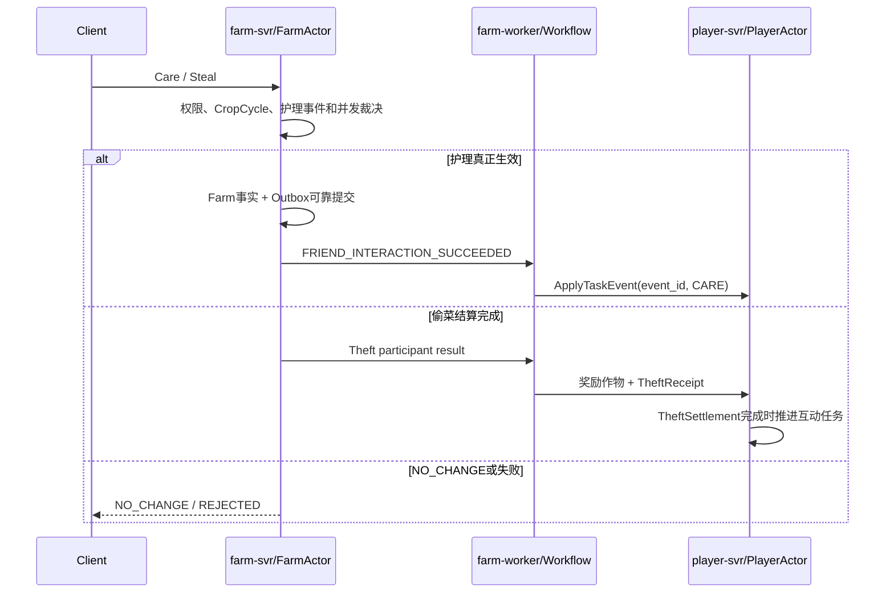
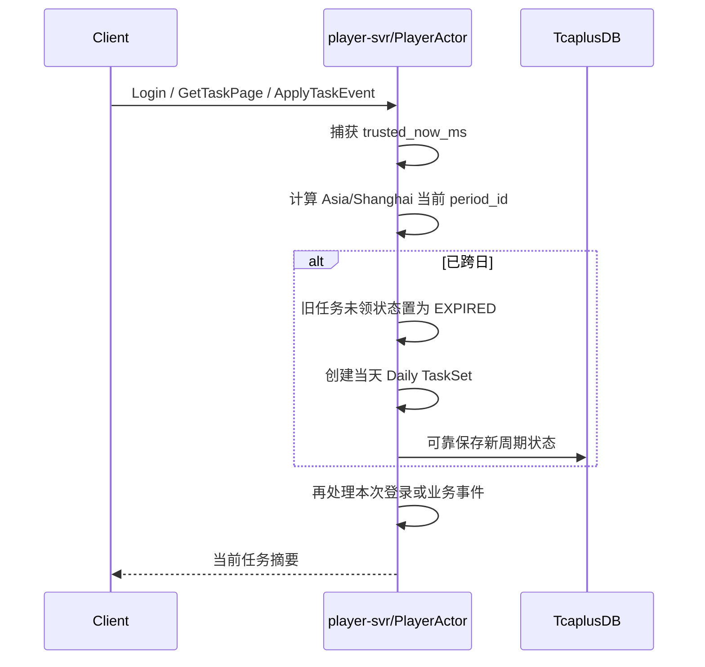
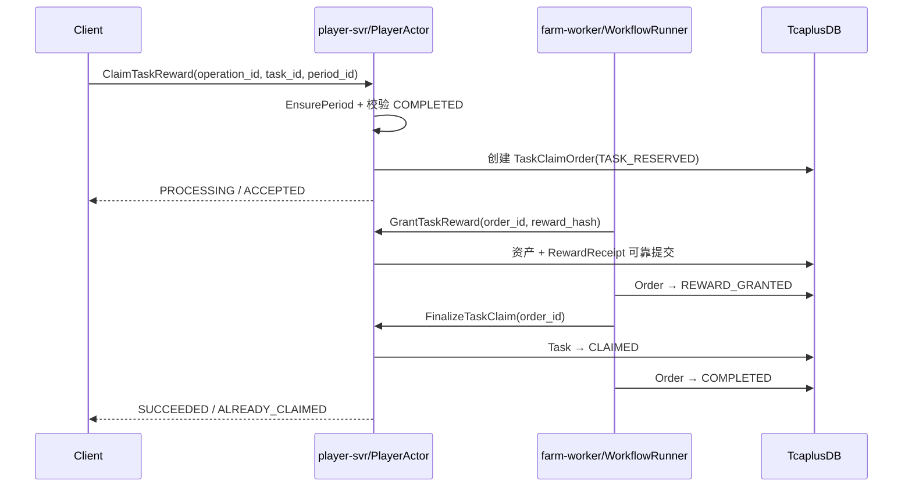

# 23 · 经典农场最小任务系统设计

版本：`v0.1-task-contract-freeze-candidate`  
日期：2026-07-29  
定位：定义每日任务、长期成就和限时活动任务的统一领域模型、事件来源、持久化、领奖、红点与失败语义。  
总体架构以 [22-production-architecture-v1.21](./22-production-architecture-v1.21.md) 为准；本文不新增 Deployment，不改变 P0 不依赖 MQ 的结论。

---

## 1. 已冻结产品规则

1. 每日任务按游戏时区每天 `00:00` 重置，默认游戏时区为 `Asia/Shanghai`。
2. “访问好友农场”目标值为 `1`：当天成功进入任意一座有效好友农场一次即可完成并领取奖励。
3. “与好友农场互动”目标值为 `1`：当天成功偷菜一次，或者完成一次真正生效的护理操作，即可完成并领取奖励。
4. `NO_CHANGE`、权限拒绝、目标过期、偷菜结算失败和仅打开好友列表都不算有效互动；宠物命中但偷菜结算成功仍算有效互动。
5. 每日任务奖励由玩家手动领取；跨日仍未领取的奖励直接过期，不通过邮件补发。
6. 长期成就不重置；限时活动任务分别配置进度截止时间和领奖截止时间。
7. 客户端只能提交业务操作和领奖意图，不能上报“任务完成”或任意增加任务进度。

### 1.1 首批任务内容

| TaskSet | 任务 | 目标 | 完成事实 |
|---|---|---:|---|
| DAILY | 今日登录 | 1 | 认证、建档和 PlayerActor Bootstrap 成功 |
| DAILY | 访问好友农场 | 1 | 好友农场 Join 进入 `IN_FARM` 并完成 `JoinConfirmation` |
| DAILY | 与好友农场互动 | 1 | 成功偷菜，或一次护理真正改变目标农场状态 |
| DAILY | 种植作物 | 可配置 | Plant Workflow 最终完成 |
| DAILY | 收获作物 | 可配置 | Harvest Settlement 最终完成且作物进入玩家仓库 |
| ACHIEVEMENT | 达到指定等级 | 多档 | PlayerActor 当前可靠等级 |
| ACHIEVEMENT | 累计收获次数/数量 | 多档 | PlayerActor 可靠累计统计 |
| ACHIEVEMENT | 累计好友互动 | 多档 | PlayerActor 可靠累计统计 |
| ACHIEVEMENT | 解锁土地数量 | 多档 | 已确认解锁的土地数量 |
| ACTIVITY | 指定活动目标 | 可配置 | 发生在活动进度窗口内的服务端权威事实 |

每日访问和每日互动虽然目标值当前都是 `1`，模型仍保留可配置目标值，后续调整规则不需要改协议和状态结构。

---

## 2. 为什么不新增 task-svr

任务进度和奖励资格属于玩家个人事实，天然以 `player_id` 为冲突键：

- 同一玩家的登录、等级、任务进度和领奖必须有唯一顺序；
- 任务领奖最终修改该玩家的钱包或仓库；
- 红点和任务列表也以玩家为查询主体；
- 单个玩家任务量有限，不需要独立热点 Actor。

因此任务权威放在现有 `PlayerActor(player_id)` 内：

```text
player-svr
└── PlayerActor(player_id)
    └── TaskDomain
        ├── TaskEngine
        ├── TaskSetState
        ├── TargetEvaluator
        ├── TaskClaim
        └── TaskSummary

farm-worker
├── TaskEventConsumer
└── RedPointConsumer
```

边界含义：

- `TaskDomain` 拥有任务状态并作最终裁决；
- `TaskEventConsumer` 只负责把已成立的外部事实可靠投递给目标 PlayerActor；
- `RedPointConsumer` 只生成可重建投影；
- `farm-worker` 不拥有玩家任务真值；
- `TaskDomain` 是 PlayerActor 内模块，不是 `TaskActor`，也不是独立微服务。

只有当任务配置发布、任务查询或事件消费形成独立负载和故障边界，并且共进程扩容已经无法解决时，才评估拆出独立 Task Role 或 task-svr。

---

## 3. 统一领域模型

### 3.1 配置模型

```text
TaskSetDefinition
├── taskset_id
├── type                  DAILY / ACHIEVEMENT / ACTIVITY
├── reset_policy          DAILY_00 / NEVER / ACTIVITY_WINDOW
├── timezone              默认 Asia/Shanghai
├── start_at_ms
├── progress_end_at_ms
├── claim_end_at_ms
├── archive_at_ms
├── config_version
└── task_definitions[]

TaskDefinition
├── task_id               稳定且全局唯一
├── display_order
├── prerequisites[]
├── targets[]
├── reward_definition
└── enabled

TargetDefinition
├── target_id             稳定 ID，禁止依赖数组下标
├── event_type
├── evaluator_type        INCREMENT / CURRENT_VALUE / UNIQUE_VALUE
├── target_value
├── filters               crop_id / action_type 等
└── counter_key
```

任务配置热更新必须遵守：

- `task_id` 和 `target_id` 一旦发布不可复用；
- 已创建任务按其 `config_version` 继续解释；
- 新任务和新周期使用新版本；
- 仅修改文案、排序等非业务字段时可以原地刷新；
- 修改目标值、奖励或时间窗口必须生成新版本并经过兼容检查。

### 3.2 玩家状态

```text
PlayerTaskState
├── player_id
├── task_version
├── daily
│   ├── period_id
│   ├── config_version
│   └── task_instances[]
├── achievements
│   ├── config_version
│   └── task_instances[]
├── active_activities[]
├── task_summary
├── source_watermarks
└── bounded_event_receipts

TaskInstance
├── task_id
├── config_version
├── target_snapshot / target_hash
├── reward_snapshot / reward_hash
├── state
├── target_states[]
├── completed_at_ms
├── claimed_at_ms
└── claim_order_id

TaskTargetState
├── target_id
├── progress
├── state
└── compact_custom_state
```

`compact_custom_state` 只用于确实需要集合语义的目标，例如未来“访问 N 个不同好友”。当前每日访问目标值为 `1`，不需要保存好友集合。

### 3.3 状态机

```text
LOCKED
  │ 前置条件满足
  ▼
ONGOING
  │ 所有 Target 达标
  ▼
COMPLETED
  │ 奖励可靠到账
  ▼
CLAIMED

ONGOING / COMPLETED
  │ 到达失效边界
  ▼
EXPIRED
```

不变量：

- `COMPLETED` 表示条件已经完成，但奖励尚未完成可靠发放；
- 只有奖励资产与 `RewardReceipt` 已可靠提交后，任务才能进入 `CLAIMED`；
- `EXPIRED` 任务不能再推进或领取；
- 每日任务在新周期建立时，旧周期未领取状态直接过期；
- 同一 `task_id + period_id` 最多存在一个有效领奖结果。
- 已生成的任务实例按冻结 target/reward snapshot 解释；配置热更不得改变其完成条件或奖励。

---

## 4. 周期和时间合同

所有时间使用服务端可信时间：

```text
trusted_now_ms = UTC Unix Milliseconds
game_timezone = Asia/Shanghai
daily_boundary = 本地时间 00:00
```

每日周期：

```text
period_id = YYYY-MM-DD@Asia/Shanghai
```

PlayerActor 在以下入口首先执行 `EnsureTaskPeriods(trusted_now_ms)`：

- 登录 Bootstrap；
- 查询任务列表；
- 处理任意任务事件；
- 领取任务奖励；
- 配置版本切换。

跨日顺序固定为：

```text
1. 计算当前 period_id
2. 发现 daily.period_id 已过期
3. 将旧周期未领取任务视为 EXPIRED
4. 丢弃旧周期可释放的明细状态
5. 按当前配置创建新 Daily TaskSet
6. 再处理本次登录或业务事件
```

这样每日登录事件不会先写入昨天再被清空。

限时活动使用四个时间点：

```text
start_at_ms          开始展示和接收进度
progress_end_at_ms   停止累计进度
claim_end_at_ms      停止领奖
archive_at_ms        允许清理玩家活动任务状态
```

活动事件按权威业务的 `occurred_at_ms` 判断进度窗口，不按 Worker 收到事件的时间判断。

---

## 5. 任务事件合同

### 5.1 通用事件信封

```text
TaskFactEvent
├── event_id
├── event_type
├── subject_player_id       任务归属玩家
├── source_authority        PLAYER / FARM / WORKFLOW / SOCIAL
├── source_entity_id
├── source_version
├── occurred_at_ms
├── payload_hash
└── payload
```

规则：

- `subject_player_id` 决定事件最终进入哪个 PlayerActor；
- `event_id` 由产生权威事实的服务生成，重试不得改变；
- 相同 `event_id + payload_hash` 重投返回已处理；
- 相同 `event_id` 携带不同 payload 必须拒绝并告警；
- 客户端提供的时间、玩家 ID、`succeeded` 标记和进度值均不可信；
- 一个业务结果只能选择一个最终事件来源，禁止 Handler、Workflow 和 Worker 各发一次。

### 5.2 首批事件目录

| 事件 | 最终来源 | 生效时点 |
|---|---|---|
| `PLAYER_LOGIN_ESTABLISHED` | player-svr | Session 合法且 PlayerActor Bootstrap 成功 |
| `PLAYER_LEVEL_CHANGED` | PlayerActor | 等级变化可靠提交 |
| `PLANT_COMPLETED` | Plant Workflow | 种子消耗与 CropCycle 创建最终完成 |
| `HARVEST_COMPLETED` | Harvest Settlement / PlayerActor | 收获作物可靠进入仓库 |
| `FRIEND_FARM_VISITED` | farm-svr | Join 进入 `IN_FARM` 并签发 JoinConfirmation |
| `FRIEND_INTERACTION_SUCCEEDED` | Farm/Settlement | 成功偷菜或护理真正改变农场状态 |
| `PLOT_UNLOCKED` | 解锁 Workflow | 土地永久解锁可靠完成 |

每一种任务事实只能有一个最终来源。禁止 Handler、Participant 和 Workflow 终态分别发布
三个“成功事件”。边界统一为：

- 登录：Session 合法且 PlayerActor Bootstrap 成功；
- 好友访问：Farm Subscription 进入 `IN_FARM` 且 JoinConfirmation 成立；
- Plant/Harvest：对应 Workflow 最终完成；
- Theft：`TheftSettlement.overall_status=COMPLETED`；
- Care：CareIncident 首次从 ACTIVE 进入 RESOLVED；
- Codex：PlayerCodexCollection 首次可靠插入 Entry，并推进 PlayerCodexMeta。

`FRIEND_INTERACTION_SUCCEEDED` 的动作类型首版为：

```text
STEAL
WATER
REMOVE_WEED
REMOVE_PEST
```

其中：

- 偷菜只有 `TheftSettlement=COMPLETED` 才成功；
- 浇水、除草、除虫只有首次真正改变事件状态才成功；
- `NO_CHANGE`、`ALREADY_RESOLVED`、偷菜结算失败和权限拒绝不推进任务；
- 宠物命中只附加罚金；只要访客获得作物且 `TheftSettlement=COMPLETED`，仍推进一次互动任务；
- 进入农场本身只推进访问任务，不推进互动任务。

---

## 6. 本地事件与跨 Actor 事件

### 6.1 PlayerActor 本地事实与跨记录 TaskProgressIntent

“来源命令和 TaskDomain 在同一个 PlayerActor”只保证业务执行顺序，不保证
PlayerEconomyRecord 与 PlayerTaskState 跨记录原子提交。

如果来源事实本身只写 TaskState，例如每日登录幂等键，可以直接由 TaskLane 可靠提交。
如果来源事实在 Economy/Pet 等其他物理记录，必须使用：

```text
来源事实 + TaskProgressIntent
→ 同一来源记录可靠提交

TaskIntentConsumer
→ PlayerActor.ApplyTaskEvents
→ TaskLane提交 TaskState + EventReceipt
→ TaskSummaryChanged Outbox
```

对于低延迟 UI，PlayerActor 可以在内存中提前计算 TaskDelta，但该 View 不能替代可靠 Intent；
Actor 重载后以已提交 TaskState 和待处理 Intent 收敛。

如果来源业务采用 `ACTOR_SOFT`，必须在来源状态首次保存时同时保存
`PendingTaskIntent(source_version)`；禁止只在内存回调中增加不可重建任务进度。

`LOCAL_DURABLE` 来源同样适用该规则。例如购买事实写入 PlayerEconomyRecord 时，必须一起
提交 PurchaseCommitted TaskProgressIntent，不能先保存资产再异步创建任务事件。

### 6.2 好友访问



只有成功进入 `IN_FARM` 才算访问。点击好友卡片、显示推荐弹窗、申请 VisitPermit 或 Join 被拒绝都不算。

`MarkVisited(window)` 只消费右下角连续导航的会话候选，与访问任务事实完全解耦。玩家从
好友列表直接 Join 也会产生 `FRIEND_FARM_VISITED`；来自推荐窗口时，客户端/ReadAPI 另外
使用 JoinConfirmation 幂等执行 MarkVisited。

### 6.3 好友互动



任务完成不能早于其依赖的最终业务事实。

### 6.4 P0 分发方式

```text
Authority Commit + Outbox
→ farm-worker DirectDispatcher
→ TaskEventConsumer
→ PlayerActor.ApplyTaskEvent
→ ACK
```

P0 不要求 MQ。未来如果事件量、重放、消费者隔离或削峰需求成立，可以将
`DirectDispatcher` 替换为 `MQDispatcher`；事件信封、幂等键和 TaskDomain 不变。

同一玩家在短窗口内的多个事件允许由 Consumer 合并：

```text
ApplyTaskEvents(player_id, events[])
```

一次 PlayerActor turn 可以更新多个 TaskInstance、LifetimeStats 和一份绝对 TaskSummary，
避免一次 Harvest 为 Daily、Achievement、Activity、Codex Task 分别激活 PlayerActor。

---

## 7. Target 推进算法

### 7.1 事件索引

配置加载时构建：

```text
event_type
→ taskset_id
→ task_id
→ target_id
```

事件到来后只处理：

- 订阅该事件的 Target；
- 当前玩家已激活的 TaskSet；
- 状态为 `ONGOING` 的任务；
- 时间窗口和过滤条件均满足的目标。

禁止每来一个事件扫描玩家全部任务。

### 7.2 三种 Evaluator

**INCREMENT**

```text
成功种植一次       progress + 1
成功访问一次       progress + 1
成功互动一次       progress + 1
```

必须先通过事件幂等检查。

**CURRENT_VALUE**

```text
达到 N 级          progress = current_level
拥有 N 块土地      progress = unlocked_plot_count
```

任务初始化、登录恢复和相关事实变化时都可以重算。

**UNIQUE_VALUE**

```text
访问 N 个不同好友
收获 N 种不同作物
```

需要有界集合、Bitmap 或独立统计。当前每日访问目标为任意好友一次，不启用这类额外状态。

### 7.3 长期统计

长期成就依赖的累计统计由 PlayerActor 持久保存：

```text
PlayerLifetimeStats
├── total_plant_actions
├── total_harvest_actions
├── total_harvest_quantity
├── total_friend_visits
├── total_friend_interactions
└── unlocked_plot_count
```

外部 Farm 事件送达 PlayerActor 后，应在一次可靠 Player 写中同时：

```text
更新 LifetimeStats
+ 推进相关 Task Target
+ 记录来源 Receipt/Watermark
```

成就可以从 LifetimeStats 重新初始化，不能永久依赖历史任务事件完整保留。

---

## 8. 幂等、顺序和 Receipt

幂等不能简单依赖一个很短的进程内 LRU。

优先级：

1. PlayerActor 本地事实只在同一个业务提交中推进一次；
2. Plant、Harvest、Care、Theft 等跨 Actor 流程复用其 Participant Receipt 或 Settlement ID；
3. 通用外部 Task Event 使用 `(consumer_id, event_id)` Receipt 或来源有序 Watermark；
4. `bounded_event_receipts` 的保留时间必须覆盖最大重试、故障恢复和事件回放窗口。

任务目标更新满足：

```text
progress = min(target_value, new_progress)
```

达到目标后重复事件不能反复产生完成奖励。处理某个事件前先快照当前已激活任务 ID；本事件处理期间新解锁的后继任务不继续消费同一个事件，避免一次操作穿透整条任务链。

---

## 9. 每日重置

每日任务不使用 Scheduler 扫描 3000 万玩家。



0 点时不要求给离线玩家执行任何任务。离线玩家下次登录、查询或收到事件时惰性切换周期。

对于 23:59 已发生但 00:00 后才到达的跨 Actor 事件：

- 事件仍按 `occurred_at_ms` 保留审计和幂等语义；
- `event_period_id = Period(task_timezone, occurred_at_ms)`，禁止按 Consumer 到达时间归入今天；
- 已过期的每日任务不重新开放领奖；
- LifetimeStats 和长期成就仍正常推进；
- Receipt/Watermark 保留时间必须覆盖 Outbox 最大重试与重放窗口；
- 记录 task_event_late_total 与 task_event_late_ms；
- 该边界通过指标记录，后续如果产品要求零损失，可增加每日领奖宽限期，但不在当前 P0 范围。

---

## 10. 领奖

客户端接口：

```text
ClaimTaskReward {
  operation_id
  taskset_id
  task_id
  period_id
}
```

服务端不能信任客户端上传的奖励内容。

由于当前 `PlayerTaskState` 与 `PlayerEconomyRecord` 是两个物理记录，首版采用可恢复
`TaskClaimOrder`：

```text
CREATED
→ TASK_RESERVED
→ REWARD_GRANTED
→ COMPLETED
```



唯一奖励键：

```text
task_reward:{player_id}:{taskset_id}:{task_id}:{period_id}
```

Order 唯一键：

```text
(player_id, taskset_id, task_id, period_id)
```

相同 Order 与相同 `reward_hash` 返回原结果；相同 Order 携带不同 reward_hash 必须拒绝并
告警。

失败恢复：

- Order 已创建、奖励未发：Workflow 重试；
- 奖励已发、任务未标记 CLAIMED：RewardReceipt 吸收重复发奖并继续完成任务；
- 客户端超时：按 `operation_id` 查询原结果，不能创建第二笔奖励；
- Reserve 前每日周期已过期：返回 `TASK_EXPIRED`；
- 0 点前已可靠进入 TASK_RESERVED：后续重试继续完成原 Order，不因跨日改写其结果。

---

## 11. 查询、推送和红点

### 11.1 查询

```text
GetTaskPage(taskset_type, cursor)
→ player-svr ReadAPI
→ PlayerActor/TaskDomain EnsureTaskPeriods
→ 返回 TaskView + Summary
```

任务页首版数据量有限，可以直接读取 PlayerTaskState；后续任务量和查询 QPS 上升后再增加 Redis TaskProjection。

### 11.2 推送

任务状态发生变化后产生：

```text
TaskDelta
├── task_id
├── target_progress
├── task_state
└── task_version
```

推送失败不影响任务提交。客户端重连后重新查询任务页或 Bootstrap TaskSummary。

### 11.3 红点

红点不是任务权威：

```text
存在 COMPLETED 且未过期任务
→ task_redpoint = true
```

任务完成、领奖、跨日重置、活动新增和活动过期后生成 `TaskSummaryChanged`，由 RedPointConsumer 更新 Redis 投影。Redis 丢失时从 PlayerTaskState 重建。

`TaskSummaryChanged` 必须携带 `task_version + absolute_summary`。RedPoint Consumer 只接受
更高版本；相等版本 payload_hash 不同必须告警，禁止使用简单 `+1/-1` 更新红点。

---

## 12. 最小协议

首版只需要：

```text
GetTaskPageRequest / Response
ClaimTaskRewardRequest / Response
TaskView
TaskTargetView
TaskSummary
TaskDelta
```

内部接口：

```text
PlayerTaskService.ApplyTaskEvent(TaskFactEvent)
PlayerTaskService.GrantTaskReward(TrustedTaskReward)
PlayerTaskService.FinalizeTaskClaim(order_id)
```

所有 ID、版本和时间在 H5 边界继续遵循现有 uint64/string 编码规则，不用 JavaScript Number 承载可能溢出的整数。

---

## 13. P0 范围与非目标

### P0 Task MVP

- DAILY、ACHIEVEMENT、ACTIVITY 三种 TaskSet 的统一基础模型；
- 每日 0 点惰性重置；
- 登录、访问好友、好友互动、种植、收获、等级六类核心事件；
- 配置索引和稳定 target_id；
- PlayerTaskState 持久化；
- 跨 Actor Outbox + DirectDispatcher + Receipt；
- 任务查询、任务变化推送、手动领奖和红点；
- 活动的 `start/progress_end/claim_end/archive` 时间合同。

### 暂不实现

- 独立 task-svr 或 TaskActor；
- P0 强制 MQ；
- 随机每日任务池；
- 周常、战令和复杂任务 DAG；
- 全服扫描式每日重置；
- 每日未领取奖励邮件补发；
- UI exactly-once 推送；
- 为“访问一次”预先维护好友去重集合。

---

## 14. 实施顺序

### T0：纯领域引擎

- 定义 TaskSet/Task/Target 状态；
- 配置加载、稳定 ID 和事件索引；
- DAILY/ACHIEVEMENT/ACTIVITY 时间判断；
- 单元测试状态机、重置和热更新兼容。

### T1：PlayerActor 本地闭环

- PlayerTaskState Load/Save；
- 登录、等级等本地事件；
- GetTaskPage；
- TaskDelta 和红点摘要。

### T2：领奖闭环

- TaskClaimOrder；
- RewardReceipt；
- 资产发放、断点恢复和重复请求测试。

### T3：跨 Actor 事件

- Visit JoinConfirmation 事件；
- Care/Theft 成功事件；
- Plant/Harvest 最终完成事件；
- Outbox、DirectDispatcher、Receipt 和重放测试。

### T4：活动与容量验证

- 活动时间窗和配置切换；
- 任务记录大小、Actor 内存和事件吞吐实测；
- 慢 Worker、重复、乱序、跨日和存储超时演练。

任务系统不阻塞当前 S2 登录、建档、Join 与重连骨架。建议在个人经营闭环和好友互动事实稳定后接入 T0～T3，避免任务系统反过来定义业务成功语义。

---

## 15. 验收标准

1. 当天第一次登录完成登录任务；重复登录不重复生成奖励。
2. 成功 Join 任意有效好友农场一次后，访问任务进入 `COMPLETED`。
3. 仅打开好友列表、VisitPermit 失败或 Join 失败不推进访问任务。
4. 成功偷菜或一次有效护理完成互动任务；宠物命中但结算成功仍计数，`NO_CHANGE` 和结算失败不推进。
5. 00:00 后首次登录/查询/事件先重置再处理新周期事件。
6. 旧日未领取奖励在新周期不可领取，也不生成补发邮件。
7. 相同跨 Actor 事件重复投递不会重复加进度。
8. 收获、偷菜等任务进度不会早于其最终业务结果成立。
9. 领奖请求重复、超时和 Worker 重启不会重复发资产。
10. Redis 红点丢失后可由 PlayerTaskState 重建。
11. 活动事件按 `occurred_at_ms` 判断，延迟到达不会错误计入新活动窗口。
12. 单事件处理只访问订阅该事件的任务，不扫描全部配置。
13. PlayerEconomyRecord 已提交后进程崩溃，TaskProgressIntent 能恢复任务进度。
14. 从好友列表直接 Join 也推进访问任务，且不依赖 NavigationState/MarkVisited。
15. 0 点前进入 TASK_RESERVED 的领奖流程跨日后仍只完成一次。
