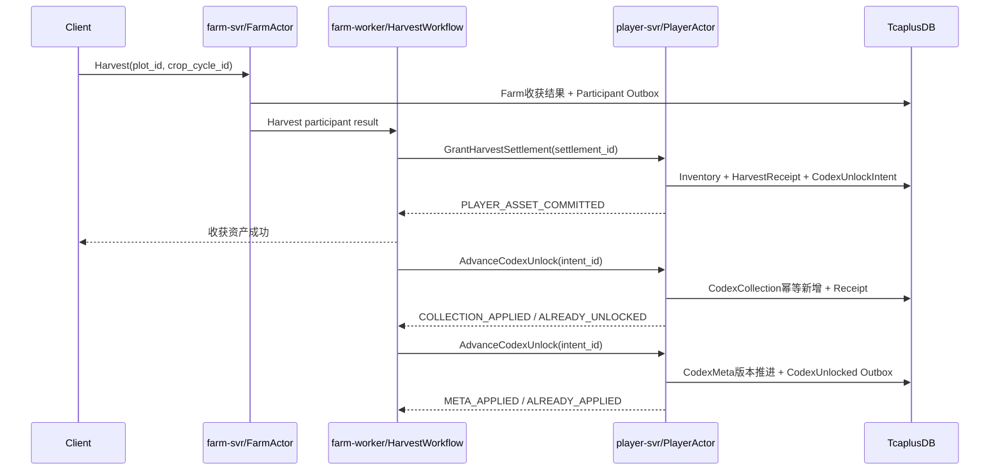

# 24 · 经典农场植物图鉴系统设计

版本：`v0.1-plant-codex-contract-freeze-candidate`  
日期：2026-07-29  
定位：定义常驻植物、活动植物、首次解锁、活动档案、图鉴查询、红点、任务联动和可靠恢复。  
总体架构以 [22-production-architecture-v1.21](./22-production-architecture-v1.21.md) 为准；本文不新增 CodexSvr、QuerySvr 或 Actor 类型。

---

## 1. 已冻结产品规则

1. 玩家第一次成功收获自己农场种植的某种植物时，该植物图鉴正式解锁。
2. 等级达到、购买种子、获得种子、偷到作物和在好友农场看到植物都不直接解锁图鉴。
3. 活动结束后，已解锁活动植物进入“活动档案”，永久完整展示，解锁事实永不倒退。
4. 活动结束后，未解锁活动植物仍在活动档案显示灰色剪影。
5. 活动结束后不能再通过活动商店等渠道获得新种子，但玩家库存中的遗留活动种子仍可继续播种。
6. 使用遗留种子在活动结束后播种并成功收获，仍可解锁对应活动植物图鉴。
7. 活动期间已种下但活动结束后才成熟的作物，仍允许收获并解锁图鉴。
8. 活动复刻时，同一种植物继续使用原 `catalog_entry_id`，已解锁玩家不重复计数。
9. 常驻图鉴完成度与活动图鉴完成度分开计算，活动植物不进入常驻 100% 分母。
10. 图鉴里程碑奖励复用 TaskDomain，不在 PlantCodexDomain 再实现一套奖励系统。

---

## 2. 服务和权威边界

植物图鉴是玩家个人永久历史，冲突键为 `player_id`。它与钱包、仓库、任务一样由
PlayerActor 串行写，但使用独立领域状态和持久化记录：

```text
player-svr
└── PlayerActor(player_id)
    └── PlantCodexDomain
        ├── UnlockEvaluator
        ├── PlayerCodexMeta
        ├── PlayerCodexCollection
        ├── CodexSeenState
        └── CodexSummary

farm-worker
├── CodexIntentConsumer
├── CodexReconcileWorker
└── RedPointConsumer

ConfigRegistry
└── PlantCatalogDefinition

TcaplusDB
├── PlayerCodexMeta
└── PlayerCodexCollection

Redis
└── CodexSummary / CodexRedPoint
```

边界规则：

- `PlantCodexDomain` 是 PlayerActor 内模块，不是 CodexActor；
- `farm-worker` 只推进已提交的 CodexUnlockIntent，不拥有图鉴真值；
- ConfigRegistry 是配置能力，不新增 config-svr Deployment；
- 查询先放在 player-svr 的 PlayerReadAPI，不新增 query-svr；
- Redis 只缓存摘要和红点，不能保存唯一解锁事实；
- 图鉴状态与仓库资产不是一个聚合记录，不能假设一次 Tcaplus CAS 跨记录原子提交。

---

## 3. 四个必须分开的概念

```text
visible
  当前是否在图鉴页面展示

obtainable
  当前是否还能从活动、商店、订单或奖励渠道获得新种子

can_plant
  玩家当前是否可以消耗库存中的种子播种

unlocked
  玩家历史上是否已经完成正式图鉴解锁
```

活动结束后的已解锁植物可以同时满足：

```text
visible = true
obtainable = false
can_plant = inventory.seed_count > 0
unlocked = true
```

活动结束后的未解锁植物：

```text
visible = true
display_mode = SILHOUETTE
obtainable = false
can_plant = inventory.seed_count > 0
unlocked = false
```

`obtainable=false` 不能被误写成 `can_plant=false`。本项目明确允许遗留活动种子继续播种。

---

## 4. 全局图鉴配置

```text
PlantCatalogDefinition
├── catalog_entry_id          永不复用
├── plant_definition_id
├── collection_id             CORE / 活动系列
├── kind                      PERMANENT / EVENT
├── activity_id
├── catalog_rule_version
├── catalog_revision
├── obtainable_begin_at_ms
├── obtainable_end_at_ms
├── archive_visible
├── locked_display_mode       SILHOUETTE
├── counts_for_core_completion
├── counts_for_collection_completion
├── allow_legacy_seed_plant   本项目活动植物固定为 true
├── resource_key
└── lifecycle_status          ACTIVE / ARCHIVED / SAFETY_HIDDEN
```

配置不变量：

- `catalog_entry_id` 发布后永不复用；
- 同一活动植物复刻时沿用原 entry_id；
- 真正不同的植物或需要独立计数的变体使用新 entry_id；
- 活动结束把条目转入 `ARCHIVED`，不删除配置；
- 已有玩家解锁事实引用的条目必须保留墓碑配置；
- `SAFETY_HIDDEN` 只用于法律、安全或资源事故，不得用于普通活动下架；
- 客户端资源版本只影响展示降级，不得改变服务端已经成立的解锁事实。

### 4.1 图鉴分组和完成度

```text
CORE
  常驻植物：18 / 25

EVENT:SPRING_FESTIVAL_2026
  春节植物：5 / 6

EVENT:ANNIVERSARY_2026
  周年庆植物：3 / 3
```

活动系列的完成度按稳定 `collection_id + catalog_revision` 解释。活动复刻新增条目时应创建新
revision；旧 revision 的历史完成和已领取任务奖励不能被撤销。

---

## 5. 玩家图鉴状态与冷分区

P0 只保存正式完成状态，不实现 DISCOVERED/PLANTED 多阶段：

```text
PlayerCodexMeta(player_id)
├── player_id
├── codex_version
├── global_unlock_seq
├── last_seen_unlock_seq
├── seen_catalog_revision_by_collection
├── total_unlocked_count
└── collection_summaries[]

PlayerCodexCollection(player_id, collection_id)
├── collection_id
├── catalog_revision
├── collection_version
├── unlocked_count
├── completion_state
├── unlocked_entries[]
└── bounded_source_receipts / source_watermarks

UnlockedPlantEntry
├── catalog_entry_id
├── first_harvested_at_ms
├── first_crop_cycle_id
├── source_activity_id
├── catalog_rule_version
└── unlock_seq
```

不在图鉴记录中保存：

- 当前种子和作物数量：属于 Inventory；
- 每种植物累计收获数量：属于 PlayerLifetimeStats；
- 玩家当前是否达到播种等级：由成长与配置查询计算；
- 图鉴奖励 Receipt：属于 TaskClaim/RewardReceipt；
- 每个条目的 `unseen bool`：使用全局 `unlock_seq` 判断。

查看红点：

```text
unseen_unlock_count
= count(entry.unlock_seq > last_seen_unlock_seq)
```

PlayerActor 激活时只常驻 CodexMeta 摘要，不默认加载所有历史 Collection。打开具体页面或
处理对应 Collection 解锁时按 `collection_id` 加载，并在空闲后卸载。

玩家查看图鉴后只需可靠推进 Meta：

```text
last_seen_unlock_seq = max(last_seen_unlock_seq, viewed_through_unlock_seq)
```

不需要逐条修改所有 Entry。

---

## 6. CropCycle 必须冻结图鉴上下文

播种时从种子定义与 Catalog 配置冻结：

```text
CropCycle
├── plant_definition_id
├── catalog_entry_id
├── catalog_rule_version
├── source_activity_id
├── seed_item_id
├── planted_from_legacy_seed
└── codex_unlock_eligible
```

活动结束后：

- 已种下作物按 CropCycle 快照继续成长；
- 遗留种子仍可创建新的 CropCycle；
- 新 CropCycle 使用该种子的稳定 catalog_entry_id；
- `codex_unlock_eligible` 仍为 true；
- 收获时不能重新读取“活动已经结束”并取消图鉴资格。

服务端仍需校验种子是合法库存资产，客户端不能通过上传 `catalog_entry_id` 把普通种子伪装成活动植物。

---

## 7. 正式解锁条件

`UnlockEvaluator` 只接受已成立的自己农场收获事实：

```text
HarvestCodexCandidate
├── settlement_id
├── player_id
├── farm_id
├── owner_player_id
├── crop_cycle_id
├── catalog_entry_id
├── catalog_rule_version
├── source_activity_id
├── codex_unlock_eligible
└── occurred_at_ms
```

必须同时满足：

```text
player_id == owner_player_id
farm_id 属于该 player
HarvestSettlement 已可靠完成
收获作物已进入该玩家 Inventory
CropCycle.codex_unlock_eligible == true
Catalog Entry 可识别且未被 SAFETY_HIDDEN 禁止处理
```

以下情况不解锁：

- 偷取好友作物；
- 邮件或活动直接发放成品作物；
- 购买成品作物；
- 仅获得种子；
- 仅完成播种；
- 收获结算失败或仍为未知结果；
- 客户端直接发送 CodexUnlock 命令。

---

## 8. 收获、资产和图鉴的可靠链路

`PlayerEconomyRecord` 与 `PlayerCodexMeta/PlayerCodexCollection` 是不同物理记录。首版不能宣称“一次 CAS
同时提交仓库、任务和图鉴”，而应使用现有 Harvest Workflow 和可靠 Intent：



成功边界：

- 作物进入仓库后，核心收获可以成功返回；
- 图鉴解锁通过可靠 Intent 最终完成，不阻塞核心资产可用性；
- 正常情况下 DirectDispatcher 立即推进，客户端很快收到 `CodexUnlocked`；
- Worker、Logic 或网络故障只会延迟图鉴显示，不能永久丢失；
- `settlement_id/intent_id` 重投不会重复解锁或重复增加任务进度。

若答辩演示要求“收获动画结束立即展示新图鉴”，客户端可等待 `CodexUnlocked` Push，或在超时后查询图鉴；不能让客户端自行猜测已解锁。

---

## 9. 活动植物生命周期

### 9.1 活动进行中

| 玩家状态 | 展示 | 获取 | 播种 | 收获解锁 |
|---|---|---|---|---|
| 未解锁、无种子 | 灰色剪影 + 获取方式 | 是 | 否 | — |
| 未解锁、有种子 | 灰色剪影 | 是 | 是 | 是 |
| 已解锁 | 完整展示 | 是 | 是 | 已解锁 |

### 9.2 活动结束后

| 玩家状态 | 活动档案展示 | 获取新种子 | 使用遗留种子播种 | 收获解锁 |
|---|---|---|---|---|
| 未解锁、无种子 | 灰色剪影、“活动已结束” | 否 | 否 | — |
| 未解锁、有遗留种子 | 灰色剪影 | 否 | 是 | 是 |
| 活动结束前已种下 | 灰色剪影 | 否 | 不适用 | 是 |
| 已解锁 | 永久完整展示 | 否 | 有种子即可 | 不重复计数 |

### 9.3 活动复刻

```text
Catalog Entry 保持不变
→ obtainable 重新开启
→ 历史已解锁状态继续有效
→ 未解锁玩家可以再次获取
→ 同一 entry 不重复增加 collection_count
```

---

## 10. 查询和页面模型

P0 查询由 player-svr 提供逻辑 API：

```text
GetPlantCodex(collection_id, cursor)
AckCodexViewed(expected_codex_version, seen_unlock_seq, seen_catalog_revision)
```

查询过程：

```text
ConfigRegistry 读取 Catalog Definitions
+ PlayerCodexMeta
+ 目标 PlayerCodexCollection 稀疏已解锁集合
+ Inventory/Progression 的只读摘要
→ 合并 PlantCodexView
```

返回视图：

```text
PlantCodexEntryView
├── catalog_entry_id
├── plant_definition_id
├── collection_id
├── unlocked
├── display_mode          FULL / SILHOUETTE
├── obtainable
├── can_plant
├── archived
├── first_harvested_at_ms
└── resource_key
```

Catalog 配置缓存在进程内，玩家只保存稀疏已解锁条目。查询不为每个未解锁植物创建玩家
记录，也不加载 FarmActor。历史图鉴只读可以由 PlayerReadAPI 直接读取 CodexMeta/Collection；
写入和 Ack 仍经过 PlayerActor 或带 writer_epoch Fence 的可信玩家命令。

---

## 11. 红点

P0 图鉴只定义两个红点来源：

```text
CODEX_NEW_CONTENT
  Catalog 新 revision 出现，玩家尚未查看

CODEX_NEW_UNLOCK
  玩家 unlock_seq 大于 last_seen_unlock_seq
```

图鉴里程碑奖励属于 TaskDomain，使用任务红点，不创建 `CODEX_REWARD` 的第二套领奖状态。

图鉴提交后产生绝对摘要：

```text
CodexSummaryChanged
├── player_id
├── codex_version
├── unseen_unlock_count
├── new_content_count
├── unlocked_core_count
└── total_core_count
```

RedPointConsumer 将摘要写入 Redis。Redis 丢失后从 Tcaplus 图鉴状态和 Catalog 配置重建。

---

## 12. 与任务系统联动

PlantCodexDomain 是具体解锁事实的唯一来源：

```text
PlayerCodexCollection可靠新增Entry + CodexMeta版本推进
→ PlantCodexUnlockedEvent
→ TaskEventConsumer
→ PlayerActor/TaskDomain
```

可配置的图鉴任务：

- 解锁 5/10/20 种常驻植物；
- 完成某个活动 collection；
- 解锁指定稀有度植物；
- 历史总解锁达到 N。

TaskDomain 只统计已经由 PlantCodexDomain 提交的唯一 entry，不直接根据 Harvest 事件猜测“是否首次解锁”。任务奖励继续使用 `TaskClaimOrder + RewardReceipt`。

---

## 13. 持久化、冷加载与容量

`PlayerCodexMeta/Collection` 是独立 Tcaplus 权威记录，不塞入每次普通 Buy/Sell 都会
改写的 PlayerEconomyRecord。

P0 采用：

```text
PlayerCodexMeta
  key = player_id

PlayerCodexCollection
  key = (player_id, collection_id)
  value = compact repeated unlocked_entries
```

原因：

- 登录只读取小型 Meta；
- 打开常驻图鉴只加载 CORE Collection；
- 打开春节档案只加载对应活动 Collection；
- 多年活动不会让单记录和 Actor 热内存无限增长；
- 单 Collection 内植物数量有限，暂不为每个植物创建独立 Tcaplus 行。

只有单 Collection 达到平台记录大小、分页或 CAS 写放大阈值时，才在 Repository 内继续按
entry range 分区；该物理演进不能改变 catalog_entry_id 和查询协议。

PlayerActor 冷模块预算：

```text
max_loaded_codex_collections
codex_collection_idle_unload_ms
codex_collection_record_bytes_p95/p99
codex_entries_per_collection_p95/p99
```

Redis 可保存：

```text
codex-summary:{player_id}
codex-redpoint:{player_id}
```

但 Redis 不保存唯一 `unlocked=true` 事实。

### 13.1 Meta 与 Collection 的提交

一次首次解锁需要同时推进 Collection 与 Meta，但二者是不同物理记录，不能并行裸写。
`CodexUnlockIntent` 状态显式记录：

```text
CREATED
→ COLLECTION_APPLIED
→ META_APPLIED
→ EVENT_PUBLISHED
→ COMPLETED
```

Collection 使用 `(player_id, catalog_entry_id)` 或等价唯一约束吸收重复；Meta 使用
`global_unlock_seq` 和 Intent Receipt 收敛。客户端只在 Collection Entry 已成立后看到
`unlocked=true`，Meta/Summary 延迟由 Reconcile 修复。

---

## 14. 失败和修复

### 14.1 重复 HarvestSettlement

相同 `settlement_id` 重试：

```text
Inventory Grant → HarvestReceipt 吸收重复
Codex Unlock → Intent/Entry 幂等返回 ALREADY_UNLOCKED
Task Event → CodexUnlocked event_id 防重
```

### 14.2 资产已到账、图鉴尚未更新

`CodexUnlockIntent` 与资产/HarvestReceipt 同一可靠 PlayerEconomy 提交。Worker 重试，超过 SLA 告警；ReconcileWorker 可扫描长时间未完成 Intent。

### 14.3 Catalog 配置下架或活动结束

历史 Entry 使用墓碑配置继续展示。普通活动结束不得删除配置或撤销玩家状态。

历史内容是正式持久依赖，必须长期保留：

```text
catalog_entry_id / collection_id / activity_id
catalog_rule_version
历史名称、描述和resource_key
活动档案展示信息
遗留种子的播种解释规则
```

仅在 CropCycle 保存 rule_version、但运营平台删除旧版本和客户端资源，不满足恢复与档案展示
要求。资源下线时必须保留归档资源包或稳定占位资源映射。

### 14.4 配置缺失

发现 PlayerCodexEntry 引用未知 catalog_entry_id：

- 不删除玩家事实；
- 返回安全占位展示；
- 上报告警；
- 等待配置修复或迁移。

### 14.5 Redis 丢失

只影响摘要和红点及时性，从 Tcaplus + Catalog 重建，不影响解锁事实。

---

## 15. 最小协议

客户端命令：

```text
GetPlantCodexRequest / Response
AckCodexViewedRequest / Response
```

服务端 Push：

```text
PlantCodexUnlocked
CodexSummaryChanged
```

内部可信命令：

```text
AdvanceCodexUnlock(TrustedCodexUnlockIntent)
```

Ack 规则：

```text
expected_codex_version > current_codex_version
→ 拒绝

seen_unlock_seq
→ 只能单调推进到请求实际看过的序号

旧expected_codex_version / 旧seen_unlock_seq
→ 不得清除之后产生的新解锁红点
```

客户端不能提交：

- `unlocked=true`；
- `first_harvested_at_ms`；
- `catalog_rule_version`；
- `source_activity_id`；
- 解锁奖励内容。

这些字段必须来自 HarvestSettlement、CropCycle 快照和服务端配置。

---

## 16. P0 范围与非目标

### P0 Codex MVP

- 常驻植物与活动植物两个大类；
- 首次自己收获解锁；
- 活动结束永久档案；
- 未解锁活动植物灰色剪影；
- 遗留活动种子继续播种；
- PlayerCodexMeta + Collection 冷分区；
- CodexUnlockIntent 与幂等恢复；
- 图鉴查询、解锁 Push、查看消红点；
- CodexUnlockedEvent 接入 TaskDomain。

### 暂不实现

- 独立 codex-svr、query-svr 或 CodexActor；
- DISCOVERED/PLANTED 多阶段图鉴；
- 每种植物的累计收获统计；
- 图鉴内独立里程碑领奖系统；
- 图鉴排行榜；
- 图鉴玩家间展示和点赞；
- 通过客户端本地状态判定解锁；
- 为全部未解锁植物预建玩家记录。

---

## 17. 实施顺序

### C0：配置和 Schema

- PlantDefinition 与 PlantCatalogDefinition；
- Catalog entry、collection、revision 和墓碑规则；
- PlayerCodexMeta/Collection 大小预算与冷加载上限。

### C1：CropCycle 和 HarvestSettlement

- 冻结 catalog_entry_id、activity_id 和 unlock eligibility；
- Harvest participant 写入 CodexUnlockIntent；
- 重复结算测试。

### C2：PlantCodexDomain

- Meta/Collection、稀疏 Entry、unlock_seq、seen 状态；
- ApplyCodexUnlock；
- Outbox、重试和 Reconcile。

### C3：页面与红点

- GetPlantCodex；
- 常驻、当前活动和活动档案；
- FULL/SILHOUETTE；
- MarkSeen 与绝对红点摘要。

### C4：任务联动

- PlantCodexUnlockedEvent；
- 解锁数量和活动 collection 任务；
- TaskClaimOrder 奖励闭环。

图鉴不阻塞当前 S2 登录、Join 和空农场骨架。应在版本化植物配置、Plant/Harvest 闭环和
TaskDomain 基础模型明确后接入。

---

## 18. 验收标准

1. 第一次成功收获自己农场植物后，图鉴只解锁一次。
2. 购买种子、获得种子、播种、偷菜和邮件获得成品作物均不直接解锁。
3. 重复 HarvestSettlement 不重复解锁，不重复推进任务。
4. 活动结束后已解锁条目永久完整展示。
5. 活动结束后未解锁条目仍显示灰色剪影。
6. 活动结束后不能获取新活动种子，但库存遗留种子仍能播种。
7. 活动结束后使用遗留种子播种并收获，能够正常解锁。
8. 活动期间播种、活动结束后收获，能够正常解锁。
9. 活动复刻沿用同一 entry_id，已解锁玩家不重复计数。
10. 活动植物不改变常驻图鉴完成度分母。
11. 资产已到账而 Logic/Worker 崩溃时，CodexUnlockIntent 可恢复。
12. 查看图鉴后红点消失；Redis 丢失后可以重建。
13. 未知或下架 Catalog 配置不会删除玩家已有解锁事实。
14. 图鉴解锁任务只消费 CodexUnlockedEvent，不从普通 Harvest Event 重复推算首次解锁。
15. 玩家登录不加载全部历史活动 Collection。
16. 旧 AckCodexViewed 不会清除新解锁产生的红点。
17. Collection 已解锁而 Meta 更新失败时，Intent/Reconcile 能恢复总览摘要。
