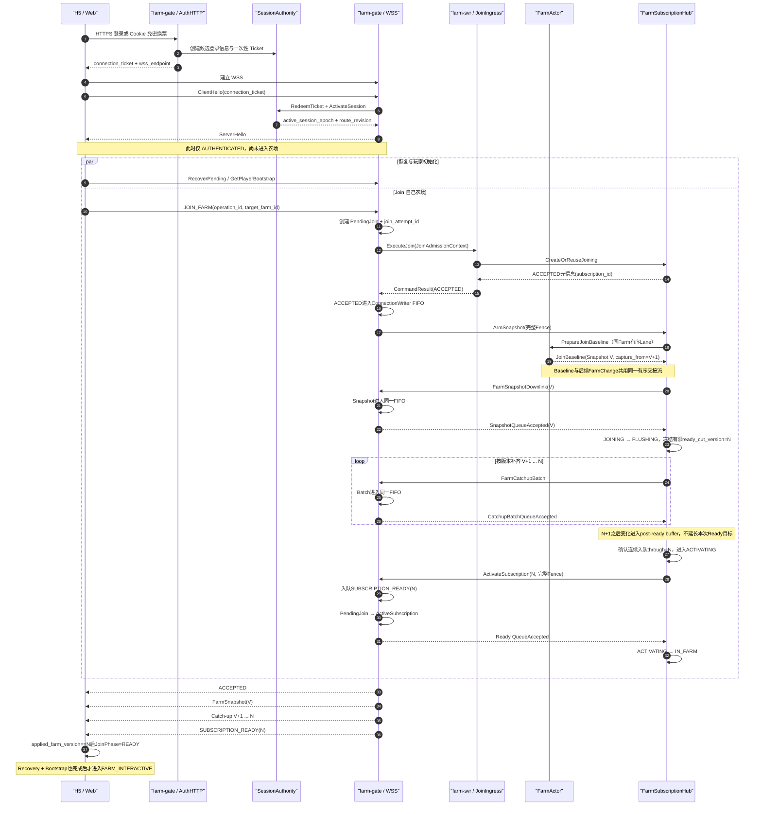
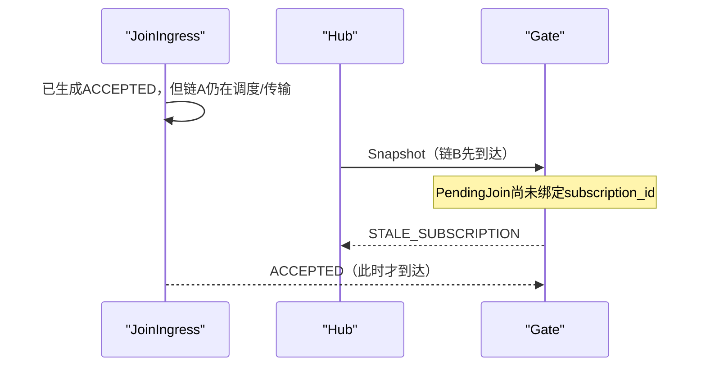
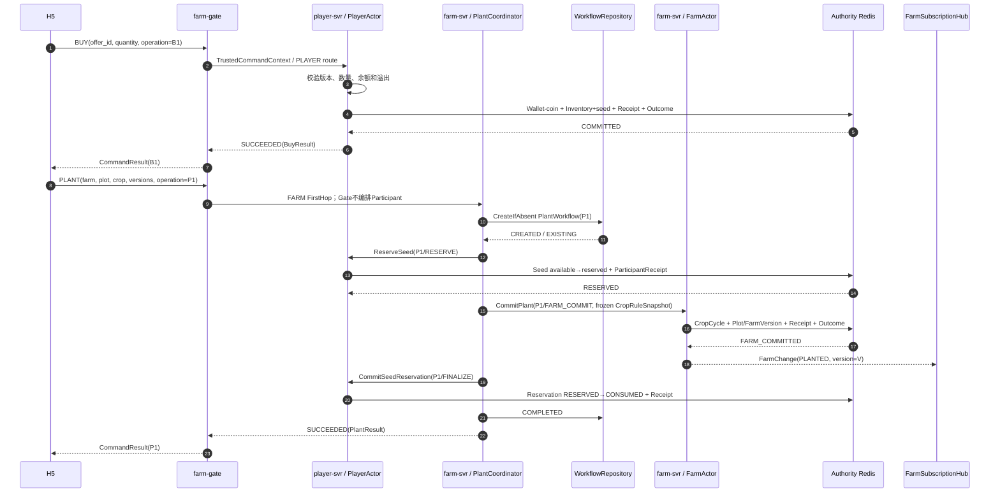
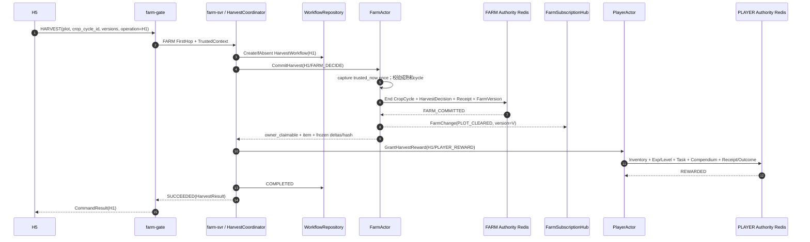
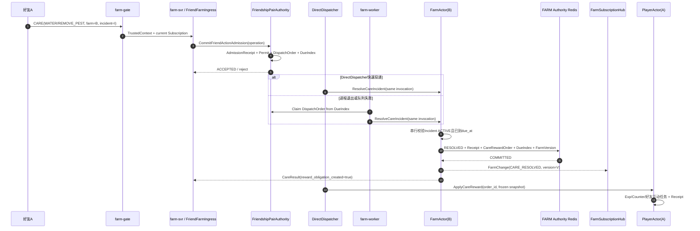
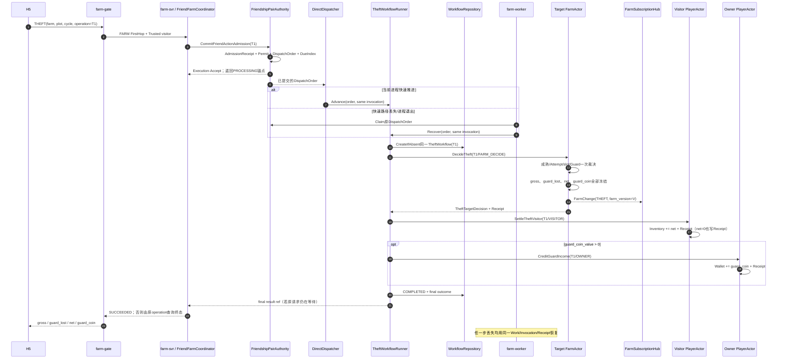
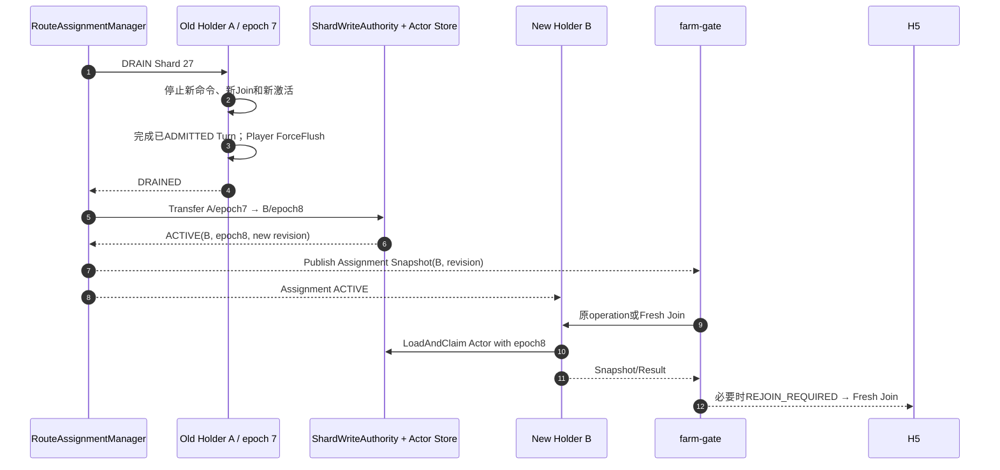
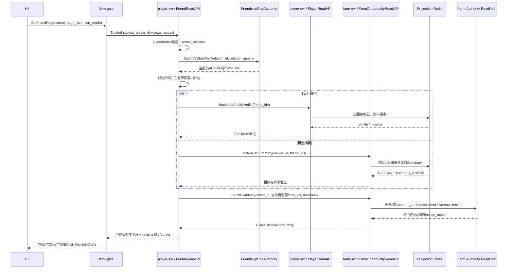
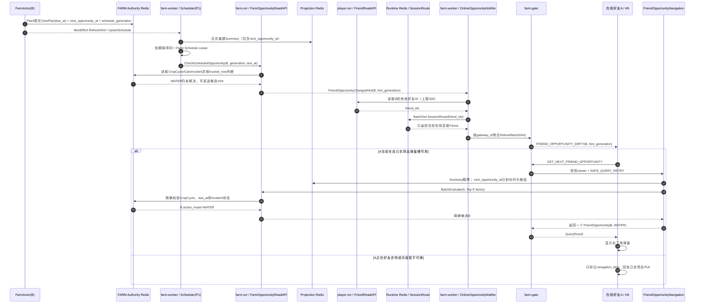
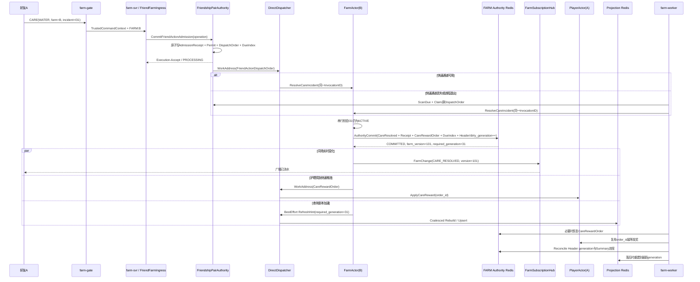

# 核心场景案例集

状态：`v1.1-online-opportunity-push-case`
日期：2026-08-03  
定位：用完整时序、状态含义、失败案例和验收断言解释当前稳定语义合同，供实现 Agent、测试
Agent 和答辩讲解共同使用。

> 本文是“案例化说明”，不是新的规则来源。发生冲突时：接入、Session、Subscription 与 Join
> 以 [26-access-session-contract.md](./26-access-session-contract.md) 为准；命令公网表达以
> [28-command-catalog-public-protocol.md](./28-command-catalog-public-protocol.md) 为准；内部 RPC
> 以 [29-internal-rpc-trusted-context.md](./29-internal-rpc-trusted-context.md) 为准；Actor Route、
> Runtime 与 Workflow 以 [27-access-routing-actor-workflow-freeze.md](./27-access-routing-actor-workflow-freeze.md)
> 为准；Actor Authority、Receipt、Order 与 Unknown Outcome 以
> [30-actor-authority-store-contract.md](./30-actor-authority-store-contract.md) 为准；Redis查询副本、容量与
> BatchEvaluate物理边界以 [31-actor-authority-redis-physical-contract.md](./31-actor-authority-redis-physical-contract.md)
> 为准；好友关系、Permit和好友页合同以
> [33-friendship-share-access-contract.md](./33-friendship-share-access-contract.md) 为准；核心经营数值、并发和
> 跨 Actor 场景以 [32-core-business-scenario-contract.md](./32-core-business-scenario-contract.md) 为准；任务、
> 宠物与图鉴分别以 [34 号任务合同](./34-task-system-contract.md)、
> [36 号宠物合同](./36-simple-pet-guard-contract.md)、
> [37 号图鉴合同](./37-plant-compendium-contract.md) 为准。

---

## 1. 案例目录

| 案例 | 场景 | 状态 |
|---|---|---|
| C01 | 账号登录、WSS 建连、Join 自己农场、Snapshot/Catch-up、进入可写状态 | 稳定语义已确认，待实现验证 |
| C02 | Buy、Sell、UnlockPlot 与 Plant：单 Actor 经济写和双 Actor Reservation | 稳定语义已冻结，待实现验证 |
| C03 | 时间派生成熟、Harvest、任务进度与图鉴解锁 | 稳定语义已冻结，待实现验证 |
| C04 | 好友 Join、Care/除虫、可靠奖励与 200 人同场广播 | 稳定语义已冻结，待实现验证 |
| C05 | Theft、宠物截留、访问者入库与农场主金币结算 | 稳定语义已冻结，待实现验证 |
| C06 | Shard Drain、Holder 崩溃、Writer Fence 与 Fresh Join | 稳定语义已冻结，待实现验证 |
| C07 | 好友互动机会发现、好友列表精确标识与连续推荐 | 稳定语义已冻结，待实现验证 |

阅读建议：先用 C01 理解连接、Session 和 Subscription，再用 C02～C05 Review 经营与社交主循环；
C06 解释迁移和故障时为什么不丢业务事实，C07 解释好友列表和连续推荐为什么不批量加载 FarmActor。
本文只串联现行合同，不重新决定 Payload 字段号、Redis Key、Lua 或平台参数。

---

# C01 · 登录与 Join 农场

## 2. 这个场景要证明什么

C01 不是“页面收到一个农场 JSON”这么简单。它要同时证明：

1. 账号认证与游戏长连接分离；密码只用于 HTTPS 登录，不进入 WSS。
2. 一次性 ConnectionTicket 只能被一根连接核销。
3. ClientHello/ServerHello 建立的是应用层在线 Session，不是 TCP 三次握手。
4. Join 期间 Snapshot 与后续 FarmChange 之间没有版本空洞。
5. `ACCEPTED`、Snapshot、Catch-up 和 `SUBSCRIPTION_READY` 在同一连接上的可见顺序明确。
6. Snapshot 入 Gate 队列不等于浏览器已收到，也不等于已经允许经营写命令。
7. 断线、切换、重复请求和旧回调不会污染新连接或新农场页面。

## 3. 四类关键 ID

| ID | 谁生成 | 生命周期 | 作用 |
|---|---|---|---|
| `request_id` | H5 | 一次网络请求 | 关联本次请求与响应；网络重试可以变化 |
| `operation_id` | H5 | 一次 Join 业务意图 | 同一逻辑 Join 的幂等身份；不得因超时随意更换 |
| `join_attempt_id` | Gate | 当前连接上的一次 Join 尝试 | Fence 旧 ACCEPTED、旧 Snapshot、旧 Ready；新 WSS/Fresh Join 必须新建 |
| `subscription_id` | FarmSubscriptionHub | 一次农场订阅 | 标识当前观看关系，约束 Snapshot、Delta、广播和 Leave |

`operation_id` 回答“是不是同一次用户意图”；`join_attempt_id` 回答“是不是当前这根连接正在等待
的这一次运行尝试”。两者不能合并。

## 4. 三组状态，不使用一个大枚举

### 4.1 H5 状态

| 维度 | 状态 | 含义 |
|---|---|---|
| Connection | `DISCONNECTED` | 没有可用 WSS |
| Connection | `CONNECTING` | TCP/TLS/WebSocket 正在建立 |
| Connection | `AUTHENTICATING` | 已建 WSS，等待 ServerHello |
| Connection | `AUTHENTICATED` | Ticket 已核销，连接身份和 SessionRoute 已建立 |
| Recovery | `NOT_STARTED/RECOVERING/COMPLETE` | 未决 operation 与玩家私有状态是否恢复完成 |
| Join | `NO_JOIN` | 未加入任何农场 |
| Join | `PENDING_JOIN` | Join 已发出，尚未完成 ACCEPTED/Arm |
| Join | `WAITING_SNAPSHOT` | 已匹配 ACCEPTED，等待 Snapshot |
| Join | `CATCHING_UP` | Snapshot 已应用，等待增量补齐和 Ready |
| Join | `READY` | 收到匹配的 SubscriptionReady，且本地已连续应用到 Ready 版本 |

H5 的“可经营”是派生条件：

```text
subscription_ready_for_ui
  = Snapshot已应用
  + Ready的farm/subscription/attempt匹配
  + applied_farm_version == ready_through_version

FARM_INTERACTIVE
  = AUTHENTICATED
  + Recovery COMPLETE
  + PlayerBootstrap完成
  + subscription_ready_for_ui
```

好友列表和好友机会允许异步 Loading/Retry；它们失败不能伪装成“没有好友机会”，也不能把已经
成立的 `FARM_INTERACTIVE` 撤销。

### 4.2 Gate 状态

```text
连接：PRE_AUTH → ACTIVE → DRAINING/CLOSED

当前农场订阅：
NONE
→ PENDING_JOIN
→ ACTIVE_SUBSCRIPTION

PENDING_JOIN
→ CANCELLING
→ NONE / Fresh Join(new attempt)
```

`PENDING_JOIN` 只允许 Join 控制流；它不能生成普通经营命令使用的
`FarmAdmissionContext`。`CANCELLING` 只接受迟到结果的清理和幂等取消，不能重新 Arm。只有
`ACTIVE_SUBSCRIPTION` 才能准入 Plant、Harvest、Care、Theft。

### 4.3 FarmSubscriptionHub 状态

| 状态 | 含义 |
|---|---|
| `JOINING, armed=false` | 只建立 Subscription、保留名额和 Fence；尚未选择 Snapshot 版本，也不捕获变化 |
| `JOINING, armed=true` | ACCEPTED 已入 Gate FIFO；Arm 在同序 Lane 建立了唯一 Snapshot(V) 与 V+1 捕获游标 |
| `FLUSHING` | Snapshot 已进入 Gate FIFO；已冻结有限 Ready 切点 N，只补发截至 N 的 Catch-up |
| `ACTIVATING` | 已冻结 Ready 切点 N，等待 Gate 把 Ready 放入同一 FIFO；N 之后变化暂存 |
| `IN_FARM` | Gate 已确认 Ready 入队，可以继续发送 N+1 之后的实时变化 |
| `RESYNC_REQUIRED` | 缓冲溢出或版本无法连续，必须重新 Join |
| `CLOSED` | Subscription 已被精确清理或租约到期 |

Hub 是可丢失的实时运行态，不拥有 Plot、CropCycle、金币或库存等业务真值。

## 5. 完整成功时序



图中的四条 Gate 下行都进入同一根连接的 `ConnectionWriter` FIFO，因此浏览器可见顺序是：

```text
ACCEPTED
→ FarmSnapshot(V)
→ Catch-up(V+1 ... N)
→ SUBSCRIPTION_READY(N)
→ 实时变化(N+1 ...)
```

`QueueAccepted` 只表示数据已经进入 Gate 的有界发送队列，不表示浏览器已经接收或渲染。

## 6. 为什么需要 ArmSnapshot

### 6.1 问题不是 TCP 乱序，而是两条内部 RPC 竞速

TCP 会保证同一条连接内的字节顺序，但这里的 `ACCEPTED` 和 Snapshot 在到达 Gate 之前来自两条
不同调用链：

```text
链A：JoinIngress → ExecuteCommandResponse → Gate
链B：Hub → DownlinkService → Gate
```

即使业务代码先“构造或返回 ACCEPTED”，也不能保证链 A 一定先于链 B 到达 Gate。不同 goroutine、
连接池、线程调度、网络排队和重试都可能产生下面的顺序：



这不是说 TCP 把同一条消息顺序打乱，而是两条独立 RPC 根本没有共同的 FIFO。

### 6.2 显式握手如何解决

```text
Gate收到ACCEPTED
→ 绑定PendingJoin.subscription_id
→ ACCEPTED进入客户端ConnectionWriter FIFO
→ Gate调用ArmSnapshot
→ Hub才获得发送Snapshot的资格
```

`ArmSnapshot` 建立了明确的因果关系：只要 Hub 看到了 Arm，就能确定 Gate 已经准备好识别本次
Snapshot，而且 ACCEPTED 已经排在同一客户端 FIFO 的前面。实现不再依赖时序运气，也不需要让
Gate 从“第一条未知 Snapshot”反向猜测并隐式建立订阅。

## 7. 为什么 Snapshot 到了还不能立刻经营

假设 Snapshot 在版本 100 生成，生成后另一位好友立即浇水：

```text
t1  Snapshot(version=100)
t2  Water提交，FarmChange(version=101)
t3  浏览器收到Snapshot(100)
```

如果 H5 在 t3 直接开放写操作，而 101 没有被可靠补发，页面就永久停在旧状态。JoiningBuffer
因此从 Snapshot 切点 V 起保存后续变化。Snapshot 入队确认后，Hub 在同一 Lane 冻结一个有限 N：
只追赶截至 N 的连续变化，N+1 之后排到 Ready 后发送。这样热门农场持续产生变化时也能在有界
时间 Ready，而 H5 仍能证明自己的视图已经连续到 N。

自己的农场与好友农场使用同一套顺序规则。区别只在权限，不在 Snapshot/Delta 一致性。

## 8. 关键失败案例

| 故障点 | 服务端处理 | H5 看到什么 | 是否可写 |
|---|---|---|---|
| Ticket 已过期/已核销 | ClientHello 失败并关闭连接 | 重新 Cookie 免密换票 | 否 |
| ACCEPTED 无法进入 Gate 队列 | 不 Arm Snapshot，取消 PendingJoin | Join 失败/重连 | 否 |
| FirstHop已创建JOINING，但ACCEPTED响应丢失 | Gate先进入CANCELLING，再用attempt/operation/完整Fence调用CancelJoinAttempt；迟到ACCEPTED不能重新Arm | Join超时后Fresh Join | 否 |
| ArmSnapshot 超时 | 保持 Pending 或取消并精确 Cleanup；不得隐式激活 | Join 超时后 Fresh Join | 否 |
| Snapshot 队列满 | Gate 不回 QueueAccepted；Hub 不进入 FLUSHING | Loading 后重连/重 Join | 否 |
| JoiningBuffer 溢出 | 标记 RESYNC_REQUIRED | 重新 Join 获取新 Snapshot | 否 |
| 热门农场持续产生新Change | 固定N以后，新Change进入post-ready buffer；不继续延长本次Catch-up | 正常收到Ready，再持续收增量 | Ready后是 |
| Catch-up 批次只入一部分 | 不发送 Ready，取消本次 Join | 重新 Join | 否 |
| Ready 请求/响应超时 | 依据完整 Fence 幂等重查/重试，旧 Ready 不得激活新 Join | 仍处于 CATCHING_UP | 否 |
| H5 已收到 Snapshot 但 Recovery 未完成 | 允许渲染农场，只保留恢复屏障 | 页面可见但经营按钮禁用 | 否 |
| 好友列表/机会查询超时 | 自己农场照常进入，好友区域显示 Loading/Retry | 局部降级 | 是 |
| 从 A 切到 B 后收到 A 的旧 Push | subscription_id Fence 丢弃 | B 页面不受污染 | 是，针对 B |
| A 的旧命令已在切换前 ADMITTED | 允许按 operation_id 返回结果，但不把 A PlotView 应用到 B | 仅更新操作结果 | 是，针对 B |
| Subscription 续租失败到本地 Deadline | Gate 将订阅置 INVALID，停止新写准入并要求 Fresh Join | 重连/重新进入当前农场 | 否，直到新 Ready |
| Gate 崩溃未发送 Leave | Hub 的 Subscription Lease 到期回收；新连接重新 Join | 短暂重连 | 新 Join Ready 后是 |

## 9. 实现注意事项

1. FarmActor 只生成权威 Snapshot/Change，不等待 Gate 网络 RPC；Join 状态机由同 Holder 的
   FarmSubscriptionHub 推进。
2. 未 Arm 时 Hub 不读取 Snapshot，也不开始 JoiningBuffer。Arm 后的 `PrepareJoinBaseline` 必须与
   FarmActor 的 FarmChange 发布共用一个可证明的顺序边界；不能“先读 Snapshot、稍后注册监听”。
3. Snapshot QueueAccepted 回到 Hub Lane 时冻结有限 `ready_cut_version=N`；只等待截至 N 的
   连续前缀。N 之后的新变化必须暂存，等 Ready 入队后再发送，不能越过 Ready，也不能反向延长 N。
4. Gate 对 ACCEPTED、Snapshot、Catch-up、Ready、Disconnect 都校验：

```text
join_attempt_id
+ subscription_id
+ target_farm_id
+ gateway_id/gateway_boot_id
+ connection_id/connection_generation
+ session_epoch/session_route_revision
```

5. 旧 Fence 回调只能幂等忽略，不能释放当前新 Subscription 的名额。
6. 正常断线按 `farm_id + subscription_id + 完整Fence` 精确 Cleanup；ACCEPTED 未知导致 Gate 尚无
   subscription_id 时，先原子进入 CANCELLING，再按 `farm_id + join_attempt_id + operation_id +
   完整Fence` 精确取消未Arm Join。CANCELLING 后迟到 ACCEPTED 不能继续 Arm。
7. Gate 可以按 Holder/Farm 批量续租，续租使用 TTL 和本地单调 Deadline；不能为 200 人同场的
   每个 Subscription 建立独立高频网络调用。
8. ConnectionWriter 必须有 item/byte 双上限；一个慢客户端只能挤满自己的队列，不能阻塞 Hub、
   FarmActor 或同场其他 199 个客户端。
9. 好友机会是首屏增强，不是 Join 正确性的组成部分。查询失败显示 Loading/Retry，不能返回伪造的
   `NONE`。

## 10. 最小验收断言

```text
C01-01 ClientHello成功前，任何业务命令均被拒绝。
C01-02 ServerHello只代表AUTHENTICATED，不代表FARM_INTERACTIVE。
C01-03 未Arm时Hub绝不发送Snapshot。
C01-04 ACCEPTED、Snapshot、Catch-up、Ready在同一ConnectionWriter中严格有序。
C01-05 Snapshot QueueAccepted只令Hub进入FLUSHING，不激活Subscription。
C01-06 H5收到Snapshot后仍禁止经营写命令。
C01-07 Ready版本之前不存在FarmChange空洞或重复应用造成的状态倒退。
C01-08 PendingJoin不能生成普通经营命令的FarmAdmissionContext。
C01-09 旧join_attempt_id/subscription_id/Fence的回调不能影响新Join。
C01-10 队列满、断线和缓冲溢出时不会形成半激活Subscription。
C01-11 Gate崩溃后Presence可由Lease回收，金币、地块等业务事实不受影响。
C01-12 好友机会查询失败不阻塞自己农场最终可写，UI显示Loading/Retry而非空结果。
C01-13 Ready(N)到达时H5必须满足applied_farm_version==N；小于N有界等待，大于N立即Resync。
C01-14 Subscription续租不能创建/复活记录；续租失败到Deadline后Gate停止写准入并Fresh Join。
C01-15 未Arm时没有Snapshot版本或变化捕获；Arm建立的Snapshot切点与V+1捕获之间不得有空洞。
C01-16 热门农场持续变化时，固定ready_cut_version使Join仍能有界完成，N+1变化严格排在Ready后。
C01-17 Gate不知道subscription_id时，CancelJoinAttempt仍能精确释放未Arm名额且不误删新Join。
C01-18 Subscription续租使用TTL与本地单调时钟，跨机器墙钟偏差不能延长写准入。
C01-19 Cancel先于原Join到达Hub时会安装attempt Tombstone，迟到Join不能重新占用名额。
```

---

# C02 · Buy、Sell、UnlockPlot 与 Plant

## C02.1 这个场景要证明什么

C02 把三类容易混在一起的操作拆清楚：

1. `BUY` 和 `SELL` 只修改 PlayerActor，是最简单的单权威经济写；
2. `UNLOCK_PLOT` 横跨玩家金币与农场土地，使用金币 Reservation；
3. `PLANT` 横跨玩家种子与农场 CropCycle，使用种子 Reservation；
4. Gate 只选择 FirstHop，不能直接扣资源或调用多个 Participant；
5. Workflow 必须先可靠创建，再预留资源；Farm 提交后不可回滚，只能完成资源 Finalize；
6. CommandResult 与 FarmChange 是两条不同链路，二者先后到达均不能重复应用业务事实。

## C02.2 权威边界与命令

| 命令 | 第一跳 | 权威状态 | 执行方式 |
|---|---|---|---|
| `BUY` | `player-svr / PlayerIngress` | Wallet、Inventory、ShopCounter | PlayerActor 一个 Turn、一次 Authority Commit |
| `SELL` | `player-svr / PlayerIngress` | Inventory、Wallet、ShopCounter | PlayerActor 一个 Turn、一次 Authority Commit |
| `UNLOCK_PLOT` | `farm-svr / UnlockPlotCoordinator` | Player 金币 + Farm Plot | 持久 UnlockPlotWorkflow |
| `PLANT` | `farm-svr / PlantCoordinator` | Player 种子 + Farm Plot/CropCycle | 持久 PlantWorkflow |

客户端可以一次购买多个同类种子或一次出售多个同类普通作物，但一次 Plant 只种一块地、消费一颗
服务端映射的种子。客户端不能提交玩家 ID、成交单价、种子 item_id、成熟时间、产量或偷菜比例。

土地规则：

```text
Plot 1～5：新农场初始已解锁
Plot 6～24：按固定unlock_order依次购买
达到等级：只获得下一块地的购买资格
真正解锁：仍需玩家点击并支付服务端版本化价格
```

## C02.3 Buy 后 Plant 的成功时序



Buy 与 Plant 是两个独立 operation。Buy 成功只说明种子进入 Player Authority；Plant 的 Workflow 仍须
独立预留种子并创建 CropCycle。

## C02.4 Sell 仍是单 PlayerActor 原子写

```text
SELL(offer_id, quantity, quote_version, operation_id)
→ PlayerActor校验服务端报价、物品可售和库存数量
→ 同一Authority Commit：Inventory -= quantity
                         + Wallet.normal_coin += total_price
                         + ShopCounter/Receipt/Outcome
```

偷来的普通作物和自己收获的同类作物进入同一库存堆叠，默认都可出售；若活动或特殊道具不可出售，
必须由服务端 Catalog 明确标记。库存不足、报价已变化或乘法溢出都在提交前稳定拒绝。`SELL` 不触碰
FarmActor，也不为了“以后可能扩展”预创建 Workflow。

## C02.5 UnlockPlot 使用同一 Reservation 模板

```text
CreateIfAbsent UnlockPlotWorkflow
→ PlayerActor.ReserveUnlockCoin
→ FarmActor.CommitPlotUnlock
→ PlayerActor.CommitUnlockCoinReservation
→ COMPLETED
```

FarmActor 提交 `Plot=UNLOCKED` 是不可逆点：

- Farm 明确拒绝且不存在 Commit Receipt：可靠释放金币 Reservation；
- Farm 已提交但金币 Finalize 暂时失败：土地保持解锁，返回 `PROCESSING`，worker 继续 Finalize；
- 两个 Workflow 购买同一 Plot：只有第一个匹配 PlotVersion 的提交成功，另一个先释放 Reservation；
- Plot 7 在 Plot 6 尚未提交时拒绝；Plot 6 已提交后，独立的 Plot 7 operation 可以重新校验并成功。

## C02.6 失败与客户端可见语义

| 故障点 | 权威结果 | 客户端处理 |
|---|---|---|
| Buy 价格版本旧 | 无资产变化，稳定 `PRICE_CHANGED` | 刷新报价后用新 operation 确认 |
| Buy 提交响应丢失 | 可能已提交，原 operation 进入查询 | 不重新生成 operation_id |
| Sell 库存不足或物品不可售 | 无资产变化，稳定业务拒绝 | 刷新仓库/商品配置，不猜测重试 |
| Sell 提交响应丢失 | 可能已扣库存并加金币，查询原 operation | 不能换 operation 重卖一次 |
| Workflow 创建前失败 | 没有 Reservation、没有 Farm 变化 | 可按 RetryDirective 重发 |
| 已预留种子，Farm 明确拒绝 | 先可靠 Release，再返回 `REJECTED` | Release 未明确前显示 `PROCESSING` |
| Farm 已种下，Finalize 响应丢失 | CropCycle 保留，继续完成消费 | 页面可能先从 FarmChange 看到作物 |
| 相同 operation、不同 plot/crop/quantity | `IDEMPOTENCY_CONFLICT` | 不能把旧 operation 改造成新意图 |
| FarmChange 投递失败 | 权威种植不回滚，实时流失效 | 收到 `REJOIN_REQUIRED` 后 Fresh Join |

H5 在首次发送写命令前把 `operation_id + canonical payload` 放入 Operation Journal。收到
`PROCESSING`、断线或迁移时都查询/重放原 operation；只有稳定终态才能删除 Journal。

## C02.7 Review 检查项

```text
C02-01 BUY是否只进入PlayerActor，没有创建多余Workflow？
C02-02 Buy/Sell quantity是否支持一次多个，并做乘法与余额溢出检查？
C02-02A SELL是否在同一个Player提交中同时扣库存、加金币并写Receipt/Outcome？
C02-03 Workflow是否先于任何金币/种子Reservation可靠创建？
C02-04 PlantCoordinator是否在farm-svr，但种子仍由PlayerActor裁决？
C02-05 Reservation Finalize是否只改状态，不会再次扣金币/种子？
C02-06 Farm Commit后是否禁止业务回滚，只允许继续Finalize？
C02-07 Farm明确未提交时，是否先证明Release成功再返回最终拒绝？
C02-08 初始是否只有5块地、最多24块，并禁止跳过unlock_order？
C02-09 客户端是否不能提交价格、成熟时间、产量和操作者ID？
C02-10 CommandResult和FarmChange是否分别幂等处理，任何先后顺序都不会重复种植？
```

---

# C03 · 时间派生成熟、Harvest、任务与图鉴

## C03.1 这个场景要证明什么

1. 作物成熟由 `trusted_now_ms >= mature_at` 派生，不为每块地创建成熟 Timer 或写一次 Mature 状态；
2. Harvest 首先在 FarmActor 结束 CropCycle 并冻结奖励，再由 PlayerActor 可靠到账；
3. Farm 已清空但奖励暂未到账时只能显示 `PROCESSING`，不能回滚作物或再次收获；
4. 作物、经验、任务进度和首次图鉴解锁在同一 Player Authority Commit 中完成；
5. Harvest 与 Theft 并发由同一 FarmActor 顺序解释，不会超产或重复到账。

## C03.2 成熟不是持久状态迁移

CropCycle 在 Plant 时冻结：

```text
crop_cycle_id
plant_at_ms
mature_at_ms
base_yield
steal_plan_snapshot
care_plan_snapshot
compendium_unlock_snapshot
rule_versions / hashes
```

展示阶段：

```text
now < mature_at_ms  → Growing
now >= mature_at_ms → Mature
```

Scheduler 以后可以在 `next_opportunity_at` 到期时唤醒通知流程，但它不能把 CropCycle 写成 Mature。
Scheduler 故障最多导致提醒变晚；玩家打开、收获或偷菜时仍按当前权威时间判断成熟。

## C03.3 Harvest 成功时序



`owner_claimable = base_yield - stolen_amount`。宠物截留的 gross 作物已经在 Theft 决策时从农场产量中
扣除并折算给主人金币，因此不会在 Harvest 时重新回到主人作物数量。

## C03.4 任务和图鉴为什么放进同一 Player 提交

PlayerActor 应用 HarvestReward 时一次提交：

```text
Inventory[reward_item] += owner_claimable
Exp/Level += frozen progression delta
HarvestCounter += 1
当前成长任务/相关任务进度
首次自种自收获的Compendium UnlockDelta
ParticipantReceipt
StoredOperationOutcome
Player RecordVersion++
```

这样不会出现“作物到账但任务没进度”或“图鉴解锁了但库存回退”。活动结束后，已解锁植物进入活动
档案永久展示；未解锁仍是灰色剪影。遗留活动种子是否仍可种，由 Plant 时冻结的配置决定。

任务没有独立 TaskActor、task-svr 或任务 MQ。三条每日任务和一条线性成长任务都由 PlayerActor 在消费
唯一成功事实时推进；每日 0 点使用惰性 Period 换代，不做全服扫描。

## C03.5 并发与失败

| 情况 | 唯一结果 |
|---|---|
| 未成熟 Harvest | 明确拒绝，不结束 CropCycle |
| 两次 Harvest 同一 cycle | 第一次提交；之后命中 Receipt 或返回周期已结束 |
| Theft 先进入 FarmActor | 先扣一个偷菜槽，Harvest 获得剩余 owner_claimable |
| Harvest 先进入 FarmActor | CropCycle 结束，之后 Theft 拒绝且不产生新 Attempt |
| Farm 已提交、Player 未到账 | 作物在页面已清空，operation=`PROCESSING`；worker恢复奖励 |
| Player 已到账、Workflow 更新响应丢失 | ParticipantReceipt 证明已到账，恢复器只完成 Workflow |
| 规则热更新 | 在途 CropCycle 使用 Plant 时冻结规则，不改变 mature_at/base_yield |

## C03.6 Review 检查项

```text
C03-01 是否完全没有“到时间批量写Mature”的正确性依赖？
C03-02 每个Actor Turn是否只捕获一次trusted_now_ms？
C03-03 Harvest是否绑定crop_cycle_id，禁止旧页面收获下一茬？
C03-04 Farm是否先冻结不可变HarvestDecision，再调用PlayerParticipant？
C03-05 Farm已提交后是否永远不回滚，只恢复Player到账？
C03-06 Inventory、Exp、Task、Compendium和Receipt是否一次Player提交？
C03-07 同一Harvest重试是否不会重复经验、任务或图鉴解锁？
C03-08 Theft与Harvest并发是否只由FarmActor顺序决定且总产量守恒？
C03-09 Scheduler关闭后，查看与收获是否仍能正确识别成熟？
C03-10 FarmChange是否只包含公开农场变化，不泄漏玩家仓库/经验私有数据？
```

---

# C04 · 好友 Join、Care/除虫与同场广播

## C04.1 这个场景要证明什么

1. 好友进入农场先验证 canonical FriendRelation，再复用 C01 的 Snapshot/Ready 顺序；
2. Presence 只负责名额、订阅和广播，不替代好友权限或 FarmActor 裁决；
3. 浇水与虫害是每茬两个独立全局 Incident，各自最多一次有效成功；
4. 好友护理先可靠提交 ActionAdmission，再到 FarmActor 解决 Incident；
5. Farm 护理事实与 CareRewardOrder 同提交，奖励可以延迟但不能丢失或重复；
6. 一次 FarmChange 只计算一次，再按 Gate 聚合发给最多 199 个其他同场连接。

## C04.2 好友 Join 的授权边界

```text
Gate创建PendingJoin
→ 目标Holder的Hub创建AUTHORIZING并预留200人名额
→ FriendshipPairAuthority.AuthorizePreparedVisit
→ 返回绑定relation_id + relation_epoch的VisitPermit
→ Hub继续ArmSnapshot / Snapshot / Catch-up / Ready
```

农场主进入自己的农场不需要好友 Permit。好友删除或拉黑后，新的 Visit/ActionAdmission 立即拒绝；已经
越过 Execution-Accept 的原 operation 按其已冻结 Permit/Receipt 恢复，不能变成第二个新意图。

## C04.3 好友护理成功时序



Owner Care 可以直接进入 FarmActor，不需要 Pair ActionAdmission；Owner 可获得基础护理奖励，但不推进
“好友互动一次”每日任务。Friend Care 才消费好友互动事实。

## C04.4 Incident 和实时广播

P0 暂定每茬最多：

```text
1个WATER Incident
1个PEST Incident
```

两类 Incident 可以同时 ACTIVE，出现时间先用版本化固定配置，未来上线时可以换成种植时冻结的随机
计划。未处理护理暂不改变成熟时间和基础产量，只形成互动机会；Harvest 后随 CropCycle 一起结束。

多人并发时即使所有 Farm 操作暂时经过同一 FarmActor 邮箱，不同 Plot 的无冲突命令仍应允许全部成功，
只是获得一个可解释的 `FarmVersion` 公开顺序。相同 Incident 只有第一个匹配 Turn 成功，后续为
`NO_CHANGE/ALREADY_RESOLVED`，不创建第二个 RewardOrder。

广播流程：

```text
Farm AuthorityCommit(V)
→ PostCommitDeliveryGuard
→ 一份FarmChange(V)
→ FarmSubscriptionHub按gateway_id分组
→ 每个Gate接收一个DeliverBatch
→ Gate并行放入各连接自己的有界FIFO
```

FarmActor 不等待 199 个浏览器真正收到。某个慢连接队列满，只影响该连接并触发重连/Resync。

## C04.5 失败语义

| 故障 | 处理 |
|---|---|
| ActionAdmission 前关系失效 | 明确拒绝，不创建 Farm 操作 |
| Admission 已提交但 Dispatch 快路径丢失 | 返回/保持 `PROCESSING`，worker 从 Pair DueIndex 恢复 |
| Farm Commit 前 Incident 已被别人处理 | `NO_CHANGE`，不创建 CareRewardOrder |
| Farm Commit 成功但奖励未到 | CareResult 保持成功义务，DeliveryView 显示 PENDING |
| 奖励成功但完成 Order 响应丢失 | Player Receipt 防止重复经验/任务 |
| FarmChange 队列满 | 护理事实不回滚；该实时流标记失效并 Fresh Join |
| Projection 尚未刷新 | 好友页 BatchEvaluate 读取权威状态，去掉旧护理标识 |

## C04.6 Review 检查项

```text
C04-01 Presence是否只保存在线/订阅状态，不拥有好友权限和地块真值？
C04-02 Friend Care是否先提交AdmissionReceipt+Permit+DispatchOrder+DueIndex？
C04-03 Owner Care是否不会错误推进好友互动任务？
C04-04 同一Incident并发是否只有一个成功，其余NO_CHANGE且不发奖励？
C04-05 Care事实与CareRewardOrder是否在Farm Authority同一次提交？
C04-06 DirectDispatcher是否只是快路径，队列丢失后worker仍可发现Order？
C04-07 FarmChange是否只生成一次并按Gate批量广播？
C04-08 慢客户端是否只堵自己的ConnectionWriter？
C04-09 查询副本延迟是否不会造成第二次有效护理？
C04-10 200人同场Presence/续租是否没有进入FarmActor普通UserMailbox？
```

---

# C05 · Theft、宠物截留与双方结算

## C05.1 产品不变量

```text
未成熟作物不能偷
非好友、目标换茬、主人已收获不能偷
每名好友对每块地的每茬作物最多一次合法Attempt
整茬累计最多被偷base_yield的20%，主人至少保留80%
P0为10个槽位，每槽2%；启用该规则的base_yield必须是50的倍数
宠物不扣访问者钱包；只截留本次gross作物
截留作物按CropCycle冻结单价折算给主人普通金币
```

未成熟、无好友权限、周期结束等前置拒绝不消耗 Attempt。FarmActor 一旦提交合法 Attempt，即使宠物
完整截留，也消耗本茬机会，不能重新抽宠物结果。

## C05.2 为什么是一次 Farm 裁决、两个 Player 结算

FarmActor 唯一知道：

- 当前 CropCycle 是否仍存在并成熟；
- 已消费几个 2% 槽位；
- 该访问者是否已经 Attempt；
- 此 Turn 生效的 GuardSnapshot；
- 主人收获与其他偷菜的唯一先后顺序。

访问者 PlayerActor 才能增加仓库，农场主 PlayerActor 才能增加金币。这三个 Authority 不在一个 Redis
Slot，不能伪装成一次跨 Slot 事务，因此使用 TheftWorkflow 和 ParticipantReceipt 最终完成。

## C05.3 完整时序



这里的 `DirectDispatcher` 只是读取已经可靠提交的 DispatchOrder 并立即推进的进程内快路径；真正的恢复
依据是 Pair Authority 中的 DispatchOrder + DueIndex。即使 Pair 返回 Execution-Accept 后进程立刻退出，
worker 也会用同一 operation/workflow_id 创建或取得原 TheftWorkflow，不会生成第二次 Attempt。

P0 宠物为二元截留：

```text
未触发：guard_lost=0，net=gross
触发：guard_lost=gross，net=0
guard_coin_value=guard_lost × frozen_crop_unit_coin_value
```

Farm 提交时同时增加 `stolen_amount` 和减少 `owner_claimable` 的都是 gross 数量。宠物截留的作物不返回
农场库存，而是换成农场主金币；访问者回家后仓库只看到 net 作物，不会因为偷菜直接得到金币。

## C05.4 并发、结果与隐私

| 并发/故障 | 结果 |
|---|---|
| 同一好友并发两次 | 确定性 `theft_attempt_id`，只有一个 Farm Decision |
| 两个好友并发 | 按 FarmActor Turn 顺序消费不同 slot |
| 主人 Harvest 与 Theft 并发 | Theft 先则主人收剩余；Harvest 先则 Theft 周期结束 |
| 宠物配置/切换与 Theft 并发 | Theft 使用其 Turn 已应用的 GuardSnapshot，提交后不重抽 |
| Farm 已扣 gross，访问者未到账 | 返回 `PROCESSING`，不得重新偷；worker继续 Visitor Participant |
| 访问者 net=0 | 仍写 VisitorReceipt，合法 Attempt 已结算 |
| Owner金币提交响应丢失 | OwnerReceipt 防止恢复时重复加金币 |
| FarmChange 广播 | 只公开地块/活动变化，不广播双方钱包或仓库 |

顶层 `SUCCEEDED` 的边界是 Farm Decision、访问者 Receipt，以及存在时农场主 GuardIncomeReceipt 都完成。
此前客户端只能看到 `PROCESSING` 或可查询的中间状态。

## C05.5 Review 检查项

```text
C05-01 未成熟或权限失败是否不消耗Attempt？
C05-02 合法Attempt是否无论宠物结果都只能发生一次？
C05-03 10个2%槽位是否精确等于20%，配置是否拒绝不可整除base_yield？
C05-04 Farm是否在一个Commit中写gross扣减、AttemptReceipt、GuardDecision和FarmVersion？
C05-05 宠物随机是否只在首次Farm Decision计算并随Receipt永久固定？
C05-06 是否绝不扣访问者已有金币？
C05-07 net=0时是否仍写VisitorReceipt？
C05-08 Owner金币是否来自guard_lost×冻结单价，并有独立Receipt？
C05-09 Farm已提交后任何错误是否都只能恢复，不能返回可重新尝试的纯失败？
C05-10 同场Push是否没有泄漏访问者库存和Owner钱包？
C05-11 ResultDirectory是否让访问者按原operation查询最终结果，而不是扫描Farm/Workflow？
C05-12 Harvest/Theft并发是否满足base_yield数量守恒？
```

---

# C06 · Shard Drain、Holder 崩溃与 Fresh Join

## C06.1 这个场景要证明什么

1. 本地 RouteSnapshot 是性能缓存，不是写权真值；
2. 一个 Shard 同时只有一个 Holder 能通过 Store Fence；
3. 计划迁移先 Drain 再切写权，意外崩溃由 Lease 到期和更高 writer_epoch 接管；
4. 不复制 Actor 内存、Mailbox、Presence、JoiningBuffer 或未发送下行；
5. 已提交事实从 Authority Store 恢复，跨 Actor 未决步骤从 Workflow/Order/Receipt 恢复；
6. 仅 farm-svr 迁移时 WSS 通常仍在，客户端不必重新登录，只需 Fresh Join 当前农场。

## C06.2 四种路由不能混淆

```text
ConnectionRoute：底层连接在哪
SessionRoute：玩家当前在哪个Gate/Connection
ActorRoute：PLAYER/FARM VirtualShard由哪个Holder承载
Subscription：这根连接当前订阅哪座农场
```

Actor 路由：

```text
ActorAddress(domain,id)
→ 稳定Hash
→ VirtualShard
→ 本地Assignment Snapshot
→ Holder Pod
→ RouteIngress校验ShardRevision/Lease/WriterEpoch
→ ActorRegistry/Mailbox
```

`writer_epoch` 属于 `RouteDomain + VirtualShard` 的写权代次，不是客户端字段。Actor 激活时还取得自己的
`writer_claim_id`；每次 Authority Commit 同时校验 Shard epoch 和 Actor claim，旧 Holder 的迟到写必然失败。

## C06.3 计划内 Shard Drain



切写权前 A 可以完成已经接受的有界 Turn；切换后 A 的任何 epoch 7 CAS 都返回
`WRITER_EPOCH_MISMATCH`。不能先发布 B 路由、再慢慢切 Store 写权。

## C06.4 意外崩溃

```text
A进程崩溃
→ A的Shard Lease失效或故障被确认
→ RouteManager原子分配给B并推进writer_epoch
→ 发布新Assignment
→ B收到请求时按需LoadAndClaim Actor
→ Workflow/Order由farm-worker恢复
→ Presence/Subscription由客户端Fresh Join重建
```

Actor 的旧 Mailbox 不是可靠日志：

| 崩溃时请求阶段 | 恢复方式 |
|---|---|
| 还在 UserMailbox，未开始 Turn | 原调用方用相同 operation 恢复；旧消息不迁移 |
| 已计算 Candidate，尚未发 Persist | 没有业务事实，Candidate 丢弃 |
| Persist 已发，结果未知 | FenceAndClaim + Receipt 解析 `TIMEOUT_UNKNOWN` |
| Persist 已成功，响应未返回 | Authority Receipt/OperationResult 返回原结果 |
| 跨 Actor Workflow 中途 | worker Claim 原 Work，按 ParticipantReceipt 继续 |

## C06.5 客户端在迁移期间看到什么

```text
已ADMITTED命令
→ 可以在旧Holder完成
→ CommandResult仍按request_id/operation_id处理

尚未ADMITTED
→ SHARD_DRAINING / ROUTE_STALE / Redirect
→ Gate刷新Assignment并用原operation_id有界重试

依赖旧Subscription的新经营命令
→ STALE_SUBSCRIPTION / REJOIN_REQUIRED
→ 同一WSS Fresh Join当前农场
→ Ready后再按RetryDirective处理原operation
```

正在旧 Holder `JOINING/FLUSHING` 的上下文不迁移。最多 200 个同场玩家重建时，H5 使用随机抖动，Gate
限速，Hub 设置 Join 预算，避免同时重连形成风暴。

热点 Farm 的 Actor 内存 Snapshot 热迁移可以以后优化，但不是 P0 正确性基础。冷加载期间延迟可能变高，
但数据仍来自 Redis Authority；不能为了“无感迁移”先引入一套无法证明写权的内存复制主链。

## C06.6 Review 检查项

```text
C06-01 RouteSnapshot是否只是缓存，最终写入是否仍校验writer_epoch+writer_claim？
C06-02 Assignment改变是否由Watch自动更新，而不是人工修改每台Gate？
C06-03 Drain后是否停止新命令/Join，但允许已ADMITTED Turn在Deadline内完成？
C06-04 是否先切Store写权再发布新Assignment？
C06-05 旧epoch迟到CAS是否必定失败？
C06-06 是否明确不迁移Mailbox、Presence、JoiningBuffer和未发送批次？
C06-07 Persist Unknown是否通过Fence+Receipt解析，而不是一次普通GET猜结果？
C06-08 跨Actor未决步骤是否从Workflow/Order恢复？
C06-09 farm-svr迁移时客户端是否通常只Fresh Join，不要求重新输入密码登录？
C06-10 已ADMITTED旧命令结果是否与旧Subscription Push分开处理？
C06-11 200人重建是否有抖动、限速和Join预算？
C06-12 动态路由尚未上线时，静态Assignment是否被诚实标为功能基线而非生产迁移完成？
```

---

# C07 · 好友互动机会发现、精确标识与连续推荐

## C07.1 这个场景要证明什么

本案例解释以下产品体验如何在不批量激活好友 FarmActor 的前提下成立：

1. 打开好友列表时，当前页能显示哪些好友可以偷菜、浇水或除虫；
2. 登录后右下角一次推荐一个当前可互动农场；
3. 推荐农场完成 `SUBSCRIPTION_READY` 后由服务端标记本轮已访问，回到自己农场后继续推荐下一座；
4. 一个好友完成全局护理事件后，其他好友不再看到该护理机会；
5. 作物成熟由 `trusted_now_ms >= mature_at` 派生，Scheduler 故障不改变成熟事实；
6. 查询链路可以短暂延迟，但真正的 Care/Theft 仍由 FarmActor 最终裁决；
7. 查询量与当前页和候选数相关，而不是与全部好友完整农场数据线性放大。

本案例中的“查询副本（Projection）”是从权威状态整理出的只读摘要。它可以延迟、丢失和重建，
不能作为资产、好友权限或互动操作的最终真值。

## C07.2 产品规则与业务不变量

```text
R1  FarmOpportunitySummary只表达“这座农场总体存在什么机会”，不表达某位访问者一定能操作。
R2  好友列表当前页的操作标识必须经过viewer维度的BatchEvaluate，不能只显示Summary结果。
R3  FriendRelation、Visit/ActionPermit和FarmActor状态共同决定最终访问与操作权限。
R4  同一CareIncident只允许一次有效处理；先被FarmActor接受者成功，之后请求返回NO_CHANGE。
R5  只有now >= mature_at的ActiveCrop可以被偷；Scheduler不负责写Mature状态。
R6  每位好友每茬最多一次TheftAttempt，是否已经尝试由Farm侧AttemptReceipt判断。
R7  Query Projection更新失败不能回滚已经提交的Farm事实，也不能重复发放护理或偷菜奖励。
R8  右下角一次只返回一个候选；进入该农场即视为本轮已访问，不要求操作成功。
R9  返回自己农场后可以继续请求下一候选；候选耗尽后才隐藏入口或显示无可用机会。
R10 查询超时必须显示Loading/Retry，不能把“未知”伪装成“没有互动机会”。
```

好友列表的“准确”是指：返回响应时，当前页卡片已经基于一个权威读取切片完成精确校验。响应返回后若
其他玩家立即完成护理或收获，卡片仍可能短暂过时；点击后的最终结果以 FarmActor 当前顺序为准。

## C07.3 各类数据、职责与存储位置

| 数据/组件 | 作用 | 负责模块 | 存放位置 |
|---|---|---|---|
| `FriendshipPairAuthorityRecord` | 验证好友/拉黑和relation_epoch | `player-svr / FriendshipPairAuthority` | Authority Redis canonical pair |
| `FriendIndex` | 分页返回friend_id候选和roster revision | `player-svr / FriendReadAPI` | Projection Redis |
| 公开资料查询副本 | 昵称、头像、等级等好友卡片字段 | `player-svr / PlayerReadAPI` | PLAYER Projection Redis |
| `FarmOpportunitySummary` | 对整座农场做低成本机会粗筛和排序 | `farm-svr / FarmOpportunityReadAPI` | FARM Projection Redis |
| `FarmRecord`、CropCycle、CareIncident | 农场互动权威事实 | `farm-svr / FarmActor` | FARM Authority Redis |
| `TheftAttemptReceipt` | 判断某位访问者是否已经尝试当前作物周期 | `farm-svr / FarmActor` | 目标 FarmActor 所在 Authority Slot |
| `opportunity_dirty_generation` / 合并刷新状态 | 合并要求重建农场查询摘要 | `farm-svr / ProjectionWriter`、`farm-worker` | Farm Header + Projection刷新状态；可Reconcile |
| 本轮已访问集合/导航游标 | 连续推荐时排除已经进入过的农场 | `player-svr / FriendOpportunityNavigation` | Runtime/Projection Redis；允许丢失后重算和偶尔重复 |
| `DirectDispatcher` 队列 | 权威提交后快速刷新查询副本 | `farm-svr` 进程内模块 | 进程内有界内存队列，不承担可靠性 |

P0 不为这些查询副本单独部署 `query-svr`：

```text
player-svr
├── FriendReadAPI                 # 组织好友页面与连续推荐
├── FriendshipPairAuthority      # 当前页canonical关系批量验证
├── FriendIndexReadModule        # 好友候选、revision和分页
├── PlayerReadAPI                # 公开资料查询副本
└── FriendOpportunityNavigation  # 本轮候选/已访问状态

farm-svr
├── FarmActor                     # 最终权威裁决
├── FarmOpportunityReadAPI        # Summary批量读取和BatchEvaluate
└── OpportunityProjectionWriter  # 写查询副本

farm-worker
└── ProjectionReconcile           # 对比dirty generation并合并重建摘要
```

查询副本存在 Redis，不只存在 Actor 或 Pod 内存。FarmActor 从 Pod-3 迁移到 Pod-7 时，按稳定 farm_id
定位的 Summary 不需要跟着迁移；Actor Passivation 后好友列表仍可读取它。

## C07.4 Summary 为什么能降低查询量

完整 FarmRecord 包含地块、CropCycle、护理事件、守护状态、Receipt 和版本等信息；Summary 只保存固定
大小的页面筛选字段：

```text
FarmOpportunitySummary {
  farm_id
  farm_version
  summary_revision
  source_opportunity_generation
  opportunity_mask            # HAS_MATURE / HAS_STEALABLE / NEED_WATER / HAS_PEST
  mature_plot_count
  active_care_count
  next_opportunity_at_ms
  updated_at_ms
}
```

以 200 个好友为例：

```text
错误方式：
200个friend_id
→ 激活/读取200份完整FarmActor状态
→ 分别计算当前玩家能否互动

冻结方式：
200个friend_id
→ Redis Cluster Client按节点/Slot分组批量GET小型Summary
→ 用Summary做粗筛和排序
→ 对当前页20张卡片做一次BatchEvaluate
→ 右下角弹窗只对Top K候选做精确检查
```

因此 Summary 负责减少完整状态读取和冷 Actor 激活，`BatchEvaluate` 负责补上时间派生和访问者个性化
条件，两者不能互相替代。

## C07.5 打开好友列表的完整时序



`BatchEvaluate` 是一个批量 Read API，不要求为当前页每座农场各发一条公网请求。它可以使用当前 Holder
的只读快照或 Authority ReadPath；真正 Care/Theft 命令仍按 FARM Route Domain 投递 FarmActor。

Summary 不保存每位访问者的完整个性化状态。例如同一成熟作物：A 已偷过、C 未偷过，二人读到相同
Summary，但 `BatchEvaluate` 会读取各自的 `TheftAttemptReceipt`，返回不同 `action_mask`。

当前页默认20、最大50。Cursor绑定viewer、sort_mode与roster revision；加删好友导致revision改变时，
旧Cursor返回`FRIEND_ROSTER_CHANGED`并刷新第一页。每张返回卡都精确检查；单卡超时显示UNKNOWN，不能
把Summary或读取失败伪装成NONE。

## C07.6 种植、成熟与 Summary 更新

种植提交时并不会持久化一次 `Growing -> Mature` 状态转换：

```text
FarmActor.Plant
→ 保存plant_at / mature_at
→ 计算下一次可能出现机会的next_opportunity_at_ms
→ 同一Authority Commit重算FarmOpportunityHeader
→ opportunity_dirty_generation++
→ 最佳努力发送RefreshHint，或合并到该Farm唯一刷新状态
```

时间到达后可以通过三条路径刷新查询副本：

1. P1 Scheduler 到期唤醒并发送可合并的 RefreshHint；
2. 查询发现 `trusted_now_ms >= next_opportunity_at_ms`，将该农场列为候选并精确计算；
3. 玩家进入、查看或操作农场时惰性重算，Projection Reconcile 根据 dirty generation 补刷。

不为每次种植、护理或偷菜都追加一条不可丢的 Summary Order。查询副本可重建，同一
Farm/ProjectionKind 只需保留“最新 required generation 尚未构建”这个有界事实。

无论哪条加速链路失败，权威判断始终是：

```text
ActiveCrop存在
+ trusted_now_ms >= mature_at
+ stolen_amount < stealable_limit
→ 当前存在可偷候选
```

Scheduler 故障可以让弹窗稍晚，不能让已经成熟的作物重新变成未成熟。

## C07.7 在线好友收到浇水机会提示

在线提醒采用“最佳努力 Hint + 权威 Pull”，不直接向好友 Push 一条“你一定可以浇水”的最终结论。
若产品要求在 `due_at_ms` 到点附近主动出现弹窗，需要启用 P1 Scheduler；未启用时，登录、回自己农场
和打开好友列表的 Pull 仍能发现机会，只是不保证到点立即提醒。



这里的 Scheduler 不把 Incident 写成 `ACTIVE`，也不把作物写成 `MATURE`；它只根据 Plant 时保存的
`next_opportunity_at_ms + schedule_generation` 到期唤醒。`FarmOpportunitySummary` 即使尚未把当前
`opportunity_mask` 刷成 WATER，只要其 `next_opportunity_at_ms <= trusted_now_ms`，Navigation 也会把
该农场列入少量候选，再由 `BatchEvaluate` 精确判断。

`OnlineOpportunityNotifier` 是 `farm-worker` 内的逻辑模块，不新增独立 Deployment。它不会让
FarmActor 遍历好友，也不会为最多 300 个好友持久化 300 份 Inbox：只批量读取好友 ID 和
`SessionRoute`，向在线子集按 Gate 聚合发送轻量 Hint。Hint 丢失不进入业务补偿；登录/回家/好友页的
Pull 是体验补偿，真正 Care 仍由 Pair Authority 和 FarmActor 裁决。

当另一名好友已经解决浇水 Incident 时，Farm Commit 会推进 Header/dirty generation，并可再次发送
失效 Hint。已经显示 B 弹窗的客户端收到后重新 Pull；若失效 Hint 也丢失，点击前的 BatchEvaluate 和
最终 FarmActor 仍会返回 `NO_CHANGE`。执行护理的玩家回到自己农场时必定重新
`GET_NEXT_FRIEND_OPPORTUNITY`，不会继续显示刚处理过的 B。

## C07.8 好友完成浇水后的完整时序



若好友 C 与 A 并发浇水，FarmActor 的邮箱顺序保证：

```text
A先被接受 → I31=RESOLVED → A获得有效互动结果
C随后处理 → 看到I31已结束 → NO_CHANGE，不重复奖励
```

若权威 Commit 已成功但 Summary 仍旧显示 `NEED_WATER`，当前页 `BatchEvaluate` 会读取到 I31 已结束并
去掉浇水标识；点击后的 FarmActor 也会返回 `NO_CHANGE`。查询副本延迟不会造成第二次有效护理。

## C07.9 右下角连续推荐

```text
登录/回到自己农场
→ GET_NEXT_FRIEND_OPPORTUNITY
→ 好友ID + Summary粗筛
→ 排除本轮visited_farm_ids
→ 对Top K候选BatchEvaluate
→ 只返回一个当前可操作农场

玩家点击并完成该好友农场SUBSCRIPTION_READY
→ Gate按ActiveSubscription Fence最佳努力标记visited_farm_ids
→ 不要求偷菜或护理成功

玩家回到自己农场
→ 再次GET_NEXT_FRIEND_OPPORTUNITY
→ 返回下一座尚未访问且仍可操作的农场
```

本轮导航状态是体验状态，不是资产权威。Redis 丢失后允许偶尔重复推荐同一农场；实际操作仍受
AttemptReceipt、CareIncident 和 FarmActor Fence 保护，不能因此重复生效。

在线 Push 只负责让候选更及时：Push 丢失后，登录或回家时的 Pull 查询仍可根据 Summary 和精确检查
补偿。好友列表当前页要求精确检查；右下角提醒是增强体验，查询异常时允许暂时不出现但必须支持重试。

## C07.10 Projection 更新和版本规则

```text
FarmActor AuthorityCommit
→ 同提交更新FarmOpportunityHeader并令opportunity_dirty_generation++
→ Best-effort RefreshHint快速触发合并重建
→ farm-worker/Reconcile比较Authority dirty generation与Summary已构建进度
→ 落后则重建到当前最新generation
```

Projection Upsert 必须幂等并保持单调：

```text
incoming.source_opportunity_generation > stored.source_opportunity_generation
→ 接受更新

incoming.source_opportunity_generation == stored.source_opportunity_generation
+ payload_hash相同
→ ALREADY_APPLIED

incoming.source_opportunity_generation < stored.source_opportunity_generation
→ 丢弃迟到旧更新

同generation + 不同payload_hash
→ PROJECTION_CONFLICT并告警
```

Projection Redis 丢失时可以从 Farm Authority 数据重建。重建过程不得修改 CropCycle、Receipt、奖励或
好友关系；查询副本永远不能反向覆盖权威 Actor。

## C07.11 失败语义

| 故障 | 用户体验 | 正确性处理 |
|---|---|---|
| Summary BatchGet 超时 | 好友区域显示 Loading/Retry | 不返回伪造的“无机会” |
| Summary 比权威状态旧 | 当前页精确检查过滤旧标识 | FarmActor最终裁决 |
| Summary 尚未体现刚成熟作物 | `next_opportunity_at_ms` 到期后列为候选并精确判断；当前页直接精确检查 | 成熟仍由 `mature_at` 决定 |
| Projection RefreshHint 丢失/Dispatcher崩溃 | 查询副本可能短暂延迟 | Authority dirty generation仍在，Reconcile合并重建；不为每次变化创建必达Order |
| FriendActionDispatch 快速通道丢失 | Care/Theft先显示PROCESSING | Pair Authority内DispatchOrder + DueIndex由farm-worker恢复原operation |
| CareReward 快速通道丢失 | 护理已成功，奖励可稍晚到账 | FARM Authority内CareRewardOrder + DueIndex可恢复，Receipt防重 |
| BatchEvaluate 超时 | 当前页显示局部 Loading/重试 | 不根据旧Summary宣称可操作 |
| 玩家点击后机会刚被别人处理 | 返回 NO_CHANGE/机会已结束 | 不重复Receipt和奖励 |
| Navigation State 丢失 | 可能重复推荐一座农场 | 最终业务幂等不受影响 |
| Projection Redis 整体丢失 | 好友机会暂时降级并触发重建 | Authority Redis中的农场事实不回滚 |
| 在线 Hint 丢失或 SessionRoute 已过期 | 当前不弹或稍晚显示 | 登录/回家/好友页 Pull 补偿，不写逐好友 Inbox |
| Scheduler 延迟/不可用 | 到点弹窗可能变晚 | `due_at/next_opportunity_at` 仍由查询和 FarmRead 精确识别 |
| Hint 到达前机会已被处理 | 不显示旧弹窗，或点击后提示机会结束 | Hint只触发 Pull；BatchEvaluate/FarmActor最终校验 |

## C07.12 最小验收断言

```text
C07-01 打开200好友列表不激活200个FarmActor；Summary读取按Redis节点/Slot批量执行。
C07-02 Summary不保存“viewer一定可偷”的结论；当前页每张有效卡的action_mask都经过viewer维度BatchEvaluate。
C07-03 好友A护理前，Pair Authority必须原子提交AdmissionReceipt、Permit、DispatchOrder与DueIndex。
C07-04 A护理成功后C的并发请求只能NO_CHANGE，不能产生第二份有效奖励。
C07-05 Farm Care提交必须原子写CareIncident、CareOperationReceipt、CareRewardOrder/其DueIndex与dirty_generation++。
C07-06 RefreshHint丢失后，farm-worker/Reconcile仍能发现dirty generation落后并合并刷新Summary。
C07-07 迟到的低source_generation更新不能覆盖更高版本Summary；同generation不同payload必须告警。
C07-08 Scheduler关闭时，BatchEvaluate仍能按trusted_now_ms >= mature_at识别成熟作物。
C07-09 未成熟作物永远不能因Summary错误被FarmActor允许偷取。
C07-10 好友列表查询失败显示Loading/Retry，而不是返回“全部无互动”。
C07-11 推荐好友农场完成匹配的SUBSCRIPTION_READY后，服务端按ActiveSubscription Fence最佳努力
       将其从本轮Navigation候选排除；回家后返回下一座当前可操作农场。
C07-12 Navigation State丢失最多造成重复推荐，不会突破AttemptReceipt和CareIncident约束。
C07-13 FarmActor迁移或Passivation不要求搬运/保留进程内Summary，Redis查询副本仍可读取。
C07-14 Projection Redis丢失和重建不能反向修改Farm Authority状态。
C07-15 P0不要求独立query-svr；FriendReadAPI与FarmOpportunityReadAPI按领域共部署并使用批量RPC。
C07-16 Cursor必须绑定roster revision；加删好友后不得混用旧Cursor继续翻页。
C07-17 Navigation visited失败最多造成重复推荐，不回滚Join；每日访问任务仍由独立
       CONFIRM_FRIEND_VISIT可靠提交。
C07-18 到点主动提醒关闭时，登录/回家/好友页Pull仍能通过next_opportunity_at+BatchEvaluate发现机会。
C07-19 Scheduler只负责到期唤醒，不写MATURE或ACTIVE业务状态。
C07-20 OnlineOpportunityNotifier不得激活好友PlayerActor/FarmActor，也不得持久化逐好友通知Inbox。
C07-21 在线目标必须批量读取SessionRoute并按gateway_id聚合DeliverBatch，不能逐好友同步等待发送。
C07-22 H5收到Hint后必须调用GET_NEXT_FRIEND_OPPORTUNITY；Hint本身不能直接成为可浇水授权。
C07-23 Hint、Summary和弹窗全部过期时，最终FarmActor仍必须阻止第二次有效护理。
```

---

# 附录 · 后续案例统一模板

后续每个核心场景都按同一模板补充：

1. 产品规则与业务不变量；
2. 操作者、目标对象和权威 Actor；
3. 公网 Command/Payload/Result；
4. 第一跳、Coordinator、Participant 与 worker；
5. 正常时序图；
6. 幂等 ID、Receipt、Workflow/Order；
7. 持久化边界与 Redis 原子操作；
8. 超时、未知结果、迁移和重连语义；
9. 同场 Push/Subscription 影响；
10. 单测、故障注入与压测断言。

这样实现 Agent 不需要从多份总体文档中自行拼接关键链路，也不会把案例说明反向变成新的架构
权威来源。
