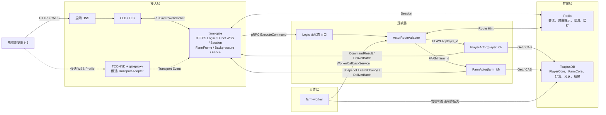

# 05 · 系统骨架与端到端主干

> 2026-07-29 Transport 增量冻结：本文中将 TCONND/gateproxy 描述为唯一生产入口的段落
> 保留为平台候选方案和历史探针背景。P0 默认公网链路已经改为
> `公网 DNS → CLB/TLS → farm-gate Direct WebSocket`，两种 Transport 复用同一 Gate Core、FarmFrame、
> Session 和下行合同；不做运行时自动回退。以
> [21-direct-websocket-tlog-freeze](./21-direct-websocket-tlog-freeze.md) 为准。

版本：v0.3<br>
更新时间：2026-07-27<br>
状态：S2 实现前冻结稿。已统一 Logic 内双 Actor 路由、双记录建档、Joining/Downlink 和阶段边界；不展开任务、邮件、宠物、Kubernetes 或 3000 万 DAU 的最终部署参数。

前提与领域边界见 [00-overview](./00-overview.md)。业务场景到服务、Actor 内模块、原子提交组和异步流程的统一映射见 [12-business-module-scenario-map](./12-business-module-scenario-map.md)。协议字段细节见 [10-protocol](./10-protocol.md)，字节帧见 [11-frame-codec](./11-frame-codec.md)，UC 路由与迁移的 Farm 定制取舍见 [17-uc-routing-migration-adaptation](./17-uc-routing-migration-adaptation.md)。

---

## 0. 本文解决什么

本文统一回答：

1. H5 请求首先访问什么；
2. TCONND、gateproxy、farm-gate、Logic、Worker 分别做什么；
3. Logic 实例、Virtual Shard、PlayerActor/FarmActor 的关系；
4. `actor_kind + entity_id` 如何路由到权威 Actor；
5. HTTPS、WSS、Protobuf、gRPC 分别处于哪一层；
6. SessionAuthority 和 FriendshipAuthority 在哪里工作；
7. CommandResult、Snapshot、FarmChange 如何返回 H5；
8. Linux/Docker 测试服务器如何承载真实接入链路。

本文冻结后，S2 只实现：

```text
HTTPS 测试登录
→ EnsureAccountInitialized(bootstrap_id)
→ AccountReady(player_id, farm_id)
→ connection_ticket
→ WSS ClientHello / ServerHello
→ Join 自己的农场
→ 返回空农场 Snapshot
→ 断线后重新认证和 Join
```

S2 不实现购买、播种、收获、好友、浇水、偷菜和 Worker 结算。

### 0.1 第一次阅读只记住这些

```text
1. H5 的 P0 WSS 经公网 DNS/CLB/TLS 直连 farm-gate，不知道 Shard、Logic 和 Actor
2. farm-gate 内的 DirectWebSocketTransport 管 Upgrade、PRE_AUTH 与真实 WSS Socket；TCONND/gateproxy 仅为候选 Adapter
3. farm-gate 管 HTTPS、Ticket、应用 Session、协议、限流和下行背压，可推导第一跳 ActorAddress，但不拥有 ShardAssignment
4. Logic 是游戏业务进程；云上通常一个 Pod 跑一个 Logic Instance
5. 一个 Logic Instance 负责多个 Virtual Shard
6. 一个 Virtual Shard 包含很多 ActorKey
7. 一个 ActorKey = actor_kind + entity_id，对应一个当前权威 Actor
8. Logic 按 PLAYER:player_id 或 FARM:farm_id 找 Virtual Shard、目标 Logic 和本地 Actor
9. 普通 Player 软资产在 Actor 内原子成功后异步回写；Farm/跨 Actor 可靠步骤在 Tcaplus 确认后 ACK
10. S2 只跑通登录 → Direct WebSocket → Join → 空农场 Snapshot
```

---

## 1. 总体拓扑



一句话：

> P0 中 H5 的真实 WSS 经公网 DNS/CLB/TLS 终止于 farm-gate 的
> DirectWebSocketTransport。farm-gate 同时负责 Upgrade、PRE_AUTH、Ticket、应用 Session、
> FarmFrame、限流、下行背压和旧连接 Fence，但不裁决游戏，也不拥有 ShardAssignment；
> farm-gate 调用稳定 Logic 入口，Logic 根据命令推导 PlayerActor 或 FarmActor 的 ActorKey。

本文后续保留的 `GatewayDownlinkService` 是 Logic 调用 `farm-gate` 的内部服务名；时序中的
`farm-gate` 表示同一个应用接入 Deployment。P0 的 `/ws` 由 farm-gate 直接监听。若候选
TCONND/gateproxy Profile 通过探针，只替换入站/出站 Transport Adapter，不改变 Gate Core、
Session、FarmFrame 或下行语义。

---

## 2. Logic、Pod、Shard、Actor 的关系

### 2.1 Logic 不是 Pod，但部署时通常一一对应

概念必须分开：

| 概念 | 含义 |
|---|---|
| `farm-logic` | Go 进程/服务程序 |
| Logic Instance | 一次运行中的 `farm-logic` 实例 |
| Container | Logic Instance 的镜像运行单元 |
| Pod | Kubernetes 部署时承载一个或多个容器的调度单元 |
| Logic Node | 路由层看到的一个 Logic Instance 身份 |

本项目未来如果使用 Kubernetes，建议：

```text
一个 farm-logic Pod
→ 一个 farm-logic 主容器
→ 一个 Logic Instance / Logic Node
```

但领域和路由代码不能依赖 Kubernetes Pod 名称；Logic Node 使用独立、稳定的 `logic_node_id`。

### 2.2 一个 Logic Node 负责多个 Virtual Shard

Virtual Shard 是 ActorKey 路由和所有权分配单位，不是 Actor：

```text
Logic Node A
├── Shard 0
│   ├── PLAYER:10001 → PlayerActor(10001)
│   ├── FARM:10001   → FarmActor(10001)
│   ├── FARM:23017   → FarmActor(23017)
│   └── ...
├── Shard 7
└── Shard 18
```

关系为：

```text
一个 Logic Node
→ 多个 Virtual Shard

一个 Virtual Shard
→ 多个 ActorKey

一个 ActorKey
→ 至多一个当前权威 Actor 激活
```

Actor 是按需激活的，不是为 Shard 中所有实体预先创建并永久驻留。

---

## 3. Actor 路由

### 3.1 路由键

客户端携带业务目标字段，Logic 根据命令目录推导 ActorKey。客户端不能自行指定 `actor_kind` 或 Shard。

| 命令 | ActorKey |
|---|---|
| A 购买/出售/领奖 | `PLAYER:A` |
| A 给自己的农场播种 | 首跳 `FARM:farm_id` 到 farm-svr/FarmOperationCoordinator；持久创建 PlantWorkflow 后依次调用 `PLAYER:A` 预留种子、`FARM:farm_id` 种植、`PLAYER:A` 确认消耗 |
| A 收获自己的作物 | 先 `FARM:farm_id`，HarvestSettlement 再投递 `PLAYER:A` |
| B 进入/浇水/偷 A 的农场 | `FARM:A_farm_id` |
| Worker 给 B 发偷菜奖励 | `PLAYER:B` |

### 3.2 ActorKey 到 Virtual Shard

S2 采用版本化路由合同。S1 草稿曾把 `routing v1` 标签用于 owner-only 和后续 kind-aware 两种未实施方案；为避免同一版本号含义漂移，双 Actor 的第一个可实施合同固定为 routing v2：

```text
routing_version = 2
hash_algorithm = xxhash64
hash_input = actor_kind 1 字节 || entity_id 的 uint64 大端 8 字节
hash_seed = 0
virtual_shard_count_per_region = 4096
virtual_shard_id = xxhash64(hash_input, seed=0) % 4096
assignment_key = (actor_kind, virtual_shard_id)
```

要求：

- 路由版本、Hash 输入编码、算法、seed 与 Shard 总数进入共享配置；
- 固定跨语言黄金样例，防止字节序、signed/unsigned 和算法库差异；
- 需要计算 Actor Shard 的组件使用同一版本化实现；S2 由 Logic 计算并复核，Gateway 只从命令目录推导第一跳 ActorAddress；
- 多 Logic 若采用 xrpc/proxyless，Gateway/Worker 的 ActorRouteClient 使用同一 ShardCalculator，但仍不读取或拥有 ShardAssignment；
- 正式产生数据后不直接修改 `% 4096`；未来变更必须提升 `routing_version` 并受控迁移；
- Shard 只决定运行时归属，不改变 TcaplusDB 的 `player_id/farm_id` 主键。
- `player_id/farm_id/target_farm_id` 在逻辑和 Protobuf IDL 中统一为 `uint64`，`0` 非法；H5 必须使用 protobuf Long/BigInt 或十进制字符串，禁止用 JavaScript `Number` 承载 64 位 ID。

routing v2 的黄金样例如下；旧 owner_id-only 样例仅用于验证废弃基线，不可继续作为目标路由合同：

| actor_kind | entity_id | xxhash64 | shard |
|---|---:|---|---:|
| PLAYER(1) | 1 | `46894e5a99fba7f0` | 2032 |
| PLAYER(1) | 10001 | `e72afe9f11bec41a` | 1050 |
| PLAYER(1) | 9223372036854775807 | `a2177c9d4c88bcca` | 3274 |
| FARM(2) | 1 | `85189b32d04a4015` | 21 |
| FARM(2) | 10001 | `3d7566a6ed093a5f` | 2655 |
| FARM(2) | 9223372036854775807 | `779d0dfceaa03758` | 1880 |

Go、TypeScript 与平台 ShardCalculator 必须共享这些测试向量，确保相同数值的 Player/Farm 不共享路由键。

`4096` 在 routing v2 中冻结，S2 必须实现并用黄金样例锁定。正式产生数据后不能原地修改 v2 的 Shard 数量或映射语义。

### 3.3 Virtual Shard 到 Logic Node

路由表至少包含：

```text
ShardAssignment {
    actor_kind
    virtual_shard_id
    logic_node_id
    shard_revision
    lease_deadline
    state: Importing | Active | Handoff | Shutdown
}
```

查找过程：

```text
ActorKey(kind, entity_id)
→ virtual_shard_id
→ ShardAssignment
→ logic_node_id
→ 对应 ActorRegistry.GetOrActivate(ActorKey)
→ PlayerActor 或 FarmActor Mailbox
```

### 3.4 本地与云上实现

S2 本地只有一个 Logic，Player/Farm 是两个逻辑 Region：

```text
(PLAYER, 0..4095) → logic-local-1
(FARM,   0..4095) → logic-local-1
```

此时 ShardAssignment 可以由静态配置生成，不需要分布式协调器。

云上多 Logic 时再引入权威 Shard Directory/Coordinator。PlayerRegion 与 FarmRegion 的 Assignment 独立：

```text
(PLAYER, Shard 0..127) → logic-1
(FARM,   Shard 0..127) → logic-2
...
```

Redis 中的 Route Hint 只能是缓存，不能单独决定 Shard 所有权。多节点阶段需选择具备租约、代次和条件更新能力的协调来源；该产品选型不阻塞 S2 单节点实现。

### 3.5 第一跳 ActorAddress 与 ActorRouteAdapter

farm-gate 和 farm-logic 共享版本化 CommandRouteDirectory。farm-gate 从已认证玩家与业务 payload 推导第一跳 ActorAddress，Logic 必须再次复核；客户端不能提供可信 actor kind/shard。

S2/P0 首版采用：

```text
Gateway LogicClient
→ 任意健康 LogicIngress
→ Logic 根据 command type 复核 ActorAddress
→ ActorRouteAdapter(ActorKey)
→ local Actor / remote Logic
```

Gateway 只通过服务发现取得健康 LogicIngress 地址，不查询或拥有 ShardAssignment。S2 只有 `logic-local-1`，remote 分支不会执行。

进入多 Logic 阶段后，优先让 ActorRouteClient 通过批准版本的 xrpc/proxyless ShardedService 直达 holder。平台依赖不可用时，保留兼容回退：

```text
LogicIngress
→ ActorRouteAdapter
→ ForwardActorCommand(shard_revision, hop_count)
→ 目标 Logic
→ 本地 Actor
```

两条数据面共享 ActorAddress、routing v2、ShardAssignment 和 Redirect 合同，业务模块不感知使用哪一种。

### 3.6 是否使用 proxyless mesh

S2 单节点不引入 proxyless mesh，使用静态 Logic 地址和直接 gRPC，以最小复杂度验证主链路；但现在就冻结 ActorAddress、routing v2 和 Redirect 元数据，避免多节点时改业务命令。

多 Logic 的优先生产候选是团队批准版本的 xrpc/proxyless ShardedService：

- Farm 提供自己的 `ShardCalculator(routing v2)` 和双 Region Assignment；
- 平台层提供服务发现、连接池、节点摘除、直达 holder 与 Redirect；
- Logic Region 仍负责唯一 Actor 激活和业务 Admission；
- `player_epoch/farm_epoch` fencing 与 Intent/Receipt 不由 Mesh 代替。

新农场可以依赖获准的公共平台库，但不复制 UC 的 Session、业务 Proto、PlayerActor 或 zonesvr 实现。完整取舍见 [17-uc-routing-migration-adaptation](./17-uc-routing-migration-adaptation.md)。

### 3.7 迁移与扩缩容：当前边界

S2 冻结并实现的只有：

```text
(PLAYER, 0..4095) / (FARM, 0..4095) → logic-local-1
同 ActorKey → 唯一本地 keyed mailbox
```

多节点只预留合同，不宣称已经解决：

```text
ShardLease {
    actor_kind
    shard_id
    holder_logic_node_id
    shard_revision
    lease_deadline
}

ActorActivation {
    actor_kind
    entity_id
    bound_shard_revision
    writer_epoch
    activation_id
}
```

尚未冻结：

- Shard 协调器产品；
- 租约时钟与续租；
- Actor 认领/提升 `player_epoch/farm_epoch`（统一语义为 writer_epoch）的条件协议；
- 网络分区下的切换和回退；
- Shard/Actor 迁移实现。

### 3.8 多节点迁移目标流程

扩缩容不改变 `ActorKey → virtual_shard_id`，只修改：

```text
(actor_kind, virtual_shard_id) → logic_node_id
```

迁移主流程：

```text
1. Shard 标记 Handoff，源节点停止接受新 Actor 激活和新业务 turn
2. 已进入邮箱的 turn 完成或明确失败
3. Farm/P-DURABLE 步骤确认已提交；PlayerActor ForceFlush 普通 DirtyModel 后钝化
4. Coordinator 提升 shard_revision，目标节点取得 ShardLease
5. 目标 Actor 从 Tcaplus 加载，并以 RecordVersion CAS 认领更高 player_epoch/farm_epoch
6. Actor 认领成功后才对外可写
7. 新请求路由到目标节点
8. Actor 按需从 TcaplusDB 重新加载
9. Presence 丢失时客户端重新 Join
```

P0 不实现内存 Actor 状态跨 Pod 搬运。TcaplusDB 是恢复来源；正常 Player Handoff 必须先 Flush，源 Pod 硬崩溃时普通软资产按已确认 RPO 回退。Shard Lease 失效时旧节点必须 fail-closed，`writer_epoch + RecordVersion` 阻止旧 Actor 再写。Presence/Joining 不迁移，客户端重新 Join。完整状态机、Redirect 和异常切换见 [17](./17-uc-routing-migration-adaptation.md)。

---

## 4. H5 到接入层：HTTPS 与 Direct WebSocket

### 4.1 HTTPS 用途

HTTPS 只承载低频请求：

- 登录；
- 获取一次性 `connection_ticket`；
- 接受分享链接；
- 获取静态启动配置。

HTTP 本身是一次请求对应一次响应，不需要给全部 HTTP 请求增加连接级 seq。

写接口使用：

- `request_id`：本次 HTTP 尝试的追踪标识；
- `Idempotency-Key`：确实存在重复副作用的 HTTP 写操作；
- `trace_id`：跨服务排错。

### 4.2 WSS 用途

Windows 电脑上的 H5 连接 Linux/Docker 测试服务器：

```text
wss://<domain>/ws
```

建立过程：

```text
H5 POST /v1/auth/login
→ farm-gate/Logic 取得稳定 player_id + bootstrap_id
→ Logic EnsureAccountInitialized(player_id, bootstrap_id)
→ AccountReady(player_id, farm_id)
→ farm-gate 返回 wss_endpoint + 一次性 connection_ticket
→ H5 经公网 DNS/CLB/TLS 与 farm-gate 建立 WebSocket
→ farm-gate 进入 PRE_AUTH 并执行未认证连接保护
→ H5 发送 ClientHello(connection_ticket)
→ farm-gate 核销票据并绑定 player_id / session_epoch / connection_id
→ farm-gate 沿当前 Direct WebSocket 返回 ServerHello
→ H5 才能发送 JoinFarm 和游戏命令
```

H5 不知道 Virtual Shard、Logic Node、Actor 或数据库地址。候选 TCONND/gateproxy 接入细节
仅用于平台 Profile 评估，见 [07-tconnd-access-boundary](./07-tconnd-access-boundary.md)。

### 4.3 序号的职责

WebSocket 建立在 TCP 上，连接存续期间已经保证可靠、有序字节流。应用层字段不是为了重新实现 TCP：

| 字段 | 作用 | 能否代替其他字段 |
|---|---|---|
| `request_id` | 一次请求尝试的追踪 | 不能防重复业务 |
| `operation_id` | 跨超时、断线和重试的业务幂等 | 不能表示消息顺序 |
| `connection_seq`（上行） | 当前连接内 H5 发送的观测顺序 | 不能代替 operation_id |
| `connection_seq`（下行） | 当前连接内 farm-gate 下行的观测顺序 | 不能代替 farm_version |
| `farm_version` | 单个农场公开业务变化顺序 | 不负责连接重放 |

P0 策略：

- H5 为每次命令请求生成 request_id，farm-gate 校验后原样转发，响应必须回显；farm-gate 不再生成另一份同名 ID；
- FarmFrame 只保留一个 `connection_seq` 字段，上下行分别从 1 自增，用于发现连接链路缺口和排错；
- 不实现复杂 ACK + 任意消息重放；
- 强写/可靠流程结果未知时按同一 `operation_id` 查询；Join/Leave 不查询持久结果，重新建立运行态；
- FarmChange 缺口时服务端尽量发送 `ResyncRequired`，客户端重新 `JoinFarm`；
- 如果 `ResyncRequired` 也无法进入有界下行队列，farm-gate 通过当前 Transport 直接断开慢连接；
- 以后弱网证据表明需要时，再增加有限下行重放。

---

## 5. 最小外部 Protobuf

### 5.1 FarmFrame

每个 WebSocket binary message 只承载一个 Protobuf，不再添加 `total_size/meta_size` 自定义长度头：

```proto
message FarmFrame {
  uint32 protocol_version = 1;
  FrameKind kind = 2;
  uint32 connection_seq = 3;
  bytes body = 15;
}
```

`kind` 决定 body 是 ClientHello、ServerHello、ClientCommandEnvelope、CommandResultEnvelope、ServerPushEnvelope 或 ConnectionError。`request_id/operation_id/error_code/farm_version` 不进入 FarmFrame。完整定义见 [11-frame-codec](./11-frame-codec.md)。

### 5.2 ClientHello

`ClientHello` 是 H5 经 Direct WebSocket 发给 farm-gate 的 WSS 应用控制消息，不是 gRPC；
候选 Transport Adapter 不改变消息内容：

```proto
message ClientHello {
  string connection_ticket = 1;
  reserved 2;
  reserved "protocol_version";
  string client_build = 3;
}
```

票据合同：

- 服务端生成 32 个密码学安全随机字节，编码为无 padding 的 base64url string（约 43 字符）；
- 默认 TTL 30 秒，可配置，只允许原子核销一次；
- HTTPS JSON 与 ClientHello 直接传递同一 string，不放进 WSS URL；
- Redis 只存 `SHA256(ticket)` 对应的绑定信息，不存原始票据；
- 绑定 player_id/session_id/session_authority_epoch/active_session_epoch，不绑定 IP、特定
  farm-gate 实例或候选 Transport Adapter；
- farm-gate 先校验 FarmFrame.protocol_version、连接序号和 client_build，再用 GETDEL/Lua 原子核销；
- 核销失败统一返回 `ERR_CONNECTION_TICKET_INVALID` 并断开；核销后连接失败必须重新登录取得新票据。

H5 不接触 SessionPermit 或 FriendPermit，也不得在日志中输出完整 connection_ticket。

### 5.3 ServerHello

```proto
message ServerHello {
  string session_id = 1;
  uint64 active_session_epoch = 2;
  uint64 session_authority_epoch = 3;
  int64 server_time_ms = 4;
  uint32 heartbeat_interval_ms = 5;
  uint32 max_frame_bytes = 6;
}
```

`ServerHello` 只表示 WSS 已认证，不表示已经 Join 农场。
`heartbeat_interval_ms` 是否保留为应用层合同，必须由 Direct WebSocket/CLB 的 Idle Timeout、
应用层 Heartbeat、半开连接和前后台切换探针裁决。浏览器 JavaScript 不能主动发送原生
WebSocket Ping；候选 TCONND Profile 的心跳另行验证，不能反向决定默认主链。

### 5.4 业务信封

S2 冻结：

- `ClientCommandEnvelope`
- `CommandResultEnvelope`
- `ServerPushEnvelope`
- `JoinFarmRequest`
- `FarmSnapshot`
- `FarmChange`
- `ResyncRequired`

FarmFrame 与 Envelope 字段唯一真值规则：

- `FarmFrame` 只负责 `protocol_version/kind/connection_seq/body`；
- `ClientCommandEnvelope` 负责业务层的 `request_id/operation_id(按命令适用)/command_type/target_farm_id/expected_*`；玩家命令的 player_id 取自可信会话；
- 外部 `CommandResultEnvelope` 原样回显 `request_id`，并负责 `operation_id(按命令适用)/status/error_code/farm_version/payload`；
- `OwnerMeta.state_version` 只用于内部 RPC、Actor/Store 观测和日志，不下发 H5；
- 不在 FarmFrame 与 Envelope 中保存两份可相互矛盾的 `operation_id/error_code/farm_version`；
- farm-gate 解析 Envelope 的路由字段，但不解析具体命令 payload 的领域含义。

现有 D2/D3 Proto 在进入 S2 编码前按此规则校正。

---

## 6. 内部 gRPC

### 6.1 farm-gate → Logic

```proto
service LogicService {
  rpc ExecuteCommand(ExecuteCommandRequest)
      returns (ExecuteCommandResponse);
}
```

请求包含：

```text
ClientCommandEnvelope
+
GatewayTrustedContext {
    player_id
    session_authority_epoch
    active_session_epoch
    session_permit
    gateway_id
    connection_id
    trace_id
}
```

`ClientHello` 不转发给 Logic。farm-gate 完成连接认证后，JoinFarm 等业务命令才进入 `ExecuteCommand`。farm-gate 不计算 Actor Shard；LogicIngress 收到命令后由 ActorRouteAdapter 完成 local/remote 路由。

### 6.2 Logic → farm-gate

普通即时命令结果只通过 `ExecuteCommandResponse` 原路返回，不再主动 Push 同一份结果。

JoinFarm 的响应和 Snapshot 拆分：

```text
ExecuteCommandResponse
= CommandStatus.ACCEPTED / REJECTED + subscription_id

GatewayDownlink
= FarmSnapshot
```

Snapshot、FarmChange、跨 Actor `Processing` 后产生的最终 OperationResult，以及 `ResyncRequired` 等主动下行统一使用：

```proto
service GatewayDownlinkService {
  rpc DeliverBatch(DeliverBatchRequest)
      returns (DeliverBatchResponse);
}
```

每个下行目标至少包含：

```text
gateway_id
connection_id
subscription_id
server_push_envelope
```

Logic/Actor 只把已提交结果加入有界 Downlink 队列，不等待浏览器确认后再决定业务是否成功。

`DeliverBatch` 必须按 `item_id` 逐条返回。`QUEUE_ACCEPTED` 只表示该 item 已进入 farm-gate 当前 connection generation 的有界 ConnectionWriter，并建立了短时 item_id 防重记录，不表示浏览器已经收到或应用。可返回：

- `ConnectionNotFound`；
- `QueueFull`；
- `StaleSubscription`；
- `StaleConnection`；
- `Unavailable`。

同一逻辑投递重试必须保持 item_id；RPC 超时或结果未知不能确认 Join。这些失败不回滚业务；Logic 取消 Joining、清理订阅或要求客户端重新 Join。

### 6.3 Worker → Logic

```proto
service WorkerCallbackService {
  rpc GrantLoot(...)
  rpc MarkGranted(...)
  rpc CompleteTheft(...)
}
```

这些是内部可信命令，不进入 H5 命令目录。

`ExpirePresence` 不属于可靠 Worker 流程。Presence 通过 farm-gate 接收的 gateproxy transport Disconnect/Leave 事件、Actor 惰性过期和 Logic 本地低频租约清理回收。

### 6.4 gRPC 公共要求

- 每次 RPC 有服务端上限控制的 deadline；
- `trace_id/request_id` 必填；`operation_id/actor_kind/player_id/farm_id/routing_version/virtual_shard_id/shard_revision` 按链路适用时记录；
- 不直接信任客户端提交的 timeout；
- Logic 路由过期时保持同一 `request_id`，并在适用时保持同一 `operation_id`，刷新路由后重试；限制 hop_count 防止转发环；
- gRPC 传输成功不代表业务成功，最终以 `CommandStatus` 和 Tcaplus 提交点为准。

---

## 7. SessionAuthority 与 FriendshipAuthority

### 7.1 SessionAuthority

回答：

> 当前连接是否属于该玩家的活跃可写会话？

建议作为 Gateway 侧逻辑模块，Redis 支持多 Gateway 间的会话代次线性化。

职责：

- 登录和顶号；
- `session_authority_epoch`，用于整体作废旧会话世代；
- `active_session_epoch`；
- connection 绑定；
- 为本次 `request_id + action + connection/session` 生成短时 SessionPermit；强写/可靠流程额外绑定 operation_id；
- 把 Permit 放入 Gateway → Logic 的可信上下文。

Permit 至少绑定：

```text
session_authority_epoch
active_session_epoch
player_id
request_id
operation_id（按命令适用）
connection_id
allowed_action
expires_at
```

S2 使用固定测试 authority epoch，不实现 Redis 全量灾难切换；字段现在保留。多节点稳定性阶段必须将 authority generation 放在不会随同一 Redis 全量丢失而回退的协调/持久来源中。

### 7.2 FriendshipAuthority

回答：

> 请求者与目标农场的 owner_player_id 当前是否存在允许该动作的好友关系？

建议位于 Logic 的 Admission 层，TcaplusDB 中的 Friendship 是权威，Redis 只缓存摘要。

### 7.3 完整准入顺序

```text
H5 命令
→ Gateway 校验当前连接与 SessionAuthority
→ Logic 校验 SessionPermit
→ 好友操作取得当前 Friendship assertion / FriendPermit
→ 路由到目标 FarmActor
→ 强写/可靠流程：Actor 先查询 operation_id 的已有结果
→ 已有结果：返回原结果；未命中：继续校验
→ Join/Leave：不查持久 OperationResult，按当前 JoinContext/Presence 吸收重复
→ 校验 FriendPermit、Presence 和目标领域状态
→ 构造 next-state 并 CAS
```

FriendshipAuthority 只证明关系，不能决定浇水或偷菜成功；最终裁决仍在目标 Actor。

为了不让“好友已删除”否认此前已经完成的相同 operation_id，强写/可靠流程的 Logic Admission 不应在 Actor 查询原结果之前把幂等重放改写成一个新的业务失败。Join/Leave 没有跨重启幂等承诺，始终依据当前 Session、Friendship 和 Presence 重新判断。

---

## 8. 四条主干时序

### 8.1 登录与 WSS 认证

```text
H5
→ HTTPS Login
→ SessionAuthority 提升/建立 active_session_epoch
→ 取得稳定 player_id + bootstrap_id
→ Logic EnsureAccountInitialized
→ AccountBootstrap 条件创建/恢复
→ 条件创建 PlayerCore（初始资产）和 FarmCore（初始地块）
→ 两者 Ready：返回原 AccountReady，不重复发初始资产或农场
→ 返回一次性 connection_ticket
→ H5 建立 WSS
→ ClientHello(ticket)
→ farm-gate 核销并绑定连接
→ ServerHello
```

### 8.2 Join 自己的农场

```text
H5 → 当前 WebSocket Transport → farm-gate：JoinFarm(self_farm_id)
farm-gate → Logic：ExecuteCommand + TrustedContext
LogicIngress → ActorRouteAdapter：FARM:self_farm_id
ActorRouteAdapter → local FarmActorRegistry（S2 remote 分支不执行）
FarmActorRegistry → 激活 FarmActor(self_farm_id)
FarmActor → TcaplusDB：Get FarmCore
Actor turn：
  1. 创建 Presence=Joining
  2. 分配 subscription_id / presence_epoch
  3. 记录 snapshot_version=V
  4. 开始缓存 version>V 的变化
  5. 生成 Snapshot(V)
Actor → ExecuteCommandResponse：CommandStatus.ACCEPTED + subscription_id
Actor → 本地 DownlinkDispatcher：Snapshot(V)
DownlinkDispatcher → farm-gate GatewayDownlinkService.DeliverBatch
farm-gate → ConnectionWriter 有界队列：Snapshot(V)
farm-gate → Logic：QueueAccepted
Logic → Actor mailbox：ConfirmSnapshotQueued
Actor：把 JoiningBuffer 作为同订阅有序 Catch-up 批次加入 DownlinkDispatcher，再执行 Joining → InFarm
farm-gate → 当前 WebSocket Transport → H5：ServerPush(FARM_SNAPSHOT)
H5：应用 Snapshot 后进入客户端 InFarm
```

Actor 不在一个 turn 中等待 farm-gate gRPC 或 socket flush。Snapshot 投递、QueueAccepted 和 Presence 状态推进通过异步消息完成。连接在 QueueAccepted 前断开时取消 Joining 并释放名额。

客户端收到 ACCEPTED 时，服务端只是较早完成了 Joining/Buffer 建立，服务端和客户端都还不能把本次 Join 视为最终完成。farm-gate QueueAccepted 后服务端 Presence 才转 InFarm；H5 应用 FarmSnapshot 后客户端才转 InFarm 并开放经营操作。

S2 直接实现 JoiningBuffer，不再采用“当前为空、多人阶段再补”的临时分支。Presence 仍只有两个有效状态：

```text
Joining --ConfirmSnapshotQueued--> InFarm
Joining --QueueRejected/Disconnect/Timeout--> Removed
```

`SnapshotQueued` 是确认事件，不是第三个持久状态。Joining 上下文至少包含：

```text
JoinContext {
    subscription_id
    connection_id
    presence_epoch
    snapshot_version
    state: Joining | InFarm
    pending_changes[]
    pending_change_bytes
    deadline
}
```

约束：

- 创建 `Snapshot(V)` 的同一个 Actor turn 内建立 Joining，并从此缓存该订阅所有 `farm_version > V` 的变化；
- `pending_changes` 按 farm_version 连续递增，不能用到达 farm-gate 的顺序代替；
- `ConfirmSnapshotQueued` 必须同时匹配 subscription_id、connection_id 和 presence_epoch，旧确认不得提升新 Join；
- Snapshot 已进入 ConnectionWriter 后，Actor 在新的 turn 中把缓冲变化作为一个有序批次加入同一订阅的 DownlinkDispatcher，再转为 InFarm；
- DownlinkDispatcher 对同一 subscription_id 保证 FIFO，后续实时 FarmChange 只能排在 Catch-up 批次之后；
- Buffer 必须有数量、字节和时间上限。默认建议 64 条或 256 KiB、Join 5 秒超时，任一超限即取消本次 Join，并发送 ResyncRequired 或断开重连；
- Buffer、Presence 和 Snapshot 都是可重建运行态，不进入 FarmCore。

### 8.3 普通单 Actor 写命令

```text
H5 → 当前 WebSocket Transport → farm-gate：Command(request_id, operation_id, business target)
farm-gate：认证 / 限流 / 调用健康 LogicIngress
Logic：Admission / 由 command type 推导 ActorKey / ActorRouteAdapter
Actor：幂等先查 → 业务校验 → 构造 next
Actor → TcaplusDB：CAS
CAS 成功
→ Actor 替换内存
→ 返回 CommandResult
→ 发布 FarmChange
```

### 8.4 FarmChange 下行

```text
Actor 已提交 FarmChange(V)
→ Downlink Dispatcher 按 gateway_id 分组
→ GatewayDownlinkService.DeliverBatch(farm-gate)
→ farm-gate ConnectionWriter bounded queue
→ 当前 WebSocket Transport → H5 收到 FarmChange(V)
→ 连续版本：应用
→ 重复版本：忽略
→ 版本缺口：停止增量，处理 ResyncRequired 并重新 Join
```

---

## 9. 有状态与无状态

| 组件 | 分类 | 状态 |
|---|---|---|
| H5 | 非权威客户端状态 | 当前视图、Pending、已见版本 |
| TCONND/gateproxy（候选） | 连接/适配有状态、业务无权威 | 仅在显式候选 Profile 中接管公网 Socket 和 Transport 转换 |
| farm-gate | 应用连接有状态、业务无权威 | Direct WSS、Upgrade、PRE_AUTH、Ticket、FarmFrame、Session、限流、ConnectionWriter、Fence、非 Actor-aware Logic 服务发现 |
| Logic 入口 | 无状态 | Validation、Admission、ActorRouteAdapter、local/remote forward |
| PlayerActor | 有状态权威运行单元 | PlayerCore 热状态，TcaplusDB 为持久来源 |
| FarmActor | 有状态权威运行单元 | FarmCore 热状态、Presence 与 Join 屏障 |
| FarmPresenceState | FarmActor 内短期可重建 | 当前订阅、Joining、租约 |
| Worker | 计算无状态 | 可靠进度必须在 Outbox/Settlement |
| Redis | 有状态基础设施、非业务权威 | Session、路由提示、限流、缓存 |
| TcaplusDB | 权威持久状态 | PlayerCore、FarmCore、Bootstrap、关系、分享、可靠结果 |

---

## 10. Docker 与部署阶段

### 10.1 日常开发与测试服务器

```text
H5 Mock 开发           → 复用同级工作区 ../classic-farm-h5，在 Windows 运行 Vite
H5 Staging             → Linux 多阶段构建后由 Nginx/Caddy 提供静态 dist，不运行 Vite dev
farm-gate              → Linux 测试服务器容器
farm-logic             → Linux 测试服务器容器
farm-worker           → S2 不启动，仅保留目录和接口
Redis                 → Linux Docker
TcaplusDB             → 远程测试实例
TCONND/gateproxy       → 候选 Profile，非默认 Compose 依赖
```

### 10.2 本地集成

使用 Docker Compose：

```text
docker compose
├── farm-gate
├── farm-logic
├── redis
├── nginx（H5 构建产物，可选）
├── prometheus（后置）
└── grafana（后置）
```

默认 Compose 由 farm-gate 直接监听 `/ws`。候选 TCONND/gateproxy 使用单独
`tconnd-candidate` Profile，只有平台包、TBUS/IPC、证书与发送语义探针通过后才启用；
真实凭据不进入镜像和仓库。

H5 与服务端可以保持独立工作区：服务端 `api/proto` commit/tag、固定生成器和 Go/TypeScript golden vectors 是双方的版本化交付边界。不得在 H5 手写另一份 canonical Proto，也不得把 Mock codec 带入 Staging 产物。

### 10.3 云部署

S2 不实现 Kubernetes、proxyless mesh、正式 Worker 和 Shard 迁移。

进入多节点阶段前再完成：

- 多 farm-gate Pod；
- 多 Logic Node；
- 权威 Shard Directory；
- Shard lease/epoch；
- Actor fencing；
- 平滑下线和迁移；
- Kubernetes Deployment/Service；
- 负载与故障验证。

Docker 是当前需要的可重复打包手段；Direct WebSocket 的 Upgrade、Idle Timeout、心跳、
慢连接和 ConnectionWriter 背压必须先做最小实测。Kubernetes 是后续部署工具，不参与当前领域建模。

S2 的 Linux Staging 推荐使用单机 Docker Compose：H5 静态 Edge、farm-gate、farm-logic 与
Redis 分开运行，TcaplusDB 使用远程实例。公网 `/api` 和 `/ws` 均经 DNS/CLB/TLS 进入
farm-gate，H5 永远不访问容器内网服务名。候选 TCONND/gateproxy 只在独立 Profile 中验证。

---

## 11. S2 实施顺序摘要

本节只保留系统骨架视角的顺序摘要；工作包、目录、依赖、测试、退出条件和交付物统一以 [14-s2-implementation-plan](./14-s2-implementation-plan.md) 为准，阶段准入以 [08-s2-go-no-go](./08-s2-go-no-go.md) 为准。

1. 按 [08-s2-go-no-go](./08-s2-go-no-go.md) 完成 S2-0：C1～C7、OwnerID、Bootstrap 字段复核，
   H5 uint64 round-trip，以及 Direct WebSocket/CLB 心跳与 Idle Timeout 探针；
2. 按本文校正最小 Proto：FarmFrame、ClientHello、ServerHello、ConnectionError、JoinFarm、Snapshot 和三大信封；
3. 实现 Go/H5 FarmFrame codec 与 FakeTransport 共用测试向量；
4. 完成 Direct WebSocket 消息边界、Origin、PRE_AUTH、慢读和断线探针；TCONND/gateproxy
   T1/T2/T3/T7 作为不阻塞 P0 的候选工作包；
5. 实现测试登录、Session epoch 和一次性 `connection_ticket`；
6. 经 Direct WebSocket 跑通 ClientHello / ServerHello；
7. 定义并实现 `LogicService.ExecuteCommand`；
8. 在 Logic 实现 routing v2 黄金向量和静态双 Region `ShardAssignment：(PLAYER/FARM, 0..4095) → logic-local-1`；
9. 实现 keyed ActorRegistry、邮箱和激活；
10. 实现 `EnsureAccountInitialized(player_id, bootstrap_id)` 与 Bootstrap 恢复；
11. 实现 PlayerStore/FarmStore Get/Insert/CAS；
12. 定义并实现 `GatewayDownlinkService.DeliverBatch`、逐 item 状态和 ConnectionWriter；
13. 实现 JoinFarm 的 `Joining --ConfirmSnapshotQueued--> InFarm`、有界 JoiningBuffer 和失败清理；
14. 实现断线清理、重新登录与重新 Join；
15. 执行并发初始化、Ticket 重放、慢下行和真实 Tcaplus CAS 故障测试。

完成以上十五步前，不继续展开偷菜 Outbox、任务邮件、复杂弱网重放、云上迁移或完整 H5 美术。

---

## 12. S2 验收

- H5 不能绕过 ClientHello 直接发送游戏命令；
- 一个 connection_ticket 只能成功核销一次；
- 两个并发请求核销同一个 Ticket 时只能一个成功；
- ServerHello 后必须 Join 成功才能进入 `InFarm`；
- H5 不知道 Logic Node、Shard、Actor 和数据库地址；
- 所有 Join 都携带 `target_farm_id` 并经过 ActorRouteAdapter；
- 本地所有 4096 个 Virtual Shard 静态归属 `logic-local-1`；
- routing v2 的 ActorKey→Shard 黄金样例在重启和重新生成后不漂移；
- `PLAYER:X` 与 `FARM:X` 不共享邮箱，同一 ActorKey 只进入一个本地 keyed mailbox；
- 同一账号并发初始化 100 次只创建一条 PlayerCore 和一条 FarmCore；
- 中途只创建一条 Core 时，用稳定 bootstrap_id 恢复另一条，不重复发初始资产；
- Actor 激活期间重复 Join 不重复占用成员名额；
- Snapshot 入队前连接断开时取消 Joining，不留下幽灵 Presence；
- Snapshot(V) 生成后、QueueAccepted 前注入 FarmChange(V+1/V+2)，客户端必须依序收到 Snapshot(V)、V+1、V+2；
- JoiningBuffer 数量、字节或超时越界时不得进入 InFarm，必须 Resync 或断开重连；
- 旧 subscription_id / connection_id / presence_epoch 的 QueueAccepted 不得提升新的 Join；
- farm-gate 下行队列阻塞或满载时 Actor mailbox 不等待 socket；
- 旧 connection_id 的下行不得发送到同玩家的新连接；
- Redis 或 TcaplusDB 不可用时不得展示一个假成功农场；
- farm-gate 断开后可以重新登录、重新认证、重新 Join 并得到权威 Snapshot；
- 日志用 `trace_id + request_id` 串起所有链路，并在适用时补充 `operation_id + actor_kind + player_id/farm_id + virtual_shard_id`。
