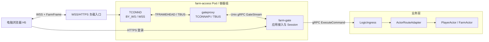

# 07 · TCONND 接入边界与 Linux/Docker 部署

版本：v0.3

更新时间：2026-07-26

状态：优先采用 TCONND + gateproxy；BY_WS 控制命令、gateproxy 兼容性和容器运行参数需由最小探针确认。

本文只定义新农场如何使用 TCONND 官方能力。`mfcn/gatesvr` 只作为部署和接入参考，不作为农场运行依赖；优先把 `mfcn/gateproxy` 当作平台组件直接依赖，不复制其他游戏的 Session、业务 Proto、ACK、frameCache、zonesvr、RegionServer 或 Handoff 代码。专项执行步骤见 [15-tconnd-gateproxy-integration-plan](./15-tconnd-gateproxy-integration-plan.md)。

参考：

- [TCONND Websocket 模式说明](https://km.internal.example.invalid/redacted-reference)
- [TCONND WebSocket 接入框架（v3.4.47）](https://iwiki.internal.example.invalid/redacted-reference)
- [系统骨架](./05-system-skeleton.md)
- [内部接口](./40-interfaces.md)

---

## 1. 冻结结论

1. 唯一真实客户端长连接入口为 Linux 服务器上的 `TCONND(BY_WS/WSS)`。
2. `farm-gate` 不直接监听公网 WSS；它负责应用接入、Session、FarmFrame、限流、下行背压和 LogicIngress 调用。
3. 优先部署平台 `gateproxy`，由 farm-gate 通过 Unix gRPC GateStream 接收连接事件和 opaque bytes；真实探针证明 gateproxy 不兼容 BY_WS 且没有可用平台版本时，才重新评审最薄自研兼容层。
4. H5 可以在 Windows 电脑上开发和运行，但连接 Linux 测试服务器的 WSS 地址；完整后台通过 Docker/Pod 运行。
5. TCONND 的连接路由只决定连接进入哪个 `farm-gate`，不能替代 Logic 按 ActorKey 执行的 Player/Farm Actor 路由。
6. TCONND、gateproxy 和 farm-gate 都不拥有金币、库存、土地或作物等业务权威事实。
7. 单元测试可以使用 `FakeTransport`，但不提供第二套可部署的自研公网 WebSocket Gateway。
8. 借鉴 UC 的执行隔离：Connection/Session Lane 只做短状态转换，Logic RPC 进入独立有界 BackendPool，完成后再回到 Lane；禁止持有 Lane 等待后端。
9. S2 的 Gate 通过稳定 LogicIngress；多 Logic 时可用批准版本的 xrpc/proxyless ActorRouteClient 直达 holder，但 ShardAssignment 仍不属于 Gate。
10. Gate 滚动发布先使用 drain + reconnect + 重新 Join；当前没有任意下行 ACK/FrameCache 合同，不实现或宣称无损 Session Handoff。

---

## 2. 总体拓扑



为了图示简洁，HTTPS 可以经过独立七层入口再到 farm-gate；WSS 必须进入 TCONND。

---

## 3. 四层协议不能混用

| 层 | 协议/结构 | 负责者 | 用途 |
|---|---|---|---|
| 公网传输 | RFC 6455 WebSocket/WSS | 浏览器 + TCONND | 握手、WS 帧、TLS 长连接 |
| TCONND 内部 | TFRAMEHEAD | TCONND + gateproxy | START/INPROC/STOP 或 WEB 等价事件、连接索引和传输寻址 |
| 农场应用帧 | 单一 FarmFrame protobuf | H5 + farm-gate | 协议版本、消息类别、连接内观测序号和 opaque body |
| 业务消息 | Envelope + Command Payload | H5 + farm-gate/Logic | request_id、operation_id、命令、业务目标和领域参数；ActorKey 由 Logic 推导 |

正常上行：

```text
H5 ws.send(FarmFrame bytes)
→ TCONND 解 WebSocket 帧
→ TFRAMEHEAD(CMD_INPROC) + FarmFrame bytes
→ gateproxy GateStream
→ farm-gate transport mapper(connection_id, generation, bytes)
→ farm-gate 解析 FarmFrame/Envelope
→ LogicIngress
```

TCONND 把 FarmFrame 当作 opaque bytes，不理解 JoinFarm、FarmVersion 或 Actor。

FarmFrame 不再包含 `total_size/meta_size` 自定义头：WebSocket、TFRAMEHEAD 和 GateStream 已各自提供长度与消息边界。应用帧完整定义见 [11-frame-codec](./11-frame-codec.md)。

---

## 4. 组件职责

### 4.1 TCONND

负责：

- WSS 长连接与 WebSocket BY_WS 解包/封包；
- TLS、连接空闲检测、网络流控和可选排队；
- 产生 START/INPROC/STOP 等连接生命周期消息；
- 把业务字节送到 gateproxy，并把 gateproxy 下行送回目标连接。

不负责：

- connection_ticket 的农场应用语义；
- request_id/operation_id；
- actor_kind、player_id/farm_id 与 Actor Shard；
- Join、Presence、FarmVersion；
- 农场业务权限和结果裁决。

### 4.2 gateproxy 与 farm-gate transport mapper

gateproxy 是优先使用的平台适配组件：

```text
TFRAMEHEAD START/WEBSTART   → GateStream Start
TFRAMEHEAD INPROC/WEBINPROC → GateStream Inproc
TFRAMEHEAD STOP/WEBSTOP     → GateStream Stop
GateStream 下行             → TCONNAPI/TBUS
```

farm-gate 内的 transport mapper 把 GateStream 事件归一化为 Connected/Data/Disconnected，并生成本项目的 `connection_id + generation`。它不解析 FarmFrame Body，不访问 Redis/Tcaplus，不调用 Actor，不保存可恢复业务事实。

当前 gateproxy 源码是否直接处理 WEB 系列命令尚未得到真实证据。先按 D1.13 做 T1 探针；不兼容时优先获取平台支持版本，不在 farm-gate 中用 cgo 引入 TBUS。

### 4.3 farm-gate

负责：

- 把 TCONND 连接身份规范化为内部 connection_id；
- ClientHello/connection_ticket 核销；
- SessionAuthority、顶号和短时 Permit；
- FarmFrame、ClientCommandEnvelope 和控制消息解析；
- request_id 校验、限流、deadline 截断与日志；
- 按命令目录推导第一跳 ActorAddress，并在 S2 调用任意健康 LogicIngress；多 Logic 数据面见 D1.15；
- 每连接有界 ConnectionWriter、同连接 FIFO 和下行失败处理；
- Disconnect/Leave/批量租约变化通知 Logic。

不负责：

- ShardAssignment；
- PlayerActor/FarmActor 的业务裁决；
- Tcaplus PlayerCore/FarmCore 写入；
- 好友关系权威；
- Plant/Harvest/护理奖励/偷菜跨 Actor 结算。

---

## 5. farm-gate 执行隔离

UC gatesvr 中“用户 Session 串行执行器 + 后端 RPC 执行器”的核心价值可以复用，但不复制它的 Session/ACK 代码。农场采用：

```text
Transport Event
→ ConnectionLane(connection_id)
→ 认证后 SessionLane(player_id)
→ frame/session/rate/deadline admission
→ 有界 BackendPool
→ LogicIngress / ActorRouteClient
→ 完成事件重新进入当前 Lane
→ ConnectionWriter
```

Lane 中只允许快速本地操作：连接状态、ticket 核销结果落地、epoch/generation 校验、限流与队列 admission。Redis、Logic、Actor、Tcaplus 和 socket 慢写都不能在 Lane 中同步等待。

BackendPool 满时：

- 尚未被业务 Actor 接受的命令返回 `SERVER_BUSY`；
- 已持久接受的操作只能返回/查询 `PROCESSING`，不能改口为失败；
- 完成回调必须重新校验当前 `transport_generation + active_session_epoch`，旧连接结果不能发给新连接。

---

## 6. farm-gate Transport 最小合同

farm-gate 内部保持平台无关的窄接口，使 FakeTransport 与 gateproxy transport 使用同一组合同测试：

```text
TransportEventStream
  Connected {
    transport_instance_id
    transport_conn_index
    transport_generation
    peer_address
    optional_transport_identity
  }

  Data {
    connection_id
    transport_generation
    payload
  }

  Disconnected {
    connection_id
    transport_generation
    reason
  }

Send(connection_id, transport_generation, payload)
Close(connection_id, transport_generation, reason)
```

ConnectionWriter 在调用 Transport 前逐 item 判定：

- `QUEUE_ACCEPTED`
- `CONNECTION_NOT_FOUND`
- `QUEUE_FULL`
- `STALE_CONNECTION`
- `UNAVAILABLE`

这些是本项目的本地归一化语义。若 gateproxy GateStream 没有逐消息回执，不能臆造“gateproxy 已持久接受”或“浏览器已收到”；Stream 失败后使连接和订阅失效。

---

## 7. connection_id 与代次

`iConnIdx` 可能复用，不能单独作为长期 connection_id。farm-gate 在 Connected 时生成内部不可预测 ID，并保存：

```text
connection_id
→ access_instance_id
→ transport_conn_index
→ transport_generation
→ TFRAMEHEAD iID / 其他必要句柄
```

所有 Data、Send、Close 和 Join 确认都必须匹配 connection generation。旧连接关闭后，即使底层索引被新连接复用，旧 Snapshot/FarmChange 也不得发给新连接。

---

## 8. 登录与鉴权

S2 使用统一应用认证流程：

```text
H5 HTTPS TestLogin
→ farm-gate 返回 wss_endpoint + connection_ticket + expires_at_ms
→ H5 连接 TCONND
→ TCONND/gateproxy 完成 WS 建连并向 farm-gate 产生 Connected
→ H5 首条农场应用消息 ClientHello(connection_ticket)
→ farm-gate 原子核销 ticket 并绑定 connection/session
→ ServerHello
→ JoinFarm
```

测试阶段可以将 TCONND 配成 `NoAuth=1`，但这不等于应用无鉴权；ClientHello ticket 仍然 fail-closed。未来启用 TCONND 的微信/QQ 鉴权时，其 START 身份作为额外可信输入，不能静默改变 SessionAuthority 和 connection_ticket 合同。

---

## 9. Join 与 QueueAccepted

Logic 的 `GatewayDownlinkService.DeliverBatch` 仍然调用 farm-gate。`QUEUE_ACCEPTED` 冻结为：

> 指定 item 已进入 farm-gate 当前 connection generation 的有界 ConnectionWriter，并建立短期 item_id 防重记录。

它不表示：

- gateproxy 已写入 TBUS；
- TCONND 已写入 Socket；
- 浏览器已收到；
- H5 已应用 Snapshot。

ConnectionWriter 按同连接 FIFO 调用 gateproxy transport。若 gateproxy/TCONND 在接受后失败：

```text
订阅标记 stale
→ 尽力发送 ResyncRequired
→ 控制消息也无法发送时关闭连接
→ H5 重新认证并 Join
```

因此 TCONND 的存在不删除 JoiningBuffer，也不把网络发送变成业务提交点。

---

## 10. Linux/Docker 部署

服务器容器组：

```text
farm-access Pod
├── tconnd
├── gateproxy
└── farm-gate

farm-logic Pod(s)
farm-worker Pod(s，S2 不启动)
Redis
远程 TcaplusDB
```

TCONND 与 gateproxy 需要共享 TBUS 所需的 IPC/共享内存环境；gateproxy 与 farm-gate 通过共享卷中的 Unix Socket 通信。具体采用 Docker Compose IPC 配置还是 Kubernetes Pod IPC 配置，必须以实际 TCONND 发布包和真实 T7 结果为准。

Access Ready 必须同时满足：

1. TBUS 初始化成功；
2. gateproxy 已连接 TCONND；
3. farm-gate 已建立 GateStream；
4. farm-gate 已连通 Redis 和至少一个 LogicIngress；
5. WSS 证书、监听和最大帧配置有效。

启动顺序可以重试，但条件未全部满足前不得对外 Ready。

---

## 11. 故障语义

| 故障 | 处理 |
|---|---|
| TCONND 退出 | 当前连接断开；客户端重新连接、ClientHello、Join |
| gateproxy 退出 | Access NotReady；已有连接按断开处理，不保留假 Session |
| farm-gate 退出 | Session/ConnectionWriter 丢失；客户端重连，业务强事实不受影响 |
| Logic 超时 | 强写按 operation_id 查询/重试；Join 重新建立运行态 |
| ConnectionWriter/GateStream 不可用 | 不阻塞 Actor；订阅失效或连接关闭 |
| 旧 generation 下行 | `STALE_CONNECTION`，禁止发到复用的新连接 |
| Redis 不可用 | 新 ClientHello/Session fail-closed；已提交 PlayerCore/FarmCore 不回退 |

---

## 12. Gate 滚动发布

P0 使用可证明的恢复路径：

```text
Access Pod NotReady
→ 停止新连接
→ 有界 drain
→ 关闭剩余连接
→ H5 重新认证、ClientHello、JoinFarm
→ Snapshot/FarmVersion 恢复
```

当前 FarmFrame 没有 UC 式 `server_seq ACK + 未确认 FrameCache`，所以只搬 connection/session 元数据不能保证 CommandResult 无损。未来若弱网与滚动发布指标证明需要无感 Handoff，必须先增加 ACK/重放、序号继承、双 Gate fencing 和失败回退合同。

业务强事实和 operation result 位于 PlayerCore/FarmCore；Gate 重启只影响连接体验，不得影响已提交业务。

---

## 13. 编码前必须实测的 TCONND 边界

| 编号 | 待确认 | 验证方法 | 未确认时策略 |
|---|---|---|---|
| T1 | BY_WS 经 gateproxy 后的命令类型，以及一个 WebSocket message 是否对应一个完整 Inproc | 最小 H5 建连 + 多种大小二进制消息抓 GateStream | GateStream 不宣称 Ready；不兼容时进入 D1.13 决策门 |
| T2 | GateStream/TCONNAPI send 成功的精确确认点 | 正常、队列满、TCONND 停止故障注入 | 只使用本地 QueueAccepted，不表述客户端收到 |
| T3 | 连接不存在、写阻塞、队列满如何从 gateproxy 表现 | 主动断线/慢读/限流测试 | 本地先拦截；Stream 异常统一 UNAVAILABLE 并失效订阅 |
| T4 | 同连接上下行是否严格保持调用顺序 | 序号压测 | 发现缺口即重连/重新 Join |
| T5 | 最大业务帧与 WSS/TBUS/TCONNAPI 限制 | 边界大小递增测试 | 使用各层最小上限 |
| T6 | Docker/Pod 中 TBUS 共享内存、Unix Socket 和退出清理 | 重启/强杀 TCONND、gateproxy、probe | Access NotReady |
| T7 | TCONND/gateproxy 镜像、兼容 tag、证书和服务器权限 | 在专用 Linux 服务器部署最小样例 | 不开始宣称真实 TCONND 验收 |
| T8 | BY_WS 的 Ping/Pong、空闲超时与浏览器保活职责 | 浏览器保持静默、前后台切换、断网/半开连接故障注入 | 不冻结 `heartbeat_interval_ms`；必要时再定义应用层 Heartbeat |

UC 中出现过的“单实例最大连接数”等数据只能作为测试起点，不能直接作为本项目容量结论；必须按实际 TCONND 版本、BY_WS、TLS、帧大小和服务器规格重新压测。

---

## 14. S2 验收

- H5 通过真实 TCONND BY_WS/WSS 完成 ClientHello/ServerHello；
- BY_WS 事件可经 gateproxy 被 farm-gate transport 正确归一化；
- 同一 connection generation 内 FarmFrame 上下行有序；
- ticket 只核销一次，旧连接不能在顶号后继续写；
- Join Snapshot 进入 farm-gate ConnectionWriter 后才确认服务端 InFarm；
- 强杀 TCONND/gateproxy/farm-gate 任一容器后，不出现金币、农场或 OperationResult 假成功；
- 重连后重新 Join 得到当前权威 Snapshot；
- BackendPool 慢 RPC 不占用 Connection/Session Lane，旧 generation 完成回调被拒绝；
- farm-gate 的 Transport、Session 和业务协议均为本项目独立实现；gateproxy 以固定版本平台依赖接入，仓库不包含其他游戏业务实现复制件。
