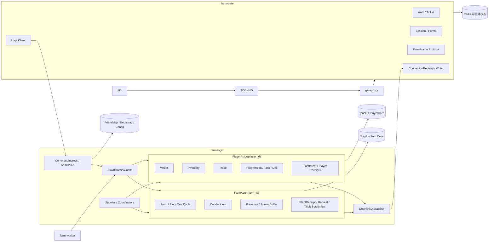

# 12 · 业务模块与场景映射

版本：v0.3，2026-07-27。本文回答“有哪些模块、它们在哪个进程、每个场景由谁裁决、哪些步骤原子、哪些需要可靠异步”。Actor 拆分的完整理由见 [16-player-farm-actor-split](./16-player-farm-actor-split.md)。

---

## 1. 先区分四个概念

| 概念 | 回答的问题 | 本项目示例 |
|---|---|---|
| 进程/部署单元 | 什么一起启动、扩缩容和发布 | farm-gate、farm-logic、farm-worker |
| Actor | 哪个实体邮箱串行裁决权威事实 | PlayerActor(player_id)、FarmActor(farm_id) |
| 业务模块 | Actor 内怎样组织领域规则 | Wallet、Inventory、Farm、Trade、Care |
| RPC/命令 | 边界之间怎样调用 | ExecuteCommand、ApplyPlant、GrantLoot |

业务模块不等于微服务。当前不按 Wallet/Farm/Task 拆独立进程。

## 2. 总体模块图



## 3. 进程模块

### 3.1 farm-gate

```text
farm-gate
├── GateproxyTransport
├── FarmFrameProtocol
├── Auth / Ticket
├── SessionAdapter
├── RateLimit
├── ConnectionRegistry
├── ConnectionWriter
├── LogicClient
└── GatewayDownlinkService
```

负责连接、认证、Session、限流和背压；不读取 PlayerCore/FarmCore，不判断成熟、余额或可偷量，不计算 Actor shard。

### 3.2 farm-logic 无状态入口

```text
farm-logic ingress
├── CommandValidation
├── SessionAdmission
├── FriendshipAdmission
├── ActorRouteAdapter
├── RemoteForward
├── Plant/Harvest Coordinator
├── QueryAdapter
└── ErrorMapping
```

入口可以组合调用，但不能成为新的权威状态所有者。Coordinator 正常路径串联多个短 Actor turn；请求结束后仍依靠持久 Intent/Outbox 恢复。

### 3.3 PlayerActor

```text
PlayerActor(player_id)
├── PlayerMeta
├── Wallet
├── Inventory
├── Trade
├── Progression
├── TaskProgress / TaskClaim
├── MailClaimReceipt
├── Pet / Album
├── PlantIntent
├── OperationResult
├── InboundReceipt
├── PendingOutbox
└── PersistenceRuntime
    ├── version / savedVersion / modifiedVersion
    ├── DirtyModel
    └── Writeback / ForceFlush
```

只修改 PlayerCore。Buy/Sell 是 PlayerActor 内存原子事务并异步回写；任务/邮件唯一领奖虽然也在同一 Actor 内，但必须使用 P-DURABLE，不能因为同进程就放宽领取与奖励的可靠边界。

### 3.4 FarmActor

```text
FarmActor(farm_id)
├── FarmMeta
├── Plot / CropCycle / FarmVersion
├── CareIncident
├── PlantReceipt
├── HarvestSettlement
├── TheftSettlement
├── FarmOperationResult
├── PendingOutbox
└── ActivationRuntime
    ├── Presence
    ├── JoiningContext
    ├── JoiningBuffer
    └── Subscription
```

只修改 FarmCore。Join、FarmChange 和同场成员都属于 FarmActor activation；运行态可丢失重建，不进入 Tcaplus。

### 3.5 farm-worker

```text
farm-worker
├── PendingWorkDiscovery
├── PlantWorkflow
├── HarvestWorkflow
├── TheftWorkflow
├── CareRewardWorkflow
├── Projection
├── Notification(P1)
└── Archive/Reconcile
```

Worker 不直接改 Core，只调用 Actor 的可信幂等命令。PendingWork 源事实必须在 Core 内，Redis 只能做发现提示；禁止遍历三千万条记录。

## 4. 业务模块归属

| 模块 | 位置 | 原因 |
|---|---|---|
| Wallet / Inventory / Trade | PlayerActor | 同玩家资产冲突键；普通经济 P-ASYNC，可靠参与步骤 P-DURABLE |
| Progression / Task / MailClaim | PlayerActor | 奖励与防重需和玩家资产共同提交 |
| Farm / Plot / CropCycle | FarmActor | 同一农场操作必须唯一排序 |
| CareIncident | FarmActor | 护理是某茬地块的全局事件 |
| Presence / JoiningBuffer | FarmActor activation | 与 FarmVersion/FarmChange 顺序对齐 |
| FriendshipAuthority | 独立 Authority/表 | 好友关系是两玩家共享事实，不属于任一 Core |
| SessionAuthority | farm-gate + 独立代次来源 | 顶号与连接准入，不拥有游戏资产 |
| ConfigAuthority | Logic 只读模块 + 版本化表 | 在途作物冻结版本 |
| Plant/Harvest Coordinator | Logic 无状态模块 | 串联正常路径，不拥有可靠进度 |
| Worker workflow | farm-worker | 恢复 Outbox、重试和闭合 |
| PlayerPublicProfile | query-svr 查询投影 | 好友页批量展示，不激活 PlayerActor；不建立 infosvr |

## 5. 场景总表

| 场景 | 第一 Actor | 第二 Actor/Authority | 本地原子步骤 | 跨边界结果 |
|---|---|---|---|---|
| 登录/首次建档 | BootstrapAuthority | PlayerStore + FarmStore | 两条记录分别条件创建 | BootstrapRecord 推进到 COMPLETED |
| Join 自己农场 | FarmActor | SessionAuthority | Presence/Joining 运行态 | Snapshot/FarmChange 下行 |
| Join 好友农场 | FarmActor(目标) | FriendshipAuthority | Presence/Joining 运行态 | FriendPermit + Snapshot |
| Buy | PlayerActor | ConfigAuthority | Wallet- + Inventory+ + ShopCounter + 内存 Result；异步回写 | 无 |
| Sell | PlayerActor | ConfigAuthority | Inventory- + Wallet+ + 内存 Result；异步回写 | 无 |
| Plant | PlayerActor | FarmActor | Player 预留；Farm 种下；Player确认消耗 | PlantIntent/Receipt/Outbox |
| 查看成熟 | FarmActor | 无 | 由 mature_at 派生 | 无 |
| Harvest | FarmActor | PlayerActor(主人) | Farm 结束作物；Player 到账 | HarvestSettlement/Receipt |
| Water/RemovePest | FarmActor | FriendshipAuthority；可选帮助者 PlayerActor | Incident resolve + FarmVersion | CareRewardOutbox/Receipt |
| Steal | FarmActor(目标) | FriendshipAuthority + 访客 PlayerActor | 目标扣减 + Settlement | LootReceipt + 闭合 |
| 任务领奖 | PlayerActor | ConfigAuthority | claimed + reward + Result | 无 |
| 邮件领奖 | PlayerActor | MailAuthority | claim receipt + reward + Result | 无 |
| 分享接受 | ShareAuthority | Friendship/PlayerActor | 唯一接受事实 | 奖励按 Receipt 到账 |

## 6. 个人经营 Loop

### 6.1 Buy

```text
H5
→ Logic Route(PLAYER:self)
→ PlayerActor
→ Trade 读取版本化 Offer
→ EconomyTxn 完整 Check
→ Wallet/Inventory/ShopCounter 一次内存 Apply
→ DirtyModel + version++
→ SUCCEEDED
→ UniqueWritebackQueue 增量 HMSet
```

### 6.2 Plant

```text
H5
→ PlayerActor：预留种子 + PlantIntent + Outbox
→ FarmActor：校验空地/expected version，创建 CropCycle + PlantReceipt
→ PlayerActor：确认消耗或释放预留
→ SUCCEEDED / REJECTED
```

暂时失败用原 `plant_txn_id` 重试。地块非空、版本变化是永久拒绝；不能自动换版本继续种。

### 6.3 成熟

```text
phase(now):
  now < mature_at  -> GROWING
  now >= mature_at -> MATURE
```

成熟不触发状态写；提醒是 P1 派生能力。

### 6.4 Harvest

```text
FarmActor：验证成熟并结束 CropCycle，创建 HarvestSettlement/Outbox
→ PlayerActor：Inventory/Exp + HarvestReceipt
→ FarmActor：Settlement COMPLETED
```

P0 库存无容量上限，因此玩家到账只会暂时失败，不会因容量永久拒绝。

## 7. 实时社交 Loop

### 7.1 Join

```text
Logic → FarmActor(target_farm_id)
→ 创建 Joining 与 snapshot_version V
→ Snapshot(V) 和 JoiningBuffer 共用订阅 FIFO
→ QueueAccepted + Catch-up 后 InFarm
```

### 7.2 护理

```text
好友 B → FarmActor(A)
→ 校验 FriendPermit + Presence + Incident
→ 第一位有效处理者 CAS 成功并广播
→ CareRewardOutbox → PlayerActor(B) 增加经验/任务进度
```

同一茬一次浇水/一次除虫是全局地块事件，其他人返回 NO_CHANGE。

### 7.3 偷菜

```text
好友 B → FarmActor(A)
→ 校验成熟、每好友一次、最大可偷量、主人保底、宠物
→ FarmCore CAS：目标扣减 + TheftSettlement + Outbox
→ PlayerActor(B)：库存 + LootReceipt
→ FarmActor(A)：Settlement 闭合
```

作物未成熟直接拒绝。目标扣减一旦提交，访客看到“奖励到账中”而不是纯失败。

## 8. 原子组与跨 Actor 组

### 8.1 PlayerActor 本地一致性组

| 场景 | 本地/持久化边界 |
|---|---|
| Buy | Wallet- + Inventory+ + ShopCounter + OperationResult 同一内存 Apply；异步同组回写 |
| Sell | Inventory- + Wallet+ + OperationResult 同一内存 Apply；异步同组回写 |
| TaskClaim | claimed + reward + OperationResult，P-DURABLE |
| MailClaim | claim receipt + reward + OperationResult，P-DURABLE |
| Plant Reserve | seed reserved + PlantIntent + Outbox + PROCESSING，P-DURABLE |
| Plant Finalize | seed consume/release + Intent terminal + Result terminal，P-DURABLE |

### 8.2 FarmCore 单记录原子

| 场景 | 同一次 CAS |
|---|---|
| ApplyPlant | CropCycle/CareIncident + versions + PlantReceipt + OutcomeOutbox |
| Harvest accept | CropCycle end + FarmVersion + Settlement + CreditOutbox |
| Care | Incident resolved + FarmVersion + Result + optional RewardOutbox |
| Theft accept | stolen amount + FarmVersion + Settlement + GrantLootOutbox |

### 8.3 不能宣称原子的组合

- 种子真实消耗与 CropCycle 创建；
- CropCycle 结束与收获物进入玩家库存；
- 目标农场扣减与访客库存到账；
- 好友护理成功与帮助者经验到账。

这些组合只能通过可恢复工作流实现最终一致。

## 9. 权限检查位置

| 检查 | 位置 |
|---|---|
| SessionPermit/顶号代次 | Logic Admission；Actor turn 内对写 Permit 再校验必要绑定 |
| 是否本人 PlayerActor | 由认证 player_id 推导路由，客户端不能指定 |
| 农场 owner | FarmActor 从 FarmMeta 判断 |
| 好友关系 | FriendshipAuthority 签发 FriendPermit |
| 是否在场 | FarmActor Presence |
| 地块/作物/护理/偷菜规则 | FarmActor |
| 余额/种子/库存 | PlayerActor |

Presence 不是好友权限权威；FriendPermit 也不能替代 FarmActor 对当前作物和版本的最终校验。

## 10. 阶段实施

| 阶段 | 点亮模块 | 验证目标 |
|---|---|---|
| S2 | 双记录 Bootstrap、ActorRouteAdapter、PlayerActor/FarmActor 空模型、Join/重连 | 系统骨架与边界成立 |
| S3a | Buy | PlayerActor EconomyTxn + DirtyModel/异步回写/RPO |
| S3b | Plant + 最小 Worker | 跨 Actor Intent/Receipt/补偿 |
| S3c | mature_at + Harvest | 完整个人经营闭环 |
| S4 | PlayerPublicProfile/FarmSummary、好友 Join、FarmChange、Water、RemovePest | 批量读不激活冷 Actor；FarmActor 同场裁决 |
| S5 | CareReward、Theft | 跨玩家可靠结算 |
| S6 | Task、Mail、Pet、Album、Share 与容量验证 | 题面补齐和演示 |

## 11. 暂不拆服务

当前不要把 Player、Farm、Inventory、Task 分别做成网络微服务。这样会增加 RPC 和部署复杂度，却不会替代 Actor 与数据所有权设计。满足以下证据之一再考虑拆进程：

- PlayerActor 与 FarmActor 的扩缩容曲线长期明显不同；
- 热门 Farm 对节点资源形成独立瓶颈；
- 团队需要独立发布和故障域；
- 真正的 CPU/内存/Store 指标表明共进程不合适。

即使未来拆进程，ActorKey、PlayerCore/FarmCore、Intent/Receipt 的业务合同也保持不变。
