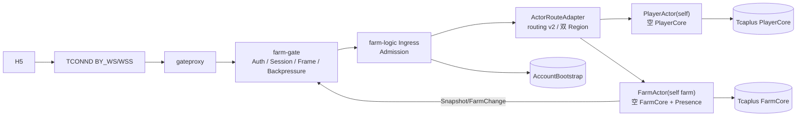
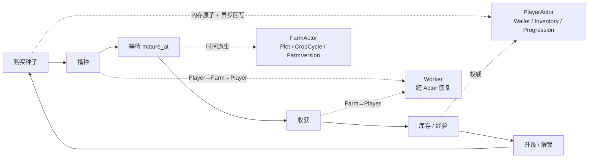
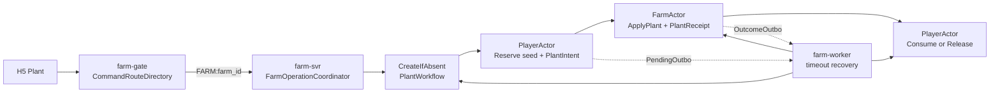
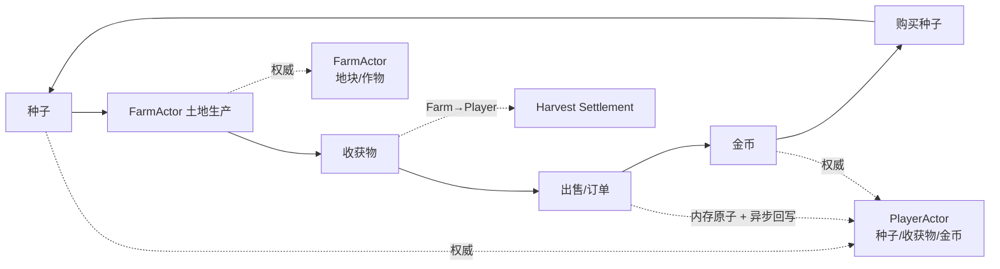
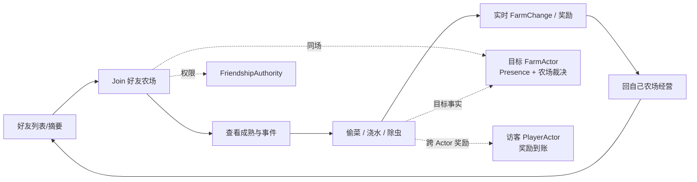
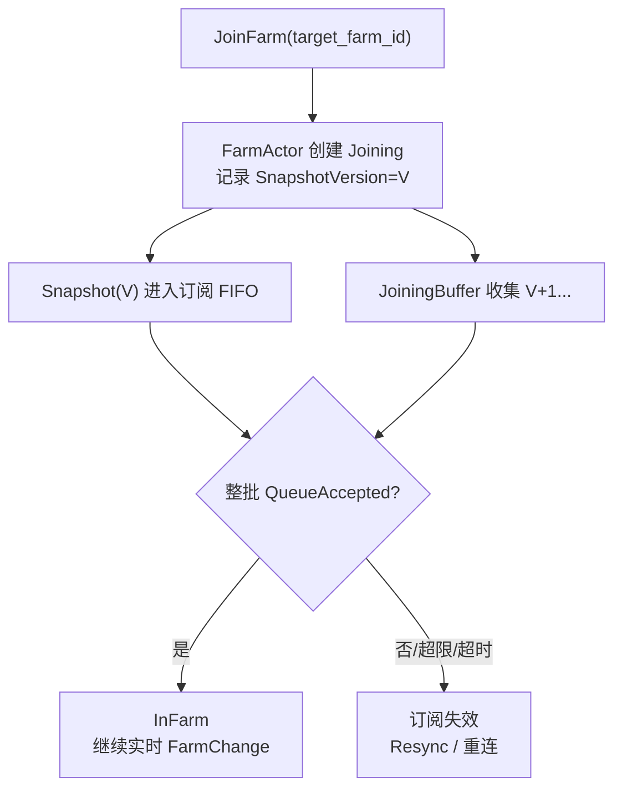
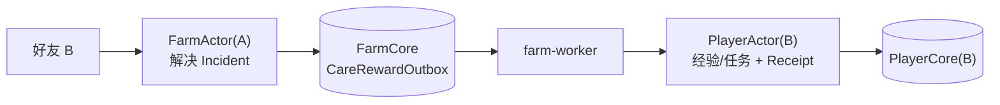
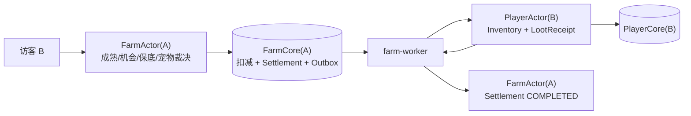
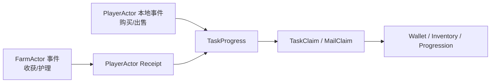

# 13 · 核心 Loop 服务联动图

本文只画主干关系；字段、失败语义和状态机见 [双 Actor 设计](./16-player-farm-actor-split.md)、[路由迁移设计](./17-uc-routing-migration-adaptation.md) 与 [关键时序](./41-sequences.md)。

---

## 1. S2 系统骨架



S2 先证明：登录、双记录建档、连接、Session、ActorKey 路由、两类 Actor 激活、Join、Snapshot 和重连成立。

## 2. 个人成长 Loop



核心变化：

- Buy 是 PlayerActor 内 EconomyTxn 原子修改，随后 DirtyModel 异步增量回写；
- Plant 是 Player 预留、Farm 种下、Player 确认；
- Mature 不产生定时状态写；
- Harvest 是 Farm 结束作物、Player 到账。

## 3. Plant 联动



`FarmOperationCoordinator` 只推进正常路径，不直接修改玩家种子或农场地块。它必须先可靠创建 `PlantWorkflow`，再调用 PlayerActor/FarmActor Participant；超时后由 farm-worker Claim 同一 Workflow 继续。种子属于 PlayerActor，只决定 `ReserveSeed` 的裁决权，不决定 Coordinator 必须部署在 player-svr。永久地块冲突释放预留，暂时失败保持原 workflow 重试。

## 4. 经济 Loop



防刷要点：

- 客户端不提交产量和价格；
- CropCycle 在 FarmActor 冻结规则；
- HarvestReceipt 防止重复到账；
- Buy/Sell 使用 operation_id 防重；
- PROCESSING 操作不能换 operation_id 重做。

## 5. 社交 Loop



好友摘要只是候选展示，不能代替 FarmActor 对当前作物、版本和配额的最终裁决。

## 6. Join 与实时同步



Presence 在 FarmActor 里是因为 Join、业务变化和广播版本必须对齐；它不是 Tcaplus 长期事实。

## 7. 护理奖励



第一位有效护理者改变 Farm；其他人得到 NO_CHANGE。Farm 提交不等待奖励到账。

## 8. 偷菜结算



未成熟直接拒绝。目标已扣减但访客暂未到账时显示 PROCESSING/奖励到账中。

## 9. 任务与邮件



Player 本地 P-ASYNC Buy/Sell 在经济快照保存成功后，通过 post-save effect 推进 TaskModel，丢失窗口由近期 PurchaseReceipt/Reconcile 修复；唯一领奖必须强制持久化。Farm 触发必须用 Receipt 可靠防重，不能跨 Actor 直接改 PlayerCore。

## 10. 演进边界

```text
S2  双 Actor 空骨架 + Join
↓
S3a Buy（Player EconomyTxn + DirtyModel）
↓
S3b Plant（Player→Farm→Player）
↓
S3c Mature + Harvest（Farm→Player）
↓
S4  好友 Join + FarmChange + Care
↓
S5  CareReward + Theft
```

这条顺序先用最小业务验证每一种一致性形态，再扩玩法，避免同时铺开多条半成品链路。
