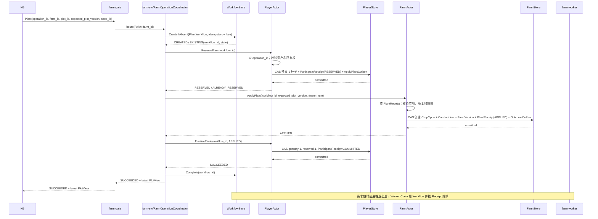

# 16 · PlayerActor / FarmActor 拆分与跨 Actor 一致性

状态：**架构基线，2026-07-27 起生效**。

本文取代旧设计中的 `PlayerFarmActor(owner_id) + OwnerCoreRecord` 合并边界。接入层、TCONND、farm-gate、farm-logic、farm-worker 的进程边界不因此增加；变化发生在 farm-logic 内部 Actor、路由、持久化记录和业务工作流。

---

## 1. 决策

P0 使用两个独立权威 Actor：

| Actor | 路由键 | 长期权威事实 | 运行时状态 |
|---|---|---|---|
| `PlayerActor(player_id)` | `PLAYER:player_id` | Wallet、Inventory、Progression、Task、MailClaim、Pet、Album、玩家侧 OperationResult、跨 Actor 接收回执、PlantIntent | 玩家自己的短期命令上下文 |
| `FarmActor(farm_id)` | `FARM:farm_id` | Farm、Plot、CropCycle、CareIncident、FarmVersion、PlantReceipt、Harvest/Theft/Care Settlement 与目标侧 Outbox | Presence、JoiningContext、JoiningBuffer、Subscription |

P0 仍是“一名玩家拥有一个私有农场”。为减少建档和协议复杂度，`farm_id` 可以暂时与 `owner_player_id` 数值相同，但二者必须是不同语义的类型和路由空间：

```text
PLAYER:10001 != FARM:10001
```

未来即使一名玩家拥有多个农场，或 FarmActor 与 PlayerActor 分别迁移，也不需要改业务权威边界。

## 2. 为什么拆分

拆分不是为了增加服务数量，而是为了让两类热点和生命周期独立：

- 玩家资产命令（购买、出售、任务、邮件）只排队在 PlayerActor；
- 好友访问、Join、浇水、偷菜和热门农场写只排队在 FarmActor；
- 热门农场的 Presence 和互动不会阻塞农场主购买、领奖等个人资产操作；
- PlayerActor 与 FarmActor 可以独立激活、钝化、迁移和容量治理。

代价也必须正视：

- Plant、Harvest 等原来可在一个 OwnerCore 内原子完成的操作，变成跨 Actor 流程；
- 一次业务操作会产生更多 RPC/邮箱消息和 Tcaplus 条件写；
- 必须有持久 Intent、Outbox、Receipt 和补偿，不能用内存回调冒充可靠流程。

所以拆分后的正确性不再来自“跨两个 Actor 加锁”，而来自“每个 Actor 内局部原子 + 跨 Actor 可恢复状态机”。

## 3. 路由

统一 ActorKey：

```text
ActorKey {
    actor_kind: PLAYER | FARM
    entity_id: uint64
}

routing_version = 2
virtual_shard = xxhash64(actor_kind_byte || uint64_be(entity_id)) % 4096
logic_node    = shard_table[(actor_kind, virtual_shard)]
```

路由键必须对齐被修改的权威事实：

| 操作 | 第一权威路由 |
|---|---|
| Buy、Sell、TaskClaim、MailClaim | `PLAYER:player_id` |
| JoinFarm、Water、RemovePest、Steal | `FARM:target_farm_id` |
| Plant | 先 `PLAYER:player_id`，再由可靠流程投递 `FARM:farm_id` |
| Harvest | 先 `FARM:farm_id`，再由可靠流程投递 `PLAYER:owner_player_id` |
| CareReward、TheftLoot 到账 | `PLAYER:receiver_player_id` |

`ActorRouteAdapter` 是通用路由器，`PlayerRouteAdapter` 与 `FarmRouteAdapter` 可以是类型安全的薄封装。farm-gate 可按共享命令目录推导第一跳 ActorAddress，但客户端不能指定可信 actor kind/shard，farm-logic 必须复核。S2 的 ShardAssignment 静态位于 Logic；多 Logic 时可由批准版本的 xrpc/proxyless ActorRouteClient 使用同一 routing v2 直达 holder。完整合同见 [17](./17-uc-routing-migration-adaptation.md)。

## 4. 持久化记录

### 4.1 PlayerCoreRecord

```text
PlayerCoreRecord (PK = player_id)
├── player_meta / player_epoch / state_version
├── profile
├── wallet
├── inventory
│   └── stacks[item_id] = quantity / reserved_quantity
├── progression / task / mail claim / pet / album
├── plant_intents[]
├── player_operation_results[]
├── pending_outbox[]
└── inbound_receipts[]
```

库存满足：

```text
0 <= reserved_quantity <= quantity
available_quantity = quantity - reserved_quantity
```

### 4.2 FarmCoreRecord

```text
FarmCoreRecord (PK = farm_id)
├── farm_meta / owner_player_id / farm_epoch / state_version
├── farm_version
├── plots[]
├── active_crop_cycles[]
├── active_care_incidents[]
├── plant_receipts[]
├── harvest/theft/care settlements[]
├── farm_operation_results[]
└── pending_outbox[]
```

两条记录分别使用自己的 `RecordVersion` 和 epoch。TcaplusDB 不提供这两条记录之间的事务；任何跨记录成功都必须由本文件定义的流程证明。

## 5. 播种工作流

### 5.1 用户语义

用户提出的“先扣种子，再种到 Farm，失败可重试”冻结为：

1. farm-gate 按 `FARM:farm_id` 把 Plant 首跳到 farm-svr/FarmOperationCoordinator；
2. Coordinator 使用幂等键先 `CreateIfAbsent PlantWorkflow`，成功后才能调用任何 Participant；
3. `PlayerActor` 减少种子的**可用数量**，即创建预留；
4. `FarmActor` 使用同一 `workflow_id` 幂等种植；
5. Farm 成功后，Player 将预留转成真实消耗；
6. Farm 永久拒绝后，Player 释放预留；
7. 暂时性失败由原请求或 farm-worker Claim 同一 Workflow 继续，不能悄悄丢弃流程。

预留在 UI 上等价于种子已被扣减：玩家不能再购买/播种时使用它；但在永久失败时可以无歧义地释放，不需要凭空“补发”一颗新种子。

种子属于 PlayerActor，只说明 `ReservePlant` 必须由 PlayerActor 裁决；Plant 的业务目标是 `farm_id + plot_id + crop`，因此当前由 farm-svr 中的 FarmOperationCoordinator 作为首跳和正常路径协调者。Coordinator 不拥有 Participant 业务事实，WorkflowRecord 才是跨服务恢复的全局进度。

### 5.2 状态

玩家侧 `PlantIntent`：

```text
RESERVED
  ├── Farm APPLIED  -> COMPLETED
  └── Farm REJECTED -> REJECTED_REFUNDED
```

农场侧 `PlantReceipt` 是不可变终态：

```text
APPLIED
REJECTED(reason)
```

公开 `OperationResult` 由 PlayerActor 持有：

```text
PROCESSING -> SUCCEEDED
PROCESSING -> REJECTED
```

### 5.3 正常时序



Coordinator 只推进正常请求路径；Gate 只选择首跳和返回结果，不能编排 Participant。任何一步超过请求 deadline 后，返回 `PROCESSING`。farm-worker 从持久 Workflow 和 Participant Receipt 恢复。Actor 在自己的 turn 内不得等待远程 Actor 或网络回调。

### 5.4 重试与拒绝

| 结果 | 示例 | 处理 |
|---|---|---|
| 暂时失败 | RPC 超时、Logic 重启、Tcaplus 暂时不可用 | 使用原 `plant_txn_id`、原 `expected_plot_version` 重试 |
| Actor 内 CAS 冲突 | RecordVersion 变化 | Reload → 重查 Receipt/Intent → 重新校验 → 有界 CAS 重试 |
| 永久业务拒绝 | 地块非空、地块版本变化、作物被紧急禁用 | Farm 持久化 `PlantReceipt(REJECTED)`；Player 释放预留并形成终态 REJECTED |
| 结果未知 | 调用超时，不知道对端是否提交 | 不猜失败；查询 Receipt/Intent 或按同一 txn 重投 |

“重试”只适用于暂时失败。不能在地块版本已经改变后修改 `expected_plot_version` 再自动重试，否则可能在玩家没有确认的下一茬地块上种菜。

### 5.5 幂等键

- 客户端 `operation_id`：在 PlayerActor 范围内标识一次用户播种意图；
- 服务端 `plant_txn_id`：PlayerActor 首次接受时生成，不可猜测，供 Actor 间可靠投递；
- `PlantReceipt` 以 `plant_txn_id` 唯一；
- 相同 `operation_id` 携带不同 payload 必须拒绝；
- 重试不得重新抽护理事件、成熟时间或产量参数。

`plant_at` 取 FarmActor 首次成功提交时间。`rule_version`、种子定义和随机种子在 PlantIntent 创建时冻结，FarmActor仍可按紧急禁用规则永久拒绝。

## 6. 建档工作流

S2 首次建档现在要创建两条权威记录，不能再宣称“一次 OwnerCore 条件创建”：

```text
AccountBootstrapRecord
CREATED -> PLAYER_READY -> FARM_READY -> COMPLETED
```

`BootstrapService.EnsureAccountInitialized`：

1. 取得或条件创建稳定的 `player_id/farm_id/bootstrap_id`；
2. 幂等条件创建 PlayerCore（初始金币、种子）；
3. 幂等条件创建 FarmCore（初始地块、owner_player_id）；
4. 两者都可读取且规则版本一致后才返回 `AccountReady`。

任一步崩溃后，下次登录从 BootstrapRecord 继续。P0 可令 `farm_id == player_id` 以免新增 ID 分配器，但 API 与路由仍使用不同字段。

## 7. 对其他业务的影响

| 场景 | 新流程 |
|---|---|
| Buy / Sell | PlayerActor 内 EconomyTxn 一次原子 Check/Apply，DirtyModel 异步增量回写 |
| Harvest | FarmActor 先结束 CropCycle 并创建 HarvestSettlement/Outbox；PlayerActor 用 Receipt 增加库存/经验；FarmActor闭合流程 |
| Water / RemovePest | FarmActor 裁决事件；若帮助者获得经验，CareRewardOutbox 投递到帮助者 PlayerActor |
| Steal | 目标 FarmActor 扣减可偷量并创建 TheftSettlement；访客 PlayerActor 用 LootReceipt 到账 |
| Join / FarmChange | 完全属于 FarmActor；Presence 与 JoiningBuffer 仍只在内存 |
| Task / Mail | PlayerActor 内裁决；来自 Farm 的异步进度使用 Receipt 防重 |

Harvest 的 P0 仓库容量无限，因此玩家侧到账没有“容量不足”这一永久拒绝，只有暂时失败；这使“Farm 先提交、Player 后到账”可可靠收敛。

## 8. 必须成立的不变量

1. 一次成功播种恰好消耗一颗种子，恰好创建一个 CropCycle。
2. 重复 `ReservePlant/ApplyPlant/FinalizePlant` 不会重复扣种子、重复种植或重复返回奖励。
3. Farm 永久拒绝后，种子不会永久停留在 reserved。
4. `SUCCEEDED` 只能在 Farm 已 APPLIED 且 Player 已完成真实消耗后返回。
5. FarmActor 永不直接修改 Wallet/Inventory；PlayerActor 永不直接修改 Plot/CropCycle。
6. `RESERVED 但尚未种下`、`已种下但尚未 Finalize` 是允许的短暂状态，但必须可发现、可重试、可收敛。
7. 广播失败不回滚 Farm 提交；客户端依靠 FarmVersion 缺口检测和重新 Join 收敛。
8. 已持久接受的流程不能因为“重试三次”而丢弃；只有终态成功或终态拒绝/补偿才能停止。

## 9. 性能与容量影响

与旧合并模型相比：

- Plant 最少从 1 次 OwnerCore CAS 变成 3 次 CAS（Player 预留、Farm 种植、Player 确认）；
- 普通 Buy/Sell 不再把 Tcaplus 写入放在请求关键路径，多次同玩家操作可合并回写；
- Harvest 通常也需要 3 次或更多持久步骤；
- 活跃 Actor 数上限接近原来的两倍，但 Player 与 Farm 可以独立钝化；
- 好友流量只激活目标 FarmActor，不必激活农场主 PlayerActor；
- 热门 Farm 邮箱不会拖慢农场主自己的资产命令。

容量模型必须按“业务步骤数”重新计算，不能沿用旧的单 Owner 写 QPS。压测至少分别报告：

- PlayerActor/FarmActor 激活数、内存和邮箱等待；
- Plant 端到端 P50/P95/P99 与 PROCESSING 比例；
- Player 普通回写合并率/Dirty Age/ForceFlush 与每次 Plant 的 Player/Farm 可靠写次数；
- Worker backlog、Intent/Receipt 最老年龄；
- 热门 Farm 与普通 Player 命令的相互隔离效果。

## 10. 实施顺序

1. **S2 骨架先拆边界**：ActorKey、PlayerActor、FarmActor、PlayerStore、FarmStore、双记录 Bootstrap；Join 路由到 FarmActor。
2. **S3 先做 Player 本地 Buy**，验证 EconomyTxn、Dirty version、UniqueWritebackQueue、增量 HMSet、ForceFlush 与硬崩溃 RPO。
3. **再做 Plant Saga**，同时启用最小可靠 Worker/Outbox；不能先写一个只靠内存回调的“临时 Plant”。
4. **实现 Harvest Saga**，完成 `Buy → Plant → mature_at → Harvest`。
5. S4/S5 再复用同一套 Receipt/Outbox 思路完成护理奖励和偷菜。

多 Logic 之前只实现静态双 Region 路由；扩缩容时 Player/Farm Shard 独立迁移，以 Shard Lease/revision 和记录内 `player_epoch/farm_epoch` 做 fencing，首版从 Tcaplus Reload，不搬 Presence/Joining 内存。不得为了接入 UC 路由而改变本文件冻结的 Plant 第一跳和 Intent/Receipt 语义。

当前 `api/proto/ownercore`、`internal/storage/ownercoresize` 和部分 S1 代码仍是旧单 OwnerCore 基线；它们不再代表目标 Schema，应在 S2 协议/存储冻结时迁移并重新做容量实测。
