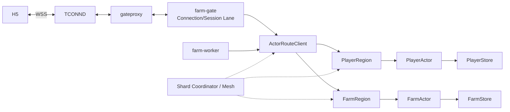

# 17 · 双 Actor 接入、路由、迁移与扩缩容

版本：v0.3

更新时间：2026-07-27

状态：**目标合同已冻结，分布式实现按阶段引入**。

本文回答一个具体问题：拆成 `PlayerActor` 与 `FarmActor` 后，哪些 UC 接入、路由和迁移能力适合复用，哪些必须按农场业务改造，哪些不应进入当前 S2。

业务边界以 [16-player-farm-actor-split](./16-player-farm-actor-split.md) 为准。本文不改变“播种先由 PlayerActor 预留种子”的决定。

---

## 1. 最终结论

### 1.1 采用

| UC 思想 | 农场中的落法 |
|---|---|
| 连接状态与后端 RPC 分离执行 | farm-gate 的 Connection/Session Lane 只做短操作，Logic RPC 在独立有界执行池中运行，完成后再回到 Lane |
| 稳定 Shard 计算 | `ActorAddress(kind,id)` 通过版本化 xxhash64 映射到 Virtual Shard |
| ShardCalculator / Proxyless ShardedService | 多 Logic 时的优先生产候选；Player/Farm 使用独立 Region/Assignment |
| 路由过期后 Redirect | 内部返回新 `shard_revision + holder`，原 request/operation id 最多自动重投一次 |
| Region Import/Normal/Handoff/Shutdown | 用于 Logic Shard 的正常扩缩容和滚动发布 |
| Actor autoload/passivation、mailbox watermark | PlayerActor/FarmActor 分别治理 |
| modifiedVersion/savedVersion + UniqueFifo 增量回写 | 仅用于 PlayerActor 普通软资产；队列在 player-svr 进程内，不冒充可靠日志 |
| P2P Handoff 与 DB Reload 两条恢复路 | 农场第一版只实现 DB Reload；热状态搬运是后续优化 |
| 写入 fencing | PlayerCore/FarmCore 分别保存 `writer_epoch`，配合 Shard Lease 防止旧 Actor 继续写 |
| Gateway 下行精确寻址与背压 | `gate_id + connection_id + transport_generation` 精确投递到当前 ConnectionWriter |

### 1.2 改造

1. UC 常见的单 GID/Player Actor 路由，改成 `PLAYER` 与 `FARM` 两种 ActorAddress。
2. Player/Farm 各自拥有 ShardAssignment，可独立放置、扩容和迁移。
3. Gateway 可以根据服务端命令目录推导**第一跳 ActorAddress**，但不拥有 ShardAssignment，也不能信任客户端提交的 actor kind/shard。
4. `Plant` 第一跳仍是 PlayerActor：

   ```text
   PLAYER reserve seed
   → FARM apply crop
   → PLAYER finalize consume/refund
   ```

   不为了减少一次地块冲突而改成 FarmActor 先锁地。客户端携带 `expected_plot_version`；Farm 永久拒绝后释放种子预留即可。
5. 跨 Actor 使用 Typed WorkflowRecord 作为唯一全局进度；参与者自己的 `Intent/Settlement + Outbox + Receipt` 只证明本地步骤。Workflow 不进入 Actor 邮箱长期等待，由 Coordinator/Worker 在 turn 外推进。
6. Farm 的实时恢复主要靠 `FarmVersion + Snapshot + 重新 Join`，不是 UC 的任意下行 ACK/FrameCache 重放。

### 1.3 当前不采用

| 能力 | 当前不采用的原因 |
|---|---|
| 直接复制 UC gatesvr/Session/业务 Proto | 新项目需要独立协议、SessionAuthority 和业务语义 |
| S2 就部署 Proxyless/Coordinator | S2 只有一个 Logic，分布式控制面没有验证价值 |
| Gate 无感热 Session Handoff | 当前协议没有 UC 式 server_seq ACK 与未确认帧重放，搬一半状态反而产生错误承诺 |
| Actor 内存快照作为唯一迁移来源 | Presence/Joining 可重建；Player 有序迁移前先 Flush DirtyModel，Farm/可靠步骤已经持久化，随后 DB Reload 更容易证明正确 |
| 通过拆分一个热门 FarmActor 提高单农场写吞吐 | 会破坏地块、作物和偷菜的唯一裁决顺序 |
| Redis Route Hint 决定所有权 | Redis 只可缓存路由，不能成为 Shard/Actor 权威 |

---

## 2. 参考证据与复用边界

本次判断不仅基于文字分析，也对照了平台代码：

- `mfcn/gatesvr` commit `3f6feb8`：`gate_handler.go` 中按用户串行的 Session executor 与独立后端 RPC executor；Session 中存在 server/client sequence、FrameCache、继承和迁移信息。
- `mfcn/xrpc` commit `cee7b3a`：Actor Region 的 `Import → Normal → Handoff → Shutdown`、`AskRedirect`、P2P Handoff，以及 Proxyless `ShardCalculator`。

因此可以复用两层内容：

1. **平台库/公共组件**：若依赖审批、版本和 Linux 环境满足，可直接依赖批准版本的 gateproxy、xrpc/proxyless。
2. **架构机制**：Lane 分离、Shard 状态机、Redirect、Handoff、Fencing。

不能复制：

- UC 的 PlayerActor 合并边界；
- UC 的 Session、业务 Proto、zonesvr 约定；
- UC 的 ACK/重放语义；
- UC 面向自身 GID 的路由规则和业务代码。

农场必须自行实现命令目录、ActorAddress、Player/Farm Store、业务工作流和失败语义。

---

## 3. 两类路由不能混淆

### 3.1 连接路由

回答“这个浏览器连接当前在哪个接入实例”：

```text
ConnectionRoute {
    gate_id
    connection_id
    transport_generation
    active_session_epoch
}
```

用途：

- Logic/FarmActor 把 Snapshot、FarmChange、踢线通知投到正确 farm-gate；
- farm-gate 再找到当前 ConnectionWriter；
- generation/epoch 不匹配时拒绝旧下行，不能误发给复用的新连接。

### 3.2 Actor 业务路由

回答“谁有资格裁决这份业务事实”：

```text
ActorAddress {
    kind: PLAYER | FARM
    id: uint64
}
```

用途：

- `PLAYER:A` 裁决 A 的 Wallet、Inventory、成长和玩家侧流程；
- `FARM:X` 裁决 X 农场的 Plot、CropCycle、Care、Theft、FarmVersion 和 Presence。

连接在哪个 Gate 与 Actor 在哪个 Logic 没有绑定关系。客户端可以重连到另一个 Gate，但同一 ActorAddress 仍必须路由到当前唯一权威 Actor。

---

## 4. 目标拓扑



阶段差异：

- S2：一个 farm-gate、一个 farm-logic；ActorRouteClient 使用静态本地 Assignment。
- S3：仍可单 Logic，先验证双 Actor Plant/Harvest 流程。
- 多 Logic：ActorRouteClient 优先接入批准版本的 xrpc/proxyless ShardedService；Coordinator 管 Assignment/Lease/Revision。
- 多 Gate：DownlinkDispatcher 按 `gate_id` 精确调用目标 `GatewayDownlinkService`。

---

## 5. routing v2 合同

S1 草稿曾把 routing v1 标签用于 owner-only 和后续 kind-aware 两种方案，但都没有投入生产。双 Actor 的第一个可实施合同命名为 routing v2，避免让同一个版本号继续承载不同字节规则。

```text
routing_version = 2
hash_algorithm = xxhash64
hash_seed = 0
virtual_shard_count_per_region = 4096

actor_kind_byte:
  PLAYER = 0x01
  FARM   = 0x02

hash_input = actor_kind_byte || uint64_be(entity_id)
virtual_shard_id = xxhash64(hash_input, seed=0) % 4096
assignment_key = (actor_kind, virtual_shard_id)
```

约束：

- `entity_id == 0` 非法；
- ID 使用 uint64 大端编码，不使用十进制字符串字节；
- `PLAYER:10001` 与 `FARM:10001` 是不同 ActorAddress；
- PlayerRegion 与 FarmRegion 分别维护 4096 个 Assignment，逻辑上共 8192 个归属单元；
- Shard 只决定运行时归属，不改变 Tcaplus 的 player_id/farm_id 主键；
- 正式产生数据后，不能原地修改算法、字节序、seed 或 4096；升级必须使用新 routing version 和受控迁移。

经独立实现复核的黄金向量：

| actor_kind | entity_id | xxhash64 | shard |
|---|---:|---|---:|
| PLAYER | 1 | `46894e5a99fba7f0` | 2032 |
| PLAYER | 10001 | `e72afe9f11bec41a` | 1050 |
| PLAYER | 9223372036854775807 | `a2177c9d4c88bcca` | 3274 |
| FARM | 1 | `85189b32d04a4015` | 21 |
| FARM | 10001 | `3d7566a6ed093a5f` | 2655 |
| FARM | 9223372036854775807 | `779d0dfceaa03758` | 1880 |

Go、TypeScript 和平台 ShardCalculator 必须共享这些测试向量。

---

## 6. 第一跳路由目录

接入层不能根据“字段长得像 owner id”自行猜路由。服务端维护版本化 CommandRouteDirectory：

| 命令 | 第一跳 ActorAddress | 后续流程 |
|---|---|---|
| Buy/Sell/TaskClaim/MailClaim | `PLAYER:authenticated_player_id` | 单 PlayerActor |
| Join/GetSnapshot/Water/RemovePest/Steal | `FARM:target_farm_id` | 单 FarmActor 或从 Farm 发起结算 |
| Plant | `PLAYER:authenticated_player_id` | Player reserve → Farm apply → Player finalize |
| Harvest | `FARM:target_farm_id` | Farm accept → Player credit → Farm complete |
| CareReward/TheftLoot | 可信内部 `PLAYER:receiver_player_id` | Receipt 幂等到账 |

要求：

1. 客户端只提供业务参数，不提供可信 `actor_kind/shard/holder`。
2. farm-gate 从已认证 player 与命令 payload 推导第一跳 ActorAddress。
3. farm-logic 再按同一目录复核，防止 Gate Bug 或旧版本误路由。
4. Gateway 不读取 ShardAssignment；S2 把 ActorAddress 交给 LogicIngress，多 Logic 的 Proxyless 客户端使用公共 ShardCalculator 找 holder。
5. 跨 Actor 的第二、第三跳由 Coordinator/Worker 使用内部可信命令路由，不能由 H5 直接指定。

### 为什么 Plant 不改成 Farm-first

Farm-first `PreparePlot → Player reserve → Farm commit` 会在等待 Player/Worker 时引入地块预占、超时释放和额外持久状态，正常路径也可能增加一次 Farm CAS。

当前 Player-first 已经有完整收敛方式：

```text
Client expected_plot_version = V
→ PlayerActor CAS：reserve seed + PlantIntent
→ FarmActor：仍为空地且 version == V 时 APPLIED
→ 否则持久 REJECTED
→ PlayerActor consume 或 release reserve
```

这允许短暂“种子已预留但尚未种下”，但不会丢种子、重复种植或跨 Actor 加锁，更适合当前低频播种业务。

---

## 7. farm-gate 的 UC 式执行隔离

farm-gate 借鉴 UC 的 executor 分层，但使用农场自己的 Session 语义：

```text
Transport Event
→ ConnectionLane(connection_id)
→ 认证后进入 SessionLane(player_id)
→ 校验 frame/session/rate/deadline
→ 提交 BackendPool
→ ActorRouteClient / Logic RPC
→ 完成事件重新进入 Session/Connection Lane
→ ConnectionWriter
```

Lane 中允许：

- 连接状态转换；
- ClientHello/ticket 核销结果落地；
- `active_session_epoch` 检查；
- connection_seq 观测检查；
- 限流、deadline 和有界队列 admission；
- 结果与当前 generation/session 再匹配。

Lane 中禁止：

- 等待 Logic/Actor/Redis/Tcaplus 网络调用；
- 执行业务规则；
- 等待 socket 慢写；
- 无界排队。

BackendPool 也必须有界。队列满时在业务尚未接受前返回 `SERVER_BUSY`；已被 Actor 持久接受的操作按 operation id 查询，不能改口为失败。

---

## 8. S2 与多 Logic 的数据面选择

### 8.1 S2：稳定 LogicIngress

```text
farm-gate
→ 任意健康 LogicIngress（实际只有 logic-local-1）
→ ActorRouteAdapter
→ 本地 ActorRegistry
```

S2 实现 routing v2 和静态：

```text
(PLAYER, 0..4095) → logic-local-1
(FARM,   0..4095) → logic-local-1
```

这样能验证 ActorKey、双 Registry、路由黄金向量和业务首跳，不需要部署分布式控制面。

### 8.2 多 Logic：优先 Proxyless ShardedService

平台依赖可用且验证通过时，生产候选为：

```text
farm-gate / farm-worker
→ ActorRouteClient
→ xrpc/proxyless ShardCalculator(routing v2)
→ 当前 holder Logic
→ PlayerRegion 或 FarmRegion
```

收益：

- 避免“任意 LogicIngress → 再转发目标 Logic”的固定额外一跳；
- 复用服务发现、连接池、摘除和 Shard Redirect；
- Gate/Worker 使用同一 Actor 路由客户端。

但 Proxyless 不替代：

- Farm 的 CommandRouteDirectory；
- Player/Farm 独立 Assignment；
- 唯一 Actor 激活；
- `writer_epoch`；
- Intent/Receipt 业务一致性。

如果平台库不可用，回退为：

```text
任意 LogicIngress
→ ActorRouteAdapter
→ ForwardActorCommand
→ holder Logic
```

二者共享相同 ActorAddress、routing v2、ShardAssignment 和 Redirect 合同，业务代码不感知数据面实现。

---

## 9. ShardAssignment 与代次

```text
ShardAssignment {
    actor_kind
    virtual_shard_id
    holder_logic_id
    shard_revision
    lease_deadline
    state: IMPORTING | ACTIVE | HANDOFF | SHUTDOWN
}
```

Player/Farm 使用独立 Assignment：

- 可以先由同一批 Logic 同时托管；
- 后续可让 FarmRegion 使用更高内存或更强网络规格；
- 迁移一个热门 Farm Shard 不要求迁移相同数值的 Player Shard；
- co-location 只能是放置优化，不能成为 Plant 正确性前提。

### 不能混用的代次

| 字段 | 防止什么 |
|---|---|
| `session_authority_epoch` | SessionAuthority 整体回滚或旧权威恢复 |
| `active_session_epoch` | 同玩家旧设备继续取得写 Permit |
| `transport_generation` | 底层连接索引复用后旧下行误发 |
| `shard_revision` | 请求仍投向旧 holder |
| `writer_epoch`（PlayerCore 中为 player_epoch，FarmCore 中为 farm_epoch） | 旧 Actor/旧进程继续修改业务记录 |
| `presence_epoch/subscription_id` | 旧 Join 回调提升新订阅 |

这些字段不能合并成一个通用 epoch。

---

## 10. Redirect 与路由刷新

内部路由错误分为：

| 错误 | 含义 | 处理 |
|---|---|---|
| `ROUTE_STALE` | 请求 shard_revision 落后 | 刷新 Assignment 后原 request 最多重投一次 |
| `ACTOR_REDIRECT` | 当前节点不是 holder | 使用响应中的 holder/revision 更新路由 |
| `SHARD_NOT_READY` | 目标 IMPORTING/HANDOFF，暂不可写 | 有界退避；超 deadline 返回可恢复错误 |
| `WRITER_EPOCH_STALE` | Actor 已失去写权 | 立即停止 Actor，不当普通 CAS 冲突重试 |
| `OVERLOADED` | holder/邮箱/BackendPool 已满 | 未接受命令可重试或返回 BUSY |

规则：

- Redirect 是服务端内部机制，不暴露 Logic 地址给 H5；
- 保留原 `request_id/operation_id`；
- 自动 Redirect 最多一次，防止环路；
- 响应 revision 只能单调提升；
- 连续 Redirect/NotReady 必须记录 Assignment divergence 告警。

---

## 11. Logic Shard 迁移

### 11.1 第一版选择 DB Reload

第一版仍不搬 Actor 内存对象，但 Player 与 Farm 的迁移前提不同：

```text
PlayerActor 普通软资产
→ 有序迁移前必须 ForceFlush DirtyModel

FarmActor / Player可靠参与步骤
→ ACK 前已经可靠持久化

Presence / JoiningBuffer
→ 可丢失并重新 Join
```

迁移流程：

```text
1. Coordinator 发布迁移计划，源 Shard 进入 HANDOFF
2. 源节点停止新 Actor 激活，并拒绝新业务 turn
3. 已接受 turn 完成；Farm/可靠 Player turn 得到明确 Tcaplus 结果
4. PlayerActor 将普通 DirtyModel 送入优先队列并 ForceFlush；失败则保持 HANDOFF，不释放 Holder
5. Coordinator 将 holder 切到目标，shard_revision + 1
6. 目标进入 IMPORTING；Actor 按需从 Tcaplus 加载并认领 writer_epoch
7. 目标认领成功后进入 ACTIVE
8. 旧路由收到 Redirect；Presence 客户端重新 Join
```

迁移窗口允许短暂 `SHARD_NOT_READY`，不允许两个节点同时返回业务成功。源节点硬崩溃时无法 Flush，Player 普通软资产按已确认 RPO 回退至最近保存版本；Farm、Workflow 和 P-DURABLE 参与步骤不得因此回退。

### 11.2 writer_epoch 认领

每条 PlayerCore/FarmCore 保存：

```text
record_version
writer_epoch
```

目标 holder 首次激活该记录时：

1. 验证自己持有未过期的 Assignment Lease；
2. Get 当前记录；
3. 以当前 RecordVersion CAS 提升 writer_epoch；
4. Actor 绑定新 writer_epoch；
5. Farm CAS、Player P-DURABLE 写和 Player 异步 HMSet/FieldUpdate 都必须校验绑定 writer_epoch。

旧 Actor 即使仍持有内存，也会因 Lease 失效或 writer_epoch 不匹配而停止写入。

`activation_id` 只用于进程内 singleflight 和观测，不代替持久 fencing。相同 Logic 进程中的普通 passivation/reactivation可复用当前 holder lineage；跨进程恢复、Shard 转移或 Lease 世代变化必须重新认领。

### 11.3 异常切换

源节点失联时：

```text
等待旧 Lease 明确过期
→ Coordinator 提升 shard_revision 并授予目标
→ 目标逐 Actor CAS 认领 writer_epoch
→ 从 Tcaplus 恢复
```

任何节点无法续租或无法确认自己仍是 holder 时必须 fail-closed，不能仅凭本地旧路由继续写。目标 PlayerActor 从最近 `saved_version` 恢复；旧进程内尚未回写的普通软资产不具备跨故障重放能力。

### 11.4 Presence 与 Joining

不迁移：

- Presence member；
- JoiningContext/JoiningBuffer；
- subscription；
- ConnectionWriter。

迁移时使旧订阅 stale，客户端重新 Join 并取得当前 Snapshot/FarmVersion。成熟由 `mature_at` 派生，不需要搬 Timer。

### 11.5 何时才做热状态 P2P Handoff

只有 DB Reload 的实测恢复时间或加载风暴不满足滚动发布目标时，才评审：

- 已提交热状态快照；
- 幂等/Outbox 游标；
- Actor mailbox 接收边界；
- P2P chunk/ACK；
- 快照失败回退 DB Reload。

P2P 只是降低恢复延迟，不能替代 Tcaplus 和 writer_epoch。

---

## 12. Gate 滚动发布与 Session 迁移

当前 FarmFrame 不提供 UC 式“任意下行 server_seq ACK + 未确认帧 FrameCache”。因此 P0 冻结为：

```text
Access Pod 标记 NotReady
→ 停止接收新连接
→ 给已有连接短暂 drain 时间
→ 关闭剩余连接
→ H5 重新认证、ClientHello、JoinFarm
→ 以 Snapshot/FarmVersion 恢复
```

业务正确性由：

- PlayerCore/FarmCore；
- operation_id/txn id；
- active_session_epoch；
- Snapshot/FarmVersion；

保证，而不是依赖旧 Gate 内存。

UC 式无感 Session Handoff 只作为后续弱网/平滑更新优化。若引入，必须先明确：

- 哪些下行需要客户端 ACK；
- 未确认 CommandResult 如何缓存和重放；
- session/server sequence 如何继承；
- 旧/新 Gate 同时发送时如何 fencing；
- Handoff 失败如何回退重连。

在这些合同缺失时，不宣称“Session 已无损迁移”。

---

## 13. 热点与扩容边界

迁移能平衡“很多 Actor 落在某节点”的负载，但不能提升“一个 FarmActor”的并发写吞吐。

热门 Farm 的治理顺序：

1. 同场人数上限；
2. Join/Snapshot 限流和缓存只读 Projection；
3. FarmChange 广播批处理；
4. 有界 mailbox 与 command 分类 watermark；
5. 慢连接摘除；
6. 将包含该 Actor 的 Shard 迁移到低负载节点；
7. 仍不足时评审读写分离，但所有写仍回到唯一 FarmActor。

Player/Farm 分区的价值是让热门 Farm 不拖慢同一 owner 的 Buy/Task/Mail，而不是把单块地交给多个写者。

---

## 14. 分阶段实施

| 阶段 | 必须实现 | 明确不做 |
|---|---|---|
| S2 | ActorAddress、routing v2/黄金向量、CommandRouteDirectory、静态双 Region Assignment、双 Registry、Gate/Actor 有界队列 | Coordinator、Proxyless、Redirect、跨节点迁移 |
| S3 | Plant/Harvest 跨 Actor 路由、内部可信命令、Intent/Receipt/Outbox、最小 Worker | 全局 Workflow 权威表、热状态迁移 |
| S4 | 多 Gate 精确下行、Gate drain/reconnect、好友 Farm 路由和 Presence 重建 | 无感 Gate Session Handoff |
| 多 Logic 里程碑 | xrpc/proxyless 或等价 ActorRouteClient、Coordinator、Lease/revision、Redirect、writer_epoch、DB Reload Handoff | P2P 热快照作为正确性前提 |
| 性能演进 | 按压测引入 P2P Actor Handoff、可选 Session Handoff、关联 Actor 放置优化 | 破坏单 Actor 唯一写入 |

这意味着：**S2 现在冻结未来不会变的路由合同，但不实现暂时没有运行场景的分布式控制面。**

---

## 15. 验收清单

### S2

- Go/TypeScript routing v2 黄金向量一致；
- `PLAYER:X` 与 `FARM:X` 不共享邮箱和 Assignment key；
- 客户端伪造 actor kind/shard 被忽略或拒绝；
- Plant 第一跳固定为 PlayerActor；
- Gate BackendPool/ConnectionWriter 满载不会阻塞 Session Lane 或 Actor mailbox；
- 同一 connection generation 下行 FIFO，旧 generation 被拒绝。

### 多 Logic

- stale route 最多一次 Redirect 后到达新 holder；
- Handoff 后旧 holder 无法通过 writer_epoch CAS；
- 源节点强杀后等待 Lease 过期，目标能从 Tcaplus 恢复；
- 迁移中没有双写成功；
- Farm Presence 丢失后客户端重新 Join 得到连续 Snapshot/FarmVersion；
- PlayerRegion/FarmRegion 可以独立迁移和容量统计；
- Proxyless 不可用时可切换到相同合同的 LogicIngress Forward 路径。

### 滚动发布

- Gate 摘流量后新连接不再进入；
- 旧连接断开可重新认证和 Join；
- 已提交操作通过 operation_id 查询，不因 Gate 重启重复扣资产；
- Logic Shard 滚动迁移期间 `WRITER_EPOCH_STALE` 会立即停旧 Actor；
- DB Reload 和加载速率限制不会造成 Tcaplus 加载风暴。
