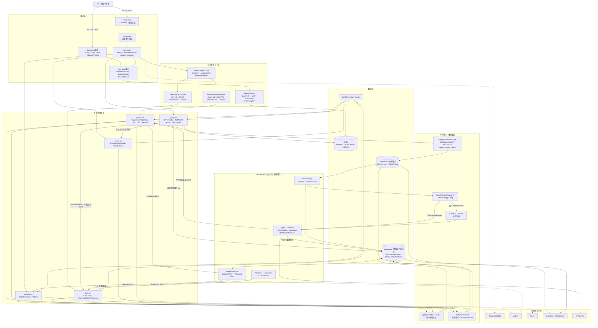
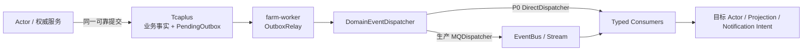
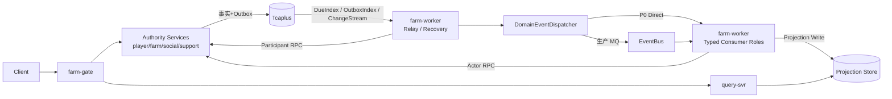
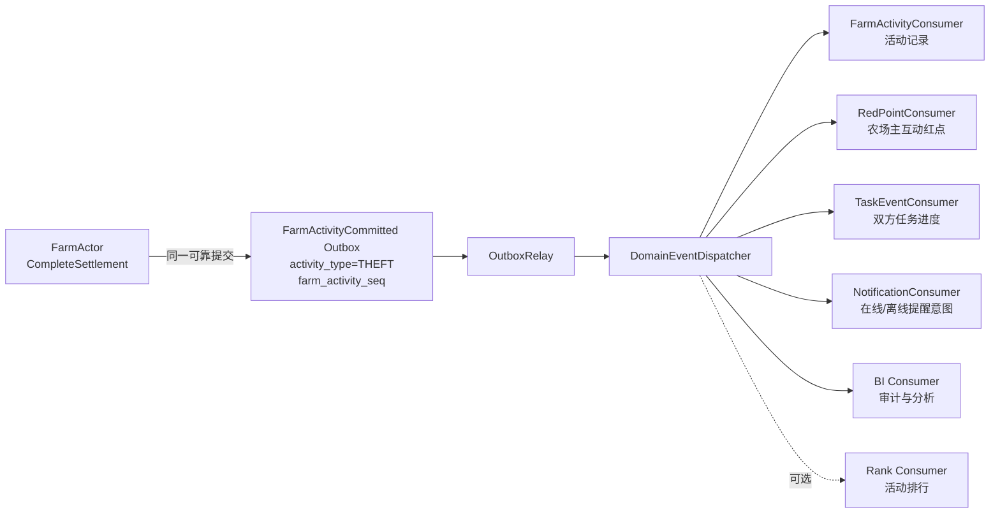
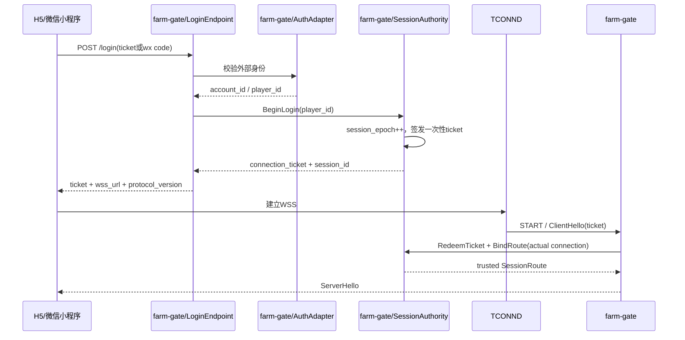
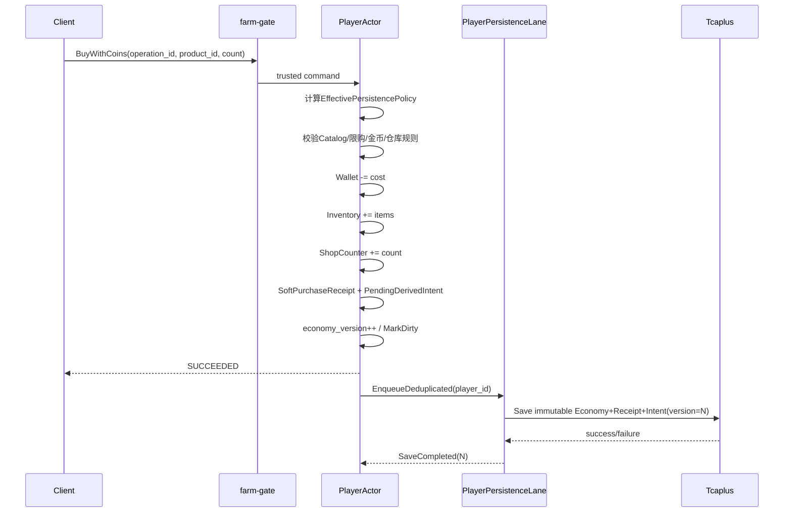
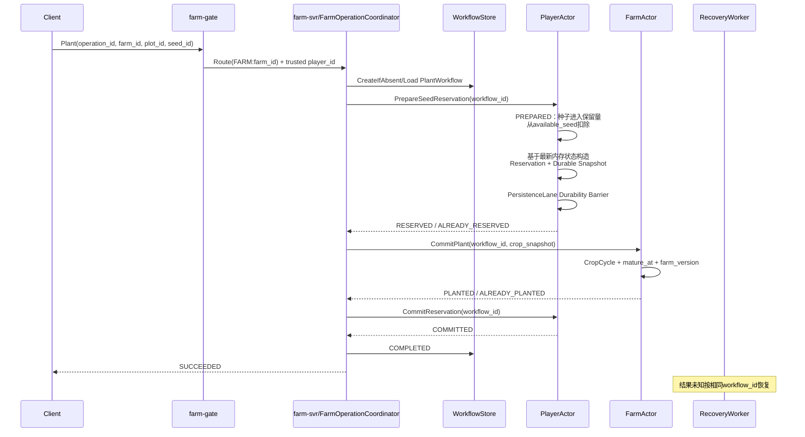
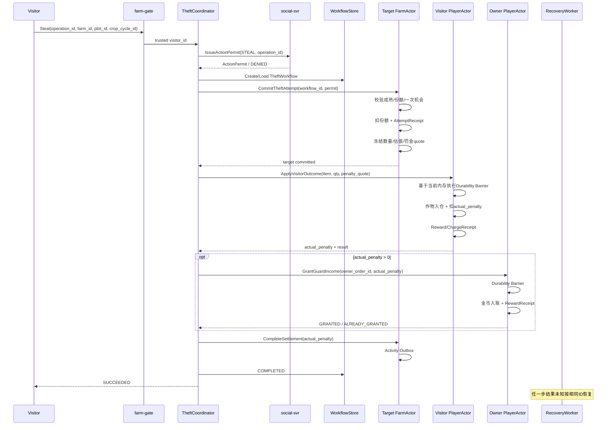
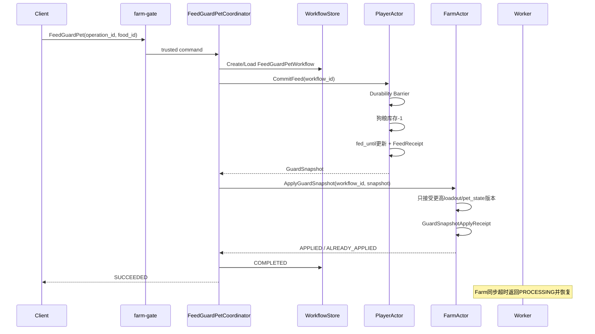
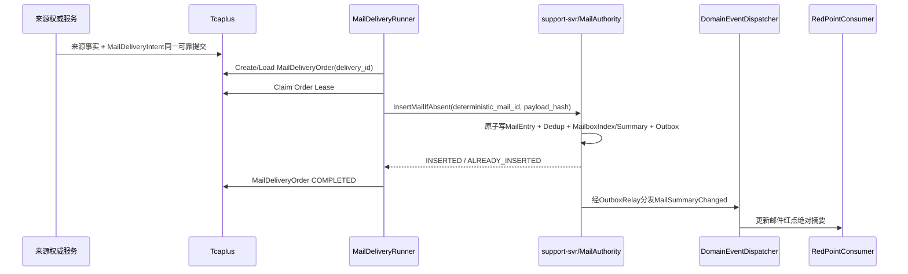

# 18 · 经典农场后台统一生产架构

> 历史稿提示（2026-07-29）：本文保留七部署单元阶段的完整推导，仅用于追溯，不再是当前
> 实现入口。当前四部署单元、Direct WebSocket 默认接入、TCONND 候选 Adapter、好友导航、
> Mail、混合持久化和 Tlog 的唯一总体架构见
> [22-production-architecture-v1.21](./22-production-architecture-v1.21.md)；接入/Tlog 摘要见
> [21-direct-websocket-tlog-freeze](./21-direct-websocket-tlog-freeze.md)。

版本：`v1.13-detailed-freeze-candidate`
日期：2026-07-28  
定位：后续开发、Agent 编码、架构评审、压测、故障演练、部署和答辩的唯一总体架构入口。

本文在 `v1.12-detailed-freeze-candidate` 基础上继续完成正式冻结前修订。核心架构仍是 **PlayerActor 混合持久化模型**：普通软资产保持 Actor 内线性一致并异步回写 Tcaplus；跨 Actor、跨玩家、付费、永久解锁和唯一领取仍通过可靠持久化、Workflow、Order 与 Receipt 保证可恢复。本版进一步冻结 Domain Event 分发的物理进度、消费者目录版本和生命周期，明确关键邮件 Intent/Order 分工，补齐 JoiningBuffer Fence/上限，并消除 Gate 连接事件与领域事件 Dispatcher 的命名冲突。

本文同时冻结：

- 四类命令执行与持久化策略及不同命令的成功语义；
- PlayerEconomyModel、DirtyModel、统一 PlayerPersistenceLane 和 Durability Barrier；
- SoftFlush 与 Barrier 的单写通道、版本和 Fence 语义；
- 派生状态不得领先来源事实的已持久化版本；
- 可靠派生 Intent 与来源 Economy Snapshot 同一可靠保存；
- 命令默认策略、商品/奖励配置和权威边界共同决定最终执行策略；
- 在线 Coordinator 的部署落点及 Worker 的恢复职责；
- PlayerPublicProfile 逻辑独立但当前不新增 infosvr；
- Social 权威关系与双边索引的恢复模型；
- 统一时间语义和 `operation_id` 作用域；
- FarmActivity 顺序来源与弹窗至少一次展示；
- 七个部署单元、双 Actor、Typed Workflow 和 Outbox 主干保持不变；
- 明确“架构服务、Go 进程、Kubernetes Deployment 与 Kubernetes Service 对象”不是同一概念；
- 详细冻结七个部署单元的服务类型、输入输出、权威边界、扩容指标和故障影响；
- 明确 `farm-worker` 是独立后台异步服务，解释其 Outbox、Workflow 恢复、投影、对账、通知和 Scheduler 职责，以及为什么不能放进在线服务或 PlayerPersistenceRuntime。
- 冻结逻辑服务、P0 部署映射和生产 Role Deployment 的关系，避免把 Service、Binary、Deployment 和 ClusterIP 画等号；
- 冻结 Worker 的 Go/Tcaplus/EventBus/Redis/gRPC 实现分工、有限执行写权和可靠发现合同；
- 冻结 MQ 的适用与禁用场景、偷菜完成后的多消费者扇出，以及 DirectDispatcher 到 MQDispatcher 的无业务重构演进；
- 明确 Workflow、关键邮件投递、Scheduler 成熟裁决和 Gate 下行不依赖 MQ 保证正确性；
- 升级总体生产架构图为 `v2.6-freeze-review`，在图面直接标出本轮 Dispatcher、Routing Snapshot、邮件和 JoiningBuffer 四项 Freeze 修订；
- 冻结 `DomainEventDispatcher`、`OutboxPublicationState`、`ConsumerDeliveryState`、不可变 Consumer Routing Snapshot 和 Consumer 生命周期；
- 冻结 Direct/MQ 为环境级部署模式，禁止 MQ 故障时自动热切 Direct；
- 冻结 `MailDeliveryIntent → MailDeliveryOrder → MailEntry` 三层职责和 MailAuthority 原子性阻塞项；
- 补齐每订阅 JoiningBuffer 的数量、字节、时长上限及 QueueAccepted 完整 Fence。
- 明确 query-svr 对核心事实只读，但允许写展示 Ack/游标；
- 明确 Login/AuthAdapter、TicketService 和 SessionAuthority 当前属于 farm-gate 部署；
- 按 P0a～P1 分阶段启用 Worker Role，不要求第一阶段实现完整异步平台。

旧文档可用于追溯讨论过程，但不得与本文混合作为实现合同。

---

## v1.13 本轮 Freeze 修订导航

如果只想确认本轮审核是否真正落入文档，优先检查下表，不需要在全文中搜索：

| 审核问题 | v1.13 冻结结果 | 正文位置 |
|---|---|---|
| Guard Workflow 命名残留 | 喂食=`FeedGuardPetWorkflow`；切换=`ApplyGuardLoadoutWorkflow`；Farm 本地步骤=`ApplyGuardSnapshot` | 12.3 |
| Gate 与领域 Dispatcher 同名 | Gate=`ConnectionEventDispatcher`；领域事件=`DomainEventDispatcher` | 5.1、11.6 |
| 发布完成与消费完成混淆 | `OutboxPublicationState` 与 `ConsumerDeliveryState` 分层 | 11.6 |
| Consumer 集合随配置漂移 | 事件创建时冻结不可变 `EventRoutingSnapshot` | 11.6 |
| Consumer ACK 争用热 Aggregate | 独立 `OutboxPublicationRecord` / `EventDeliveryRecord` | 11.6、`BLOCKER-P0B-07` |
| MQ 故障自动切 Direct | 明确禁止自动热切；仅允许带 `dispatcher_mode_epoch` 的受控 Runbook | 11.6 |
| 邮件 Intent/Order 混写 | `MailDeliveryIntent → MailDeliveryOrder → MailEntry` 三层职责 | 18.3 |
| 邮件插入原子边界不完整 | MailEntry、防重、MailboxIndex/Summary、Outbox 必须原子 | 18.3、`BLOCKER-P0D-01` |
| Join 快照与增量可能有空洞 | 每订阅有界 JoiningBuffer + 五字段 QueueAccepted Fence + `JOIN_RESYNC_REQUIRED` | 14.2 |
| P0c/P0d Consumer 范围冲突 | P0c 只真实运行基础投影；Task/RedPoint/Notification/Mail 在 P0d 接入 | 24.3、24.4 |

这张表是变更索引，不替代对应章节的完整实现合同。

---

## 文档权威层级

```text
L0：总体生产架构
  本文
  决定服务边界、数据权威、运行模型、执行与持久化策略、成功语义和故障语义

L1：领域详细设计
  Farm / Pet
  Task / Mail / RedPoint
  Social
  Scheduler
  Actor Runtime
  决定领域状态机、局部规则和局部数据结构

L2：接口与存储合同
  Protobuf / Error Code / Event Schema
  Tcaplus Table / Redis Key
  决定线上兼容和物理布局

L3：实现与运维
  Go package / Docker / Kubernetes
  Dashboard / Runbook / 压测 / 故障演练
```

冲突规则：

1. L0 决定权威归属、部署单元和正确性边界；
2. L1 不得改变 L0 的成功语义；
3. L2 是线上合同，实现不能绕过；
4. L3 发现设计不可实现时，必须回到上位评审，不得在代码中暗改语义。

---

---

## 0. 一页冻结结论

### 0.1 七个逻辑服务边界与基线部署单元

```text
farm-gate
player-svr
farm-svr
social-svr
support-svr
query-svr
farm-worker
```

七个名称代表**架构上的逻辑服务边界**。P0 基线将它们映射为七个独立部署单元；生产中同一逻辑服务可以按负载 Role 映射为多个 Deployment，但不因此增加新的领域权威或微服务合同。其中前六个主要承接在线请求，`farm-worker` 是后台异步服务。名称是否带 `-svr` 只是命名风格，不决定它是不是服务。

| 部署单元 | 服务类型 | 是否承接玩家在线命令 | 是否拥有业务权威 |
|---|---|---:|---:|
| farm-gate | 在线接入服务 | 是 | 否 |
| player-svr | 在线 Actor 权威服务 | 是 | 是，Player 权威 |
| farm-svr | 在线 Actor 权威服务 | 是 | 是，Farm 权威 |
| social-svr | 在线无状态权威服务 | 是 | 是，好友关系权威 |
| support-svr | 在线/订单型领域服务 | 是 | 是，Mail/Commerce/LiveOpsActivity 局部权威 |
| query-svr | 核心事实只读、展示状态可写的查询服务 | 是 | 否；只读核心投影，可写 Ack/游标等展示状态 |
| farm-worker | 后台异步服务 | 否，正常业务命令不以它为入口 | 无 Player/Farm 领域权威；在 Lease/CAS 下推进可靠执行状态 |

P0 中 `farm-worker` 使用一个独立 Go 二进制和一个 Kubernetes Deployment。生产可用同一二进制按 `critical/projection/notification/scheduler` Role 启动多个 Deployment。若 Worker 没有被其他服务主动 RPC 调用，可以不创建面向业务流量的 Kubernetes ClusterIP Service；这不影响它在架构上属于一个逻辑服务。

平台和基础设施：

```text
TCONND / gateproxy
Actor Shard Routing Platform
TcaplusDB
Redis
DomainEventDispatcher
EventBus / MQ（P0可不部署，生产推荐）
Config / Feature Toggle
Logs / Metrics / Trace / Audit / BI
Docker / Kubernetes
```

当前不增加：

```text
pet-svr
task-svr
mail-svr
redpoint-svr
rank-svr
profile-read-svr / infosvr
gm-svr
```

### 0.2 两种核心 Actor

```text
PlayerActor(player_id)
FarmActor(farm_id)
```

- PlayerActor 是钱包、仓库、商店限购、成长、宠物、任务和奖励的串行裁决者；
- FarmActor 是土地、作物、偷菜、护理、守护快照、同场版本和订阅的串行裁决者；
- Presence、Subscription、JoiningBuffer 虽由 FarmActor 持有，但属于可丢运行态；
- Task、Pet、Mail、Profile、RedPoint、Rank 和 Scheduler 不建立新的 Actor。

### 0.3 四类命令执行与持久化策略

这四类是命令执行策略，不是简单的线性“耐久等级”。`WORKFLOW_DURABLE` 表示跨权威协调，或同一权威内缺少原子事务的多记录可恢复流程；其中每个参与者的本地不可逆步骤仍必须达到 `LOCAL_DURABLE`。

| 策略 | 成功语义 | 典型场景 |
|---|---|---|
| `RUNTIME_ONLY` | 可丢失、可重建 | Presence、Subscription、JoiningBuffer |
| `ACTOR_SOFT` | PlayerActor 内存事务已线性提交；异步落库；接受受控硬崩溃 RPO | 普通金币、普通种子/作物/道具、普通 ShopCounter |
| `LOCAL_DURABLE` | 单权威状态、Receipt 和必要 Outbox 在返回最终成功前可靠落库 | FarmActor 持久地块/作物步骤、付费货币、永久解锁、唯一奖励；能在 PlayerActor 单一可靠写单元闭合的任务领取 |
| `WORKFLOW_DURABLE` | 跨权威或无原子事务的多记录流程使用 Workflow/Order；每个参与者本地步骤均为 `LOCAL_DURABLE` | Plant、Harvest、Theft、Care、FeedGuardPet、MailClaim；无法单写单元闭合的 TaskClaim |

策略不能只按命令名静态决定。服务端计算：

```text
EffectivePersistencePolicy
= ResolvePolicy(
    command_catalog_default,
    item_and_reward_requirements,
    permanent_side_effects,
    authority_participants,
    physical_atomic_capability
  )
```

客户端不能指定或降低该策略。普通商品可以走 `ACTOR_SOFT`；同一个购买入口一旦涉及付费货币、唯一物品或永久解锁，必须升级为 `LOCAL_DURABLE` 或 `WORKFLOW_DURABLE`。

`ResolvePolicy` 不是简单数值取最大值，而是先判断是否需要持久事实，再判断本地步骤是否允许 Soft，最后根据权威参与者和物理原子能力决定使用单权威提交还是 Workflow/Order。

准确表述：

```text
业务一致性：
  同一玩家仍由PlayerActor线性裁决

持久化时机：
  普通软资产允许异步回写

关键边界：
  跨Actor、跨玩家、唯一领取、付费和永久副作用不得走裸Dirty
  WORKFLOW_DURABLE不是更高一级的单记录提交，而是多个LOCAL_DURABLE参与步骤或多记录步骤的可恢复协调
```

### 0.4 技术选择

| 链路 | 选择 | 原因 |
|---|---|---|
| 登录与静态页面 | HTTPS + JSON | 低频、易调试、适合身份认证 |
| 游戏在线主链 | WSS + Binary Protobuf | 双向 Push、多人增量、消息体小、Schema 可演进 |
| 生产长连接 | TCONND + gateproxy | 复用公司连接治理，隔离公网连接与业务 |
| 服务间同步调用 | gRPC + Protobuf | 强类型、Deadline、拦截器和代码生成 |
| 权威数据 | TcaplusDB | 海量 Key、CAS、水平扩展、公司游戏基础能力 |
| 短期状态和热投影 | Redis | Session、限流、Rank、可重建索引 |
| 权威并发模型 | Actor + Virtual Shard | 同 Key 串行、不同 Key 并行、支持迁移和扩缩容 |
| 跨 Actor 一致性 | Typed Workflow + Participant Receipt | 不依赖跨记录分布式事务，可重试恢复 |
| 可靠异步来源 | Authority Commit + Outbox | 避免 DB 成功但派生意图永久丢失；Outbox 才是恢复真值 |
| 异步事件分发 | P0 DirectDispatcher；生产 EventBus/MQDispatcher | P0 降低基础设施复杂度；生产获得跨服务解耦、削峰、独立扩容与重放 |
| 普通软资产 | DirtyModel + PlayerPersistenceLane + Versioned Async Writeback | 降低在线尾延迟并合并写入，同时与 Barrier/ForceFlush 串行 |

### 0.5 核心正确性原则

1. 同一 `player_id` 的业务裁决只由当前 PlayerActor 完成。
2. 同一 `farm_id` 的农场强操作只由当前 FarmActor 完成。
3. Actor turn 不同步等待另一个 Actor、Gate 或远程业务服务。
4. Gate 不创建或推进跨 Actor Workflow。
5. WorkflowRecord 是跨权威流程的唯一全局进度。
6. Reservation、Settlement、RewardReceipt 和 ChargeReceipt 只证明参与者本地步骤。
7. Workflow 必须在第一次不可逆参与者提交前创建。
8. `ACTOR_SOFT` 只允许普通软资产，不能扩散到跨 Actor、唯一领取和付费交易。
9. FarmActionState 的地块、作物、份额、护理和守护快照没有 `ACTOR_SOFT` 路径；每个 Farm 参与步骤均先 `LOCAL_DURABLE`。
10. 任意 `LOCAL_DURABLE` 或 `WORKFLOW_DURABLE` 操作只要读取、扣减或发放 PlayerActor 当前资产，就必须在该 Player 参与步骤执行 Durability Barrier；Farm/Social/Support 的单权威步骤直接使用本地可靠 CommitWithOutbox。
11. 同一 PlayerActor 的 SoftFlush、Durability Barrier 和 ForceFlush 共用一个 PlayerPersistenceLane，任意时刻最多一个存储写请求 in-flight。
12. Actor 可以等待自身权威存储的可靠提交，但不能在一个 turn 内等待另一个 Actor、Gate 或远程业务服务；跨参与者等待由 Coordinator/Workflow 承担。
13. 派生状态的持久化版本不得领先来源事实的已持久化版本。
14. 不能永久丢失的派生 Intent 必须与来源事实处于同一可靠保存；不能采用“保存成功后才在内存生成 Intent”的有崩溃空洞方案。
15. 权威事实和关键 Outbox 必须处于同一可靠提交。
16. DomainEventDispatcher/EventBus 是分发通道，不是恢复真值；无论 Direct 还是 MQ，均从已可靠提交且可发现的 Outbox 恢复。
17. Reward/ChargeReceipt 在防重窗口内必须与资产变化处于同一可靠写单元。
18. Presence 不能证明好友权限；Join 与强操作分别校验授权。
19. Query、Profile、RedPoint、Rank、FarmPublicSummary 和 FarmActivityFeed 都不是强业务真值。
20. 作物成熟由 `now >= mature_at` 决定，Scheduler 只负责主动副作用。
21. 连接路由、Session 路由和 Actor 路由是三套不同地址。
22. 所有持久业务时间使用 UTC Unix Milliseconds；客户端时间只用于展示。
23. 幂等键作用域为 `(subject_player_id, command_type, operation_id)`。
24. 优雅迁移普通软资产目标 RPO=0；节点硬崩溃允许有界软资产 RPO；关键经济 RPO=0。

---

## 1. 从玩法和冲突范围推导架构

### 1.1 三个核心 Loop

个人经营：

```text
购买种子
→ 播种
→ 等待成熟
→ 收获
→ 作物入仓
→ 出售/成长
```

经济：

```text
金币
→ 种子/道具
→ 土地生产
→ 作物
→ 出售/订单
→ 金币与经验
```

社交：

```text
好友列表
→ 查看互动状态
→ 进入好友农场
→ 偷菜/护理
→ 同场动画
→ 活动记录/红点
→ 回到自己的农场
```

这三个 Loop 产生两个主要冲突键：

- `player_id`：钱包、仓库、经验、宠物、任务和奖励；
- `farm_id`：地块、作物周期、护理事件、可偷份额、同场版本和广播。

因此选择 PlayerActor 与 FarmActor，而不是先看到 Actor 框架再套业务。

### 1.2 冻结的偷菜语义

偷菜包含三种不同量，禁止混用：

```text
loot_item_quantity       实际进入访客仓库的作物数量
loot_display_value_coin  页面显示的作物金币估值
actual_penalty_coin      宠物实际从访客钱包扣除的金币
```

规则：

1. 未成熟作物不可偷；
2. 同一好友对同一 `crop_cycle_id` 只有一次成功尝试机会；
3. 守护宠物不阻止偷菜，访客仍获得作物；
4. 页面可以显示“偷到价值 X 金币的作物，被宠物咬掉 Y 金币”；
5. `loot_display_value_coin` 只是估值，不直接增加访客钱包；
6. 访客仓库增加作物，访客钱包扣除实际罚金；
7. 农场主钱包增加与访客实际扣款完全相同的金币；
8. 金币不允许为负；
9. 作物估值、罚金规则和配置版本在 FarmActor 裁决时冻结，重试不得重新计算。

推荐默认公式，具体比例仍是产品配置：

```text
loot_display_value_coin
  = stolen_quantity × valuation_unit_price_snapshot

actual_penalty_coin
  = min(
      penalty_quote_coin,
      loot_display_value_coin,
      visitor_wallet_balance
    )

owner_income_coin
  = actual_penalty_coin
```

### 1.3 冻结的护理与宠物语义

- 一次缺水、虫害或杂草事件只允许一个好友完成；
- 其他好友随后得到 `NO_CHANGE/ALREADY_RESOLVED`，但可看到成功者的广播动画；
- 当前守护宠物在有效喂食期内可触发护理礼盒；
- 一次判定触发后，农场主和护理者各得到一份礼盒；
- 技能有按 `period_id` 懒重置的每日上限，不建立午夜 Timer；
- 守护有效性由 `now < fed_until_ms` 派生；
- 喂当前守护宠物使用 `FeedGuardPetWorkflow`，切换守护宠物使用 `ApplyGuardLoadoutWorkflow`；二者在 Farm 的本地参与步骤统一调用 `ApplyGuardSnapshot`。

---

---

## 2. 总体生产架构

答辩与汇报使用的正式总图：


下面的 Mermaid 是与代码边界对应的可维护关系图。PNG 强调分层和汇报可读性，Mermaid 强调调用方向、权威边界和异步恢复；二者语义必须一致。



图中有两类写路径：

```text
普通软资产：
PlayerActor内存事务
→ DirtyModel
→ 版本化异步回写Tcaplus

关键业务：
Durability Barrier / Authority Commit
→ 同步可靠持久化
→ 才推进Workflow或返回最终成功
```

### 2.1 正确的异步事件链

禁止：

```text
业务事实提交
→ 直接Publish MQ
```

因为数据库成功、Publish 失败会永久丢事件。

正确链路首先保证来源事实与 Outbox 同提交，然后由环境级固定的 `DomainEventDispatcher` 负责分发：



图中的 P0 Direct 并不是“提交后直接调用一次，失败就算了”，而是：

```text
OutboxRelay从可靠索引发现事件
→ DirectDispatcher按订阅目录调用各Typed Consumer
→ 每个Consumer可靠提交目标状态和ConsumerReceipt
→ 每个必需Consumer都ACK后，Outbox才进入DONE
→ 任一步失败均可从Outbox重试
```

生产环境把同一个接口替换为 MQDispatcher：

```text
OutboxRelay
→ MQ Publish并取得Broker ACK
→ 独立Consumer Group消费
→ 目标状态 + ConsumerReceipt可靠提交
→ Consumer ACK
```

两种模式使用相同的 `EventEnvelope`、`event_id`、`source_version`、`payload_hash` 和 Consumer Receipt 合同，业务模块不感知当前部署模式。MQ 可重复、延迟和乱序，也不能让“数据库提交 + Publish”天然成为原子事务；MQ 故障不回滚已提交核心事实，也不得触发自动热切 Direct，具体切换合同见第 11.6 节。

---

## 3. 七个服务边界：如何部署、为什么需要、如何协作

### 3.1 先澄清四个不同概念

项目讨论中容易混淆：

```text
架构服务
Go二进制/进程
Kubernetes Deployment
Kubernetes Service对象
```

它们不是同一个概念。

- **架构服务**：拥有明确职责、接口、扩容和故障边界的运行单元；
- **Go 二进制/进程**：服务的程序实现和运行载体；
- **Kubernetes Deployment**：负责副本、发布和 Pod 生命周期；
- **Kubernetes Service 对象**：为需要被主动访问的 Pod 提供稳定网络地址。

当前映射是：

```text
逻辑服务farm-worker
  P0 → 一个Go二进制 + 一个Deployment
  生产 → 同一二进制可按Role运行多个Deployment
  仅在需要被主动调用时创建ClusterIP
```

这是部署映射，不是语义等号。一个逻辑服务可以有多个 Deployment；同一个 Go 二进制也可以通过启动参数承担不同 Role。Worker 通过可靠索引发现 Tcaplus 工作、使用 DirectDispatcher 或消费 EventBus，并主动调用其他服务时，可以不提供业务 ClusterIP，只暴露健康、Metrics 或管理入口。

### 3.2 七个服务的类型和核心边界

| 逻辑服务 | 服务类型 | 主要输入 | 主要输出 | 真值/状态 | 主要扩容信号 |
|---|---|---|---|---|---|
| farm-gate | 在线接入服务 | HTTPS/WSS、TCONND 连接事件 | 后端 RPC、客户端 Response/Push | SessionRoute 等短期状态；无业务真值 | 连接数、带宽、下行队列、握手 QPS |
| player-svr | 在线 Actor 权威服务 | 玩家命令、Workflow Participant RPC、Task Event | Player 结果、Receipt、Player Outbox | Player 钱包、仓库、宠物、任务等权威 | 活跃 PlayerActor、Mailbox、内存、持久写 QPS |
| farm-svr | 在线 Actor 权威服务 | 农场命令、Social Permit、Workflow RPC | FarmChange、Farm Settlement、Farm Outbox | 土地、作物、偷菜、护理等权威 | 活跃 FarmActor、热点农场、广播、CAS QPS |
| social-svr | 进程无 Actor、数据有权威的在线服务 | 好友/分享请求、Permit 请求 | FriendRelation、FriendIndex、Permit | Tcaplus 中的好友关系和黑名单权威 | 关系写 QPS、分页 QPS、Permit QPS |
| support-svr | 在线/订单型领域服务 | 邮件、复杂订单、运营活动命令 | Mail/Commerce Order、领域结果 | 邮件资格、复杂订单和 LiveOpsActivity 局部权威 | Order QPS、Mail Query/Claim QPS、积压 |
| query-svr | 核心事实只读、展示状态可写的查询服务 | 页面查询、展示 Ack | 聚合页面、Profile/RedPoint/Rank/Feed | 无核心真值；读取投影，写 Ack/展示游标 | 查询 QPS、缓存命中、BatchRead P99 |
| farm-worker | 后台异步服务 | Outbox、DirectDispatcher/EventBus、Workflow/Order、ScheduleJob | 事件投递、流程恢复、投影、通知 Intent | 无领域聚合真值；在 Lease/CAS 下推进外部可靠执行状态 | Consumer Lag、Pending Age、DueIndex 积压、Job Backlog |

### 3.3 服务之间的三条主链

#### 在线命令链

```text
Client
→ farm-gate
→ 对应在线业务服务
→ PlayerActor / FarmActor / Social / Support
→ 返回结果
```

目标是低延迟。`farm-worker` 不处于普通 Buy、Plant、Steal 的同步首跳链路。

#### 可靠异步链

```text
权威服务
→ 业务事实 + Outbox 同一可靠提交
→ farm-worker / OutboxRelay
→ DomainEventDispatcher（P0 Direct / 生产 MQ）
→ Typed Consumer
→ 投影、目标Actor或通知Intent
```

目标是不丢事件、允许重试和解耦在线请求。

#### 故障恢复链

```text
前台Coordinator超时或崩溃
→ WorkflowRecord仍为非终态
→ farm-worker / WorkflowRunner取得Lease
→ 查询Participant Receipt
→ 使用相同workflow_id/order_id续跑
→ 最终收敛
```

目标是让客户端收到 `PROCESSING` 后，流程仍能在没有原连接、没有原 Coordinator 的情况下完成。



### 3.4 farm-gate：在线接入服务

#### 做什么

```text
登录适配
一次性Connection Ticket
SessionEpoch和顶号
WSS/Protobuf协议
命令准入和限流
首跳路由
后端连接池
ConnectionWriter FIFO
下行背压
Gate Drain
```

当前部署归属冻结：

```text
farm-gate进程
├── HTTPS Login Endpoint
├── AuthAdapter（调用UIC/微信身份平台）
├── TicketService
├── SessionAuthority / SessionRoute
├── WSS Command Gateway
└── DownlinkService

Redis
└── Session/Ticket/Route短期状态
```

UIC 或微信登录是外部身份平台，不是本项目新增服务。未来登录 QPS、独立 SLA 或安全边界形成证据后，可以拆 Auth 服务；P0 不新增 `login-svr` 或 `session-svr`。

#### 为什么需要独立

Gate 的资源模型是：

```text
公网连接数
TLS/WSS
带宽
慢客户端
发送队列
```

业务 Actor 的资源模型是：

```text
Actor内存
Mailbox
业务计算
Tcaplus读写
```

把两者混在一起，慢客户端和网络波动可能直接拖慢 Actor。独立 Gate 让连接层可抛弃、可重连，而 Player/Farm 事实仍保留。

#### 不允许做什么

- 不写钱包和农场；
- 不校验最终好友权限；
- 不创建、保存或推进 Workflow；
- 不根据客户端参数选择 Actor Holder；
- 不让 Actor 等待 Socket Flush。

#### 故障与扩容

Gate 崩溃主要导致客户端重连、Bootstrap 和 Re-Join，不应造成资产或作物丢失。按连接数、带宽、下行队列和握手峰值独立扩容。

### 3.5 player-svr：PlayerActor 在线权威服务

#### 做什么

```text
PlayerIngress / Coordinator
PlayerActor(player_id)
Economy / Wallet / Inventory / Shop
Pet / Task / Reward
PlayerPersistenceRuntime
```

权威拥有：

```text
普通金币与仓库
付费货币
ShopCounter
经验/等级和永久解锁
宠物和狗粮
任务状态
Reward/Charge/Reservation Receipt
```

#### 为什么需要独立

绝大多数玩家经济操作都以 `player_id` 冲突：

```text
购买
出售
发奖励
扣罚金
邮件/任务领取
喂宠物
```

PlayerActor 提供同玩家串行裁决。player-svr 还需要独立扩容，因为活跃玩家数量、Actor 状态字节和 Player 持久写 QPS 与 Farm 热点不同。

#### 为什么 PlayerPersistenceRuntime 不能放 farm-worker

`ACTOR_SOFT` 的最新状态只存在当前 PlayerActor 内存。以下组件必须和 Actor 生命周期、writer_epoch 和 Mailbox 配合：

```text
DirtyTracker
SnapshotSerializer
PlayerPersistenceLane
DeduplicatedWritebackQueue
SaveCompletionDispatcher
UnknownOutcomeResolver
ForceFlushController
```

farm-worker 只能基于**已经持久化**的 Workflow、Outbox、Order 和 Receipt 恢复工作，不能可靠读取另一个进程中尚未落库的 Actor 内存。因此：

```text
Player普通软资产异步保存
→ player-svr内部PersistenceRuntime

跨服务Workflow恢复
→ farm-worker
```

#### 故障与扩容

按活跃 PlayerActor、Mailbox 等待、Actor 内存、Dirty Age、Barrier QPS 和 Tcaplus 写延迟扩容。计划迁移必须 ForceFlush；硬崩溃只允许已声明的普通软资产 RPO。

### 3.6 farm-svr：FarmActor 在线权威服务

#### 做什么

```text
FarmIngress
FarmOperationCoordinator
FarmActor(farm_id)
FarmReadPath
Presence / Subscription / JoiningBuffer
```

权威拥有：

```text
土地和CropCycle
mature_at
可偷份额
TheftAttemptReceipt
CareIncident
AppliedGuardSnapshot
farm_version / farm_activity_seq
Farm Settlement和Outbox
```

#### 为什么需要独立

多人同时访问同一农场，冲突键是 `farm_id`。FarmActor 邮箱为：

```text
偷同一茬
收获与偷菜竞争
多人护理同一事件
同场版本和广播
```

提供唯一顺序点。

Farm 的热点形态与 Player 不同：一个热门农场可能集中大量访客和广播，因此需要独立人数限制、命令限频和扩容监控。

#### Coordinator 为什么在 farm-svr

Plant、Harvest、Theft、Care 的主要共享冲突和最终业务对象是目标 Farm。Coordinator 在 Actor turn 外编排 Player/Farm Participant，但 FarmActor 自己绝不等待另一个 Actor。

#### 故障与扩容

按活跃 FarmActor、Mailbox、单 Farm TopK、Presence 人数、广播 QPS 和 Farm CAS 延迟扩容。Pod 崩溃后新 Holder 从 Tcaplus 加载，Presence 通过 Re-Join 重建。

### 3.7 social-svr：在线无状态关系权威服务

#### 做什么

```text
好友申请、接受、删除
黑名单
分享邀请
FriendRelation权威
FriendIndex分页
VisitPermit
ActionPermit
InviteReceipt
```

#### 为什么需要独立

好友关系是独立安全边界。Presence 和“已经进入农场”不能证明仍是好友。每次 Join 或强操作需要由 Social 权威签发 Permit。

#### 为什么不建 SocialActor

好友关系是规范化 Pair Key，可以通过：

```text
条件写
relation_version
幂等Receipt
Outbox驱动双边Index
Reconcile
```

处理。建立 SocialActor 会遇到一条关系属于 A 还是 B 的双边归属问题，当前收益不足。

#### 故障与扩容

Social 不可用时，已有 Farm/Player 状态不丢，但新的好友强操作应拒绝或短暂重试，不能仅凭 Presence 放行。按 Permit QPS、关系写和分页 QPS 扩容。

### 3.8 support-svr：在线/订单型领域服务

#### 做什么

当前只容纳：

```text
MailDomain
复杂CommerceDomain
LiveOpsActivityDomain（运营活动，不是FarmActivityFeed）
```

准入规则：

> 无 Actor、相对低频、订单驱动、可以和 Player/Farm 热路径隔离。

#### 为什么需要

邮件资格、复杂订单和活动配置拥有自己的状态机和数据生命周期，但当前尚未形成各自独立扩容曲线。合并到 support-svr 可以减少微服务数量，同时保留逻辑边界。

#### 为什么简单金币商店不在这里

普通金币购买同时修改 PlayerActor 的钱包、库存和限购计数，放 PlayerActor 内可形成一个 EconomyTxn。把它远程化到 support-svr 只会破坏原子边界并增加 RPC。

#### 防止变成“万能服务”

各模块必须独立：

```text
package
Repository
物理表
错误码
指标
Order状态机
```

support-svr 不能直接改 Player/Farm 数据，只能通过 Participant RPC 和 Order 协作。

### 3.9 query-svr：核心事实只读、展示状态可写的查询服务

#### 做什么

```text
QueryBFF
PlayerPublicProfileQuery
FarmPublicSummaryQuery
FriendPage聚合
RedPointQuery/Ack
RankQuery
FarmActivityFeedQuery
降级和缓存
```

#### 为什么需要独立

页面查询经常跨多个领域做批量聚合，负载以读 QPS、BatchGet、缓存命中和 P99 为主。如果让 Player/Farm Actor 承担大量好友页和排行榜读取，会激活冷 Actor、增加 Mailbox 排队并污染权威热路径。

#### 权威边界

query-svr 对核心业务事实只读：

```text
Profile
Summary
RedPoint
Rank
Feed
```

它不能：

- 校验真实余额；
- 修改 Player/Farm；
- 决定偷菜是否允许；
- 决定任务/邮件能否领取。

它可以写入非核心展示状态：

```text
RedPointAck
PopupShownAck
last_popup_seq
PlayerActivityViewState
查询缓存
```

这些写入只表达“用户看过什么”，不能反向改变任务、邮件、资产或农场资格。

玩家自己的钱包和仓库读取当前 PlayerActor；真正的偷菜和护理仍回到 Social Permit + FarmActor。

#### 故障与扩容

Query 故障主要导致页面降级，不应影响核心经营写入。按 Query QPS、Cache Hit、BatchRead P99 和热点 Key 独立扩容。

### 3.10 farm-worker：独立后台异步服务

#### 它到底是什么

```text
逻辑层：
  farm-worker = 后台异步服务边界

P0部署：
  一个Go二进制
  一个Kubernetes Deployment

生产部署：
  同一二进制可按Role运行多个Deployment
```

它没有叫 `farm-worker-svr`，只是为了让名称直接表达它的负载模式是 Consumer、Relay、可靠发现和 Recovery，而不是面向客户端的同步 RPC。名称后缀不改变它是逻辑服务的事实。

#### 它运行哪些角色

| Worker Role | 输入 | 输出 | 解决的问题 |
|---|---|---|---|
| OutboxRelay | Tcaplus 中已提交 PendingOutbox | DomainEventDispatcher Event | 防止 DB 成功、后续分发失败造成永久丢事件 |
| WorkflowRunner | 非终态 WorkflowRecord、Lease、Participant Receipt | 调用 Player/Farm/Social/Support Participant，推进 Workflow | 原 Coordinator 超时、崩溃或客户端断线后继续完成流程 |
| TaskEventConsumer | 已成立领域事件 | PlayerActor.ApplyTaskEvent | 将 Farm/Social 等外部事实可靠送入 TaskDomain |
| ProfileProjectionConsumer | Player Profile Intent/Outbox | PlayerPublicProfile | 构建好友页公开资料，不激活冷 PlayerActor |
| FarmSummaryConsumer | Farm Summary Event | FarmPublicSummary | 构建可重建农场读摘要 |
| RedPointConsumer | Task/Mail/Social/Farm 绝对摘要 | PlayerRedPointProjection | 聚合红点但不成为资格真值 |
| RankConsumer | 等级、财富、活动等可靠事件 | Rank Projection / Redis ZSET | 将排行榜计算移出在线权威链 |
| FarmActivityConsumer | FarmActivityCommitted | FarmActivityFeed | 构建访问记录、宠物守护记录和弹窗数据 |
| SocialIndexConsumer | FriendRelationOutbox | A/B FriendIndex | 修复好友双边分页索引 |
| NotificationWorker | NotifyIntent / FriendActionInbox | Gate Downlink / 离线通知 | 将可靠意图转成最佳努力推送 |
| ReconcileWorker | 权威版本、投影版本、Order/Receipt | 重建投影；按已有 Order/Receipt 发确定性修复命令 | 处理事件长期积压、历史 Bug 和部分失败 |
| Scheduler Roles | ScheduleJob / DueIndex | 到期后唤醒 FarmActor重新判断 | P1 主动成熟提醒和好友互动机会通知；不改变作物成熟状态 |

#### 这些异步 Role 有什么区别、什么时候使用

| Role | 关注的问题 | 什么时候触发 | 是否执行业务状态机 |
|---|---|---|---:|
| WorkflowRunner | 一个跨 Actor/跨服务操作做到一半怎么办 | Workflow 非终态且 `retry_at` 到期，或前台返回 PROCESSING | 是，按已冻结步骤续跑 |
| OutboxRelay | 已提交事实怎样可靠进入分发层 | 权威记录中出现可发现的 PendingOutbox | 否，只搬运可靠事件 |
| Typed Consumer | 收到事件后怎样更新任务/投影/红点 | DirectDispatcher 或 EventBus 投递事件 | 只执行对应 Consumer 合同 |
| ReconcileWorker | 事件长期漏处理或历史数据不一致怎么办 | 周期分桶、版本差异、人工审计任务 | 只重建投影或执行有依据的修复 |
| Scheduler | 到了某个时间点怎样主动唤醒系统 | `due_at <= now` | 否，唤醒权威 Actor 重新裁决 |
| NotificationWorker | 已经产生通知意图后怎样送到用户 | NotifyIntent/FriendActionInbox 可投递 | 否，只做最佳努力送达 |

典型区别：

```text
偷菜执行到一半超时
→ WorkflowRunner继续结算

偷菜已经完成，需要生成任务/活动记录
→ OutboxRelay发布事件
→ Typed Consumer构建任务或Feed

某次Consumer历史故障导致Profile版本落后
→ ReconcileWorker按source_version修复

作物到达mature_at，需要主动提醒
→ Scheduler唤醒FarmActor复核
→ 产生NotifyIntent
→ NotificationWorker推送
```

#### 什么是最终一致投影

投影是为了查询方便，从权威事实复制、裁剪或聚合出来的读模型，例如：

```text
PlayerActor权威状态
  level=20
      ↓ 异步构建
PlayerPublicProfile投影
  level=20

FarmActor权威状态
  当前成熟地块和可互动事件
      ↓ 异步构建
FarmPublicSummary投影
  can_interact_hint=true
```

“最终一致”表示投影允许短暂落后：

```text
t1 PlayerActor已可靠升到20级
t2 ProfileConsumer尚未处理，好友页暂时仍看到19级
t3 Consumer或Reconcile完成，好友页更新为20级
```

投影不能用于购买、扣款、偷菜和领奖裁决；这些操作必须回到 Player/Farm/Social/Mail 权威。ReconcileWorker 比较 `source_version`，将长期落后的投影重建到权威版本，但不能凭差异直接猜测并修改金币或作物。

#### farm-worker 具体用什么实现

`farm-worker` 本身是 Go 后台进程，各基础设施分工如下：

| Role | Go 执行方式 | 可靠状态 | 对外通信 |
|---|---|---|---|
| WorkflowRunner | 分桶发现、CAS Claim Lease、状态机、退避重试 | Tcaplus WorkflowRecord/Order/Receipt | gRPC 调用 Player/Farm/Social/Support Participant |
| OutboxRelay | 可靠发现、Claim、Dispatch、Ack | Tcaplus PendingOutbox/OutboxIndex 或 Change Stream | P0 DirectDispatcher；生产 EventBus Producer |
| Typed Consumer | Handler/Consumer Group、幂等、source_version 检查 | EventReceipt、目标投影或 Actor Receipt | Direct Handler 或 EventBus Consumer + Actor gRPC/Tcaplus |
| ReconcileWorker | 分桶水位、版本对账、限速修复 | Tcaplus 权威版本、投影版本、RepairOrder | 投影写或经 Actor 执行确定性修复 |
| Scheduler | DueIndex 轮询、Lease、批量 Dispatch | Tcaplus ScheduleJob；Redis 仅作近端 ZSET | gRPC 唤醒 FarmActor |
| NotificationWorker | Intent 消费、SessionRoute 查询、限流 | NotifyIntent/DeliveryReceipt | Redis SessionRoute + farm-gate Downlink |

因此不是在 Tcaplus、MQ 和 Redis 中三选一：

```text
Go                     执行Worker逻辑
TcaplusDB              保存可靠进度和恢复真值
DomainEventDispatcher  隔离业务事件与具体分发设施
EventBus/MQ（生产）    传递跨服务异步事件
Redis                  保存可重建热索引和近端定时索引
gRPC                   调用真正的权威服务
```

#### MQ/EventBus 何时使用，何时不使用

MQ 的价值是**跨服务事件解耦、削峰、独立扩容和重放**，不是提供业务事务，也不是替代 Workflow、Outbox 或 Tcaplus。

适合进入 MQ 的场景：

| 事件 | 生产者 | 典型消费者 | 为什么适合 MQ |
|---|---|---|---|
| `FarmActivityCommitted`（含偷菜、护理） | FarmActor | Activity、RedPoint、Task、Notification、BI，可选 Rank | 一个已完成事实需要扇出给多个互不阻塞的消费者 |
| `PlayerProfileChanged` | PlayerActor | ProfileProjection、好友页缓存、BI | 允许短暂延迟，读模型可重建 |
| `FarmSummaryChanged` | FarmActor | FarmSummary、FriendHint、BI | 热点变化可削峰，好友页不应激活大量 Actor |
| `TaskSummaryChanged` | PlayerActor/TaskDomain | RedPoint、QueryProjection | 红点是派生展示，不应拖慢任务提交 |
| `MailSummaryChanged` | support-svr | RedPoint、QueryProjection、Notification | 邮件已经可靠写入后再异步更新展示和提醒 |
| `FriendRelationChanged` | social-svr | 双边 FriendIndex、Notification、BI | 好友关系真值与分页索引解耦，索引可修复 |

不应依赖 MQ 的场景：

| 场景 | 正确实现 | 原因 |
|---|---|---|
| Player/Farm 在线命令裁决 | Actor + Tcaplus/内存事务 | MQ 不能提供同步返回和同 Key 线性顺序 |
| Plant/Harvest/Theft/Care 等跨 Actor 流程 | WorkflowRecord + Lease + Participant gRPC | 需要显式步骤、补偿边界和结果查询，不是广播消费 |
| 关键补偿邮件、付费邮件、唯一奖励邮件 | `MailDeliveryIntent → MailDeliveryOrder → InsertMailIfAbsent` | 必须知道指定邮件是否已可靠创建，不能只相信事件已发送 |
| 作物成熟正确性 | `mature_at` + FarmActor 计算 | Scheduler/MQ 故障不能让作物“不成熟” |
| Scheduler 到期唤醒 | ScheduleJob + Lease + gRPC | 唤醒是定向命令，ScheduleJob 才是恢复真值 |
| Gate 在线下行 | SessionRoute + farm-gate Downlink | 需要连接代际、队列与背压语义，直接投递更清晰 |
| PlayerActor Dirty/Barrier 落库 | PlayerPersistenceLane | 这是同一 Actor 的单写通道，不是事件消费问题 |

P0 与生产的冻结选择：

```text
P0：
  Authority Commit + Outbox
  → OutboxRelay
  → DirectDispatcher
  → 进程内Typed Consumer或定向gRPC

生产：
  Authority Commit + Outbox
  → OutboxRelay
  → MQDispatcher
  → EventBus
  → 独立Consumer Group
```

事件创建时必须冻结 `EventRoutingSnapshot`；发布进度使用独立
`OutboxPublicationRecord`，Direct 模式下每个消费者的投递进度使用独立
`EventDeliveryRecord(event_id, consumer_id)`。禁止把消费者 ACK 数组写回
Player/Farm 热 Aggregate。完整状态、完成点、消费者生命周期和 Direct/MQ
受控切换合同见第 11.6 节。

消费者侧以 `(consumer_id, event_id)` 或等价 Receipt 防重。同一事件重投不会重复加任务进度、重复增加红点或重复插入 Feed。可选的 BI/实验消费者不得阻塞核心 Outbox 归档，应使用独立投递策略或在生产 MQ 中使用独立 Consumer Group。

#### 偷菜完成后的事件扇出

偷菜的资产、作物份额和罚金仍由 TheftWorkflow 完成；只有 `FarmActor.CompleteSettlement(actual_penalty)` 可靠提交后，才形成可供异步消费的完成事实：



这条链路的语义是：

1. `FarmActivityCommitted` 携带最终 `actual_penalty_coin`、访客所得作物、双方 ID、`crop_cycle_id`、`farm_activity_seq` 和规则版本，不再让消费者重新计算业务结果；
2. `FarmActivityConsumer` 按 `(farm_id, farm_activity_seq)` 幂等写活动 Feed；
3. `RedPointConsumer` 只推进农场主的 `latest_farm_activity_seq` 等绝对水位，未读状态由它与 `last_read_seq` 比较得出；
4. `TaskEventConsumer` 仅在配置存在对应任务时，调用 PlayerActor 幂等推进双方任务；
5. `NotificationConsumer` 先形成持久 NotifyIntent，再由 NotificationWorker 尝试在线 Push 或离线提醒；通知失败不回滚偷菜；
6. BI、排行榜等慢消费者各自积压和恢复，不能拖慢 TheftWorkflow 的最终成功。

P0 使用 DirectDispatcher 时，上述消费者可以先位于同一个 `farm-worker` 二进制的独立 Handler/线程池中；生产 MQ 环境中，各 Handler 变成独立 Consumer Group，事件 Schema 和幂等合同不变。Dispatcher 模式由环境配置固定，运行中不得因 MQ 故障自动双投或热切 Direct；切换必须执行第 11.6 节的受控 Runbook。

#### 可靠发现合同

文档中的“发现 Outbox/Workflow”不表示高频全表扫描 Tcaplus。3000 万 DAU 下必须采用可分片、可 Claim 的发现入口：

```text
Outbox：
  OutboxIndex/Bucket
  或平台Change Stream/Commit Log
  或Aggregate PendingOutbox + 同提交发现索引

Workflow/Order：
  retry_bucket + next_retry_at
  或WorkflowDueIndex
  + CAS Lease

Reconcile：
  bucket_id + source_version watermark
  + 登录按需修复
  + 人工RepairOrder

Scheduler：
  Tcaplus ScheduleJob为真值
  + Redis近端ZSET为可重建加速索引
```

发现索引不能与来源事实分开非原子写入，否则会出现事实存在但永远没有 Worker 知道。具体物理能力仍由第 25 章 P0B 探针冻结。

#### Scheduler 是否负责成熟和好友弹窗

Scheduler 不负责把作物状态从 Growing 写成 Mature。权威判断始终是：

```text
is_mature = trusted_now_ms >= mature_at
```

P1 Scheduler 只负责“到期唤醒”：

```text
一座农场维护next_due_at
→ ScheduleJob到期
→ Scheduler取得Lease
→ gRPC唤醒FarmActor
→ FarmActor用trusted_now_ms重新判断
→ 若首次形成可互动机会，可靠提交FarmInteractionEvent/NotifyIntent
→ NotificationWorker通知农场主
→ 对最近活跃且符合权限的好友写FriendActionInbox
→ 在线时可形成好友互动弹窗
```

不向全部好友无界广播；好友扇出需要最近活跃、订阅、数量上限和再次权威校验。即使 Scheduler 故障，玩家打开农场时仍会按 `mature_at` 正确看到作物成熟，只是主动提醒延迟。

#### 为什么必须有 farm-worker

**第一，隔离在线延迟。**

Outbox 可靠发现与重试、EventBus 重放、排行榜重建、分桶 Reconcile 和 Scheduler 到期峰值都可能消耗大量 CPU、数据库连接和网络。放入 player-svr/farm-svr 会拖慢在线 Buy、Plant、Steal。

**第二，在线请求结束后仍能恢复。**

客户端断线、Gate 超时或 Coordinator Pod 崩溃后，WorkflowRecord 和 Participant Receipt 仍在。独立 Worker 可以取得 Lease，使用相同 ID 续跑，不依赖原请求栈。

**第三，可靠异步必须有执行者。**

权威服务只负责把事实和 Outbox 同提交。真正的：

```text
可靠发现
发布
重试
去重
消费
投影
```

需要长期运行的后台角色。

**第四，最终一致投影需要重建和对账。**

RedPoint、Rank、Profile、Feed 可以短暂延迟，但不能永久错误。Worker 提供 Consumer 和 Reconcile，在线 Query 只负责读取。

**第五，独立扩容和故障隔离。**

```text
在线QPS上升
→ 扩player-svr/farm-svr

Dispatcher/EventBus积压
→ 扩farm-worker

排行榜重建
→ 调高Rank Worker副本或并发
```

Worker 崩溃时，核心权威事实仍然存在；通知和投影延迟，非终态 Workflow 保持 `PROCESSING`，恢复后继续。

#### farm-worker 不允许做什么

- 不直接处理 Buy、Plant、Steal 等玩家命令；
- 不拥有钱包、仓库、CropCycle 或好友关系真值；
- 不绕过 PlayerActor/FarmActor 直接改权威业务记录；
- 不读取 PlayerActor 尚未持久化的 Dirty 内存；
- 不把自己的内存队列当恢复真值；
- 不以 Push 成功作为 Workflow 或 Scheduler 的业务完成点。

Worker 拥有的是有限执行写权：

```text
允许：
  在Lease/CAS保护下推进Workflow/Order
  更新Outbox发布状态
  写Consumer EventReceipt
  写可重建Projection
  Claim/完成ScheduleJob
  通过Participant RPC请求权威Actor执行步骤

禁止：
  直接UPDATE PlayerEconomyRecord中的金币/库存
  直接UPDATE FarmActionState中的地块/作物
  根据“看起来不一致”自行推测经济补偿
```

关键经济修复必须来自既存 Workflow、Order、Receipt 或人工审核生成的确定性 `RepairOrder`，并经过 Actor、幂等键和 Audit。

它调用权威服务时仍使用：

```text
workflow_id
order_id
event_id
payload_hash
Participant Receipt
```

保证幂等。

#### Worker 的状态

可丢运行态：

```text
当前批次
内存队列
临时退避
连接池
正在处理的消息
```

持久恢复状态位于外部：

```text
WorkflowRecord
Outbox状态
Order
Participant Receipt
Consumer EventReceipt
source_version水位
ScheduleJob Lease
```

Pod 崩溃后可由其他 Worker 副本继续。

#### 为什么不把所有 Worker 角色拆成多个服务

三周阶段将它们合并成一个二进制和基线 Deployment，避免：

```text
workflow-worker
projection-worker
notification-worker
scheduler-worker
mail-worker
```

造成过多部署、连接池和运维成本。

但代码和运行配置必须按 Role 隔离：

```text
独立goroutine pool
独立Consumer Group
独立限流
独立Tcaplus连接预算
独立指标
可按配置启停
```

生产目标不要求所有 Role 永远共用一个 HPA 和故障域。推荐部署 Profile：

```text
farm-worker-critical
  roles=outbox,workflow

farm-worker-projection
  roles=task,profile,summary,redpoint,activity,social-index,rank

farm-worker-notification
  roles=notification

farm-worker-scheduler（P1）
  roles=scheduler
```

P0 可以只运行一个 Deployment；压测或生产按积压、SLA 和资源曲线启用多个 Role Deployment，而不改变 Workflow/Event/Projection 合同，也不增加新的领域权威。

#### 扩容、背压和故障

主要指标：

```text
outbox_pending_age
workflow_pending_age
consumer_lag
reconcile_backlog
notification_intent_age
schedule_due_lag
worker_inflight
worker_retry_total
```

过载时：

- 停止领取新 Lease 或降低 Batch；
- 不在内存无限堆积；
- 已领取任务完成、续租或安全释放；
- 核心在线服务继续工作；
- 对需要 Worker 闭合的操作返回/保持 `PROCESSING`。

### 3.11 七个服务如何调用，哪些调用被禁止

典型调用：

| 场景 | 同步在线链 | 后台链 |
|---|---|---|
| 登录进入农场 | Client → farm-gate → player-svr + farm-svr | 可延迟查询 RedPoint/Popup |
| 普通 Buy | farm-gate → player-svr | player-svr 内部 Writeback，不经过 farm-worker |
| Plant | farm-gate → farm-svr Coordinator → player-svr + FarmActor | 超时后 farm-worker WorkflowRunner |
| Steal | farm-gate → farm-svr Coordinator → social-svr + FarmActor + 两个 PlayerActor | farm-worker 恢复、Feed/Task/RedPoint Consumer |
| MailClaim | farm-gate → support-svr Coordinator → PlayerActor | farm-worker 恢复 MailClaimOrder |
| 好友页 | farm-gate → query-svr → social-svr/FarmReadPath/投影 | farm-worker 预先构建 Profile/Summary |
| 成熟提醒 | 无需在线命令 | farm-worker Scheduler → FarmActor → NotifyIntent |

禁止调用：

```text
farm-gate → farm-worker执行玩家业务命令
query-svr → 直接修改Player/Farm权威
farm-worker → 绕过Actor直接改钱包或作物
support-svr → 直接写Player仓库
PlayerActor/FarmActor turn → 等待另一个Actor RPC
```

### 3.12 为什么是七个，而不是更少或更多

不能更少的原因：

- Gate 必须与业务 Actor 隔离连接负载；
- Player 和 Farm 是不同冲突键和扩容域；
- Social 是独立权限权威；
- Query 必须旁路冷 Actor 和权威写链；
- Worker 必须隔离后台积压和恢复任务；
- Mail/复杂 Commerce 暂时需要一个受控承载单元。

当前不更多的原因：

```text
Pet → PlayerActor
Task → PlayerActor + Worker Consumer
Mail → support-svr
Profile/RedPoint/Rank/Feed → Worker构建 + Query读取
Scheduler → farm-worker Role
```

逻辑模块已经独立，但尚无证据需要为每个模块支付独立 RPC、连接池、发布和运维成本。

未来拆分必须满足第 26 章的证据：独立扩容、故障隔离、存储、SLA、团队或明确资源瓶颈。

---

## 4. 接入、协议和端到端通信

### 4.1 登录与在线会话



HTTP 回答“你是谁”，WSS 建立“当前在线游戏会话”。登录成功后客户端立即建立 WSS。

### 4.2 协议合同

| 链路 | 合同 |
|---|---|
| HTTPS 登录 | JSON，ID 和版本对 H5 使用 string |
| WSS | Binary Protobuf `FarmFrame` |
| 内部同步 RPC | gRPC + Protobuf |
| DomainEventDispatcher / EventBus | 版本化 Protobuf `EventEnvelope` |

最小外部消息：

```text
ClientHello
ServerHello
ClientCommandEnvelope
CommandResultEnvelope
ServerPushEnvelope
FarmSnapshot
FarmChange
OperationCompletedPush
```

`FarmFrame` 元数据建议：

```text
protocol_version
message_type
request_id
connection_seq
payload
```

含义：

- `request_id`：一次网络请求和 Trace 关联；
- `connection_seq`：当前连接内的帧观察顺序，只用于检测回退/重复，不是业务幂等键；
- `operation_id`：业务命令幂等键，位于 CommandEnvelope；
- `payload_hash`：相同 operation_id 不得携带不同业务参数；
- 金币、ID 和版本在 H5 边界优先使用 string，避免 JavaScript `uint64` 精度问题。

内部可信上下文：

```text
trace_id
request_id
operation_id
workflow_id
trusted_player_id
session_id
session_epoch
actor_kind
actor_id
virtual_shard_id
shard_revision
deadline
```

客户端不能指定可信 `player_id`、ActorKind、Shard、Pod、Holder 或 writer_epoch。

### 4.3 命令结果

```text
SUCCEEDED       当前命令按其EffectivePersistencePolicy承诺的成功边界已经完成
PROCESSING      已有不可逆步骤，后台仍在恢复
REJECTED        业务校验失败，不会继续执行
RETRYABLE       尚未产生不可逆事实，可以安全重试
```

因此 `SUCCEEDED` 不天然等于“已经写入 Tcaplus”；它必须与服务端为该命令解析出的执行策略一起解释，具体见 4.5。

当返回 `PROCESSING`：

- 客户端使用同一 `operation_id` 查询 `GetOperationResult`；
- 或等待 `OperationCompletedPush`；
- 不得创建新的 operation_id 重新执行同一意图。

---

### 4.4 幂等作用域

业务幂等键不是裸 `operation_id`，而是：

```text
IdempotencyKey {
  subject_player_id
  command_type
  operation_id
}
```

规则：

- 相同 Key、相同 `payload_hash`：返回原结果；
- 相同 Key、不同 `payload_hash`：返回 `IDEMPOTENCY_CONFLICT` 并告警；
- 保留期覆盖客户端重试、Workflow 恢复和 OperationResult 查询期；
- `GetOperationResult` 使用相同作用域；
- operation_id 不携带玩家隐私或可变业务参数。

### 4.5 不同执行与持久化策略的成功语义

```text
ACTOR_SOFT / SUCCEEDED：
  PlayerActor内存事务已经线性提交
  后台可能尚未写入Tcaplus

LOCAL_DURABLE / SUCCEEDED：
  对应资产、Receipt和必要Outbox已经可靠持久化

WORKFLOW_DURABLE / SUCCEEDED：
  Workflow已经进入业务终态
  所承诺的每个参与者本地不可逆步骤均已可靠持久化
```

返回 `PROCESSING` 时，客户端使用同一 operation_id 查询结果或等待完成 Push，不能创建新 ID 重做同一意图。

### 4.6 最终策略由权威服务决定

farm-gate 的 CommandCatalog 只提供命令默认策略、首跳服务和超时，不读取商品价格、奖励内容或权威状态，也不能做最终持久化判定。

```text
Gate：
  CommandCatalog默认策略
  → 路由到权威服务

权威服务：
  读取可信Catalog/Reward配置
  → 判断是否付费、唯一、永久
  → 识别实际参与的权威边界
  → 计算EffectivePersistencePolicy
```

推荐两种实现方式：

1. 明确拆分命令，例如 `BuyOrdinaryWithCoins` 与 `PurchaseEntitlement`；
2. 保留统一入口，但由服务端 `PersistencePolicyResolver` 将普通操作升级，绝不允许降级。

当奖励包中任一内容要求可靠提交或跨权威协调时，整个原子奖励单元选择能同时满足所有内容的策略，不能拆成“一部分 Soft、一部分 Durable”后分别返回成功。

---

## 5. farm-gate、Session 与连接路由

### 5.1 Gate 内部平面

```text
TransportAdapter
→ ConnectionEventDispatcher
→ SessionLane
→ CommandCatalog
→ BackendPool
→ ConnectionWriter

旁路：
SessionAuthority
DownlinkService
Lifecycle / Drain
```

| 组件 | 负责 |
|---|---|
| TransportAdapter | TCONND 事件、帧限制、连接 generation |
| ConnectionEventDispatcher | 按 `connection_id` 将 START/FRAME/STOP 等传输事件投递到同一 SessionLane；只处理连接事件，不处理领域 EventEnvelope |
| SessionLane | Session 状态、序号、准入、限频 |
| CommandCatalog | 命令解析、首跳服务、超时策略 |
| BackendPool | 有界执行内部 RPC |
| ConnectionWriter | 单连接 Response/Push/Control FIFO |
| DownlinkService | 校验连接 Fence 后入有界队列 |
| Lifecycle | readiness、Redirect、Drain |

Actor 不等待 Socket Flush；慢连接只能压满自己的 ConnectionWriter，不能反压 FarmActor 邮箱。

### 5.2 三种地址

连接地址：

```text
gate_id
gate_boot_id
connection_id
transport_generation
```

Session 地址：

```text
player_id
session_id
active_session_epoch
route_revision
```

Actor 地址：

```text
actor_kind
actor_id
virtual_shard_id
shard_revision
writer_epoch
```

`session_epoch` 不能代替 `writer_epoch`；`writer_epoch` 也不能判断旧浏览器连接。

### 5.3 不做完整 Gate Handoff

P0 和目标架构均不依赖 Gate Session 内存迁移：

```text
Gate readiness=false
→ 停止新连接
→ 带抖动 Redirect/断开
→ 客户端重连
→ BindRoute
→ Mandatory Bootstrap
→ Re-JoinFarm
→ Snapshot 恢复
```

Gate 可抛弃，业务事实不可丢。

---

---

## 6. Actor、Virtual Shard 与写权

### 6.1 两个独立路由域

```text
PlayerRegion(realm=farm-player)
FarmRegion(realm=farm-farm)
```

即使 P0 中 `farm_id == owner_player_id`，PlayerActor 和 FarmActor 也是不同 Actor 类型、不同 Shard 空间和独立扩容单元。

路由：

```text
RouteKey(actor_kind, actor_id)
→ VirtualShard
→ ShardAssignment
→ Holder Pod
→ Actor mailbox
```

目标可从每个 Realm 固定 4096 个 Virtual Shard 起步，最终值由平台限制、迁移粒度和压测回填。

### 6.2 为什么不用 `hash(id) % pod_count`

- Pod 数改变会重映射大量 Actor；
- 无法表达 Drain；
- 无法表达当前写权；
- 无法可靠 Redirect；
- 新旧 Pod 可能双写；
- 无法独立迁移少量热点 Shard。

一致性哈希可以帮助找缓存节点，但不能单独成为权威路由。

### 6.3 writer_epoch 存储合同

路由平台给出 Shard Lease 和单调递增的 `writer_epoch`。ActorStore 必须支持：

```text
ActivateActor(actor_key, new_writer_epoch)
CAS(
  actor_key,
  expected_record_version,
  expected_writer_epoch,
  next_state
)
```

规则：

1. Holder Lease 不确定或过期后立即停止接收新命令；
2. 新 Holder 在 Actor 对外服务前完成 ActorEpoch Claim；
3. 每次权威写同时校验 RecordVersion 和 writer_epoch；
4. 旧 Holder 写入返回 `STALE_WRITER`，不得当作普通 CAS 冲突重试；
5. writer_epoch 的真实存储侧 fencing 能力属于必须完成的平台探针。

### 6.4 Actor 生命周期和背压

必须提供：

```text
autoload
passivation
mailbox item/byte上限
mailbox oldest wait
activation rate limit
load storm保护
per-actor state bytes
hot actor TopK
Stop/迁移时完成或拒绝等待者
```

同一 Actor 内串行，不同 Actor 间并行。热门单农场无法靠增加 FarmActor 副本提高写吞吐，应通过房间人数上限、命令限频、读路径旁路和广播聚合保护。

---

---

## 7. 统一时间语义

游戏正确性大量依赖时间：

```text
mature_at
fed_until
mail expire_at
ActionPermit expire_at
period_id
Schedule due_at
Workflow deadline
```

### 7.1 持久时间

所有持久业务时间使用：

```text
UTC Unix Milliseconds
```

不保存 Pod 本地时区时间。

### 7.2 Actor turn 时间

每个 Actor turn 开始时捕获一次：

```text
trusted_now_ms
```

同一 turn 内所有成熟、过期、狗粮和周期判断使用同一时间，避免边界条件中多次读时钟得出不一致结果。

### 7.3 周期时间

每日、每周任务和宠物技能上限使用：

```text
period_id = Period(configured_timezone, trusted_now_ms)
```

业务时区由配置冻结，不依赖宿主机本地时区。跨周期时惰性重置，不为每个玩家或农场建立午夜 Timer。

### 7.4 客户端和单调时钟

客户端时间只用于倒计时、动画和本地展示，不参与裁决。进程 monotonic clock 只用于 Deadline 和耗时统计，不持久化。

### 7.5 时钟漂移保护

监控：

```text
clock_offset_ms
clock_sync_status
```

漂移超过阈值时 Pod 退出 readiness，避免不同 Holder 对成熟、狗粮和每日上限产生不同判断。

---

## 8. 数据模型与事实分类

### 8.1 事实类别

| 类型 | 示例 | 存储/位置 | 丢失后语义 |
|---|---|---|---|
| `RUNTIME_ONLY` | Presence、Subscription、JoiningBuffer | Actor 内存 | Re-Join 重建 |
| `ACTOR_SOFT` | 普通金币、普通种子/作物/道具、ShopCounter | PlayerActor 内存 + 异步 Tcaplus | 硬崩溃允许有界回滚 |
| `LOCAL_DURABLE` | 付费货币、永久解锁、唯一领取、单权威关键提交 | Tcaplus 同步可靠写 | 不允许丢 |
| `WORKFLOW_DURABLE` | Plant、Harvest、Theft、Care、MailClaim | Workflow + 各参与者本地可靠 Receipt | 必须恢复 |
| 投影 | Profile、RedPoint、Rank、Feed | Tcaplus/Redis | 可重建 |
| 诊断 | Logs、Trace | 日志平台 | 不用于恢复 |

### 8.2 PlayerEconomyModel

普通钱包、仓库和商店限购不能各自独立异步保存，应形成一个一致性组：

```text
PlayerEconomyModel
├── wallet
├── inventory
├── shop_counters
├── economy_version
├── persisted_economy_version
├── storage_record_version
├── recent_soft_operation_receipts
├── recent_reward_receipts
├── recent_charge_receipts
├── reservations
├── bounded_pending_derived_intents
└── bounded_pending_outbox
```

逻辑模块仍可分为 Wallet、Inventory、Shop；物理保存必须保证同一个 Economy Snapshot 不会只落一半。

### 8.3 PlayerPetState

```text
pet_collection
pet_levels / skills
selected_guard_pet_uid
fed_until_by_pet
pet_state_version
guard_loadout_version
guard_apply_receipts
```

只有当前守护宠物需要喂狗粮。若 PetState 与 EconomyModel 分记录且无跨记录事务，PlayerActor 内可使用本地 PetFeedOrder，但全局仍只有一个 `FeedGuardPetWorkflow`。

### 8.4 PlayerTaskState

```text
task_version
task_instances
task_summary
task_claim_orders
bounded_recent_event_receipts
source_watermarks
```

等级提升和永久解锁首版属于 `LOCAL_DURABLE`，暂不加入普通 Dirty，避免等级回滚而土地、奖励或功能开放已经可靠持久化。

### 8.5 FarmActionState

FarmActor 的精简权威热记录：

```text
farm_id / owner_player_id
farm_version
farm_activity_seq
writer_epoch

plots[]
  plot_id
  plot_version
  crop_cycle_id
  crop_template_id
  crop_rule_version
  plant_at
  mature_at
  base_yield
  stealable_limit
  stolen_amount
  valuation_unit_price_snapshot
  bounded_theft_attempt_receipts[]

active_care_incidents[]
applied_guard_snapshot
guard_skill_daily_runtime
active_participant_settlements
bounded_pending_outbox
interaction_summary_header
farm_schedule_meta
```

长期 Feed、终态 Workflow、旧 Receipt 和审计不进入热记录。

### 8.6 Social 权威和索引

```text
FriendRelation(canonical_pair_key)
  status ACTIVE/DELETED
  relation_version
  updated_at

FriendIndex(player_id, cursor)
  可修复查询索引
```

FriendRelation 是唯一权限真值；FriendIndex 只用于分页。

### 8.7 Mail

```text
MailDefinition
PlayerMailboxIndex
MailReceipt
MailDeliveryIntent
MailDeliveryOrder
MailClaimOrder
```

阅读和附件领取是正交状态。

### 8.8 可重建投影

```text
PlayerPublicProfile
PlayerRedPointProjection
RankProjection
FarmPublicSummary
FarmActivityFeed
PlayerActivityViewState
FriendActionInbox
```

Redis 只保存热缓存和可重建索引，不保存唯一业务真值。

---

## 9. PlayerActor 混合持久化运行时

### 9.1 普通软资产的 Actor 内事务

普通购买或出售在一个 PlayerActor turn 内：

```text
读取Catalog/规则快照
→ 服务端PersistencePolicyResolver确认最终策略仍为ACTOR_SOFT
→ 一次性检查商品、限购、余额和仓库规则
→ 内存原子修改Wallet + Inventory + ShopCounter
→ 写SoftOperationReceipt
→ 生成不能永久丢失的PendingDerivedIntent
→ economy_version++
→ MarkDirty
→ 返回SUCCEEDED
→ 后台异步保存
```

这保证同一玩家的后续命令立即看到最新状态；改变的是 Tcaplus 的持久化时机，而不是业务裁决顺序。若商品或奖励配置包含付费、唯一或永久副作用，命令在修改内存前升级为 `LOCAL_DURABLE` 或 `WORKFLOW_DURABLE`。

### 9.2 版本状态

Actor 至少维护：

```text
economy_version
persisted_economy_version
storage_record_version
modified_version[model]
dirty_models
dirty_since_ms
save_retry_count

persistence_inflight
  kind = SOFT_FLUSH / DURABILITY_BARRIER / FORCE_FLUSH
  snapshot_economy_version
  expected_storage_record_version
  writer_epoch
  immutable_snapshot_hash
```

`economy_version` 是 Actor 业务版本；`persisted_economy_version` 表示已可靠落库到哪个业务版本；`storage_record_version` 是 Tcaplus CAS 的物理版本。三者禁止混用。

例子：

```text
economy_version=10
persisted_economy_version=9
开始保存snapshot(version=10)

保存期间发生新购买：
economy_version=11
```

version 10 保存成功后只能推进：

```text
persisted_economy_version=10
storage_record_version=SaveResult.next_record_version
```

Actor 仍为 Dirty，不能把 version 11 误认为已经保存。

### 9.3 PlayerPersistenceLane 与 AsyncWritebackQueue

`SoftFlush`、`DurabilityBarrier` 和 `ForceFlush` 共享同一 `PlayerPersistenceLane`。该 Lane 位于 player-svr Actor Runtime，是每个 PlayerActor 的唯一存储写出口：

```text
同一PlayerActor最多一个存储写请求in-flight
SoftFlush与Barrier不得并发CAS同一PlayerEconomy记录
队列按Actor去重
保存前生成不可变snapshot
失败不推进persisted_economy_version和storage_record_version
完成消息回到Actor mailbox
旧snapshot成功不能覆盖新内存状态
所有保存携带writer_epoch
Barrier等待期间建立Durable Fence
Durable Fence之后的资产写必须排队或返回RETRYABLE
```

普通 SoftFlush 进行期间仍可接受新的普通软操作，因为 Save 使用不可变旧快照；新操作形成更高的 `economy_version`。一旦 Barrier 到来，就不能继续让资产命令越过该 Barrier。

业务代码依赖：

```text
SaveEconomySnapshot(
  player_id,
  snapshot_version,
  expected_record_version,
  expected_writer_epoch,
  immutable_snapshot
)
```

SaveCompletion 必须返回：

```text
saved_economy_version
next_storage_record_version
writer_epoch
result = SUCCEEDED / CONFLICT / STALE_WRITER / UNKNOWN
```

`STALE_WRITER` 立即停止 Actor 写入；`UNKNOWN` 必须按相同快照标识查询或重试，不能假定失败后创建新的业务意图。

具体是全记录 CAS 还是字段级一致性更新，由 Tcaplus 探针决定，不在业务层写死“HMSet”。

### 9.4 Lane 状态机与 Unknown Outcome

同一玩家相关的以下存储操作必须串行：

```text
ActorEpochClaim
SoftSave
DurabilityBarrier
ForceFlush
UnknownOutcomeResolve
```

推荐状态机：

```text
CLAIMING_EPOCH
→ IDLE
↔ SOFT_SAVE_INFLIGHT
↔ DURABLE_SAVE_INFLIGHT
↔ RESOLVING_UNKNOWN
→ DRAINING
→ STOPPED
```

- `ActorEpochClaim` 发生在 Actor 对外服务前；Claim 成功并加载状态后才能进入 `IDLE`；
- `SOFT_SAVE_INFLIGHT` 允许 Actor 内存继续产生更高软版本，但不允许另一个存储写同时发出；
- `DURABLE_SAVE_INFLIGHT` 建立 Durable Fence，相关资产命令不得越过；
- 任一保存超时且结果未知时进入 `RESOLVING_UNKNOWN`，期间禁止新的资产写和 Lease 释放；
- `DRAINING` 先收敛未知结果，再 ForceFlush；不能直接退出。

每个写请求携带：

```text
idempotency_key
snapshot_economy_version
snapshot_hash
expected_storage_record_version
writer_epoch
```

Unknown Outcome 的解析顺序：

```text
按actor_key读取最新记录
→ writer_epoch更高：STALE_WRITER，停止本Actor
→ 已存在相同idempotency_key和snapshot_hash：视为原提交成功
→ 记录仍处于原expected版本：使用完全相同请求重试
→ 版本已变化但找不到匹配结果：进入冲突恢复和告警，禁止盲写
```

不能因为 RPC Timeout 就生成新的 operation_id、Receipt、SnapshotVersion 或 WriterEpoch。

### 9.5 有界 Dirty 和数据库故障保护

配置：

```text
soft_asset_flush_interval_ms
max_dirty_age_ms
max_dirty_version_gap
max_writeback_queue_depth
max_save_retry_count
```

短暂数据库故障时保留 Dirty 并退避重试；超过任一保护阈值后：

```text
暂停新的ACTOR_SOFT资产写
→ SYSTEM_BUSY / RETRYABLE
```

查询、Presence 和非资产只读仍可继续。不能在数据库故障一小时后仍无限接受内存资产写。

### 9.6 计划迁移与硬崩溃

计划钝化、发布、Shard 迁移：

```text
StopAcceptSoftWrites
→ 完成当前turn
→ 等待当前PersistenceLane请求收敛
→ ForceFlush到economy_version
→ persisted_economy_version == economy_version
→ Release Holder Lease
→ Passivate/退出
```

硬崩溃：

```text
尚未保存的Dirty丢失
→ 新Holder从persisted_economy_version恢复
```

因此：

```text
优雅迁移普通软资产RPO=0
硬崩溃普通软资产RPO>0但有界
关键经济和跨Actor流程RPO=0
```

### 9.7 SoftReceipt 的幂等

软操作效果和 SoftReceipt 必须在同一 Economy 一致性组。

- 未保存即崩溃：效果和 Receipt 一起丢失；同 operation_id 重试后重新执行一次；
- 已保存后崩溃：效果和 Receipt 都存在；重试返回原结果；
- 保存失败：不能只落效果或只落 Receipt。

### 9.8 自己的钱包和仓库查询

活跃 PlayerActor 的内存可能领先 Tcaplus，因此：

```text
自己的钱包/仓库/限购
→ farm-gate
→ player-svr
→ 当前PlayerActor
```

query-svr 和 Profile 投影不能作为真实余额来源。

---

## 10. Durability Barrier 与派生状态顺序

### 10.1 为什么必须有 Barrier

```text
BuyWithCoins购买种子
→ 内存种子+10，尚未落库

随后Plant
→ FarmActor可靠创建CropCycle

此时PlayerActor硬崩溃
→ 数据库购买回滚
→ Farm作物仍存在
```

这会复制种子。

### 10.2 Barrier 合同

```text
EnsureDurable(
  idempotency_key,
  required_models,
  required_current_version,
  durable_mutation,
  participant_receipt,
  optional_outbox
)
```

对于读取、扣减或发放 Player 当前资产的 `LOCAL_DURABLE` 参与步骤，以及 `WORKFLOW_DURABLE` 中的 Player 参与步骤：

```text
基于当前最新Player内存状态
+ durable_mutation
+ 本次Reservation/Reward/ChargeReceipt
+ 必要PendingOutbox
→ 构造不可变next snapshot
→ 进入PlayerPersistenceLane
→ 可靠CAS Tcaplus
→ 成功后推进persisted_economy_version和storage_record_version
→ 才允许Workflow进入下一步
```

Barrier 会顺便保存此前所有尚未落库的普通软变化。`required_models` 表示本次业务不变量涉及的模型依赖闭包；对于 Wallet、Inventory、ShopCounter、Reservation 和相关 Receipt，它们属于同一个 PlayerEconomy 一致性组，Barrier 必须保存完整 Economy Snapshot，不能只选择其中一个字段。

### 10.3 必须触发 Barrier 的操作

```text
Plant SeedReservation
Harvest奖励入仓
Theft访客作物和罚金
农场主守护金币收入
Care双方礼盒
TaskClaim的本地奖励参与步骤
MailClaim中的Player奖励参与步骤
付费货币
永久解锁
唯一奖励
正常钝化和Shard迁移
```

### 10.4 两条 Actor 提交路径

软提交：

```text
ApplySoftTxn
→ 修改内存
→ SoftReceipt + PendingDerivedIntent
→ economy_version++
→ MarkDirty
→ 返回
```

可靠提交：

```text
PrepareDurableTxn
→ 基于当前内存构造next_snapshot
→ 加入本次Receipt/Reservation
→ 建立Durable Fence
→ 通过PlayerPersistenceLane可靠CAS
→ 成功后替换CommittedState
→ persisted_economy_version和storage_record_version推进
→ 解除Durable Fence
→ 返回
```

数据库失败时，原有软 Dirty 仍在，但本次关键操作不能进入最终可见状态，Workflow 不推进。构造 `next_snapshot` 时，本次关键操作先处于 Staged 状态；CAS 成功前不能让后续命令观察到它已经最终提交。

### 10.5 Barrier 与正在进行的 SoftFlush

必须冻结以下顺序：

```text
persisted_economy_version=9
SoftFlush(version=10)正在进行
Actor内存又发生软操作，economy_version=11
Plant请求Barrier

→ 建立Durable Fence
→ 不再让后续资产写越过Barrier
→ 等待version=10的SaveCompletion
→ 更新storage_record_version
→ 基于当前version=11 + SeedReservation构造version=12
→ Barrier CAS(version=12)
→ 成功后推进Workflow并解除Fence
```

如果 SoftFlush 失败，Barrier 可以基于仍然有效的 `storage_record_version` 提交包含全部 v10、v11 变化和本次 Reservation 的最新快照。任何情况下都不能让 SoftFlush 与 Barrier 并发写同一个 PlayerEconomy 记录。

实现可以让当前 Actor 等待自身权威存储，也可以使用“发起存储请求 → 结束当前 turn → SaveCompletion 回到 mailbox”的异步 continuation；无论选择哪种方式，Durable Fence 期间都不能处理会改变相关资产不变量的后续命令。

### 10.6 派生状态不得领先且不能永久漏失源事实

错误：

```text
购买只在内存成功
→ Buy任务进度已可靠落库
→ Actor崩溃购买回滚
→ 任务进度仍保留
```

只在保存成功回调后才在内存创建事件也不够，因为存在：

```text
Economy已经保存成功
→ 进程在创建事件前崩溃
→ 购买永久存在，但任务/Profile事件永久缺失
```

可靠派生链必须是：

```text
PlayerActor内存原子修改
+ SoftReceipt
+ PendingDerivedIntent(source_economy_version)
→ 作为同一个Economy Snapshot异步可靠保存
→ Save成功后，该Intent才具备发布资格
→ OutboxRelay/Consumer投递和物化
```

这样保存前崩溃时来源事实和 Intent 一起丢失；保存后崩溃时二者都存在。活跃玩家 UI 可以立即读 Actor 内存，但持久投影不能主动领先。

派生数据按可靠性进一步区分：

| 派生数据 | 要求 |
|---|---|
| 任务进度、会影响奖励的统计 | 必须持久化 Intent/Outbox，不能永久漏失 |
| Profile、RedPoint、FarmSummary | Intent 驱动，并可通过 `source_version` Reconcile |
| 普通 BI | 可按产品要求选择可靠事件或允许少量采样丢失 |

### 10.7 PlayerPublicProfile

```text
player_id
nickname
avatar_url
level
optional display_coin
profile_version
source_player_version
updated_at
```

`display_coin` 仅用于展示，不能参与购买或扣款校验。

构建：

```text
PlayerActor创建PendingProfileIntent(source_economy_version)
→ Economy Snapshot + PendingProfileIntent原子保存
→ 保存成功后OutboxRelay发现
→ farm-worker ProfileConsumer
→ Tcaplus ProfileStore
→ Redis Cache
→ query-svr
```

投影允许落后，通过登录校准、分桶 Reconcile 和 `source_player_version` 修复。不能依赖 3000 万玩家全表高频扫描；Reconcile 使用版本水位、分桶扫描、登录按需修复或可靠待处理索引。

---

## 11. Tcaplus、Redis 与 Outbox 物理合同

### 11.1 存储边界

Tcaplus 保存：

- Player/Farm/Social/Mail 权威；
- Workflow、Order、Settlement 和 Receipt；
- PlayerEconomy 持久快照；
- 关键 Outbox；
- 持久投影；
- P1 Scheduler Job/Index。

Redis 只保存：

```text
SessionAuthority / SessionRoute
限流和短期去重
页面缓存
Profile/RedPoint热缓存
Rank ZSET
Scheduler近端ZSET
在线提示
```

### 11.2 CommitWithOutbox

业务代码只依赖：

```text
CommitWithOutbox(
  aggregate_key,
  expected_record_version,
  expected_writer_epoch,
  next_state,
  events[]
)
```

成功意味着权威状态和关键事件可恢复，Actor 才能更新 committed state，并按对应 PersistencePolicy 返回结果。

### 11.3 PlayerEconomyRecord 物理原子边界

首版冻结一个 Player 资产与防重一致性组：

```text
PlayerEconomyRecord
├── Wallet
├── Inventory
├── ShopCounters
├── EconomyVersion
├── Exp / Level
├── PermanentUnlocks
├── SoftOperationReceipts
├── RewardReceipts
├── ChargeReceipts
├── Reservations
├── DurableOperationResults
├── PendingDerivedIntents
└── PendingOutbox
```

逻辑代码仍拆为 Wallet、Inventory、Shop、Progression、Reward 等模块；物理保存必须保证资产、对应 Receipt、Reservation 和必要 Outbox 不会只落一半。经验、等级和永久解锁虽然与普通经济处于同一物理一致性组，但首版不属于 `ACTOR_SOFT`，修改它们时仍使用 `LOCAL_DURABLE`。

优先使用一个 Tcaplus 记录；若记录大小或字段更新能力不满足，则必须使用平台明确支持的原子一致性组或跨记录事务。不能在没有事务的情况下把资产和 Receipt 拆成两个独立记录。

必须避免：

```text
资产到账，Receipt未保存
→ 重试重复发奖

Receipt保存，资产未到账
→ 重试错误返回已完成
```

`SaveEconomySnapshot` 必须原子保存普通资产、SoftReceipt 和当前 `PendingDerivedIntents`；Barrier 还必须原子加入本次 Durable Receipt/Reservation/Outbox。

### 11.4 Outbox 物理实现候选

方案 A：Tcaplus 跨记录事务

```text
AuthorityRecord + OutboxRecord → 同事务
```

方案 B：Aggregate 内 PendingOutbox

必须解决：

1. Aggregate 永远不再激活时 Relay 如何发现；
2. Publish Ack 如何避免与热 Actor 高频 CAS 冲突；
3. Pending 上限、背压和归档；
4. Shard/Bucket 扫描成本；
5. 发现索引是否能与 Aggregate 同提交。

方案 C：平台 Change Stream / Commit Log

若平台提供可靠变更订阅，可由 Commit Log 驱动 Relay。

### 11.5 P0B 阻塞项

```text
BLOCKER-P0B-01：CommitWithOutbox物理实现
BLOCKER-P0B-02：PlayerEconomyRecord资产、Receipt和PendingIntent物理原子性
```

在 Repository 代码冻结前必须完成 Tcaplus 探针并选择方案。不能依赖 Actor 再次激活发现 Pending。

### 11.6 DomainEventDispatcher 与 EventBus 语义

Gate 的 `ConnectionEventDispatcher` 只分派 TCONND 连接事件；本节的 `DomainEventDispatcher` 只分派已经可靠成立的领域事件，两者禁止复用接口或包名。

业务代码依赖稳定接口：

```text
DomainEventDispatcher.Dispatch(EventEnvelope)
```

```text
EventEnvelope {
  event_id
  event_type
  schema_version
  source_kind
  source_id
  source_version
  occurred_at_ms
  trace_id
  payload_hash
  routing_catalog_version
  required_consumer_set_hash
  payload
}
```

生产者只声明事实，不在 PlayerActor/FarmActor 中逐个调用 RedPoint、Task、Feed、Notification 或 BI。事件可靠创建时，按当时的 `SubscriberCatalog` 冻结不可变 Routing Snapshot：

```text
EventRoutingSnapshot {
  routing_catalog_version
  required_consumer_ids[]
  optional_consumer_ids[]
  required_consumer_set_hash
}
```

冻结时点必须是**来源事实与 OutboxEvent 同一可靠提交时**，不能等到 Relay 重试或首次 Consumer 执行时再读取最新目录。新增 Consumer 不追溯改变旧事件；历史补数使用 `ProjectionRebuildJob`、`RepairOrder` 或显式 `ReplayRequest`。

#### 发布进度与消费进度分层

禁止再使用一个模糊的 Outbox `DONE` 同时表示“已发布”和“所有消费者已完成”。物理状态拆成：

```text
OutboxPublicationState {
  PENDING
  CLAIMED
  PUBLISHED
  ARCHIVED
}

ConsumerDeliveryState {
  PENDING
  APPLIED
  DEAD_LETTERED
  WAIVED
}
```

物理记录：

```text
Source Aggregate
  └── immutable OutboxEvent + EventRoutingSnapshot

OutboxPublicationRecord(event_id)
  dispatcher_mode
  dispatcher_mode_epoch
  publication_state
  claim_owner / claim_expire_at
  attempts / next_retry_at / broker_metadata

EventDeliveryRecord(event_id, consumer_id)   // Direct模式
  delivery_state
  attempts
  next_retry_at
  last_error
  receipt_version
```

`OutboxPublicationRecord` 和 `EventDeliveryRecord` 与 PlayerEconomyRecord/FarmActionState 分离。Consumer ACK 不得把 `acknowledged_consumers[]` 写回热 Aggregate，否则一次偷菜的多个消费者会制造多次额外 CAS，并与新的农场操作争用。

两种部署模式的完成点：

```text
DirectDispatcher：
  可靠创建全部required EventDeliveryRecord
  → Publication=PUBLISHED
  → Consumer逐个提交目标状态 + ConsumerReceipt
  → required Delivery全部APPLIED或经Runbook明确WAIVED
  → Publication=ARCHIVED

MQDispatcher：
  Broker ACK
  → Publication=PUBLISHED
  → 来源Outbox可按保留策略ARCHIVED
  → 各Consumer Group独立提交目标状态 + ConsumerReceipt后ACK
```

`DEAD_LETTERED` 不是 required Consumer 的自动成功；它必须进入告警和 Repair/Replay 流程，只有人工或受控策略确认不再需要时才转 `WAIVED`。

#### Direct 与 MQ 是环境级模式

| 实现 | 使用阶段 | 运行规则 |
|---|---|---|
| DirectDispatcher | P0、本地集成、明确配置的环境 | 使用独立 EventDeliveryRecord 逐 Consumer 恢复 |
| MQDispatcher | 生产规模、多独立消费者 | Broker ACK 后由独立 Consumer Group 恢复 |

生产 MQ 故障时保留 Outbox `PENDING/CLAIMED` 并等待 MQ 恢复，禁止自动热切 Direct。因为 MQ 可能已经收到事件但 ACK 丢失，自动双投会造成双倍流量和两套进度。

确需切换时使用受控 Runbook：

```text
停止新的Outbox Claim
→ 等待当前Publisher收敛或Lease过期
→ 冻结dispatcher_mode_epoch
→ 更新分区Publisher Owner和部署配置
→ 切换Dispatcher模式
→ 恢复Claim
```

相同 `event_id` 的 PublicationRecord 绑定 `dispatcher_mode_epoch`；旧 Epoch Publisher 不得继续发布。

#### Consumer 顺序与生命周期

共同规则：

- 至少一次投递，不承诺端到端 exactly-once；
- Consumer 按 `(consumer_id, event_id)` 去重；
- 同一来源按 `source_version` 防止旧事件覆盖新投影；
- MQ 分区键使用 `source_kind + source_id`，只保证同一来源的分区观察顺序；
- 同一玩家的任务事件可来自 Player、Farm、Social 和 Mail 等不同来源，TaskConsumer 必须按 `(source_kind, source_id)` 维护独立水位并做单调推进，禁止依赖 `player_global_event_seq`；
- 可表达绝对摘要时优先绝对摘要，不依赖 `+1/-1` 猜测最终值；
- Consumer ACK 只能发生在目标状态和 ConsumerReceipt 可靠提交后；
- Schema 采用向后兼容演进，删除字段使用 `reserved`；
- 生产 MQ 需要独立 Consumer Group、退避、DLQ、Lag 告警和受控重放；
- MQ Publish ACK 只证明 Broker 接收，不证明 Task、RedPoint、Feed 或通知已经完成。

Required Consumer 生命周期：

```text
ACTIVE
→ DRAINING
→ RETIRED
```

下线流程：

```text
发布新catalog_version，不再把新事件路由给该Consumer
→ 旧catalog_version事件继续处理
→ 旧required Delivery清零
→ Consumer转RETIRED
→ 再下线代码和Deployment
```

禁止直接删除 Required Consumer 代码，否则旧 Routing Snapshot 会永久等待无法产生的 ACK。

---

## 12. Typed Workflow

### 12.1 WorkflowRecord

```text
workflow_id
workflow_type
business_key
operation_id
payload_hash
state
current_step
workflow_revision
participant_results
retry_at
attempts
lease_owner
lease_until
last_error
final_result
created_at
updated_at
deadline_at
```

WorkflowRecord 是：

```text
唯一全局阶段
前台结果
重试计划
Worker扫描入口
终态查询
```

参与者本地只保存 Reservation、Settlement、CommitReceipt、RewardReceipt 和 ChargeReceipt。

### 12.2 创建和推进

```text
Create/Load Workflow
→ 第一次不可逆参与者提交
```

前台 Coordinator 使用 `workflow_revision` 条件推进；Worker 恢复前取得 Lease。远程等待发生在 Actor turn 外。

前台超时：

```text
已有不可逆提交 → PROCESSING
尚无不可逆提交 → RETRYABLE/REJECTED
```

### 12.3 Workflow 类型

```text
PlantWorkflow
HarvestWorkflow
TheftWorkflow
CareWorkflow
FeedGuardPetWorkflow
ApplyGuardLoadoutWorkflow
TaskClaimOrder
MailClaimOrder
InviteRewardWorkflow
```

不额外维护第二套“守护同步”全局 Workflow。当前守护宠物喂食使用端到端 `FeedGuardPetWorkflow`，切换当前守护使用 `ApplyGuardLoadoutWorkflow`，FarmActor 内的幂等参与者步骤统一命名为 `ApplyGuardSnapshot`；Player 内部跨记录问题可使用 Local PetFeedOrder，但不是第二个全局 Workflow。

### 12.4 在线 Coordinator 的部署落点

Coordinator 是对应部署单元内的无状态流程模块，不是新的 `coordinator-svr`，也不运行在 Actor mailbox 内。在线请求负责低延迟推进，farm-worker 使用相同 Workflow 合同负责超时恢复。

| 流程 | 在线 Coordinator 所在部署单元 | 选择依据 |
|---|---|---|
| Buy/Sell | player-svr / PlayerIngress | 只涉及 PlayerActor |
| Plant/Harvest | farm-svr / FarmOperationCoordinator | 目标农场是主要业务对象，Farm 是共享冲突中心 |
| Theft/Care | farm-svr / SocialFarmCoordinator | 先由目标 Farm 冻结份额、事件和奖励快照 |
| FeedGuardPet/ApplyGuardLoadout | player-svr / PetCoordinator | 起点是 PlayerPetState，随后同步 Farm 守护快照 |
| TaskClaim | player-svr / TaskClaimCoordinator | TaskDomain 与 PlayerActor 共置；若无法单写单元闭合则创建 Order |
| MailClaim | support-svr / MailClaimCoordinator | 邮件资格由 support-svr 权威掌握，奖励进入 PlayerActor |
| InviteReward | social-svr / InviteCoordinator | 邀请资格由 Social 权威掌握 |
| 所有超时流程 | farm-worker / WorkflowRunner | 取得 Lease 后按相同 workflow_id 续跑 |

Gate 只根据 CommandCatalog 选择首跳服务，不创建、保存或推进 Workflow。

### 12.5 Participant Reservation 状态机

跨 Actor 扣资源不能只有一个布尔值。通用状态：

```text
PREPARED
→ COMMITTED
或
PREPARED
→ RELEASED
```

规则：

1. `PREPARED` 后资源从可用额度中扣除或进入保留量，不能再被其他命令消费；
2. 目标参与者明确返回“未提交且不会提交”后，Coordinator 才能执行 `RELEASED`；
3. 目标结果未知时禁止释放，必须按同一 workflow_id 查询或恢复；
4. 目标不可逆事实已提交后只能 `COMMITTED`；
5. Reservation、资产变化和 ParticipantReceipt 必须处于同一个本地可靠写单元；
6. 相同 workflow_id 重试返回已有状态，不重复扣资源。

---

## 13. Social 权威关系、好友权限与索引恢复

### 13.1 FriendRelation 是唯一真值

```text
FriendRelation(canonical_pair_key)
├── player_a
├── player_b
├── status ACTIVE/DELETED
├── relation_version
└── updated_at
```

FriendIndex 只用于分页：

```text
FriendIndex(player_id, cursor)
```

### 13.2 双边索引更新

```text
FriendRelation权威条件写
+ FriendRelationOutbox
→ 同一可靠提交

OutboxRelay
→ SocialIndexConsumer
→ 更新A/B双方FriendIndex
```

索引短暂不一致只影响列表展示，不影响权限。SocialReconcileWorker 负责修复。

### 13.3 VisitPermit 与 ActionPermit

Presence 不是权限。

VisitPermit 用于 Join；ActionPermit 用于每次偷菜或护理，并绑定：

```text
operation_id
viewer_id
farm_id
action_type
relation_version
issued_at
expire_at
signature
```

ActionPermit 必须查询 FriendRelation 权威，不依赖 FriendIndex。Permit TTL 很短且不可复用。

删除好友时先将 FriendRelation 变为 DELETED，未来新 Permit 立即拒绝；已签发的短 TTL Permit 按签发时线性化规则完成，不追溯撤销。

---

## 14. Bootstrap、Join 和好友页读路径

### 14.1 Bootstrap 三条链路

必须成功：

```text
GetPlayerBootstrap
→ 读取当前PlayerActor内存最新状态
→ Join自己的农场
```

可降级：

```text
GetRedPoints
```

可延迟：

```text
GetLatestOwnFarmActivityPopup
GetFriendActionOpportunityPopup
```

自己的钱包、仓库和限购不能直接读可能落后的数据库或 Query 投影。

### 14.2 Join QueueAccepted

```text
FarmActor创建JOINING(subscription_id)
→ 捕获snapshot_version=V并生成Snapshot(V)
→ 该subscription后续version>V的FarmChange进入JoiningBuffer
→ Snapshot进入当前ConnectionWriter有界FIFO
→ QueueAccepted(subscription_id,
                 connection_id,
                 connection_generation,
                 session_epoch,
                 snapshot_item_id)
→ FarmActor校验完整Fence仍匹配
→ FarmActor转IN_FARM
→ 按version顺序Flush JoiningBuffer
```

QueueAccepted 只证明 Snapshot 进入当前 Gate FIFO，不证明浏览器已经渲染。

`JoiningBuffer` 是**每个 subscription 独立**的运行时缓冲，只保存
`FarmChange.version > snapshot_version` 的变化，不持久化。FarmActor 崩溃或迁移
导致它丢失时，客户端必须重新 Join 并获取新 Snapshot，不能从 Tcaplus 恢复半个
Join。

P0 默认上限冻结为：

```text
max_joining_buffer_items = 64
max_joining_buffer_bytes = 256 KiB
max_joining_duration_ms  = 5000
```

任一上限被突破时：

```text
旧subscription立即失效
→ 丢弃该Snapshot和JoiningBuffer
→ 返回/推送JOIN_RESYNC_REQUIRED
→ 客户端使用新的subscription发起Fresh Join
```

不能只 Flush 一部分变化后把状态改为 `IN_FARM`。Snapshot 和完整 Catch-up Batch
必须按同一订阅 FIFO 入队成功，才允许进入 `IN_FARM`；旧连接、旧 session epoch、
旧 connection generation 或旧 snapshot item 的 QueueAccepted 一律忽略。

### 14.3 farm_version 和同场广播

播种、收获、偷菜、护理和守护快照应用等玩家可见变化使 `farm_version++`。客户端用它做 Snapshot/Delta 排序和缺口检测。资产到账以 PlayerActor Receipt 为准，动画不是到账证明。

### 14.4 好友页两阶段精确读

```text
1. social-svr分页返回friend_ids
2. query-svr批量读取PlayerPublicProfile
3. FarmReadPath BatchRead InteractionSummaryHeader
4. 对有候选的农场读取PlotActionSlice和viewer相关AttemptReceipt
5. 针对viewer_id计算can_steal/can_water/can_remove_pest
6. 一次返回完整好友卡片
```

不会激活一页 20～30 个冷 FarmActor。

准确性语义：每张卡片在计算时准确；返回后允许并发变化，真正操作仍由 ActionPermit + FarmActor 重新裁决。

---

## 15. 核心经营流程

### 15.1 BuyWithCoins：ACTOR_SOFT

本节描述 P0b-2 开启 Feature Toggle 后的目标路径。P0b-1 使用相同业务校验和 PlayerEconomyRecord，但每次购买先走 `LOCAL_DURABLE`，用于建立正确性基线。



简单金币购买不经过 support-svr，因为钱包、仓库和限购在同一 PlayerActor 一致性组。若商品配置包含唯一或永久权益，`PersistencePolicyResolver` 在修改内存前升级策略，不再执行本图的 Soft 路径。

### 15.2 Sell：ACTOR_SOFT

同 Buy，P0b-1 先可靠落库后返回；只有进入 P0b-2 白名单后才异步回写。

```text
普通作物/道具减少
+ 普通金币增加
+ SellReceipt
+ economy_version++
→ 异步回写
```

### 15.3 Plant：WORKFLOW_DURABLE



Plant 的业务目标是 `farm_id + plot_id + crop`，因此首跳按 `FARM:farm_id` 到 farm-svr/FarmOperationCoordinator。种子属于 PlayerActor，只决定 `PrepareSeedReservation` 必须由 PlayerActor 裁决，并不能推出 Coordinator 必须部署在 player-svr。Coordinator 必须先可靠 `CreateIfAbsent PlantWorkflow`，随后才能调用任何 Participant；Gate 只负责首跳路由，不推进跨 Actor 步骤。请求超时或进程退出后，farm-worker Claim 原 Workflow 并依据 Participant Receipt 继续或释放 Reservation。

Barrier 会顺便持久化之前尚未落库的软购买种子，避免免费复制。

Reservation 规则：

```text
available_seed = total_seed - prepared_seed

Farm明确拒绝且证明从未提交
→ RELEASED

Farm结果未知
→ 保持PREPARED并由Workflow恢复

Farm已创建CropCycle
→ COMMITTED
```

不得在 Farm RPC Timeout 后直接释放种子。

### 15.4 Harvest：WORKFLOW_DURABLE

```text
Create HarvestWorkflow
→ FarmActor提交HarvestSettlement并结束CropCycle
→ PlayerActor Durability Barrier
→ 仓库增加作物 + RewardReceipt
→ FarmActor CompleteSettlement
→ Workflow COMPLETED
```

Farm 已结束作物但 Player 暂未到账时不恢复作物，返回 PROCESSING，由 Worker 补发。

---

## 16. 偷菜三方结算

冻结语义：访客获得作物物品；金币估值只用于展示；守护罚金从访客钱包扣除并同额转给农场主。



必须满足：

```text
访客作物只发一次
访客罚金只扣一次
农场主收入只发一次
访客钱包不为负
访客实际扣款 == 农场主实际到账
同一访客同一CropCycle只有一次
```

同场可以先广播偷菜和宠物追赶动画；精确罚金和资产结果在 Player 结算完成后 Push。FarmActivityFeed 使用 Settlement 完成后的实际罚金，而不是 quote。

---

## 17. 护理、宠物和守护快照

### 17.1 CareWorkflow

```text
Create CareWorkflow
→ Social ActionPermit
→ FarmActor ACTIVE→RESOLVED
→ 计算period_id、守护有效性和每日上限
→ 确定性抽奖
→ 冻结双方奖励快照和order_id
→ 护理者PlayerActor Durability Barrier
→ 可选农场主PlayerActor Durability Barrier
→ FarmActor CompleteSettlement
→ Workflow COMPLETED
```

确定性种子：

```text
hash(operation_id, farm_id, incident_id, pet_uid, skill_config_version, period_id)
```

重试和恢复不得重新抽奖。

### 17.2 GuardSkillDailyRuntime

```text
period_id
skill_id
triggered_count
daily_limit
last_triggered_at
```

跨周期时惰性重置；只有真正触发时 `triggered_count++`，并与 CareIncident、Settlement 同一 Farm 提交。

### 17.3 FeedGuardPetWorkflow

只有当前守护宠物需要喂狗粮：

```text
new_fed_until
= max(old_fed_until, trusted_now_ms) + food_duration
```



FarmActor 保存版本化 AppliedGuardSnapshot，不在偷菜热路径远程读取 PlayerPetState。

---

## 18. Task、Mail、Profile、RedPoint、Feed 与 Rank

### 18.1 Reward 合同

```text
order_id
payload_hash / reward_hash
RewardReceipt
GRANTED / ALREADY_GRANTED
```

相同 order_id、不同 hash 拒绝并告警。

### 18.2 Task

同 PlayerActor 内的硬事实直接推进 TaskDomain。外部事实：

```text
来源事实 + Outbox
→ DomainEventDispatcher（P0 Direct；生产 EventBus）
→ TaskEventConsumer
→ PlayerActor.ApplyTaskEvent
→ TaskState + 去重可靠提交
→ ACK
```

如果来源是 `ACTOR_SOFT` 本地操作，PlayerActor 在软事务中创建 `PendingTaskIntent(source_economy_version)`，并与 Economy Snapshot 原子保存；只有保存成功后的 Intent 才可发布。禁止在 SaveCompletion 后才首次创建 Task 事件。

领奖：

```text
TaskClaimOrder
→ Reserve TaskClaim
→ PlayerActor Durability Barrier
→ 资产 + RewardReceipt
→ TaskClaimOrder COMPLETED
→ Task CLAIMED
```

如果未来 Tcaplus 能让 TaskState、奖励资产和 RewardReceipt 在一个 PlayerActor 可靠写单元中原子提交，TaskClaim 可收敛为 `LOCAL_DURABLE`；当前 TaskState 与 PlayerEconomyRecord 分离，因此按 `WORKFLOW_DURABLE` 的可恢复 Order 实现。

### 18.3 Mail

```text
support-svr MailClaimCoordinator创建/加载MailClaimOrder
→ MailAuthority Reserve
→ PlayerActor Durability Barrier
→ 资产 + RewardReceipt
→ MailAuthority写MailReceipt CLAIMED
→ MailClaimOrder COMPLETED
```

MailClaim 横跨 support-svr 邮件权威与 PlayerActor 资产权威，固定属于 `WORKFLOW_DURABLE`。Reserve 前已过期则拒绝；Reserve 成功后即使恢复时跨过 expire_at，也必须按原 order 完成。

Reserve 前过期则拒绝；Reserve 后跨过期时间仍完成。

邮件需要区分“创建邮件”和“领取附件”。MailClaim 使用上面的跨权威 Order；邮件创建分为两种可靠等级。

**关键邮件投递**：补偿、付费、唯一奖励、客服补发等场景必须知道某一封确定邮件是否已经可靠创建：



三层职责冻结如下：

```text
MailDeliveryIntent {
  delivery_id
  receiver_player_id
  deterministic_mail_id
  payload_hash
  payload_snapshot
  required_success_level
}

MailDeliveryOrder {
  delivery_id
  state
  lease_owner / lease_expire_at
  attempts / next_retry_at
  last_error
  resolved_mail_id
}

MailEntry {
  mail_id
  receiver_player_id
  content_and_attachments
  read_state
  claim_state
  expire_at_ms
}
```

- `MailDeliveryIntent` 是来源权威与业务事实同提交的“必须投递”承诺；
- `MailDeliveryOrder` 是 Worker 创建或加载的可恢复执行进度，不与来源事实混写；
- `MailEntry` 是 MailAuthority 中玩家最终可见、可领取的邮箱事实。

规则：

- `deterministic_mail_id` 由来源业务键和接收者稳定生成，重试不会插入两封邮件；
- `InsertMailIfAbsent` 必须在 MailAuthority 的一个物理原子边界中完成 `MailEntry`、防重记录、`PlayerMailboxIndex/MailSummary` 和 `MailSummaryChanged Outbox`；只原子插入 MailEntry 仍可能造成邮箱列表、红点或事件永久缺口；
- 关键业务只有在 `MailEntry` 已可靠写入后才能返回最终 `SUCCEEDED`；若前台不等待则返回 `PROCESSING`；
- 这条正确性链不依赖 MQ，P0 可由 Worker 通过 gRPC 直接调用 `InsertMailIfAbsent`；
- 邮件可靠创建后产生 `MailSummaryChanged`，红点、提醒和 QueryProjection 才适合走 DirectDispatcher/MQ；
- MQ Publish 成功不能替代 `MailEntry` 持久化成功。

**提醒型邮件/通知**：成熟提醒、普通运营提醒等不包含唯一资产的场景，只要求来源事实与 Notify/Mail Intent 可靠；后续投递可以延迟，不回滚作物或活动事实。是否真正创建 MailEntry 由产品配置决定，也可以只发送在线 Push。

### 18.4 PlayerPublicProfile 与 infosvr 判断

Profile 逻辑独立，但当前不建 infosvr：

```text
farm-worker：ProfileProjectionConsumer / Reconcile
query-svr：PlayerPublicProfileQuery
Tcaplus/Redis：ProfileStore / ProfileCache
```

查询投影允许落后，不能作为资产真值。出现跨游戏高频查询、独立缓存集群、独立 SLA 或团队后再拆 `profile-read-svr`。

### 18.5 RedPoint 与 redpoint-svr 判断

冻结：

```text
RedPointConsumer / Rebuild / Reconcile → farm-worker
GetRedPoints / RedPointAck → query-svr
```

当前不拆，因为红点是小型 player-keyed 投影，没有独立权威、Redis、SLA 和扩容曲线。逻辑模块、Repository、Key、ConsumerGroup、指标和线程池必须独立，便于未来无痛拆分。

红点使用绝对摘要或单调水位，不直接依赖“收到一次事件就 `+1`”：

```text
偷菜/护理：
  latest_farm_activity_seq = max(current, event.farm_activity_seq)

邮件：
  unread_mail_count / latest_mail_seq = 来源MailSummary

任务：
  claimable_task_count / task_summary_version = 来源TaskSummary
```

查询时由 `query-svr` 比较最新水位与玩家展示 Ack；真正领取任务、邮件或执行好友操作仍回到各自权威服务。MQ 延迟只会让红点暂时晚出现，不会改变领取资格。

### 18.6 FarmActivityFeed 的顺序

`activity_seq` 不能由乱序 Consumer 按到达顺序分配，也不强行复用 `farm_version`。两者职责不同：

```text
farm_version：
  农场Snapshot/FarmChange的观察顺序

farm_activity_seq：
  农场主活动记录、守护记录和启动弹窗的业务顺序
```

对于偷菜，实际罚金和农场主收入在 Player 参与步骤完成后才确定。因此在 `FarmActor.CompleteSettlement(actual_penalty)` 中：

```text
farm_activity_seq++
+ FarmActivityCommitted Outbox
→ 同一Farm可靠提交
```

一次业务操作最多生成一条 Owner Activity Item。同一次偷菜的访问、守护罚金和实际收入合并为一条 Item。`farm_version` 可以在作物份额变化时更早推进，`farm_activity_seq` 在最终活动内容确定时推进，二者禁止互相替代。

Outbox 必须冻结：

```text
farm_activity_seq
source_farm_version（可选上下文）
activity_type
activity_payload
```

Consumer 按 `(farm_id, farm_activity_seq)` 幂等物化，不自行分配序号。

### 18.7 PopupShownAck

启动活动弹窗采用至少一次展示：

```text
Client PopupShownAck(activity_seq)
→ 更新last_popup_seq
```

- 展示后 Ack 成功：不再展示该序号及以前；
- 展示后 Ack 丢失：重连后允许重复展示；
- 不追求 UI exactly-once。

访问记录、宠物守护记录和弹窗使用独立游标：

```text
last_seen_visit_seq
last_seen_guard_seq
last_popup_seq
```

### 18.8 好友互动机会通知

```text
Farm interaction false→true
→ interaction_epoch++
→ FarmInteractionEvent
→ NotificationWorker
→ 最近活跃/订阅好友扇出
→ FriendActionInbox
```

登录时读取最近候选，经 FarmReadPath 强校验后选择最新仍有效的一条。它与 OwnFarmActivityPopup 使用不同 event、inbox、cursor 和 UI priority。

### 18.9 Rank

业务事实通过 Outbox 构建 Redis ZSET / 持久榜单。TopN、附近排名和赛季结算形成独立热点后，Rank 可能最先拆服务。

---

## 19. 成熟与 P1 Scheduler

### 19.1 成熟不需要定时写

```text
is_mature = now >= mature_at
```

倒计时、Harvest、Steal 和好友页显示都直接计算。Scheduler 故障不影响作物正确成熟。

### 19.2 Scheduler 只负责主动副作用

P1：

- 农场主成熟提醒；
- 好友互动机会通知；
- 少量赛季 Close Job。

一座农场只维护一个当前 `next_due_at`，不为每块地创建 Timer。

```text
FarmScheduleMeta
  schedule_generation
  next_due_at
  last_owner_notice_generation
  interaction_epoch

ScheduleJob
  job_id
  due_at
  status
  lease_owner/token/until
  attempts
```

Redis ZSET 只是近端索引；可靠 Claim 在 Tcaplus ScheduleJob 上条件更新。Scheduler 完成条件是 FarmActor 已持久化 NotifyIntent/Summary，不是 Socket Push 成功。

---

---

## 20. 可观测性、审计与 BI

### 20.1 五类数据

| 类型 | 作用 | 是否恢复依据 |
|---|---|---|
| Diagnostic Logs | 排查请求和状态转换 | 否 |
| Metrics | 容量、延迟、积压 | 否 |
| Trace | Gate、路由、邮箱、Actor、CAS、RPC 分解 | 否 |
| Audit | 奖励、扣款、订单、配置变更 | 来自可靠 Receipt/Outbox |
| BI | 产品分析 | 消费可靠事件链 |

Workflow、Outbox、Order 和 Receipt 是业务恢复事实，不是普通日志。

### 20.2 关联 ID

```text
trace_id
request_id
operation_id
workflow_id
event_id
order_id
session_id
subscription_id
```

### 20.3 Dirty Runtime 指标

```text
player_dirty_actor_count
player_dirty_age_ms
player_dirty_version_gap
writeback_queue_depth
writeback_latency
writeback_retry_total
writeback_blocked_command_total
persistence_lane_state
persistence_lane_wait_ms
persistence_lane_queue_depth
barrier_wait_for_softsave_ms
barrier_coalesced_dirty_versions
unknown_outcome_resolve_latency
unknown_outcome_unresolved_total
force_flush_latency
graceful_flush_timeout_total
soft_asset_rollback_estimate
```

### 20.4 Actor、存储和 Workflow 指标

```text
actor_mailbox_depth
actor_mailbox_oldest_wait
actor_turn_latency
actor_state_bytes
writer_epoch_reject_total
tcaplus_get/cas_latency
storage_record_version_conflict_total
pending_derived_intent_age
workflow_pending_age
workflow_count_by_state
outbox_pending_age
consumer_lag
receipt_hash_conflict_total
```

### 20.5 正确性告警

```text
negative_wallet_or_inventory
stolen_amount_over_limit
theft_penalty_transfer_diff
task_claimed_without_reward
mail_claimed_without_reward
care_gift_partial_age
profile_source_version_ahead
source_persisted_without_required_intent
redpoint_reconcile_diff
farm_activity_feed_lag
stale_writer_accepted
clock_offset_exceeded
```

### 20.6 高基数和隐私

player_id、farm_id、workflow_id 不作为 Prometheus label；只进入采样日志、Trace 和 TopK。Ticket、Token、Cookie、微信 code、邮件正文和设备隐私必须脱敏。

### 20.7 Dashboard

1. 接入与在线；
2. Actor、路由、Dirty Writeback 与存储；
3. Workflow、Outbox、Consumer 和 Scheduler；
4. 经济与业务正确性。

---

## 21. 3000 万 DAU 容量模型

### 21.1 基线输入

| 参数 | 基线 | 压力 |
|---|---:|---:|
| DAU | 30,000,000 | 30,000,000 |
| 人均在线 | 30 分钟/天 | 30 分钟/天 |
| 平均并发 | 625,000 | 625,000 |
| 峰均比 | 4 | 8 |
| 峰值 CCU | 2,500,000 | 5,000,000 |
| 业务操作间隔 | 75 秒 | 40 秒 |
| 业务 QPS | 33,333/s | 125,000/s |

```text
平均并发 = DAU × 在线分钟 / 1440
峰值CCU = 平均并发 × 峰均比
业务QPS = 峰值CCU / 操作间隔
```

TCONND 传输心跳主要在接入层终止；应用心跳单独计入 farm-gate。

### 21.2 Dirty Writeback 容量

必须压测：

```text
ACTOR_SOFT命令QPS
Dirty Actor数量
平均合并操作数
Writeback QPS
平均Snapshot字节
P95/P99保存延迟
最大Dirty Age
队列积压
数据库故障下的熔断速度
硬崩溃RPO窗口
```

估算：

```text
writeback_qps
≈ soft_command_qps / average_coalesced_operations
```

合并率越高，写 QPS 越低，但 Dirty Age 和 RPO 窗口可能增加。

### 21.3 Barrier 容量

```text
barrier_qps
= Plant + Harvest + Theft参与者
+ Care参与者
+ Task/Mail领取
+ 付费/永久解锁
```

需测 Barrier Snapshot 大小、CAS P99、热点玩家、Barrier 等待 SoftSave 的时间、一次 Barrier 合并的 Dirty 版本数，以及 Unknown Outcome 对 Lane 的阻塞时间。

### 21.4 Workflow 写放大

不能只用总业务 QPS 估算 Tcaplus 和内部 RPC。至少按业务混合比例建模：

```text
ordinary_buy:
  1次Actor内存提交
  + 合并后的SoftSave

plant:
  Workflow创建/推进
  + Player Barrier
  + Farm Commit
  + Player Reservation Commit
  + 必要Outbox

theft:
  Social Permit
  + Workflow创建/推进
  + Farm Attempt CAS
  + Visitor Player Barrier
  + Owner Player Barrier（罚金>0）
  + Farm Settlement/Activity CAS
  + Outbox
```

压测输入必须包含 `command_mix`、`participant_rpc_amplification`、`tcaplus_write_amplification` 和 `workflow_recovery_ratio`。125,000/s 业务 QPS 不能直接等价成 125,000/s 数据库写。

### 21.5 好友页、扇出和 Scheduler

好友页：

```text
friend_page_qps × page_size × Header/Candidate命中率
```

通知：

```text
interaction_event_qps × 平均有效好友数
```

Scheduler：活跃 Job 数、单桶到期峰值、Claim/Lease QPS、Batch Dispatch 和 Redis 全失恢复。

### 21.6 Actor 内存

PlayerActor：EconomyModel、PetState、TaskState、Dirty Snapshot、PersistenceLane 元数据、Mailbox。

FarmActor：FarmActionState、Presence、Subscription、JoiningBuffer、Mailbox。

必须包含 Go Runtime 和碎片。

---

## 22. Linux、Docker 与 Kubernetes

### 22.1 三周开发环境

Docker Compose：

```text
farm-gate
player-svr
farm-svr
social-svr
support-svr
query-svr
farm-worker
Redis
Fake/Probe基础设施
```

接入 Profile：

```text
local-ws
tconnd
```

两者复用相同 FarmFrame、Session 和 Downlink 接口。

### 22.2 生产 Kubernetes

- 七个逻辑服务至少拥有独立部署边界；P0 基线可映射为七个 Deployment；
- 需要被同步 RPC 调用的服务创建 ClusterIP/服务发现入口；
- farm-worker P0 使用一个 Deployment；生产允许同一二进制按 critical/projection/notification/scheduler Role 运行多个 Deployment；
- Worker 若只主动消费和调用其他服务，可不提供业务 ClusterIP，只暴露 Health/Metrics/Admin；
- 各 Worker Role 使用独立 Consumer Group、并发池、连接预算、资源限制和 HPA 指标；
- player-svr 与 farm-svr 独立 ShardAssignment；
- readiness/liveness；
- SIGTERM Drain；
- PlayerActor `StopAcceptSoftWrites → ForceFlush`；
- Flush 完成后才释放 Holder Lease；
- Worker Drain 时停止 Claim 新任务，完成/续租/释放已有 Lease；
- PodDisruptionBudget；
- 灰度和滚动发布；
- Config/Secret 外置；
- 本地磁盘不保存权威状态。

---

## 23. 故障语义

| 故障 | 已提交事实 | 客户端语义 | 恢复 |
|---|---|---|---|
| Gate 请求前断开 | 无 | 重连后同 operation_id 重试 | SessionRoute |
| ACTOR_SOFT 返回后硬崩溃 | 内存结果可能未落库 | 最新普通软资产可能回滚 | 从 persisted_economy_version 恢复 |
| Soft Snapshot 已保存但响应丢失 | 效果和 SoftReceipt 已落库 | 同 operation_id 返回原结果 | 幂等查询 |
| Dirty 超阈值 | 无新软写 | RETRYABLE / SYSTEM_BUSY | 回写恢复后解除 |
| SoftSave/Barrier 超时且结果未知 | 不确定 | PROCESSING；禁止新意图 | PersistenceLane 进入 RESOLVING_UNKNOWN |
| Barrier CAS 明确失败且无不可逆步骤 | 关键步骤未提交 | RETRYABLE | 同 operation_id 重试 |
| Barrier 已提交但响应丢失 | 本地步骤已提交 | PROCESSING | 按 Receipt/OperationResult 恢复 |
| Workflow 中间超时 | 部分参与者已提交 | PROCESSING | Worker 续跑 |
| Outbox 未投递 | 核心事实已提交 | 主链不回滚 | Relay 重试 |
| DirectDispatcher/EventBus 重复或乱序 | 核心事实已提交 | 无感 | ConsumerReceipt + event_id + source_version |
| Actor Pod 硬崩溃 | 已落库事实保留 | 短暂失败/Resync | 新 Holder 加载 |
| 计划迁移 Flush 失败 | 不释放 Lease | SYSTEM_BUSY | 重试或阻止迁移 |
| Presence 丢失 | 无业务损失 | Re-Join | Snapshot |
| Redis 全失 | Session/缓存/索引丢失 | 降级或重登 | DB 回源/重建 |
| Profile/RedPoint/Rank/Feed 失败 | 核心事实不受影响 | UI 降级 | Rebuild/Reconcile |
| PopupShownAck 丢失 | 弹窗已展示但水位未推进 | 允许重复展示 | 客户端再次 Ack |

RPC 超时代表结果未知，不能生成新的 workflow_id、order_id、operation_id 或不同 Snapshot；必须先完成 Unknown Outcome 解析。

---

## 24. P0a～P1 实施顺序

### 24.1 P0a：接入与 Actor 骨架

- HTTP 登录；
- WSS/FarmFrame；
- farm-gate SessionLane/BackendPool/ConnectionWriter；
- PlayerActor/FarmActor；
- VirtualShard 和 writer_epoch；
- CAS；
- Join QueueAccepted；
- 基础 Logs/Metrics/Trace；
- 统一时间服务和时钟漂移告警。

此阶段不要求启动 farm-worker。退出条件：玩家可靠登录并进入自己的空农场；Gate/Actor 重启可恢复。

### 24.2 P0b：个人经营和混合持久化

#### P0b-1：先完成全可靠正确性基线

- PlayerEconomyRecord 资产、Receipt 和 PendingOutbox 原子边界；
- PlayerPersistenceLane 与 ActorEpochClaim；
- Buy/Sell 暂时统一使用 `LOCAL_DURABLE`；
- Plant Durability Barrier；
- Harvest；
- Typed Workflow Revision/Lease；
- CommitWithOutbox 物理探针和实现；
- farm-worker `roles=workflow,outbox` 最小进程；
- `DomainEventDispatcher` 接口与 `DirectDispatcher`，不要求部署 MQ；
- WorkflowDueIndex/Outbox 可靠发现与 Drain；
- Unknown Outcome Resolve；
- CAS、Timeout、崩溃和重试故障注入。

退出条件：

```text
Buy → Plant → Harvest闭环正确
任一步超时不重不丢
旧writer无法覆盖新Holder
资产和Receipt不会部分保存
```

#### P0b-2：再灰度开启 ACTOR_SOFT

- Feature Toggle 按命令和商品白名单开启；
- DirtyModel/Version；
- SoftSave 合并与去重队列；
- PendingDerivedIntent 与 Economy Snapshot 原子保存；
- 启用最小 Typed Consumer，验证 Intent → DirectDispatcher → 投影链路；
- Dirty 熔断、ForceFlush 和有界 RPO；
- 计划迁移 RPO=0；
- 对比开启前后的 Tcaplus QPS、P99 和正确性指标。

退出条件：普通购买低延迟且可合并回写；关闭 Feature Toggle 可立即退回全 `LOCAL_DURABLE` 路径；硬崩溃回滚范围不超过已配置和验证的 RPO。

### 24.3 P0c：好友与多人互动

- FriendRelation 权威和 FriendIndex；
- Social Outbox/Reconcile；
- VisitPermit/ActionPermit；
- Profile/Farm Summary；
- 好友页精简读；
- 好友 Join；
- 多人广播；
- Care；
- Theft 三方结算；
- FarmActivityFeed；
- 启用 `workflow,profile,summary,social-index,activity` Worker Role；
- 用 DirectDispatcher 真实运行 Activity、Profile、FarmSummary、SocialIndex Consumer；
- 使用 `IdempotentTestConsumer` 和 `FailureInjectionConsumer` 验证未来 Task、RedPoint、Notification、Mail 等消费者的逐消费者防重、重试、积压与失败隔离，但 P0c 不提前实现这些业务。

退出条件：好友删除后新操作不能越权；并发结果正确；罚金收支相等。

### 24.4 P0d：支撑领域

- FeedGuardPetWorkflow；
- 宠物礼盒；
- Task；
- Mail；
- RedPoint；
- Profile Reconcile；
- 访问/守护记录；
- PopupShownAck；
- 对账和正确性告警；
- 启用 `task,redpoint,notification,mail,reconcile` Worker Role；
- 真实接入 Task、RedPoint、Notification、Mail Consumer，并完成偷菜事件到任务、红点、通知的端到端故障注入；
- 关键邮件使用 `MailDeliveryIntent → MailDeliveryOrder → InsertMailIfAbsent`，不以 MQ Publish 作为投递成功。

退出条件：所有关键经济链可恢复，派生状态不会领先源事实。

### 24.5 P1

- Persistent Scheduler；
- 成熟主动提醒；
- FriendActionInbox；
- Rank/赛季；
- 启用 `scheduler,rank` Worker Role，并按负载考虑独立 Deployment；
- 周期任务；
- 全服邮件；
- 若平台探针、Consumer 数量和压测证明有必要，将 DirectDispatcher 切换为 MQDispatcher；
- 根据监控证据拆服务。

3000 万 DAU 的目标生产形态推荐部署 EventBus/MQ，因为偷菜、护理、关系、邮件和任务事件会形成大量独立消费者并需要削峰与重放；但 MQ 上线不是 P0 业务正确性的前置条件。P0 必须先证明 Outbox、DirectDispatcher、ConsumerReceipt 和 Reconcile 合同正确。

---

## 25. 实现前确认、平台探针与阻塞项

### 25.1 产品配置

1. 宠物罚金公式、比例和上限；
2. 同场最大人数；
3. 护理事件是否影响产量；
4. 礼盒概率、每日上限、业务时区和奖励；
5. 哪些商品、奖励和资产允许进入普通软资产白名单；
6. P0d 是否全部为三周硬交付。

### 25.2 工程 SLO 与灰度参数

这些由压测、故障演练和可接受 RPO 决定，不是普通产品规则：

```text
soft_asset_flush_interval_ms
max_dirty_age_ms
max_dirty_version_gap
max_writeback_queue_depth
max_save_retry_count
durability_barrier_timeout_ms
unknown_outcome_resolve_timeout_ms
graceful_force_flush_timeout_ms
```

文档冻结含义和保护动作；初始数值由 P0b-1/P0b-2 探针回填，并通过 Feature Toggle 灰度。

### 25.3 平台探针

1. TCONND WSS 消息边界、最大帧和 QueueFull；
2. Tcaplus 单记录大小、字段更新、CAS P99、BatchGet；
3. Tcaplus 跨记录事务；
4. CommitWithOutbox 物理合同；
5. PlayerEconomyRecord 的单记录/一致性组能力；
6. writer_epoch 在同步写和异步回写中的真实 fencing；
7. WorkflowDueIndex、OutboxIndex/ChangeStream、SchedulerDueIndex 的可靠发现、分片和条件 Claim；
8. EventBus ACK、保留、分区顺序、重投、DLQ 和 Consumer Lag（切换 MQDispatcher 前完成）；
9. Redis SessionAuthority 原子能力；
10. 公司路由平台 Lease/Redirect；
11. Timeout 后按 idempotency_key、snapshot_hash 和 RecordVersion 查询原提交结果的能力；
12. 微信小程序 WSS 和域名；
13. `InsertMailIfAbsent` 对 MailEntry、防重、MailboxIndex/Summary 和 MailSummaryChanged Outbox 的原子能力。

### 25.4 P0B 架构阻塞项

```text
BLOCKER-P0B-01：CommitWithOutbox物理实现
BLOCKER-P0B-02：PlayerEconomyRecord资产、Receipt、Reservation和PendingIntent物理原子性
BLOCKER-P0B-03：SoftSave/Barrier/ForceFlush单一PlayerPersistenceLane
BLOCKER-P0B-04：同步CAS与异步保存的writer_epoch存储侧fencing
BLOCKER-P0B-05：Timeout Unknown Outcome解析合同
BLOCKER-P0B-06：Workflow/Outbox的可靠发现索引与来源事实原子可发现性
BLOCKER-P0B-07：DirectDispatcher独立Publication/Delivery物理布局及热Aggregate隔离
```

这些不是普通 TODO；未完成前不能冻结 Repository 和 Actor Runtime 实现。

EventBus 平台探针不属于 P0B 正确性阻塞项。没有 MQ 时，系统必须能够使用 Outbox + DirectDispatcher + 逐 Consumer Receipt 完成同样的可靠派生；切换 MQDispatcher 前，第 25.3 节第 8 项才升级为生产发布门槛。

### 25.5 P0D 架构阻塞项

```text
BLOCKER-P0D-01：InsertMailIfAbsent中MailEntry、防重记录、
                MailboxIndex/Summary和MailSummaryChanged Outbox的物理原子性
```

它不阻塞 P0b 的个人经营闭环，但在关键补偿、付费、唯一奖励或客服补发邮件进入
P0d 前必须完成平台探针和 Repository 合同；否则只能实现不含唯一资产的提醒型通知。

---

## 26. 服务拆分判据

领域逻辑独立不等于立刻独立部署。只有出现以下证据才拆：

1. 独立扩容曲线；
2. 明确故障隔离收益；
3. 不同存储或资源模型；
4. 独立 SLA；
5. 独立团队和发布周期；
6. 当前进程 CPU、内存、队列、连接或缓存成为瓶颈；
7. 稳定接口已形成，网络化不会破坏原子边界。

可能的演进顺序：

```text
rank-svr
→ mail-svr
→ profile-read-svr
→ redpoint-svr
```

实际顺序以监控和压测为准。

---

## 27. 最终冻结语句

> 经典农场后台只为玩家资产冲突和农场多人冲突建立 PlayerActor 与 FarmActor。TCONND/gateproxy 负责公网连接；当前 Login/AuthAdapter、TicketService 和 Redis-backed SessionAuthority 均属于 farm-gate 部署，farm-gate 同时负责协议、命令准入、首跳路由、背压和统一下行。Gate 不拥有业务事实，也不编排跨 Actor 流程。Player/Farm 使用独立 VirtualShard 路由域和 Holder Lease，Tcaplus RecordVersion 与 writer_epoch 共同保证写权。
>
> PlayerActor 采用混合持久化：普通金币、普通种子/作物/道具和普通 ShopCounter 可按服务端白名单进入 `ACTOR_SOFT`，在一个 Actor turn 内完成完整校验和内存原子修改，通过版本化 DirtyModel、PendingDerivedIntent 和有界异步保存持久化到 Tcaplus，并接受配置化、可监控的硬崩溃 RPO；付费货币、经验/等级、永久解锁、唯一奖励和所有跨 Actor/跨玩家流程仍属于 `LOCAL_DURABLE` 或 `WORKFLOW_DURABLE`。命令最终策略由 CommandCatalog 默认值、商品/奖励配置、永久副作用和实际权威边界共同决定，客户端不能降级。
>
> 同一 PlayerActor 的 ActorEpochClaim、SoftSave、Durability Barrier、ForceFlush 和 UnknownOutcomeResolve 遵循统一 PlayerPersistenceLane 与存储侧 writer_epoch Fence，任意时刻最多一个存储写请求 in-flight。关键操作在推进 Workflow 或返回最终成功前，必须将当前最新 Player 状态、关键资产变化、Reservation/Receipt 和必要 Outbox 一起可靠提交；计划迁移和正常钝化必须收敛未知结果并 ForceFlush 后才释放写权。P0b 首先让全部写使用 `LOCAL_DURABLE` 跑通正确性闭环，再通过 Feature Toggle 灰度开启 `ACTOR_SOFT`。
>
> 跨 Actor 或无原子事务的多记录操作由对应在线业务服务内的无状态 Coordinator 在 Actor turn 外创建 typed Workflow/Order，WorkflowRecord 是唯一全局进度，参与 Actor 只提交本地 `LOCAL_DURABLE` Reservation、Settlement 和 Receipt。`farm-worker` 是后台异步逻辑服务：P0 映射为一个 Go 二进制和一个 Deployment，生产可按 critical/projection/notification/scheduler Role 映射为多个 Deployment。它负责 OutboxRelay、Workflow/Order 恢复、Typed Consumer、Profile/RedPoint/Rank/Feed 投影、Social Index、Reconcile、Notification 和 P1 Scheduler；不承接普通玩家命令、不拥有 Player/Farm 领域真值，也不能绕过 Actor 修改权威。Worker 只在 Lease/CAS 下推进 Workflow、OutboxPublicationRecord、EventDeliveryRecord、ConsumerReceipt、Projection 和 ScheduleJob 等执行状态，并通过 Participant RPC 请求权威服务执行关键步骤。业务事实、不能永久漏失的 PendingDerivedIntent 与关键 Outbox 必须处于同一可靠保存，并通过原子可发现的 OutboxIndex/ChangeStream 进入 `DomainEventDispatcher`；事件创建时冻结不可变 Consumer Routing Snapshot，发布和各消费者投递在独立记录中推进，不能回写 Player/Farm 热 Aggregate。Direct 与 MQ 是环境级固定模式，生产故障不得自动双投，切换必须执行带 `dispatcher_mode_epoch` 的受控 Runbook。任何持久投影不得领先来源权威的已持久化版本。
>
> SocialDomain 的 FriendRelation 是好友权威，FriendIndex 是可修复查询索引；Join 和强操作分别使用 VisitPermit 与一次性 ActionPermit。好友页批量读取精简 Farm 状态和公开投影，不激活冷 Actor；强操作重新访问 Social 和 Farm 权威。偷菜实际给访客仓库增加作物，金币估值只用于展示；守护罚金从访客钱包扣除并同额转入农场主钱包。宠物属于 PlayerActor，FarmActor 使用版本化守护快照完成罚金和护理技能裁决。
>
> Task、Mail、Pet、Profile、RedPoint、Rank 和 Feed 是清晰领域模块，但当前不预先拆成独立服务；Profile/RedPoint/Rank/Feed 的 Consumer 运行在 farm-worker。query-svr 对核心事实只读，但可以写 PopupShownAck、RedPointAck 和展示游标。偷菜完成后的 `FarmActivityCommitted` 可异步扇出到 Activity、RedPoint、Task、Notification、BI 和可选 Rank Consumer；消费者失败只延迟派生结果，不回滚已经完成的偷菜。关键邮件依赖与来源事实同提交的 `MailDeliveryIntent`、可恢复的 `MailDeliveryOrder` 和 MailAuthority 内原子幂等的 `MailEntry`，而不是 MQ 投递成功。`farm_version` 只负责农场 Snapshot/Delta 顺序，独立 `farm_activity_seq` 由 FarmActor 在最终活动内容确定时分配。Join 使用每订阅有界 `JoiningBuffer` 和完整 QueueAccepted Fence；缓冲丢失或溢出必须 Fresh Join，不得留下 Snapshot/Delta 空洞。成熟由 `now >= mature_at` 派生；Scheduler 只负责到期唤醒 FarmActor，后者重新裁决并产生 NotifyIntent/FriendActionInbox，Scheduler 故障不能影响成熟正确性。三周实现按接入骨架、全可靠经营基线、Soft 灰度优化、好友互动和支撑模块逐层形成可演示、可压测且可恢复的闭环。
