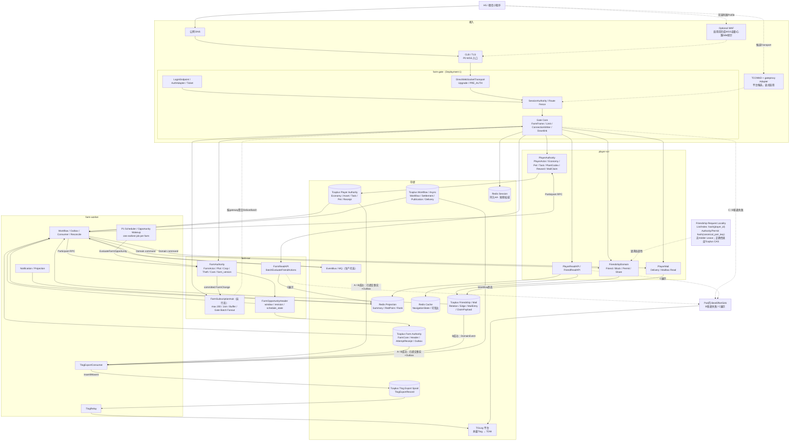
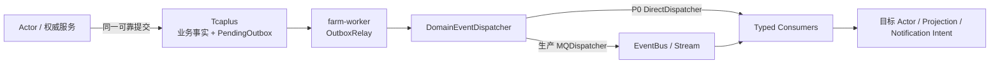
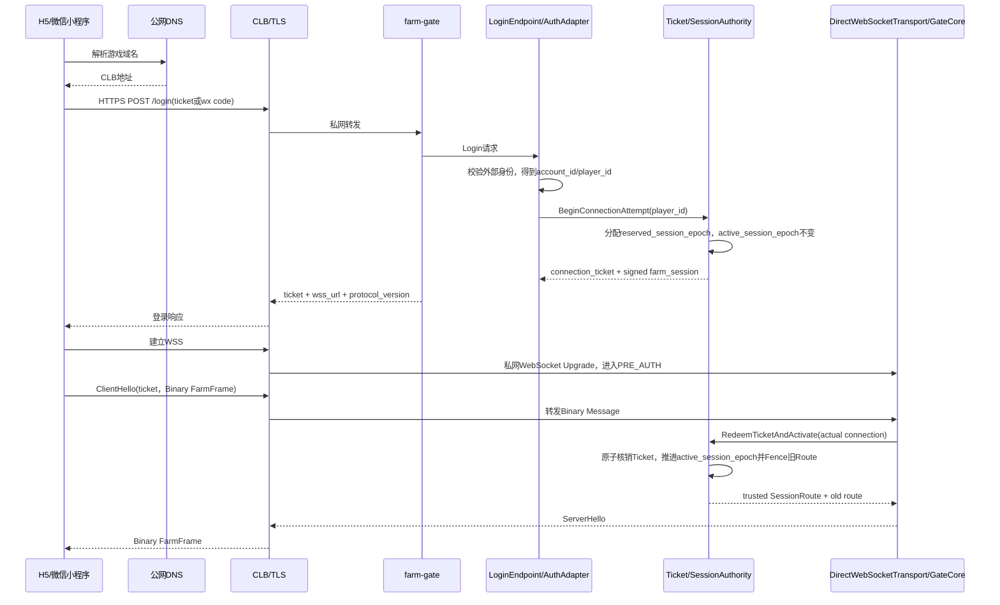
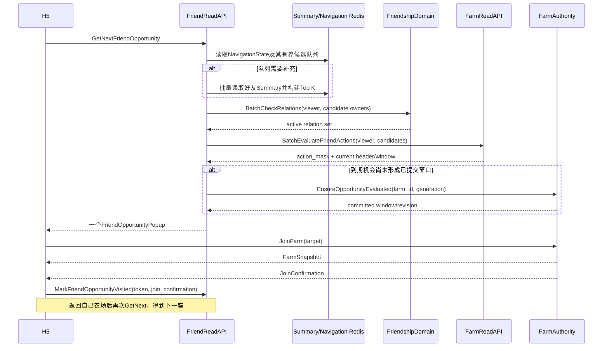
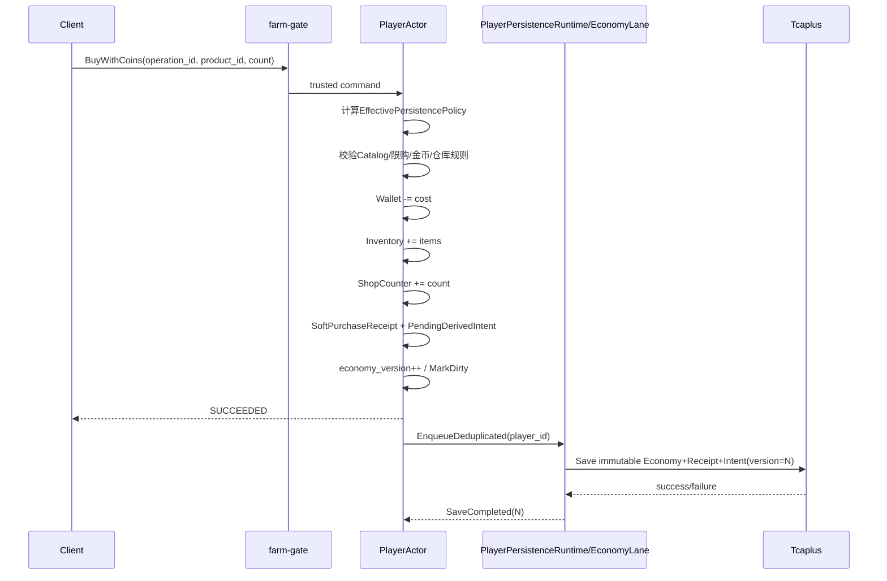
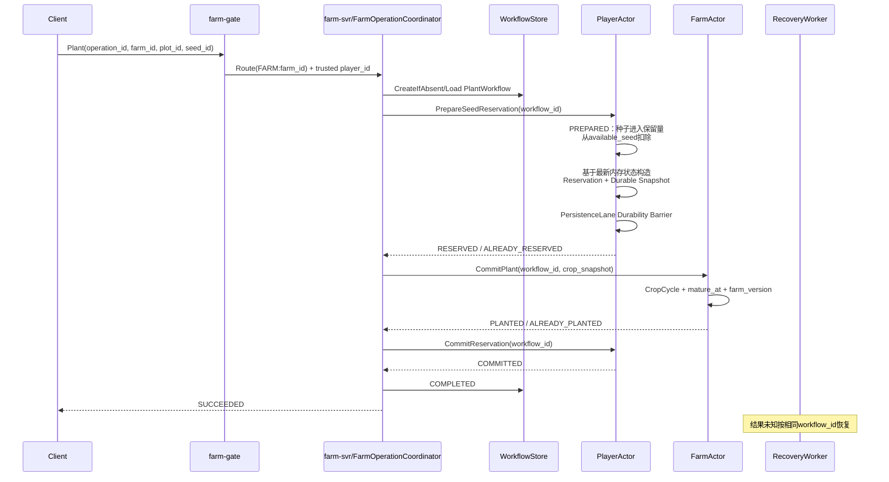
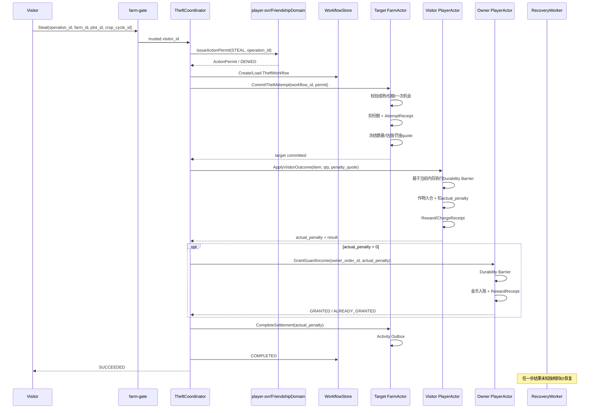
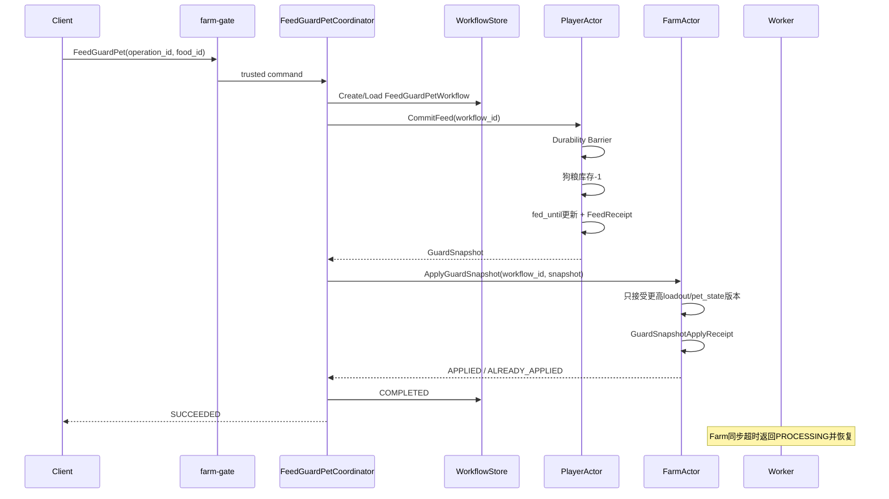
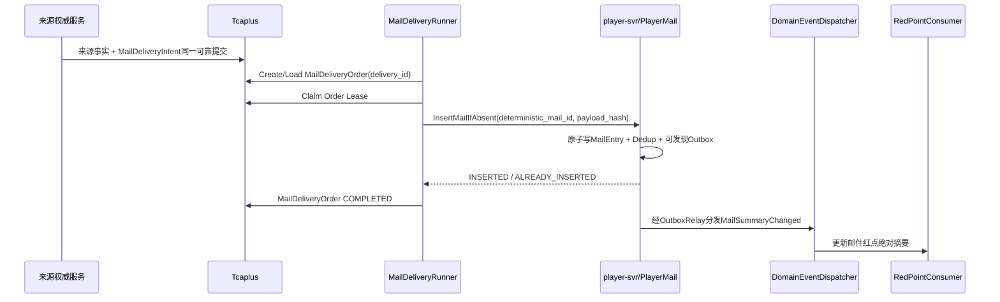
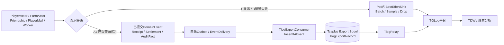

# 22 · 经典农场后台统一生产架构

版本：`v1.21.2-production-architecture-freeze`
日期：2026-07-30  
定位：L0 正式冻结基线；后续开发、Agent 编码、架构评审、压测、故障演练、部署和答辩的唯一总体架构入口。

本文在 `v1.20-transport-tlog-production-contract-freeze-candidate` 基础上完成 L0 收敛。除 P0 公网
主链固定为 `公网 DNS → CLB/TLS → farm-gate Direct WebSocket`，WebSocket Upgrade、
ClientHello、一次性 Ticket、PRE_AUTH、Session、FarmFrame、限流、ConnectionWriter 和
旧连接 Fence 都由同一个 farm-gate Deployment 承担；TCONND + gateproxy 只保留为显式
候选 Transport。A 级 Tlog 增加独立 Export Spool 可靠交接点，B 级成功与 C 级展示不再
混用发送语义外，本版正式冻结 PlayerPersistenceRuntime 多 Record Lane、TaskProgressIntent、
TaskClaimOrder、PlantCodex 冷记录、CodexUnlockIntent、历史 Catalog 保留及其容量与阻塞项。
以上修改不新增部署单元，也不让 Tlog、Task Consumer 或 Codex Consumer 成为同步主链业务权威。
此前已确认的导航、候选队列、Receipt 生命周期、
服务拆分、Summary 乱序覆盖、`FarmOpportunityHeader.schedule_state`、Ensure 防惊群、
NavigationState、可信邮件领取以及 Player/Farm/Workflow/Outbox 主干保持不变。

`v1.21.2` 增加 [26-access-session-contract](./26-access-session-contract.md) 作为接入与会话
L1 权威合同，并修正两处容易误实现的语义：HTTPS 只分配候选 Session 代次，ClientHello
成功核销 Ticket 后才激活并 Fence 旧连接；正常首屏并行取得首个精确好友机会，超时只能显示
Loading/Unavailable，不能伪装成 NONE。当前账号凭证使用公司持久化 Redis 和 PBKDF2，
`farm_session` 为签名 HttpOnly Cookie，Redis 不保存 Cookie 正文。

这里的“正式冻结”指 L0 权威边界、成功/失败语义和演进合同冻结，不表示 L2 物理 Repository
已经验收。Tcaplus 原子边界、writer_epoch、Export Spool、TaskClaimOrder 和 Codex 冷记录仍须
通过本文 Blocker/Probe 后，才能宣布生产实现冻结。

本次修订在不增加 Deployment 和 Actor 类型的前提下，进一步冻结单热点农场的实时承载目标：

```text
单农场最多200个活跃游戏会话（包含农场主）
全部会话都可以发起合法业务操作
FarmActor只承担业务权威裁决
FarmSubscriptionHub承担订阅、Join缓冲和广播扇出
```

`FarmSubscriptionHub` 是与 Farm Holder 共置的可丢运行时模块，不是新 Actor、不是新服务，也
不拥有土地、作物、偷菜、护理或权限真值。三千万 DAU 决定全局水平扩展规模；200 人同场是
额外冻结的单热点农场 NFR，不能由 DAU 数字直接推导。Shard 负责把不同农场分布到不同 Pod，
不拆分同一农场的唯一写入顺序。

本版同时保留以下生产冻结：

```text
Direct WebSocket 默认主链：
  公网DNS → CLB/TLS → farm-gate

farm-gate内：
  DirectWebSocketTransport → PRE_AUTH → Session → GateCore

TCONND/gateproxy：
  仅为显式候选Adapter

Tlog 分级
  A：Receipt/Settlement/AuditFact → Outbox → Export Spool → TGLog
  B成功：已提交DomainEvent/AuditFact → Export Spool
  B普通失败/C：Pod内有界队列，允许采样或受控丢失
```

这些合同都不改变四部署单元、双 Actor 和双 Route Domain。

以下保留 v1.18 的十一项核心修订，并增加第十二项实时同场承载修订。

第一，P0 基线进一步收敛为四个部署单元：

```text
farm-gate
player-svr
farm-svr
farm-worker
```

`FriendshipDomain`、`PlayerMail`、`PlayerReadAPI` 和 `FriendReadAPI` 共部署在 `player-svr`。FriendshipDomain 不进入 PlayerActor Mailbox；它是无 FriendActor 的长期关系权威，只有处理进程和缓存可丢，好友关系本身不会因时间、Pod 重启或缓存 TTL 自动失效。PlayerMail 的邮件条目、索引和投递流程也不装入 PlayerActor 热快照，但附件领取命令由 PlayerActor 以“资产 + MailClaimReceipt”单次可靠提交。各模块仍拥有独立 package、Repository、Tcaplus 表、执行池、限流、错误码和指标。只有出现独立扩容、故障隔离、SLA、团队或安全证据后，才拆出 `friend-svr`、`mail-svr` 或其他服务。

第二，好友成熟提醒、会话级右下角连续导航和好友列表详细互动统一到同一套机会模型：

```text
FarmOpportunityHeader
→ FarmOpportunitySummary
→ FriendOpportunityNavigationState
→ FarmReadAPI.BatchEvaluateFriendActions
→ ActionPermit + FarmActor
```

其中：

- 作物成熟始终由 `trusted_now_ms >= mature_at` 派生；
- Scheduler 只按“每座农场一个最早时间”主动唤醒，不决定成熟；
- `opportunity_revision` 负责有效机会集合正确性；
- `opportunity_window_id` 标识一次从“无机会”进入“有机会”的连续可操作窗口；
- `schedule_generation` 负责废弃旧 ScheduleJob；
- 登录进入自己农场后只展示一座最新且仍有效的好友农场；
- 玩家成功进入该好友农场后，本会话把该 `farm_id + opportunity_window_id` 标记为已访问；
- 玩家返回自己农场后动态选择下一座，不维护历史待办队列；
- 好友列表返回当前页所有好友的详细 `action_mask`；
- 在线 Push 只发送“候选可能变化”的 Hint；最终弹窗必须调用访问者维度精确检查；
- Summary 或 Scheduler 延迟不能导致好友列表或连续导航永久漏掉已经到达 `next_opportunity_at` 的农场；导航返回前必须取得已提交窗口号。

第三，当前范围只有系统邮件，没有玩家互发邮件。邮件内容和列表仍使用独立 PlayerMail 表，但附件领取不再建跨权威 MailClaimWorkflow：MailClaimCoordinator 经 PlayerMailPort 获取可信不可变 ClaimMaterial，PlayerActor 再把奖励资产与 `MailClaimReceipt` 放在同一个 PlayerEconomyRecord 可靠写单元中提交。完整 MailEntry 不进入 Actor 内存快照。

第四，右下角导航从“每次返回全量扫描”优化为会话级有界候选队列：

```text
首次登录/队列需要补充
→ 扫描好友Summary并生成Top K候选
→ 保存到NavigationState

访问好友并返回
→ 从候选队列取下一小批
→ Friendship + Farm精确校验
→ 返回下一座

队列不足/过期/收到Hint
→ 增量合并或重新补充
```

候选队列只是 Redis Cache 中的加速状态，不能替代 Summary、FriendRelation、TheftAttemptReceipt 和 FarmActor。

第五，服务拆分不再由“模块名字”决定。P0 仍保持四个部署单元；只有独立负载、资源干扰、故障隔离、SLA/安全/团队边界和稳定网络合同形成证据后，才拆 `mail-svr`、`friend-svr`、Read Deployment 或 Worker Role。

第六，补齐实现不能自行猜测的可靠性合同：

- MailClaim 在所有分类表中统一为 `LOCAL_DURABLE`；
- Summary 使用 `opportunity_revision + source_farm_version + payload_hash` 防乱序覆盖；
- Farm 内 `FarmOpportunityHeader.schedule_state` 是唯一恢复来源，外部 ScheduleJob/DueIndex 可重建；
- Ensure 使用 Holder 侧 singleflight、generation 去重、Batch 和限流；
- NavigationState 有字节/条目/TTL 上限、Hint 失效和明确响应枚举；
- MarkVisited 只接受完整 Fence 下已经进入 `IN_FARM` 的订阅；
- PlayerActor 只接受 PlayerMailPort 提供的可信不可变 ClaimMaterial；
- MailClaimReceipt 在邮件不可领取和全部恢复窗口结束前不得淘汰。

第七，好友边界与导航并发进一步收敛：

- 原 `SocialDomain` 收敛命名为 `FriendshipDomain`，P0 只实现分享建友、列表、删除和 Permit；
- `FriendRelation=ACTIVE` 没有自然到期时间，只有显式删除、P1 拉黑或受信管理处置才能终止；
- Friendship 处理进程无 Actor、可丢缓存，但 Tcaplus canonical relation 是长期权威状态；
- 好友列表按 `player_id` 路由，单关系写与 Permit 按 canonical pair 路由；BatchCheck 保持一次批量读；
- NavigationState 使用有界 `checked_candidates + state_version + IDLE/OFFERED` CAS，不能因 Top K 无效误报 EXHAUSTED；
- 成功导航访问由 farm-svr 签发且绑定 navigation context 的 `JoinConfirmation` 证明；
- Role 拆分前即冻结逻辑发现别名，避免命令进入未启用对应 Role 的 Pod。

第八，补齐分享建友与好友索引的可执行合同：

- P0 `ShareInvite` 固定为可撤销、有有效期的 `MULTI_ACCEPT`，单次接受不会消费整条链接；
- `FriendCommandReceipt` 覆盖完整重试窗口，禁止只保留最后一次好友命令；
- ACTIVE/TERMINATED 的每次授权变化都使 `relation_epoch` 单调递增；
- FriendEdge 以 relation_epoch 条件投影，低版本删除不能覆盖后来重新建立的好友关系；
- FriendLimit 在索引 Lag 过高或接近上限时保守准入。

第九，Permit 与 MarkVisited 不再依赖隐含信任：

- Visit/Action Permit 绑定 payload、target scope、session epoch、issuer、audience、schema 与 key；
- 普通 Get 不满足线性一致性时，必须使用 Primary、No-op CAS 或带 fencing 的 pair Holder；
- farm-svr 在 IN_FARM 后最佳努力内部 MarkVisited，客户端调用只作为幂等兜底；
- Join 同时记录 offered/observed window，明确窗口切换时消费哪个窗口。

第十，Scheduler 只保留一份权威调度状态：

- `FarmOpportunityHeader.schedule_state` 是唯一真值，`ScheduleIntentChanged` 只是 Outbox 快照；
- 有未来候选提交 `SCHEDULED`，无未来候选也必须提交更高 generation 的 `NONE`；
- `source_farm_version` 固定等于本次提交后的 farm_version；
- Reconcile 使用分桶、checkpoint、水位、Pending 索引和激活修复，不做高频全农场扫描。

第十一，偷菜与邮件补齐对称的结果及清理合同：

- TheftAttemptReceipt 保存 Farm 目标侧稳定结果，TheftSettlement/OperationResult 保存跨 Actor 最终结果；
- Farm 已扣份额但 Player 结算未完成时返回 PROCESSING，不得伪装成纯失败；
- Mail ClaimPayload 与 Receipt 都覆盖重试、Unknown、Reconcile 和客服窗口；
- 邮件列表可提前隐藏，但展示 TTL 不得删除权威 ClaimPayload；
- 为关键合同分配稳定 `HC-*` 编号，后续版本不得通过改名暗改语义。

第十二，200 人同场不再把连接扇出压进 FarmActor 主邮箱：

- `max_farm_sessions=200`，包含农场主和好友；超过上限直接返回 `FARM_SESSION_FULL`；
- P0 不区分只读观众和可操作席位，所有在场好友都可以发起合法操作，最终仍由 Permit 与 FarmActor 裁决；
- FarmActor 只维护 Farm 权威状态、`farm_version` 和提交后的 `FarmChange`；
- `FarmSubscriptionHub` 维护 Presence、Subscription、JoiningBuffer、会话 Fence 和按 Gate 聚合的广播扇出；
- `JoinPrepared(Snapshot(V))` 与其后的 `FarmChange(V+1...)` 进入同一 Holder 内有序交接流，避免 Snapshot/Delta 空洞；
- Hub 或下行队列过载时拒绝 Join、合并 Delta 或要求客户端 Resync，不能反压 FarmActor，也不能回滚已提交业务；
- 客户端没有人物移动和角色形象，不下发完整 200 人成员列表；Presence 只用于服务端名额、订阅和连接清理；
- 200 人压测验证同场订阅和突发操作正确性，不宣称单 FarmActor 可以承受 200 人持续高频写入。

本文同时保留并冻结：

- 四类命令执行与持久化策略；
- PlayerPersistenceRuntime、EconomyLane、Durability Barrier 和分层 Unknown Outcome；
- 双 Actor、Virtual Shard 和 writer_epoch；
- Workflow、Order、Reservation、Settlement 与 Receipt；
- Authority Commit + Outbox；
- P0 DirectDispatcher 与生产 MQDispatcher；
- JoiningBuffer 的 Fence、上限和 Resync；
- MailDeliveryIntent → MailDeliveryOrder → MailEntry；
- Tcaplus 与 Session/Projection/Cache 三类 Redis 的职责边界。

旧文档仅用于追溯讨论过程，不得与本文混合作为实现合同。

---

## v1.21.2 正式冻结导航

| 审核问题 | v1.21.2 冻结结果 | 正文位置 |
|---|---|---|
| P0 公网 Transport | 公网 DNS → CLB/TLS → farm-gate Direct WebSocket；TCONND + gateproxy 仅为显式候选 | 0.4、2、4、5 |
| farm-gate 接入职责 | 同一 Deployment 内承担 Upgrade、PRE_AUTH、Ticket、Session、FarmFrame、限流、ConnectionWriter 与旧连接 Fence | 3.2、4、5 |
| Tlog 是否是业务真值 | 否；业务成功不等待 TGLog，TGLog 不参与恢复 | 20 |
| A 级 Tlog 可靠交接点 | `InsertTlogExportRecordIfAbsent` 持久化成功；TGLog SDK 内存入队不算 | 20.3 |
| B/C 流水是否相同 | 否；B 成功来自已提交事实，普通失败和 C 才允许 BestEffort、采样或受控丢弃 | 20.3 |
| TGLog 故障是否影响业务 | 不影响；积压隔离在 Export Spool，不让 Authority Aggregate 的 PendingOutbox 无界增长 | 20.3、20.4 |
| Friendship 是否必须独立部署 | 否；P0 共部署在 player-svr，但保持独立权威模块 | 0.1、3.3、13 |
| Mail 是否必须独立部署 | 否；PlayerMail 共部署在 player-svr，MailEntry 外置，附件领取进入 PlayerActor | 3.3、8.7、18.3 |
| 系统邮件是否属于 Friendship | 否；两者仅共部署，关系键、规则、负载和故障域都不同 | 3.3、26 |
| P0 部署数量 | 四个：Gate、Player、Farm、Worker | 0.1、2、22 |
| 单农场同场目标 | 最多 200 个活跃会话，包含农场主；全部会话可发起合法操作，超过上限直接拒绝 | 0.1、3.4、6.4、14.2、21.6 |
| 200 人订阅和广播由谁负责 | FarmSubscriptionHub；它是 farm-svr 内可丢运行时模块，不是 Actor 或独立服务 | 0.2、3.4、14.2 |
| 200 人是否拆分一个 FarmActor | 否；同一农场仍由唯一 FarmActor 串行裁决，Shard 只分散不同农场 | 6、21.6 |
| 成熟是否依赖 Scheduler | 不依赖；始终由 mature_at 派生 | 14.4、19 |
| Summary 延迟是否会漏好友机会 | 不会；`now >= next_opportunity_at` 也进入候选精确读，导航再确保窗口已提交 | 14.1、14.4、19 |
| 多块地同类型机会如何刷新 | 有效候选集合变化即递增 `opportunity_revision` | 8.5、18.8 |
| 右下角弹窗如何连续导航 | 一次只显示一座；访问后返回自己农场再动态计算下一座 | 14.1、18.7、18.8 |
| 同一农场何时可再次推荐 | 当前 `opportunity_window_id` 已访问后不再推荐；机会清空并形成新窗口后才可再次出现 | 8.5、18.8 |
| 好友列表显示什么 | 当前页每个好友的详细可操作项 | 14.4 |
| 是否需要逐好友持久 Inbox | P0 不需要；在线 Push 只发 Hint，登录/返回时从 Summary 动态计算 | 8.8、18.8 |
| 最终操作如何裁决 | ActionPermit + FarmActor 再次裁决 | 13.3、14.4 |
| 返回自己农场是否每次全量扫好友 | 否；优先消费会话级有界候选队列，队列不足或失效时才补充 | 8.8、14.1、21.6 |
| AttemptReceipt 是否会无限增长 | 不会；只为真实尝试创建，按 CropCycle 分区并在周期结束和重试保留期后清理 | 8.5、21.5 |
| 何时拆 mail-svr 等服务 | 由可量化负载、干扰、故障/SLA和合同成熟度触发，不按领域名提前拆 | 26 |
| Summary 乱序如何处理 | opportunity revision 优先、farm version 次序、同版本 payload hash 必须一致 | 8.8、18.8 |
| Scheduler 的恢复真值 | `FarmOpportunityHeader.schedule_state`；外部 Job/DueIndex 是 generation fenced 可重建执行索引 | 19 |
| MailClaim 信任与防重保留 | 客户端只传 mail_id；PlayerMailPort提供可信ClaimMaterial；Receipt覆盖完整可领取与恢复窗口 | 18.3、25 |
| 好友关系是否会自然到期 | 不会；ACTIVE关系仅由删除、P1拉黑或受信管理处置终止 | 3.3、8.6、13 |
| Friendship是否需要Actor | 不需要；Pod和缓存可丢，canonical Tcaplus记录才是长期状态 | 13 |
| Top K何时可以返回EXHAUSTED | 全量扫描且排除handled/同版本checked后不再有候选，预算不足不能冒充耗尽 | 8.8、14.1 |
| MarkVisited如何跨服务证明 | farm-svr在IN_FARM后签发绑定navigation context的JoinConfirmation | 14.1、14.2、18.7 |
| Role拆分后如何寻址 | 从P0冻结authority/friend/mail/read等逻辑别名；拆分只改发现映射 | 22 |
| Player 是否只有一条数据库 Lane | 否；Mailbox 保证玩家业务顺序，同一物理记录 Lane 串行，不同记录可并行 | 9.3、21.8 |
| 跨 Lane 是否具有原子性 | 否；跨记录依赖必须使用 Intent、Order、Receipt 或 Workflow 恢复 | 9.3、12 |
| 同 PlayerActor 事实能否直接推进 TaskState | 只有来源事实与 TaskState 位于同一物理写单元时才可以；当前使用 TaskProgressIntent | 9.3、18.2 |
| Task 周期按什么时间归属 | 使用已提交来源事实的 occurred_at_ms 和版本化时区，而非 Consumer 处理时间 | 18.2 |
| TaskClaim 如何避免半完成 | 使用 CREATED → TASK_RESERVED → REWARD_GRANTED → COMPLETED 的 TaskClaimOrder | 12、18.2 |
| 图鉴什么时候解锁 | 玩家自己农场 Harvest 最终完成、作物可靠入仓并保存 CodexUnlockIntent 后推进 | 18.2.1 |
| 图鉴是否全部进入热 Actor | 否；只常驻 CodexMeta 摘要，Collection 按需冷加载和回收 | 8.4.1、21.7 |
| 活动结束后是否还能解锁 | 可以使用遗留种子继续播种和解锁；历史 Catalog 与客户端资源必须保留 | 18.2.1 |

这张表是变更索引，不替代对应章节的完整合同。

---

## 文档权威层级

```text
L0：总体生产架构
  本文
  决定服务边界、数据权威、运行模型、执行与持久化策略、成功语义和故障语义

L1：领域详细设计
  Farm / Pet
  Task / Mail / RedPoint
  Friendship
  Scheduler
  Actor Runtime
  决定领域状态机、局部规则和局部数据结构

L2：接口与存储合同
  Protobuf / Error Code / Event Schema
  Tcaplus Table / Redis Key
  决定线上兼容和物理布局

L3：实现与运维
  Go package / Docker / Kubernetes
  Dashboard / Runbook / 压测 / 故障演练
```

冲突规则：

1. L0 决定权威归属、部署单元和正确性边界；
2. L1 不得改变 L0 的成功语义；
3. L2 是线上合同，实现不能绕过；
4. L3 发现设计不可实现时，必须回到上位评审，不得在代码中暗改语义。

### 稳定硬合同编号

下面的编号跨后续文档版本保持稳定。正文可以补充实现细节，但若要改变某条合同的成功语义、
权威归属或失败语义，必须在评审记录中明确写出被替代的合同编号，不能通过改字段名悄悄改变。

| 合同 ID | 冻结语义 |
|---|---|
| HC-FRIEND-01 | `FriendRelation(canonical_pair_key)` 是好友关系唯一真值；ACTIVE 不自然到期 |
| HC-FRIEND-02 | 单关系写按 relation_epoch + CAS 排序，幂等由 FriendCommandReceipt 证明 |
| HC-FRIEND-03 | FriendEdge/Index 只是可修复投影；高 epoch 覆盖低 epoch，同 epoch 异 payload 告警 |
| HC-FRIEND-04 | P0 ShareInvite 为 MULTI_ACCEPT；每位接受者独立激活自己的 canonical relation |
| HC-FRIEND-05 | 撤销阻止之后的新 AcceptAdmission；撤销前已强校验的短时在途接受允许完成 |
| HC-PERMIT-01 | Permit 证明关系与会话校验结果，不替代 FarmActor 对目标业务状态的最终裁决 |
| HC-NAV-01 | EXHAUSTED 只能由完成全量扫描并排除 handled/同版本 checked 后证明 |
| HC-NAV-02 | NavigationState 以 state_version + IDLE/OFFERED CAS；旧 token 不得清除新候选 |
| HC-NAV-03 | 只有绑定 navigation context 且已进入 IN_FARM 的 JoinConfirmation 才能 MarkVisited |
| HC-OPP-01 | Header 与 Farm 权威事实同提交；Summary 按 revision/version/hash 单调投影 |
| HC-SCHED-01 | `Header.schedule_state` 是唯一调度真值；SCHEDULED/NONE 都必须 generation fenced |
| HC-THEFT-01 | Farm 份额裁决与消费型 TheftAttemptReceipt 不得形成不可恢复半完成 |
| HC-THEFT-02 | 目标侧 AttemptReceipt 与跨 Actor TheftSettlement/OperationResult 是两层结果 |
| HC-MAIL-01 | 邮件附件资产与 MailClaimReceipt 在 PlayerActor 内单次可靠提交 |
| HC-MAIL-02 | ClaimPayload/Receipt 覆盖领取、重试、Unknown、Reconcile 和客服窗口后才能清理 |
| HC-PERSIST-01～08 | Mailbox 负责玩家业务顺序；Lane 负责物理记录写顺序；跨记录使用 Intent/Order/Receipt，Unknown 分 Record/Authority 两级 |
| HC-TASK-01～05 | 任务只消费已提交事实；跨记录必须有 TaskProgressIntent；事件幂等和 period 归属稳定；TaskClaimOrder 可恢复 |
| HC-CODEX-01～05 | 自己农场 Harvest 完成后解锁；CropCycle 冻结资格；CodexUnlockIntent 可靠推进；图鉴永久单调；奖励进入 TaskDomain |
| HC-ROLE-01 | authority/friend/mail/read/worker 使用稳定逻辑发现别名；拆 Role 不改变调用合同 |
| HC-TRANSPORT-01～10 | P0 DNS/CLB/TLS/Direct WebSocket 主链、PRE_AUTH、帧边界、心跳、背压、安全与旧连接 Fence |
| HC-REALTIME-01～06 | 单 Farm 200 会话上限、唯一 FarmActor 写权、SubscriptionHub 运行态隔离、有序 Join 交接、按 Gate 聚合广播与 Resync |
| HC-TLOG-01～13 | Tlog 非权威、A 级 Spool 交接、稳定 flow_id、B/C 分级、故障隔离与隐私 |

---

---

## 0. 一页冻结结论

### 0.1 四个 P0 部署单元

```text
farm-gate
player-svr
farm-svr
farm-worker
```

| 部署单元 | 必须独立的证据 | P0 职责 | 生产 Role |
|---|---|---|---|
| farm-gate | 公网连接、带宽、慢客户端和下行背压与业务负载不同 | Login/Auth、Ticket、Direct WebSocket Upgrade、PRE_AUTH、Session、FarmFrame、Route、ConnectionWriter、Downlink | access / login |
| player-svr | `player_id` 经济 Actor 权威；同时承载无 Actor 的玩家周边模块 | PlayerAuthority、TaskDomain、PlantCodexDomain、PlayerPersistenceRuntime、FriendshipDomain、PlayerMail、Player/Friend Read API | authority / friend / mail / read |
| farm-svr | `farm_id` 是土地、作物、偷菜和护理的冲突键；200 人订阅扇出具有独立运行时负载 | FarmActor、FarmSubscriptionHub、FarmReadAPI、Opportunity Header | actor / realtime / read |
| farm-worker | 原请求消失后仍要恢复；有独立积压和批处理资源曲线 | Workflow、Outbox、Projection、Notification、Reconcile、Tlog Export；P0 仅探针 Scheduler 数据合同 | critical / projection / notification / tlog；scheduler(P1) |

`player-svr` 内部不是一个大 Actor：

```text
player-svr
├── PlayerAuthority
│   ├── PlayerActor
│   ├── PlayerPersistenceRuntime
│   │   └── Economy / Task / Codex keyed Record Lanes
│   ├── TaskDomain / PlantCodexDomain
│   └── MailClaimReceipt
├── FriendshipDomain
│   ├── FriendRelation / FriendIndexPage / ShareAcceptance
│   ├── VisitPermit / ActionPermit
│   └── P1 BlockRelation / FriendRequest
├── PlayerMail
│   ├── MailEntry / MailboxIndex
│   └── MailDeliveryIntent / MailDeliveryOrder
└── ReadAPI
    ├── PlayerReadAPI
    │   ├── TaskReadPort
    │   └── CodexReadPort
    └── FriendReadAPI
```

隔离要求：

- Friendship 不进入 PlayerActor Mailbox；
- PlayerMail 不直接修改钱包和仓库；`ClaimSystemMail` 必须投递到 PlayerActor；
- MailEntry、MailboxIndex 和正文附件不进入 PlayerActor 热快照；
- PlayerActor 原子提交奖励资产与 MailClaimReceipt；
- 各自使用独立 Repository、表、状态机、执行池、限流、连接预算和指标；
- Read API 不激活冷 Actor；真实钱包和仓库仍读取当前 PlayerActor；
- 生产可以从同一代码库按独立合同启动 `player-svr-friend`、`player-svr-mail`、`player-svr-read`，但 P0 不提前增加网络服务边界。

当前不增加：

```text
query-svr
support-svr
community-svr
friend-svr
mail-svr
pet-svr
task-svr
codex-svr
redpoint-svr
rank-svr
profile-read-svr
commerce-svr
```

普通金币商店属于 PlayerActor；运营配置属于 Config/LiveOps 平台；真实支付进入范围后再按安全、审计和对账证据评估独立 Commerce 服务。

### 0.2 两种核心 Actor

```text
PlayerActor(player_id)
FarmActor(farm_id)
```

- PlayerActor 是钱包、仓库、商店限购、成长、宠物、任务、植物图鉴和奖励的串行裁决者；
- FarmActor 是土地、作物、偷菜、护理、守护快照和 `farm_version` 的串行裁决者；
- Presence、Subscription、JoiningBuffer 和广播扇出由同 Holder 的 `FarmSubscriptionHub` 持有，属于可丢运行态；
- `FarmSubscriptionHub` 不进入 Actor 类型集合，不拥有业务事实；同一 FarmActor 提交后的 `FarmChange` 才是广播来源；
- Task、PlantCodex、Pet、Mail、Profile、RedPoint、Rank 和 Scheduler 不建立新的 Actor。

### 0.3 四类命令执行与持久化策略

这四类是命令执行策略，不是简单的线性“耐久等级”。`WORKFLOW_DURABLE` 表示跨权威协调，或同一权威内缺少原子事务的多记录可恢复流程；其中每个参与者的本地不可逆步骤仍必须达到 `LOCAL_DURABLE`。

| 策略 | 成功语义 | 典型场景 |
|---|---|---|
| `RUNTIME_ONLY` | 可丢失、可重建 | FarmSubscriptionHub 中的 Presence、Subscription、JoiningBuffer |
| `ACTOR_SOFT` | PlayerActor 内存事务已线性提交；异步落库；接受受控硬崩溃 RPO | 普通金币、普通种子/作物/道具、普通 ShopCounter |
| `LOCAL_DURABLE` | 单权威状态、Receipt 和必要 Outbox 在返回最终成功前可靠落库 | FarmActor 持久地块/作物步骤、付费货币、永久解锁、唯一奖励；PlayerActor 内资产与 Receipt 同写单元闭合的 MailClaim/TaskClaim |
| `WORKFLOW_DURABLE` | 跨权威或无原子事务的多记录流程使用 Workflow/Order；每个参与者本地步骤均为 `LOCAL_DURABLE` | Plant、Harvest、Theft、Care、FeedGuardPet；无法单写单元闭合的 TaskClaim |

策略不能只按命令名静态决定。服务端计算：

```text
EffectivePersistencePolicy
= ResolvePolicy(
    command_catalog_default,
    item_and_reward_requirements,
    permanent_side_effects,
    authority_participants,
    physical_atomic_capability
  )
```

客户端不能指定或降低该策略。普通商品可以走 `ACTOR_SOFT`；同一个购买入口一旦涉及付费货币、唯一物品或永久解锁，必须升级为 `LOCAL_DURABLE` 或 `WORKFLOW_DURABLE`。

`ResolvePolicy` 不是简单数值取最大值，而是先判断是否需要持久事实，再判断本地步骤是否允许 Soft，最后根据权威参与者和物理原子能力决定使用单权威提交还是 Workflow/Order。

准确表述：

```text
业务一致性：
  同一玩家仍由PlayerActor线性裁决

持久化时机：
  普通软资产允许异步回写

关键边界：
  跨Actor、跨玩家、唯一领取、付费和永久副作用不得走裸Dirty
  WORKFLOW_DURABLE不是更高一级的单记录提交，而是多个LOCAL_DURABLE参与步骤或多记录步骤的可恢复协调
```

### 0.4 技术选择

| 链路 | 选择 | 原因 |
|---|---|---|
| 登录与静态页面 | HTTPS + JSON | 低频、易调试、适合身份认证 |
| 游戏在线主链 | WSS + Binary Protobuf | 双向 Push、多人增量、消息体小、Schema 可演进 |
| 生产长连接 | 默认公网 DNS + CLB/TLS + farm-gate Direct WebSocket；候选 TCONND + gateproxy | P0 缩短依赖链；Upgrade/PRE_AUTH/Session 均在 farm-gate，两种 Transport 复用 Gate Core |
| 服务间同步调用 | gRPC + Protobuf | 强类型、Deadline、拦截器和代码生成 |
| 权威数据 | TcaplusDB | 海量 Key、CAS、水平扩展、公司游戏基础能力 |
| 短期状态和热投影 | Redis | Session、限流、Rank、可重建索引 |
| 权威并发模型 | Actor + Virtual Shard | 同 Key 串行、不同 Key 并行、支持迁移和扩缩容 |
| 跨 Actor 一致性 | Typed Workflow + Participant Receipt | 不依赖跨记录分布式事务，可重试恢复 |
| 可靠异步来源 | Authority Commit + Outbox | 避免 DB 成功但派生意图永久丢失；Outbox 才是恢复真值 |
| 异步事件分发 | P0 DirectDispatcher；生产 EventBus/MQDispatcher | P0 降低基础设施复杂度；生产获得跨服务解耦、削峰、独立扩容与重放 |
| 普通软资产 | DirtyModel + EconomyLane + Versioned Async Writeback | 降低在线尾延迟并合并写入，同时与 Barrier/ForceFlush 串行；Task/Codex 物理记录使用独立 LaneKey |
| 经营流水 | 分级 Tlog/TGLog | 普通行为低开销异步；关键资产与结算从已提交事实可靠派生；不阻塞业务 |

### 0.5 核心正确性原则

1. 同一 `player_id` 的经济、仓库、宠物、任务和奖励裁决只由当前 PlayerActor 完成。
2. 同一 `farm_id` 的土地、作物、偷菜、护理和 `farm_version` 只由当前 FarmActor 完成；FarmSubscriptionHub 只能传播已经裁决的变化。
3. FriendshipDomain 与 PlayerMail 可和 player-svr 共部署；Friendship 不是 PlayerActor 子状态。邮件条目外置，但 MailClaimReceipt 与奖励资产属于 PlayerActor 的同一可靠写单元。
4. FriendRelation 的权威键是 `canonical_pair_key`；FriendIndex 只是可修复分页索引。
5. Actor turn 不等待另一个 Actor、Gate 或远程业务服务。
6. Gate 不创建或推进跨 Actor Workflow。
7. WorkflowRecord 是跨权威流程的唯一全局进度。
8. Reservation、Settlement、RewardReceipt 和 ChargeReceipt 只证明参与者本地步骤。
9. Workflow 必须在第一次不可逆参与者提交前创建。
10. `ACTOR_SOFT` 只允许普通软资产；跨 Actor、唯一领取、付费和永久副作用不得走裸 Dirty。
11. PlayerEconomyRecord 的 SoftFlush、Durability Barrier 和 ForceFlush 共用同一 EconomyLane；该规则不要求 Task/Codex 等其他物理记录共用一条全局写队列。
12. 派生状态不得领先来源事实的已持久化版本；可靠 Intent 必须与来源事实同一可靠保存。
13. 权威事实和关键 Outbox 必须同一可靠提交。
14. DomainEventDispatcher/EventBus 是分发通道，不是恢复真值。
15. 作物成熟始终由 `trusted_now_ms >= mature_at` 判断，Scheduler 只主动唤醒。
16. 每座农场只有一个有效 `FarmOpportunityHeader.schedule_state`；其状态只能是 `SCHEDULED(generation, due_at_ms, source_farm_version)` 或 `NONE(generation, source_farm_version)`，外部旧 Job 可以暂存但不得生效。
17. FarmActor 可靠保存 `FarmOpportunityHeader`；Summary 和 NavigationState 都是提示/运行态，不是最终操作权威。
18. 有效机会候选集合变化时递增 `opportunity_revision`；`NONE → HAS_ACTION` 时递增 `opportunity_window_id`，同一连续窗口内新增机会不创建新的导航窗口。
19. `schedule_generation` 只用于废弃旧 Scheduler Job，不能代替机会版本。
20. 好友列表候选条件为 `mask != NONE OR now >= next_opportunity_at`，Summary 延迟不得导致漏成熟。
21. 好友列表必须使用一次批量 `BatchEvaluateFriendActions`，不能一页好友逐个 RPC。
22. 右下角一次只显示一座好友农场；成功进入后标记当前窗口已访问，返回自己农场再选择下一座。
23. P0 不为所有好友持久化 Inbox；首次登录/队列补充从 Summary 构建会话级有界 Top K，普通返回自己农场优先消费该队列并做小批精确检查。
24. TheftAttemptReceipt 只为真实尝试创建；不能按 `farm × 全部好友 × crop` 预生成，也不能永久保留。
25. 右下角 Hint 允许延迟；好友列表和具体弹窗必须在响应前做访问者维度精确读，但点击后仍由 ActionPermit + FarmActor 最终裁决。
26. Presence 不能证明好友权限。
27. 连接路由、Session 路由和 Actor 路由是三套地址。
28. 所有持久业务时间使用 UTC Unix Milliseconds；客户端时间只用于展示。
29. 幂等键作用域为 `(subject_player_id, command_type, operation_id)`。
30. 优雅迁移普通软资产目标 RPO=0；关键经济和跨 Actor 流程 RPO=0。
31. `FriendRelation=ACTIVE` 没有 TTL；ShareInvite、Permit、缓存或会话到期不得改变好友关系。
32. Friendship 一致性哈希只提供缓存/冲突局部性；关系正确性必须由 canonical key、强一致读、CAS、epoch 和幂等保证。
33. NavigationState 的旧 token/state version 不能清除新候选；预算耗尽、Top K 无效和状态溢出不得返回 EXHAUSTED。
34. MarkVisited 必须同时验证 navigation token 与 farm-svr 的 JoinConfirmation，不能查询易失 Presence 后自行推断。
35. Role Deployment 拆分只改变服务发现映射，不改变 CommandCatalog 逻辑目标和 Proto。
36. P0 farm-gate 不可被公网绕过；只接受 CLB 私网来源，TLS、Host/SNI、客户端类型与转发头信任边界必须显式配置。
37. A 级 Tlog 在 ACK 来源事件前必须持久化到独立 Export Spool；TGLog SDK 内存入队不是可靠交接。
38. B 级成功流水只能由已提交 DomainEvent/AuditFact 派生；普通失败和 C 级展示才允许 BestEffort。
39. 单农场最多 200 个活跃会话；全部会话可以发起合法操作，但同一农场仍只有一个 FarmActor 写入顺序。
40. Presence、Subscription、JoiningBuffer 和广播扇出属于 FarmSubscriptionHub 运行态，不得进入 FarmActor 业务快照或 Tcaplus 权威记录。
41. FarmActor 不为 199 个接收者逐个执行 RPC；FarmSubscriptionHub 必须按 `gateway_id` 聚合 `DeliverBatch`，慢连接由 Gate 独立隔离。
42. 广播或 Hub 投递失败不能回滚已提交 Farm 事实；无法保证连续 Delta 时必须让受影响订阅 Resync。

## 1. 从玩法和冲突范围推导架构

### 1.1 三个核心 Loop

个人经营：

```text
购买种子
→ 播种
→ 等待成熟
→ 收获
→ 作物入仓
→ 出售/成长
```

经济：

```text
金币
→ 种子/道具
→ 土地生产
→ 作物
→ 出售/订单
→ 金币与经验
```

社交：

```text
好友列表
→ 查看互动状态
→ 进入好友农场
→ 偷菜/护理
→ 同场动画
→ 活动记录/红点
→ 回到自己的农场
```

这三个 Loop 产生两个主要冲突键：

- `player_id`：钱包、仓库、经验、宠物、任务和奖励；
- `farm_id`：地块、作物周期、护理事件、可偷份额、同场版本和广播。

因此选择 PlayerActor 与 FarmActor，而不是先看到 Actor 框架再套业务。

### 1.2 冻结的偷菜语义

偷菜包含三种不同量，禁止混用：

```text
loot_item_quantity       实际进入访客仓库的作物数量
loot_display_value_coin  页面显示的作物金币估值
actual_penalty_coin      宠物实际从访客钱包扣除的金币
```

规则：

1. 未成熟作物不可偷；
2. 同一好友对同一 `crop_cycle_id` 只有一次成功尝试机会；
3. 守护宠物不阻止偷菜，访客仍获得作物；
4. 页面可以显示“偷到价值 X 金币的作物，被宠物咬掉 Y 金币”；
5. `loot_display_value_coin` 只是估值，不直接增加访客钱包；
6. 访客仓库增加作物，访客钱包扣除实际罚金；
7. 农场主钱包增加与访客实际扣款完全相同的金币；
8. 金币不允许为负；
9. 作物估值、罚金规则和配置版本在 FarmActor 裁决时冻结，重试不得重新计算。

推荐默认公式，具体比例仍是产品配置：

```text
loot_display_value_coin
  = stolen_quantity × valuation_unit_price_snapshot

actual_penalty_coin
  = min(
      penalty_quote_coin,
      loot_display_value_coin,
      visitor_wallet_balance
    )

owner_income_coin
  = actual_penalty_coin
```

### 1.3 冻结的护理与宠物语义

- 一次缺水、虫害或杂草事件只允许一个好友完成；
- 其他好友随后得到 `NO_CHANGE/ALREADY_RESOLVED`，但可看到成功者的广播动画；
- 当前守护宠物在有效喂食期内可触发护理礼盒；
- 一次判定触发后，农场主和护理者各得到一份礼盒；
- 技能有按 `period_id` 懒重置的每日上限，不建立午夜 Timer；
- 守护有效性由 `now < fed_until_ms` 派生；
- 喂当前守护宠物使用 `FeedGuardPetWorkflow`，切换守护宠物使用 `ApplyGuardLoadoutWorkflow`；二者在 Farm 的本地参与步骤统一调用 `ApplyGuardSnapshot`。

---

---

## 2. 总体生产架构

答辩、交接和架构评审统一使用下图；它把“部署单元”与“进程内领域模块”明确分开，避免再次把
Friendship、Mail、Read API 或 Worker Role 误画成独立微服务。


可维护的完整画布源文件：
[classic-farm-overall-architecture-midterm-source.html](./assets/classic-farm-overall-architecture-midterm-source.html)。

本文硬合同与下方 Mermaid/HTML 图源是权威。PNG 必须从该 HTML 图源导出并完成全画布无裁切
检查；PNG 与硬合同或图源有差异时视为过期，不能让静态图片形成第二套真值。



主链分为：

```text
在线命令：
Gate → PlayerActor / FarmActor / FriendshipDomain / PlayerMail

同场实时：
FarmActor可靠提交并递增farm_version
→ FarmSubscriptionHub
→ 按gateway_id聚合DeliverBatch
→ ConnectionWriter
→ 最多199个其他订阅者

可靠恢复：
Tcaplus Workflow/Outbox → farm-worker → Participant/Consumer

好友机会：
FarmOpportunityHeader
→ Summary
→ NavigationState
→ 右下角连续导航或好友列表
→ BatchEvaluate
→ Join好友农场进入IN_FARM
→ JoinConfirmation
→ MarkVisited(farm_id, opportunity_window_id)
→ ActionPermit + FarmActor
→ 返回自己农场后GetNextFriendOpportunity

Tlog可靠导出：
Authority事实 + Receipt/Settlement/AuditFact + Outbox
→ TlogExportConsumer
→ Tcaplus Export Spool
→ TlogRelay
→ TGLog
```

没有通用 Query 服务。Read API 位于拥有数据语义的 Player/Farm 边界，且不进入 Actor Mailbox。

### 2.1 正确的异步事件链

禁止：

```text
业务事实提交
→ 直接Publish MQ
```

因为数据库成功、Publish 失败会永久丢事件。

正确链路首先保证来源事实与 Outbox 同提交，然后由环境级固定的 `DomainEventDispatcher` 负责分发：



图中的 P0 Direct 并不是“提交后直接调用一次，失败就算了”，而是：

```text
OutboxRelay从可靠索引发现事件
→ DirectDispatcher按订阅目录调用各Typed Consumer
→ 每个Consumer可靠提交目标状态和ConsumerReceipt
→ 每个必需Consumer都ACK后，Outbox才进入DONE
→ 任一步失败均可从Outbox重试
```

生产环境把同一个接口替换为 MQDispatcher：

```text
OutboxRelay
→ MQ Publish并取得Broker ACK
→ 独立Consumer Group消费
→ 目标状态 + ConsumerReceipt可靠提交
→ Consumer ACK
```

两种模式使用相同的 `EventEnvelope`、`event_id`、`source_version`、`payload_hash` 和 Consumer Receipt 合同，业务模块不感知当前部署模式。MQ 可重复、延迟和乱序，也不能让“数据库提交 + Publish”天然成为原子事务；MQ 故障不回滚已提交核心事实，也不得触发自动热切 Direct，具体切换合同见第 11.6 节。

---

## 3. 四个部署单元：领域独立不等于独立服务

### 3.1 拆服务的判据

建立独立服务至少需要一个强证据：

- 不同权威冲突键或并发模型；
- 明显不同的资源和扩缩容曲线；
- 明确故障隔离价值；
- 独立安全、审计、SLA、团队或发布节奏；
- 网络化不会破坏本地原子边界；
- 收益大于 RPC、超时、对账、部署和运维成本。

“这是一个页面、一个 package、一个读接口或以后可能变大”都不足以拆服务。

### 3.2 farm-gate

Gate 独立是因为公网连接、TLS/WSS、带宽、慢客户端和下行队列与业务 Actor 的资源模型不同。Gate 无业务真值，不创建 Workflow，不做资产或好友权限裁决。

### 3.3 player-svr

player-svr 是 P0 的玩家侧部署容器，但内部模块不共享一个聚合根。`Role` 只用于进程启动模式和 Deployment，不进入领域模块命名。

#### PlayerAuthority

拥有：

```text
钱包、仓库、ShopCounter
宠物、任务、植物图鉴、奖励
PlayerPersistenceRuntime
  Economy / Task / Codex keyed Record Lanes
Reward/Charge/Reservation Receipt
MailClaimReceipt
```

所有经济变化仍以 `player_id` 串行。

#### FriendshipDomain

拥有：

```text
FriendRelation(canonical_pair_key)
ShareInvite / ShareAcceptanceReceipt
FriendIndexPage / FriendEdge
VisitPermit
ActionPermit

P1扩展：
FriendRequest
BlockRelation
Remark / PinnedFriend
PlatformFriend
```

它不进入 PlayerActor，原因是好友关系属于双方，不能在 A/B 两个 PlayerActor 中各保存一份权威。当前题目采用“点击有效分享链接后自动建立游戏好友”，P0 不实现等待对方同意的好友申请箱；拉黑保留数据和接口扩展点，P1 才开放产品能力。共部署只是省去 P0 的网络和运维成本。

`FriendshipDomain` 的“无 Actor”只表示 Pod 不拥有不可丢失的关系内存，不表示好友关系没有状态。`FriendRelation=ACTIVE` 是 Tcaplus 长期业务事实，不设置自然到期时间；只有显式删除、拉黑或受信管理处置才能终止。Share Token、VisitPermit、ActionPermit、本地 LRU 和 Redis Cache 可以到期，但它们到期只影响邀请或单次访问凭证，不会把已经建立的好友自动变成非好友。

#### PlayerMail

拥有：

```text
MailEntry
MailboxIndex/Summary
MailDeliveryOrder
```

当前只有系统邮件，没有玩家互发邮件。PlayerMail 负责邮件创建、列表、正文和投递恢复；完整 MailEntry 不进入 PlayerActor 热快照。附件领取固定进入 PlayerActor：MailClaimCoordinator 先通过 PlayerMailPort 获取可信 ClaimMaterial，再由 PlayerActor 校验接收者、过期时间、载荷 Hash 和来源身份，并把附件资产与 `MailClaimReceipt(mail_id)` 在同一个 PlayerEconomyRecord 可靠写单元中提交。PlayerMail 不直接写仓库，P0 不建立跨权威邮件领取 Workflow。

#### 为什么系统邮件不并入 FriendshipDomain

两者都以玩家为使用者，但冲突键、规则和负载完全不同：

| 对比 | FriendshipDomain | PlayerMail |
|---|---|---|
| 核心关系 | 玩家 A 与玩家 B 的双边关系 | 系统向单个玩家投递内容 |
| 权威键 | `canonical_pair_key(A,B)` | `receiver_player_id + mail_id` |
| 主要规则 | 分享建友、删除、P1 拉黑、访问/操作权限 | 防重投递、过期、已读、附件快照 |
| 访问模式 | 高频关系查询和 Permit，低频关系写 | 批量投递突发、列表/正文读、长保留 |
| 故障影响 | 好友页和好友操作降级 | 邮箱/补偿延迟，不应影响好友权限 |
| 最终资产 | 不直接写资产 | Claim 由 PlayerActor 写资产 |

因此当前结论是：

```text
逻辑上：
  FriendshipDomain 与 PlayerMail 永远是两个模块和两个数据权威

P0物理部署：
  两者都共部署在player-svr

未来演进：
  Friendship有证据时单独拆friend-svr
  Mail有证据时单独拆mail-svr
  不推荐为了“都和玩家有关”建立friend-mail混合服务
```

若未来出现玩家私聊、好友留言或玩家互发礼物，应新增并评审
`SocialMessageDomain`；它也不自动等于现有系统邮件，因为审核、反垃圾、撤回和消息保留规则不同。

#### PlayerReadAPI / FriendReadAPI

负责：

```text
PlayerPublicProfile
RedPoint / Rank
FriendPage
Mailbox / InvitePage
登录好友互动弹窗查询
TaskPage / TaskSummary
CodexOverview / CodexCollectionPage
```

Read API 读取公开投影和 Friendship/PlayerMail 数据，不读取完整 PlayerActor 私有记录，不把投影用于资产和权限裁决。`TaskReadPort` 与 `CodexReadPort` 是 PlayerReadAPI 下的逻辑接口，
不是新的网络服务。Codex 总览读取 PlayerCodexMeta；历史 Collection 页面按
`player_id + collection_id + cursor` 直接分页读取冷记录，不为查询激活并装载完整 PlayerActor。

P0 共进程，生产可以启动：

```text
player-svr-authority
player-svr-friend
player-svr-mail
player-svr-read
```

只有形成独立接口、负载和 SLA 后，才演进为新的网络服务。

### 3.4 farm-svr

FarmActor 以 `farm_id` 串行处理：

```text
土地、作物、偷菜、护理
守护快照
farm_version / committed FarmChange
FarmOpportunityHeader
```

`FarmSubscriptionHub` 与 Farm Holder 共置，但位于 FarmActor 邮箱之外，按 `farm_id` 管理：

```text
最多200个活跃会话（包含农场主）
Presence / Subscription
JOINING / IN_FARM / JoiningBuffer
Snapshot与Delta的订阅FIFO
connection/session/generation Fence
按gateway_id聚合DeliverBatch
慢连接Resync与断线清理
```

它不是第三种 Actor，也不是独立服务。Hub 可以按 Holder 分片使用固定数量的执行器，不要求
每座农场创建一个 Goroutine。它不校验好友真值、不裁决作物、不修改 `farm_version`，也不把
Presence 名单持久化。玩家业务命令仍直接进入 Farm Coordinator/FarmActor；Hub 只接收
FarmActor 已经提交的 `FarmChange`。

由于客户端没有人物移动、人物形象和聊天，P0 不向客户端广播完整成员 Join/Leave 列表。
Presence 只服务于 200 人名额、Subscription、连接 Fence 和下行目标计算，避免把 200 人的
心跳与成员变化放大成业务广播。

FarmReadAPI 不激活冷 Actor，提供：

```text
BatchReadFarmOpportunityHeader
BatchEvaluateFriendActions
FarmActivityFeed
Popup/View Ack
```

生产可以拆 `farm-svr-authority` 与 `farm-svr-read` Deployment，但仍属于 Farm 领域合同。

### 3.5 farm-worker

Worker 必须独立，因为：

- 原在线请求消失后仍要恢复 Workflow；
- Outbox、投影、通知和 P1 Scheduler 启用后有独立积压；
- EventBus 重放和 Reconcile 会形成突发负载；
- Worker 故障应只延迟恢复/提醒，不能拖慢在线 Actor。

Worker 不直接修改 PlayerEconomyRecord 或 FarmActionState，只能：

```text
推进Workflow/Order状态
更新Outbox发布状态和ConsumerReceipt
写可重建Projection
P1启用后Claim ScheduleJob并唤醒FarmActor重算机会
通过幂等Participant/Domain命令调用权威模块
```

### 3.6 四个部署单元的调用关系

| 场景 | 在线链 | 后台链 |
|---|---|---|
| 登录和自己的农场 | Gate → PlayerActor + FarmActor → FarmSubscriptionHub | RedPoint/好友导航可延迟 |
| Buy/Sell | Gate → PlayerActor | PlayerPersistenceRuntime / EconomyLane |
| Plant/Harvest | Gate → Farm Coordinator → PlayerActor + FarmActor | Worker 恢复 Workflow |
| Steal/Care | Gate → Farm Coordinator → FriendshipDomain Permit + FarmActor + PlayerActor；已提交 FarmChange 交给 SubscriptionHub | Worker 恢复并扇出领域事件 |
| 好友列表 | Gate → FriendReadAPI → FriendshipDomain + Summary → FarmReadAPI.BatchEvaluate | Worker 构建 Summary |
| 登录或返回自己的农场后取下一推荐 | Gate → FriendReadAPI → Summary + NavigationState → FarmReadAPI.BatchEvaluate | Worker 更新 Summary/发送 Hint |
| MailClaim | Gate → MailClaimCoordinator → PlayerMailPort可信ClaimMaterial → PlayerActor | 资产 + MailClaimReceipt 单次可靠提交 |
| 成熟实时提醒（P1） | 无在线请求 | Persistent Scheduler → FarmActor重新判断 → Worker → Gate OpportunityChangedHint |

禁止：

```text
Gate → Worker执行普通玩家命令
Friendship/PlayerMail → 直接改PlayerActor内存或经济记录
ReadAPI → 直接修改Player/Farm权威
Worker → 绕过Actor修改金币或作物
Actor turn → 等待另一个Actor
```

即使 P0 共进程，也必须通过显式 Port 调用：

```text
FriendListPort
  ListFriends
  BatchCheckRelations

FriendshipAuthorityPort
  AcceptShare
  DeleteFriend
  IssueVisitPermit
  IssueActionPermit

PlayerMailPort
  GetTrustedClaimMaterial
  InsertMailIfAbsent
  List/GetMail

FriendReadPort
  GetFriendPage
  GetNextFriendOpportunity
  MarkVisitedInternal

FarmReadPort
  BatchEvaluateFriendActions
  BatchEnsureOpportunityEvaluated
```

P0 使用 InProcess Adapter，未来拆 Deployment 时替换为 gRPC Adapter。任何模块不得跨 package
直接操作另一个领域的 Repository；否则虽然进程图上写着边界，代码实际上仍无法拆分。

### 3.7 公开投影合同

```text
可重建共享投影：
PlayerPublicProfile
FarmOpportunitySummary
FarmActivityFeed
PlayerRedPointProjection
RankProjection

会话体验状态：
FriendOpportunityNavigationState
```

两类都不能作为最终权威，但存储合同不同：

- 来源领域拥有 Schema；
- 携带 `source_version/schema_version`；
- Profile/Summary/Feed/RedPoint/Rank 可由 Worker/Reconcile 重建，可以使用独立的 Persistent Redis Projection；
- NavigationState 是可丢会话体验状态，只能进入 Redis Cache + TTL，不参与 Projection 恢复容量；
- 不得作为资产、关系、领取或最终操作权威。

## 4. 接入、协议和端到端通信

### 4.1 登录与在线会话



HTTP 回答“你是谁”，WSS 建立“当前在线游戏会话”。登录成功后客户端立即建立 WSS。
页面刷新和弱网重连使用签名 HttpOnly `farm_session` 调用 `/v1/auth/renew` 免密换取新的
一次性 Ticket，不重新发送密码，也不尝试恢复已经断开的 Socket。HTTPS 签发 Ticket 只分配
候选 `reserved_session_epoch`；真正的 `active_session_epoch` 只能在 ClientHello 成功核销
Ticket 并绑定实际连接时生效。这样新 WSS 建立失败不会提前踢掉仍可用的旧连接，已激活的高
候选代次也会 Fence 延迟到达的旧 Ticket。完整合同见
[26-access-session-contract](./26-access-session-contract.md)。
P0 唯一已冻结公网主链是：

```text
H5 / 微信小程序
→ 公网 DNS
→ CLB / TLS
→ farm-gate Direct WebSocket
```

farm-gate 同一 Deployment 内负责 WebSocket Upgrade、ClientHello、Ticket 兑换、PRE_AUTH
保护、Session 绑定、FarmFrame、限流、ConnectionWriter 和旧连接 Fence。WAF 不属于 P0
默认依赖；未来启用前必须验证 WebSocket 容量、Idle Timeout、心跳与误杀。TCONND +
gateproxy 只替换 Transport 输入，ClientHello、Session、FarmFrame、ConnectionWriter 和
后端路由合同不变。

#### 4.1.1 Direct WebSocket 状态机

```text
TCP_ACCEPTED
→ WS_UPGRADED / PRE_AUTH
→ AUTHENTICATED
→ ROUTE_BOUND
→ ACTIVE
→ DRAINING
→ CLOSED
```

`PRE_AUTH` 只允许一个合法 Binary ClientHello 和必要控制帧，并受
`client_hello_timeout_ms`、每 IP/Pod 未认证连接数、帧数、字节数、Upgrade 速率和 Ticket
兑换速率硬限制。收到文本消息、业务命令、第二个 ClientHello、超大帧或超时必须立即关闭。

#### 4.1.2 帧、安全与心跳

```text
一个WebSocket Binary Message = 一个完整FarmFrame
```

P0 禁止文本帧、跨消息 FarmFrame、单消息多 FarmFrame 和 `permessage-deflate`；同时限制
网络 message、FarmFrame 和解码后 payload。farm-gate 不可被公网绕过，只信任 CLB 私网
来源和受信代理信息；Browser H5 校验 Origin Allowlist，微信小程序按
`client_type + ticket audience + 合法域名` 校验。Ticket 不得放 URL Query。

```text
CLB idle_timeout
> application_ping_interval + pong_timeout + network_jitter_budget
```

同时配置 `connection_idle_timeout`、`write_timeout` 和带抖动的 `max_connection_age`，
避免静默半开连接及同时重连风暴。

```text
HC-TRANSPORT-01  P0主链为公网DNS→CLB/TLS→farm-gate Direct WebSocket。
HC-TRANSPORT-02  TCONND+gateproxy仅为显式候选；同环境只启用一种公网Transport。
HC-TRANSPORT-03  farm-gate负责Upgrade、PRE_AUTH、Ticket、Session、FarmFrame、限流、背压和旧连接Fence。
HC-TRANSPORT-04  PRE_AUTH只接收一个Binary ClientHello和必要控制帧，并受超时/连接数/字节硬限制。
HC-TRANSPORT-05  一个Binary WebSocket message等于一个FarmFrame；文本、多帧打包和P0压缩禁止。
HC-TRANSPORT-06  CLB idle_timeout大于应用心跳窗口；Drain和max_connection_age带抖动。
HC-TRANSPORT-07  ConnectionWriter按消息类型执行保留、合并、Resync或关闭，不能反压Actor。
HC-TRANSPORT-08  断线依靠新generation+重新认证/Join/Snapshot恢复，不做透明Socket迁移。
HC-TRANSPORT-09  farm-gate不得被公网绕过，只信任受信CLB来源和客户端类型安全合同。
HC-TRANSPORT-10  同连接Response/Push/Control满足单Writer和单调server_seq。
```

### 4.2 协议合同

| 链路 | 合同 |
|---|---|
| HTTPS 登录 | JSON，ID 和版本对 H5 使用 string |
| WSS | Binary Protobuf `FarmFrame` |
| 内部同步 RPC | gRPC + Protobuf |
| DomainEventDispatcher / EventBus | 版本化 Protobuf `EventEnvelope` |

最小外部消息：

```text
ClientHello
ServerHello
ClientCommandEnvelope
CommandResultEnvelope
ServerPushEnvelope
FarmSnapshot
FarmChange
OperationCompletedPush
GetNextFriendOpportunityRequest
GetNextFriendOpportunityResponse
FriendOpportunityChangedHint
FriendOpportunityPopupShownAck
JoinConfirmation
MarkFriendOpportunityVisited
```

其中 `FriendOpportunityChangedHint` 只是“候选可能变化”的轻量 Push，不携带可直接展示的最终结论。`GetNextFriendOpportunityResponse` 才返回经过当前访问者维度精确校验的单个 `FriendOpportunityPopup`。导航相关请求仍封装在统一 Envelope 中，并沿用 `request_id`、`operation_id`、`payload_hash` 和 Session Fence；读取下一候选不创建持久 OperationResult，`MarkFriendOpportunityVisited` 只做会话级幂等更新。

`FarmFrame` 元数据建议：

```text
protocol_version
message_type
request_id
connection_seq
payload
```

含义：

- `request_id`：一次网络请求和 Trace 关联；
- `connection_seq`：当前连接内的帧观察顺序，只用于检测回退/重复，不是业务幂等键；
- `operation_id`：业务命令幂等键，位于 CommandEnvelope；
- `payload_hash`：相同 operation_id 不得携带不同业务参数；
- 金币、ID 和版本在 H5 边界优先使用 string，避免 JavaScript `uint64` 精度问题。

内部可信上下文：

```text
trace_id
request_id
operation_id
workflow_id
trusted_player_id
session_id
session_epoch
actor_kind
actor_id
virtual_shard_id
shard_revision
deadline
```

客户端不能指定可信 `player_id`、ActorKind、Shard、Pod、Holder 或 writer_epoch。

### 4.3 命令结果

```text
SUCCEEDED       当前命令按其EffectivePersistencePolicy承诺的成功边界已经完成
PROCESSING      已有不可逆步骤，后台仍在恢复
REJECTED        业务校验失败，不会继续执行
RETRYABLE       尚未产生不可逆事实，可以安全重试
```

因此 `SUCCEEDED` 不天然等于“已经写入 Tcaplus”；它必须与服务端为该命令解析出的执行策略一起解释，具体见 4.5。

当返回 `PROCESSING`：

- 客户端使用同一 `operation_id` 查询 `GetOperationResult`；
- 或等待 `OperationCompletedPush`；
- 不得创建新的 operation_id 重新执行同一意图。

---

### 4.4 幂等作用域

业务幂等键不是裸 `operation_id`，而是：

```text
IdempotencyKey {
  subject_player_id
  command_type
  operation_id
}
```

规则：

- 相同 Key、相同 `payload_hash`：返回原结果；
- 相同 Key、不同 `payload_hash`：返回 `IDEMPOTENCY_CONFLICT` 并告警；
- 保留期覆盖客户端重试、Workflow 恢复和 OperationResult 查询期；
- `GetOperationResult` 使用相同作用域；
- operation_id 不携带玩家隐私或可变业务参数。

### 4.5 不同执行与持久化策略的成功语义

```text
ACTOR_SOFT / SUCCEEDED：
  PlayerActor内存事务已经线性提交
  后台可能尚未写入Tcaplus

LOCAL_DURABLE / SUCCEEDED：
  对应资产、Receipt和必要Outbox已经可靠持久化

WORKFLOW_DURABLE / SUCCEEDED：
  Workflow已经进入业务终态
  所承诺的每个参与者本地不可逆步骤均已可靠持久化
```

返回 `PROCESSING` 时，客户端使用同一 operation_id 查询结果或等待完成 Push，不能创建新 ID 重做同一意图。

### 4.6 最终策略由权威服务决定

farm-gate 的 CommandCatalog 只提供命令默认策略、首跳服务和超时，不读取商品价格、奖励内容或权威状态，也不能做最终持久化判定。

```text
Gate：
  CommandCatalog默认策略
  → 路由到权威服务

权威服务：
  读取可信Catalog/Reward配置
  → 判断是否付费、唯一、永久
  → 识别实际参与的权威边界
  → 计算EffectivePersistencePolicy
```

推荐两种实现方式：

1. 明确拆分命令，例如 `BuyOrdinaryWithCoins` 与 `PurchaseEntitlement`；
2. 保留统一入口，但由服务端 `PersistencePolicyResolver` 将普通操作升级，绝不允许降级。

当奖励包中任一内容要求可靠提交或跨权威协调时，整个原子奖励单元选择能同时满足所有内容的策略，不能拆成“一部分 Soft、一部分 Durable”后分别返回成功。

---

## 5. farm-gate、Session 与连接路由

### 5.1 Gate 内部平面

```text
LoginEndpoint / AuthAdapter / TicketService
DirectWebSocketTransport
→ ConnectionEventDispatcher
→ SessionLane
→ CommandCatalog
→ BackendPool
→ ConnectionWriter

旁路：
SessionAuthority
DownlinkService
Lifecycle / Drain
```

| 组件 | 负责 |
|---|---|
| LoginEndpoint / AuthAdapter | HTTPS 登录、平台身份校验；和 WSS 共享 farm-gate Deployment |
| TicketService / SessionAuthority | 一次性 Ticket、session_epoch、SessionRoute CAS 和旧连接 Fence |
| DirectWebSocketTransport | Upgrade、PRE_AUTH、防护、Binary FarmFrame 边界、心跳、ReadLimit；属于 farm-gate 进程内模块 |
| 候选 TransportAdapter | 将 TCONND/gateproxy 的 Connected/Frame/Disconnected 适配到同一 Gate Core，不改变业务合同 |
| ConnectionEventDispatcher | 按 `connection_id` 将 CONNECTED/FRAME/DISCONNECTED 等传输事件投递到同一 SessionLane；只处理连接事件，不处理领域 EventEnvelope |
| SessionLane | Session 状态、序号、准入、限频 |
| CommandCatalog | 命令解析、首跳服务、超时策略 |
| BackendPool | 有界执行内部 RPC |
| ConnectionWriter | 单连接 Response/Push/Control FIFO |
| DownlinkService | 校验连接 Fence 后入有界队列 |
| Lifecycle | readiness、Redirect、Drain |

Actor 不等待 Socket Flush；慢连接只能压满自己的 ConnectionWriter，不能反压 FarmActor 邮箱。

当前工作区中，`AccountCredential` 使用公司持久化 Redis 和 PBKDF2；`farm_session` 是浏览器
保存的签名 HttpOnly Cookie，Redis 不保存 Cookie 正文；Redis 保存 SessionAuthority、登录代次、
当前 Gateway/连接路由和一次性 Ticket。账号 Repository 保持独立，以后迁移到 Tcaplus 不改变
HTTPS、Cookie、Ticket 或 ClientHello 合同。当前 SessionRoute 是 Redis SessionAuthority 的
逻辑组成部分，不要求拆成独立 Deployment。

ConnectionWriter 同时限制 `max_queue_items`、`max_queue_bytes`、`max_oldest_age_ms` 和
`max_single_message_bytes`。队列过载顺序固定为：

```text
合并连续FarmChange和可覆盖消息
→ 丢弃普通Hint/红点/曝光
→ 出现版本空洞则RESYNC_REQUIRED
→ CommandResult或Control仍无法入队时关闭连接
```

- CommandResult 不随意丢弃；断线后按原 operation_id 查询或恢复；
- FarmSnapshot 只能在同 generation + subscription 内由新快照替代旧快照；
- FarmChange 只合并连续版本；
- `ReconnectRequired` 等 Control 高优先级保留；
- 所有 Response/Push/Control 共享一个 WritePump 和单调 server_seq。

### 5.2 三种地址

连接地址：

```text
gate_id
gate_boot_id
connection_id
transport_generation
```

Session 地址：

```text
player_id
session_id
active_session_epoch
route_revision
```

Actor 地址：

```text
actor_kind
actor_id
virtual_shard_id
shard_revision
writer_epoch
```

`session_epoch` 不能代替 `writer_epoch`；`writer_epoch` 也不能判断旧浏览器连接。

### 5.3 不做完整 Gate Handoff

P0 和目标架构均不依赖 Gate Session 内存迁移：

```text
Gate readiness=false
→ 停止新连接
→ 带抖动 Redirect/断开
→ 客户端重连
→ BindRoute
→ Mandatory Bootstrap
→ Re-JoinFarm
→ Snapshot 恢复
```

Gate 可抛弃，业务事实不可丢。

---

---

## 6. Actor、Virtual Shard 与写权

### 6.1 两个独立路由域

```text
PlayerRegion(realm=farm-player)
FarmRegion(realm=farm-farm)
```

即使 P0 中 `farm_id == owner_player_id`，PlayerActor 和 FarmActor 也是不同 Actor 类型、不同 Shard 空间和独立扩容单元。

路由：

```text
RouteKey(actor_kind, actor_id)
→ VirtualShard
→ ShardAssignment
→ Holder Pod
→ Actor mailbox
```

目标可从每个 Realm 固定 4096 个 Virtual Shard 起步，最终值由平台限制、迁移粒度和压测回填。

### 6.1.1 自有路由合同与可替换数据面

本项目必须拥有自己的 Actor 路由逻辑，不能把“是否采用 UC Proxyless Mesh”当成架构成立的前提。真正冻结的是下面这组业务无关的路由合同：

```text
ActorAddress = (realm, actor_kind, actor_id)
route_key    = encode(actor_kind, actor_id)
virtual_shard_id = Hash(routing_version, route_key) % virtual_shard_count
assignment   = (realm, virtual_shard_id)
              → holder_id / holder_endpoint / shard_revision / lease
```

请求方只需要携带受信的 `ActorAddress` 和 `operation_id`，由 `ActorRouteClient` 完成：

```text
ActorAddress
→ routing_v2 计算 VirtualShard
→ 查询本地 Assignment 缓存
→ 调用当前 Holder Pod
→ Holder 校验 Lease 后投递本地 Actor mailbox
```

因此路由层的职责是“找到当前谁拥有写权”，不是裁决业务，也不是保存金币、地块或奖励。业务正确性仍由 Actor、RecordVersion、writer_epoch、Receipt 和 Tcaplus CAS 共同保证。

Proxyless Mesh 只是上述数据面的一种实现：它可以让 `ActorRouteClient` 根据 Assignment 直接访问目标 Holder，减少固定的中间转发跳数；也可以替换成 LogicIngress 转发、平台路由 SDK 或自研 gRPC 路由客户端。无论采用哪种实现，都必须复用同一套 `ActorAddress / VirtualShard / Assignment / Redirect / writer_epoch` 合同，不能把 UC 的业务实现直接复制进本项目。

阶段选择：

- S2：单 `player-svr`、单 `farm-svr`，使用本地静态 Assignment；所有 Shard 映射到对应 Logic 进程，先验证路由黄金向量、双 Registry 和 mailbox 串行性；
- 多 Logic：实现 `ActorRouteClient` 的 Assignment 缓存、Holder 健康检查、`STALE_ROUTE`/`REDIRECT` 刷新和有界重试；是否接入 Proxyless 由真实平台探针、延迟和运维成本决定；
- 生产迁移：引入 Lease、shard_revision、writer_epoch 和 Drain/Handoff，保证扩缩容和迁移时同一 Actor 同时只有一个有效写者。

因此“我们使用自己的路由方案”是冻结结论；“我们使用 UC Proxyless Mesh”只是待验证的实现选项。

### 6.2 为什么不用 `hash(id) % pod_count`

- Pod 数改变会重映射大量 Actor；
- 无法表达 Drain；
- 无法表达当前写权；
- 无法可靠 Redirect；
- 新旧 Pod 可能双写；
- 无法独立迁移少量热点 Shard。

一致性哈希可以帮助找缓存节点，但不能单独成为权威路由。

### 6.3 writer_epoch 存储合同

路由平台给出 Shard Lease 和单调递增的 `writer_epoch`。ActorStore 必须支持：

```text
ActivateActor(actor_key, new_writer_epoch)
CAS(
  actor_key,
  expected_record_version,
  expected_writer_epoch,
  next_state
)
```

规则：

1. Holder Lease 不确定或过期后立即停止接收新命令；
2. 新 Holder 在 Actor 对外服务前完成 ActorEpoch Claim；
3. 每次权威写同时校验 RecordVersion 和 writer_epoch；
4. 旧 Holder 写入返回 `STALE_WRITER`，不得当作普通 CAS 冲突重试；
5. writer_epoch 的真实存储侧 fencing 能力属于必须完成的平台探针。

### 6.4 Actor 生命周期和背压

必须提供：

```text
autoload
passivation
mailbox item/byte上限
mailbox oldest wait
activation rate limit
load storm保护
per-actor state bytes
hot actor TopK
Stop/迁移时完成或拒绝等待者
```

同一 Actor 内串行，不同 Actor 间并行。热门单农场无法靠增加 FarmActor 副本提高写吞吐；
Virtual Shard 只负责把**不同农场**分散到不同 Holder，不能拆分同一 Farm 的唯一权威顺序。

生产目标允许单农场最多 200 个活跃会话，因此必须同时满足：

```text
FarmActor：
  只处理业务命令、权威版本和持久化状态机
  不处理客户端心跳、逐连接Join/Leave广播和199次下行RPC

FarmSubscriptionHub：
  处理200个Subscription、Join缓冲、广播分组和慢连接隔离
  使用有界item/byte/age队列
  过载时拒绝Join、合并Delta或要求Resync

保护：
  per-connection命令限频
  per-farm mailbox watermark与oldest-wait
  hot-farm TopK
  FARM_BUSY / FARM_SESSION_FULL显式错误
```

“200 人可以操作”表示所有会话都可以发起合法命令，不表示单 FarmActor 承诺承受 200 人
持续高频写入。农业操作是低频交互；200 人同时突发操作由同一邮箱确定顺序，超过可验证等待
预算时必须背压或返回 `FARM_BUSY`，不能为了提高单热点吞吐复制 Farm 权威。

---

---

## 7. 统一时间语义

游戏正确性大量依赖时间：

```text
mature_at
fed_until
mail expire_at
ActionPermit expire_at
period_id
Schedule due_at
Workflow deadline
```

### 7.1 持久时间

所有持久业务时间使用：

```text
UTC Unix Milliseconds
```

不保存 Pod 本地时区时间。

### 7.2 Actor turn 时间

每个 Actor turn 开始时捕获一次：

```text
trusted_now_ms
```

同一 turn 内所有成熟、过期、狗粮和周期判断使用同一时间，避免边界条件中多次读时钟得出不一致结果。

### 7.3 周期时间

每日、每周任务和宠物技能上限使用：

```text
period_id = Period(configured_timezone, trusted_now_ms)
```

业务时区由配置冻结，不依赖宿主机本地时区。跨周期时惰性重置，不为每个玩家或农场建立午夜 Timer。

### 7.4 客户端和单调时钟

客户端时间只用于倒计时、动画和本地展示，不参与裁决。进程 monotonic clock 只用于 Deadline 和耗时统计，不持久化。

### 7.5 时钟漂移保护

监控：

```text
clock_offset_ms
clock_sync_status
```

漂移超过阈值时 Pod 退出 readiness，避免不同 Holder 对成熟、狗粮和每日上限产生不同判断。

---

## 8. 数据模型与事实分类

### 8.1 事实类别

| 类型 | 示例 | 存储/位置 | 丢失后语义 |
|---|---|---|---|
| `RUNTIME_ONLY` | Presence、Subscription、JoiningBuffer | farm-svr / FarmSubscriptionHub 内存 | Re-Join 重建 |
| `ACTOR_SOFT` | 普通金币、普通种子/作物/道具、ShopCounter | PlayerActor 内存 + 异步 Tcaplus | 硬崩溃允许有界回滚 |
| `LOCAL_DURABLE` | 付费货币、永久解锁、唯一领取、单权威关键提交、资产与Receipt同写单元的MailClaim | Tcaplus 同步可靠写 | 不允许丢 |
| `WORKFLOW_DURABLE` | Plant、Harvest、Theft、Care、FeedGuardPet，以及不能在单写单元闭合的TaskClaim | Workflow + 各参与者本地可靠 Receipt | 必须恢复 |
| 投影 | Profile、RedPoint、Rank、Feed | Tcaplus/Redis | 可重建 |
| 诊断 | Logs、Trace | 日志平台 | 不用于恢复 |

### 8.2 PlayerEconomyModel

普通钱包、仓库和商店限购不能各自独立异步保存，应形成一个一致性组：

```text
PlayerEconomyModel
├── wallet
├── inventory
├── shop_counters
├── economy_version
├── persisted_economy_version
├── storage_record_version
├── recent_soft_operation_receipts
├── recent_reward_receipts
├── recent_charge_receipts
├── mail_claim_receipts（按可领取生命周期保留，禁止简单FIFO）
├── reservations
├── bounded_pending_derived_intents
└── bounded_pending_outbox
```

逻辑模块仍可分为 Wallet、Inventory、Shop；物理保存必须保证同一个 Economy Snapshot 不会只落一半。

### 8.3 PlayerPetState

```text
pet_collection
pet_levels / skills
selected_guard_pet_uid
fed_until_by_pet
pet_state_version
guard_loadout_version
guard_apply_receipts
```

只有当前守护宠物需要喂狗粮。若 PetState 与 EconomyModel 分记录且无跨记录事务，PlayerActor 内可使用本地 PetFeedOrder，但全局仍只有一个 `FeedGuardPetWorkflow`。

### 8.4 PlayerTaskState

```text
task_version
task_instances
task_summary
task_claim_orders
bounded_recent_event_receipts
source_watermarks
```

等级提升和永久解锁首版属于 `LOCAL_DURABLE`，暂不加入普通 Dirty，避免等级回滚而土地、奖励或功能开放已经可靠持久化。

### 8.4.1 PlayerCodexMeta 与 PlayerCodexCollection

```text
PlayerCodexMeta(player_id)
  codex_version
  global_unlock_seq / last_seen_unlock_seq
  seen_catalog_revision_by_collection
  collection_summaries[]

PlayerCodexCollection(player_id, collection_id)
  collection_version
  unlocked_entries[]
  bounded_source_receipts / source_watermarks
```

植物图鉴是玩家永久、单调增长的历史事实，使用独立 Tcaplus 冷记录，不塞入普通经济 Dirty
快照，也不在每次 PlayerActor 激活时加载全部历史 Collection。正式合同见
[24-plant-codex-system-design](./24-plant-codex-system-design.md)。

### 8.5 FarmActionState 与 FarmOpportunityHeader

FarmActor 的精简权威热记录：

```text
farm_id / owner_player_id
farm_version
farm_activity_seq
writer_epoch

plots[]
  plot_id
  plot_version
  crop_cycle_id
  crop_template_id
  crop_rule_version
  plant_at
  mature_at
  base_yield
  stealable_limit
  stolen_amount
  valuation_unit_price_snapshot
  bounded_theft_receipt_cache[]  // 仅缓存实际尝试，不为全部好友预生成

active_care_incidents[]
applied_guard_snapshot
guard_skill_daily_runtime
active_participant_settlements
bounded_pending_outbox

farm_opportunity_header
  schema_version
  owner_player_id
  source_farm_version
  opportunity_window_id
  opportunity_revision
  opportunity_set_hash
  current_opportunity_mask
  latest_opportunity_id
  latest_opportunity_at
  latest_opportunity_type
  schedule_state
    generation
    status SCHEDULED/NONE
    due_at_ms
    source_farm_version
```

`FarmOpportunityHeader` 与 Farm 权威事实同一可靠提交。它不是 Redis 投影，也不能等 Worker 更新后才产生。
`schedule_state` 是 Header 内唯一调度意图；`ScheduleIntentChanged` 只是由该结构生成的 Outbox
快照，不能在业务代码中维护第二份独立字段。

为兼容查询与事件的扁平字段，统一定义只读别名：

```text
next_opportunity_at = schedule_state.due_at_ms（status=SCHEDULED时；NONE时为空）
schedule_generation = schedule_state.generation
schedule_status = schedule_state.status
```

这些别名可以出现在 Summary、Event 和 API 中，但不得在 Farm 权威记录里独立赋值或形成第二份
持久状态。

冻结版本不变量：

```text
source_farm_version = 本次提交后的farm_version
schedule_state.source_farm_version = FarmOpportunityHeader.source_farm_version
```

任何 Header 业务字段变化，包括 opportunity revision/window、候选 Hash、mask、
next opportunity、schedule state 和 latest opportunity，都必须处于一次 `farm_version++` 的 Farm
权威提交中。同一个 farm_version 不允许对应两份不同 Header payload。

候选集合由稳定 Key 表达：

```text
OpportunityCandidateKey {
  action_type
  plot_id或incident_id
  crop_cycle_id
}
```

规则：

- 候选集合 Hash 变化：`opportunity_revision++`；
- `old_mask == NONE && new_mask != NONE`：`opportunity_window_id++`，形成新的导航窗口；
- 同一窗口内有新候选加入：更新 `latest_opportunity_id/at/type`，但不增加窗口号；
- 候选删除：递增 `opportunity_revision`；若删除的是最新候选，则从当前仍有效集合重新选择最新候选；
- 全部候选消失：`current_opportunity_mask=NONE`，当前窗口结束；
- 可偷数量仍大于零时的普通数量变化不一定改变候选集合；
- 可偷额度变为零、收获、铲除或 CareIncident 解决会删除候选；
- 重复 Scheduler 唤醒若集合未变，不增加版本。

产品已经确认：同一农场在一个连续 `opportunity_window_id` 内只进入右下角导航一次。
因此本期**不引入** `notice_revision/handled_notice_revision`。同一窗口中新成熟的地块只增加
`opportunity_revision` 并刷新好友列表；已经访问过该窗口的玩家不会被右下角再次带回。
如果未来产品要允许“同窗口新地块再次推荐”，必须新增独立导航版本和冷却规则，不能复用
`opportunity_revision` 偷偷改变当前语义。

`next_opportunity_at` 是整座农场所有未来候选中的最早时间。长期 Feed、终态 Workflow、旧 Receipt 和审计不进入热记录。

“每位好友对每茬只能尝试一次”是访问者维度的稀疏事实。系统不得为 `farm × 全部好友 × crop` 预生成状态；只在真实偷菜尝试发生时创建：

```text
TheftAttemptReceipt {
  farm_id
  crop_cycle_id
  visitor_player_id
  first_operation_id
  workflow_id
  consumes_attempt
  target_result_code
  stolen_item_id
  stolen_quantity
  valuation_unit_price_snapshot
  loot_display_value_coin
  penalty_quote_coin
  source_farm_version
  result_payload_hash
  created_at_ms
  expire_at_ms
}

UniqueKey = (farm_id, crop_cycle_id, visitor_player_id)
```

Farm 热记录可以保留有界最近 Receipt 缓存；若单记录大小探针无法覆盖好友上限和活跃地块上限，则使用独立 `CropTheftState/AttemptReceipt` 记录，并由 TheftWorkflow 保证“份额变化 + 尝试防重”可恢复，不能把所有潜在好友状态塞入 FarmActor。

P0 推荐把权威 `TheftAttemptReceipt` 放在独立 Tcaplus 表或按
`farm_id + crop_cycle_id` 分区的 `CropTheftRecord` 中，FarmActor 内只保留有界最近缓存。
物理布局必须满足以下合同：

- 只在真实偷菜尝试进入权威裁决后创建，不为“可能来偷”的好友预生成；
- 未成熟请求在业务准入阶段拒绝，不创建消耗次数的 Receipt；
- 成功偷取设置 `consumes_attempt=true`；宠物命中只附加罚金，不改变作物成功入仓；
- 相同 UniqueKey 条件创建或返回原结果，不能产生两次机会；
- “目标份额变化”和“本次尝试已消费”不能变成不可恢复的半完成状态。

`TheftAttemptReceipt` 只记录 **Farm 权威已经裁决并提交的目标侧结果**，不能冒充整个跨 Actor
偷菜流程已经结束。它冻结本次偷到的作物数量、展示估值与宠物罚金报价，因而 FarmActor
重启、请求重试或 Workflow 恢复时不会重新随机、重新计价或再次减少可偷份额。

跨 Actor 的最终结果由 `TheftSettlement/OperationResult` 记录：

```text
TheftSettlement {
  workflow_id
  attempt_key
  first_operation_id
  target_result_payload_hash
  visitor_reward_status
  actual_penalty_coin
  owner_income_status
  overall_status
}

TheftOperationResult {
  operation_id
  result_code
  stolen_item_id
  stolen_quantity
  loot_display_value_coin
  actual_penalty_coin
  owner_income_coin
}
```

其中 `penalty_quote_coin` 是 FarmActor 按守护规则给出的稳定报价；`actual_penalty_coin` 必须由
PlayerActor 根据访客当时可扣余额裁决，并由 Workflow 将同额金币可靠发给农场主。只有
访客作物到账、访客实际罚金确定、农场主金币到账均完成后，整体结果才是 `COMPLETED`。
页面展示“偷到价值多少、被宠物咬掉多少”读取最终 OperationResult；仓库读取真实作物资产，
农场主金币读取其 PlayerActor 权威资产。

重试合同：

- 同一 `operation_id + payload_hash`：返回原 Workflow/OperationResult，不重复推进目标份额；
- 同一 Attempt UniqueKey、不同 operation_id：返回 `ALREADY_ATTEMPTED`，并可附带该玩家本茬
  已经产生的目标侧摘要，但不得创建新 Workflow；
- Farm 已提交而后续参与者未完成：返回 `PROCESSING`，由原 `workflow_id` 恢复；
- 不能把后续 PlayerActor 超时翻译成“偷菜失败”，否则客户端可能换 operation_id 再偷一次。

`consumes_attempt` 不能留给 Repository 或 Agent 自行猜测，P0 冻结为：

| 裁决结果 | 是否创建消费型 AttemptReceipt | 原因 |
|---|---:|---|
| 作物未成熟 | 否 | 尚未进入可偷阶段 |
| Friend/Session/ActionPermit 无效 | 否 | 未通过业务准入 |
| CropCycle 已结束 | 否 | 目标已经不存在 |
| 可偷份额已经为零 | 否 | 没有产生偷取结果，且份额不会再次增加 |
| P0 仓库容量不足 | 不适用 | P0 仓库不设实际容量上限 |
| 成功获得作物、无宠物罚金 | 是 | 本茬机会已经使用 |
| 成功获得作物、同时被宠物咬并扣金币 | 是 | 宠物不阻止偷菜，只附加罚金 |
| RPC Unknown，最终确认 Farm 已提交 | 是 | 必须按原 operation/workflow 返回原结果 |
| Farm 尚未提交即明确失败 | 否 | 没有消耗份额和机会 |

文档中的“宠物拦截”统一解释为“宠物命中并产生罚金”，不是阻止作物入仓。访客仍获得作物，
实际罚金从访客钱包扣除并等额进入农场主钱包。

最后一条可以由三种物理方式实现：

```text
A. Tcaplus跨记录事务
B. 单CropTheftRecord内原子提交份额和有界AttemptMap
C. Typed TheftWorkflow：
   PendingAttempt/Reservation
   → Farm份额裁决
   → Receipt终态
   → Recovery补齐
```

平台探针完成前不武断冻结 A/B/C，但禁止简单执行“两张表各写一次，失败后靠日志排查”。

Receipt 也不永久保留：

```text
Active CropCycle期间：
  必须可查

CropCycle结束后：
  保留时间 >= 客户端重试窗口
            + Workflow最长恢复窗口
            + OperationResult查询窗口

超过热保留期：
  删除/压缩Gameplay Receipt
  长期审计只保留必要的Settlement/Audit事件
```

P0 可先以 7 天热保留作为容量测试基线，最终数值由客户端重试期、客服查询期和合规要求确认。

### 8.6 FriendshipDomain 权威和索引

FriendshipDomain 与 player-svr 共部署，但拥有独立数据权威：

```text
FriendRelation(canonical_pair_key)
  status ACTIVE/TERMINATED
  relation_epoch
  record_version
  created_at_ms
  terminated_at_ms

FriendIndexPage(player_id, page_no)
  可修复查询索引
```

FriendRelation 是无自然到期时间的权限真值；只有显式删除、P1 拉黑或受信管理处置才能终止。
FriendIndex 只用于分页，不能签发 Permit。ShareInvite、Permit 和缓存可以过期，但它们的过期
不会改变已经建立的 FriendRelation。

### 8.7 PlayerMail 与 PlayerActor 邮件领取

当前范围只有系统邮件，没有玩家互发邮件。邮件内容、列表和投递事实独立存储，不装入 PlayerActor 热快照：

```text
MailDefinition
MailEntry
PlayerMailboxIndex
MailDeliveryIntent
MailDeliveryOrder
```

其中 `MailEntry` 在创建后对领取相关字段保持不可变，至少包含 `receiver_player_id`、附件快照、`expire_at_ms` 和配置版本。阅读状态与附件领取正交。

附件领取进入 PlayerActor：

```text
ClaimSystemMail(operation_id, mail_id)
→ MailClaimCoordinator通过PlayerMailPort读取TrustedMailClaimMaterial
→ PlayerActor校验receiver/expire_at/payload_hash/trusted origin
→ 资产变化 + MailClaimReceipt(mail_id, payload_hash)
→ PlayerEconomyRecord单次LOCAL_DURABLE提交
→ ClaimProjection/RedPoint Outbox
```

同一 `mail_id` 的 Receipt 与奖励资产同写单元，因此不需要跨邮件权威与 PlayerActor 的 MailClaimWorkflow。若未来加入玩家互发邮件、撤回、共享附件权威或物理存储无法让资产与 ClaimReceipt 同写，再重新评估独立邮件权威和 Workflow。

### 8.8 机会投影与其他可重建投影

```text
PlayerPublicProfile
PlayerRedPointProjection
RankProjection
FarmOpportunitySummary
FarmActivityFeed
FriendOpportunityNavigationState
PlayerActivityViewState
```

`FarmOpportunitySummary` 镜像 Farm 权威 Header，用于批量筛选：

```text
schema_version
farm_id
owner_player_id
source_farm_version
opportunity_window_id
opportunity_revision
opportunity_set_hash
current_opportunity_mask
next_opportunity_at
schedule_generation
schedule_status SCHEDULED/NONE
latest_opportunity_id
latest_opportunity_at
latest_opportunity_type
header_payload_hash
updated_at
```

`FarmOpportunityChanged` 不能只依赖通用 EventEnvelope 的一个 `source_version`，事件体必须显式携带：

```text
schema_version
farm_id
owner_player_id
source_farm_version
opportunity_window_id
opportunity_revision
opportunity_set_hash
current_opportunity_mask
next_opportunity_at
latest_opportunity_id
latest_opportunity_at
latest_opportunity_type
schedule_generation
schedule_status
header_payload_hash
```

Summary Consumer 使用以下比较规则：

```text
incoming.window_id < stored.window_id
  → 拒绝并告警

incoming.window_id > stored.window_id
AND incoming.opportunity_revision <= stored.opportunity_revision
  → INVARIANT_VIOLATION；新窗口必须伴随更高机会版本

incoming.opportunity_revision > stored.opportunity_revision
  → 接受；但source_farm_version不得回退

incoming.opportunity_revision < stored.opportunity_revision
  → 丢弃旧事件

incoming.opportunity_revision == stored.opportunity_revision
AND incoming.source_farm_version > stored.source_farm_version
  → 接受同一机会集合下更晚的Farm上下文/next_at/generation

incoming.opportunity_revision == stored.opportunity_revision
AND incoming.source_farm_version < stored.source_farm_version
  → 丢弃旧事件

revision和farm_version都相等：
  payload_hash相同 → 幂等ACK
  payload_hash不同 → INVARIANT_VIOLATION，拒绝并告警
```

`header_payload_hash` 对上述 Header 业务字段做确定性序列化，不包含 Worker `updated_at`、MQ
到达时间或本地时间；这些时间也不能参与覆盖顺序。Hash 必须包含
`schema_version + farm_id + owner_player_id + source_farm_version` 以及全部机会和 schedule_state
业务字段。`source_farm_version` 固定等于产生该 Header 的提交后 `farm_version`；发现同一
farm_version 对应不同 Hash 时必须拒绝并告警，不能用到达时间挑一个覆盖。

`FriendOpportunityNavigationState` 是会话级右下角导航状态：

```text
Key = viewer_player_id + session_epoch
navigation_state_version
offer_state IDLE/OFFERED

current_candidate {
  popup_id
  navigation_token_hash
  farm_id
  opportunity_window_id
  opportunity_revision
  offer_state_version
}

handled_windows {
  farm_id -> opportunity_window_id
}

candidate_queue[] {
  farm_id
  summary_window_id
  summary_revision
  candidate_sort_at
}

checked_candidates[] {
  farm_id
  checked_window_id
  checked_revision
  checked_relation_epoch
  reject_reason
}

hinted_candidates[] {
  farm_id
  hinted_revision
}

friend_index_version
scan_state {
  status IDLE/SCANNING/EXHAUSTED/DIRTY
  scan_generation
  friend_scan_cursor
  friend_scan_complete
  exhausted_at_ms
  observed_hint_generation
}
hint_generation
queue_built_at
next_refresh_at
needs_refill
last_popup_at
updated_at
expire_at
```

它可以放在 Redis Cache/短期运行态并设置 TTL。丢失后最多重复推荐一座好友农场，不影响偷菜次数、资产和权限。`handled_windows` 只影响右下角推荐，不得影响好友列表和最终 `ActionPermit + FarmActor` 裁决。

`candidate_queue` 是本次登录会话的有界 Top K 加速队列，推荐初始上限 32，最终由
好友上限、返回次数和压测决定。它不是把所有好友机会复制一份：

- 首次登录或队列需要补充时，批量读取好友 Summary，排序后只保存 Top K；
- 每次返回自己农场优先从队列取下一小批做精确检查，不重新扫描全部好友；
- 当前 viewer 精确检查失败的 `(farm_id, window_id, revision, relation_epoch)` 进入有界
  `checked_candidates`；队列耗尽后重新扫描 Summary 时排除这些完全相同的已检查版本；
- 在线 Hint 只把对应 Farm 合并进有界 `hinted_candidates`，不立即替换当前弹窗；
- 队列低水位、过期、好友索引版本变化、Hint 溢出或 `next_refresh_at` 到期时才补充；
- 队列全部消费后若还有未扫描好友，使用短期扫描游标继续补充；若 Summary 已全量扫描但只保存
  过 Top K，则重新扫描并排除同版本 `checked_candidates`，不能把“Top K 无效”误判成“全部机会耗尽”。

`next_refresh_at` 取本次扫描中尚未成熟候选的最早时间。即使 Scheduler 或在线 Hint
延迟，到时也会触发一次候选补充。

如果 P0 好友上限在数百以内，可以一次批量扫描并令 `friend_scan_complete=true`；只有好友规模
明显增大时才启用分页 cursor。不要为了尚不存在的超大好友列表先实现复杂全局优先队列。

NavigationState 必须有界。P0 初始保护值建议：

```text
max_handled_windows_per_session = min(friend_limit, 512)
max_candidate_queue_items       = 32
max_checked_candidates          = min(friend_limit, 512)
max_hinted_candidates           = 32
max_navigation_state_bytes      = 64 KiB
navigation_state_ttl            = 当前登录会话 + 最多30分钟重连窗口
```

实际数值由 Redis Key 字节和压测回填，但“必须有限”是冻结合同。超过上限时优先淘汰最旧
handled window 或低优先级候选；后果只能是重复推荐，不能拒绝真实操作。

扫描耗尽不是永久事实。NotificationWorker 成功合并新的 Hint 时：

```text
hint_generation++
scan_state.status = DIRTY
```

如果旧状态是 `EXHAUSTED`，下一次 `GetNextFriendOpportunity` 仍必须重新检查 Hint/补充队列。
接口结果明确区分：

```text
FOUND
EXHAUSTED
BUDGET_EXHAUSTED
RETRY_AFTER
PROJECTION_UNAVAILABLE
```

`friend_scan_complete=true` 只证明当前 generation 的 Summary 都被看过，不证明所有候选都完成了
viewer 精确检查。只有扫描游标完成、Hint generation 已观察、队列为空，并且一次全量补充在排除
`handled_windows + 同版本checked_candidates` 后不再得到任何候选，才能返回 `EXHAUSTED`。
FriendIndex 版本或 FriendRelation epoch 变化时，对应旧 checked 项立即失效，避免删除后重新建立
好友仍被旧拒绝结果压住。
若 `checked_candidates` 或 NavigationState 达到容量上限，必须返回 `RETRY_AFTER`、清理最旧体验
状态后重扫或提高预算，不能为了控制内存宣称机会已经耗尽。

写入 `EXHAUSTED` 必须使用 `expected_hint_generation` 条件更新；若扫描期间新 Hint 使 generation
变化，本次扫描不能覆盖为 EXHAUSTED，而应保持 `DIRTY` 并返回 `RETRY_AFTER` 或继续有界补充。

同一玩家的重复请求、短线重连、多个标签页、Hint、GetNext 与 MarkVisited 会并发修改同一个
NavigationState。所有状态迁移必须使用 Redis Lua 或等价 CAS，比较
`session_epoch + navigation_state_version + current_candidate.token_hash`：

```text
GetNext（IDLE）
→ 选择并精确确认candidate
→ 设置current_candidate和token_hash
→ offer_state=OFFERED
→ navigation_state_version++

GetNext（OFFERED且candidate仍有效）
→ 返回同一个popup/token，不创建第二个并发offer

MarkVisited（OFFERED）
→ token/session/offer_state_version全部匹配
→ handled_windows[farm_id]取max(window_id)
→ 清除current_candidate
→ offer_state=IDLE
→ navigation_state_version++
```

不需要单独持久化 `VISITED` 状态；`handled_windows` 已经表达访问结果。旧 token、旧 session 或旧
state version 只能得到幂等旧结果/`STALE_NAVIGATION_TOKEN`，不能清除后来生成的新候选。

`navigation_token` 使用高熵随机 string，Redis 只保存其 Hash 与绑定上下文；token 生命周期不超过当前登录会话和 NavigationState TTL。它不是访问 Farm 的 Permit，真正进入和操作仍分别需要 VisitPermit/ActionPermit。

这里的 `session_epoch` 指一次有效游戏登录会话，不是某一条 WSS 连接的
`connection_generation`。同一登录会话内的短暂断线重连应继续使用原导航状态；重新登录、
被新设备顶下线或会话过期后才创建新的导航状态。

P0 不要求为每个离线好友持久化 `FriendOpportunityInbox`。只为当前登录会话保存上述有界、可丢的候选队列；它仍不能成为登录或导航正确性的唯一来源。若导航状态丢失，重新从 FriendIndex + Summary 构建即可。

## 9. PlayerActor 混合持久化运行时

### 9.1 普通软资产的 Actor 内事务

普通购买或出售在一个 PlayerActor turn 内：

```text
读取Catalog/规则快照
→ 服务端PersistencePolicyResolver确认最终策略仍为ACTOR_SOFT
→ 一次性检查商品、限购、余额和仓库规则
→ 内存原子修改Wallet + Inventory + ShopCounter
→ 写SoftOperationReceipt
→ 生成不能永久丢失的PendingDerivedIntent
→ economy_version++
→ MarkDirty
→ 返回SUCCEEDED
→ 后台异步保存
```

这保证同一玩家的后续命令立即看到最新状态；改变的是 Tcaplus 的持久化时机，而不是业务裁决顺序。若商品或奖励配置包含付费、唯一或永久副作用，命令在修改内存前升级为 `LOCAL_DURABLE` 或 `WORKFLOW_DURABLE`。

### 9.2 版本状态

Actor 至少维护：

```text
economy_version
persisted_economy_version
storage_record_version
modified_version[model]
dirty_models
dirty_since_ms
save_retry_count

persistence_inflight
  kind = SOFT_FLUSH / DURABILITY_BARRIER / FORCE_FLUSH
  snapshot_economy_version
  expected_storage_record_version
  writer_epoch
  immutable_snapshot_hash
```

`economy_version` 是 Actor 业务版本；`persisted_economy_version` 表示已可靠落库到哪个业务版本；`storage_record_version` 是 Tcaplus CAS 的物理版本。三者禁止混用。

例子：

```text
economy_version=10
persisted_economy_version=9
开始保存snapshot(version=10)

保存期间发生新购买：
economy_version=11
```

version 10 保存成功后只能推进：

```text
persisted_economy_version=10
storage_record_version=SaveResult.next_record_version
```

Actor 仍为 Dirty，不能把 version 11 误认为已经保存。

### 9.3 PlayerPersistenceRuntime、Record Lane 与 AsyncWritebackQueue

正式合同见
[25-player-persistence-runtime](./25-player-persistence-runtime.md)。

PlayerActor Mailbox 负责同一 `player_id` 的业务裁决顺序；PersistenceLane 负责单个物理权威
记录的存储写顺序。两者不得混为一谈：

```text
PlayerPersistenceRuntime
├── EconomyLane(player_id, ECONOMY, 0)
├── TaskLane(player_id, TASK, task_partition)
├── CodexMetaLane(player_id, CODEX_META, 0)
└── CodexCollectionLane(player_id, CODEX_COLLECTION, collection_id)
```

LaneKey：

```text
(player_id, record_kind, record_partition)
```

不变量：

```text
同一physical_record_key最多一个权威写请求in-flight
不同physical_record_key无显式依赖时允许并行
所有完成消息和Unknown解析结果回到Actor mailbox
后台I/O线程不能直接修改Actor状态
每个物理记录独立维护storage_record_version
所有权威写携带writer_epoch
跨Lane依赖必须由Intent/Order/Receipt/Workflow推进
```

`SoftFlush`、`DurabilityBarrier` 和 `ForceFlush` 仍共享同一个 EconomyLane；原有经济写回
状态机不变。它们不得并发 CAS 同一 PlayerEconomyRecord，但这不要求 TaskState 和 Codex
冷记录也进入同一全局写队列。

普通 SoftFlush 进行期间仍可接受新的普通软操作，因为 Save 使用不可变旧快照；新操作形成更高的 `economy_version`。一旦 Barrier 到来，就不能继续让资产命令越过该 Barrier。

业务代码依赖：

```text
SaveEconomySnapshot(
  player_id,
  snapshot_version,
  expected_record_version,
  expected_writer_epoch,
  immutable_snapshot
)
```

SaveCompletion 必须返回：

```text
saved_economy_version
next_storage_record_version
writer_epoch
result = SUCCEEDED / CONFLICT / STALE_WRITER / UNKNOWN
```

`STALE_WRITER` 立即停止 Actor 写入；`UNKNOWN` 必须按相同快照标识查询或重试，不能假定失败后创建新的业务意图。

具体是全记录 CAS 还是字段级一致性更新，由 Tcaplus 探针决定，不在业务层写死“HMSet”。

P0 可以把多个 LaneKey 保守映射到同一共享执行队列，正确性不变但可能发生无关
Head-of-Line Blocking；压测后再开放 Economy/Task/Codex 记录级并行。即使 P0 共用执行器，
代码、Trace 和 Metrics 也必须保留 LaneKey。

### 9.4 Lane 状态机与两级 Unknown Outcome

EconomyLane 内以下操作必须串行：

```text
SoftSave
DurabilityBarrier
ForceFlush
EconomyUnknownOutcomeResolve
```

推荐状态机：

```text
IDLE
↔ SOFT_SAVE_INFLIGHT
↔ DURABLE_SAVE_INFLIGHT
↔ RESOLVING_RECORD_UNKNOWN
→ DRAINING
→ STOPPED
```

- `SOFT_SAVE_INFLIGHT` 允许 Actor 内存继续产生更高软版本，但不允许另一个存储写同时发出；
- `DURABLE_SAVE_INFLIGHT` 建立 Durable Fence，相关资产命令不得越过；
- Economy 保存超时且结果未知时进入 `RESOLVING_RECORD_UNKNOWN`，冻结 EconomyLane；
- `DRAINING` 先收敛未知结果，再 ForceFlush；不能直接退出。

Unknown 分两级：

```text
RECORD_UNKNOWN(lane_key)
  只冻结相关物理记录Lane
  无依赖的其他Lane可以继续

AUTHORITY_UNKNOWN(player_id)
  writer_epoch / Lease / ActorEpochClaim不确定
  冻结整个PlayerActor及全部Lane
```

`ActorEpochClaim` 发生在 Actor 对外服务前；Claim 成功并加载必要热状态后才能服务。它属于
Authority Context，而不是 EconomyLane 的普通记录写。`STALE_WRITER`、更高 writer_epoch
或 Lease 所有权不确定必须进入 `AUTHORITY_UNKNOWN`，不能当成 Record CAS 冲突。

每个写请求携带：

```text
idempotency_key
snapshot_economy_version
snapshot_hash
expected_storage_record_version
writer_epoch
```

Unknown Outcome 的解析顺序：

```text
按physical_record_key读取最新记录
→ writer_epoch更高：STALE_WRITER，停止本Actor
→ 已存在相同idempotency_key和snapshot_hash：视为原提交成功
→ 记录仍处于原expected版本：使用完全相同请求重试
→ 版本已变化但找不到匹配结果：进入冲突恢复和告警，禁止盲写
```

不能因为 RPC Timeout 就生成新的 operation_id、Receipt、SnapshotVersion 或 WriterEpoch。

跨 Lane 并行写不得依赖完成顺序。TaskClaim、TaskProgress 和 CodexUnlock 分别使用
TaskClaimOrder、TaskProgressIntent 和 CodexUnlockIntent；多条 Lane 同时返回成功不等于
跨记录事务。

### 9.5 有界 Dirty 和数据库故障保护

配置：

```text
soft_asset_flush_interval_ms
max_dirty_age_ms
max_dirty_version_gap
max_writeback_queue_depth
max_save_retry_count
```

短暂数据库故障时保留 Dirty 并退避重试；超过任一保护阈值后：

```text
暂停新的ACTOR_SOFT资产写
→ SYSTEM_BUSY / RETRYABLE
```

查询、Presence 和非资产只读仍可继续。不能在数据库故障一小时后仍无限接受内存资产写。

### 9.6 计划迁移与硬崩溃

计划钝化、发布、Shard 迁移：

```text
StopAcceptSoftWrites
→ 完成当前turn
→ 等待当前PersistenceLane请求收敛
→ ForceFlush到economy_version
→ persisted_economy_version == economy_version
→ Release Holder Lease
→ Passivate/退出
```

硬崩溃：

```text
尚未保存的Dirty丢失
→ 新Holder从persisted_economy_version恢复
```

因此：

```text
优雅迁移普通软资产RPO=0
硬崩溃普通软资产RPO>0但有界
关键经济和跨Actor流程RPO=0
```

### 9.7 SoftReceipt 的幂等

软操作效果和 SoftReceipt 必须在同一 Economy 一致性组。

- 未保存即崩溃：效果和 Receipt 一起丢失；同 operation_id 重试后重新执行一次；
- 已保存后崩溃：效果和 Receipt 都存在；重试返回原结果；
- 保存失败：不能只落效果或只落 Receipt。

### 9.8 自己的钱包和仓库查询

活跃 PlayerActor 的内存可能领先 Tcaplus，因此：

```text
自己的钱包/仓库/限购
→ farm-gate
→ player-svr
→ 当前PlayerActor
```

PlayerReadAPI 和公开 Profile 投影不能作为真实余额来源。

---

## 10. Durability Barrier 与派生状态顺序

### 10.1 为什么必须有 Barrier

```text
BuyWithCoins购买种子
→ 内存种子+10，尚未落库

随后Plant
→ FarmActor可靠创建CropCycle

此时PlayerActor硬崩溃
→ 数据库购买回滚
→ Farm作物仍存在
```

这会复制种子。

### 10.2 Barrier 合同

```text
EnsureDurable(
  idempotency_key,
  required_models,
  required_current_version,
  durable_mutation,
  participant_receipt,
  optional_outbox
)
```

对于读取、扣减或发放 Player 当前资产的 `LOCAL_DURABLE` 参与步骤，以及 `WORKFLOW_DURABLE` 中的 Player 参与步骤：

```text
基于当前最新Player内存状态
+ durable_mutation
+ 本次Reservation/Reward/ChargeReceipt
+ 必要PendingOutbox
→ 构造不可变next snapshot
→ 进入EconomyLane
→ 可靠CAS Tcaplus
→ 成功后推进persisted_economy_version和storage_record_version
→ 才允许Workflow进入下一步
```

Barrier 会顺便保存此前所有尚未落库的普通软变化。`required_models` 表示本次业务不变量涉及的模型依赖闭包；对于 Wallet、Inventory、ShopCounter、Reservation 和相关 Receipt，它们属于同一个 PlayerEconomy 一致性组，Barrier 必须保存完整 Economy Snapshot，不能只选择其中一个字段。

### 10.3 必须触发 Barrier 的操作

```text
Plant SeedReservation
Harvest奖励入仓
Theft访客作物和罚金
农场主守护金币收入
Care双方礼盒
TaskClaim的本地奖励参与步骤
MailClaim中的Player奖励参与步骤
付费货币
永久解锁
唯一奖励
正常钝化和Shard迁移
```

### 10.4 两条 Actor 提交路径

软提交：

```text
ApplySoftTxn
→ 修改内存
→ SoftReceipt + PendingDerivedIntent
→ economy_version++
→ MarkDirty
→ 返回
```

可靠提交：

```text
PrepareDurableTxn
→ 基于当前内存构造next_snapshot
→ 加入本次Receipt/Reservation
→ 建立Durable Fence
→ 通过EconomyLane可靠CAS
→ 成功后替换CommittedState
→ persisted_economy_version和storage_record_version推进
→ 解除Durable Fence
→ 返回
```

数据库失败时，原有软 Dirty 仍在，但本次关键操作不能进入最终可见状态，Workflow 不推进。构造 `next_snapshot` 时，本次关键操作先处于 Staged 状态；CAS 成功前不能让后续命令观察到它已经最终提交。

### 10.5 Barrier 与正在进行的 SoftFlush

必须冻结以下顺序：

```text
persisted_economy_version=9
SoftFlush(version=10)正在进行
Actor内存又发生软操作，economy_version=11
Plant请求Barrier

→ 建立Durable Fence
→ 不再让后续资产写越过Barrier
→ 等待version=10的SaveCompletion
→ 更新storage_record_version
→ 基于当前version=11 + SeedReservation构造version=12
→ Barrier CAS(version=12)
→ 成功后推进Workflow并解除Fence
```

如果 SoftFlush 失败，Barrier 可以基于仍然有效的 `storage_record_version` 提交包含全部 v10、v11 变化和本次 Reservation 的最新快照。任何情况下都不能让 SoftFlush 与 Barrier 并发写同一个 PlayerEconomy 记录。

实现可以让当前 Actor 等待自身权威存储，也可以使用“发起存储请求 → 结束当前 turn → SaveCompletion 回到 mailbox”的异步 continuation；无论选择哪种方式，Durable Fence 期间都不能处理会改变相关资产不变量的后续命令。

### 10.6 派生状态不得领先且不能永久漏失源事实

错误：

```text
购买只在内存成功
→ Buy任务进度已可靠落库
→ Actor崩溃购买回滚
→ 任务进度仍保留
```

只在保存成功回调后才在内存创建事件也不够，因为存在：

```text
Economy已经保存成功
→ 进程在创建事件前崩溃
→ 购买永久存在，但任务/Profile事件永久缺失
```

可靠派生链必须是：

```text
PlayerActor内存原子修改
+ SoftReceipt
+ PendingDerivedIntent(source_economy_version)
→ 作为同一个Economy Snapshot异步可靠保存
→ Save成功后，该Intent才具备发布资格
→ OutboxRelay/Consumer投递和物化
```

这样保存前崩溃时来源事实和 Intent 一起丢失；保存后崩溃时二者都存在。活跃玩家 UI 可以立即读 Actor 内存，但持久投影不能主动领先。

派生数据按可靠性进一步区分：

| 派生数据 | 要求 |
|---|---|
| 任务进度、会影响奖励的统计 | 必须持久化 Intent/Outbox，不能永久漏失 |
| Profile、RedPoint、FarmSummary | Intent 驱动，并可通过 `source_version` Reconcile |
| 普通 BI | 可按产品要求选择可靠事件或允许少量采样丢失 |

### 10.7 PlayerPublicProfile

```text
player_id
nickname
avatar_url
level
optional display_coin
profile_version
source_player_version
updated_at
```

`display_coin` 仅用于展示，不能参与购买或扣款校验。

构建：

```text
PlayerActor创建PendingProfileIntent(source_economy_version)
→ Economy Snapshot + PendingProfileIntent原子保存
→ OutboxRelay发现
→ farm-worker ProfileConsumer
→ 按部署模式写入：
   A. Persistent Redis Profile Projection
   或
   B. Tcaplus Profile Projection + Redis Hot Cache
→ player-svr / PlayerReadAPI与FriendReadAPI批量读取
```

投影允许落后，通过登录校准、分桶 Reconcile 和 `source_player_version` 修复。不能依赖 3000 万玩家全表高频扫描；Reconcile 使用版本水位、分桶扫描、登录按需修复或可靠待处理索引。

---

## 11. Tcaplus、Redis 与 Outbox 物理合同

### 11.1 Tcaplus 与三类 Redis 的职责边界

“Redis 开启 AOF/RDB 和主从高可用”只说明它有更好的数据存活能力，不自动意味着它适合承载所有业务权威。存储选择由**丢失后果、原子能力、fencing、审计和重建能力**决定。

#### Tcaplus：不可逆业务和恢复真值

必须保存在 Tcaplus 或具备同等级合同的权威存储：

```text
PlayerEconomyRecord
FarmActionState
FriendRelation
MailEntry / MailClaim
Workflow / Order
Reservation / Settlement / Receipt
Outbox与可靠发现索引
永久解锁、付费和唯一奖励
```

这些数据丢失会产生资产、作物、权限或领取错误，不能仅因 Redis“可持久化”而迁移。

#### Redis Session：持久 HA 的短期权威

独立 Cluster，建议：

```text
AOF/平台持久化
主从/多AZ
noeviction
TTL
原子Lua/CAS
```

可承载：

```text
SessionAuthority
SessionRoute
ConnectionTicket
登录限流和短期Fence
```

Redis Session 全失的业务语义是要求重新登录，而不是资产丢失，因此可以成为短期权威。

#### 当前 AccountCredential：公司持久化 Redis

当前工作区的 Web 账号密码模式已经使用公司持久化 Redis 保存 `AccountCredential`，密码只保存
PBKDF2 派生结果和版本化参数。该记录是账号登录长期事实，不设置 Session TTL，也不能进入可淘汰
Cache；逻辑 Repository 与 SessionAuthority/Ticket 分离。未来迁移到 Tcaplus 时只替换账号
Repository，不改变 HTTPS、签名 HttpOnly Cookie、免密换票或 ClientHello 合同。生产前必须
补齐备份恢复、KDF 参数升级、账号唯一索引和持久 Redis 灾难恢复探针。

#### Redis Projection：持久 HA 的可重建读模型

独立于 Session 和普通 Cache，避免淘汰/容量相互影响。可以承载：

```text
PlayerRedPointProjection
RedPointAck / last_seen_seq（允许重复展示时）
CurrentSeason Rank ZSET
FriendIndex查询索引
PlayerPublicProfile
FarmOpportunitySummary
Scheduler近端Due ZSET
```

这些数据必须具备：

```text
source_version
schema_version
rebuild/reconcile入口
明确的丢失降级语义
```

推荐冻结：

| 数据 | 推荐模式 |
|---|---|
| RedPoint、自己的农场活动展示 Ack | Persistent Redis 主读模型；从 Mail/Task/Farm/Friendship 摘要重建 |
| Rank ZSET | Persistent Redis 在线主模型；赛季事件/快照可重建 |
| FriendIndexPage/FriendEdge | Tcaplus 可修复持久投影 + Persistent Redis 热缓存；FriendRelation 永远是 Tcaplus 权威 |
| PlayerPublicProfile/FarmOpportunitySummary | 容量探针后选择 Redis-primary，或 Tcaplus Projection + Redis 热缓存 |
| Scheduler ZSET | Redis 近端索引；`FarmOpportunityHeader.schedule_state` 才是恢复来源，外部 Job/DueIndex 可重建 |

自己的农场历史活动游标若要求绝不回退，应写入 Tcaplus；若允许灾难恢复后重复显示一次，可放 Persistent Redis。好友右下角 `NavigationState` 是会话级体验状态，放 Redis Cache + TTL 即可，不能与资产或偷菜资格绑定。

#### Redis Cache：可淘汰缓存

用于：

```text
热点页面缓存
短期合并
本地/分布式限流辅助
配置缓存
FriendOpportunityNavigationState
```

可设置淘汰策略，丢失后直接回源或重建。

#### 不允许混用一个 Redis 集群

至少逻辑隔离：

```text
redis-session       noeviction，短期权威
redis-projection    持久、可重建、容量规划
redis-cache         可淘汰
```

否则 Rank/Profile 大 Key 或 Cache 淘汰可能驱逐 Session，造成全服重登。

#### Persistent Redis 平台探针

在冻结为主存储前必须验证：

```text
AOF/RDB模式和最坏RPO
fsync策略
主从复制与Failover数据窗口
Cluster迁移语义
noeviction是否可保证
Lua/事务/CAS能力
备份恢复时间
最大内存和Key开销
大规模重建时间
监控与审计
```

最终原则：

> Redis 是否持久化决定“更不容易丢”，业务事实是否可放 Redis 取决于“即使丢失或回退，系统能否从更高权威重建且不会造成不可逆错误”。

### 11.2 CommitWithOutbox

业务代码只依赖：

```text
CommitWithOutbox(
  aggregate_key,
  expected_record_version,
  expected_writer_epoch,
  next_state,
  events[]
)
```

成功意味着权威状态和关键事件可恢复，Actor 才能更新 committed state，并按对应 PersistencePolicy 返回结果。

### 11.3 PlayerEconomyRecord 物理原子边界

首版冻结一个 Player 资产与防重一致性组：

```text
PlayerEconomyRecord
├── Wallet
├── Inventory
├── ShopCounters
├── EconomyVersion
├── Exp / Level
├── PermanentUnlocks
├── SoftOperationReceipts
├── RewardReceipts
├── ChargeReceipts
├── MailClaimReceipts / 同事务ClaimLedger引用
├── Reservations
├── DurableOperationResults
├── PendingDerivedIntents
└── PendingOutbox
```

逻辑代码仍拆为 Wallet、Inventory、Shop、Progression、Reward 等模块；物理保存必须保证资产、对应 Receipt、Reservation 和必要 Outbox 不会只落一半。经验、等级和永久解锁虽然与普通经济处于同一物理一致性组，但首版不属于 `ACTOR_SOFT`，修改它们时仍使用 `LOCAL_DURABLE`。

优先使用一个 Tcaplus 记录；若记录大小或字段更新能力不满足，则必须使用平台明确支持的原子一致性组或跨记录事务。不能在没有事务的情况下把资产和 Receipt 拆成两个独立记录。MailClaimReceipt 不得按普通近期 Receipt 的固定条数上限提前淘汰，具体保留合同见第 18.3 节。

必须避免：

```text
资产到账，Receipt未保存
→ 重试重复发奖

Receipt保存，资产未到账
→ 重试错误返回已完成
```

`SaveEconomySnapshot` 必须原子保存普通资产、SoftReceipt 和当前 `PendingDerivedIntents`；Barrier 还必须原子加入本次 Durable Receipt/Reservation/Outbox。

### 11.4 Outbox 物理实现候选

方案 A：Tcaplus 跨记录事务

```text
AuthorityRecord + OutboxRecord → 同事务
```

方案 B：Aggregate 内 PendingOutbox

必须解决：

1. Aggregate 永远不再激活时 Relay 如何发现；
2. Publish Ack 如何避免与热 Actor 高频 CAS 冲突；
3. Pending 上限、背压和归档；
4. Shard/Bucket 扫描成本；
5. 发现索引是否能与 Aggregate 同提交。

方案 C：平台 Change Stream / Commit Log

若平台提供可靠变更订阅，可由 Commit Log 驱动 Relay。

### 11.5 P0B 阻塞项

```text
BLOCKER-P0B-01：CommitWithOutbox物理实现
BLOCKER-P0B-02：PlayerEconomyRecord资产、Receipt和PendingIntent物理原子性
```

在 Repository 代码冻结前必须完成 Tcaplus 探针并选择方案。不能依赖 Actor 再次激活发现 Pending。

### 11.6 DomainEventDispatcher 与 EventBus 语义

Gate 的 `ConnectionEventDispatcher` 只分派 Direct WebSocket 或候选
TCONND/gateproxy 的连接事件；本节的 `DomainEventDispatcher` 只分派已经可靠成立的领域
事件，两者禁止复用接口或包名。

业务代码依赖稳定接口：

```text
DomainEventDispatcher.Dispatch(EventEnvelope)
```

```text
EventEnvelope {
  event_id
  event_type
  schema_version
  source_kind
  source_id
  source_version
  occurred_at_ms
  trace_id
  payload_hash
  routing_catalog_version
  required_consumer_set_hash
  payload
}
```

生产者只声明事实，不在 PlayerActor/FarmActor 中逐个调用 RedPoint、Task、Feed、Notification 或 BI。事件可靠创建时，按当时的 `SubscriberCatalog` 冻结不可变 Routing Snapshot：

```text
EventRoutingSnapshot {
  routing_catalog_version
  required_consumer_ids[]
  optional_consumer_ids[]
  required_consumer_set_hash
}
```

冻结时点必须是**来源事实与 OutboxEvent 同一可靠提交时**，不能等到 Relay 重试或首次 Consumer 执行时再读取最新目录。新增 Consumer 不追溯改变旧事件；历史补数使用 `ProjectionRebuildJob`、`RepairOrder` 或显式 `ReplayRequest`。

#### 发布进度与消费进度分层

禁止再使用一个模糊的 Outbox `DONE` 同时表示“已发布”和“所有消费者已完成”。物理状态拆成：

```text
OutboxPublicationState {
  PENDING
  CLAIMED
  PUBLISHED
  ARCHIVED
}

ConsumerDeliveryState {
  PENDING
  APPLIED
  DEAD_LETTERED
  WAIVED
}
```

物理记录：

```text
Source Aggregate
  └── immutable OutboxEvent + EventRoutingSnapshot

OutboxPublicationRecord(event_id)
  dispatcher_mode
  dispatcher_mode_epoch
  publication_state
  claim_owner / claim_expire_at
  attempts / next_retry_at / broker_metadata

EventDeliveryRecord(event_id, consumer_id)   // Direct模式
  delivery_state
  attempts
  next_retry_at
  last_error
  receipt_version
```

`OutboxPublicationRecord` 和 `EventDeliveryRecord` 与 PlayerEconomyRecord/FarmActionState 分离。Consumer ACK 不得把 `acknowledged_consumers[]` 写回热 Aggregate，否则一次偷菜的多个消费者会制造多次额外 CAS，并与新的农场操作争用。

两种部署模式的完成点：

```text
DirectDispatcher：
  可靠创建全部required EventDeliveryRecord
  → Publication=PUBLISHED
  → Consumer逐个提交目标状态 + ConsumerReceipt
  → required Delivery全部APPLIED或经Runbook明确WAIVED
  → Publication=ARCHIVED

MQDispatcher：
  Broker ACK
  → Publication=PUBLISHED
  → 来源Outbox可按保留策略ARCHIVED
  → 各Consumer Group独立提交目标状态 + ConsumerReceipt后ACK
```

`DEAD_LETTERED` 不是 required Consumer 的自动成功；它必须进入告警和 Repair/Replay 流程，只有人工或受控策略确认不再需要时才转 `WAIVED`。

#### Direct 与 MQ 是环境级模式

| 实现 | 使用阶段 | 运行规则 |
|---|---|---|
| DirectDispatcher | P0、本地集成、明确配置的环境 | 使用独立 EventDeliveryRecord 逐 Consumer 恢复 |
| MQDispatcher | 生产规模、多独立消费者 | Broker ACK 后由独立 Consumer Group 恢复 |

生产 MQ 故障时保留 Outbox `PENDING/CLAIMED` 并等待 MQ 恢复，禁止自动热切 Direct。因为 MQ 可能已经收到事件但 ACK 丢失，自动双投会造成双倍流量和两套进度。

确需切换时使用受控 Runbook：

```text
停止新的Outbox Claim
→ 等待当前Publisher收敛或Lease过期
→ 冻结dispatcher_mode_epoch
→ 更新分区Publisher Owner和部署配置
→ 切换Dispatcher模式
→ 恢复Claim
```

相同 `event_id` 的 PublicationRecord 绑定 `dispatcher_mode_epoch`；旧 Epoch Publisher 不得继续发布。

#### Consumer 顺序与生命周期

共同规则：

- 至少一次投递，不承诺端到端 exactly-once；
- Consumer 按 `(consumer_id, event_id)` 去重；
- 同一来源按 `source_version` 防止旧事件覆盖新投影；
- MQ 分区键使用 `source_kind + source_id`，只保证同一来源的分区观察顺序；
- 同一玩家的任务事件可来自 Player、Farm、Friendship 和 Mail 等不同来源，TaskConsumer 必须按 `(source_kind, source_id)` 维护独立水位并做单调推进，禁止依赖 `player_global_event_seq`；
- 可表达绝对摘要时优先绝对摘要，不依赖 `+1/-1` 猜测最终值；
- Consumer ACK 只能发生在目标状态和 ConsumerReceipt 可靠提交后；
- Schema 采用向后兼容演进，删除字段使用 `reserved`；
- 生产 MQ 需要独立 Consumer Group、退避、DLQ、Lag 告警和受控重放；
- MQ Publish ACK 只证明 Broker 接收，不证明 Task、RedPoint、Feed 或通知已经完成。

Required Consumer 生命周期：

```text
ACTIVE
→ DRAINING
→ RETIRED
```

下线流程：

```text
发布新catalog_version，不再把新事件路由给该Consumer
→ 旧catalog_version事件继续处理
→ 旧required Delivery清零
→ Consumer转RETIRED
→ 再下线代码和Deployment
```

禁止直接删除 Required Consumer 代码，否则旧 Routing Snapshot 会永久等待无法产生的 ACK。

---

## 12. Typed Workflow

### 12.1 WorkflowRecord

```text
workflow_id
workflow_type
business_key
operation_id
payload_hash
state
current_step
workflow_revision
participant_results
retry_at
attempts
lease_owner
lease_until
last_error
final_result
created_at
updated_at
deadline_at
```

WorkflowRecord 是：

```text
唯一全局阶段
前台结果
重试计划
Worker扫描入口
终态查询
```

参与者本地只保存 Reservation、Settlement、CommitReceipt、RewardReceipt 和 ChargeReceipt。

### 12.2 创建和推进

```text
Create/Load Workflow
→ 第一次不可逆参与者提交
```

前台 Coordinator 使用 `workflow_revision` 条件推进；Worker 恢复前取得 Lease。远程等待发生在 Actor turn 外。

前台超时：

```text
已有不可逆提交 → PROCESSING
尚无不可逆提交 → RETRYABLE/REJECTED
```

### 12.3 Workflow 类型

```text
PlantWorkflow
HarvestWorkflow
TheftWorkflow
CareWorkflow
FeedGuardPetWorkflow
ApplyGuardLoadoutWorkflow
TaskClaimOrder
InviteRewardWorkflow
```

不额外维护第二套“守护同步”全局 Workflow。当前守护宠物喂食使用端到端 `FeedGuardPetWorkflow`，切换当前守护使用 `ApplyGuardLoadoutWorkflow`，FarmActor 内的幂等参与者步骤统一命名为 `ApplyGuardSnapshot`；Player 内部跨记录问题可使用 Local PetFeedOrder，但不是第二个全局 Workflow。

### 12.4 在线 Coordinator 的部署落点

Coordinator 是对应部署单元内的无状态流程模块，不是新的 `coordinator-svr`，也不运行在 Actor mailbox 内。在线请求负责低延迟推进，farm-worker 使用相同 Workflow 合同负责超时恢复。

| 流程 | 在线 Coordinator 所在部署单元 | 选择依据 |
|---|---|---|
| Buy/Sell | player-svr / PlayerIngress | 只涉及 PlayerActor |
| Plant/Harvest | farm-svr / FarmOperationCoordinator | 目标农场是主要业务对象，Farm 是共享冲突中心 |
| Theft/Care | farm-svr / FriendFarmCoordinator | 先由目标 Farm 冻结份额、事件和奖励快照 |
| FeedGuardPet/ApplyGuardLoadout | player-svr / PetCoordinator | 起点是 PlayerPetState，随后同步 Farm 守护快照 |
| TaskClaim | player-svr / TaskClaimCoordinator | TaskDomain 与 PlayerActor 共置；若无法单写单元闭合则创建 Order |
| MailClaim | player-svr / MailClaimCoordinator → PlayerActor | PlayerMailPort 提供可信不可变 ClaimMaterial；PlayerActor 原子提交奖励资产与 MailClaimReceipt，无跨权威 Workflow |
| InviteReward | player-svr / FriendshipDomain.InviteCoordinator | FriendshipDomain 掌握邀请资格 |
| 所有超时流程 | farm-worker / WorkflowRunner | 取得 Lease 后按相同 workflow_id 续跑 |

Gate 只根据 CommandCatalog 选择首跳服务，不创建、保存或推进 Workflow。

### 12.5 Participant Reservation 状态机

跨 Actor 扣资源不能只有一个布尔值。通用状态：

```text
PREPARED
→ COMMITTED
或
PREPARED
→ RELEASED
```

规则：

1. `PREPARED` 后资源从可用额度中扣除或进入保留量，不能再被其他命令消费；
2. 目标参与者明确返回“未提交且不会提交”后，Coordinator 才能执行 `RELEASED`；
3. 目标结果未知时禁止释放，必须按同一 workflow_id 查询或恢复；
4. 目标不可逆事实已提交后只能 `COMMITTED`；
5. Reservation、资产变化和 ParticipantReceipt 必须处于同一个本地可靠写单元；
6. 相同 workflow_id 重试返回已有状态，不重复扣资源。

---

## 13. FriendshipDomain：长期好友权威、双路由与权限

FriendshipDomain 当前共部署在 player-svr，但它是独立于 PlayerActor 的关系权威。它没有
FriendActor、Activation、Mailbox、Holder Lease 或需要迁移的业务内存；任意 Pod 重启后都能从
Tcaplus 和投影重新加载。因此它在部署意义上是无状态服务，但好友关系本身是长期有状态业务事实。

### 13.1 “服务无状态”不等于“好友会到期”

必须区分四类数据：

| 数据 | 是否权威 | 是否自然到期 | 丢失后果 |
|---|---:|---:|---|
| `FriendRelation` | 是 | 否 | 不允许丢失 |
| `ShareInvite` | 是，直到撤销/过期并完成安全清理 | 是 | 链接不能再建立好友；单次接受不会消费 MULTI_ACCEPT Invite |
| `VisitPermit/ActionPermit` | 单次可信凭证 | 是 | 重新检查关系并签发 |
| `FriendIndex/Redis/LRU` | 查询投影或缓存 | 可 TTL/淘汰 | 重建或回源 |

`FriendRelation=ACTIVE` 不设置 `expire_at`，也不会因为玩家离线、长期不互动、Share Token
过期、Permit 过期、缓存 TTL、Pod 重启或路由变化而自动失效。只有以下受信命令可以终止：

```text
DeleteFriend
BlockFriend（P1开放）
TrustedAdminTerminate（审计命令）
```

P0 的核心权威记录：

```text
FriendRelation(canonical_pair_key)
├── player_a
├── player_b
├── status ACTIVE/TERMINATED
├── relation_epoch
├── created_at_ms
├── terminated_at_ms
├── record_version
├── friend_command_receipts[]
└── pending_outbox

canonical_pair_key
= canonical(min(player_a, player_b), max(player_a, player_b))
```

不得在两个 PlayerActor 中各保存一份好友权威。重新通过有效分享链接建立已经删除的关系时，
复用 canonical pair 记录，执行 `TERMINATED → ACTIVE` 并递增 `relation_epoch`。

`friend_command_receipts` 不能退化为“只保存最后一次操作”的单槽。它是在同一关系记录内、覆盖
完整客户端重试和 Unknown Outcome 窗口的有界幂等 Map：

```text
FriendCommandReceipt {
  command_type
  operation_id
  payload_hash
  session_epoch
  expected_relation_epoch
  result_status
  resulting_relation_epoch
  created_at_ms
  expire_at_ms
}

ReceiptKey = (command_type, operation_id)
```

同 Key + 同 payload 返回原结果；同 Key + 不同 payload 返回 `IDEMPOTENCY_CONFLICT`。
`NONE → ACTIVE`、`ACTIVE → TERMINATED`、`TERMINATED → ACTIVE` 都必须使
`relation_epoch++`，索引重建、缓存恢复和读取不得改变 epoch。所有 Delete/Block 等终止命令
还必须绑定 `expected_relation_epoch`；即使极晚的旧 Receipt 已安全回收，旧命令也不能删除后来
重新建立的更高 epoch 关系。过期 Session 和超过 `max_operation_age` 的命令直接拒绝，不作为新
命令重新执行。

### 13.2 P0 功能范围

P0 实现：

```text
CreateShareInvite
AcceptShareAndBecomeFriends
ListFriends
DeleteFriend
BatchCheckRelations
IssueVisitPermit
IssueActionPermit
FriendLimit软准入
RelationChanged通知与索引修复
```

P0 分享链接冻结为 `MULTI_ACCEPT`：同一链接可以被多个不同玩家接受，每位接受者的一次有效点击
只会使对应 canonical relation 激活一次。链接有有效期、可撤销，但不维护严格
`accepted_count/max_acceptances`，避免把 Invite 消费计数与 FriendRelation 激活做成不必要的
跨记录事务。滥用由创建频控、接受频控、好友软上限和安全策略控制。

```text
ShareInvite {
  invite_id
  inviter_player_id
  token_hash
  mode MULTI_ACCEPT
  status ACTIVE/REVOKED
  created_at_ms
  expire_at_ms
  revoked_at_ms
  record_version
}
```

`EXPIRED` 是 `trusted_now_ms >= expire_at_ms` 的派生终态，不要求到期时主动写一次状态；撤销是
显式 CAS。P0 不存在 `CONSUMED` 状态。

接受流程：

```text
AcceptShare(operation_id, share_token)
→ 从可信Session取得acceptor_player_id
→ StrongGet ShareInvite，校验token_hash、ACTIVE、未过期、未撤销
→ 捕获invite_id + invite_record_version + validated_at_ms，形成短时内部AcceptAdmission
→ 拒绝acceptor == inviter
→ 计算canonical_pair_key
→ 加载FriendRelation和同Key FriendCommandReceipt
→ 同operation + 同payload：返回原结果
→ 同operation + 不同payload：IDEMPOTENCY_CONFLICT
→ 当前ACTIVE：提交/返回ALREADY_FRIEND Receipt，不增加epoch
→ 当前NONE/TERMINATED：同一FriendRelation Insert/CAS中提交
     ACTIVE + relation_epoch++ + FriendCommandReceipt + RelationChangedOutbox
→ 异步更新双方FriendIndex
```

因为 Multi-Accept 不消费 ShareInvite，建友的唯一不可逆写集中在 canonical FriendRelation 一条
记录内，不需要 `ShareAcceptanceOrder`。同一玩家删除好友后，可以通过一次新的明确点击、使用
新的 operation_id 重新建立；延迟重放的旧 operation_id 只能返回旧 Receipt，不能重新激活。
领域文档中的 `ShareAcceptanceReceipt` 是上述 `FriendCommandReceipt(command_type=ACCEPT_SHARE)`
的逻辑名称，不再创建第二份独立防重真值。

撤销并发语义冻结为：

```text
RevokeShare成功前，Accept已经通过ShareInvite强校验并取得短时AcceptAdmission
→ 该在途Accept允许在Admission有效期内完成Relation CAS

RevokeShare成功后才开始校验，或Admission已过期
→ 拒绝INVITE_REVOKED/INVITE_ADMISSION_EXPIRED
```

`AcceptAdmission` 绑定 invite、acceptor、invite record version、validated time、expire time、
issuer 和 audience，只在服务内部传递；P0 共进程时可以是强类型对象，未来拆服务时使用签名
信封。这样撤销能够阻止新的接受，同时不会为了极短的在途窗口引入 Invite + Relation 跨记录
事务。若未来产品要求“撤销成功瞬间连所有已准入但未提交的请求也必须失败”，则必须升级为
ShareAcceptanceOrder 或平台跨记录事务，不能沿用当前 P0 合同。

P0 不实现等待同意的好友申请箱。以下仅保留模型或接口扩展点：

```text
P1 FriendRequest
P1 BlockRelation
P1 Remark / PinnedFriend
P1 PlatformFriend同步
```

P1 拉黑为有方向命令，但权限效果是双向拒绝：任一方存在 ACTIVE Block 时都不再签发新 Permit；
拉黑流程同时终止当前 FriendRelation，或以同一可靠 Workflow 保证二者最终闭合。已经签发的
短 TTL Permit 仍按签发时的线性化顺序处理。

### 13.3 两种路由键，但路由不承担正确性

好友列表和关系权威的访问模式不同：

```text
FriendListAPI
  route_key = viewer_player_id
  用途 = ListFriends / 读取FriendIndex / 提高LRU局部性

FriendshipAuthorityAPI
  route_key = canonical_pair_key
  用途 = AcceptShare / DeleteFriend / 单关系Check / IssuePermit
```

两种路由都是可重平衡的一致性哈希/弱粘性路由，不是 Actor Holder。路由变化、Pod 并发或
重试时仍可能有多个进程访问同一关系；真正的正确性只能来自：

```text
Tcaplus唯一canonical key
+ 强一致读取
+ 条件写/CAS
+ relation_epoch
+ IdempotencyKey/payload_hash
```

好友页的 `BatchCheckRelations(pair_keys[])` 是批量例外：它不能按每个 pair 拆成多个网络 RPC，
而应一次进入任意健康 Friendship Read Handler，使用 Tcaplus BatchGet/MultiGet 读取当前页
20～30 个 canonical key。列表请求可以按 viewer 路由，单关系写和 Permit 才按 pair 路由。

Tcaplus 是否提供满足 Permit/删除并发语义的强一致读必须通过平台探针确认。本地 keyed executor
只能串行当前 Pod，不能修复陈旧副本读取、Mesh 重路由或跨 Pod 并发，不能作为一致性替代。
若普通 Get 不能提供所需语义，备选顺序固定为：

```text
A. 强制读取权威Primary/Master
B. 在FriendRelation执行条件No-op CAS或PermitIssueReceipt，以写入线性化
C. 引入带Lease、fencing token和故障转移的canonical-pair Holder
```

C 已经是新的有状态权威运行模型，必须单独评审容量、迁移和 writer fencing；不能包装成普通
进程内队列。A/B/C 均不可用时，Friend Permit Repository 属于实现阻塞，禁止用本地 LRU 或普通
Redis 缓存签发。

### 13.4 双边索引与缓存

```text
FriendRelation权威CAS
+ RelationChangedOutbox
→ 同一可靠提交

OutboxRelay
→ FriendshipIndexConsumer
→ Upsert/Delete A视角FriendIndexPage/FriendEdge
→ Upsert/Delete B视角FriendIndexPage/FriendEdge
→ 失效双方Local LRU和Redis热缓存
```

FriendEdge 不得物理裸删除，删除事件也必须保留 relation epoch：

```text
FriendEdge {
  owner_player_id
  friend_player_id
  canonical_pair_key
  relation_epoch
  relation_status ACTIVE/TERMINATED
  created_at_ms
  sort_key
  payload_hash
}

FriendIndexMeta {
  player_id
  index_version
  active_friend_count
  source_watermark
  updated_at_ms
}
```

Consumer 条件覆盖规则：

```text
incoming.relation_epoch > stored.relation_epoch
→ 接受UPSERT或TERMINATED墓碑

incoming.relation_epoch < stored.relation_epoch
→ 旧事件幂等ACK并丢弃

epoch相同 + payload_hash相同
→ 幂等ACK

epoch相同 + payload_hash不同
→ INVARIANT_VIOLATION，拒绝并告警
```

如果底层使用物理删除，必须执行 `DeleteEdgeIfStoredEpochNotNewer(deleting_epoch)`，绝不能让
迟到的低 epoch 删除覆盖后来重新建立的高 epoch Edge。`FriendIndexMeta.index_version` 在当前
玩家视角的有效 Edge 集合变化时单调增加，用于好友分页、NavigationState 失效和 LRU 版本检查；
`source_watermark` 用于监控 RelationChanged 消费延迟。

物理职责冻结为：

```text
Tcaplus FriendRelation
  权限和关系恢复真值

Tcaplus FriendIndexPage/FriendEdge
  可修复持久查询投影

Persistent Redis
  热门好友页和公开摘要加速

Local LRU
  player_id → friend_ids + edge_version短时缓存
```

索引短暂缺失或残留只影响列表展示，不能产生永久越权。FriendshipReconcileWorker 负责修复；
好友页对当前页调用一次 BatchCheckRelations，真实 Join/偷菜/护理再签发 Permit。

### 13.5 FriendLimit 采用软准入

严格好友上限需要同时修改 `FriendQuota(A) + FriendQuota(B) + FriendRelation(A,B)` 三个权威位置，
不应为非资产配额提前引入跨玩家 Workflow。P0 采用可配置软上限：

```text
friend_limit = 配置值（容量基线可先按200）
friend_limit_safety_margin = 配置值（初始可按5）
friend_index_lag_threshold_ms = 容量/压测回填

AcceptShare前读取双方FriendIndexMeta

索引水位正常且count < limit - safety_margin
→ 允许进入Relation CAS

count >= limit - safety_margin
→ 对该玩家执行更精确Count，无法确认则保守拒绝

source_watermark延迟超过threshold
→ FRIEND_INDEX_STALE / RETRYABLE
→ 暂停新增，不使用明显陈旧的count继续放行
```

极端并发下允许小幅超限。Reconcile 发现超限后只阻止继续添加并告警，不得自动删除已经建立的
好友；玩家删除好友并回到上限以下后恢复添加。若未来产品要求绝对不超限，再引入
FriendQuotaReservation Workflow。

必须监控：

```text
friend_limit_overage_total
friend_index_lag_ms
friend_index_count_reconcile_diff
friend_accept_rejected_due_to_stale_index_total
```

### 13.6 VisitPermit 与 ActionPermit

Presence、好友列表缓存、FriendIndex 和 FarmOpportunitySummary 都不能证明权限。

VisitPermit 用于 Join；ActionPermit 用于一次具体偷菜或护理。二者都是完整可信信封：

```text
CommonPermitClaims {
  schema_version
  viewer_player_id
  owner_player_id
  farm_id
  canonical_pair_key
  friendship_epoch
  session_epoch
  issuer = friend-authority
  audience
  issued_at_ms
  expire_at_ms
  key_id
}

VisitPermit {
  CommonPermitClaims
  audience = farm-authority
  join_operation_id
  command_payload_hash
  signature
}

ActionPermit {
  CommonPermitClaims
  audience = farm-authority
  operation_id
  action_type
  command_payload_hash
  target_scope_hash
  signature
}
```

`target_scope_hash` 必须覆盖不能被替换的目标：

```text
STEAL  = hash(farm_id, plot_id, crop_cycle_id, action_type)
CARE   = hash(farm_id, care_incident_id, action_type)
WATER  = hash(farm_id, plot_id, crop_cycle_id, action_type)
```

FarmActor 验证 schema、issuer、audience、key_id/signature、session、operation、payload hash、
target scope、epoch 和 TTL 后，仍需按当前作物/护理事实最终裁决。上层 Envelope 幂等不能替代
Permit 自身的完整参数绑定。

P0 未开放 Block 时，签发必须强一致确认 `FriendRelation == ACTIVE`；P1 开放 Block 后再同时确认
双方 BlockRelation。Permit 只在服务端内部由 Coordinator 立即取得并交给 FarmActor，不能下发
H5、持久保存在客户端或跨操作复用。

Permit 到期不等于好友到期。删除好友的 CAS 先提交时，之后不再签发新 Permit；Permit 的强一致
读取先看到 ACTIVE 时，该操作在线性顺序上早于删除，可在短 TTL 内按原 `friendship_epoch`
完成。删除成功后通过 AccessRevoked 最佳努力清理 Presence，但新操作的正确性不依赖清理完成。

## 14. Bootstrap、Join 和好友页读路径

### 14.1 Bootstrap 与右下角好友导航

进入可写 `IN_FARM` 必须成功：

```text
GetPlayerBootstrap
RecoverPending
Join自己的农场
→ 当前PlayerActor内存最新状态已取得
→ Pending已恢复
→ Snapshot已应用且版本连续
```

正常完整首页的 UI 里程碑 `HOME_READY` 还需要：

```text
GetNextFriendOpportunity
→ 返回一座精确FOUND候选或明确NONE
```

客户端收到 ServerHello 后并行发起 Bootstrap、Pending 恢复、Join 自己农场和首个好友机会
查询；不需要先把完整好友列表传给客户端。正常网络下四者完成后一次展示完整首页。
`HOME_READY` 不新增 WsClient 连接状态，而是 `IN_FARM + 首个好友机会FOUND/NONE` 的 UI
里程碑。若好友机会超过首屏等待预算，可先进入 `IN_FARM` 并展示自己的农场，但右下角弹窗和好友列表必须显示
`LOADING/TEMPORARILY_UNAVAILABLE` 并后台重试，不能把失败冒充 `NONE`。

可延迟，不阻塞个人经营：

```text
GetLatestOwnFarmActivityPopup
GetFriendRosterPage
GetRedPoints
排行榜和图鉴完整列表
```

右下角一次只展示一座好友农场，但它不是一次性通知：玩家访问该农场、返回自己的农场后再次
调用接口，继续得到下一座候选。

```text
1. FriendReadAPI读取当前session_epoch的FriendOpportunityNavigationState
2. 若current_candidate经轻量检查仍有效且尚未访问，保持当前弹窗稳定，不因新Push突然替换
3. 合并hinted_candidates，丢弃已经handled或revision更旧的Hint
4. 若candidate_queue为空、低于低水位、已过期或needs_refill：
   4.1 读取friend_ids/friend_index_version
   4.2 批量MGET FarmOpportunitySummary
   4.3 以mask != NONE OR trusted_now_ms >= next_opportunity_at筛选
   4.4 构建有界Top K candidate_queue、scan_cursor和next_refresh_at
5. 从candidate_queue和hinted_candidates合并取下一小批
6. 已处理过滤只能作为预筛选：
   - Summary窗口号明确等于handled_windows时可先跳过
   - 但trusted_now_ms >= next_opportunity_at的到期候选必须保留，防止Summary仍停在旧窗口
7. 按max(latest_opportunity_at, 已到期的next_opportunity_at)倒序
8. 对候选按有界批次调用FriendshipDomain.BatchCheckRelations，剔除已删除/拉黑关系
9. 对剩余候选调用FarmReadAPI.BatchEvaluateFriendActions
10. Farm精确读检查当前viewer的TheftAttemptReceipt、护理事件、份额和当前有效window
11. 精确结果返回的effective_opportunity_window_id若已处理，则继续消费队列
12. 无action或关系无效的当前(farm,window,revision)加入checked_candidates
13. 返回第一条仍有action_mask且窗口未处理的FriendOpportunityPopup，并原子记录为current_candidate/OFFERED
14. 队列低水位时允许异步预取下一批，但不得越过当前请求的精确检查直接展示
15. 队列为空但scan_cursor未完成时继续补充
16. Summary虽已全量扫描但只保存过Top K时，重新扫描并排除同版本checked_candidates
17. 只有本generation全量扫描后不再得到任何未处理/未检查候选，才返回EXHAUSTED
18. 若仅因max_exact_candidates_per_request或状态容量预算耗尽，返回retry_after_ms而不是宣称全部机会已耗尽
```

弹窗是当前会话的单条好友农场导航，不是历史 Feed，也不是全部好友汇总。好友详细互动仍在好友列表展示。

因此大多数“访问好友后返回自己农场”的热路径不是重新查询全部好友，而是：

```text
1次 NavigationState Redis读/原子更新
+ 1次小批 Friendship关系校验
+ 1次小批 Farm精确检查
```

只有首次登录、候选队列低水位/过期、好友关系版本变化、Hint 缓冲溢出或未来最早机会到期时，
才执行 FriendIndex + Summary 批量补充。这样把“好友总数”从每次返回的成本，降成偶尔重建
候选队列的成本；仍由精确读和 FarmActor 保证最终正确性。

例如玩家有 200 位好友并连续访问 5 座农场：

```text
朴素方案：
  登录扫描200
  + 每次返回再扫描200 × 5
  = 1200个Summary Key被重复处理

会话队列：
  首次批量扫描200并保留Top 32
  + 每次返回精确检查约1～5个候选
  = 200个Summary Key + 少量精确读
```

MGET 本身仍是一次批量网络调用，但服务端解码、排序、Redis 吞吐和后续候选处理都会随 Key 数增长，
所以减少重复 Key 处理仍然有价值。

协议建议：

```text
FriendOpportunityPopup {
  popup_id,
  navigation_token,
  farm_id,
  opportunity_window_id,
  opportunity_revision,
  primary_action_type,
  action_mask
}

GetNextFriendOpportunityResponse {
  status FOUND/EXHAUSTED/BUDGET_EXHAUSTED/RETRY_AFTER/PROJECTION_UNAVAILABLE
  popup（仅FOUND）
  retry_after_ms（可选）
  observed_hint_generation
}

FriendOpportunityPopupShownAck(popup_id)
MarkFriendOpportunityVisited(
  navigation_token,
  join_confirmation
)
```

`navigation_token` 是服务端签发的短期不透明字符串，绑定
`viewer_player_id + session_epoch + popup_id + farm_id + opportunity_window_id`，客户端不能自行构造窗口号。`PopupShownAck` 只证明客户端真正渲染并用于遥测/重复展示诊断，不推进导航。客户端点击弹窗并成功 `JoinFarm(target_farm_id)` 后，farm-svr 先最佳努力内部回写，客户端再以 `MarkFriendOpportunityVisited(navigation_token, join_confirmation)` 作为兜底。服务端验证确认来自完成 IN_FARM 的 farm-svr，并与 token 绑定的会话、弹窗和 Farm 完全一致后，按下述 offered/observed 规则推进 `handled_windows`。这条状态只影响玩家自己的推荐，不改变资产和权限，因此不需要 Workflow。

FriendReadAPI 不跨服务查询 FarmSubscriptionHub 的易失 Subscription 内存。只有 Hub 校验
完整连接 Fence 并将 Subscription 完成 `JOINING → IN_FARM` 后，才由 farm-svr 签发短期
不透明 `JoinConfirmation`：

```text
JoinConfirmation {
  viewer_player_id
  session_epoch
  farm_id
  subscription_id
  popup_id
  navigation_nonce_hash
  offered_window_id
  observed_window_id
  observed_has_action
  joined_at_ms
  expire_at_ms
  key_id
  signature
}
```

客户端发起从弹窗进入农场的 Join 时携带不透明 `navigation_token`；farm-svr 不信任客户端解析
结果，只把服务端校验后的 `popup_id/navigation_nonce_hash` 绑定进确认凭证。MarkVisited 同时校验：

```text
navigation_token签名/Hash有效
JoinConfirmation由当前farm-svr密钥签发
viewer/session/farm/popup/navigation_nonce完全一致
offered_window_id == token目标窗口
observed_window_id >= offered_window_id
两者均未过期
NavigationState仍处于对应OFFERED版本
```

这样旧的同农场 Join 证明不能拿来确认一个新的弹窗；Farm Holder 迁移或 Presence 丢失后仍能验证
“该玩家曾成功进入”，重复 MarkVisited 通过 handled window 的 `max` 更新保持幂等。

写入窗口固定为：

```text
observed_window_id == offered_window_id
→ visited_window_id = offered_window_id

observed_window_id > offered_window_id AND observed_has_action=true
→ visited_window_id = observed_window_id

Join时机会已经全部消失
→ visited_window_id = offered_window_id
```

玩家已经实际进入并看到更高的新窗口时，不应返回自己农场后立刻再次推荐同一座；机会已经消失
时则只消费原推荐窗口，未来真正形成的新窗口仍可进入导航。

客户端不应成为服务器事实唯一转发者。FarmSubscriptionHub 完成 IN_FARM 并生成确认后，
由 Actor 邮箱之外的异步 Dispatcher 调用：

```text
FriendReadPort.MarkVisitedInternal(
  navigation_context,
  join_confirmation
)
```

内部调用最佳努力、短超时、有界重试，不需要 Workflow，也不能阻塞 FarmActor Mailbox 或 Hub
的订阅 FIFO。客户端
MarkVisited 保留为幂等兜底；两条路径使用同一 Redis Lua/CAS。两者都失败时允许返回后重复推荐，
这是已接受的体验降级，不影响权限、偷菜次数或资产。

“成功进入”固定为 Subscription 已经完成第 14.2 节 Join 状态机：

```text
subscription.viewer_id == token.viewer_id
subscription.farm_id == token.farm_id
subscription.session_epoch == token.session_epoch
subscription.state == IN_FARM
subscription.connection_id/generation仍是当前Fence
subscription.presence_epoch仍有效
FarmSubscriptionHub已经接受并校验带完整Fence的QueueAccepted
```

仅仅生成 FarmSnapshot、Join RPC 返回或客户端声称页面已打开都不算成功。慢连接、旧连接或已被
新 Session 淘汰的 Subscription 不能消耗导航候选。

玩家完成偷菜/护理或只是查看后返回自己的农场，再次调用 `GetNextFriendOpportunity`。冻结规则是“成功进入目标农场即视为本轮已访问”，不要求一定操作成功；否则机会被别人抢先处理时会反复推荐同一农场。

到期兜底有一个不能省略的版本约束：如果 Summary 仍是 `NONE`，但
`trusted_now_ms >= next_opportunity_at`，只做只读计算还不能安全产生新的
`opportunity_window_id`。FriendReadAPI 可以先读出候选，但在把它作为右下角弹窗返回前，
必须对最终少量候选调用 FarmAuthority 的幂等
`EnsureOpportunityEvaluated(farm_id, expected_schedule_generation)`，等待 FarmActor
提交新的 Header，并以提交后的 `effective_opportunity_window_id` 生成弹窗。好友列表只需要
显示当前动作时可以不等待这次修复；连续导航因为要记录“本窗口已访问”，必须使用已提交的窗口号。



### 14.2 Join QueueAccepted

```text
JoinIngress校验Session与VisitPermit
→ FarmSubscriptionHub原子预占一个会话名额并创建JOINING(subscription_id)
→ 超过max_farm_sessions=200时返回FARM_SESSION_FULL
→ 向FarmActor投递PrepareJoin(subscription_id)
→ FarmActor在一个turn中捕获snapshot_version=V并生成Snapshot(V)
→ FarmActor将JoinPrepared(subscription_id, Snapshot(V))非阻塞写入同Holder有序交接流
→ 后续已提交的FarmChange(V+1...)进入同一有序交接流
→ FarmSubscriptionHub接收JoinPrepared并为该subscription缓冲version>V的变化
→ Snapshot进入当前ConnectionWriter有界FIFO
→ QueueAccepted(subscription_id,
                 connection_id,
                 connection_generation,
                 session_epoch,
                 snapshot_item_id)
→ FarmSubscriptionHub校验完整Fence仍匹配
→ FarmSubscriptionHub转IN_FARM
→ 按version顺序Flush JoiningBuffer
→ 若Join绑定有效navigation context，签发短期JoinConfirmation
```

QueueAccepted 只证明 Snapshot 进入当前 Gate FIFO，不证明浏览器已经渲染。

`JoiningBuffer` 是**每个 subscription 独立**的运行时缓冲，只保存
`FarmChange.version > snapshot_version` 的变化，不持久化。Farm Holder 崩溃、迁移或
FarmSubscriptionHub 重建导致它丢失时，客户端必须重新 Join 并获取新 Snapshot，不能从 Tcaplus 恢复半个
Join。

`JoinPrepared` 与已提交 `FarmChange` 必须由同一 FarmActor 按产生顺序写入同一个
Holder 内有序交接流。Actor turn 不等待 Gate RPC；写入 Hub 本地有界入口失败时，本次 Join
直接失败。业务变化已经可靠提交但无法交给 Hub 时，不回滚 Farm，而是将受影响订阅标记为
`RESYNC_REQUIRED`。

生产同场上限冻结为：

```text
max_farm_sessions = 200
```

该上限包含农场主。P0 不提供排队、只读观众或隐藏的可写席位；超过上限直接拒绝进入。所有
成功进入的好友都可以发起合法操作，但权限与结果仍由 Friendship Permit 和 FarmActor 裁决。
客户端不展示人物，因此不需要接收完整成员名单。

名额不能只维护一个容易泄漏的整数计数。Hub 以
`subscription_id + connection_generation + session_epoch` 保存有界条目，重复 Join 幂等返回
原订阅或替换旧 Fence；Join 超时、QueueAccepted 失败、Leave、连接关闭、新 Session 顶号和
Holder Drain 都必须 compare-and-remove 并释放名额。Hub 重建后从空集合开始，旧客户端只能
通过新 Fence Re-Join，不能凭旧 subscription 恢复名额。

P0 默认上限冻结为：

```text
max_joining_buffer_items = 64
max_joining_buffer_bytes = 256 KiB
max_joining_duration_ms  = 5000
```

任一上限被突破时：

```text
旧subscription立即失效
→ 丢弃该Snapshot和JoiningBuffer
→ 返回/推送JOIN_RESYNC_REQUIRED
→ 客户端使用新的subscription发起Fresh Join
```

不能只 Flush 一部分变化后把状态改为 `IN_FARM`。Snapshot 和完整 Catch-up Batch
必须按同一订阅 FIFO 入队成功，才允许进入 `IN_FARM`；旧连接、旧 session epoch、
旧 connection generation 或旧 snapshot item 的 QueueAccepted 一律忽略。

普通手动进入好友农场不需要 JoinConfirmation；只有从右下角导航弹窗发起并携带服务端签发
navigation context 的 Join 才生成。确认凭证只证明已进入，不授予偷菜或护理权限。

### 14.3 farm_version 和同场广播

播种、收获、偷菜、护理和守护快照应用等玩家可见变化使 `farm_version++`。客户端用它做 Snapshot/Delta 排序和缺口检测。资产到账以 PlayerActor Receipt 为准，动画不是到账证明。

广播路径冻结为：

```text
FarmActor可靠提交
→ farm_version++
→ FarmChange(version)
→ FarmSubscriptionHub
→ 按gateway_id分组
→ 每个Gateway一次DeliverBatch
→ ConnectionWriter投递给该Gate上的多个订阅
```

FarmActor 不能循环 199 个连接并逐个 RPC。Hub 应尽量复用同一份序列化 Delta，并只为
Gateway 分组和每连接 Fence 保存轻量索引。相邻可合并变化允许合并；若单连接 item/byte/age
预算溢出，Gate 对该连接执行 Resync 或关闭，不能反压 Hub 和 FarmActor。

广播是已提交事实的运行时传播。广播全部失败也不回滚土地、作物或偷菜结果；客户端重连后
通过最新 Snapshot 恢复。

```text
HC-REALTIME-01  单Farm最多200个活跃会话，超过上限直接FARM_SESSION_FULL。
HC-REALTIME-02  同一Farm只有一个FarmActor业务写权，Hub和Shard都不得拆分或复制该权威。
HC-REALTIME-03  Presence/Subscription/JoiningBuffer/扇出只属于FarmSubscriptionHub运行态。
HC-REALTIME-04  JoinPrepared(Snapshot(V))与FarmChange(V+1...)必须进入同一Holder有序交接流。
HC-REALTIME-05  FarmChange按gateway_id聚合DeliverBatch，FarmActor不得逐连接RPC。
HC-REALTIME-06  Hub、Gate或广播失败不回滚业务；无法证明连续版本时必须Resync/Re-Join。
```

### 14.4 好友列表：摘要筛选 + 一次批量精确读

```text
1. player-svr/FriendReadAPI调用FriendshipDomain分页取得friend_ids和relation_version
2. 批量读取PlayerPublicProfile
3. Redis MGET或Tcaplus BatchGet FarmOpportunitySummary
4. 候选条件：
   current_opportunity_mask != NONE
   OR trusted_now_ms >= next_opportunity_at
5. 对当前页候选一次调用FriendshipDomain.BatchCheckRelations，剔除已删除/拉黑关系
6. 对剩余候选一次调用：
   farm-svr/FarmReadAPI.BatchEvaluateFriendActions
7. 返回每个好友的详细action_mask
```

禁止一页 20～30 个好友发送 20～30 次 Farm RPC。

批量精确读检查：

```text
CropCycle是否已按mature_at成熟
剩余可偷份额是否大于0
当前viewer是否已有TheftAttemptReceipt
CareIncident是否仍ACTIVE
机会Header和source_farm_version
```

`TheftAttemptReceipt` 只在真实偷菜尝试时创建，不为未操作好友预生成。一次批量精确读只查询当前页候选 Farm 的活跃 `crop_cycle_id` 与当前 `viewer_id` 的稀疏 Receipt。

返回：

```text
CAN_STEAL
CAN_WATER
CAN_REMOVE_PEST
CAN_REMOVE_WEED
```

若 Summary 尚未被 Scheduler/Worker 刷新，但 `now >= next_opportunity_at`，该农场仍会进入候选精确读，因此 Scheduler 故障不会让好友列表漏成熟。

FarmReadAPI 在发现到期但 Header 尚未评估时，可以异步提交幂等 `EvaluateFarmOpportunity(farm_id, schedule_generation)` 以修复 Header；好友列表响应不等待该修复。

这里与右下角导航不同：好友列表只展示临时可操作标记，不需要立即写入
`handled_windows`，所以可以先返回精确计算结果并异步修复 Header；右下角导航必须先获得
FarmActor 已提交的 `effective_opportunity_window_id`，否则旧窗口可能误伤新一轮机会。

好友卡片只保证计算时准确。玩家点击后仍执行：

```text
FriendshipDomain.IssueActionPermit
→ FarmActor
→ 再次裁决
```

`FriendOpportunityNavigationState.handled_windows` 只影响右下角下一座推荐，不得过滤好友列表。即使玩家刚访问过某好友，该好友仍可在列表中展示剩余 `action_mask`。

## 15. 核心经营流程

### 15.1 BuyWithCoins：ACTOR_SOFT

本节描述 P0b-2 开启 Feature Toggle 后的目标路径。P0b-1 使用相同业务校验和 PlayerEconomyRecord，但每次购买先走 `LOCAL_DURABLE`，用于建立正确性基线。



简单金币购买不经过 player-svr，因为钱包、仓库和限购在同一 PlayerActor 一致性组。若商品配置包含唯一或永久权益，`PersistencePolicyResolver` 在修改内存前升级策略，不再执行本图的 Soft 路径。

### 15.2 Sell：ACTOR_SOFT

同 Buy，P0b-1 先可靠落库后返回；只有进入 P0b-2 白名单后才异步回写。

```text
普通作物/道具减少
+ 普通金币增加
+ SellReceipt
+ economy_version++
→ 异步回写
```

### 15.3 Plant：WORKFLOW_DURABLE



Plant 的业务目标是 `farm_id + plot_id + crop`，因此首跳按 `FARM:farm_id` 到 farm-svr/FarmOperationCoordinator。种子属于 PlayerActor，只决定 `PrepareSeedReservation` 必须由 PlayerActor 裁决，并不能推出 Coordinator 必须部署在 player-svr。Coordinator 必须先可靠 `CreateIfAbsent PlantWorkflow`，随后才能调用任何 Participant；Gate 只负责首跳路由，不推进跨 Actor 步骤。请求超时或进程退出后，farm-worker Claim 原 Workflow 并依据 Participant Receipt 继续或释放 Reservation。

Barrier 会顺便持久化之前尚未落库的软购买种子，避免免费复制。

Reservation 规则：

```text
available_seed = total_seed - prepared_seed

Farm明确拒绝且证明从未提交
→ RELEASED

Farm结果未知
→ 保持PREPARED并由Workflow恢复

Farm已创建CropCycle
→ COMMITTED
```

不得在 Farm RPC Timeout 后直接释放种子。

### 15.4 Harvest：WORKFLOW_DURABLE

```text
Create HarvestWorkflow
→ FarmActor提交HarvestSettlement并结束CropCycle
→ PlayerActor Durability Barrier
→ 仓库增加作物 + RewardReceipt
→ FarmActor CompleteSettlement
→ Workflow COMPLETED
```

Farm 已结束作物但 Player 暂未到账时不恢复作物，返回 PROCESSING，由 Worker 补发。

---

## 16. 偷菜三方结算

冻结语义：访客获得作物物品；金币估值只用于展示；守护罚金从访客钱包扣除并同额转给农场主。



图中的“扣份额 + AttemptReceipt”表示一个可恢复的 Farm Participant 逻辑提交边界，不代表
必须把所有 Receipt 永久嵌进 Farm 主记录。物理实现必须采用第 8.5 节 A/B/C 之一，并满足
第 25.6 节 P0C 阻塞项。

必须满足：

```text
访客作物只发一次
访客罚金只扣一次
农场主收入只发一次
访客钱包不为负
访客实际扣款 == 农场主实际到账
同一访客同一CropCycle只有一次
```

同场可以先广播偷菜和宠物追赶动画；精确罚金和资产结果在 Player 结算完成后 Push。FarmActivityFeed 使用 Settlement 完成后的实际罚金，而不是 quote。

---

## 17. 护理、宠物和守护快照

### 17.1 CareWorkflow

```text
Create CareWorkflow
→ Friendship ActionPermit
→ FarmActor ACTIVE→RESOLVED
→ 计算period_id、守护有效性和每日上限
→ 确定性抽奖
→ 冻结双方奖励快照和order_id
→ 护理者PlayerActor Durability Barrier
→ 可选农场主PlayerActor Durability Barrier
→ FarmActor CompleteSettlement
→ Workflow COMPLETED
```

确定性种子：

```text
hash(operation_id, farm_id, incident_id, pet_uid, skill_config_version, period_id)
```

重试和恢复不得重新抽奖。

### 17.2 GuardSkillDailyRuntime

```text
period_id
skill_id
triggered_count
daily_limit
last_triggered_at
```

跨周期时惰性重置；只有真正触发时 `triggered_count++`，并与 CareIncident、Settlement 同一 Farm 提交。

### 17.3 FeedGuardPetWorkflow

只有当前守护宠物需要喂狗粮：

```text
new_fed_until
= max(old_fed_until, trusted_now_ms) + food_duration
```



FarmActor 保存版本化 AppliedGuardSnapshot，不在偷菜热路径远程读取 PlayerPetState。

---

## 18. Task、Mail、Profile、RedPoint、Feed 与 Rank

### 18.1 Reward 合同

```text
order_id
payload_hash / reward_hash
RewardReceipt
GRANTED / ALREADY_GRANTED
```

相同 order_id、不同 hash 拒绝并告警。

### 18.2 Task

任务系统的可实现合同见
[23-task-system-design](./23-task-system-design.md)。当前冻结为：

- TaskDomain 与 PlayerActor 共置，不新增 task-svr 或 TaskActor；
- 每日任务按 `Asia/Shanghai` 每天 `00:00` 惰性重置；
- 当天成功进入任意好友农场一次即可完成访问任务；
- 当天成功偷菜一次或完成一次真正生效的护理即可完成互动任务；
- `NO_CHANGE`、偷菜结算失败和 Join 失败不推进任务；宠物命中但偷菜结算成功仍计为一次互动；
- 每日奖励手动领取，跨日未领取直接过期且不补邮件；
- P0 使用 Outbox + DirectDispatcher，任务系统不要求 MQ。

只有来源事实和 TaskState 位于同一物理写单元时，才能直接可靠推进 TaskDomain。当前
PlayerEconomyRecord 与 PlayerTaskState 分离，因此购买、成长等“同 PlayerActor”来源也必须
在来源提交中携带 TaskProgressIntent；Mailbox 串行不能替代跨记录恢复：

```text
来源事实 + TaskProgressIntent / Outbox
→ DomainEventDispatcher（P0 Direct；生产 EventBus）
→ TaskEventConsumer
→ PlayerActor.ApplyTaskEvents
→ TaskState + 去重可靠提交
→ ACK
```

如果来源是 `ACTOR_SOFT` 本地操作，PlayerActor 在软事务中创建
`PendingTaskIntent(source_economy_version)`，并与 Economy Snapshot 原子保存；只有保存成功
后的 Intent 才可发布。LOCAL_DURABLE 来源同样必须把 Intent 与来源事实同提交，禁止在来源
SaveCompletion 后才首次创建 Task 事件。

访问任务的唯一来源是 Farm Subscription 进入 `IN_FARM` 且 JoinConfirmation 成立。
NavigationState 的 `MarkVisited` 只消费连续推荐窗口，不是任务事实来源；从好友列表直接进入
也必须推进访问任务。

领奖：

```text
TaskClaimOrder
→ Reserve TaskClaim
→ PlayerActor Durability Barrier
→ 资产 + RewardReceipt
→ TaskClaimOrder COMPLETED
→ Task CLAIMED
```

如果未来 Tcaplus 能让 TaskState、奖励资产和 RewardReceipt 在一个 PlayerActor 可靠写单元中原子提交，TaskClaim 可收敛为 `LOCAL_DURABLE`；当前 TaskState 与 PlayerEconomyRecord 分离，因此按 `WORKFLOW_DURABLE` 的可恢复 Order 实现。

```text
HC-TASK-01  只有已提交的权威业务事实才能推进任务；客户端事件不能推进任务。
HC-TASK-02  TaskState与来源事实不同记录时，来源必须同提交TaskProgressIntent/Outbox。
HC-TASK-03  同一event_id不得重复累计；occurred_at_ms决定period归属，过期Daily不重新开放。
HC-TASK-04  TaskClaim与奖励到账不得永久分离，使用TaskClaimOrder或单写单元原子提交。
HC-TASK-05  Reserve前过期拒绝；TASK_RESERVED后的Order跨周期仍必须完成原结果。
```

### 18.2.1 Plant Codex

植物图鉴的可实现合同见
[24-plant-codex-system-design](./24-plant-codex-system-design.md)。当前冻结为：

- PlantCodexDomain 与 PlayerActor 共置，不新增 codex-svr、query-svr 或 CodexActor；
- 玩家第一次成功收获自己农场种植的植物时正式解锁；
- 购买种子、获得种子、播种和偷取好友作物不直接解锁；
- 活动结束后，已解锁植物进入活动档案并永久完整展示，未解锁植物显示灰色剪影；
- 活动结束后不再获得新活动种子，但库存遗留种子仍可继续播种、收获并解锁；
- CropCycle 冻结 catalog_entry_id、activity_id、rule_version 和 unlock eligibility；
- 图鉴使用 PlayerCodexMeta + PlayerCodexCollection 冷记录；登录不加载全部历史活动档案；
- 图鉴状态是 Tcaplus 永久事实，Redis 只保存可重建摘要与红点；
- 仓库资产与图鉴记录不假设跨记录原子 CAS，使用 HarvestReceipt + CodexUnlockIntent 可靠推进；
- 图鉴数量和活动完成奖励复用 TaskDomain，不重复建设里程碑领奖系统。
- 历史 Catalog 业务版本、名称、描述和 resource_key 必须保留；仅保存 rule_version 而删除旧配置或资源不满足恢复合同。

```text
HC-CODEX-01  植物只在玩家自己农场Harvest最终完成、作物入仓后解锁。
HC-CODEX-02  CropCycle冻结catalog_entry/activity/rule/unlock eligibility，重试不得读新配置重算。
HC-CODEX-03  Harvest资产和Codex记录分离时，使用可靠CodexUnlockIntent推进。
HC-CODEX-04  图鉴是永久单调事实；Redis摘要、红点和展示缓存均不是权威。
HC-CODEX-05  图鉴进度奖励通过版本化Codex事件进入TaskDomain，Codex不得直接发资产。
```

### 18.3 Mail

```text
Client只提交operation_id + mail_id
→ MailClaimCoordinator使用trusted_player_id调用PlayerMailPort
→ GetTrustedClaimMaterial(mail_id, trusted_player_id)
→ PlayerActor ClaimSystemMail(operation_id, TrustedMailClaimMaterial)
→ 校验receiver_player_id / expire_at / payload_hash / trusted origin
→ 资产 + MailClaimReceipt
→ PlayerEconomyRecord一次LOCAL_DURABLE提交
→ PendingOutbox派生ClaimProjection、MailboxSummary和红点
```

当前邮件只有系统到玩家的单向投递，没有玩家互发、撤回或多人共享附件。MailEntry 在领取相关字段上保持不可变；领取资格由接收者、过期时间和 `MailClaimReceipt(mail_id, payload_hash)` 判断。PlayerActor 对同一玩家串行裁决，并将奖励资产与 Receipt 放在同一个可靠写单元中，因此 P0 MailClaim 是 `LOCAL_DURABLE`，不创建跨权威邮件领取 Workflow。

客户端永远不能上传 `mail_snapshot/attachments/payload_hash` 让 PlayerActor 信任。P0 共进程时，
PlayerMailPort 从权威 Repository 构造强类型 TrustedMailClaimMaterial；未来拆成 mail-svr 时，
由 MailClaimCoordinator 通过 mTLS 服务身份取得，并使用签名 ClaimToken 或等价内部可信信封。
PlayerActor turn 不等待远程 mail-svr，远程读取发生在进入 Actor 邮箱之前。

PlayerActor 在一个 turn 内捕获 `trusted_now_ms`。开始校验时已经过期则拒绝；一旦构造出同一 operation_id 的可靠提交意图，存储重试即使跨过 `expire_at` 也继续解析原结果，不能重新生成领取意图。

邮件仍需要区分“创建邮件”和“领取附件”。邮件创建分为两种可靠等级。

**关键邮件投递**：补偿、付费、唯一奖励、客服补发等场景必须知道某一封确定邮件是否已经可靠创建：



三层职责冻结如下：

```text
MailDeliveryIntent {
  delivery_id
  receiver_player_id
  deterministic_mail_id
  payload_hash
  payload_snapshot
  required_success_level
}

MailDeliveryOrder {
  delivery_id
  state
  lease_owner / lease_expire_at
  attempts / next_retry_at
  last_error
  resolved_mail_id
}

MailEntry {
  mail_id
  receiver_player_id
  presentation_content
  claim_payload {
    attachments
    expire_at_ms
    purge_at_ms
    template/config_snapshot
    claim_payload_hash
    mail_version
  }
}

MailReadState {
  mail_id
  receiver_player_id
  is_read
  read_at_ms
  state_version
}

TrustedMailClaimMaterial {
  schema_version
  mail_id
  receiver_player_id
  claim_payload
  claim_payload_hash
  expire_at_ms
  mail_version
  issued_at_ms
  material_expire_at_ms
  issuer
  audience PLAYER_AUTHORITY
  key_id/signature（远程部署时）
}

MailClaimReceipt {
  mail_id
  receiver_player_id
  payload_hash
  claimed_at_ms
  operation_id
}
```

- `MailDeliveryIntent` 是来源权威与业务事实同提交的“必须投递”承诺；
- `MailDeliveryOrder` 是 Worker 创建或加载的可恢复执行进度，不与来源事实混写；
- `MailEntry.claim_payload`、接收者、过期时间、清理时间和配置快照不可变；`MailReadState` 是独立可变展示状态；
- `claim_payload_hash` 覆盖 receiver、attachments、expire_at、purge_at 和 template/config snapshot，不包含 read_state；
- `TrustedMailClaimMaterial` 只能由 PlayerMailPort/可信 mail-svr 生成，客户端字段不能升级为该类型；
- PlayerActor 必须校验 ClaimMaterial 的 `schema_version`、`issuer`、`audience`、
  `material_expire_at_ms`、receiver、mail version 与 payload hash；ClaimMaterial 的短期有效期不
  改变 MailEntry 自身的领取截止时间；
- `MailClaimReceipt` 与奖励资产同处 PlayerEconomyRecord，是附件已经领取的恢复真值；
- Mailbox 的已领取展示状态是 Receipt 的投影，不是 MailEntry 内第二份独立权威。

规则：

- `deterministic_mail_id` 由来源业务键和接收者稳定生成，重试不会插入两封邮件；
- `InsertMailIfAbsent` 必须在 PlayerMail 的一个物理可靠边界中完成 `MailEntry`、防重记录和可可靠发现的 Outbox/Pending；MailboxIndex、MailSummary 和红点允许异步投影并由 Reconcile 修复；
- 关键业务只有在 `MailEntry` 已可靠写入后才能返回最终 `SUCCEEDED`；若前台不等待则返回 `PROCESSING`；
- 这条正确性链不依赖 MQ，P0 可由 Worker 通过 gRPC 直接调用 `InsertMailIfAbsent`；
- 邮件可靠创建后产生 `MailSummaryChanged`，红点、提醒和 QueryProjection 才适合走 DirectDispatcher/MQ；
- MQ Publish 成功不能替代 `MailEntry` 持久化成功。

MailClaimReceipt 不能像普通近期 Receipt 一样按固定条数直接 FIFO 淘汰。最早回收时间必须满足：

```text
receipt_retain_until
>= mail_claimable_until
 + max(
     client_retry_window,
     unknown_outcome_resolve_window,
     workflow/reconcile_window,
     customer_service_query_window
   )
```

不可变 `claim_payload` 的清理时间也不得早于同一安全窗口：

```text
claim_payload.purge_at_ms
>= receipt_retain_until
```

并且只有以下条件同时成立才能回收：

```text
MailEntry已经不可领取
ClaimProjection/MailboxSummary已经收敛
不存在PROCESSING/Unknown Outcome
客服和审计热查询窗口结束
```

MailboxIndex、MailSummary、红点和普通列表可以在邮件已领取或过期后更早隐藏该邮件，因为这些
只是展示投影；但它们的隐藏或 TTL 不得删除权威 ClaimPayload。真正删除附件快照前，必须已经
形成至少包含 `mail_id + receiver_player_id + claim_payload_hash + mail_version + 最终领取结果`
的持久 Tombstone/Audit 记录；涉及付费、唯一奖励或客服补发时，还必须能从 Receipt/Audit
还原实际发放资产。这样即使邮件已不在列表中，Unknown Outcome、重试、Reconcile 与客服查询
仍有证据可用。

如果客户端在 `expire_at_ms` 前发起领取，但 PlayerActor 尚未形成可靠提交意图就已经过期，
本次领取拒绝；如果可靠提交意图已经形成，后续存储重试跨过过期时间仍解析原结果。ClaimMaterial
本身过期时，Coordinator 可以从尚未清理的权威 ClaimPayload 重新签发；不得让客户端回传附件
快照替代。

若 PlayerEconomyRecord 无法容纳“所有仍可能重试的 MailClaimReceipt + 安全尾部”，必须改用
支持同一物理事务/一致性组的紧凑 `PlayerClaimLedger`；如果平台做不到资产与 Ledger 原子提交，
则 MailClaim 不能继续宣称 `LOCAL_DURABLE`，必须重新评审物理模型。不能通过提前删除 Receipt
换取记录大小。

**提醒型邮件/通知**：成熟提醒、普通运营提醒等不包含唯一资产的场景，只要求来源事实与 Notify/Mail Intent 可靠；后续投递可以延迟，不回滚作物或活动事实。是否真正创建 MailEntry 由产品配置决定，也可以只发送在线 Push。

### 18.4 PlayerPublicProfile 与 infosvr 判断

Profile 逻辑独立，但当前不建 infosvr：

```text
farm-worker：ProfileProjectionConsumer / Reconcile
player-svr / PlayerReadAPI：PlayerPublicProfileQuery
Tcaplus/Redis：ProfileStore / ProfileCache
```

查询投影允许落后，不能作为资产真值。出现跨游戏高频查询、独立缓存集群、独立 SLA 或团队后再拆 `profile-read-svr`。

### 18.5 RedPoint 与 redpoint-svr 判断

冻结：

```text
RedPointConsumer / Rebuild / Reconcile → farm-worker
GetRedPoints / RedPointAck → player-svr / PlayerReadAPI
```

当前不拆，因为红点是小型 player-keyed 投影，没有独立权威、Redis、SLA 和扩容曲线。逻辑模块、Repository、Key、ConsumerGroup、指标和线程池必须独立，便于未来无痛拆分。

红点使用绝对摘要或单调水位，不直接依赖“收到一次事件就 `+1`”：

```text
偷菜/护理：
  latest_farm_activity_seq = max(current, event.farm_activity_seq)

邮件：
  unread_mail_count / latest_mail_seq = 来源MailSummary

任务：
  claimable_task_count / task_summary_version = 来源TaskSummary
```

查询时由 `player-svr/PlayerReadAPI` 比较最新水位与玩家展示 Ack；真正领取任务、邮件或执行好友操作仍回到各自权威服务。MQ 延迟只会让红点暂时晚出现，不会改变领取资格。

### 18.6 FarmActivityFeed 的顺序

`activity_seq` 不能由乱序 Consumer 按到达顺序分配，也不强行复用 `farm_version`。两者职责不同：

```text
farm_version：
  农场Snapshot/FarmChange的观察顺序

farm_activity_seq：
  农场主活动记录、守护记录和启动弹窗的业务顺序
```

对于偷菜，实际罚金和农场主收入在 Player 参与步骤完成后才确定。因此在 `FarmActor.CompleteSettlement(actual_penalty)` 中：

```text
farm_activity_seq++
+ FarmActivityCommitted Outbox
→ 同一Farm可靠提交
```

一次业务操作最多生成一条 Owner Activity Item。同一次偷菜的访问、守护罚金和实际收入合并为一条 Item。`farm_version` 可以在作物份额变化时更早推进，`farm_activity_seq` 在最终活动内容确定时推进，二者禁止互相替代。

Outbox 必须冻结：

```text
farm_activity_seq
source_farm_version（可选上下文）
activity_type
activity_payload
```

Consumer 按 `(farm_id, farm_activity_seq)` 幂等物化，不自行分配序号。

### 18.7 自己农场活动 Ack 与好友导航状态

OwnFarmActivityPopup 与 FriendOpportunityPopup 的语义不同，不能共用“展示即消费”规则。

自己的农场活动弹窗：

```text
PopupShownAck(activity_seq)
→ last_popup_seq = max(last_popup_seq, activity_seq)
```

好友机会导航：

```text
FriendOpportunityPopupShownAck(popup_id)
→ 仅记录客户端已渲染，用于遥测和重复展示诊断

MarkFriendOpportunityVisited(
  navigation_token,
  join_confirmation
)
→ 校验token与farm-svr签发的JoinConfirmation
→ handled_windows[token.target_farm_id]
  = token.opportunity_window_id
```

好友弹窗显示后不会立即消失；只有玩家成功进入目标好友农场，才把当前窗口标记为本会话已访问。玩家返回自己的农场后请求下一座。默认不要求偷菜或护理成功，因为机会可能在到达前被其他人处理；“成功 Join”已经证明玩家访问过该推荐。

NavigationState 丢失允许重复推荐一座农场。该状态不参与偷菜次数、好友权限、奖励或资产裁决。

### 18.8 好友互动机会：一份事实，两种展示，一条最终权威

```text
FarmOpportunityHeader
  Farm权威机会头部
        ↓
FarmOpportunitySummary
  农场级共享筛选投影
        ├── FriendReadAPI：右下角单条连续导航
        └── FriendPage：当前页全部好友详细action_mask

所有真实操作：
  FriendshipDomain ActionPermit + FarmActor
```

#### 三层准确性合同

```text
在线Hint/右下角入口：
  最佳努力及时
  允许因为Summary、Scheduler或网络延迟而晚出现

GetNext返回的具体弹窗 / 好友列表action_mask：
  必须经过当前viewer维度的批量精确检查
  保证“服务端计算响应的那个时刻”准确

玩家点击后的真实操作：
  再次由ActionPermit + FarmActor裁决
  这是唯一最终结果
```

因此，右下角可能不够及时，但不能把宽松 Summary 直接包装成“你现在一定能偷”的精确文案。
好友列表必须在返回前做 `BatchCheckRelations + BatchEvaluateFriendActions`，不能只读缓存。
即便列表返回时准确，响应到点击之间仍可能被其他好友抢先处理，所以 FarmActor 的最终裁决不能省略。

#### 机会版本

```text
source_farm_version
  Farm业务上下文版本；不能单独覆盖时间派生的机会版本

opportunity_revision
  当前有效候选集合变化时递增，用于Summary乱序覆盖和好友列表刷新

opportunity_window_id
  current_mask从NONE变为非NONE时递增，用于一轮连续好友导航

schedule_generation
  等于Header.schedule_state.generation；调度状态重算时递增，只用于废弃旧Job
```

例子：

```text
09:50 种植，当前无机会：
  next_opportunity_at=10:00

10:00 1号地成熟：
  NONE → HAS_STEAL
  opportunity_window_id++
  opportunity_revision++

10:05 2号地成熟，类型仍是STEAL：
  同一连续窗口新增CropCycle
  opportunity_window_id不变
  opportunity_revision++

10:10 1号地被收获：
  候选删除
  opportunity_revision++

10:20 所有候选结束：
  current_mask=NONE

次日新作物成熟：
  新的NONE → HAS_ACTION
  opportunity_window_id++
```

版本负责正确性；同一会话是否再次推荐某座农场由 `handled_windows[farm_id] == opportunity_window_id` 决定，不能通过停止递增 `opportunity_revision` 来减少刷新。

#### Worker 构建 Summary 和在线 Hint

```text
FarmActor
→ FarmOpportunityChanged Outbox
→ farm-worker更新FarmOpportunitySummary
→ 对在线/近期活跃/订阅好友做有界候选筛选
→ 对当前在线会话BestEffort合并NavigationState.hinted_candidates
→ NotificationWorker发送FriendOpportunityChangedHint
→ Client在需要时调用GetNextFriendOpportunity
```

限制：

```text
max_fanout_per_farm
per_viewer_hint_cooldown
daily_hint_limit
hint_coalesce_window_ms
```

P0 不为全部好友逐人持久化 Inbox。只有在线会话才写有界、可丢的
`hinted_candidates`；Redis 合并失败时可以不发本次 Hint，后续队列补充、`next_refresh_at`
或好友列表仍能发现机会。Hint 只表示候选可能发生变化，不是可直接展示的最终弹窗。

#### 在线 Push

在线 Hint 只做轻量检查：

```text
好友关系有效
Summary有新变化
玩家在线
频控和通知偏好允许
```

客户端当前没有弹窗时，收到 Hint 后调用 `GetNextFriendOpportunity`；当前已有弹窗时只标记候选已变化，不突然替换用户准备点击的目标。最终返回弹窗前，服务端必须执行访问者维度 `BatchEvaluateFriendActions`，检查当前 viewer 的 TheftAttemptReceipt 和护理事件，不能直接把宽松 Push 当作“仍可互动”的页面事实。

如果精确检查发现当前候选已经失效，服务端在同一次有界扫描中继续寻找下一座，不把
“好友农场有机会”的宽松 Hint 原样展示。若候选来自
`trusted_now_ms >= next_opportunity_at` 的到期兜底，必须先由 FarmAuthority 提交新的
Header/window，再把它作为可访问导航返回。

#### 登录、返回自己农场与下一座推荐

```text
登录并Join自己的农场
→ GetNextFriendOpportunity
→ 展示当前候选A
→ 成功Join A
→ Farm返回JoinConfirmation
→ MarkFriendOpportunityVisited(A.token, join_confirmation)
→ 偷菜/护理或查看
→ 返回自己的农场
→ GetNextFriendOpportunity
→ 优先从会话candidate_queue排除A当前window，精确检查并展示候选B
→ 全部候选处理完后隐藏入口
```

`candidate_queue` 不是历史通知队列，而是当前 Summary 候选的短期加速缓存。每次真正返回
弹窗前仍动态检查 FriendRelation、Farm 当前状态和 viewer Receipt；已经失效的队列项直接
丢弃，新的机会窗口可通过 Hint 或队列补充重新进入。导航状态丢失最多导致重新扫描和重复推荐，
不会重复偷菜或发奖。

`MarkFriendOpportunityVisited` 不要求客户端立即删除右下角控件。玩家停留在好友农场时，
客户端可以隐藏该控件或保持本地状态；回到自己的农场后，以新的
`GetNextFriendOpportunityResponse` 原子替换为下一座，只有服务端返回“当前扫描已耗尽”时才隐藏。

#### 好友列表

好友列表读取相同 Summary，但忽略 NavigationState，返回当前页所有好友的详细互动。玩家刚访问过的农场如果仍有剩余操作，依然在好友列表展示；右下角则优先引导下一座农场。

### 18.9 Rank

业务事实通过 Outbox 构建 Redis ZSET / 持久榜单。TopN、附近排名和赛季结算形成独立热点后，Rank 可能最先拆服务。

---

## 19. 成熟合同与 P1 每农场单 Job Scheduler

阶段边界：

```text
P0：
  维护FarmOpportunityHeader.schedule_state
  读取时按mature_at兜底
  EnsureOpportunityEvaluated保证精确结果
  完成SchedulerIndexer/DueIndex数据合同与恢复探针
  不要求常驻Persistent Scheduler主动唤醒

P1：
  启用Persistent Scheduler Role
  按每农场一个最早Job主动唤醒FarmActor
  发送实时OpportunityChangedHint
```

无论 P1 是否启用，Scheduler 都不拥有成熟事实。

### 19.1 成熟是时间派生事实

```text
is_mature = trusted_now_ms >= mature_at
```

不写 `MATURE=true` 作为正确性前提。Harvest、Steal、好友列表精确读和进入农场都直接按时间判断。

### 19.2 每座农场只有一个有效 schedule_state

FarmActor 计算：

```text
next_opportunity_at
= 当前尚未形成机会的所有未来候选中的最早时间
```

例如三块地分别在 10:00、10:05、10:20 成熟，Farm 权威 Header 中初始只保存一个有效调度状态：

```text
FarmScheduleState {
  generation = G
  status = SCHEDULED
  due_at_ms = 10:00
  source_farm_version = V
}
```

10:00 唤醒后，FarmActor 扫描整座农场，更新候选集合，并把下一次有效状态改为
`10:05/G+1/SCHEDULED`。不会预先创建三个长期 Timer。若已经没有任何未来候选，则提交
`G+1/NONE`，而不是留下一个永远不会再合法触发的旧 Job。

### 19.3 schedule_state、ScheduleJob 与 DueIndex 合同

```text
FarmOpportunityHeader.schedule_state {
  generation
  status SCHEDULED/NONE
  due_at_ms（仅SCHEDULED存在）
  source_farm_version
}

ScheduleJob {
  farm_id
  due_at
  schedule_generation
  status
  lease_owner
  lease_until
  attempts
}
```

其中：

```text
FarmOpportunityHeader.schedule_state
  Farm权威记录内唯一的恢复来源

ScheduleJob
  可重建的执行记录/Lease状态

Redis Due ZSET
  可重建的近端到期索引
```

FarmActor 在种植、收获、铲除或机会评估后：

```text
计算新的next_opportunity_at
→ schedule_state.generation++
→ 有未来候选：status=SCHEDULED，due_at=最早时间
→ 无未来候选：status=NONE，清空due_at
→ Farm事实 + Header(schedule_state) + PendingOutbox同一可靠提交
→ Outbox携带ScheduleIntentChanged快照
→ SchedulerIndexer消费Outbox
→ SCHEDULED：条件Upsert外部ScheduleJob/DueIndex
→ NONE：条件删除对应DueIndex，并写取消墓碑/清理不高于该generation的Job
```

`ScheduleIntentChanged` 只是权威 `schedule_state` 的 Outbox 快照，不是第二份可独立赋值的业务
结构。业务代码必须通过一个构造函数同时生成 Header 新值和事件，避免漏赋字段。

如果 Indexer 或 Redis 写失败，PendingOutbox 继续重试；Reconcile 也可以从权威 schedule_state
修复外部执行索引。因此不要求 Farm 主记录与外部 ScheduleJob 跨记录原子提交。3000 万农场下
禁止把 Reconcile 实现成高频全表扫描，必须组合使用：

```text
farm_id稳定分桶
+ 每桶checkpoint
+ source_farm_version水位
+ PendingOutbox/异常索引
+ Actor登录或激活时按需修复
```

到期执行流程：

```text
Scheduler Claim到期Job
→ EvaluateFarmOpportunity(farm_id, generation)
→ FarmActor校验generation仍匹配
→ 使用一次trusted_now_ms扫描地块和护理事件
→ 计算opportunity_set_hash/current_mask
→ 集合变化时更新opportunity_revision
→ NONE→HAS_ACTION时更新opportunity_window_id
→ 更新latest_opportunity_id/at/type
→ 计算新的next_opportunity_at
→ schedule_state.generation++
→ 选择SCHEDULED或NONE
→ Farm事实 + Header(schedule_state) + Outbox可靠提交
```

每座农场任意时刻只有一个 generation 有效，但物理上允许旧 generation 的 Job 暂时存在。
旧 Job Claim 后由 FarmActor 返回 `STALE_GENERATION`，随后由 Cleanup/TTL 回收。禁止为了“物理上只留一条 Job”引入不必要的跨记录事务。

`EnsureOpportunityEvaluated` 还必须防止热门农场到期惊群：

```text
FriendReadAPI
→ 每请求限制max_ensure_farms
→ BatchEnsureOpportunityEvaluated按VirtualShard/Holder分组
→ Holder按(farm_id, expected_generation) singleflight
→ 同generation只向Actor邮箱投递一次
→ 其他等待者复用已提交Header
```

保护项：

- FarmActor 对相同/旧 generation 幂等返回当前 Header；
- Holder 使用有界等待者数量和 Deadline；
- 全局与单调用方 Token Bucket 限流；
- Redirect 后在新 Holder 重新 singleflight，仍由 Actor generation 最终防重；
- 超过 Ensure 预算时返回 `RETRY_AFTER/BUDGET_EXHAUSTED`，不能无界激活 FarmActor。

### 19.4 Scheduler 故障语义

Scheduler 正常：

```text
及时更新Summary
及时产生在线Push
```

Scheduler 延迟或故障：

```text
作物仍按mature_at正确成熟
进入农场和最终操作仍正确
好友列表用now >= next_opportunity_at纳入候选
连续导航可通过Summary扫描 + BatchEvaluate发现，并为最终候选Ensure已提交window
主动实时Push可能延迟
```

Redis ZSET 和外部 ScheduleJob 都是可修复执行索引；FarmOpportunityHeader 内的
`schedule_state` 才是恢复来源。Scheduler 完成条件是 FarmActor 已可靠提交新的 Header 和
Outbox，不是 Socket Push 成功。`status=NONE` 同样是一个更高 generation 的权威调度决定，
旧 Job 即使物理残留也只能得到 `STALE_GENERATION/SCHEDULE_NONE`。

## 20. 可观测性、审计与 BI

### 20.1 六类数据

| 类型 | 作用 | 是否恢复依据 |
|---|---|---|
| Diagnostic Logs | 排查请求和状态转换 | 否 |
| Metrics | 容量、延迟、积压 | 否 |
| Trace | Gate、路由、邮箱、Actor、CAS、RPC 分解 | 否 |
| Audit | 奖励、扣款、订单、配置变更 | 来自可靠 Receipt/Outbox |
| Tlog/TGLog | 结构化经营流水、资产变化和玩法统计 | 否；关键流水的来源事实可重放 |
| BI/TDW | 产品分析 | 消费 Tlog 和可靠事件链 |

Workflow、Outbox、Order 和 Receipt 是业务恢复事实，不是普通日志，也不是 Tlog。关键
Tlog 可以从这些事实和不可变 AuditFact 重放，但 TGLog 本身不参与业务恢复。

### 20.2 关联 ID

```text
trace_id
request_id
operation_id
workflow_id
event_id
order_id
session_id
subscription_id
```

Tlog 额外使用：

```text
flow_id
correlation_id
source_fact_id
line_key
payload_hash
```

不同来源统一生成 `source_fact_id`：

```text
Outbox      = event_id
Receipt     = receipt_type + receipt_id + receipt_revision
Workflow    = workflow_id + terminal_revision
Settlement  = settlement_id + settlement_revision
```

```text
flow_id = DeterministicID(
  producer_namespace,
  source_fact_id,
  flow_schema,
  line_key
)
```

`line_key` 稳定描述同一事实内的逻辑行，例如 `currency:COIN`、
`item:SEED_1001`、`shop_counter:SHOP_01:ITEM_1001`。相同 `flow_id + payload_hash`
视为幂等；相同 flow_id 但 payload_hash 不同必须返回 `FLOW_ID_CONFLICT`、停止覆盖并告警。
不能假设 TGLog 自动去重；TGLog 允许至少一次接收，TDW 规范查询或下游物化层按 flow_id
去重。

### 20.3 Tlog 分级与导出



| 等级 | 示例 | 发送语义 |
|---|---|---|
| A 关键资产/结算 | Money/Item、邮件奖励、任务奖励、偷菜罚金和农场主收入、Workflow 终态 | 不采样；从已提交 Receipt/Settlement/AuditFact 经独立 Spool 异步导出 |
| B 核心玩法 | Plant/Harvest/Steal/Care、好友关系、邮件生命周期、任务状态 | 成功只从已提交 DomainEvent/AuditFact 派生并进入 Spool；普通失败可 BestEffort 采样 |
| C 展示点击 | 好友列表、弹窗曝光、查看邮件、页面和活动点击 | Pod 内有界队列；允许采样和受控丢失 |

持久化与流水必须对齐：

```text
ACTOR_SOFT
  PendingAuditFact 与 Economy Snapshot 同生
  → Snapshot Flush 成功后才允许导出最终资产流水

LOCAL_DURABLE
  资产 + Receipt + AuditFact 同一可靠提交
  → 提交成功后导出

WORKFLOW_DURABLE
  参与者资产流水只表示本地变化
  → 业务成功次数只统计 WorkflowSettlementFlow 终态
```

P0 的可靠交接链固定为：

```text
Authority可靠提交业务事实 + Receipt/Settlement/AuditFact + Outbox
→ Publication/EventDelivery
→ TlogExportConsumer
→ InsertTlogExportRecordIfAbsent(flow_id, payload_hash)
→ ACK来源EventDelivery
→ TlogRelay批量发送TGLog
```

`TlogExportRecord` 持久化成功才表示已经从业务事件域可靠交接到 Tlog 导出域。TGLog SDK
内存入队不算可靠交接，TGLog 接收或 TDW 入仓也不是来源 Outbox 的完成点。

Authority 不在玩家请求同步路径中额外写 ExportRecord；它只提交业务事实与来源 Outbox。
Spool 写由 Worker 异步完成，因此 TGLog 故障只在独立 Export Spool 中积压，不能让
PlayerEconomyRecord、FarmActionState 或 Authority Aggregate 的 PendingOutbox 无界增长。
Spool 是导出队列，不是资产账本。

TGLog 不可用时，A 级和已提交 B 级成功在 Spool 退避重试；B 普通失败/C 级按 item/byte
上限采样或丢弃。Buy、Harvest、Steal、MailClaim 和 TaskClaim 都不得等待 TGLog。

Task/Codex 流水：

```text
A：TaskReward Item/Currency Flow、图鉴任务奖励资产
B：TaskBecameClaimableFlow、TaskClaim状态、CodexUnlockFlow、CodexCollectionCompleteFlow
C：任务页/图鉴页打开、植物详情曝光和点击
```

TaskClaimFlow 只表示领取流程状态；奖励实际到账仍由 ItemFlow/CurrencyFlow 表示。一个
TaskClaim 不能因“Order完成 + 两条资产流水”被统计为三次奖励。CodexUnlockFlow 只能从已提交
Codex Entry/Receipt 派生，不能在 Harvest Handler 中提前记录。

Tlog Mapper 只能消费不可变事实，不得在延迟导出时回查当前钱包、库存或农场状态，不得在
Actor mailbox 中拼接大字符串或进行网络发送。

```text
tlog_best_effort_queue_items
tlog_best_effort_queue_bytes
tlog_best_effort_drop_total
tlog_export_pending_count
tlog_export_oldest_age
tlog_send_retry_total
tlog_sdk_queue_bytes
tlog_sdk_drop_total
tlog_flow_id_conflict_total
tlog_batch_items
tlog_batch_bytes
tlog_send_latency
```

冻结合同：

```text
HC-TLOG-01  Tlog不是业务权威、幂等依据或恢复来源。
HC-TLOG-02  业务成功不得等待TGLog，TGLog故障不得回滚业务。
HC-TLOG-03  C级和普通失败B级使用Pod内有界队列；B级成功不得在权威提交前记录。
HC-TLOG-04  A级从已提交Receipt/Settlement/AuditFact派生。
HC-TLOG-05  ACTOR_SOFT最终资产流水只能在对应Snapshot Flush后导出。
HC-TLOG-06  跨Actor成功次数只以Workflow终态流水统计。
HC-TLOG-07  flow_id由producer_namespace/source_fact_id/flow_schema/line_key确定；同ID异payload告警。
HC-TLOG-08  Mapper不回查当前业务状态，不在Actor mailbox中进行网络发送。
HC-TLOG-09  敏感凭据、邮件正文和大对象禁止进入Tlog。
HC-TLOG-10  farm-tlog是共享库，TlogExport/TlogRelay属于farm-worker Role。
HC-TLOG-11  A级流水在ACK来源事件前必须持久化到独立Export Spool；SDK入队不算可靠交接。
HC-TLOG-12  来源EventDelivery完成点是ExportRecord持久化，不是TGLog接收或TDW入仓。
HC-TLOG-13  TGLog故障不得使Player/Farm Authority Aggregate内PendingOutbox无界增长。
```

### 20.4 Tlog 容量与故障预算

```text
tlog_rows_per_second
= Σ(业务峰值QPS × 每操作平均Flow行数 × 记录比例)

tlog_bytes_per_second
= Σ(flow_rows_per_second × average_encoded_bytes)

export_spool_growth_bytes
= (A级bytes_per_second + 已提交B级成功bytes_per_second)
   × TGLog最长不可用秒数
```

容量报告必须包含 A/B/C 峰值 rows/s、各 Flow P50/P95/P99 字节、每操作平均/最大 Flow
行数、SDK item/byte 上限、TGLog 不可用 1/6/24 小时的 Spool 增长、Relay 单 Pod 发送与
清理吞吐，以及 TDW 按 flow_id 去重成本。

固定过载顺序：

```text
降低C级采样
→ 丢弃C级
→ 采样普通失败B级
→ 保留已提交B级成功
→ 始终优先保留A级
→ 扩容TlogRelay
→ Spool保护线告警和存储扩容
```

Spool 必须有独立配额和保留期，不能无界吃满 Tcaplus；也不能通过拒绝玩家资产操作保护
Tlog。

### 20.5 Dirty Runtime 指标

```text
player_dirty_actor_count
player_dirty_age_ms
player_dirty_version_gap
writeback_queue_depth
writeback_latency
writeback_retry_total
writeback_blocked_command_total
persistence_lane_state
persistence_lane_wait_ms
persistence_lane_queue_depth
barrier_wait_for_softsave_ms
barrier_coalesced_dirty_versions
unknown_outcome_resolve_latency
unknown_outcome_unresolved_total
force_flush_latency
graceful_flush_timeout_total
soft_asset_rollback_estimate
```

### 20.6 Actor、存储和 Workflow 指标

```text
actor_mailbox_depth
actor_mailbox_oldest_wait
actor_turn_latency
actor_state_bytes
writer_epoch_reject_total
tcaplus_get/cas_latency
storage_record_version_conflict_total
pending_derived_intent_age
workflow_pending_age
workflow_count_by_state
outbox_pending_age
consumer_lag
receipt_hash_conflict_total
opportunity_summary_stale_drop_total
opportunity_summary_same_version_hash_conflict_total
schedule_intent_index_lag
schedule_stale_generation_total
ensure_singleflight_coalesced_total
ensure_actor_mailbox_submit_total
mail_claim_material_verify_failure_total
mail_claim_receipt_capacity_ratio
mail_claim_receipt_safe_expire_lag
```

### 20.7 正确性告警

```text
negative_wallet_or_inventory
stolen_amount_over_limit
theft_penalty_transfer_diff
task_claimed_without_reward
mail_claimed_without_reward
care_gift_partial_age
profile_source_version_ahead
source_persisted_without_required_intent
redpoint_reconcile_diff
farm_activity_feed_lag
stale_writer_accepted
clock_offset_exceeded
friend_popup_returned_for_handled_window
friend_popup_returned_without_effective_action
friend_popup_window_uncommitted
opportunity_window_regression
schedule_intent_missing_outbox
mail_claim_receipt_evicted_while_claimable
```

好友连续导航需要单独指标，不能只看普通好友页 QPS：

```text
friend_opportunity_get_next_qps
friend_opportunity_get_next_latency
friend_opportunity_summary_candidates
friend_opportunity_exact_candidates
friend_opportunity_candidate_queue_depth
friend_opportunity_candidate_queue_hit_ratio
friend_opportunity_candidate_queue_refill_total
friend_opportunity_candidate_queue_refill_latency
friend_opportunity_hinted_candidate_depth
friend_opportunity_navigation_state_bytes
friend_opportunity_navigation_state_eviction_total
friend_opportunity_hint_generation
friend_opportunity_exact_scan_budget_exhausted_total
friend_opportunity_same_window_repeat_total
friend_opportunity_candidate_invalidated_total
friend_opportunity_navigation_exhausted_total
friend_opportunity_hint_sent/coalesced/dropped
friend_opportunity_due_fallback_total
friend_opportunity_ensure_evaluated_latency
theft_attempt_receipt_insert_latency
theft_attempt_receipt_conflict_total
theft_attempt_receipt_hot_record_count
theft_attempt_receipt_expire_lag
```

### 20.8 高基数和隐私

player_id、farm_id、workflow_id 不作为 Prometheus label；只进入采样日志、Trace、Tlog
业务字段和 TopK。Ticket、Token、Cookie、微信 code、OpenID、Permit、签名、邮件正文、
完整附件 JSON、FarmSnapshot、好友列表和设备隐私禁止进入 Tlog，日志中也必须脱敏。

### 20.9 Dashboard

1. 接入与在线；
2. Actor、路由、Dirty Writeback 与存储；
3. Workflow、Outbox、Consumer 和 Scheduler；
4. 经济与业务正确性；
5. Tlog 队列、导出积压、发送重试、丢弃率和 TGLog 可用性。

---

## 21. 3000 万 DAU 容量模型

### 21.1 基线输入

| 参数 | 基线 | 压力 |
|---|---:|---:|
| DAU | 30,000,000 | 30,000,000 |
| 人均在线 | 30 分钟/天 | 30 分钟/天 |
| 平均并发 | 625,000 | 625,000 |
| 峰均比 | 4 | 8 |
| 峰值 CCU | 2,500,000 | 5,000,000 |
| 业务操作间隔 | 75 秒 | 40 秒 |
| 业务 QPS | 33,333/s | 125,000/s |

```text
平均并发 = DAU × 在线分钟 / 1440
峰值CCU = 平均并发 × 峰均比
业务QPS = 峰值CCU / 操作间隔
```

默认 Direct WebSocket 的心跳、空闲超时和断线判定由 farm-gate Transport 管理；候选
TCONND 路径可在平台层终止传输心跳。两条路径的应用 Session 心跳均单独计入 farm-gate。

### 21.2 Dirty Writeback 容量

必须压测：

```text
ACTOR_SOFT命令QPS
Dirty Actor数量
平均合并操作数
Writeback QPS
平均Snapshot字节
P95/P99保存延迟
最大Dirty Age
队列积压
数据库故障下的熔断速度
硬崩溃RPO窗口
```

估算：

```text
writeback_qps
≈ soft_command_qps / average_coalesced_operations
```

合并率越高，写 QPS 越低，但 Dirty Age 和 RPO 窗口可能增加。

### 21.3 Barrier 容量

```text
barrier_qps
= Plant + Harvest + Theft参与者
+ Care参与者
+ Task/Mail领取
+ 付费/永久解锁
```

需测 Barrier Snapshot 大小、CAS P99、热点玩家、Barrier 等待 SoftSave 的时间、一次 Barrier 合并的 Dirty 版本数，以及 Unknown Outcome 对 Lane 的阻塞时间。

### 21.4 Workflow 写放大

不能只用总业务 QPS 估算 Tcaplus 和内部 RPC。至少按业务混合比例建模：

```text
ordinary_buy:
  1次Actor内存提交
  + 合并后的SoftSave

plant:
  Workflow创建/推进
  + Player Barrier
  + Farm Commit
  + Player Reservation Commit
  + 必要Outbox

theft:
  Friendship Permit
  + Workflow创建/推进
  + Farm Attempt CAS
  + Visitor Player Barrier
  + Owner Player Barrier（罚金>0）
  + Farm Settlement/Activity CAS
  + Outbox
```

压测输入必须包含 `command_mix`、`participant_rpc_amplification`、`tcaplus_write_amplification` 和 `workflow_recovery_ratio`。125,000/s 业务 QPS 不能直接等价成 125,000/s 数据库写。

### 21.5 TheftAttemptReceipt 容量

Receipt 数量按真实尝试计算，不按好友关系预分配：

```text
daily_attempt_receipts
= DAU
× theft_participation_ratio
× avg_theft_attempts_per_participant

hot_receipt_count
= daily_attempt_receipts × hot_retention_days
```

以 3000 万 DAU 做示例容量区间：

| 场景 | 参与偷菜比例 | 参与者日均尝试 | 日新增 Receipt | 平均写入 | 峰均比 8 的峰值 |
|---|---:|---:|---:|---:|---:|
| 基线 | 30% | 3 | 2700 万/天 | 约 313/s | 约 2,500/s |
| 压力 | 60% | 5 | 9000 万/天 | 约 1,042/s | 约 8,400/s |

若单条紧凑逻辑记录按 200 Bytes、热保留 7 天粗估：

```text
基线：1.89亿条，约37.8 GB逻辑数据
压力：6.30亿条，约126 GB逻辑数据
```

真实物理容量还要乘副本、索引、记录头和对齐开销，暂按 3 倍准备约
113～378 GB 的探针区间。这个数字不小，但对分布式 KV/Table 不是不可控量级；真正危险的是
“为所有好友预生成”或“永不清理”，而不是按真实操作稀疏写入。

压测还必须包含：

```text
AttemptReceipt条件创建QPS/P99
按(viewer, active crop cycles)批量读取P99
热点Farm/Crop分区
重复operation_id比例
TheftWorkflow写放大
周期结束后的TTL/批量清理吞吐
单条记录与二级索引实际字节
```

上述 200 Bytes、7 天和 3 倍系数只是容量建模基线，不是最终平台配置。

### 21.6 好友页、通知扇出、导航和 Scheduler

单农场同场实时容量必须单独建模，不能被 3000 万 DAU 的全局平均掩盖：

```text
max_farm_sessions = 200

单次公开变化的最坏下行接收者：
  active_farm_sessions - command_sender_count
  ≤ 199

禁止模型：
  1次FarmChange × 199次Actor内RPC

冻结模型：
  1次FarmChange
  → SubscriptionHub按gateway_id分组
  → gate_group_count次DeliverBatch
  → Gateway本地ConnectionWriter扇出
```

容量与压测必须分别覆盖：

```text
200个会话在同一农场稳定订阅
200个会话在配置窗口内同时Join
200个会话同时发起一次Care/Theft等访客突发命令
1次变化向最多199个其他会话广播
10%慢读连接、QueueFull、断线和新旧generation切换
Hub崩溃/Holder迁移后200个会话带抖动Re-Join
```

正确性验收优先于所有命令都成功：突发超过 Farm 邮箱和持久化等待预算时，允许返回
`FARM_BUSY` 或 `RETRYABLE`，但不得多偷、重复护理、丢失已确认收获或产生版本空洞。
广播 P99、每 Gate 批次数、Delta 复用率、Hub bytes/session、Farm mailbox oldest wait 和
Tcaplus 单热点 CAS 吞吐由压测回填。200 人目标不允许通过复制同一 FarmActor 达成。

好友列表：

```text
friend_page_qps
× page_size
× Summary候选命中率
→ BatchEvaluateFriendActions总Farm数
```

必须监控单次批量大小、候选率、BatchRead P99 和 `now >= next_opportunity_at` 的兜底命中率。

在线通知：

```text
FarmOpportunityChanged QPS
× 有界在线/近期活跃好友数
```

限制 `max_fanout_per_farm`。P0 发送可合并的 OpportunityChangedHint，不为所有好友追加持久 Inbox。

右下角导航：

```text
cold/refill成本：
  (login_qps + queue_refill_qps)
  × Summary扫描好友数

热返回成本：
  return_home_qps
  × next_candidate_exact_batch_size

在线Hint：
  hint_triggered_merge_qps
  × bounded_hinted_candidate_count
```

目标是让绝大多数 `return_home` 只读取 NavigationState 并精确检查 1～5 个候选，不再乘好友总数。必须分别监控首次登录、候选队列补充、处理后返回自己农场和在线 Hint 合并；NavigationState 命中率、queue depth/refill rate、每返回精确检查数量、handled window 数量、同一窗口重复推荐率和“当前候选失效后换下一座”的次数不能混成普通好友页 QPS。

Scheduler：

```text
活跃农场Job数
每桶到期峰值
Claim/Lease QPS
generation失效比例
schedule_due_lag
```

### 21.7 Actor 内存

PlayerActor 常驻热状态：

```text
EconomyModel
必要Pet摘要
当前Daily/Task摘要
CodexMeta摘要
Dirty Snapshot
PlayerPersistenceRuntime活跃Lane元数据
Mailbox
```

按需冷状态：

```text
TaskSet详细实例
CodexCollection(collection_id)
历史活动图鉴
```

冷模块按 idle timeout 卸载；“由 PlayerActor 裁决”不等于“每次 Actor 激活加载全部记录”。

FarmActor 常驻热状态：

```text
FarmActionState
FarmOpportunityHeader
必要Receipt热摘要
Mailbox / Persistence状态机
```

`FarmSubscriptionHub` 的运行时容量独立计算：

```text
active_farm_sessions
× (
    subscription元数据
    + connection/session/generation Fence
    + JoiningBuffer预算
    + 下行批次索引
  )
```

不能把 `200 × max_joining_buffer_bytes` 直接作为每座农场常驻内存；只有处于 `JOINING`
的订阅分配实际 Buffer，并设置全 Holder 的 joining bytes 总预算。`IN_FARM` 订阅只保留
紧凑 Fence 与版本游标。Hub 与 FarmActor 分别统计 state bytes、queue depth 和 oldest wait。

必须包含 Go Runtime 和碎片。

### 21.8 Task、Codex 与多 Record Lane 容量

任务：

```text
task_event_qps
task_events_per_business_operation
task_apply_actor_activation_qps
task_apply_batch_size
task_event_duplicate_ratio
task_event_late_ratio
task_claim_qps
task_claim_order_pending_count
task_state_record_bytes_p95/p99
task_consumer_lag_ms
```

图鉴：

```text
codex_unlock_qps
codex_unlock_consumer_lag_ms
codex_meta_record_bytes_p95/p99
codex_collection_record_bytes_p95/p99
codex_entries_per_player_p95/p99
codex_collection_count_per_player_p95/p99
codex_summary_projection_qps
codex_reconcile_pending_count
```

PersistenceRuntime：

```text
active_record_lanes
lane_queue_items/bytes/age by record_kind
lane_write_latency_ms by record_kind
record_unknown_count
authority_unknown_count
completion_mailbox_lag_ms
```

一次 Harvest 可能同时形成 Harvest Task、Daily/Activity/Achievement、CodexUnlock、
Codex Collection Task、RedPoint 和 Tlog。Consumer 必须按 `player_id` 合并短窗口事件，
使用 `ApplyTaskEvents(events[])` 在一个 PlayerActor turn 内更新多个 TaskInstance 和一份
绝对 Summary，避免为每个派生目标重复激活 PlayerActor。

---

## 22. Linux、Docker 与 Kubernetes

### 22.1 三周开发环境

```text
farm-gate
player-svr
farm-svr
farm-worker
redis-session
redis-projection
redis-cache
Fake/Probe基础设施
```

player-svr 内通过配置开启：

```text
modes=authority,friend,mail,read
```

farm-svr：

```text
modes=authority,read
```

### 22.2 生产 Role Deployment

P0 基线仍是四个 Deployment。生产先拆 Role，而不是先增加领域网络服务：

```text
player-svr-authority
player-svr-friend
player-svr-mail
player-svr-read

farm-svr-authority（包含与Holder共置的FarmSubscriptionHub）
farm-svr-read

farm-worker-critical
farm-worker-projection
farm-worker-notification
farm-worker-scheduler
farm-worker-tlog-export
farm-worker-tlog-relay
```

这些运行模式可以独立 HPA、连接预算和发布。它们共享代码库与基础运行框架，但 Player、Friendship、PlayerMail 和 Read API 的领域合同仍然独立。

CommandCatalog 和内部客户端不得只依赖一个随机负载的 `player-svr`/`farm-svr` 地址。逻辑服务
发现别名从 P0 就冻结：

```text
player-authority.internal
friend-list.internal
friend-authority.internal
player-mail.internal
player-read.internal

farm-authority.internal
farm-read.internal

worker-critical.internal
worker-projection.internal
worker-notification.internal
worker-scheduler.internal
worker-tlog-export.internal
worker-tlog-relay.internal
```

P0 中多个别名可以解析到同一个 Deployment/Service 后端；Role 拆分后只修改 Service Selector、
Route CR 或服务发现映射，不修改 Proto、CommandCatalog 的逻辑目标和业务语义。健康检查必须按
Role 暴露 readiness，未启用对应 Role 的 Pod 不能被该别名选中。

要求：

- Authority 模式使用独立 ShardAssignment；
- FarmSubscriptionHub 与对应 Farm Holder 共置并使用同一 Assignment；P0 不建立独立 realtime Route Domain；
- Friendship/PlayerMail/Read 模式不进入 PlayerActor Mailbox；
- Read 模式不修改 Player/Farm 权威；
- Redis Session/Projection/Cache 独立资源和淘汰策略；
- Worker Drain 停止 Claim 新任务；
- PlayerActor Drain 完成 ForceFlush 后释放 Lease；
- 本地磁盘不保存权威状态。

## 23. 故障语义

| 故障 | 已提交事实 | 客户端语义 | 恢复 |
|---|---|---|---|
| Gate 请求前断开 | 无 | 重连后同 operation_id 重试 | SessionRoute |
| ACTOR_SOFT 返回后硬崩溃 | 内存结果可能未落库 | 最新普通软资产可能回滚 | 从 persisted_economy_version 恢复 |
| Soft Snapshot 已保存但响应丢失 | 效果和 SoftReceipt 已落库 | 同 operation_id 返回原结果 | 幂等查询 |
| Dirty 超阈值 | 无新软写 | RETRYABLE / SYSTEM_BUSY | 回写恢复后解除 |
| SoftSave/Barrier 超时且结果未知 | 不确定 | PROCESSING；禁止新意图 | PersistenceLane 进入 RESOLVING_UNKNOWN |
| Barrier CAS 明确失败且无不可逆步骤 | 关键步骤未提交 | RETRYABLE | 同 operation_id 重试 |
| Barrier 已提交但响应丢失 | 本地步骤已提交 | PROCESSING | 按 Receipt/OperationResult 恢复 |
| Workflow 中间超时 | 部分参与者已提交 | PROCESSING | Worker 续跑 |
| Outbox 未投递 | 核心事实已提交 | 主链不回滚 | Relay 重试 |
| DirectDispatcher/EventBus 重复或乱序 | 核心事实已提交 | 无感 | ConsumerReceipt + event_id + source_version |
| Actor Pod 硬崩溃 | 已落库事实保留 | 短暂失败/Resync | 新 Holder 加载 |
| 计划迁移 Flush 失败 | 不释放 Lease | SYSTEM_BUSY | 重试或阻止迁移 |
| FarmSubscriptionHub/Presence 丢失 | 无业务损失 | 带抖动 Re-Join | Snapshot + 新Subscription Fence |
| Scheduler 延迟或停机 | mature_at和Farm事实不受影响 | 主动Push延迟；好友列表仍可发现；连续导航最终候选需Ensure窗口 | Summary兜底+FarmAuthority幂等评估+恢复Job |
| 外部 ScheduleJob/DueIndex 丢失 | `FarmOpportunityHeader.schedule_state` 仍在 | 主动唤醒延迟 | SchedulerIndexer/Reconcile 从 Header 重建 |
| Summary 乱序或重复 | Farm Header不受影响 | 最多投影延迟 | revision/version/hash条件覆盖，旧事件ACK丢弃 |
| Redis Session 全失 | SessionRoute/Ticket丢失 | 重新登录 | 重建短期路由 |
| Redis Projection 全失 | Summary/Rank等投影丢失 | 好友页降级、提醒延迟 | 从Farm Header/事件/Reconcile重建 |
| NavigationState 丢失 | 当前会话已访问集合丢失 | 可能重复推荐一座农场 | 重新计算；不影响资格和资产 |
| Profile/RedPoint/Rank/Feed 失败 | 核心事实不受影响 | UI 降级 | Rebuild/Reconcile |
| Friend PopupShownAck 丢失 | 仅遥测缺失 | 当前弹窗仍保持 | 不推进或回滚导航 |
| MarkFriendOpportunityVisited 丢失 | 已进入农场但未记handled window | 返回后可能再次推荐 | 客户端幂等重试或手动跳过 |
| NavigationState 达上限 | 淘汰最旧体验状态 | 可能重复推荐 | 不影响好友列表、Permit和Farm裁决 |
| TrustedMailClaimMaterial校验失败 | 无资产提交 | REJECTED/SECURITY_ERROR | 拒绝并审计，不信任客户端重传 |
| MailClaimReceipt达到容量保护线 | 不允许提前淘汰 | SYSTEM_BUSY/PROCESSING | 扩容Ledger或完成安全回收 |
| Farm偷菜份额已提交、Player结算未完成 | AttemptReceipt与目标结果已确定 | PROCESSING，不能返回纯失败 | 原TheftWorkflow按Receipt续跑 |
| Schedule外部索引残留旧Job | Farm Header不受影响 | 无业务错误 | generation/source version校验后ACK清理 |
| Mail列表投影已隐藏、Claim恢复仍在窗口内 | ClaimPayload与Receipt仍保留 | 原operation继续解析 | 禁止展示TTL联动删除权威载荷 |

RPC 超时代表结果未知，不能生成新的 workflow_id、order_id、operation_id 或不同 Snapshot；必须先完成 Unknown Outcome 解析。

---

## 24. P0a～P1 实施顺序

### 24.1 P0a：接入与 Actor 骨架

- HTTP 登录；
- WSS/FarmFrame；
- farm-gate SessionLane/BackendPool/ConnectionWriter；
- PlayerActor/FarmActor；
- VirtualShard 和 writer_epoch；
- CAS；
- FarmSubscriptionHub 最小骨架、Join QueueAccepted 与 Snapshot/Delta 无空洞；
- `max_farm_sessions=200` 准入、`FARM_SESSION_FULL` 和按 Gate 聚合下行接口；
- 基础 Logs/Metrics/Trace；
- 统一时间服务和时钟漂移告警。

此阶段不要求启动 farm-worker。退出条件：玩家可靠登录并进入自己的空农场；Gate/Actor/Hub
重启可通过 Re-Join 恢复；本阶段完成 200 个 Fake Client 同场 Join 与广播骨架压测，但不要求
实现好友权限、偷菜和护理。

### 24.2 P0b：个人经营和混合持久化

#### P0b-1：先完成全可靠正确性基线

- PlayerEconomyRecord 资产、Receipt 和 PendingOutbox 原子边界；
- PlayerPersistenceRuntime、EconomyLane 与 ActorEpochClaim；
- Buy/Sell 暂时统一使用 `LOCAL_DURABLE`；
- Plant Durability Barrier；
- Harvest；
- Typed Workflow Revision/Lease；
- CommitWithOutbox 物理探针和实现；
- farm-worker `roles=workflow,outbox` 最小进程；
- `DomainEventDispatcher` 接口与 `DirectDispatcher`，不要求部署 MQ；
- WorkflowDueIndex/Outbox 可靠发现与 Drain；
- Unknown Outcome Resolve；
- CAS、Timeout、崩溃和重试故障注入。

退出条件：

```text
Buy → Plant → Harvest闭环正确
任一步超时不重不丢
旧writer无法覆盖新Holder
资产和Receipt不会部分保存
```

#### P0b-2：再灰度开启 ACTOR_SOFT

- Feature Toggle 按命令和商品白名单开启；
- DirtyModel/Version；
- SoftSave 合并与去重队列；
- PendingDerivedIntent 与 Economy Snapshot 原子保存；
- 启用最小 Typed Consumer，验证 Intent → DirectDispatcher → 投影链路；
- Dirty 熔断、ForceFlush 和有界 RPO；
- 计划迁移 RPO=0；
- 对比开启前后的 Tcaplus QPS、P99 和正确性指标。

退出条件：普通购买低延迟且可合并回写；关闭 Feature Toggle 可立即退回全 `LOCAL_DURABLE` 路径；硬崩溃回滚范围不超过已配置和验证的 RPO。

### 24.3 P0c：好友、机会摘要与多人互动

- FriendshipDomain：FriendRelation、FriendIndex、ShareAcceptance、Permit；Block 仅保留 P1 扩展模型；
- PlayerPublicProfile；
- FarmOpportunityHeader；
- FarmOpportunitySummary；
- Summary Consumer 乱序/重复/同版本冲突合同；
- Farm `Header.schedule_state` 与到期读取兜底；
- SchedulerIndexer/DueIndex 只完成数据合同、重建和 generation 探针，P0 不要求常驻主动唤醒；
- EnsureOpportunityEvaluated singleflight/Batch/限流；
- FriendReadAPI 好友页；
- `BatchEvaluateFriendActions` 单次批量 RPC；
- 好友 Join、200 人同场订阅和按 Gate 聚合的多人广播；
- 200 人同时发起一次操作的正确性、邮箱背压和 `FARM_BUSY` 验收；
- Care；
- Theft 三方结算；
- TheftAttemptReceipt 条件创建、批量读、半完成恢复和 CropCycle 后 TTL 清理；
- FarmActivityFeed；
- 使用 DirectDispatcher 运行 Profile、Summary、FriendshipIndex、Activity Consumer；
- 验证 Summary 延迟时 `now >= next_opportunity_at` 兜底不会漏成熟。

退出条件：

```text
好友删除后新操作不能越权
一页好友只发生一次Farm批量精确读
并发偷菜/护理结果正确
每位好友每茬最多一次且Receipt不会无界进入Farm热记录
Scheduler未启用时好友列表仍按mature_at正确
```

### 24.4 P0d：Mail、Task、PlantCodex、红点和好友连续导航

P0d 冻结为三周内“最小闭环但全部交付”。这里的全部是指下列基础能力均有可体验、可恢复的
最小实现，不是把每个领域扩展成完整运营系统：

- FeedGuardPetWorkflow；
- TaskSet/Task/Target、TaskProgressIntent、TaskClaimOrder 与 0 点惰性重置；
- PlantCodexMeta/Collection、CropCycle 图鉴快照、CodexUnlockIntent 与活动档案；
- 历史 Task/Catalog 配置和客户端图鉴资源保留；
- MailDelivery；
- TrustedMailClaimMaterial 与 MailClaimCoordinator；
- PlayerActor `ClaimSystemMail`：资产 + MailClaimReceipt 单次可靠提交；
- MailClaimReceipt 保留/淘汰与 MailReadState 独立模型；
- RedPoint；
- FriendOpportunityNavigationState；
- `GetNextFriendOpportunity`、`FriendOpportunityPopupShownAck` 与 `MarkFriendOpportunityVisited`；
- 到期兜底时 `EnsureOpportunityEvaluated` 产生已提交窗口号；
- 登录/Join自己农场后显示一座，访问后返回自己农场继续下一座；
- NavigationState 内有界 `candidate_queue + hinted_candidates + scan_cursor`；
- 在线 `FriendOpportunityChangedHint` 的频控和合并窗口；
- 首次登录/队列补充扫描 Summary；普通返回优先消费候选队列并做小批 BatchEvaluate；
- 对账和正确性告警。

P0d 明确不包含：

```text
好友互发邮件 / 撤回 / 共享附件
全服邮件
排行榜与赛季
复杂运营活动平台
独立GM服务
成熟主动Scheduler
MQ
独立task-svr / mail-svr / redpoint-svr / codex-svr
```

关键邮件继续使用：

```text
MailDeliveryIntent
→ MailDeliveryOrder
→ InsertMailIfAbsent
```

不以 MQ Publish 作为投递成功。

退出条件：

```text
Task：
  来源事实提交后进程崩溃，TaskProgressIntent仍可恢复进度
  相同event_id重放不重复累计
  跨日迟到事件按occurred_at_ms归属原period
  TaskClaimOrder任一步崩溃后最终只发放一次奖励

PlantCodex：
  Harvest资产到账后进程崩溃，CodexUnlockIntent仍可恢复解锁
  重复Intent不重复解锁或增加完成度
  历史Collection按需加载，不进入PlayerActor完整热快照
  活动结束后遗留种子仍可播种、收获并解锁
  历史Catalog或客户端资源缺失时发布被阻止并告警

Mail：
  附件资产与MailClaimReceipt不分离

RedPoint：
  重放、乱序和旧Ack不得清除更新版本状态
```

### 24.5 P1

- 每农场单 Job Persistent Scheduler；
- `schedule_generation` 和旧 Job 失效；
- 成熟主动在线提醒；
- 在线/近期活跃/订阅好友的有界 OpportunityChangedHint；
- 只有会话队列补充的 Summary 扫描成本仍不可接受时，才增加跨会话、可重建的 FriendOpportunityCandidateIndex；
- Rank/赛季；
- 全服邮件；
- 必要时 DirectDispatcher 切 MQDispatcher；
- 根据指标拆 Role Deployment 或独立服务。

P1 Scheduler 不是成熟正确性的前置条件。它提升实时 Push 时效；好友列表和登录补偿必须在 Scheduler 故障时仍正确发现当前机会。

## 25. 实现前确认、平台探针与阻塞项

### 25.1 产品配置

1. 宠物罚金公式、比例和上限；
2. 已确认：生产单农场最多 200 个活跃会话，包含农场主；全部会话可发起合法操作，超过上限直接拒绝；
3. 已确认：P0 护理事件不修改基础产量，只改变护理状态、任务进度和可配置奖励；
4. 礼盒概率、每日上限、业务时区和奖励；
5. 已确认：P0b-1 普通软资产白名单为空；P0b-2 仅对白名单普通金币、普通种子、普通作物和普通道具灰度开放；
6. 已确认：P0d 的任务、系统邮件、宠物、植物图鉴、红点和好友连续导航按最小闭环全部交付；
7. 已确认：成功 Join 推荐农场即算本窗口已访问，不要求完成有效操作；
8. 已确认：同一农场在一个连续 `opportunity_window_id` 内只进入右下角导航一次，即使该窗口后来新增另一块成熟地；新窗口形成后才能再次推荐；
9. 当前范围已冻结为只有系统邮件，不支持好友互发、撤回和共享附件。

第 2～3、5～9 项均为当前已确认范围。第 1、4 项的具体数值仍配置化；建议业务时区默认
`Asia/Shanghai`，礼盒概率、每日上限和奖励在 P0d 开始前冻结测试配置。未来若修改 200 人
边界、导航规则或邮件范围，应单独重新评审。

### 25.2 工程 SLO 与灰度参数

这些由压测、故障演练和可接受 RPO 决定，不是普通产品规则：

```text
soft_asset_flush_interval_ms
max_dirty_age_ms
max_dirty_version_gap
max_writeback_queue_depth
max_save_retry_count
durability_barrier_timeout_ms
unknown_outcome_resolve_timeout_ms
graceful_force_flush_timeout_ms
```

文档冻结含义和保护动作；初始数值由 P0b-1/P0b-2 探针回填，并通过 Feature Toggle 灰度。

### 25.3 平台探针

1. 公网 DNS、CLB TLS/WSS、私网回源、安全组、Host/SNI 和 Trusted Proxy 合同；
2. Direct WebSocket PRE_AUTH、ClientHello、FarmFrame、心跳、异步下行、单 Writer、慢连接、
   Drain、重连风暴和容量；
3. Optional WAF 对 WebSocket 容量、Idle Timeout、心跳、真实 IP 和误杀的兼容性；未通过
   不进入 P0 主链；
4. 候选 TCONND/gateproxy 的 BY_WS 消息边界、最大帧和 QueueFull；该探针不阻塞 P0；
5. Tcaplus 单记录大小、字段更新、CAS P99、BatchGet；
6. Tcaplus 跨记录事务；
7. CommitWithOutbox 物理合同；
8. PlayerEconomyRecord 的单记录/一致性组能力；
9. writer_epoch 在同步写和异步回写中的真实 fencing；
10. TlogExportRecord `InsertIfAbsent(flow_id,payload_hash)`、Lease、批量扫描、保留和清理吞吐；
11. TGLog SDK 的 SendAsync、队列、错误、Flush/ACK 能力及不可用 1/6/24 小时演练；
12. WorkflowDueIndex、OutboxIndex/ChangeStream、SchedulerDueIndex 的可靠发现、分片和条件 Claim；
13. EventBus ACK、保留、分区顺序、重投、DLQ 和 Consumer Lag（切换 MQDispatcher 前完成）；
14. Redis SessionAuthority 原子能力；
15. 公司路由平台 Lease/Redirect；
16. Timeout 后按 idempotency_key、snapshot_hash 和 RecordVersion 查询原提交结果的能力；
17. 微信小程序 WSS、合法域名和缺少标准 Origin 时的客户端类型校验；
18. `InsertMailIfAbsent` 对 MailEntry、防重记录和可靠 Outbox/Pending 的物理原子能力；MailboxIndex、MailSummary 和红点允许异步投影；
19. PlayerEconomyRecord 对邮件附件资产与 `MailClaimReceipt(mail_id, payload_hash)` 的单写单元原子能力；
20. Redis Cache 中 NavigationState 的 TTL、原子 `max(window_id)` 更新和同一登录会话重连保留能力；
21. Projection Store 对 `(opportunity_revision, source_farm_version, payload_hash)` 条件覆盖的原子能力；
22. Farm `Header.schedule_state` 与 PendingOutbox 同提交、外部 DueIndex 可重建和旧 generation 清理能力；
23. NavigationState 条目/字节上限、Hint generation 原子失效、EXHAUSTED 证明和扫描状态更新；
24. PlayerMailPort 可信 ClaimMaterial、远程服务身份/签名方案，以及 MailClaimReceipt 容量和最早淘汰时间；
25. FriendCommandReceipt 与 canonical FriendRelation 的同写单元/CAS能力，以及 ShareInvite MULTI_ACCEPT 高并发验收；
26. FriendEdge 条件覆盖、同 epoch 异 payload 检测、软上限附近强读与索引 Lag 判定；
27. ClaimPayload `purge_at_ms`、Tombstone/Audit 与 Receipt 安全回收的批量清理吞吐。
28. FarmSubscriptionHub 每 Holder 会话/字节预算、同 Farm 200 会话、按 Gate 聚合扇出和 Hub 重建吞吐；
29. 单热点 FarmActor 在 Tcaplus CAS 下的持续与突发写吞吐、邮箱 oldest wait 和 `FARM_BUSY` 保护阈值；
30. 200 会话 Join 风暴、10% 慢读、QueueFull、Delta 合并、Resync 和带抖动重连。

### 25.4 P0A Direct WebSocket 架构阻塞项

```text
BLOCKER-P0A-01：PRE_AUTH状态、ClientHello超时和未认证连接容量保护
BLOCKER-P0A-02：Binary FarmFrame消息边界、最大帧、解码上限和压缩策略
BLOCKER-P0A-03：ConnectionWriter item/byte/age上限、消息优先级、合并、Resync和关闭语义
BLOCKER-P0A-04：CLB Idle Timeout、应用心跳、Drain、重连风暴和容量探针
BLOCKER-P0A-05：Host/SNI/Origin/Trusted Proxy、TLS终止和公网绕过防护
BLOCKER-P0A-06：connection generation、SessionRoute CAS和新旧连接Fence
BLOCKER-P0A-07：JoinPrepared与FarmChange同一Holder有序交接、Hub非阻塞入口和Snapshot/Delta无空洞
BLOCKER-P0A-08：max_farm_sessions=200原子准入、名额释放、Hub总字节预算和FARM_SESSION_FULL
```

这些阻塞公网生产验收，不阻塞先编码 S2 纵向骨架；数值先配置化，再由 Linux/CLB 压测
回填。

### 25.5 Tlog 生产导出阻塞项

```text
BLOCKER-TLOG-01：A级和已提交B级成功在ACK来源EventDelivery前进入独立Export Spool
BLOCKER-TLOG-02：source_fact_id/flow_id/line_key/payload_hash稳定规范及同ID异Payload告警
BLOCKER-TLOG-03：TlogExportRecord InsertIfAbsent、Lease、重试、保留和清理物理实现
BLOCKER-TLOG-04：TGLog SDK入队、发送、错误和Flush/ACK语义完成平台探针
BLOCKER-TLOG-05：A/B/C容量模型、1/6/24小时故障预算及Spool独立配额
```

这些阻塞“A级可靠导出”的生产承诺；未完成时只能把 Tlog 标为 Best Effort，并从
Receipt/Settlement/AuditFact 离线补数。

### 25.6 P0B 架构阻塞项

```text
BLOCKER-P0B-01：CommitWithOutbox物理实现
BLOCKER-P0B-02：PlayerEconomyRecord资产、Receipt、Reservation和PendingIntent物理原子性
BLOCKER-P0B-03：EconomyRecord的SoftSave/Barrier/ForceFlush共用EconomyLane；所有物理记录按LaneKey串行
BLOCKER-P0B-04：同步CAS与异步保存的writer_epoch存储侧fencing
BLOCKER-P0B-05：Timeout Unknown Outcome解析合同
BLOCKER-P0B-06：Workflow/Outbox的可靠发现索引与来源事实原子可发现性
BLOCKER-P0B-07：DirectDispatcher独立Publication/Delivery物理布局及热Aggregate隔离
```

这些不是普通 TODO；未完成前不能冻结 Repository 和 Actor Runtime 实现。

EventBus 平台探针不属于 P0B 正确性阻塞项。没有 MQ 时，系统必须能够使用 Outbox +
DirectDispatcher + 逐 Consumer Receipt 完成同样的可靠派生；切换 MQDispatcher 前，
第 25.3 节 EventBus 项才升级为生产发布门槛。

### 25.7 服务与 Redis 平台探针

```text
PROBE-SVC-01：Player/Farm Read API共进程时的P99与Authority干扰
PROBE-SVC-02：Friendship/PlayerMail与PlayerActor共部署时的执行池、连接预算和P99隔离
PROBE-REDIS-01：Session Redis最坏RPO、noeviction和Failover
PROBE-REDIS-02：Projection Redis容量、Key开销、恢复和重建时间
PROBE-REDIS-03：RedPoint Ack和NavigationState丢失后的产品可接受语义
PROBE-OPP-01：FarmOpportunityHeader单记录大小和同Farm提交原子性
PROBE-OPP-02：好友页MGET/BatchGet与BatchEvaluate的峰值P99
PROBE-OPP-03：Header.schedule_state→外部Job/DueIndex的重建、Lease、generation和恢复吞吐
PROBE-OPP-04：登录构建/队列补充时Summary扫描，以及普通返回消费候选队列的P99
PROBE-OPP-05：同一window不重复推荐、窗口重开可再次推荐和当前候选失效换下一座
PROBE-OPP-06：Summary乱序、重复、同版本异Payload和window回退故障注入
PROBE-OPP-07：热门Farm的Ensure singleflight、Batch、限流和Actor邮箱放大
PROBE-RT-01：同Farm 200 Subscription的Hub内存、加入/离开、Fence和Holder重建
PROBE-RT-02：FarmChange按gateway_id聚合DeliverBatch、Delta复用率和199接收者广播P99
PROBE-RT-03：200人单次操作突发、Farm邮箱水位、Tcaplus单热点CAS和FARM_BUSY语义
PROBE-RT-04：10%慢连接、队列满、Resync、旧generation和200客户端带抖动重连
PROBE-THEFT-01：AttemptReceipt条件创建、批量读取、热点分区和实际记录字节
PROBE-THEFT-02：Crop结束后TTL清理吞吐及Workflow/OperationResult保留窗口
PROBE-THEFT-03：Attempt目标结果与Settlement最终结果的Unknown/重试/不同operation_id矩阵
PROBE-MAIL-01：TrustedClaimMaterial来源身份、签名/直读与payload_hash规范化
PROBE-MAIL-02：最大可领取邮件数、ClaimReceipt字节和安全淘汰吞吐
PROBE-MAIL-03：ClaimPayload隐藏、过期、purge、Tombstone与客服查询恢复窗口
PROBE-FRIEND-01：FriendCommandReceipt+Relation CAS、MULTI_ACCEPT并发和relation_epoch单调性
PROBE-FRIEND-02：FriendEdge乱序/重复/同epoch异payload、索引Lag和软上限强读
```

上述探针决定是否在生产拆 Role Deployment，以及哪些投影采用 Redis-primary。

### 25.8 P0C 好友机会与偷菜架构阻塞项

```text
BLOCKER-P0C-01：尝试次数消费与Farm份额裁决不得形成不可恢复半完成
BLOCKER-P0C-02：AttemptReceipt条件创建和viewer维度批量读取物理Key
BLOCKER-P0C-03：CropCycle结束后的TTL、Workflow恢复和OperationResult保留窗口
BLOCKER-P0C-04：Summary乱序覆盖、相等版本payload_hash冲突和window防回退
BLOCKER-P0C-05：Farm Header.schedule_state可靠来源、NONE取消语义与Job/DueIndex可重建
BLOCKER-P0C-06：EnsureOpportunityEvaluated的singleflight、generation去重和限流
BLOCKER-P0C-07：FriendRelation强一致读/CAS、relation_epoch和Permit/删除并发顺序
BLOCKER-P0C-08：FriendCommandReceipt与Relation变更的原子边界、payload冲突和保留窗口
BLOCKER-P0C-09：FriendEdge按relation_epoch条件投影、索引Lag保护和软上限附近强校验
BLOCKER-P0C-10：TheftAttempt目标结果与TheftSettlement最终结果的稳定映射和Unknown恢复
BLOCKER-P0C-11：200人同场时业务命令仍只进入唯一FarmActor，Hub不得成为业务裁决者
BLOCKER-P0C-12：已提交FarmChange的按Gate聚合扇出、慢连接隔离、版本缺口与Resync合同
```

在 A/B/C 物理方案完成平台探针前，不能让实现把全部 AttemptReceipt 塞进 Farm 主记录，
也不能以两次无恢复保障的独立写代替。

### 25.9 P0D 架构阻塞项

```text
BLOCKER-P0D-01：InsertMailIfAbsent中MailEntry、防重记录和可靠Outbox/Pending的物理原子性
BLOCKER-P0D-02：PlayerEconomyRecord中邮件附件资产与MailClaimReceipt的物理原子性
BLOCKER-P0D-03：MailClaimReceipt容量、保留期、淘汰与MailEntry生命周期合同
BLOCKER-P0D-04：TrustedMailClaimMaterial来源身份、不可变hash和客户端不可伪造合同
BLOCKER-P0D-05：NavigationState Lua/CAS、Top K checked集合和EXHAUSTED证明
BLOCKER-P0D-06：JoinConfirmation签发、密钥轮换、navigation绑定和幂等MarkVisited
BLOCKER-P0D-07：Role逻辑发现别名、Selector与按Role readiness
BLOCKER-P0D-08：ClaimPayload purge_at、Receipt保留、Tombstone/Audit与列表投影TTL解耦
BLOCKER-TASK-01：PlayerEconomy/Pet等来源事实与TaskState跨记录TaskProgressIntent原子来源
BLOCKER-TASK-02：TaskEvent去重保留期、occurred_at period归属、迟到事件和过期Daily语义
BLOCKER-TASK-03：TaskClaimOrder CREATED/TASK_RESERVED/REWARD_GRANTED/COMPLETED恢复合同
BLOCKER-CODEX-01：HarvestReceipt与CodexUnlockIntent可靠同源提交及重复结算吸收
BLOCKER-CODEX-02：CodexMeta/Collection物理Key、单条大小、冷加载和多年活动容量
BLOCKER-CODEX-03：历史Catalog业务版本、档案展示与客户端资源长期保留
BLOCKER-PERSIST-01：LaneKey、每记录CAS版本、完成回Mailbox和P0共队列到多Lane兼容
BLOCKER-PERSIST-02：Record Unknown与Authority Unknown的冻结、解析和恢复边界
```

这些阻塞项不影响 P0b 的个人经营闭环，但在关键补偿、付费、唯一奖励、任务领奖、永久图鉴
或客服补发邮件进入 P0d 前必须完成平台探针和 Repository 合同；否则只能实现不含唯一资产
与永久图鉴承诺的提醒型功能。

---

## 26. 服务合并与拆分判据

### 26.1 当前基线为什么是四个

```text
farm-gate    公网连接和带宽故障域
player-svr   PlayerActor + 玩家周边无Actor模块
farm-svr     farm_id Actor和农场读模型
farm-worker  后台积压、恢复和Scheduler故障域
```

FriendshipDomain 保持独立权威；PlayerMail 保持独立表与投递模块，但邮件附件领取进入 PlayerActor。当前都没有足够证据支付独立服务的 RPC、部署和运维成本。P0 不拆 `friend-svr`，也不拆 `mail-svr`；未来若只有 Friendship 达到拆分门槛，就只拆 Friendship，不能顺手把系统邮件一起塞入 friend-svr。

### 26.2 通用拆分门槛

“有独立 package/表”不等于“必须独立服务”。建议先经过三个层次：

```text
进程内独立模块
→ 同代码库独立Role Deployment
→ 稳定网络合同的独立服务
```

独立 Role 解决资源和发布隔离，独立服务还会增加 RPC、超时、重试、幂等、版本兼容和运维成本。
至少出现一项强触发证据，并且网络合同已经具备，才进入独立服务评审：

| 维度 | 可观测触发证据 | 拆分前必须具备 |
|---|---|---|
| 独立扩缩容 | 该模块所需副本数持续是主进程的约 3 倍以上，或负载峰谷完全不同 | 独立限流、容量模型和 HPA 指标 |
| 资源干扰 | 模块持续占 Pod CPU/内存/DB连接池约 20%～30% 以上，或令核心 Actor P99 恶化约 20% | 独立执行池、连接预算和压测证据 |
| 故障隔离 | 该模块积压/超时曾让登录、经济或 FarmActor 发生级联故障 | 熔断、降级、超时和重试合同 |
| SLA/安全 | 需要独立可用性、合规、审计、权限或数据访问边界 | 独立鉴权、审计和数据所有权 |
| 团队/发布 | 独立团队和发布节奏长期存在 | 版本化 Proto、兼容窗口和 Owner |
| 数据权威 | 数据生命周期和事务边界已经独立 | Repository、幂等、Reconcile 和迁移方案 |

表中的比例是容量评审起点，不是脱离压测的硬编码阈值。三周项目以故障注入和压力模型证明，
正式生产再用连续观察窗口回填。

### 26.3 什么时候拆 Friendship

第一步优先启动同代码库的 `player-svr-friend` Role，满足下列任一情况后，再评审独立
`friend-svr`：

- 好友图查询、申请和 Permit QPS 需要独立扩容，明显高于 PlayerActor；
- FriendRelation/Index/Reconcile 使用的 Tcaplus 连接和批量读持续干扰玩家经济 P99；
- 好友、黑名单和访问权限需要独立安全/SLA/团队；
- Friendship故障需要在不影响登录、钱包和仓库的前提下单独降级；
- `BatchCheckRelations`、`IssueVisitPermit`、`IssueActionPermit` 的版本化合同已经稳定。

拆出后仍然保持：

```text
FriendRelation = Friendship权威
PlayerActor = 玩家资产权威
FarmActor = 农场操作权威
```

好友页必须批量调用 Friendship，不能因为拆服务退化成一好友一次 RPC。

### 26.4 什么时候拆 Mail

当前系统邮件阶段，PlayerMail 共部署在 player-svr 更简单。演进顺序是：

```text
PlayerMail进程内模块
→ player-svr-mail Role
→ 独立mail-svr
```

先拆 Role 的触发条件：

- 全服/大批量邮件投递产生独立 Worker 积压和连接池压力；
- 邮件列表、正文和投递 QPS 持续占 player-svr 显著资源；
- 大附件、长保留期和 MailboxIndex 需要独立存储容量与扩缩容；
- 邮件查询或 Reconcile 故障开始影响 PlayerActor P99。

再拆成独立 `mail-svr` 的额外条件：

- 引入玩家互发、撤回、举报审核、多人共享附件等独立邮件权威；
- 需要独立合规、审计、数据访问权限、团队或可用性 SLA；
- `ListMail/GetMail/GetTrustedClaimMaterial/InsertMailIfAbsent` 已成为稳定网络合同；
- 已完成跨服务超时、幂等、版本兼容和降级设计。

即使拆出 `mail-svr`，附件资产也不能由 mail-svr 直接写仓库：

```text
列表/正文：
  Gate → mail-svr

领取：
  Gate → PlayerActor.ClaimSystemMail
       → mail-svr.GetTrustedClaimMaterial(mail_id, trusted_player_id)
       → PlayerActor提交资产 + MailClaimReceipt

投递：
  farm-worker → mail-svr.InsertMailIfAbsent
```

这样 Mail 可独立扩容，但玩家资产仍只有 PlayerActor 一个写入口。

### 26.5 Read Role 的演进

Read API 出现资源干扰时，优先从相同领域拆 Deployment：

```text
player-svr-read
farm-svr-read
```

触发条件包括：

- FriendPage/Bootstrap/FarmRead 的 BatchGet 和序列化令 Actor P99 明显升高；
- 读流量副本需求远高于写 Actor；
- 需要独立缓存、限流、降级或只读 SLA。

它们仍分别读取 Player/Farm/Friendship 的公开投影，不产生新的数据权威。只有形成跨多个业务域共享的稳定公共接口、独立团队和 SLA 后，才考虑新的 Profile/Query 服务；不创建“什么都查”的通用 `query-svr`。

### 26.6 什么时候拆 farm-worker

P0 的 `farm-worker` 是一个 Deployment，但内部 Role 已分为：

```text
critical-workflow
outbox-relay
projection-consumer
notification
scheduler
reconcile
tlog-export
tlog-relay
```

以下情况优先拆 Role Deployment，而不是增加领域服务：

- Notification 扇出突增影响 Workflow 恢复；
- Projection/Reconcile 全量重建抢占关键结算资源；
- Scheduler 到期峰值与普通 Consumer 资源曲线不同；
- Critical Workflow 需要更高 SLA 和专用连接池；
- Tlog Export Spool 积压或 TGLog 故障需要独立配额、连接池和扩缩容；
- 各 Role 的 Lag、Retry、DLQ 和扩缩容指标已经独立。

### 26.7 Task、Pet、RedPoint 与 Support

- Task 和 Pet 与玩家资产、等级和奖励高频联动，继续作为 PlayerActor 内领域模块；只有形成跨游戏共享平台、独立内容团队和稳定合同后才考虑服务化；
- RedPoint 是可重建投影，先放 Read API/Redis Projection，不建立 `redpoint-svr`；当它服务多个产品、具有独立规则平台和显著 QPS 时再拆；
- `support-svr`/GM 只在确有客服、权限、审计、审批和回滚需求时建设。三周 P0 只保留审计事件与受控运维脚本，不创建空壳服务；
- 仓库、普通商店、经验和本地任务继续由 PlayerActor 裁决，不能为了“模块看起来完整”分别拆服务。

### 26.8 Commerce

真实支付进入范围时按支付回调、审计、退款、对账和安全边界评估独立 `commerce-svr`；P0 不建立空壳。

### 26.9 Redis 与机会投影

Persistent Redis 成为 Summary 等投影主存储前必须满足：

- 最坏 RPO 和提醒延迟语义可接受；
- Summary 可从 FarmOpportunityHeader 重建；
- noeviction、容量、Failover 和重建时间可验证；
- source_farm_version/opportunity_window_id/opportunity_revision 完整。

NavigationState 固定属于 Redis Cache/短期状态，不要求持久恢复；丢失时只允许重复推荐，不能影响好友列表或最终操作资格。

使用 Persistent Redis 只是存储可靠性选择，不是拆服务理由。是否拆服务仍由权威边界、负载、
故障域和网络合同决定。

## 27. 最终冻结语句

> P0 公网在线主链固定为 `公网 DNS → CLB/TLS → farm-gate Direct WebSocket`。WebSocket
> Upgrade、ClientHello、一次性 Ticket、PRE_AUTH、Session、FarmFrame、限流、
> ConnectionWriter 和旧连接 Fence 都在同一个 farm-gate Deployment 内。WAF 是通过 WSS
> 容量、Idle Timeout、心跳、真实 IP 和误杀探针后才能显式启用的可选外围 Profile。
> TCONND + gateproxy 保留为显式启用的平台候选 Adapter；只有 BY_WS 消息边界、下行确认、
> 心跳、QueueFull 和故障恢复真实探针通过后才能启用。同一环境只允许一种公网 Transport，
> 不做运行时自动回退。两种路径复用 ClientHello、FarmFrame、SessionAuthority、
> connection generation、ConnectionWriter 和后端路由合同。断线与滚动发布依靠新
> generation、静默刷新 ticket、重新 Join 和 Snapshot/JoiningBuffer 收敛，不依赖透明
> Socket 迁移。
>
> Tlog/TGLog 是结构化经营流水，不是业务权威、幂等依据或恢复来源，也不新增第五个服务。
> A 级资产/结算和已提交 B 级成功流水从已提交 Receipt、Settlement、DomainEvent、Outbox
> 或不可变 AuditFact 派生；TlogExportConsumer 在 ACK 来源 EventDelivery 前必须完成
> `InsertTlogExportRecordIfAbsent`，TGLog SDK 内存入队不算可靠交接。普通失败 B 级和 C
> 级展示才使用 Pod 内 item/byte 双上限 BestEffort 队列，允许采样和受控丢失。
> `ACTOR_SOFT` 的最终资产流水只有在对应 Economy Snapshot Flush 成功后才能导出；跨
> Actor 成功次数只统计 Workflow 终态流水。`farm-tlog` 是共享库，TlogExport/TlogRelay 是
> farm-worker Role。TGLog 故障不得回滚或拒绝 Buy、Harvest、Steal、MailClaim 或
> TaskClaim；发送可至少一次，flow_id 由稳定 source_fact_id 生成，TDW 规范查询或下游物化
> 按 flow_id 去重。
>
> P0 只保留四个部署单元：`farm-gate`、`player-svr`、`farm-svr` 和 `farm-worker`。FriendshipDomain、PlayerMail、PlayerReadAPI 与 FriendReadAPI 共部署在 player-svr。Friendship 保持独立权威；MailEntry、MailboxIndex 和投递流程独立存储，但附件领取进入 PlayerActor，并以资产 + MailClaimReceipt 单次可靠提交。领域独立不自动等于独立网络服务；只有出现扩容、故障、SLA、安全、团队或发布证据后才拆分。
>
> 单农场生产同场上限固定为 200 个活跃会话，包含农场主；P0 不区分只读观众，所有成功
> 进入的好友都可以发起合法操作，最终由 Permit 与唯一 FarmActor 裁决。Virtual Shard 只
> 分散不同农场，不能复制或拆分同一农场的写权。FarmActor 只维护 Farm 权威状态、
> `farm_version` 和提交后的 `FarmChange`；Presence、Subscription、JoiningBuffer、会话
> Fence 和广播扇出由同 Holder 的 `FarmSubscriptionHub` 管理。Hub 是可丢运行时模块，
> 不是 Actor 或独立服务。`JoinPrepared(Snapshot(V))` 与后续已提交
> `FarmChange(V+1...)` 必须进入同一 Holder 有序交接流；广播按 `gateway_id` 聚合
> `DeliverBatch`。Hub、Gate 或慢连接失败不得回滚已提交业务，版本不连续时客户端必须
> Resync/Re-Join。
>
> FriendshipDomain 是无 FriendActor 的关系权威：Pod、LRU 和 Redis 热缓存均可丢，Tcaplus `FriendRelation(canonical_pair_key)` 才是长期真值。`ACTIVE` 好友没有自然到期时间；ShareInvite、Permit、会话和缓存到期均不得改变关系，只有显式删除、P1 拉黑或受信管理处置可以终止。P0 ShareInvite 为 `MULTI_ACCEPT`；每位接受者通过自己的 canonical relation + FriendCommandReceipt 幂等激活好友关系。列表按 player_id 路由，单关系写和 Permit 按 canonical pair 路由，但路由只优化局部性，正确性必须依赖强一致读、CAS、relation_epoch 和幂等。好友页的 BatchCheck 必须保持一次批量 MultiGet；FriendEdge/Index 只接受更高 relation_epoch 的投影。
>
> 好友成熟提醒、右下角连续导航和好友列表共享一套农场机会事实。FarmActor 在 Farm 权威提交中维护 `FarmOpportunityHeader`：`schema_version`、`owner_player_id`、`source_farm_version`、`opportunity_window_id`、`opportunity_revision`、`opportunity_set_hash`、`current_opportunity_mask`、嵌套 `schedule_state` 和最新有效机会信息；`next_opportunity_at/schedule_generation/schedule_status` 只是该嵌套状态在 Summary、Event 与 API 中的只读扁平别名。`source_farm_version` 必须等于本次提交后的 farm_version；同一 farm_version 不允许出现两个不同 Header payload。有效机会集合变化递增 `opportunity_revision`；`NONE → HAS_ACTION` 递增 `opportunity_window_id`。Summary 按 opportunity revision、source farm version 和 payload hash 条件覆盖，拒绝 window 回退和同版本不同载荷。
>
> 作物成熟始终由 `trusted_now_ms >= mature_at` 派生。P0 维护
> `FarmOpportunityHeader.schedule_state`、读取到期兜底和 EnsureOpportunityEvaluated，并
> 完成 SchedulerIndexer/DueIndex 数据合同探针，不要求常驻主动唤醒。P1 才启用 Persistent
> Scheduler/Opportunity Wakeup：有未来候选时为
> `SCHEDULED(generation, due_at_ms, source_farm_version)`，没有未来候选时提交更高
> generation 的 `NONE`；外部 Job/DueIndex 是可重建执行索引。Scheduler 延迟或故障不能
> 影响成熟、进入农场、偷菜或好友列表正确性。
>
> farm-worker 将 Farm 权威 Header 镜像为可重建的 `FarmOpportunitySummary`。P0 不为全部好友持久化 Inbox；在线 Push 只发送可合并的 `FriendOpportunityChangedHint`。玩家首次登录或会话候选队列需要补充时，FriendReadAPI 扫描好友 Summary 并在 NavigationState 中保存有界 Top K；普通返回自己农场时优先消费该队列，只对下一小批执行 Friendship 关系校验和访问者维度 Farm 精确检查。无效 Top K 必须进入有界 checked 集合并继续补充，只有全量扫描排除 handled/同版本 checked 后仍无候选才可返回 EXHAUSTED。NavigationState 使用 version + IDLE/OFFERED Lua/CAS，旧 token 不能清除新候选。若候选来自 `now >= next_opportunity_at` 的到期兜底，返回弹窗前必须由 FarmAuthority 提交并返回有效 `opportunity_window_id`。只有完整 Fence 下进入 `IN_FARM` 并取得与 navigation context 绑定的 `JoinConfirmation`，才能标记窗口已访问；同一农场在同一连续窗口内不再次推荐。
>
> 好友列表使用同一 Summary，但忽略会话 NavigationState，并在返回前批量精确计算当前页所有好友的 `CAN_STEAL/CAN_WATER/CAN_REMOVE_PEST/CAN_REMOVE_WEED`。右下角 Hint 可以不够及时，好友列表只保证响应计算时准确，任何点击后的真实操作仍由 ActionPermit + FarmActor 最终裁决。`TheftAttemptReceipt` 只为真实尝试稀疏创建，不为所有好友预生成；它保存 Farm 目标侧已提交结果，跨 Actor 的最终作物到账、实际罚金和农场主金币到账由 `TheftSettlement/OperationResult` 表达。Farm 已提交而结算未完成时只能返回 PROCESSING，并按原 workflow 恢复。在 CropCycle 结束并超过重试/Workflow恢复/结果查询窗口后清理 Gameplay Receipt，长期审计使用独立 Settlement/Audit 事实。
>
> PlayerActor 混合持久化、PlayerPersistenceRuntime、按物理记录分 Lane、Durability Barrier、Typed Workflow、Receipt、Authority Commit + Outbox、Direct/MQ Dispatcher、Mail Delivery Intent/Order 和 JoiningBuffer 合同继续有效。Redis 是否持久化不改变权威层级：Player/Farm/MailEntry、Workflow、Order、Receipt、Outbox、付费和唯一奖励仍以 Tcaplus 等可靠存储为恢复真值；Summary、RedPoint 和 Rank 可以使用 Persistent Redis，NavigationState 使用 Redis Cache + TTL，因为丢失只会重复推荐，不会改变业务资格。
>
> TaskDomain 只消费已经提交的权威业务事实。当前 PlayerTaskState 与 Economy、Farm、Codex 等
> 来源记录物理分离时，来源提交必须包含 TaskProgressIntent/Outbox；event_id 防重，
> occurred_at_ms 决定 period，TaskClaim 通过 TaskClaimOrder 保证任务状态与奖励不会永久
> 分离。客户端展示、MarkVisited 和未提交的 ACTOR_SOFT 内存变化均不能直接推进任务真值。
>
> PlantCodex 只在玩家自己农场 Harvest 最终完成且作物可靠入仓后解锁。CropCycle 冻结
> catalog、activity、rule 和 unlock eligibility；Harvest 与 Codex 记录分离时通过
> CodexUnlockIntent 推进 Collection、Meta 和事件。图鉴是永久、单调、按需加载的冷事实；
> 历史 Catalog 和客户端资源必须保留，图鉴奖励只能通过版本化事件进入 TaskDomain。
>
> MailClaim 是 `LOCAL_DURABLE`。客户端只提交 mail_id；MailClaimCoordinator 经 PlayerMailPort 获取包含 schema、issuer、audience 和短期有效期的可信、不可变且可验证 ClaimMaterial，再由 PlayerActor 原子提交资产 + MailClaimReceipt。Receipt 与 ClaimPayload 在 MailEntry 不可领取、Unknown Outcome/Reconcile/客服窗口结束且投影收敛前不得淘汰；MailboxIndex、Summary、红点的展示 TTL 不得联动删除权威载荷。真正清理附件快照前必须保留可验证 Tombstone/Audit；read_state 与不可变 claim payload 分离。
>
> P0 的四部署单元保持不变。Mail、Friendship、Read 和 Worker 是否拆分，按“进程内模块 → 独立 Role Deployment → 独立服务”演进；从 P0 冻结 authority/friend/mail/read/worker 逻辑发现别名，Role 拆分只修改发现映射和 Selector。只有独立扩缩容、资源干扰、故障/SLA、安全/团队边界和稳定网络合同形成证据后才升级。即使未来拆出 mail-svr，邮件附件资产仍只能由 PlayerActor 提交。
>
> P0d 按“最小闭环但全部交付”执行：任务、系统邮件、宠物、植物图鉴、红点和好友连续
> 导航均提供可体验、可恢复的最小实现；不扩张到好友互发邮件、全服邮件、排行榜、复杂活动
> 平台、独立 GM、MQ、P1 主动 Scheduler 或按领域名拆出的空壳服务。

---

## 28. Freeze 发布包与实现冻结边界

L0 Freeze 发布、答辩或交给其他 Agent 时必须同时包含：

```text
22-production-architecture-v1.21.md
23-task-system-design.md
24-plant-codex-system-design.md
25-player-persistence-runtime.md
21-direct-websocket-tlog-freeze.md
assets/classic-farm-overall-architecture-freeze.png
assets/classic-farm-overall-architecture-midterm-source.html
```

发布前必须执行相对链接检查、Markdown 围栏检查、架构图 1920×1080 全画布无裁切检查，并
确认上述文件版本来自同一提交。L0 Freeze 不替代 L2/L3 验收；以下能力只有在对应 Blocker
和真实平台 Probe 关闭后，才能标记为“生产实现冻结”：

- Tcaplus 物理原子边界与条件写；
- writer_epoch、Lease 和 ActorEpochClaim fencing；
- PlayerPersistenceRuntime Record Lane 与 Unknown Outcome；
- Tlog Export Spool 容量、ACK 和补数；
- TaskClaimOrder 崩溃恢复；
- Codex Meta/Collection 冷记录、历史配置与资源保留。
