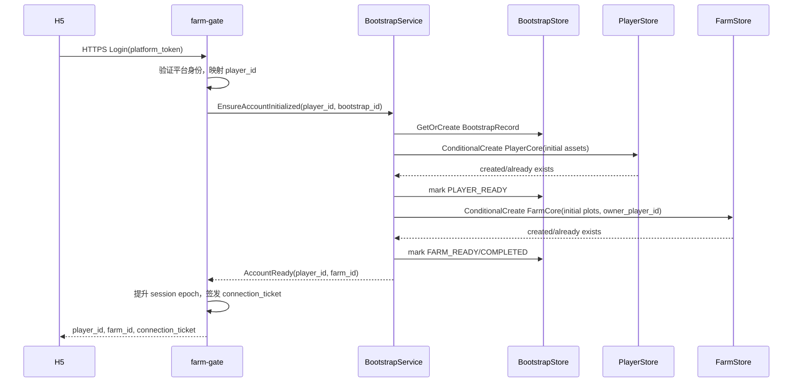
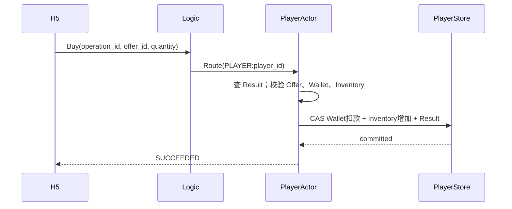
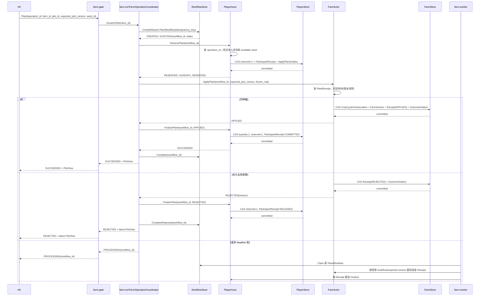
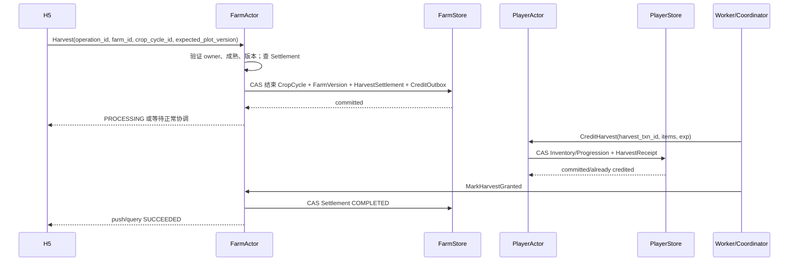
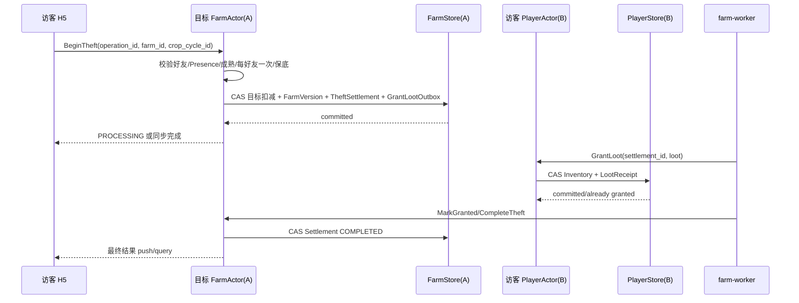

# 41 · 关键时序（双 Actor 基线）

本文件以 [PlayerActor/FarmActor 拆分](./16-player-farm-actor-split.md) 为准。所有“成功”均指对应权威 CAS 已确认；广播与投影不参与业务提交。

---

## 1. 登录与双记录建档



崩溃恢复：

- PlayerCore 已建、FarmCore 未建：下一次从 PLAYER_READY 继续；
- FarmCore 已存在：条件创建返回已有记录，不重复建地；
- BootstrapRecord 与两条 Core 不一致：以实际可校验记录推进，不重新发初始资产；
- 两条 Core 都未 Ready 时不能返回 AccountReady。

## 2. ClientHello

```text
H5 → TCONND/gateproxy → farm-gate
ClientHello(connection_ticket, client_protocol_version)

farm-gate：
验证 ticket 与 connection generation
→ 绑定 player_id/session epoch
→ 返回 ServerHello(player_id, farm_id, limits)
```

ClientHello 不进入 Actor。旧设备因 session epoch 失效后不能获得新的写 Permit。

## 3. JoinFarm

```mermaid
sequenceDiagram
    participant C as H5
    participant G as farm-gate
    participant L as Logic
    participant F as FarmActor
    participant D as DownlinkDispatcher

    C->>G: JoinFarm(request_id, target_farm_id)
    G->>L: ExecuteCommand + TrustedContext
    L->>L: Session/Friendship Admission
    L->>F: Route(FARM:target_farm_id)
    F->>F: Joining; snapshot_version=V; 开启 JoiningBuffer
    F->>D: enqueue Snapshot(V)
    F-->>L: ACCEPTED(subscription_id)
    L-->>G: ACCEPTED
    G-->>C: ACCEPTED，客户端保持 Joining
    D->>G: DeliverBatch Snapshot(V)
    G-->>D: QueueAccepted
    D->>F: ConfirmSnapshotQueued(subscription_id)
    F->>D: enqueue catch-up V+1...
    F->>F: Joining -> InFarm
    G-->>C: FarmSnapshot(V) + catch-up
    C->>C: 应用后 Joining -> InFarm
```

`ACCEPTED` 只表示服务端已建立 Join 上下文且 Snapshot 已进入本地下行编排，不表示客户端已看到页面。Snapshot 超时、Buffer 溢出、下行整批失败均使本次订阅失效。

## 4. Buy（PlayerActor 本地事务）



CAS 结果未知时不能返回失败并允许新 operation_id 重买；使用同一 operation_id 查询/重试。

## 5. Plant（Player → Farm → Player）



关键规则：

- `operation_id` 在 PlayerActor 内防重，`plant_txn_id` 在 Actor 间防重；
- accepted 后超时返回 PROCESSING，不返回纯失败；
- `PLOT_NOT_EMPTY/PLOT_VERSION_CHANGED` 是永久拒绝并释放预留，不自动改版本重试；
- Farm 已 APPLIED、Player Finalize 尚未完成时，页面可能先在 FarmSnapshot 看到作物，操作结果仍是 PROCESSING；
- 只有 Player Finalize CAS 成功后才对客户端形成 SUCCEEDED；
- Actor turn 不等待对端网络，协调器/Worker 承担跨 Actor 推进。

## 6. Harvest（Farm → Player）



P0 仓库容量无限，CreditHarvest 不会因容量产生永久业务拒绝。Farm 结束作物后不能回滚；Player 到账依靠 Receipt 和可靠重试。

## 7. 好友护理

```text
访客 B → FarmActor(A)
→ 校验 SessionPermit + FriendPermit + Presence + Incident
→ FarmCore CAS：Incident resolved + FarmVersion + CareRewardOutbox
→ 返回护理成功并广播 FarmChange

Worker → PlayerActor(B)
→ PlayerCore CAS：经验/任务进度 + CareRewardReceipt
→ 重复回调由 Receipt 吸收
```

同一 CropCycle 的一次浇水/一次除虫是地块全局事件。第一位有效处理者成功，之后返回 NO_CHANGE，不重复奖励。

## 8. 偷菜



作物未成熟直接 REJECTED，不创建已接受 Settlement。目标扣减一旦提交不能因广播或到账暂时失败而恢复。

## 9. 失败语义汇总

| 位置 | 结果 | 对外语义 |
|---|---|---|
| 入口校验未通过，未持久接受 | 稳定业务错误 | REJECTED |
| 起点 Actor 已持久 Intent/Settlement，但后续未完成 | 可恢复进行中 | PROCESSING |
| Actor 内 CAS 冲突 | Reload、重查幂等事实、有界重试 | 不直接等同业务失败 |
| Tcaplus 结果未知 | 查询或同 id 重投 | 不猜 SUCCEEDED/FAILED |
| 广播/下行失败 | 业务不回滚，订阅失效 | 重连并重新 Join |
| Worker 多次暂时失败 | 保留 PendingWork 持续重试 | 不因固定次数丢弃 |
| 对端永久业务拒绝 | 持久拒绝回执并补偿 | REJECTED |

## 10. OperationResult 归属

| 流程 | 客户端 operation_id 的权威查询位置 |
|---|---|
| Buy/Sell/Plant/Task/Mail | PlayerActor |
| Harvest/Water/RemovePest/Theft | FarmActor |

内部 txn/settlement id 不暴露为跨玩家任意查询能力。查询必须绑定已认证 player_id 和原始业务作用域。
