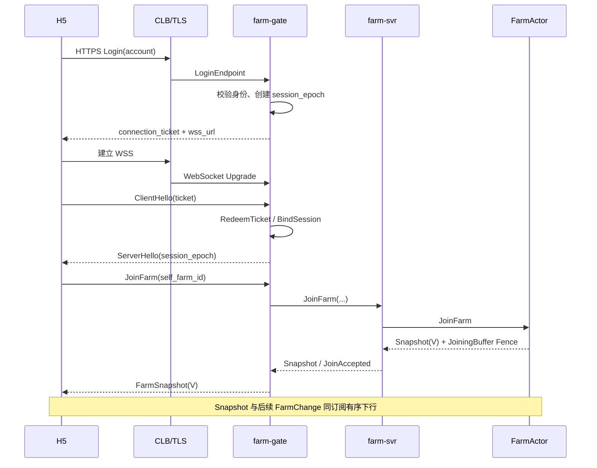
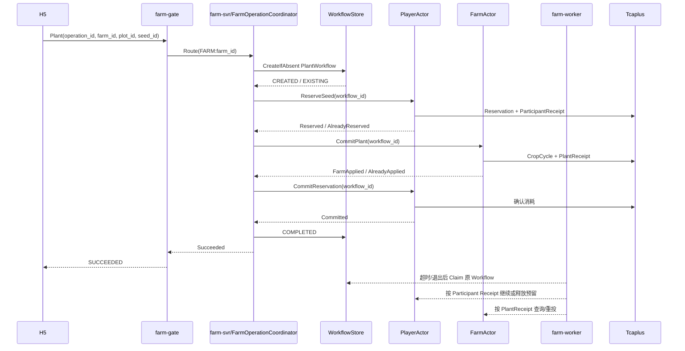
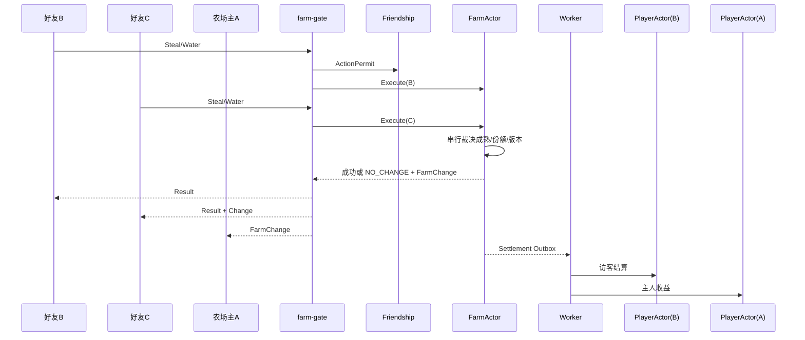

# 经典农场小游戏后台中期设计与工程评审材料

版本：`v1.2-midterm-review`  
日期：2026-07-29  
定位：超新星项目中期设计与工程评审材料（文档审阅，非口头汇报）。  
权威合同：L0 边界与成功/失败语义以 [22 · 生产架构 v1.21.2](./22-production-architecture-v1.21.md) 为准；本文不替代详细设计合同。

---

## 0. 评委阅读指引

### 0.1 本文目的

本文用于超新星项目中期设计评审。目标不是证明当前方案已经完备，而是向评委完整呈现：

- 题目理解与核心问题定义；
- 当前架构决策及其未选方案；
- 阶段实现情况；
- 尚未验证的工程假设与备选路径；

便于及时发现方向性错误，并获得后续实现建议。

**L0 架构已冻结，不等于物理 Repository、平台探针和端到端实现已经验收。**

评委可重点检查：

1. 领域和服务边界是否合理；
2. 状态与持久化语义是否过度设计；
3. 近期实施范围是否可控；
4. 平台能力假设是否成立；
5. 后续验证计划能否真正证明设计。

### 0.2 当前完成层级

| 层级 | 当前状态 | 含义 |
|---|---|---|
| 产品和玩法理解 | 已基本完成 | 三大 Loop、P0/P1 边界、冲突范围已明确 |
| L0 总体架构 | 已形成评审基线 | 四部署单元、双 Actor、双 Route Domain、存储与异步边界已确定 |
| L1/L2 详细合同 | 部分完成 | 登录 Join、Plant、Care/Theft、Mail/Task/Codex 等有设计；Proto / 表结构仍在补充 |
| L3 实现与验证 | 进行中 / 待开始 | H5 Fake Server 与协议骨架已有；Direct WSS / Tcaplus 探针、双 Actor 端到端、压测尚未完成 |

一句话：**设计推导已收敛到可评审基线；实现仍在 S2-0 编码准入门之前。**

### 0.3 决策状态说明

全文使用四种标签区分结论成熟度：

| 标签 | 含义 | 评委应如何读 |
|---|---|---|
| 【已冻结】 | 当前评审基线，推翻需显式架构变更 | 检查是否方向正确 |
| 【阶段选择】 | 为 P0 / 近期可控而收敛的实现选择 | 检查是否过重或过轻 |
| 【待平台验证】 | 依赖 Tcaplus / CLB / Redis / TGLog 等真实能力 | 检查假设是否成立，失败后怎么退 |
| 【待评委建议】 | 我们有倾向，但希望评委拍板或纠偏 | 请直接给建议 |

示例：

- 【已冻结】`PlayerActor` 管玩家资产冲突；`FarmActor` 管农场共享状态冲突。
- 【阶段选择】P0 只部署 `farm-gate` / `player-svr` / `farm-svr` / `farm-worker`。
- 【待平台验证】Tcaplus 单记录原子边界与 CAS P99。
- 【待评委建议】近期是否应实现完整 TheftWorkflow，还是先完成护理 + 简化偷菜闭环。

### 0.4 希望评委重点检查的问题

#### 架构方向

1. 以 `player_id` / `farm_id` 拆成 PlayerActor / FarmActor 是否合理？
2. P0 收敛为四个 Deployment，是过度聚合，还是仍然拆分过多？
3. Friendship / Mail / Task / Codex 共部署在 `player-svr`、但维持独立领域边界，是否合适？
4. `farm-worker` 承担 Workflow、Outbox、投影、通知、对账、Tlog，职责是否过重？

#### 一致性与持久化

5. 普通软资产采用 Actor 内提交 + 异步回写、接受受控 RPO，是否符合本题预期？
6. 跨 Actor 使用 Workflow / Order / Receipt，是否超出近期项目必要复杂度？
7. `PlayerPersistenceRuntime` 按物理记录分 Lane，是否合理？

#### 接入与平台

8. P0 使用 CLB/TLS → Direct WebSocket，TCONND 作为候选，是否符合实习 / 现网条件？
9. Tcaplus、Redis、DirectDispatcher 边界是否符合公司已有基础设施？

#### 实施范围

10. 当前 P0/P1 范围是否可控？哪些模块应进一步后移（完整任务 / 图鉴 / 邮件 / Scheduler / 完整偷菜三方结算）？

详细展开见 **§五**。

### 0.5 相关文档与仓库入口

| 入口 | 用途 |
|---|---|
| [22-production-architecture-v1.21.md](./22-production-architecture-v1.21.md) | L0 正式架构合同 |
| [08-s2-go-no-go.md](./08-s2-go-no-go.md) | 编码准入与阶段门 |
| [14-s2-implementation-plan.md](./14-s2-implementation-plan.md) | S2 实施顺序 |
| [16-player-farm-actor-split.md](./16-player-farm-actor-split.md) | 双 Actor 与跨 Actor |
| [17-uc-routing-migration-adaptation.md](./17-uc-routing-migration-adaptation.md) | 接入、Shard、迁移 |
| [21-direct-websocket-tlog-freeze.md](./21-direct-websocket-tlog-freeze.md) | Direct WSS 与 Tlog |
| `docs/design/assets/classic-farm-overall-architecture-freeze.png` | 总体生产架构图 |
| `supernova/h5` | H5 协议 / Fake Server / 联调骨架 |

### 0.6 阅读路径

| 目标 | 建议阅读 |
|---|---|
| 10 分钟判断有没有走偏 | §0 + 附录 A + §2.1～2.2 + §5.1 |
| 检查正确性设计 | §3 关键流程 |
| 检查能否落地 | §4 设计 / 实现 / 验证三线 |
| 给纠偏建议 | §5 全部 |

---

## 一、破题与工程问题定义

### 1.1 题目理解

题目表面是“做一个经典农场小游戏”，工程上真正要交付的是：

```text
可体验的产品闭环
+ 可解释的后台权威与一致性
+ 可扩展的服务 / 路由 / 存储边界
+ 可验证的容量、性能与故障恢复证据
```

H5 / 微信小程序是体验入口；评审时应重点核查后台如何把“种地、偷菜、多人同场”落成真实游戏服务端问题，而不是页面复刻。

| 能力面 | 题目要求 | 工程含义 |
|---|---|---|
| 个人经营 | 登录建档、种植、成熟、收获、商店、仓库 | 玩家资产闭环、幂等、失败可恢复 |
| 社交互动 | 好友、访问、浇水 / 除虫 / 偷菜、同场实时 | 农场内串行裁决、快照 / 增量无缺口 |
| 扩展玩法 | 任务、宠物、图鉴、邮件、红点 | 可后置，但不能破坏主权威边界 |
| 规模与稳定 | 3000 万 DAU、弱网、更新与故障恢复 | 容量模型 + 压测 / 故障注入，不是纸面口号 |

工程主线：

```text
业务规则清楚
  → 权威状态边界清楚
  → 并发和一致性可解释
  → 服务、路由和存储可扩展
  → 容量、性能和故障可验证
```

### 1.2 三个核心玩法 Loop

**个人经营：** 购买种子 → 播种 → 成熟 → 收获 → 入仓 → 出售 / 成长  

**经济循环：** 金币 ↔ 种子 / 道具 ↔ 土地生产 ↔ 作物 ↔ 金币  

**社交互动：** 好友发现 → 进入好友农场 → 浇水 / 除虫 / 偷菜 → 收益与记录 → 回自己农场  

社交 Loop 是后台难点：多好友同时操作同一农场时，必须有唯一裁决顺序，并让同场玩家看到可解释结果。

### 1.3 P0 产品边界 【阶段选择】

```text
闭环 1：登录 / 建档 → 自己农场 → 购买 → 播种 → 成熟 → 收获 → 出售
闭环 2：分享建友 → 好友列表 → 访问好友农场 → 查看可操作状态
闭环 3：多好友同场 → 浇水 / 偷菜 → FarmActor 串行裁决 → FarmChange 广播
```

【阶段选择】暂不作为近期阻塞项：复杂宠物养成、成熟主动提醒、完整任务 / 邮件 / 红点异步平台、弱网无感重放、滚动发布无感迁移。  
【待评委建议】完整 TheftWorkflow、Task/Codex 页面能力是否应继续后移，见 §5.3。

### 1.4 四类核心工程问题（扩展为六项检查点）

#### ① 权威边界 【已冻结】

| 事实类型 | 例子 | 要求 |
|---|---|---|
| 玩家事实 | 钱包、仓库、经验、任务、图鉴、Receipt | 同玩家顺序明确；永久事实不可回退 |
| 农场事实 | 地块、作物、可偷份额、护理、FarmVersion | 同农场唯一裁决顺序 |
| 展示 / 运行事实 | 连接、Presence、红点、机会摘要 | 可重建，不能反向裁决业务 |

#### ② 并发与路由 【已冻结】

```text
player_id → 玩家资产与领取
farm_id   → 土地、作物、同场广播
pair      → 好友关系与授权（无 FriendActor）
```

路由键必须对齐冲突键：同 Key 串行，异 Key 并行。

#### ③ 跨 Actor / 跨记录 【已冻结方向】【待平台验证实现成本】

Tcaplus 无跨记录事务。Plant / Harvest / Theft / MailClaim 必须用 Intent / Reservation / Receipt / Workflow / Outbox，不能假装一次本地事务。

#### ④ 实时同步 【已冻结】

```text
FarmSnapshot(V) → FarmChange(V+1...) 进入同一订阅下行
广播失败不回滚已提交事实；版本缺口后重新 Join
```

#### ⑤ 接入分层 【阶段选择】【待平台验证】

连接 / Ticket / Session / 下行队列属于 `farm-gate`；金币 / 地块 / 好友不属于 Gate。

#### ⑥ 规模验证 【待平台验证】

3000 万 DAU 需拆成峰值在线、Join、业务写、广播扇出、CAS、邮箱等待等可测项；数字必须区分假设 / 推导 / 实测。

### 1.5 完成标准（中期检查点）

中期检查点认为“破题完成”的标准是：

1. 能说清三类事实与冲突键；
2. 能说清双 Actor 与四部署为何这样拆、代价是什么；
3. 能给出跨 Actor 主链时序与失败语义；
4. 能区分已冻结、阶段选择、待验证、待评委建议；
5. 有可执行的下一阶段验证计划，而不是继续横向扩设计。

当前自评：1～4 已达到可评审状态；5 的执行仍在 S2-0。

---

## 二、总体架构设计

### 2.0 总体生产架构图


**本节状态：** 【目标生产设计】+【P0 实现最小子集】+【当前尚未验证平台与端到端】

评委可读六层：客户端与接入 → 路由会话治理 → 四部署单元 → 权威写与可靠异步 → 存储与可观测 → 六条核心业务链。  
右侧硬边界：Friendship 无 FriendActor；Join 后 MarkVisited 靠 JoinConfirmation；跨玩家结算未完成返回 `PROCESSING`；邮件领取走可信 ClaimMaterial。

### 2.1 从冲突范围推导双 Actor

**本节状态：** 【已冻结】权威边界；【阶段选择】S2 先单 Logic 静态路由；【待平台验证】多节点 Lease / fencing

#### 当前选择

```text
PlayerActor(player_id)：钱包 / 仓库 / 成长 / 宠物 / 任务 / 图鉴 / 奖励领取
FarmActor(farm_id)：土地 / 作物 / 护理 / 偷菜份额 / Presence / FarmVersion
```

即使 P0 暂令 `farm_id` 与 `owner_player_id` 数值相同，也必须保持：

```text
PLAYER:10001 != FARM:10001
```

#### 解决的问题

- 玩家资产命令按 `player_id` 冲突；
- 土地、作物、同场互动按 `farm_id` 冲突；
- 热门农场互动不应阻塞农场主买种子 / 领邮件；
- 未来一玩家多农场时不必推翻权威边界。

#### 未选择的方案

| 方案 | 未选原因 |
|---|---|
| `PlayerFarmActor(player_id)` 合并 | 好友访问时农场冲突与玩家资产冲突绑死；热门农场拖累主人经济 |
| 完全无状态 + 每次 DB CAS | 把正常并发全部推给存储；同场实时订阅与顺序难解释 |
| 单一 LogicSvr 塞所有模块 | 玩家经济与热门农场扩容 / 故障绑在一起 |

#### 代价

- Plant / Harvest / Theft 变成跨 Actor；
- 必须有 Workflow / Receipt / 恢复机制；
- 路由与迁移模型更复杂。

#### 希望评委检查 【待评委建议】

双 Actor 带来的正确性与扩容收益，是否值得近期项目承担对应复杂度？若建议先“逻辑双 Actor、物理单进程”，我们可调整实施节奏，但不打算放弃权威分离。

### 2.2 四个部署单元

**本节状态：** 【阶段选择】P0 四部署；模块可后拆

| 部署单元 | 职责 | 权威边界 | 明确不负责 |
|---|---|---|---|
| `farm-gate` | 登录、Ticket、WSS、Session、协议、限流、下行 | 连接与会话运行态 | 不裁决金币 / 地块 / 好友 |
| `player-svr` | PlayerActor；Friendship；Mail；Task/Codex；ReadAPI | Player / 关系 / 邮件条目权威 | 不拥有农场地块 |
| `farm-svr` | FarmActor；地块 / 护理 / 偷菜目标侧；Presence；机会摘要 | Farm 权威 | 不直接改访客资产 |
| `farm-worker` | Workflow / Outbox / 投影 / 通知 / 对账 / Tlog | 推进可靠执行状态 | 不做在线同步裁判 |

#### 为什么不是按玩法名拆微服务

未选：`mail-svr` / `task-svr` / `redpoint-svr` / `friend-svr` 一上来全拆。

理由：服务边界应按冲突键、负载曲线、故障 / SLA 证据决定；过早拆分增加 RPC、复制和一致性成本。

#### 合并但不混淆

1. Friendship / Mail / ReadAPI 共部署，但独立 package、表、错误码、指标；
2. `PlayerActor ≠ player-svr`：MailEntry 不进 Actor 热快照；领取才进 PlayerActor；
3. 服务 / 模块 / Actor 三层分开理解。

#### 希望评委检查 【待评委建议】

- 四部署是否仍过多？是否应 P0 先 Gate + 单 Logic（内含 Player/Farm）+ Worker？
- `farm-worker` 是否过重，是否应先只做 Outbox/Workflow，投影后移？

### 2.3 接入、Session 与 Actor 路由

**本节状态：** 【阶段选择】Direct WSS 主链；【待平台验证】Idle / 心跳 / 慢连接；TCONND 为候选

#### 当前选择

```text
公网 DNS → CLB / TLS → farm-gate Direct WebSocket
```

Gate 内：Upgrade / PRE_AUTH / Ticket / Session / FarmFrame / 限流 / ConnectionWriter / 旧连接 Fence。  
【阶段选择】TCONND + gateproxy、WAF 为显式候选 Adapter，不改变 GateCore 合同。

这里需要特别区分“我们自己的业务路由合同”和“平台路由数据面实现”。本项目不依赖 UC Proxyless Mesh 才能成立；必须自己定义并实现：

```text
ActorAddress(actor_kind, entity_id)
→ routing_v2 / xxhash
→ VirtualShard
→ ShardAssignment
→ 当前 Holder Pod
→ 本地 Actor mailbox
```

其中 `ActorRouteClient` 负责计算 Shard、读取 Assignment、访问 Holder、处理 `STALE_ROUTE/REDIRECT` 和有界重试；Holder 负责 Lease 校验并把命令投递到 Actor mailbox；Actor 才负责最终业务裁决。Shard 不保存业务真值，Pod 也不天然拥有永久写权，Tcaplus 的 `RecordVersion + writer_epoch` 才是最终写入防线。

UC Proxyless 的思想可以作为多 Logic 阶段的候选数据面：让 `ActorRouteClient` 直接访问目标 Holder，减少“先到任意 Logic、再转发到目标 Logic”的固定一跳。但它不是本项目的业务服务，也不是必须照搬的组件。未来也可以使用自研 gRPC 路由客户端、平台 SDK 或带转发的 LogicIngress，只要复用同一套 ActorAddress、VirtualShard、Assignment、Redirect 和 fencing 合同即可。

阶段上先这样落地：

```text
S2：静态 Assignment，单 Logic，验证自有路由和 Actor 串行裁决
多 Logic：Assignment/Lease/Revision，按压测结果选择直连或转发数据面
生产迁移：Holder Drain/Handoff + writer_epoch，防止旧 Holder 双写
```

#### 两类路由不能混淆 【已冻结】

| 路由 | 问题 | 键 |
|---|---|---|
| 连接路由 | 连接在哪个 Gate | `gate_id + connection_id + transport_generation` |
| Actor 路由 | 权威事实由谁裁决 | `ActorKey = actor_kind + entity_id` |

```text
virtual_shard = xxhash64(actor_kind_byte || uint64_be(entity_id)) % 4096
Player / Farm 使用独立 Assignment Region
```

Redis 可缓存路由提示，不能成为所有权权威。

#### 未选择

| 方案 | 原因 |
|---|---|
| S2 就部署完整 Proxyless / Coordinator 控制面 | 单 Logic 时无验证价值；但 S2 必须先冻结并验证自有 ActorRouteClient、VirtualShard 和静态 Assignment 合同 |
| Gate 无感热 Session Handoff + 任意下行 ACK 重放 | 协议尚未具备对应语义，易做假无感 |
| 客户端指定 actor kind / shard | 不可信 |

#### 实时恢复主路径 【阶段选择】

```text
重连认证 → 重新 Join → 权威 Snapshot(V) → 继续收 Change
```

#### 希望评委检查 【待评委建议】

1. Direct WSS 是否符合现网；是否应优先复用 TCONND？  
2. 以重新 Join 为主恢复路径，是否可接受？

### 2.4 数据权威与存储边界

**本节状态：** 【已冻结】职责分工；【待平台验证】Tcaplus / Redis 真实能力

| 存储 | 职责 | 不是 |
|---|---|---|
| TcaplusDB | 权威事实、Receipt、Workflow、Outbox、Export Spool | 不是缓存 |
| Redis | Session、路由提示、限流、机会摘要、红点投影 | 不是金币 / 地块真理 |
| DirectDispatcher | P0 异步分发 | 不是事务提交点 |
| MQ | P1 / 生产演进候选 | 不是 P0 正确性依赖 |
| TGLog / Tlog | 经营流水 | 不是业务真值 / 恢复来源 |

### 2.5 持久化策略

**本节状态：** 【已冻结】分级原则；【阶段选择】P0b 先全 Durable；【待平台验证】ACTOR_SOFT RPO

| 类别 | 策略 |
|---|---|
| 农场关键写、唯一领取、付费、跨玩家结算、永久解锁 | 可靠提交后才成功 |
| 普通玩家软资产（可灰度） | Actor 内线性提交 + Dirty 异步回写，接受受控 RPO，可一键回退 |
| 跨记录 | Intent / Order / Receipt / Workflow，不假装跨记录原子 |

`PlayerPersistenceRuntime` 按物理记录分 Lane（Economy / Task / Codex…），避免同记录旧异步写覆盖新可靠写；不同 Lane 可并行，但不宣称跨记录原子性。

#### 希望评委检查 【待评委建议】

受控 RPO 是否符合本题“资产正确性”口径？若否，P0 可全程 Durable。

### 2.6 Workflow、Outbox 与 Worker

**本节状态：** 【已冻结】模式；【阶段选择】P0 DirectDispatcher；【待评委建议】Worker Role 范围

```text
Authority Commit + Outbox
  → farm-worker DirectDispatcher
  → 幂等 Consumer / Workflow 推进
  → 投影 / 通知 / 结算 / Tlog Export
```

MQ 故障或未部署时，业务事实仍以 Tcaplus 中 Receipt / Settlement / Outbox 为准。

### 2.7 任务、邮件、图鉴、红点的领域边界

**本节状态：** 【目标生产设计】；【阶段选择】主链先留可靠来源钩子，页面能力可后置

| 领域 | 权威位置 | P0 倾向 |
|---|---|---|
| Friendship | player-svr 模块 + Tcaplus canonical pair | 分享建友 / 列表 / Permit；无 FriendActor |
| Mail | PlayerMail 表 + 领取进 PlayerActor | 仅系统邮件 |
| Task | PlayerActor 内模块 + 独立物理记录 | S3 留来源钩子；完整页面可后移 |
| Codex | 同上；首次自己收获才解锁 | 同 Task |
| RedPoint / 导航 | Redis 投影 + 精确 BatchEvaluate | 可后置，但不能当真理 |

### 2.8 目标生产架构与近期实现的差异

| 能力 | 目标生产设计 | 近期实现（阶段选择） |
|---|---|---|
| 接入 | Direct WSS；候选 TCONND/WAF | 先 Direct WSS + 探针 |
| Actor 放置 | 多节点 Assignment / Lease / Redirect | S2 静态单 Logic |
| 持久化 | Durable + 可灰度 ACTOR_SOFT | 先全 Durable 跑通 |
| 异步 | DirectDispatcher → 可换 MQDispatcher | 仅 DirectDispatcher |
| Scheduler | 持久调度主动提醒 | P1；P0 靠 `mature_at` 派生 |
| Task/Codex/Mail 全能力 | 完整合同 | 主闭环优先，扩展可后移 |
| 偷菜 | 完整三方结算 + Receipt 生命周期 | 【待评委建议】是否先简化 |

**希望评委检查：** 哪些“目标生产设计”必须在近期可见，哪些应明确标为 P1，避免过度设计占用节奏。

---

## 三、关键流程与正确性分析

> 本章用于评审正确性设计是否完整。每节标注状态，避免被理解成“三周必须全部实现”。

### 3.1 登录与 Join

**本节状态：** 【已冻结】合同；【待平台验证】WSS / Idle / 下行；【阶段选择】S2 首个端到端目标



评审要点：Ticket 非长期权限；QueueAccepted 后才 InFarm；版本缺口重新 Join。

### 3.2 Buy / Plant / Harvest（跨 Actor）

**本节状态：** 【已冻结】Plant 顺序；【阶段选择】S3 实现；【待平台验证】未知结果恢复



| 当前选择 | `FARM:farm_id` 首跳到 farm-svr Coordinator；先创建 Workflow，再 Player Reserve → Farm Apply → Player Finalize |
|---|---|
| 未选 | Farm 先占坑再扣种子；或一次 RPC 两边都改 |
| 理由 | Plant 业务目标是 Farm/Plot；种子属 Player、地块属 Farm，分别由 Participant 裁决；无跨记录事务 |
| 代价 | 多步恢复；需要 Workflow / Participant Receipt |
| 希望评委检查 | farm-svr 作为 Farm 类操作统一首跳是否合理；Workflow 创建与 Participant 写入顺序是否充分 |

“Player 先预留”描述的是第一项权威 Participant 写入，不等于 `PlantCoordinator` 必须部署在 player-svr。Gate 只按 CommandRouteDirectory 选择 `FARM:farm_id` 首跳，不直接串联 PlayerActor/FarmActor；FarmOperationCoordinator 也不直接修改种子或地块。

Harvest 对称：Farm 先成立收获事实 → Player 入账 / CodexUnlockIntent / Task 来源钩子 → 展示可延迟，不可永久丢。

### 3.3 好友关系与访问

**本节状态：** 【已冻结】无 FriendActor；【阶段选择】P0c；【待平台验证】强一致读 / CAS

```text
列表 locality = player_id
写 / Permit locality = canonical_pair_key
正确性 = Tcaplus FriendRelation + CAS + relation_epoch + Receipt
```

访问：Friendship Permit → JoinFarm → Snapshot；MarkVisited 需 farm-svr 签发的 JoinConfirmation。

### 3.4 Care / Theft

**本节状态：** 【已冻结】Farm 串行裁决 + PROCESSING；【待评委建议】完整三方结算是否近期必做



**硬规则：** Farm 已扣份额但 Player 结算未完成 → `PROCESSING`，不得伪装纯失败。

### 3.5 JoiningBuffer

**本节状态：** 【已冻结】语义；【待平台验证】慢连接内存上限

```text
Joining → 入队 Snapshot(V) 与期间 Change → QueueAccepted → InFarm
超限 / 缺口 → Resync / 重新 Join
广播失败不回滚业务事实
```

### 3.6 PlayerPersistenceRuntime

**本节状态：** 【目标生产设计】；【阶段选择】P0b-1 先 Durable；Lane 合同先落地

Mailbox 管命令顺序；Record Lane 管同记录版本与软/硬保存；跨记录靠 Intent/Order/Receipt。

### 3.7 Task / Codex / Mail

**本节状态：** 【目标生产设计】；【阶段选择】主链钩子先于完整页面

- Task：只消费服务端已成立事实；客户端不能直接报完成。  
- Codex：仅首次成功收获自己种植的植物解锁；偷菜 / 成品不解锁。  
- Mail：系统邮件；领取 = 可信 ClaimMaterial + 资产/Receipt 同写单元。

### 3.8 Scheduler 与好友机会提醒

**本节状态：** 【目标生产设计】；【阶段选择】P0 不依赖持久 Scheduler

```text
成熟：trusted_now_ms >= mature_at
Scheduler：只唤醒 / 提醒，不决定成熟
P0：读取时校验 + Opportunity Summary
P1：Persistent Scheduler
```

### 3.9 TGLog 与审计

**本节状态：** 【目标生产设计】；【待平台验证】Export Spool / TGLog ACK；【待评委建议】是否本期真实接入

```text
A 级：Receipt/Settlement → Outbox → Export Spool → TGLog（业务成功不等待 TGLog）
B/C：可 BestEffort / 采样
TGLog 不是恢复真值
```

---

## 四、工程规划（设计线 / 实现线 / 验证线）

### 4.1 设计线

| 设计产物 | 状态 |
|---|---|
| 玩法模块与 P0 范围 | 【已冻结】 |
| 冲突范围 / 权威边界 | 【已冻结】 |
| 双 Actor | 【已冻结】 |
| 四部署单元 | 【阶段选择】 |
| 接入 / Session / Actor 路由 | 【阶段选择】+【待平台验证】 |
| 持久化分级 / Lane | 【已冻结原则】+【待平台验证】 |
| Workflow / Outbox | 【已冻结模式】 |
| Task / Mail / Codex / 红点边界 | 【目标设计】；完整实现可后移 |
| 容量模型 | 【待平台验证】假设已写明 |
| S2 Go/No-Go 与实施计划 | 【已冻结流程】 |

### 4.2 实现线（诚实进度矩阵）

> 下表用于判断是否出现“设计远快于实现”的风险。✅=已完成；△=进行中；—=未开始。

| 模块 | 设计 | Proto/表 | 编码 | 联调 | 验证 |
|---|---|---|---|---|---|
| Login / WSS 合同 | ✅ | △ | △（H5 Fake） | △ | —（真实 CLB 探针） |
| Session / Ticket | ✅ | △ | — | — | — |
| Actor 路由 v2 | ✅ | △（黄金向量） | — | — | — |
| PlayerActor 骨架 | ✅ | △ | — | — | — |
| FarmActor / Join / JoiningBuffer | ✅ | △ | — | — | — |
| 经营闭环 Buy/Plant/Harvest | ✅ | — | — | — | — |
| 好友关系 / Permit | ✅ | — | — | — | — |
| Care / TheftWorkflow | ✅设计 | — | — | — | — |
| Task / Codex / Mail | ✅设计 | — | — | — | — |
| farm-worker / Outbox | ✅ | — | — | — | — |
| Tcaplus 真实探针 | ✅计划 | △ | △（verify 工具） | — | — |
| 压测与故障注入 | ✅计划 | — | — | — | — |

**当前阶段：** S2-0（协议冻结 + Direct WSS / Tcaplus 探针）。  
**风险自评：** 设计完整度高、实现证据不足——这是中期最需要评委盯住的点，不是继续加设计。

### 4.3 验证线

| 架构决策 | 如何验证 | 验证失败后怎么办 |
|---|---|---|
| Direct WSS | 长连接、心跳、慢连接、重连、Idle | 启用 TCONND Adapter；不改业务合同 |
| 双 Actor 路由 | 同 Key 串行、异 Key 并行；多节点 Redirect / 旧 Holder | P0 固定静态 Shard |
| ACTOR_SOFT | 强杀进程测真实回滚窗口 | 全部切回 Durable |
| JoiningBuffer | Snapshot 期间并发写 + 慢连接 | 超限直接 Resync / 重新 Join |
| Plant Workflow | 每 Participant 后强制崩溃 / 超时 | 缩小跨 Actor P0 范围或全程同步可恢复重试 |
| Theft Settlement | Farm 成功后杀 Worker | 保持 PROCESSING + Reconcile；或首版简化结算 |
| TaskProgressIntent | 来源提交后崩溃重放 | 调整物理记录 / 幂等键 |
| CodexUnlockIntent | Harvest 后 Consumer 故障 | Worker 重试 + Reconcile，禁止丢解锁 |
| Export Spool | TGLog 停 1/6/24h | 降采样、扩容 Spool；业务不回滚 |

测试阶梯：单测 → 集成（CAS/冲突）→ 端到端 → 压测 → 故障注入。  
指标：吞吐、P50/P95/P99、邮箱长度、下行队列、CAS 冲突、重试、Outbox 积压、错误率。

### 4.4 阶段计划与里程碑

```text
S2-0  协议 + Direct WSS / Tcaplus 探针（Go/No-Go）
S2-1  H5 → Gate → Logic → Route → 空结果下行
S2-2  双 Actor + 双记录建档
S2-3  Join / Snapshot / JoiningBuffer / 重连   ← 近期第一验收
S3    购买 → 播种 → 收获 → 出售
S4    好友 → 访问 → 浇水 / 除虫 → FarmChange
S5    偷菜结算（完整或简化，待评委建议）
S6    任务 / 图鉴 / 邮件 / 红点 / 导航（可裁剪）
P1    Scheduler 主动提醒、MQDispatcher、排行榜
```

### 4.5 容量模型（假设，非实测）

| 指标 | 基线估计 | 状态 |
|---|---:|---|
| DAU | 3000 万 | 题面输入 |
| 基线 PCU | ~125 万 | 行为假设推导 |
| 压力 PCU | ~250 万 | 安全余量 |
| JoinFarm 峰值 | ~3 万 QPS | 【待平台验证】 |
| 农场地块写 | ~3.67 万 QPS | 【待平台验证】 |

真正风险：CAS P99、热门 FarmActor、下行扇出、Workflow 积压、登录激活风暴——不是“Actor”这个词。

### 4.6 已产出与可展示材料

- 本评审材料与架构图；
- v1.21 L0 架构与专项合同（Task/Codex/Persistence/Tlog/路由）；
- S2 Go/No-Go 与实施计划；
- H5 协议编解码、Fake Server、基础测试骨架；
- Tcaplus verify 工具入口（探针用）。

### 4.7 预期效果与验收标准

| 里程碑 | 验收 |
|---|---|
| S2 | 登录 → 空农场 Snapshot → 断线重连收敛 |
| S3 | 经营闭环正确；超时重试不重不丢 |
| S4 | 好友同场护理可见 FarmChange |
| S5 | 偷菜结果可解释；无“已扣份额却报失败” |
| 压测 / 故障 | 报告区分假设 / 推导 / 实测；失败有退路 |

---

## 五、风险、困难与待评审问题

> 本章是请评委纠偏的主入口。每项按：问题 / 当前倾向 / 理由 / 风险 / 希望建议。

### 5.1 架构方向问题

#### Q1. 双 Actor 是否合理复杂度？

- **当前倾向：** 【已冻结】保留双 Actor 权威分离。  
- **理由：** 冲突范围真实不同；合并会绑死热点。  
- **风险：** 跨 Actor 流程增加实现成本。  
- **希望建议：** 是否允许“逻辑双 Actor + 物理先单进程”作为近期落地形态？

#### Q2. 四 Deployment 是否过多 / 过少？

- **当前倾向：** 【阶段选择】四部署。  
- **备选：** Gate + 单 Logic（Player+Farm）+ Worker。  
- **希望建议：** P0 最小部署数应是几个？

#### Q3. Friendship/Mail/Task/Codex 共部署是否合适？

- **当前倾向：** 共部署、独立模块。  
- **风险：** player-svr 变“大杂烩”；或过早拆服务。  
- **希望建议：** 共部署边界是否需要更严的 Role 隔离指标？

#### Q4. farm-worker 是否过重？

- **当前倾向：** 一个 Worker 多 Role，按证据再拆。  
- **备选：** 近期只启用 workflow+outbox Role。  
- **希望建议：** 哪些 Role 必须后移？

### 5.2 平台能力假设 【待平台验证】

| 问题 | 当前倾向 | 失败备选 |
|---|---|---|
| 是否有可复用 Actor Shard 路由 | 先自研 routing v2 + 静态表；再对接平台 | 长期单 Logic / 手工 Assignment |
| Tcaplus CAS / 字段写 / BatchGet | 按条件写设计 | 调整记录切分；降低软保存 |
| writer_epoch 能否 fence 旧 Holder | 作为多节点 Blocker | P0 不做热迁移 |
| Direct WSS 能否直接面向公网 | P0 默认 Direct | 切 TCONND Adapter |
| Redis 是否满足 Session 原子语义 | 用事务 / Lua / 保守设计 | Session 权威降级到更强存储 |
| TGLog 是否本期真实接入 | A 级先打通 Export Spool 合同 | 可先落 Spool，延后 TGLog |

### 5.3 实现范围问题 【待评委建议】

#### Q5. 是否先保证经营闭环 + 多人护理，暂缓完整任务 / 图鉴 / 邮件？

- **当前倾向：** 是。S3/S4 优先；S6 可裁剪。  
- **风险：** 演示完整度下降。  
- **希望建议：** 考核更看重“可见玩法全”还是“主链正确可恢复”？

#### Q6. 偷菜是否需要完整三方结算，还是首版简化？

- **当前倾向：** 合同按完整写；实现可先“目标侧扣减 + 简化结算 / PROCESSING”。  
- **希望建议：** 首版最小可接受偷菜语义是什么？

#### Q7. Scheduler 是否完全放 P1？

- **当前倾向：** 是；P0 用 `mature_at`。  
- **希望建议：** 是否必须在中期后很快看到主动提醒？

#### Q8. ACTOR_SOFT 是否先不启用？

- **当前倾向：** P0b-1 全 Durable；有证据再灰度。  
- **希望建议：** 是否同意该顺序？

### 5.4 产品规则问题 【待评委建议】

| 问题 | 当前倾向 | 备注 |
|---|---|---|
| 宠物罚金最终数值 / 展示 | 偷菜入访客仓，罚金扣访客加主人 | 需产品确认 |
| 护理礼盒概率与每日上限 | 有上限；具体表待定 | 不影响 Farm 串行模型 |
| 好友最大数量 | 有硬上限；索引 Lag 时保守准入 | 影响 Summary / 导航扫描 |
| 单农场同时在线人数 | Presence 有界；超限拒绝或降级 | 影响广播扇出 |
| 同一好友同一茬尝试次数 | 一次机会 | AttemptReceipt |
| 活动植物历史图鉴保留 | 历史 Catalog 需保留 | 发布门禁 |

### 5.5 自评：是否走偏

| 检查项 | 判断 |
|---|---|
| 纯前端 Demo | 否 |
| 过早微服务化 | 否（四部署 + 模块后拆） |
| 缓存 / 广播当真理 | 否 |
| 空谈 Actor | 否（有 CAS/Outbox/Workflow 合同） |
| 连接路由与 Actor 路由混淆 | 否 |
| 跨 Actor 当成本地事务 | 否（PROCESSING / Receipt） |
| 纸面 DAU 当达标 | 否 |
| 设计远快于实现 | **是，已知风险** —— 下一步应做探针与 S2 纵向链路 |

---

## 六、阶段性总结与思考

### 6.1 当前阶段结论

1. 题目已从“农场页面”转化为可评审的后台工程问题。  
2. L0 基线已形成：四部署、双 Actor、双路由域、Tcaplus/Redis/Outbox 分工。  
3. 主链正确性路径已想清楚：Join、Plant、Care/Theft、Mail。  
4. **尚未**完成平台验收与端到端实现；不能宣称生产就绪。  
5. 中期最大风险是设计完整、证据不足；应用验证收敛，而不是继续扩文档。

### 6.2 与最初方案相比的主要变化

| 变化 | 说明 |
|---|---|
| 单 Owner / 合并 Actor → 双 Actor | 冲突范围拆开 |
| 多服务按名字拆 → 四部署 | 证据驱动后拆 |
| TCONND 默认 → Direct WSS 默认 | 缩短依赖；TCONND 候选化 |
| MQ 前置 → Outbox + DirectDispatcher | 正确性不绑 MQ |
| 成熟靠 Scheduler → `mature_at` 派生 | Scheduler 降为提醒 |

### 6.3 仍可能需要推翻或收缩的决策

1. Direct WSS 若现网不可用 → 切 TCONND，不改业务合同。  
2. 双 Actor 跨流程过重 → 可收缩 P0 跨 Actor 范围，但保留权威分离。  
3. ACTOR_SOFT 若 RPO 不可接受 → 全程 Durable。  
4. Task/Codex/Mail/完整 Theft 若超期 → 明确后移，保留主链钩子。  
5. 容量模型假设若与探针不符 → 显式改模型，不在代码暗改。

### 6.4 下一阶段重点

```text
1) 完成 Direct WSS + Tcaplus 探针，输出 Go/No-Go
2) 打通 S2：登录 → 空农场 → 重连
3) 再进入 S3 经营闭环
4) 每完成一条链路，补故障注入证据
5) 按评委意见收缩 P0 范围，而不是横向加设计
```

---

## 附录

### 附录 A. 评委快速阅读摘要

**我们在做什么：** 经典农场后台——个人经营、经济循环、好友同场互动；H5 是入口，工程重点是权威、并发、持久化与验证。

**已确定（【已冻结】）：** Player/Farm 双权威；冲突键对齐路由；Join 用 Snapshot+JoiningBuffer；跨 Actor 用 Intent/Receipt/Outbox；Redis/广播不是真理。

**阶段选择：** 四部署；P0 Direct WSS；P0 不依赖 MQ；Scheduler 放 P1；扩展玩法可后移。

**尚未验证：** CLB Idle/心跳、Tcaplus CAS P99、多节点 fencing、ACTOR_SOFT RPO、真实容量。

**当前进度：** 设计基线完成；实现停在 S2-0；已知“设计快于实现”。

**最需要评委拍板：** 双 Actor/四部署是否过重；Direct WSS vs TCONND；软资产 RPO；偷菜/任务/邮件是否裁剪；下一里程碑是否坚持 S2 空农场。

### 附录 B. 总体生产架构图

见 §2.0：`docs/design/assets/classic-farm-overall-architecture-freeze.png`

### 附录 C. 完整时序图

见 §3.1～3.4（登录 Join、Plant、Care/Theft；Mail 见详细合同 22/相关专项）。

### 附录 D. 容量计算

见 §4.5；详细推导见容量模型相关设计文档。中期只把数字当假设，不当达标证明。

### 附录 E. 测试与验证映射

见 §4.3 验证线表。

### 附录 F. 术语与合同入口

| 术语 | 含义 |
|---|---|
| L0 Freeze | 权威边界与成功/失败语义冻结，非生产实现冻结 |
| ActorKey | `actor_kind + entity_id` |
| JoiningBuffer | Join 期间 Snapshot 与 Change 同队列 |
| PROCESSING | 本侧事实已成立，跨边界收尾未完成 |
| Outbox | 权威提交后的可靠异步出口 |
| DirectDispatcher | P0 无 MQ 的分发实现 |
| ACTOR_SOFT | 软资产异步回写路径 |

详细编号与 HC 合同见 [22](./22-production-architecture-v1.21.md)。

### 附录 G. 评审意见记录

| 日期 | 评委 | 问题编号 | 意见摘要 | 我们的跟进行动 | 状态 |
|---|---|---|---|---|---|
|  |  |  |  |  | 开放 |
|  |  |  |  |  |  |
|  |  |  |  |  |  |

---

**结束语：** 本文是当前经过推导形成的评审基线——哪些已确定、哪些仍是假设、哪里可能需要纠偏，请评委重点检查 §0.4 与 §五。我们会按评审意见收缩实施面，并用探针与纵向链路给出证据，而不是继续把目标生产设计误写成已交付能力。
