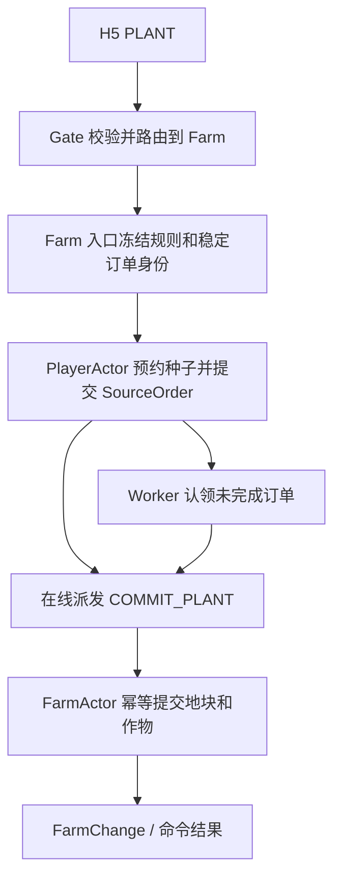

# 农场游戏：完整源码阅读指南

## 先确定版本

完整后端基线是 `sources/farm-game-master/farm-game/`，原样保留全部代码、部署、压测、设计及验证资料。另一个面试归档中的 `farm-game/` 是较早快照，与较新版本共有 1791 个同路径文件，其中 107 个内容不同。不要覆盖或混合这两个版本。

H5 来自面试归档，见 [客户端阅读指南](farm-h5.md)。分析一条端到端链路时，要同时说明所选前后端的版本；不能因目录中同时有它们，就认为已完成联调。

原 README 的 3000 万 DAU 是设计目标；本次没有执行容量压测或验证历史报告。`docs/design/` 用于理解契约，`docs/verification/` 用于理解当时如何验证，结论仍需核对实验条件和对应代码。

## 项目在做什么

客户端用 HTTP 完成账号、会话、好友和分享操作，用 WebSocket/Protobuf 发送经营命令、接收结果和农场变化。网关负责接入与转发，玩家资产由 PlayerActor 裁决，地块与作物由 FarmActor 裁决。跨 Actor 的动作通过持久协调与幂等 receipt 推进。

| 部分 | 主要入口 | 阅读时的问题 |
|---|---|---|
| 网关 | [cmd/farm-gate][gate-main]、[internal/gateway][gateway] | 连接如何认证？命令先到哪个业务服务？ |
| 玩家服务 | [cmd/player-svr][player-main]、[internal/player][player] | 谁能改种子、背包和玩家资产？ |
| 农场服务 | [cmd/farm-svr][farm-main]、[internal/farm][farm] | 谁能改地块？结果何时下发？ |
| 恢复进程 | [cmd/farm-worker][worker-main]、[internal/worker][worker] | 在线执行一半后，谁继续做？ |
| 通用 Actor 原语 | [internal/logic/actor][actor-common] | 串行、写权、保存和退出分别由谁保证？ |
| 路由与归属 | [internal/actorrouting][routing]、[internal/authoritycomposition][composition] | 请求去哪一台？旧实例为什么不能继续写？ |
| 状态保存 | [internal/storage][storage] | 什么数据一起提交？提交超时后怎么办？ |
| 协议 | [api/proto][proto] | 帧、命令、业务请求和内部步骤如何区分？ |

## 用一次种植理解主流程

种植同时涉及玩家种子与农场地块，所以不能只看 `domain/plant.go`。当前较新源码走 SourceOrder，旧 `internal/scenario/plant` 和 `internal/plantonline` 仍保留，适合研究演进，不能作为当前主路径。

| 步骤 | 已核对入口 | 状态变化与边界 |
|---|---|---|
| 收到二进制帧 | [websocket.go:483][ws] → [gate.go:723、768][gate] | 检查方向、序号，进入命令处理。 |
| 校验与路由 | [gate.go:1285、1404、1428][gate] → [sharded.go:363][sharded] | 校验会话、订阅和 Catalog，形成可信上下文；PLANT 首跳是 Farm。 |
| 进入种植协调 | [service.go:710、748、952][farm-ingress] → [plant_source.go:92][plant-source] | 重验 payload/路由，检查目标农场，冻结规则，派生稳定订单和预约 ID。 |
| 预约玩家种子 | [player/participant/plant_source.go:42、90、147、180][player-plant] | 先查 receipt，扣种子、预约地块，创建 COMMIT_PLANT 订单，与源状态一起提交。 |
| 在线推进 | [plant_source.go:182][plant-source] → [dispatch_migrated.go:20、131、192][dispatch] | 优先立即把已经提交的订单派给目标 Farm。 |
| 农场执行 | [participant_server.go:935、942][participant-server] → [participant.go:1789、1904、1935][farm-participant] | 进入 FarmActor 邮箱，查 receipt，运行播种规则，保存作物、地块版本与 receipt。 |
| 发布变化 | [participant.go:1940][farm-participant]、[participant_server.go:955][participant-server] | 保存后发布 FarmChange，Actor turn 之外执行网络下行。 |
| 半途失败 | [service.go:805][farm-ingress]、[recovery.go:513、960][recovery] | 保留 PROCESSING/查询入口，Worker 用稳定 invocation 恢复；结果未知不能直接完成订单。 |

主路径直接证据：[service.go:952][farm-ingress] 调 `plantSourceOrder()`；[farm-worker/main.go:653][worker-main] 说明旧 work-v1 兼容恢复循环不再启动。

## Actor、权威路由与持久化不要混为一谈

1. **Actor 邮箱**提供同进程内同 ID 串行，不同 ID 可并行；它本身不提供跨机器写互斥。先读 [runtime/executor.go][executor]。
2. **路由**决定请求应发到哪个 Holder；**权威保存**还要校验 Holder/Boot、assignment revision、writer epoch、lease、claim 和 record version。读 [authority.go][authority]、[Redis authority scripts][authority-scripts]。
3. **SourceOrder**把源 Actor 已提交的变化与后续责任绑定；Worker 负责重试推进，目标 receipt 防止重复生效。它不是一个覆盖两个 Actor 的数据库原子事务。
4. **提交结果未知**需要解析和 fencing，不能把所有超时当成“没写入”然后盲目重放。

## 三组模式分别控制什么

| 配置 | 含义与源码 |
|---|---|
| `ACTOR_AUTHORITY_MODE` | 权威写入模式，组合层默认 authority；见 [composition.go:108][composition-file]。某些本地 Compose 显式配置 legacy，应按实际配置解释。 |
| `ACTOR_ASSIGNMENT_MODE` | 分片归属来源，默认 static，可选 remote-watch；见 [assignment.go:94][assignment]。 |
| `FARM_GAME_DATA_MODE` | 业务数据持久化语义，默认 durable_cas，可选实验 dirty_best_effort；见 [mode.go:13、26][data-mode]。 |

`durable_cas` 在权威 CAS 提交后返回；Player 路径见 [registry.go:1953][player-registry]。`dirty_best_effort` 先更新内存、标脏并返回，之后合并刷写；对应第 1932、1941、1951 行。

后者不是同样语义下的纯性能优化。Farm 明确不保存 durable business outcomes/SourceOrders，硬崩溃可能丢状态和跨 Actor 后续步骤（[actor.go:1566][farm-actor]）；Worker 也关闭相关 durable 恢复循环（[main.go:355][worker-main]）。刷写间隔 3 秒、MaxDirtyAge 10 秒只是默认调度参数，不能表述成严格“最多丢 10 秒”。

## 推荐阅读顺序与现有测试

先读协议和种植领域规则，再沿上面的在线链路走一遍；随后补 Actor/权威保存、SourceOrder 恢复、分片路由，最后比较 dirty 实验。历史设计和压测资料放在对应源码之后读，更容易发现文档基线差异。

可用来解释边界的测试：

- [plant_source_test.go:20][plant-test]：预约、重复请求与重放。
- [plant_recovery_test.go:164、237][plant-recovery-test]：拿到终态证明才能完成，TIMEOUT_UNKNOWN 不代表完成。
- [dirty_writeback_test.go:272、322][dirty-test]：Redis I/O 不阻塞邮箱、Drain 前刷写。

这些是静态核对的阅读入口，本次未执行完整原版 Go 测试。原项目还依赖私有 Go 模块和特定 Redis 环境，不能把“有构建命令”当作当前电脑已能直接运行。

[gate-main]: ../backend/cmd/farm-gate/main.go
[gateway]: ../backend/internal/gateway/
[player-main]: ../backend/cmd/player-svr/main.go
[player]: ../backend/internal/player/
[farm-main]: ../backend/cmd/farm-svr/main.go
[farm]: ../backend/internal/farm/
[worker-main]: ../backend/cmd/farm-worker/main.go
[worker]: ../backend/internal/worker/
[actor-common]: ../backend/internal/logic/actor/
[routing]: ../backend/internal/actorrouting/
[composition]: ../backend/internal/authoritycomposition/
[storage]: ../backend/internal/storage/
[proto]: ../backend/api/proto/
[ws]: ../backend/internal/gateway/transport/websocket/websocket.go
[gate]: ../backend/internal/gateway/command/gate.go
[sharded]: ../backend/internal/gateway/command/sharded.go
[farm-ingress]: ../backend/internal/farm/ingress/service.go
[plant-source]: ../backend/internal/farm/ingress/plant_source.go
[player-plant]: ../backend/internal/player/participant/plant_source.go
[dispatch]: ../backend/internal/worker/carerecovery/dispatch_migrated.go
[participant-server]: ../backend/internal/farm/ingress/participant_server.go
[farm-participant]: ../backend/internal/farm/actor/participant.go
[recovery]: ../backend/internal/worker/carerecovery/recovery.go
[executor]: ../backend/internal/logic/actor/runtime/executor.go
[authority]: ../backend/internal/logic/actor/authority/authority.go
[authority-scripts]: ../backend/internal/storage/redis/authority/scripts.go
[composition-file]: ../backend/internal/authoritycomposition/composition.go
[assignment]: ../backend/internal/authoritycomposition/assignment.go
[data-mode]: ../backend/internal/logic/actor/datamode/mode.go
[player-registry]: ../backend/internal/player/actor/registry.go
[farm-actor]: ../backend/internal/farm/actor/actor.go
[plant-test]: ../backend/internal/player/participant/plant_source_test.go
[plant-recovery-test]: ../backend/internal/worker/carerecovery/plant_recovery_test.go
[dirty-test]: ../backend/internal/player/actor/dirty_writeback_test.go
