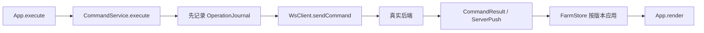

# 农场 H5：完整源码阅读指南

阅读基线是面试归档内完整 `classic-farm-h5/`。Web H5、微信相关目录、历史文档和测试均保留；早期展示稿不是本指南的基线。

## 一句话理解

H5 管页面交互、本地投影、命令身份和断线恢复；真实账号、种子资产、农场状态由后端裁决。它没有可单独启动的浏览器游戏服务器，测试 double 也不是产品环境。

## 从页面到登录

1. [index.html:12][index] → [src/main.ts][main] → [App.ts:240][app] 创建页面和事件；`start():596` 只显示初始提示，不会自动登录。
2. 登录按钮进入 `login():691` → `initializeRuntime():742`，建立认证、好友、WebSocket 和命令服务。
3. [web-auth-provider.ts:133、145、176][auth] 首次用账号密码注册/登录；后续借助 HttpOnly Cookie 续票。
4. [ws-client.ts:173、198][ws] 先取 ConnectionTicket，再开浏览器 WebSocket，打开后发送 ClientHello。传输薄层见 [transport.ts:31][transport]。
5. [final-protocol-adapter.ts:517、572][adapter] 转换语义帧与 Protobuf，并校验方向、版本和序号；当前 wire 版本常量在第 104 行，为 4。
6. [App.ts:832][app] 收到 ServerHello 后初始化玩家身份和时钟，同时开始 Bootstrap、未决操作对账与自家农场 Join。

## 进入农场不等于连上 WebSocket

[WsClient.joinFarm():271][ws] 进入 `beginJoin()`；之后依次核对 ACCEPTED、快照、追赶增量和 SubscriptionReady。核对入口在第 504、533、625 行。

只有满足版本、订阅和 Join attempt 的条件，才能把“已连接”推进到可经营的 `InFarm`。旧订阅或乱序消息不能直接应用到当前页面。

## 从点击种植到页面变化

| 入口 | 主要职责 |
|---|---|
| [App.execute():1835][app] | 从权威页面状态构造业务命令。 |
| [CommandService.execute():211][command] | 生成 operation ID，保存原始 payload 与 hash，先写 Journal 再发送。 |
| [OperationJournal:101、148][journal] | 保存有容量边界的未决操作，并通过 IndexedDB 持久化。 |
| [WsClient.sendCommand():311][ws] | 检查阶段，不能在恢复尚未完成时开放经营写操作。 |
| [decodeCommandResult():617][adapter]、[handleResult():314][command] | 区分处理中、成功、拒绝和恢复指令，按终态清理记录。 |
| [FarmStore:94、121、166、209][store] | 分别应用快照、变化、私有状态与玩家 Bootstrap。发现版本缺口时要求重新 Join。 |
| [App.ts:411、2044][app] | Store 通知页面订阅者，最终重新渲染。 |

客户端显示用的作物时间通过 [trusted-server-clock.ts:36][clock] 从服务端时间和单调时钟推导。好友、分享 HTTP 入口见 [game-friend-service.ts:122][friends]；不能把 URL 中的分享信息当作农场写权限。

## 断线恢复

[WsClient.onClose():717][ws] → `handleRecoverableFailure():758` → `nextReconnectDelay():782` → `armReconnect():802`，使用有上限的指数退避和随机抖动重新取票、握手。被踢下线或会话失效不会自动抢回登录。

恢复完成还要经过 [CommandService.recoverPending():284][command]、[App.startPendingRecovery():1321][app] 和 `tryCompleteRecovery():1563`，检查自家快照、Ready、私有 Bootstrap、未决操作首轮恢复是否完成。门禁见 [recovery-barrier.ts:42][barrier]。最后由 [WsClient.completeRecovery():345][ws] 发送 ClientRecoveryComplete，再开放写入，并恢复此前访问的好友农场。

因此讲“重连”时应区分：重建连接、恢复订阅、对账未决操作、恢复写权限，不能只解释一个自动重连定时器。

## 版本与验证注意事项

较新后端的 `api/proto/player/player.proto` 已新增 guard/PetState 相关定义；完整 H5 的生成绑定没有对应依赖。这说明 schema 基线不同，尚未证明完全兼容，也不能仅凭新增字段断定不兼容。

原 [gen-proto.mjs:8][gen] 默认读同级 `../farm-game`。当前完整资料按两个归档分别保存；直接重生成会改变绑定，先选定后端基线再讨论，不要覆盖原版。

本次在派生副本上发现若干 BUY 测试 fixture 缺少 `expectedOfferVersion`，与现行类型不一致；修正副本后 Web 构建和 213 项单测通过。完整原版保持未修改，不能套用该通过结论。真实后端与 Redis 支持的端到端测试本次未运行。

先读 [types.ts][types]，再读 `command-service.test.ts`、`final-protocol-adapter.test.ts`、`ws-client-recovery.test.ts`，通常比一开始读全部生成代码更容易理解协议与恢复边界。

[index]: ../archives/interview/classic-farm-h5/index.html
[main]: ../archives/interview/classic-farm-h5/src/main.ts
[app]: ../archives/interview/classic-farm-h5/src/app/App.ts
[auth]: ../archives/interview/classic-farm-h5/src/auth/web-auth-provider.ts
[ws]: ../archives/interview/classic-farm-h5/src/network/ws-client.ts
[transport]: ../archives/interview/classic-farm-h5/src/network/transport.ts
[adapter]: ../archives/interview/classic-farm-h5/src/protocol/final-protocol-adapter.ts
[command]: ../archives/interview/classic-farm-h5/src/domain/command-service.ts
[journal]: ../archives/interview/classic-farm-h5/src/persistence/operation-journal.ts
[store]: ../archives/interview/classic-farm-h5/src/state/farm-store.ts
[clock]: ../archives/interview/classic-farm-h5/src/app/trusted-server-clock.ts
[friends]: ../archives/interview/classic-farm-h5/src/friends/game-friend-service.ts
[barrier]: ../archives/interview/classic-farm-h5/src/app/recovery-barrier.ts
[gen]: ../archives/interview/classic-farm-h5/scripts/gen-proto.mjs
[types]: ../archives/interview/classic-farm-h5/src/protocol/types.ts
